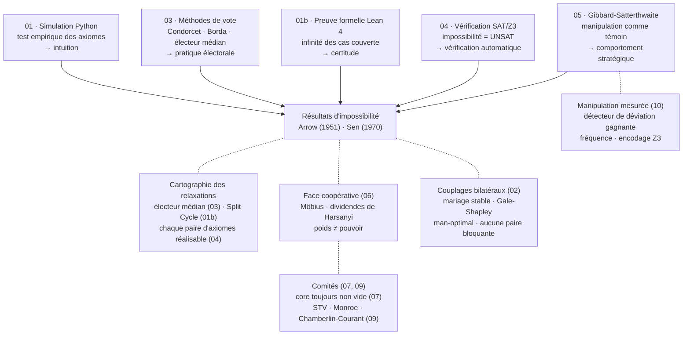
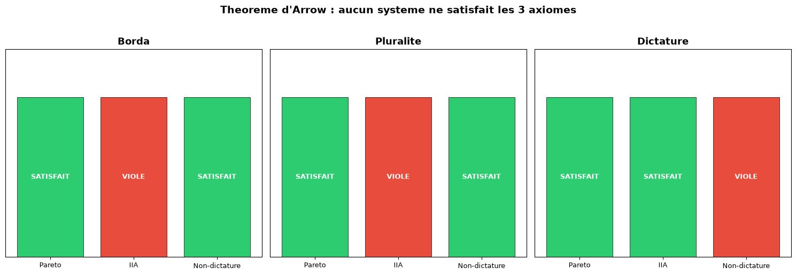
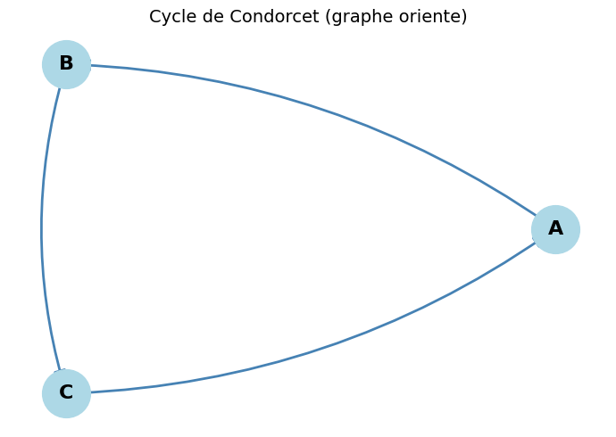
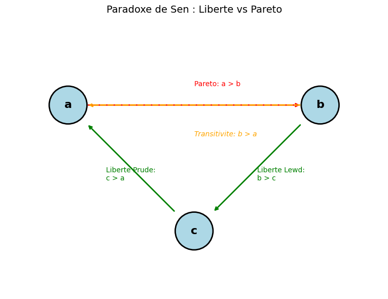
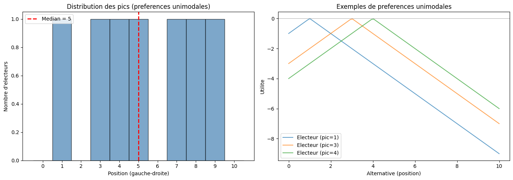
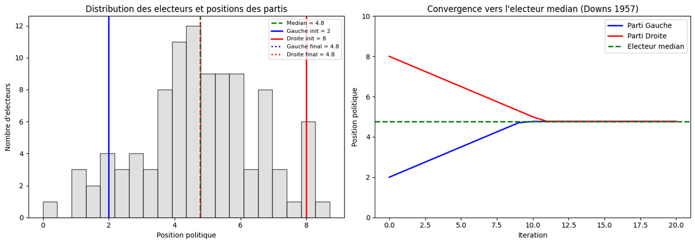
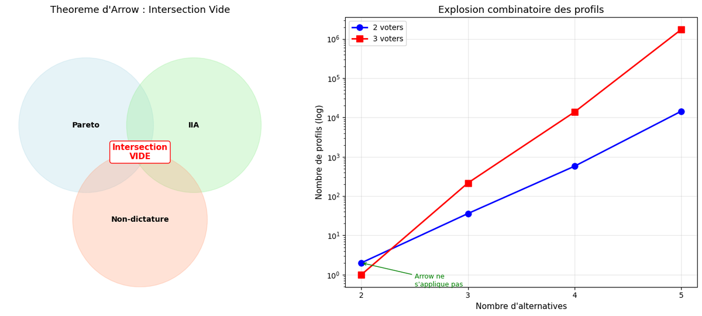

# Social Choice — Théorie du choix social

<!-- CATALOG-STATUS
series: GameTheory-SocialChoice
pedagogical_count: 25
breakdown: SocialChoice=25
maturity: BETA=23, ALPHA=2
-->

[↑ GameTheory](../README.md) · [Entrée : 01 — le théorème d'Arrow](ChoixSocial-01-Arrow-Impossibility-Theorem-Python.ipynb)

La théorie du choix social étudie comment agréger des préférences individuelles en une décision collective. Ses résultats les plus célèbres sont des **théorèmes d'impossibilité** : le théorème d'Arrow (1951) montre qu'aucune règle de vote ne peut satisfaire simultanément des axiomes « raisonnables » (Pareto, IIA, non-dictature) dès que trois alternatives ou plus sont en jeu ; le théorème de Sen (1970) démontre un conflit fondamental entre liberté individuelle et efficacité collective.

Cette sous-série du parcours [GameTheory](../README.md) confronte chacun de ces résultats à une **exécution** : la simulation Python des axiomes, la formalisation en Lean 4, les méthodes de vote concrètes et leurs paradoxes, l'encodage SAT/Z3 pour la vérification mécanique, la manipulation stratégique comme témoin. Puis elle change d'objet : la face coopérative de l'agrégation (décomposition de Möbius, dividendes de Harsanyi — poids contre pouvoir), les élections de comité (core et certificats de paiement, règles multi-vainqueurs), l'appariement bilatéral (mariage stable de Gale-Shapley) et, pour refermer la boucle, la mesure de la manipulation elle-même.

Elle s'adresse aux étudiants en économie, informatique, sciences politiques et mathématiques appliquées. Aucun prérequis en théorie du choix social : les concepts sont introduits progressivement. Python suffit pour l'essentiel du parcours ; le carnet 01b demande Lean 4, et les carnets 04, 09 et 10 s'appuient sur les solveurs PySAT et Z3.

> **Hommage — Richard E. Stearns (1936-2026).** Le tout premier article publié par Richard E.
> Stearns — alors étudiant à Carleton College — portait sur le **paradoxe d'Arrow** (*The American
> Mathematical Monthly*, 1959). Stearns est devenu co-fondateur de la théorie de la complexité
> computationnelle (prix Turing 1993, avec Juris Hartmanis, pour leur papier fondateur de 1965) ;
> il s'est éteint le 29 août 2026 à Ann Arbor (Michigan), à 90 ans. La série SocialChoice garde de
> ce lien une continuité rare : l'impossibilité d'agrégation parfaite (Arrow) et la complexité
> computationnelle comme mesure de la difficulté sont les deux faces d'une même question. Détails
> et résonances dans l'hommage [#15949](https://github.com/jsboige/CoursIA/issues/15949) ; un
> encart hommage figure également dans le
> [carnet 01](ChoixSocial-01-Arrow-Impossibility-Theorem-Python.ipynb).

## Comment lire ce README — découverte

Le principe [« Choisir sa vitesse de lecture »](https://github.com/jsboige/CoursIA#choisir-sa-vitesse-de-lecture) distingue parcours principal, approfondissements et prolongements de recherche.

- **Vous découvrez** : suivez le parcours principal ci-dessous. L'ordre des numéros porte l'arc narratif, et chaque carnet se suffit à lui-même.
- **Vous creusez un palier** : les carnets lettrés approfondissent leur palier — voir « Autour de 01 » et « Autour de 06 ».
- **Vous cherchez la recherche en cours** : « Pour aller plus loin » rassemble l'interprétation des expériences, les formalisations Lean et les liens vers les séries voisines.

## Parcours principal — lecture guidée et prérequis

Le fil commun consiste à ne jamais se contenter de l'énoncé d'un théorème : chaque résultat est testé, prouvé, encodé ou mesuré dans un carnet exécutable. Les carnets 01, 03, 04, 05 et 01b attaquent les théorèmes d'impossibilité par des méthodes distinctes — l'intuition par la simulation, la pratique électorale, la certitude formelle, la vérification automatique, le comportement stratégique — qui convergent vers une cartographie des relaxations possibles. Les suivants changent d'objet : agréger des valeurs de coalition plutôt que des classements (06), élire un comité plutôt qu'un gagnant unique (07, 09), apparier deux populations plutôt qu'ordonner des candidats (02), et mesurer ce que la manipulation stratégique coûte réellement sous chaque règle (10). Le carnet 08 complète la famille des règles de vote par celles dont déterminer le gagnant est computationnellement dur.

| # | Notebook | Ce qu'on y apprend | Durée | Public et prérequis | Pour approfondir |
|---|----------|--------------------|-------|---------------------|------------------|
| 01 | [Théorème d'Arrow : preuve et simulation](ChoixSocial-01-Arrow-Impossibility-Theorem-Python.ipynb) · [jumeau C#](ChoixSocial-01-Arrow-Impossibility-Theorem-CSharp.ipynb) | Tester empiriquement les trois axiomes (Pareto, IIA, non-dictature) sur des règles réelles — Borda, pluralité, dictature — puis suivre la preuve de Geanakoplos (lemme extrémal, pivot, dictateur partiel) pas à pas en Python. | 45 min | Python (numpy, matplotlib) ; aucun prérequis de théorie du vote. | [Autour de 01](#autour-de-01--la-preuve-formelle-en-lean) : carnet 01b (Lean 4, 80 min) |
| 02 | [Mariage stable : algorithme de Gale-Shapley](ChoixSocial-02-Stable-Marriage-Gale-Shapley-Python.ipynb) · [jumeau C#](ChoixSocial-02-Stable-Marriage-Gale-Shapley-CSharp.ipynb) · [jumeau Rust](ChoixSocial-02-Stable-Marriage-Gale-Shapley-Rust.ipynb) | Apparier deux populations qui se choisissent mutuellement par acceptation différée ; vérifier par énumération exhaustive — sur l'exemple de Knuth, 24 couplages possibles dont 2 stables — que le couplage obtenu est stable et man-optimal. | 35 min | Python (bibliothèque standard). | Formalisation Lean citée sous [Formalisations Lean](#formalisations-lean) |
| 03 | [Méthodes de vote et paradoxes](ChoixSocial-03-Voting-Methods-Python.ipynb) · [jumeau C#](ChoixSocial-03-Voting-Methods-CSharp.ipynb) | Implémenter pluralité, Borda, Copeland ; dérouler les paradoxes de Condorcet et de Sen, puis la restauration du vainqueur par l'unimodalité (électeur médian) et la convergence des partis chez Downs. | 35 min | Python (numpy, matplotlib, networkx). | Jumeau C# |
| 04 | [Agrégation computationnelle : SAT et Z3](ChoixSocial-04-Computational-Aggregation-SAT-Z3-Python.ipynb) · [jumeau C#](ChoixSocial-04-Computational-Aggregation-SAT-Z3-CSharp.ipynb) | Encoder Arrow et Sen en clauses CNF (PySAT) et en rangs entiers (Z3) : l'impossibilité devient un résultat UNSAT des solveurs, et chaque paire d'axiomes relâchée redevient réalisable. | 45 min | Python ; pysat et z3-solver (voir [Installation](#installation--pratique-tous-niveaux)). | Jumeau C# |
| 05 | [Gibbard-Satterthwaite : la manipulation comme témoin](ChoixSocial-05-Gibbard-Satterthwaite-Python.ipynb) · [jumeau C#](ChoixSocial-05-Gibbard-Satterthwaite-CSharp.ipynb) · [jumeau Rust](ChoixSocial-05-Gibbard-Satterthwaite-Rust.ipynb) | Retourner la question : quelle règle un électeur stratégique peut-il instrumenter ? Le carnet exhibe le témoin d'exploitation par le code — recherche explicite sur les bulletins — au lieu de le postuler. | 30 min | Python (bibliothèque standard). | Prolongé en mesure par [10](ChoixSocial-10-Manipulation-Strategique-MultiWinner-Python.ipynb) |
| 06 | [Möbius sur le treillis des coalitions : poids contre pouvoir](ChoixSocial-06-Mobius-Aggregation-Pouvoir-Manipulation-Python.ipynb) · [jumeau C#](ChoixSocial-06-Mobius-Aggregation-Pouvoir-Manipulation-CSharp.ipynb) · [jumeau Rust](ChoixSocial-06-Mobius-Aggregation-Pouvoir-Manipulation-Rust.ipynb) | Décomposer la valeur d'une coalition en dividendes de Harsanyi (inversion de Möbius, reconstruction exacte) ; lire le pouvoir (Shapley, Banzhaf, dummy du Luxembourg au Conseil européen de 1958) et réattester la loi de manipulation sur un Borda pondéré. | 40 min | Python (bibliothèque standard). | [Autour de 06](#autour-de-06--möbius-côté-lean) : carnet 06b (40 min) |
| 07 | [Élections de comité par approbation : le core](ChoixSocial-07-Committees-Core-Python.ipynb) | Élire un comité sur bulletins d'approbation : le core existe toujours (Becker, Greger & Peters) — quotas Hare/Droop, coalition bloquante exhibée, certificat de paiement, comparaison des règles AV, PAV et entropie harmonique sur instances. | 40 min | Python (scipy en sus). | Règles sur profils ordonnés : [09](ChoixSocial-09-Committees-STV-Monroe-ChamberlinCourant-Python.ipynb) |
| 08 | [Kemeny, Ranked Pairs et Dodgson](ChoixSocial-08-Kemeny-RankedPairs-Dodgson-Python.ipynb) · [jumeau C#](ChoixSocial-08-Kemeny-RankedPairs-Dodgson-CSharp.ipynb) | Trois règles computationnellement dures : score de Kemeny par énumération des classements (sur le cycle de Condorcet, score maximum 5 et trois classements optimaux), graphe de Tideman, score de Dodgson par échanges adjacents — et pourquoi déterminer le gagnant est NP-dur. | 40 min | Python (numpy). | Formulation par optimisation (section 4 du carnet) |
| 09 | [Comités multi-vainqueurs : STV, Monroe, Chamberlin-Courant](ChoixSocial-09-Committees-STV-Monroe-ChamberlinCourant-Python.ipynb) · [jumeau C#](ChoixSocial-09-Committees-STV-Monroe-ChamberlinCourant-CSharp.ipynb) | Comparer une règle polynomiale (STV, quota de Droop) à deux règles NP-dures (Monroe, Chamberlin-Courant), résolues d'abord par énumération puis par optimisation entière sous Z3. | 40 min | Python ; z3-solver. | Confrontation au [core](ChoixSocial-07-Committees-Core-Python.ipynb) |
| 10 | [Manipulation stratégique sous règles à comité](ChoixSocial-10-Manipulation-Strategique-MultiWinner-Python.ipynb) · [jumeau C#](ChoixSocial-10-Manipulation-Strategique-MultiWinner-CSharp.ipynb) | Mesurer la manipulation : détecteur de déviation gagnante, branches du théorème de Gibbard-Satterthwaite vérifiées sur l'espace exhaustif des profils, fréquence par énumération, encodage Z3 confronté à l'énumération brute. | 35 min | Python ; z3-solver. | Exercices proposés dans le carnet |

**Durée totale du parcours principal** : ~6h25 (385 min pour les dix carnets ; ajouter 80 min pour le carnet 01b en Lean 4 et 40 min pour le 06b).

### Ce que chaque carnet démontre, et sur quelle sortie s'appuyer

Chaque carnet aboutit à une sortie qui matérialise son résultat — c'est elle qu'il faut regarder pour vérifier qu'on a compris.

- **01 — l'impossibilité rendue tangible.** Le test empirique des trois axiomes montre que Borda et la pluralité respectent Pareto et la non-dictature mais violent l'IIA, tandis que la dictature satisfait Pareto et l'IIA mais viole la non-dictature : chaque axiome pris isolément est réalisable, aucune règle ne les satisfait toutes. La conclusion du carnet montre pourquoi la preuve formelle (01b) couvre une infinité de cas que la simulation ne peut qu'échantillonner.
- **02 — stabilité et optimalité vérifiées, pas postulées.** L'algorithme d'acceptation différée (hommes-proposent) produit un couplage parfait stable et man-optimal ; sur l'exemple de Knuth (`n=4`), l'énumération exhaustive des 24 couplages en exhibe exactement 2 stables, et chaque homme obtient sa meilleure partenaire parmi tous les couplages stables. La simulation donne la dynamique pas-à-pas ; le jumeau Lean ([`game_theory_lean/StableMarriage/`](../game_theory_lean/StableMarriage/), 0 `sorry`) garantit la propriété pour tout `n`.
- **03 — les paradoxes et leurs relaxations.** Le tournoi majoritaire forme un cycle de Condorcet (aucun vainqueur), le paradoxe de Sen fait se contredire liberté minimale et Pareto sur l'exemple de Lady Chatterley ; puis l'unimodalité restaure un vainqueur (électeur médian) et le modèle de Downs montre deux partis converger vers la position médiane en une vingtaine de rounds — la compétition électorale aspire les deux partis vers le centre.
- **04 — l'impossibilité comme UNSAT.** L'encodage d'Arrow et de Sen en clauses CNF (PySAT) et en rangs entiers (Z3) rend l'impossibilité comme un résultat UNSAT des solveurs ; la relaxation de chaque paire d'axiomes redevient SAT, ce qui matérialise la cartographie des compromis. L'explosion combinatoire se lit sur le nombre de profils `(m!)^k` : 36 profils pour 2 électeurs et 3 alternatives, 216 pour 3 électeurs — et le théorème est muet à `m=2`.
- **05 — la manipulation exhibée par le code.** Le carnet retourne la question d'Arrow : au lieu de demander quelle règle agrège honnêtement, il demande laquelle un électeur stratégique peut instrumenter. Sur 3 votants et 3 candidats, la recherche explicite sur les bulletins exhibe le témoin d'exploitation (un bulletin insincère qui produit un résultat strictement préféré) au lieu de le postuler — la version générale est le théorème de Gibbard-Satterthwaite (1973/1975), dont la formalisation Lean figure dans le tour SocialChoiceLean du carnet 01b.
- **06 — poids contre pouvoir, par la décomposition.** L'inversion de Möbius $v(S)=\sum_{T\subseteq S} m(T)$ décompose toute valeur de coalition en dividendes de Harsanyi, vérifiée par reconstruction exacte ; la valeur de Shapley est calculée deux fois par des voies indépendantes, et le Luxembourg du Conseil européen de 1958 apparaît comme un dummy à poids non nul — un poids de vote ne prédit pas la capacité à faire basculer une décision. La loi est attestée sur deux substrats : exécutée en Python et prouvée dans le lac Lean ([`Shapley.lean`](../game_theory_lean/CooperativeGames/Shapley.lean), 0 sorry).
- **07 — le core d'un comité existe toujours.** Sur le fil rouge `n=4` votants, `k=2` sièges, le comité favori des majoritaires n'est PAS dans le core (coalition bloquante exhibée au quota Hare, confronté au quota Droop), le comité proportionnel l'est, et un certificat de paiement (paiements + réserve) l'atteste — le théorème d'existence de Becker, Greger & Peters. La comparaison d'AV, PAV et de la règle de l'entropie harmonique sur 25 instances distingue ce qu'une règle simple garantit de ce qu'exige la stabilité.
- **08 — la dureté computationnelle des règles de vote.** Sur le cycle de Condorcet, le score de Kemeny atteint son maximum 5 avec trois classements optimaux, obtenus par énumération ; le graphe de Tideman (Ranked Pairs) et le score de Dodgson (échanges adjacents) complètent trois règles dont déterminer le gagnant est NP-dur — la complexité rejoint la carte des critères de choix.
- **09 — polynômial contre NP-dur, à comité.** La règle STV (quota de Droop) est polynomiale ; Monroe et Chamberlin-Courant sont NP-dures, résolues d'abord par énumération puis par optimisation entière sous Z3 — la confrontation au core du carnet 07 mesure ce que chaque règle garantit de proportionnalité.
- **10 — la manipulation mesurée, pas devinée.** Sur l'Exemple 6.1 du *Handbook of Computational Social Choice* (ch. 6, p. 127), le détecteur automatise la recherche de toute déviation gagnante et en restitue **quatre** quand le manuel n'en cite qu'une ; la vérification exhaustive (3 votants, 3 candidats) force la troisième branche de Gibbard-Satterthwaite. Le résultat central : une fréquence mesurée n'est pas une propriété de la règle — Chamberlin-Courant ne présente aucun profil manipulable à trois candidats mais une part notable dès quatre — et le classement des règles s'inverse : celles qui maximisent une satisfaction agrégée (Chamberlin-Courant, Monroe) sont les plus manipulables, parce qu'un optimum est instable.


**Jumeaux C# — parité .NET.** Les carnets [01](ChoixSocial-01-Arrow-Impossibility-Theorem-CSharp.ipynb), [02](ChoixSocial-02-Stable-Marriage-Gale-Shapley-CSharp.ipynb), [03](ChoixSocial-03-Voting-Methods-CSharp.ipynb), [04](ChoixSocial-04-Computational-Aggregation-SAT-Z3-CSharp.ipynb), [05](ChoixSocial-05-Gibbard-Satterthwaite-CSharp.ipynb), [06](ChoixSocial-06-Mobius-Aggregation-Pouvoir-Manipulation-CSharp.ipynb), [08](ChoixSocial-08-Kemeny-RankedPairs-Dodgson-CSharp.ipynb), [09](ChoixSocial-09-Committees-STV-Monroe-ChamberlinCourant-CSharp.ipynb) et [10](ChoixSocial-10-Manipulation-Strategique-MultiWinner-CSharp.ipynb) existent aussi en miroirs C# (.NET Interactive) : mêmes algorithmes implémentés from-scratch — les sept premiers sans dépendance NuGet externe, le 09 et le 10 via le paquet `Microsoft.Z3` — marathon parité .NET ⇄ Python (#4956), étendu au mariage stable en 02 (#19681), au témoin de manipulation en 05 (#27104), à la décomposition de Möbius en 06, aux règles NP-dures en 08 (#27106), aux comités multi-vainqueurs en 09 (#27107), puis à la manipulation multi-vainqueurs en 10 (#27108). Ils partagent la ligne de leur carnet d'origine dans la table ci-dessus ; ils sont comptés dans le `pedagogical_count` de la sous-série et arborent le statut PARITÉ dans le catalogue pour les distinguer des notebooks d'origine dont ils sont les retranscriptions .NET.

La structure de la série se lit d'un coup d'œil :



### Figures du parcours

Les sorties clés des carnets, adjacentes au moment du parcours qu'elles illustrent :



*01 — trois panneaux (Borda, Pluralité, Dictature), chacun portant trois barres — Pareto, IIA, Non-dictature — en vert « SATISFAIT » ou rouge « VIOLÉ ». Borda et Pluralité respectent Pareto et la non-dictature mais violent l'IIA ; la Dictature satisfait Pareto et l'IIA mais viole la non-dictature. Aucun panneau n'est entièrement vert : la simulation matérialise l'impossibilité qu'Arrow démontre pour toute règle.*



*03 — le tournoi majoritaire forme un cycle entre les alternatives : aucun sommet ne domine les autres, aucun vainqueur de Condorcet.*



*03 — les relations imposées par la liberté minimale et par Pareto forment un cycle : les deux exigences sont incompatibles.*



*03 — sous préférences unimodales, la position médiane bat toute autre en duel majoritaire : le vainqueur réapparaît.*



*03 — la concurrence électorale aspire les deux partis vers la position médiane.*



*04 — l'intersection des contraintes Pareto / IIA / non-dictature est vide ; le nombre de profils à vérifier explose avec les alternatives et les électeurs.*

Provenance, dimensions et poids de chaque figure : [`assets/readme/MANIFEST.md`](assets/readme/MANIFEST.md).

## Approfondissements — Licence et lectures avancées

### Autour de 01 — la preuve formelle et le paradoxe de non-participation

**[01b — Choix social formel en Lean 4](ChoixSocial-01b-Lean-SocialChoice-Formal-Lean.ipynb).** Ce que le carnet 01 échantillonne par simulation, 01b le couvre en entier : préférences, axiomes d'Arrow et de Sen, théorème de l'électeur médian formalisés et prouvés en Lean 4, avec un tour de la librairie SocialChoiceLean de DominikPeters (douze règles de vote, Gibbard-Satterthwaite, Split Cycle, Duggan-Schwartz). Les définitions sont compatibles avec le lake `game_theory_lean/SocialChoice/` — voir [Formalisations Lean](#formalisations-lean). Prérequis en plus : Lean 4 et le kernel WSL (instructions dans le [README parent](../README.md)).

**[01c — Le paradoxe de la non-participation (no-show)](ChoixSocial-01c-Paradoxe-NonParticipation-NoShow-Python.ipynb)** · [jumeau Rust](ChoixSocial-01c-Paradoxe-NonParticipation-NoShow-Rust.ipynb). À côté d'Arrow, le **critère de participation** : un électeur est-il mieux servi en s'abstenant qu'en votant sincèrement ? 01c le rend *visible* par l'expérience — Borda en est structurellement immunisé (recherche exhaustive, ~2,8 M de profils, zéro no-show) tandis que le vote instantané (IRV) l'exhibite sur un profil à 5 votants, et le théorème de Moulin (1988) montre que la contradiction est générale dès que la règle élit toujours le vainqueur de Condorcet.

### Autour de 06 — Möbius côté Lean

**[06b — Décomposition de Möbius sur le treillis des coalitions](ChoixSocial-06b-Mobius-Coalitions-Lean-Python.ipynb).** La même loi d'inversion, lue conjointement en Python et en Lean : jeu coopératif sous forme caractéristique, dividendes d'interaction, reconstruction exacte sur le treillis. Prérequis en plus : les bases de Lean 4.

## Repères — concepts clés (découverte et licence)

| Concept | Description |
|---------|-------------|
| **Théorème d'Arrow** | Aucune règle d'agrégation avec trois alternatives ou plus ne peut satisfaire simultanément Pareto, IIA et non-dictature (01, 01b, 04) |
| **Théorème de Sen** | Liberté minimale, Pareto et transitivité sont incompatibles (01b, 03) |
| **Paradoxe de Condorcet** | Les préférences majoritaires peuvent être cycliques — A bat B bat C bat A (03) |
| **Paradoxe de la non-participation** | Un électeur peut être mieux servi en s'abstenant qu'en votant sincèrement — IRV l'exhibite, Borda en est immunisé, et c'est inévitable dès que la règle élit toujours le vainqueur de Condorcet (Moulin 1988) (01c) |
| **Électeur médian** | Avec des préférences unimodales, le vainqueur de Condorcet existe (03) |
| **IIA** | Le classement social entre deux alternatives ne dépend que des préférences individuelles sur cette paire (01) |
| **Gibbard-Satterthwaite** | Toute règle non-dictatoriale est manipulable dès trois candidats (05, 10) |
| **Dividende de Harsanyi** | La valeur pure d'une coalition au-delà de ses sous-coalitions ; tout jeu se décompose en dividendes (06, 06b) |
| **Poids ≠ pouvoir** | Un poids de vote ne prédit pas la capacité à faire basculer une décision — Shapley, Banzhaf, dummy à poids non nul (06) |
| **Split Cycle** | Règle de vote la plus fine satisfaisant Condorcet sans exiger l'acyclicité totale (01b) |
| **Core d'une élection de comité** | Comité qu'aucune coalition (au quota Hare ou Droop) ne peut bloquer par un ensemble unanimement approuvé — toujours non vide (07) |
| **Certificat de paiement** | Preuve constructive d'appartenance au core : paiements aux votants et réserve, budget égal au coût du comité (07) |
| **Règles NP-dures** | Déterminer le gagnant de Kemeny, Dodgson, Monroe ou Chamberlin-Courant est NP-dur — d'où les solveurs des carnets 08 et 09 |

## Installation — pratique, tous niveaux

Depuis le dossier GameTheory, installer les dépendances Python déclarées dans [requirements.txt](../requirements.txt), puis les solveurs utilisés par les carnets 04, 09 et 10 :

```bash
pip install -r ../requirements.txt
pip install pysat z3-solver
```

- numpy, matplotlib et networkx servent aux carnets 01, 03 et 08 ; scipy au carnet 07 ; les carnets 02, 05 et 06 se contentent de la bibliothèque standard.
- Pour le carnet 01b (Lean 4) : suivre les instructions du [README parent](../README.md#notebooks-lean-4-2b-4b-8b-15b) et utiliser le kernel Lean 4 sous WSL.

## Pour aller plus loin — recherche

### Interpréter les expériences

- **Un théorème d'impossibilité est une cartographie, pas une impasse.** Chaque paire d'axiomes d'Arrow est réalisable (04) ; l'unimodalité restaure un vainqueur (03) ; Split Cycle satisfait Condorcet sans acyclicité totale (01b). On ne contourne pas Arrow : on choisit quel axiome relâcher selon le contexte.
- **Poids ≠ pouvoir.** La valeur de Shapley et l'indice de Banzhaf mesurent le pouvoir de faire basculer une décision, pas le poids nominal : le Luxembourg du Conseil européen de 1958 est un dummy à poids non nul (06).
- **Une fréquence mesurée n'est pas une garantie.** Sur l'espace exhaustif balayé par le carnet 10, Chamberlin-Courant ne présente aucun profil manipulable à trois candidats et une part notable dès quatre : un « jamais » mesuré reste un fait borné par l'espace parcouru, pas une propriété de la règle.
- **Les optimaux agrégés sont les plus manipulables.** Les règles qui maximisent une satisfaction agrégée (Chamberlin-Courant, Monroe) se manipulent davantage que celles qui appliquent un seuil ou une procédure (pluralité, STV) : un optimum est instable (10).
- **Plusieurs méthodes, une même vérité.** La simulation (01), la preuve formelle (01b), la vérification par solveur (04) et la pratique électorale (03) éclairent chacune ce que les autres laissent dans l'ombre : l'intuition, la certitude, la mécanisation, la réalité des règles.

### Formalisations Lean

Le lake [`game_theory_lean/SocialChoice/`](../game_theory_lean/) (dans la série parente) contient les preuves complètes consommées par les carnets 01, 01b et 02 : théorème d'Arrow, théorème de Sen, modèles de vote (Banks, STV, électeur médian), mariage stable — sans `sorry`. L'inventaire complet des théorèmes et fichiers vit dans [LEAN_INVENTORY.md](../LEAN_INVENTORY.md).

Le lake [`social_choice_lean_peters/`](social_choice_lean_peters/README.md), porté par cette série, reprend la librairie SocialChoiceLean de DominikPeters (douze règles de vote, Gibbard-Satterthwaite, Condorcet Participation et Reinforcement, Duggan-Schwartz) et y ajoute les modules Approval* qui formalisent le core et les certificats de paiement du carnet 07 — voir son [README](social_choice_lean_peters/README.md).

### Liens avec les autres parcours

- [Coalitions — pouvoir, assistance et affectation](../Coalitions/README.md) : les indices de pouvoir en miroir du carnet 06, puis l'assistance et l'affectation de ressources.
- [GameTheory-15 — Jeux coopératifs](../GameTheory-15-CooperativeGames-Python.ipynb) : fonctions caractéristiques, valeur de Shapley et cœur d'un jeu — dont le carnet 06 pose la décomposition en dividendes ; approfondissement formel en [GameTheory-15b](../GameTheory-15b-Lean-CooperativeGames-Lean.ipynb).
- [GameTheory-16 — Conception de mécanismes](../GameTheory-16-MechanismDesign-Python.ipynb) : le prolongement naturel — retourner la question d'Arrow en « comment concevoir les règles du jeu pour que les agents révèlent honnêtement leurs préférences ? » (VCG, Myerson-Satterthwaite).
- [SymbolicAI/Lean](../../SymbolicAI/Lean/README.md) : prérequis et méthodologie des preuves formelles.

## Ressources — tous niveaux

| Référence | Couverture |
|-----------|------------|
| Arrow, *Social Choice and Individual Values* (1951) | Théorème d'impossibilité (01) |
| Sen, *Collective Choice and Social Welfare* (1970) | Paradoxe libéral (01b, 03) |
| Geanakoplos, "Three Brief Proofs of Arrow's Impossibility Theorem" (2005) | Preuve suivie dans les carnets 01 et 01b |
| Moulin, "Condorcet's Principle Implies the No Show Paradox" (1988) | Paradoxe de la non-participation (01c) |
| Holliday & Pacuit, "Split Cycle" (2023) | Règle de vote optimale (01b) |
| Peters, [SocialChoiceLean](https://github.com/DominikPeters/SocialChoiceLean) | Formalisation Lean 4 de douze règles et plusieurs théorèmes (01b) |
| Gibbard (1973) / Satterthwaite (1975) | Théorème de manipulabilité (05, 10) |
| Harsanyi (1959) ; Curiel, *Cooperative Game Theory and Applications* (1997) | Dividendes de coalition, jeux de vote pondérés (06, 06b) |
| Becker, Greger & Peters, "Existence of the Core in Approval-Based Committee Elections" (arXiv 2609.11912) | Core non vide, quotas Hare/Droop, certificats (07) |
| Brandt, Conitzer, Endriss, Lang & Procaccia (dir.), *Handbook of Computational Social Choice* (2016) | Ouvrage d'ancrage de la sous-série — ch. 1-2 (impossibilités, théorie du vote), ch. 4 (Kemeny, ranked pairs), ch. 5 (Dodgson, complexité), ch. 9 par Lang & Xia (comités multi-vainqueurs, ancrage du carnet 09) |
| Kemeny, "Mathematics without Numbers" (1959) | Règle du rang médian, score de Kemeny (08) |
| Young & Levenglick, "A Consistent Extension of Condorcet's Election Principle" (1978) | Caractérisation axiomatique de Kemeny (08) |
| Tideman, "Independence of Clones as a Criterion for Voting Rules" (1987) | Ranked Pairs (08) |
| Caragiannis, Hemaspaandra & Hemaspaandra, "Dodgson's Rule and Young's Rule" (2016) | NP-dureté de la détermination du gagnant Dodgson (08) |

> L'ouvrage d'ancrage est archivé dans le gisement bibliographique du cluster : `G:\Mon Drive\MyIA\IA\Bibliographie IA\GameTheory\Social Choice, Voting and Welfare\2016 - Brandt Conitzer Endriss Lang - Handbook of Computational Social Choice.pdf` — le chemin est cité, le fichier n'est jamais copié dans le dépôt public.

## Conclusion / Prochaines étapes

### Ce que vous avez appris

Cette sous-série vous a fait saisir pourquoi le **choix social** est l'un des résultats intellectuels les plus troublants de la théorie de la décision : il existe des limites *mathématiquement prouvées* à ce qu'une collectivité peut décider de manière cohérente. L'arc pédagogique repose sur **dix angles complémentaires** — cinq braqués sur les mêmes résultats d'impossibilité, les cinq autres changeant d'objet : la face coopérative, les élections de comité, l'appariement bilatéral, les règles computationnellement dures et la mesure de la manipulation :

- **Le résultat fondateur** — le théorème d'Arrow (1951) : aucune règle d'agrégation ne peut, simultanément et dès que 3 alternatives sont en jeu, satisfaire Pareto, l'indépendance vis-à-vis des alternatives non pertinentes (IIA) et la non-dictature. Le théorème de Sen (1970) étend le constat : liberté minimale et efficacité parétienne sont incompatibles. Ces théorèmes ne disent pas « la démocratie est impossible » ; ils délimitent précisément *quels compromis* toute règle de vote doit accepter.
- **La convergence, délibérément juxtaposée** — un même énoncé est attaqué par cinq méthodes, chacune révélant une facette différente. La **simulation Python** (carnet 01) teste les axiomes sur des règles concrètes et suit la preuve de Geanakoplos (lemme extrémal, pivot, dictateur partiel) ; la **preuve formelle Lean 4** (01b) couvre l'infinité des cas que la simulation ne peut qu'échantillonner, avec 0 sorry sur Arrow et Sen ; les **méthodes de vote** (03) incarnent les paradoxes dans des règles réelles (Condorcet, Borda, Copeland, électeur médian de Downs) ; la **vérification mécanique SAT/Z3** (04) fait émerger l'impossibilité comme un résultat UNSAT des solveurs ; la **manipulation stratégique** (05) exhibe le témoin d'exploitation que Gibbard-Satterthwaite promet. Le sixième angle change d'objet : la **décomposition de Möbius** (06) agrège des valeurs de coalition — dividendes de Harsanyi, poids contre pouvoir — et réatteste la loi manipulation sur un électorat pondéré. Le septième change d'échelle : les **élections de comité** (07 et 09) élisent k sièges — sur bulletins d'approbation (07), où aucune règle unique n'est stable mais où le **core** existe toujours, quoté Hare/Droop et certifié par paiements ; sur profils ordonnés (09), où la règle polynomiale STV est confrontée aux règles NP-dures Monroe et Chamberlin-Courant. Le huitième quitte l'agrégation : les **couplages bilatéraux** (02) apparient deux populations par acceptation différée (Gale-Shapley), où la **stabilité** remplace la cohérence et l'optimalité homme borne *tous* les couplages stables. Le neuvième complète la famille des règles de vote par celles dont déterminer le gagnant est **computationnellement dur** (08) — score de Kemeny, ranked pairs de Tideman, score de Dodgson — la complexité rejoignant la carte des critères. Le dixième referme la boucle en **mesurant** la manipulation elle-même (10) : détecteur de déviation gagnante, fréquences par énumération exhaustive des profils, confrontation à l'encodage Z3. Comprendre les dix, c'est comprendre qu'une *même vérité* se laisse approcher par l'expérience, la déduction formelle, la pratique électorale, la recherche combinatoire, le comportement stratégique, la coopération décomposée, la représentation proportionnelle, l'appariement stable, la complexité calculatoire et la mesure empirique.
- **L'instrument** — les outils qui opérationnalisent chaque angle : numpy/matplotlib pour la simulation, Lean 4 + la librairie SocialChoiceLean de Peters (12 règles de vote, Gibbard-Satterthwaite, Split Cycle, Duggan-Schwartz) pour la preuve, PySAT (clauses CNF) et Z3 (rangs entiers SMT) pour la vérification mécanique. Chaque outil éclaire un aspect que les autres laissent dans l'ombre : la simulation donne l'intuition, Lean donne la certitude, SAT/Z3 donnent la vérification automatique.
- **La finesse** — qu'un théorème d'impossibilité n'est pas une impasse mais une **cartographie des relaxations possibles**. Le carnet 04 montre que chaque *paire* d'axiomes d'Arrow est réalisable ; Split Cycle (Holliday & Pacuit) satisfait Condorcet sans tomber dans l'acyclicité totale ; le théorème de l'électeur médian (Downs) restaure l'existence d'un vainqueur sous l'hypothèse d'unimodalité. La leçon pratique : on ne contourne pas Arrow, on *choisit* quel axiome relâcher selon le contexte.

La thèse est puissante et honnêtement présentée : il n'existe pas de règle de vote idéale, mais un *paysage* de règles aux compromis clairement cartographiés — et la rigueur exige de les confronter simultanément à l'expérience, à la preuve formelle et à la vérification mécanique avant de prétendre les comprendre.

### Prochaines étapes

- **Design de mécanismes** : le notebook [GameTheory-16-MechanismDesign-Python](../GameTheory-16-MechanismDesign-Python.ipynb) est le prolongement naturel — il retourne la question d'Arrow (« quelle règle agréger ? ») en « comment *concevoir* les règles du jeu pour que les agents révèlent honnêtement leurs préférences ? » (enchères VCG, appariement Gale-Shapley, Myerson-Satterthwaite).
- **Jeux coopératifs et valeur de Shapley** : [GameTheory-15-CooperativeGames-Python](../GameTheory-15-CooperativeGames-Python.ipynb) introduit une autre forme d'agrégation — non plus des préférences mais des *contributions* — où la valeur de Shapley offre l'unique répartition équitable vérifiant des axiomes analogues à ceux d'Arrow ; le carnet 06 en a déjà posé la décomposition en dividendes de Harsanyi, et le 07 la version comité (core, quotas Hare/Droop).
- **Approfondir la formalisation Lean 4** : [SymbolicAI/Lean](../../SymbolicAI/Lean/README.md) pour les prérequis et la méthodologie des preuves formelles, et l'inventaire [LEAN_INVENTORY.md](../LEAN_INVENTORY.md) pour la cartographie complète des théorèmes de choix social prouvés dans le projet Lake `game_theory_lean/SocialChoice/`.
- Pour la pratique : reprenez [ChoixSocial-04-Computational-Aggregation-SAT-Z3-Python](ChoixSocial-04-Computational-Aggregation-SAT-Z3-Python.ipynb) et relaxez un *autre* couple d'axiomes que ceux étudiés — encodez-le en SAT et observez si le solveur retourne SAT (une règle existe) ou UNSAT (nouvelle impossibilité). C'est l'exercice le plus formateur pour saisir comment la vérification mécanique transforme une conjecture en théorème.

### Le fil rouge

Le choix social propose un changement de regard sur la décision collective : ne plus demander « quelle est la meilleure règle de vote ? » mais **« quels axiomes suis-je prêt à sacrifier, et lesquels sont mutuellement incompatibles ? »**. Cette sous-série vous a donné les résultats d'impossibilité (Arrow, Sen, Gibbard-Satterthwaite), les méthodes pour les établir (simulation, preuve Lean 4, vérification SAT/Z3), et l'intuition des relaxations (électeur médian, Split Cycle) pour transformer un constat d'impossibilité apparemment stérile en une compréhension fine de l'espace des règles possibles — en gardant à l'esprit qu'aucune règle ne domine partout, et que c'est précisément cette absence de « bonne » réponse universelle qui fait du choix social un domaine vivant.

### Tombstones de provenance assumées

La purge chronologique C5 ([#23256](https://github.com/jsboige/CoursIA/pull/23256)) a retiré des carnets de la famille GameTheory les renvois de *chronologie de livraison*. Deux numéros y survivent délibérément, parce qu'ils sont de la **provenance durable** et non de la chronologie : [#15949](https://github.com/jsboige/CoursIA/issues/15949) — l'hommage à Richard E. Stearns (1936-2026), co-fondateur de la théorie de la complexité, cité par le [carnet 01](ChoixSocial-01-Arrow-Impossibility-Theorem-Python.ipynb) dans ses deux jumeaux FR/C# — et [#6146](https://github.com/jsboige/CoursIA/pull/6146) — l'absorption des jeux répétés dans [`game_theory_lean/`](../game_theory_lean/README.md), citée par le carnet `Dynamics-01` et par [`LEAN_INVENTORY.md`](../LEAN_INVENTORY.md). Ces renvois sont assumés comme tombstones (tranché dans [#23637](https://github.com/jsboige/CoursIA/issues/23637)) : ils ne relèvent d'aucune purge à venir de la classe C5.

---

## Licence

Voir la licence du repository principal.

---

[Retour à GameTheory](../README.md) · [Catalogue du dépôt](../../../COURSE_CATALOG.generated.md)
