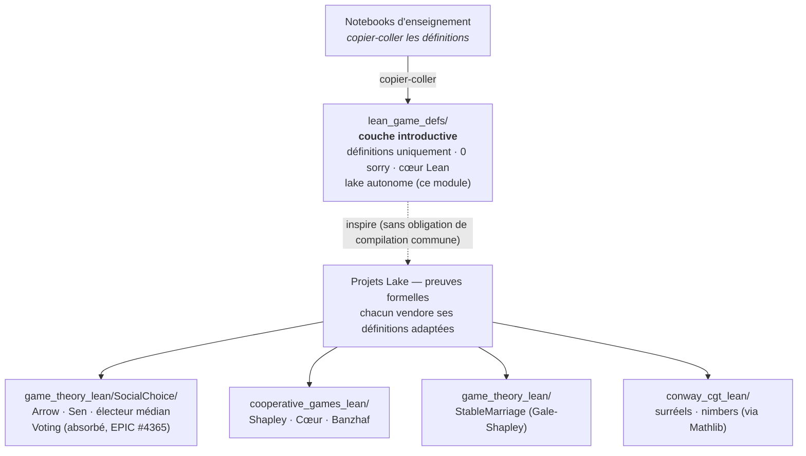
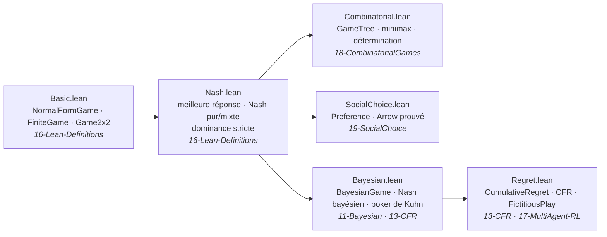

# Lean Game Definitions

Définitions de types partagées en Lean 4, utilisées par plusieurs projets Lean de GameTheory. Projet Lake **autonome et self-contained** (zéro dépendance, cœur Lean uniquement) — fournit des définitions de référence recopiées dans les notebooks d'enseignement ; `lake build` est le chemin de vérification (localement et en CI).

## Statut

- **Type** : Projet Lake autonome (`lakefile.toml`, `lean-toolchain` pinné `v4.33.0`, `lake-manifest.json`)
- **Fichiers** : voir catalogue (FR + siblings `_en`, EPIC #4980 Pattern A)
- **Compte de `sorry`** : 0 (définitions uniquement, pas de preuves)
- **Dépendance Mathlib** : aucune — tous les fichiers utilisent le cœur de Lean 4 uniquement
- **Compilable isolément** : Oui — `lake build` (harnais posé par #2752, review ai-01)
- **CI dédiée** : `.github/workflows/lean-game-defs.yml` + `lean-game-defs-ext.yml`
- **Dernier audit sorry** : 2026-05-29
- **Dernière correction de compilation** : 2026-06-10 (See #2748)

## Fichiers

- [Basic.lean](Basic.lean) — voir catalogue. Structures `NormalFormGame`, `FiniteGame`, `Game2x2` + paiements espérés. Source : `GameTheory-16-Lean-Definitions.ipynb`.
- [Nash.lean](Nash.lean) — voir catalogue. Meilleure réponse, équilibre de Nash pur/mixte, dominance stricte. Source : `GameTheory-16-Lean-Definitions.ipynb`.
- [Combinatorial.lean](Combinatorial.lean) — voir catalogue. `GameTree`, évaluation minimax, détermination victoire/défaite. Source : `GameTheory-18-Lean-CombinatorialGames.ipynb`.
- [SocialChoice.lean](SocialChoice.lean) — voir catalogue. `Preference`, `StrictPref`, axiomes d'Arrow et théorème d'impossibilité **prouvé**. Source : `GameTheory-19-Lean-SocialChoice.ipynb`.
- [Bayesian.lean](Bayesian.lean) — Jeux bayésiens à information incomplète : `BayesianGame`, `TypeStrategy`, `BayesianNashEquilibrium`, `InformationSet`, `SignalingGame`, `FirstPriceAuction`, définitions du poker de Kuhn. Source : `GameTheory-11-BayesianGames-Python.ipynb`, `GameTheory-13-ImperfectInfo-CFR-Python.ipynb`.
- [Regret.lean](Regret.lean) — Minimisation du regret et CFR : `CumulativeRegret`, `regretMatchingStrategy`, `CounterfactualRegret`, `CFRState`, `FictitiousPlayState`. Source : `GameTheory-13-ImperfectInfo-CFR-Python.ipynb`, `GameTheory-17-MultiAgent-RL-Python.ipynb`.

## Utilisation

Ces fichiers sont des définitions de référence (couche introductive, 0 preuve), vérifiables par `lake build`. Utilisation :

1. **Copier-coller dans une cellule de notebook** (workflow pédagogique typique dans `GameTheory-2b`, `GameTheory-8b`, etc.).
2. **Importer depuis un projet Lake adjacent** en ajoutant le chemin du fichier au `lakefile.lean` du projet. Exemple depuis `game_theory_lean/SocialChoice/` :

   ```lean
   import GameTheory.lean_game_defs.Basic
   import GameTheory.lean_game_defs.SocialChoice
   ```

3. **Exploration autonome** via le kernel Lean 4 WSL (voir [scripts/README.md](../scripts/README.md) pour la configuration du kernel).

Pour le support complet de `PGame` (théorie des jeux combinatoires dans toute sa généralité mathématique), utiliser Mathlib directement :

```lean
import Mathlib.SetTheory.PGame.Basic
import Mathlib.SetTheory.Game.Nim
```

## Relation aux autres projets Lean de GameTheory

- [game_theory_lean/](../game_theory_lean/) — Projet Lake multi-module (StableMarriage = formalisation Gale-Shapley, EPIC #4365 ; CooperativeGames absorbé depuis `cooperative_games_lean/` rm #6587).
- [game_theory_lean/SocialChoice/](../game_theory_lean/SocialChoice/) — Module absorbé dans `game_theory_lean` (Arrow / Sen / électeur médian / Voting, EPIC #4365).
- [social_choice_lean_peters/](../SocialChoice/social_choice_lean_peters/) — Projet Lake indépendant référençant Peters au commit `94a4c650` du `lake-manifest.json` (Gibbard-Satterthwaite, Duggan-Schwartz).
- [lean_game_defs_ext/](../lean_game_defs_ext/) — Lake autonome voisin, même parti pris « cœur Lean, zéro dépendance », qui porte les extensions bayésiennes de l'Epic #2610 (BNE décidable, enchères, valeur de l'information, réputation, regret externe, Fictitious Play *born-correct*). Voisin, pas dérivé : il **n'importe pas** ce module.

Ces projets ne dépendent **pas** de `lean_game_defs/` à la compilation — ils vendorent leurs propres définitions adaptées à leurs obligations de preuve. `lean_game_defs/` est la couche **introductive** utilisée par les notebooks d'enseignement.

**Deux homonymes à ne pas confondre avec `lean_game_defs_ext/`.** Les deux lakes ne partagent que deux noms sur 118 et 240 déclarations top-level (mots-clés `def`/`theorem`/`lemma`/`abbrev`/`instance`/`structure`/`inductive`/`class`/`axiom`, attributs `@[...]` et modificateurs inclus, siblings `_en` exclus), et ce sont des homonymes de types incompatibles, pas des doublons : `externalRegret` ([`Regret.lean:85`](Regret.lean#L85), `Float`, espace d'actions `Fin n`) n'est pas celui de [`lean_game_defs_ext/Bayesian/Regret.lean:43`](../lean_game_defs_ext/Bayesian/Regret.lean#L43) (`Int`, espace `Fin (nA+1)`), et `FictitiousPlayState` ([`Regret.lean:167`](Regret.lean#L167), indexé par `n`) n'est pas celui de [`lean_game_defs_ext/Bayesian/FictitiousPlay.lean:31`](../lean_game_defs_ext/Bayesian/FictitiousPlay.lean#L31) (`nAct` / `nOpp` / `opponentCounts`). Ils ne sont **pas interchangeables**. Aucun des deux lakes n'importe l'autre et aucun lakefile ne porte de `require` vers l'autre : la collision est donc **latente**, pas active. Elle le deviendrait le jour où un lake importerait l'autre, car les deux paires sont déclarées en **racine** (aucun `namespace` dans les modules FR) — d'où cette note de part et d'autre plutôt qu'une fusion, qui n'aurait rien à dédupliquer.

*Architecture en couches — la couche de définitions introductive (ce module, sans
preuves) vs. les projets Lake qui portent les preuves formelles (chacun vendore ses
propres définitions) :*



## Les deux preuves d'Arrow et de Sen : ce que chacune établit

Depuis le 2026-11-02 (#24183), les énoncés d'Arrow et de Sen existent en **deux
formalisations indépendantes**. Ce lake porte la **maison canonique** de ces énoncés,
[`SocialChoice.lean`](SocialChoice.lean) ; l'autre vit dans
[`game_theory_lean/SocialChoice/`](../game_theory_lean/SocialChoice/) (`Arrow.lean` +
`Sen.lean`) et reste une **preuve alternative déclarée** — conservée, pas dépréciée : elle
enseigne une autre stratégie de preuve sur les mêmes énoncés.

Ce qui les sépare, mesuré sur les deux fichiers :

| Axe | `lean_game_defs/SocialChoice.lean` (canonique) | `game_theory_lean/SocialChoice/` (alternative) |
|---|---|---|
| Socle | cœur Lean seul, zéro dépendance | Mathlib |
| Généralité | `Fin nI` / `Fin nA`, `nA ≥ 3` global | `ι` et `σ` arbitraires, agenda **local** (`Finset σ`, `3 ≤ X.card`) |
| Forme d'Arrow | négative : `¬ NonDictatorial swf` | positive : `is_dictatorship f X`, d'où le corollaire `no_perfect_swf` |
| Stratégie d'Arrow | propagation de la décisivité, chaque palier nommé (`Decisive`, `decisive_*`, `exists_dictator_of_decisive`) | méthode du pivot (Geanakoplos) : `pivot_exists`, `pivot_is_dictator_except_b`, `partial_dictator_is_full_dictator` |
| Forme de Sen | réfutation universelle de l'axiomatique : `¬ SenLiberalism swf` | contre-exemple existentiel : `∃ prof, ¬∃ best, is_best_element best X (f prof).rel` |
| Hypothèses de Sen | **sans** IIA, **sans** `Fintype`, **sans** hypothèse de cardinalité sur `I` | `2 ≤ Fintype.card ι` et `3 ≤ X.card` |
| Notion de libéralisme | `SenLiberalism` : deux individus **distincts**, deux paires **croisées**, trois alternatives distinctes | `minimal_liberal` : deux individus distincts, chacun décisif sur **une** paire non dégénérée — les paires peuvent ne pas se croiser |
| Preuve de Sen | calculatoire : profils d'utilité entière (`rank3 z x y 3 2 1`), obligations closes par `decide` | abstraite, cas « chevauchement » et cas « paires disjointes » |
| Répartition | les deux théorèmes dans un seul fichier | deux fichiers, un par théorème (`Arrow.lean`, `Sen.lean`) |

**Ce que chaque côté apprend, et que l'autre ne montre pas.**

- La formalisation canonique montre qu'**on peut faire les deux théorèmes sans Mathlib**. Elle
  paie ce choix par le bornage à `Fin n` et par un agenda global, parce que `Finset` est une
  dépendance Mathlib : ce plafond est le prix du socle, pas un oubli.
- La formalisation alternative montre ce que la **généralité** achète : société de taille
  arbitraire (y compris infinie) et agenda local, c'est-à-dire la forme sous laquelle le
  théorème se cite dans la littérature. Elle montre aussi la **deuxième stratégie de preuve**
  (pivot) et une lecture **contre-existentielle** de Sen : « voici le profil qui cycle »
  plutôt que « ces axiomes ne peuvent pas coexister ».
- **Trois notions de libéralisme** coexistent, et les confondre ferait perdre le sens des deux
  énoncés. `MinimalLiberalism` (canonique, dans `SocialChoice.lean`) admet une paire
  dégénérée, et une dictature la satisfait — le fichier le prouve
  (`dictatorship_minimally_liberal`), et c'est pourquoi l'énoncé de Sen y utilise
  `SenLiberalism` : deux individus distincts, deux paires réellement croisées, sur trois
  alternatives distinctes. `minimal_liberal` (alternative, `Sen.lean`) exige des paires non
  dégénérées mais **n'exige pas qu'elles se croisent** : elle est strictement plus faible que
  `SenLiberalism`, et l'impossibilité y est obtenue sous des hypothèses de cardinalité
  explicites (`2 ≤ Fintype.card ι`, `3 ≤ X.card`).
- Les deux ensemble donnent le seul point qu'aucune ne donne seule : les mêmes énoncés atteints
  par deux routes, avec des axiomes de clôture différents.

**Provenance.** `SocialChoice.lean` est écrit intégralement par CoursIA (commits `jsboige`,
2026-10-28 → 2026-11-01) ; son en-tête le dit « inspiré de `asouther4/lean-social-choice` »,
ce qui est une inspiration et non un portage. L'attribution, l'état des licences et le taux de
reprise module par module sont consignés dans
[`game_theory_lean/SocialChoice/NOTICE.md`](../game_theory_lean/SocialChoice/NOTICE.md) :
`Arrow.lean` y est un portage mesuré (19 noms sur 29), `Sen.lean` un ajout CoursIA (0 sur 4).

## Voir aussi

- [GameTheory/README.md](../README.md) — Vue d'ensemble de la série (tracks OpenSpiel + Lean)
- [scripts/README.md](../scripts/README.md) — Configuration du kernel Lean 4 WSL
- [.claude/rules/wsl-kernels.md](../../../.claude/rules/wsl-kernels.md) — Règles du kernel

## Conclusion

`lean_game_defs/` est la **couche de définitions introductive** du track Lean de
GameTheory : définitions de types partagées en Lean 4 (pas de preuves, 0 `sorry`)
utilisées par les notebooks d'enseignement et recopiées par les projets Lake
adjacents. C'est un projet Lake autonome depuis #2752 — `lakefile.toml`,
`lean-toolchain` pinné, CI dédiée — sans aucune dépendance Mathlib : chaque fichier
utilise le cœur de Lean 4 uniquement, et `lake build` vérifie l'ensemble (modules
FR + siblings `_en`).

### Ce qu'elle fournit

Six fichiers de référence couvrant le curriculum de théorie des jeux : jeux sous forme
normale / finis ([Basic.lean](Basic.lean)), équilibre de Nash et dominance
([Nash.lean](Nash.lean)), arbres de jeux combinatoires avec minimax
([Combinatorial.lean](Combinatorial.lean)), primitives de choix social et axiomes
d'Arrow ([SocialChoice.lean](SocialChoice.lean)), jeux bayésiens et signalisation
([Bayesian.lean](Bayesian.lean)), et minimisation du regret / CFR
([Regret.lean](Regret.lean)). Chaque fichier correspond à un notebook d'enseignement
spécifique et est autonome.

*La carte du curriculum — six fichiers, du jeu sous forme normale jusqu'au CFR, chacun
rattaché à son notebook pédagogique source :*



### Comment elle est utilisée

- **Copier-coller** dans une cellule de notebook (le workflow pédagogique typique) ;
- **Importer** depuis un projet Lake adjacent via `import GameTheory.lean_game_defs.*` ; ou
- **Explorer** de façon autonome via le kernel Lean 4 WSL.

Pour la théorie complète des jeux combinatoires (`PGame`, surréels, nimbers), le track
renvoie au `SetTheory.PGame` de Mathlib / à la visite [`conway_cgt_lean/`](../conway_cgt_lean/)
plutôt que de la redéfinir ici.

### Où aller ensuite

- **Projets compilables** (chacun vendore ses propres définitions adaptées aux preuves) :
  [`game_theory_lean/SocialChoice/`](../game_theory_lean/SocialChoice/) (Arrow / Sen / électeur médian / Voting, absorbé dans `game_theory_lean`, EPIC #4365),
  [`game_theory_lean/`](../game_theory_lean/) (StableMarriage + CooperativeGames absorbé : valeur de Shapley, Cœur, EPIC #4365).
- **Visite CGT** : [`conway_cgt_lean/`](../conway_cgt_lean/) — surréels, nimbers via
  `vihdzp/combinatorial-games`.
- **Configuration du kernel** : [scripts/README.md](../scripts/README.md) et
  [.claude/rules/wsl-kernels.md](../../../.claude/rules/wsl-kernels.md).
