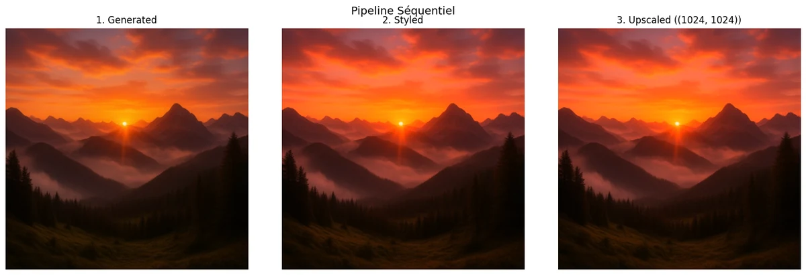
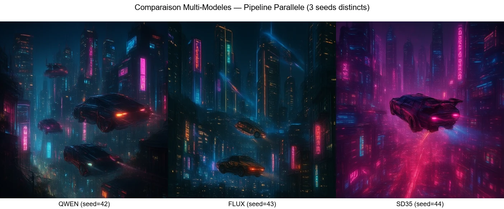
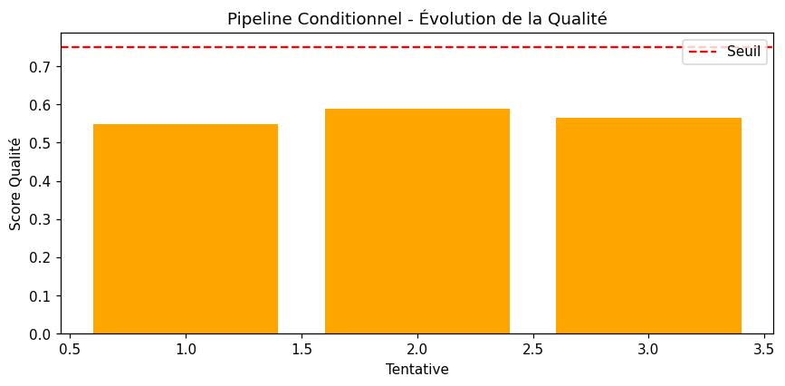
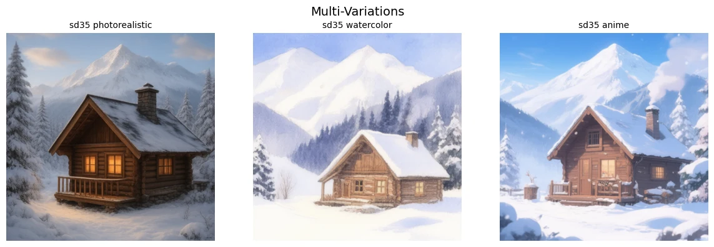
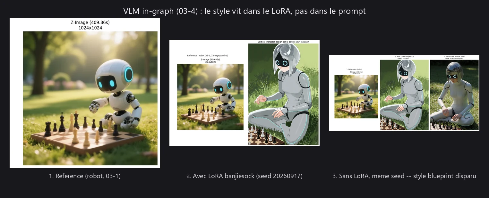

# Orchestrer la génération d'images

[← Image avancée](../02-Advanced/README.md) | [↑ Série Image](../README.md) | [Image : applications →](../04-Applications/README.md)

Comment choisir un moteur, enchaîner ses sorties avec d'autres opérations et évaluer le coût du pipeline obtenu ? Cette partie part d'une comparaison de services, construit un orchestrateur, puis propose deux approfondissements : mesurer les performances et étudier un graphe où un modèle vision-langage rédige le prompt d'un générateur d'images.

## Avant de commencer

Il est utile de savoir manipuler des images et des dictionnaires en Python, appeler une API HTTP et lire un graphe ComfyUI. Les exemples de la [partie avancée](../02-Advanced/README.md) introduisent les modèles et les workflows. Préparez les dépendances, les adresses et les éventuels jetons avec le [guide d'environnement GenAI](../../00-GenAI-Environment/README.md) ; l'[architecture des services](../../../../docs/genai/genai-services.md) détaille la configuration de la stack.

Les carnets utilisent Python. Les appels réels nécessitent les services et modèles indiqués dans chacun d'eux, ainsi que les ressources GPU adaptées. En particulier, 03-1 utilise Forge et ComfyUI ; 03-4 demande un ComfyUI configuré avec les modèles, LoRA et nœuds décrits dans le carnet. Ses sorties illustrent une exécution sur GPU de 24 Go : cette valeur n'est pas une garantie de compatibilité pour toute configuration. Vérifiez l'état des services et les chemins de modèles avant de lancer une génération.

## Parcours conseillé

| Étape | Question et activité | À retenir |
|---|---|---|
| **Socle : comparer** — [03-1 Comparaison multi-modèles](03-1-Multi-Model-Comparison.ipynb) | Envoyer un prompt à SDXL Lightning via Forge et à Qwen Image Edit via ComfyUI, puis examiner les sorties et les temps. | Les résolutions et le chargement initial diffèrent dans l'exemple : le temps observé ne suffit pas à classer les modèles. Construire un protocole avec plusieurs prompts et des conditions explicites. |
| **Socle : assembler** — [03-2 Orchestration de workflows](03-2-Workflow-Orchestration.ipynb) | Construire des étapes séquentielles, parallèles et conditionnelles, avec suivi des erreurs et relances. | Une dépendance impose l'ordre ; des tâches indépendantes peuvent être soumises en parallèle, mais le GPU peut rester le goulot. Un seuil automatique n'est pas une garantie de qualité visuelle. |
| **Approfondir : mesurer** — [03-3 Optimisation des performances](03-3-Performance-Optimization.ipynb) | Profiler temps et mémoire, explorer précision réduite, quantification, transfert CPU et traitement par lots. | Comparer à une référence dans les mêmes conditions, après échauffement, et mesurer aussi l'effet sur les images. Une partie des benchmarks est simulée ; la sortie enregistrée du benchmark ComfyUI réel indique un service indisponible. |
| **Approfondir : lire et adapter un graphe** — [03-4 Character design avec VLM](03-4-VLM-Character-Design-Workflow.ipynb) | Extraire les métadonnées d'un PNG, suivre le graphe API, puis faire produire un prompt par un VLM avant la diffusion Krea 2. | Un workflow embarqué aide à comprendre la recette, mais sa reproduction exige aussi modèles, nœuds, versions et configuration. Le contre-test avec et sans LoRA illustre leur influence dans cet exemple. |

Après 03-1 et 03-2, choisissez 03-3 si votre question porte sur les ressources, ou 03-4 si vous souhaitez examiner un pipeline multimodal complet. Les deux peuvent se lire indépendamment l'un de l'autre.

## Lire les résultats de l'orchestration

Dans 03-2, le pipeline séquentiel fait passer une image par génération, transformation de style et agrandissement. Les sorties intermédiaires permettent de voir ce que chaque étape transmet à la suivante ; agrandir l'image n'assure pas à lui seul l'apparition de détails fidèles.

Le parcours parallèle peut servir à comparer des sorties indépendantes. L'illustration ci-dessous montre **des graines différentes du même modèle Qwen**, et ne constitue donc pas une comparaison entre modèles. Dans le carnet, un sémaphore limite les générations GPU simultanées.

Le routage conditionnel relance une génération sous un seuil. Ici, le score est un indicateur simple fondé sur la luminance : il ne mesure ni fidélité au prompt ni qualité esthétique. Les tentatives ne s'améliorent pas nécessairement et peuvent toutes rester sous le seuil ; il faut prévoir une limite de relances et examiner les images.

Les variantes de style ci-dessous illustrent l'intérêt de conserver plusieurs propositions pour une sélection humaine. Le carnet peut utiliser un substitut visuel lorsque ComfyUI est indisponible : vérifiez les messages et la provenance des sorties avant de les interpréter comme des générations réelles.

Dans 03-4, la comparaison avec et sans LoRA conserve le prompt généré et la graine, mais retire aussi les mots déclencheurs associés au LoRA. Elle aide à raisonner sur la contribution du style dans ce cas précis, sans établir une séparation parfaite et générale entre identité et style.

La provenance des figures est décrite dans leur [manifest](assets/readme/MANIFEST.md).

## Pour aller plus loin

- Revenez au [sommaire Image](../README.md) pour situer ces techniques dans le parcours complet, puis appliquez-les dans les [applications](../04-Applications/README.md).
- Pour une comparaison utile, gardez trace des prompts, graines, résolutions, étapes, versions et conditions de chargement ; distinguez latence à froid et à chaud. Les métriques automatiques et l'évaluation humaine répondent à des questions différentes.
- Pour un pipeline reproductible, conservez le graphe et les paramètres, mais aussi les noms et versions des modèles et des nœuds. Les métadonnées d'une image peuvent être absentes ou supprimées lors d'une conversion.
