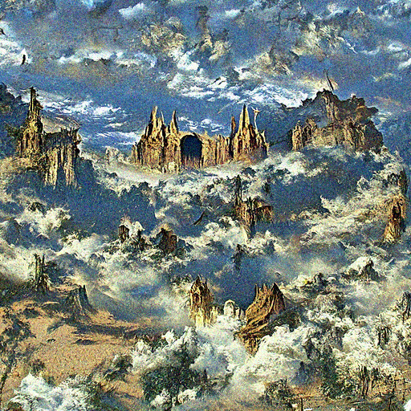
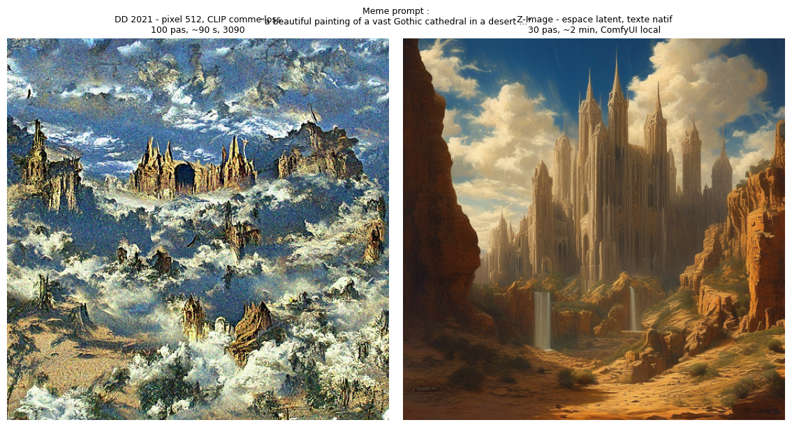
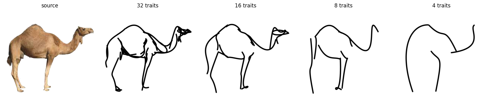
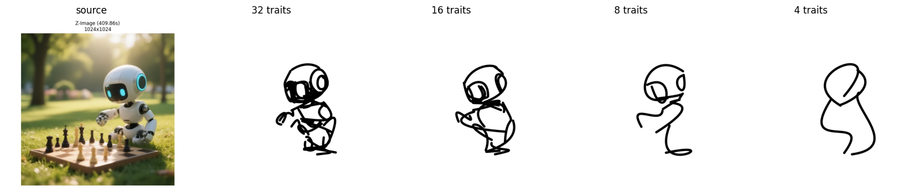
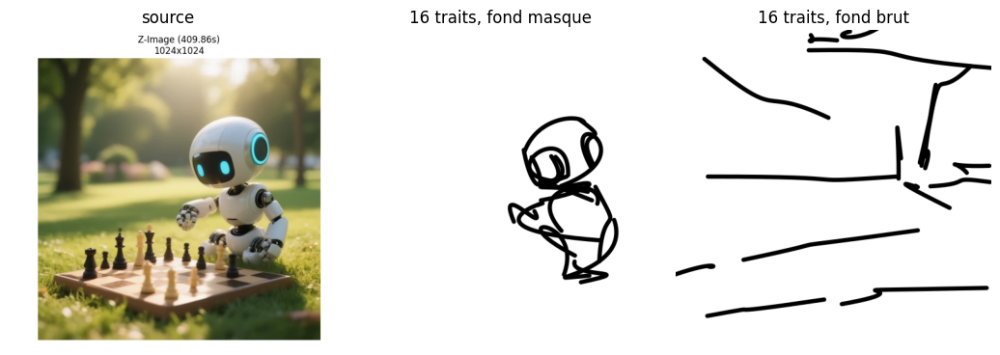

# 05-History — Racines pré-Stable-Diffusion

[← Image Applications](../04-Applications/) | [↑ Image](../README.md)

Notebooks rétrospectifs : les outils d'avant Stable Diffusion (2021-2022) qui ont établi les paradigmes encore à l'œuvre aujourd'hui — CLIP comme fonction de perte sémantique, guidance par classifieur, diffusion guidée avant l'ère des modèles ouverts massifs.

**Sources.** Chaque carnet cite l'identifiant durable de ses publications (auteurs, année, lien arXiv) et, quand la copie est archivée, le chemin du gisement partagé qui la rouvre sans la retélécharger. Ce chemin est un localisateur : la citation reste la référence si le gisement bouge. Convention complète : [docs/reference/bibliography-hygiene.md](../../../../docs/reference/bibliography-hygiene.md).

## Notebooks

| # | Notebook | Contenu | Publication |
|---|----------|---------|-------------|
| 0 | [05-0-Generateurs-Symboliques](05-0-Generateurs-Symboliques.ipynb) | Les moteurs symboliques d'avant l'apprentissage : tortue Logo (rosace), L-systèmes (Koch quadratique), automates cellulaires (règle 110, Game of Life) — la description courte engendre l'image riche, mesuré comme un ratio de compression (x1030 / x2365) | Abelson & diSessa (Turtle, années 60-80) ; Lindenmayer 1968 ; Conway 1970 ; Wolfram 1982 |
| 0b | [05-0b-Demoscene-Intros-Procedurales-Python](05-0b-Demoscene-Intros-Procedurales-Python.ipynb) | La démoscène comme argument de compression : cinq effets canoniques rejoués en NumPy au format VGA 13h (plasma, tunnel, feu, rotozoom, raymarching SDF), puis mesure les noyaux (via `inspect.getsource`) face aux frames LZMA, sur 8 à 128 frames. Le code est 200 à 5 000 fois plus court — analogie de compression, pas une borne universelle | Future Crew, *Second Reality* (1993) ; Farbrausch, *fr-08* (2000) ; Rgba & TBC, *Elevated* (2009) |
| 0c | [05-0c-Low-Complexity-Art-Python](05-0c-Low-Complexity-Art-Python.ipynb) | La beauté comme description courte : reconstruction des cercles fractals de Schmidhuber (règles appliquées à la lettre, comptes 12/31 du papier reproduits, facteur « ×4 » entre niveaux mesuré comme une limite), coût en bits d'une rosace, d'un visage et d'un témoin aléatoire, symétrie (65 → 19 bits), puis deux observateurs (cercles contre pixels LZMA) qui inversent le classement de deux rosaces de même forme | Schmidhuber, *Leonardo* 30:2, 1997 |
| 0d | [05-0d-GANs-Portraits-Moment-NFT](05-0d-GANs-Portraits-Moment-NFT.ipynb) | Les GANs, de Goodfellow à *Edmond de Belamy* (Christie's 2018) : un DCGAN entraîné sur les portraits Olivetti, puis trois mesures. (1) Le générateur copie-t-il ? On le teste avec un contrôle photo vue / photo jamais vue de la même personne. (2) L'empreinte spectrale de Durall et al. permet-elle de détecter les images générées ? (3) Combien pèse le générateur face au corpus compressé ? Le notebook ajoute une marche dans l'espace latent et distingue la vente GAN de 2018 du boom NFT de 2021, qui a surtout couronné l'art génératif par code | Goodfellow et al. 2014 ([arXiv:1406.2661](https://arxiv.org/abs/1406.2661)) ; Radford et al. 2015 ([arXiv:1511.06434](https://arxiv.org/abs/1511.06434)) ; Durall et al. 2020 ([arXiv:2003.01826](https://arxiv.org/abs/2003.01826)) |
| 1 | [05-1-DiscoDiffusion-CLIP-Guided-Diffusion](05-1-DiscoDiffusion-CLIP-Guided-Diffusion.ipynb) | La CLIP-guided diffusion pré-Stable-Diffusion : UNet KL-openai 512 pixel-space + CLIP ViT-L/14 comme fonction de perte (cutouts, distance sphérique), conditionnement de Song et al., grille `clip_gs` × `sat_scale`, même prompt contre Z-Image (ce que l'espace latent a changé) | Crowson 2021 ; Dhariwal & Nichol 2021 ([arXiv:2105.05233](https://arxiv.org/abs/2105.05233)) ; Radford et al. 2021 ([arXiv:2103.00020](https://arxiv.org/abs/2103.00020)) |
| 2 | [05-2-CLIPasso-Semantic-Sketching](05-2-CLIPasso-Semantic-Sketching.ipynb) | Le sketching sémantique : abstraction contrôlée par le nombre de traits (grilles 32/16/8/4 — chameau du papier + robot masqué U²-Net), coût du fond non extrait (A/B masqué/brut), contraste sémantique vs signal (Canny) | Vinker et al., SIGGRAPH 2022 ([arXiv:2202.05822](https://arxiv.org/abs/2202.05822)) |

*Le look DD rejoué du notebook 05-1 : UNet de diffusion en espace pixel (checkpoint d'époque `diffusion.pt`, sha256 vérifié contre le manifeste DD v5.7) guidé par la distance sphérique CLIP sur cutouts — 100 pas DDIM, ~90 s sur RTX 3090, là où un rendu Colab 2021 demandait 1-3 h.*

*Même prompt, même graine : la CLIP-guided diffusion d'époque (gauche) vise la reconnaissabilité globale — compositions monumentales, textures d'estampe — quand Z-Image (droite), entraînée avec alignement texte-image natif, suit le prompt mot à mot.*

*Grille d'abstraction du notebook 05-2 : à mesure que le budget de traits baisse, l'esquisse abandonne le signal (contours) et ne conserve que la sémantique (l'« idée » du chameau) — sortie des runs officiels CLIPasso sur GPU.*

*Même grille sur une seconde cible — le robot généré de la série, fond retiré par U²-Net avant optimisation (`mask_object=1`) : chaque trait travaille pour le sujet.*

*A/B du coût du fond : à budget égal (16 traits, mêmes graines), l'esquisse masquée gagne +0.062 de similarité CLIP (0.652 contre 0.590) — sans extraction du fond l'esquisse fonctionne, mais une fraction du budget part dans le décor.*

## Prérequis

- 05-0, 05-0b et 05-0c : numpy et matplotlib seuls, sur CPU ;
- 05-0d : la base de portraits Olivetti se télécharge au premier appel de `sklearn.datasets.fetch_olivetti_faces` ; le notebook tourne aussi sur CPU, plus lentement ;
- Environnement Python du cours (torch CUDA) pour 05-1 et 05-2 ;
- Outils locaux hors repo (voir la cellule d'installation du notebook) : clone du [code officiel CLIPasso](https://github.com/yael-vinker/CLIPasso) (MIT) + compilation MSVC de [diffvg](https://github.com/BachiLi/diffvg) — les adaptations d'exécution sont documentées dans le notebook.
