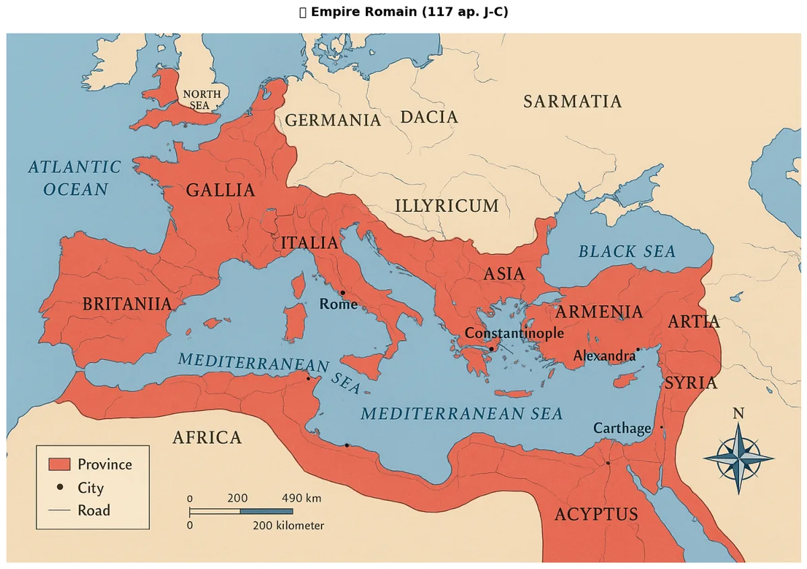
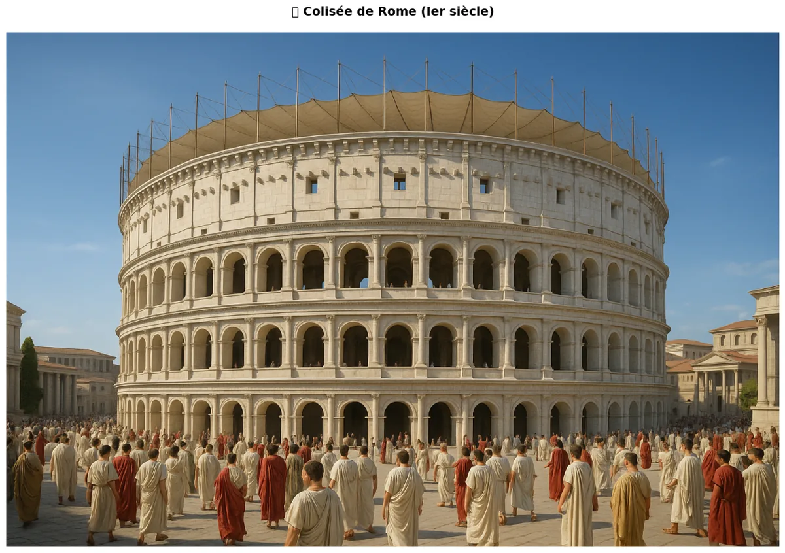
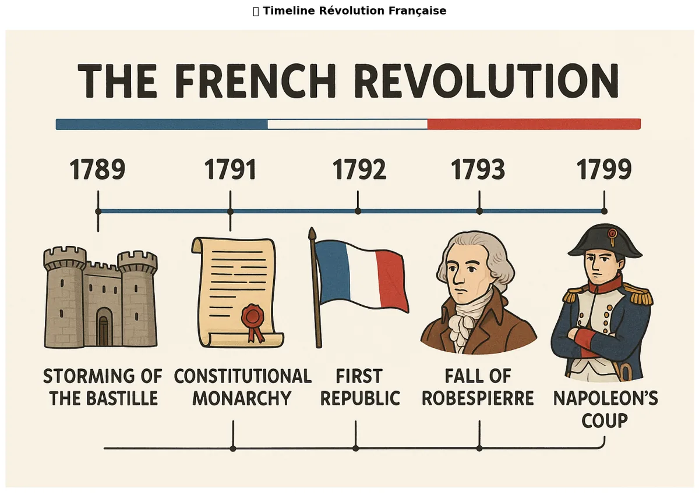
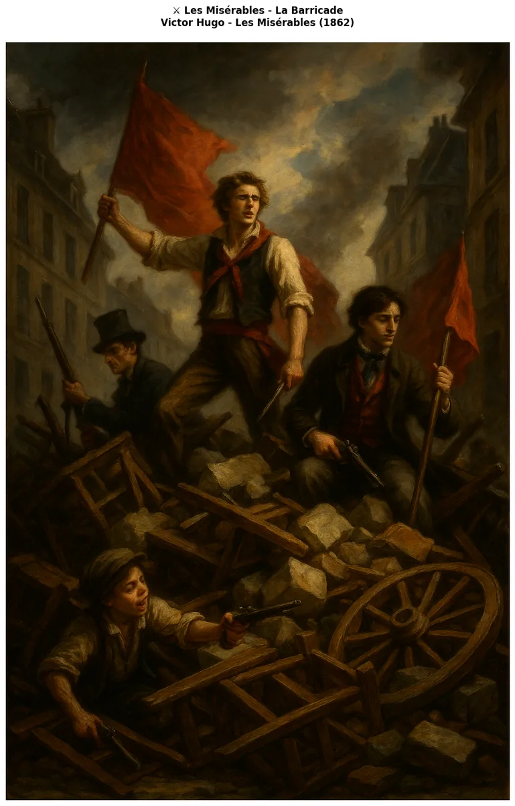
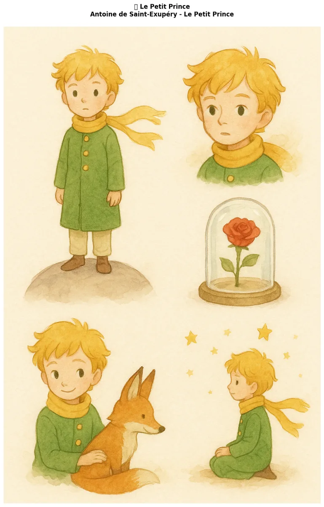
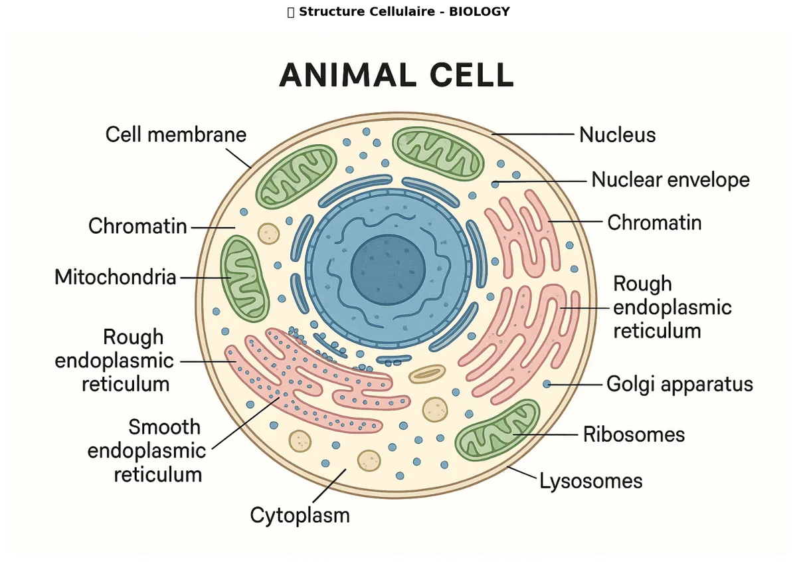

# examples - Cas d'usage spécifiques

[← Image Applications](../04-Applications/) | [↑ Image](../README.md) | [→ Audio](../../Audio/README.md)

Exemples concrets d'utilisation des notebooks GenAI Image dans différents domaines éducatifs et professionnels.

**Dans le cadre du fil rouge contenu visuel educatif** : ces notebooks montrent l'application directe des techniques des niveaux precedents. [science-diagrams](science-diagrams.ipynb) genere des diagrammes et schemas techniques pour les cours de sciences. [history-geography](history-geography.ipynb) cree des cartes et reconstitutions historiques. [literature-visual](literature-visual.ipynb) illustre des textes litteraires.

## Comment lire ce README

- Vous cherchez **un modèle de prompt pour un domaine précis** : chaque section d'[exemples concrets](#exemples-concrets) donne le prompt, la sortie réelle et l'usage pédagogique visé — commencez par le domaine qui vous concerne.
- Vous voulez **voir la mécanique avant les exemples** : les trois carnets supposent les techniques de [01-Foundation](../01-Foundation/README.md) et [02-Advanced](../02-Advanced/README.md) (génération par API, paramètres, itération sur un prompt) ; le [workflow typique](#workflow-typique) en donne l'ordre.
- Vous voulez **réutiliser les sorties** : la provenance de chaque figure (carnet, format, poids) est dans [`assets/readme/MANIFEST.md`](assets/readme/MANIFEST.md) — les images sont les sorties réelles de `gpt-image-1`, pas des maquettes.

Cette navigation par niveaux suit le principe des séries à plusieurs vitesses décrit dans [« Choisir sa vitesse de lecture »](https://github.com/jsboige/CoursIA#choisir-sa-vitesse-de-lecture).

## Vue d'overview

| Statistique | Valeur |
|-------------|--------|
| Notebooks | 3 |
| Domaines | 3 |
| Durée totale | ~2-3h |
| Difficulté | Intermédiaire |

## Notebooks par domaine

| Domaine | Notebook | Description | Ce qu'on y apprend |
|---------|---------|-------------|--------------------|
| **Histoire-Geographie** | [history-geography](history-geography.ipynb) | Création de cartes historiques, reconstitutions, illustrations éducatives | Formuler un prompt qui rend un contenu lisible (carte avec légende, frise, reconstitution) plutôt qu'une image d'ambiance |
| **Littérature** | [literature-visual](literature-visual.ipynb) | Illustrations de textes, couvertures de livres, visuels narratifs | Passer d'un passage de texte à une illustration fidèle, et d'un personnage à une planche multi-poses |
| **Science** | [science-diagrams](science-diagrams.ipynb) | Diagrammes scientifiques, schémas techniques, visualisations complexes | Obtenir un schéma annoté et légendé (organites, flux) au lieu d'une illustration décorative |

## Exemples concrets

Les trois notebooks ont été exécutés avec `gpt-image-1` ; les figures ci-dessous sont leurs sorties réelles, réduites en WebP pour l'affichage. La provenance et le poids natif de chaque image sont détaillés dans [`assets/readme/MANIFEST.md`](assets/readme/MANIFEST.md).

### Histoire-Géographie

Le notebook [history-geography](history-geography.ipynb) couvre trois usages distincts : la cartographie pédagogique, la reconstitution de monuments et la mise en frise des événements.

Pour la **cartographie**, le prompt décrit une aire géographique, ses subdivisions et le contenu attendu de la légende ; le modèle rend alors une carte lisible plutôt qu'une illustration décorative. La figure ci-dessous représente l'Empire romain à son apogée en 117 ap. J.-C. : provinces en aplats colorés (Gallia, Britannia, Italia, Asia, Africa…), Méditerranée centrale, légende (province, cité, route) et rose des vents.

 
<b>Empire romain (117 ap. J.-C.)</b> — carte d'expansion en format paysage : provinces nommées, réseau routier, légende et rose des vents (usages : Histoire 6ᵉ, comparaison avec l'Europe actuelle)

La **reconstitution de monuments** restitue un édifice dans son état d'origine. Ici, le Colisée de Rome au Iᵉʳ siècle apparaît en rendu photoréaliste — amphithéâtre complet, velarium déployé, gradins peuplés d'une foule en toges — soit l'inverse de la ruine que l'on visite aujourd'hui.

 
<b>Colisée de Rome (Iᵉʳ siècle)</b> — reconstruction photoréaliste de l'amphithéâtre dans son état d'origine (marbre et travertin, velarium, gradins peuplés)

Enfin, pour la **chronologie**, le notebook compose une frise horizontale illustrée. Celle de la Révolution française jalonne la décennie 1789-1799 : prise de la Bastille (1789), Première République (1792), Terreur (1793), coup d'État de Napoléon (1799), sur une barre bleu-blanc-rouge, dans un style poster éducatif.

 
<b>Révolution française (1789-1799)</b> — frise chronologique horizontale : Bastille (1789), Première République (1792), Terreur (1793), coup de Napoléon (1799), barre bleu-blanc-rouge

### Littérature

Le notebook [literature-visual](literature-visual.ipynb) transforme un texte en image, de la scène de roman à la planche de personnage.

L'**illustration de scène** part d'un passage descriptif. La barricade des *Misérables* de Victor Hugo (1862) donne une peinture à l'huile romantique et dramatique : un jeune homme brandit le drapeau rouge au sommet de la barricade, un enfant tient un pistolet, dans une facture inspirée de Delacroix.

 
<b>Les Misérables — la barricade</b> (Victor Hugo, 1862) — illustration de scène en peinture à l'huile romantique, format portrait (usages : français 4ᵉ/3ᵉ, révolution et justice sociale)

La **planche de personnage** (character design) rassemble plusieurs vues d'un même protagoniste. Le notebook la produit pour *Le Petit Prince* de Saint-Exupéry : une aquarelle réunit l'enfant blond à l'écharpe jaune sous plusieurs poses, le renard, la rose sous sa cloche de verre et le ciel étoilé.

 
<b>Le Petit Prince</b> (Saint-Exupéry) — planche de personnage à l'aquarelle : le prince à l'écharpe jaune en plusieurs poses, le renard, la rose sous cloche, ciel étoilé (usages : français CM2/6ᵉ, analyse de personnage et de symboles)

### Science

Le notebook [science-diagrams](science-diagrams.ipynb) génère des schémas annotés plutôt que des images d'ambiance. La coupe de cellule animale ci-dessous en est un exemple : membrane, noyau (enveloppe nucléaire et chromatine), mitochondries, réticulum endoplasmique (rugueux et lisse), appareil de Golgi, ribosomes, lysosomes et cytoplasme y sont légendés un à un.

 
<b>Cellule animale en coupe</b> — schéma des organites légendés (membrane, noyau, mitochondries, réticulum endoplasmique, appareil de Golgi, lysosomes) (usages : biologie cellulaire niveau lycée, identification des organites)

## Workflow typique

1. **Brief** : Définir le besoin et le style visuel
2. **Sélection du modèle** : Choisir le modèle le plus adapté
3. **Génération** : Créer les images avec paramètres précis
4. **Post-processing** : Amélioration et édition si nécessaire
5. **Intégration** : Utilisation dans le support final

## Approfondissements

- **Le prompt de chaque figure est lisible dans son carnet** : les sections ci-dessus commentent les sorties ; le prompt exact, la seed et les paramètres vivent dans les cellules de [history-geography](history-geography.ipynb), [literature-visual](literature-visual.ipynb) et [science-diagrams](science-diagrams.ipynb) — c'est là qu'on adapte un exemple à son propre cours.
- **La provenance des images** : [`assets/readme/MANIFEST.md`](assets/readme/MANIFEST.md) documente le carnet, la cellule et le poids natif de chaque WebP affiché ; les fichiers sont des réductions d'outputs réels.
- **En amont** : les techniques employées (API cloud, paramètres de rendu, itérations sur un prompt) sont introduites dans [01-Foundation](../01-Foundation/README.md) et affinées dans [02-Advanced](../02-Advanced/README.md).

## Ressources

- [Documentation Image principale](../README.md)
- [Tous les notebooks Image](../README.md)