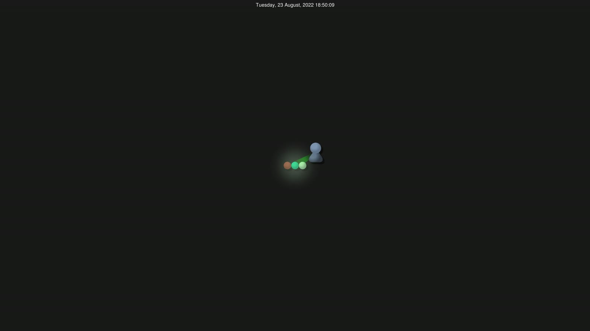
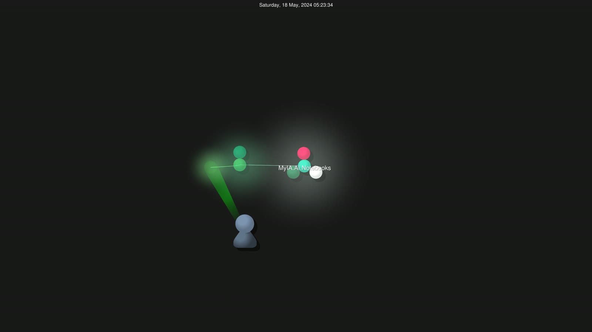
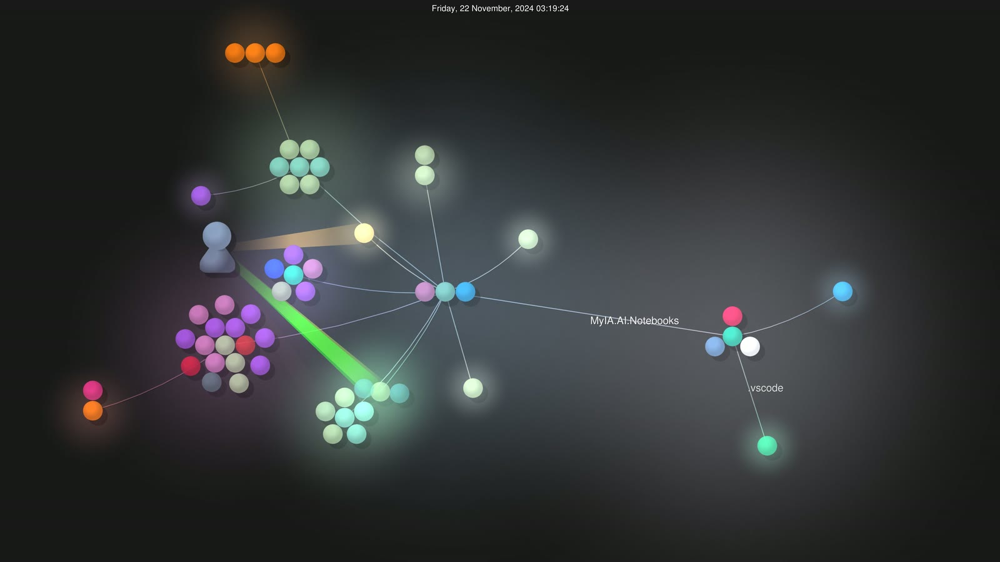
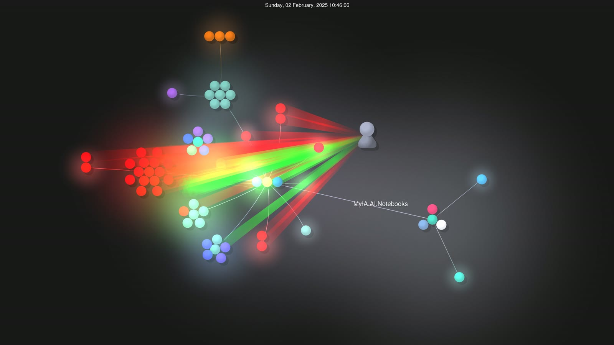
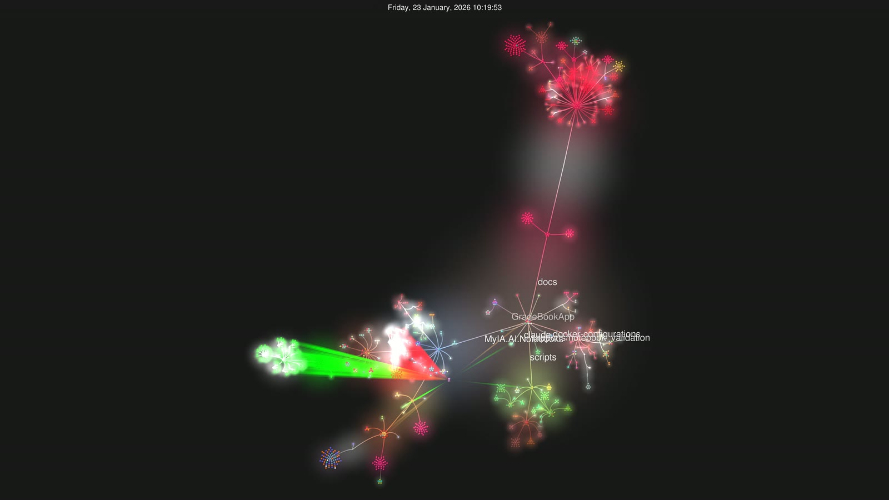
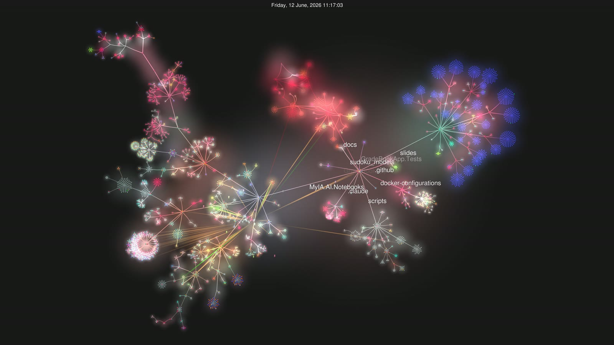
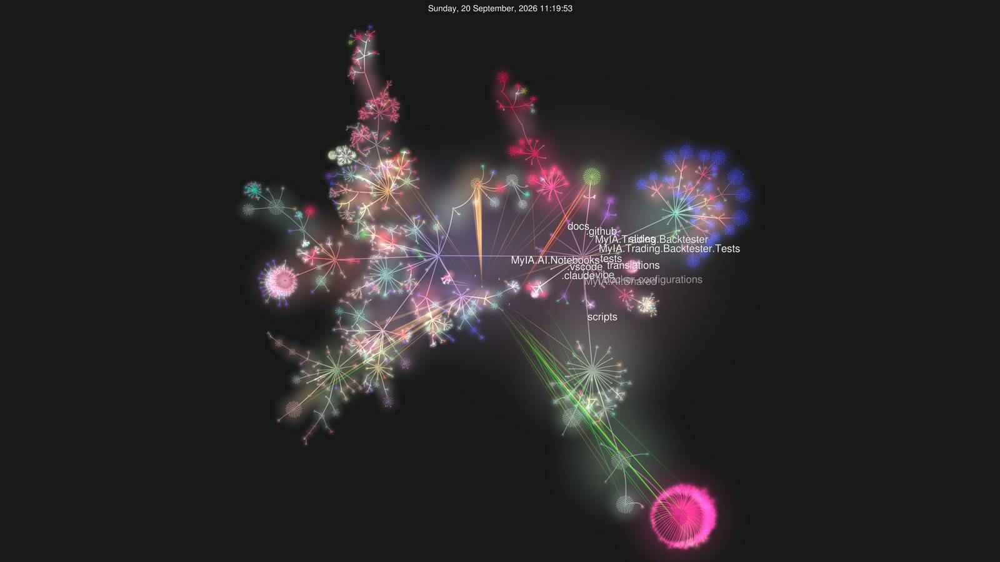
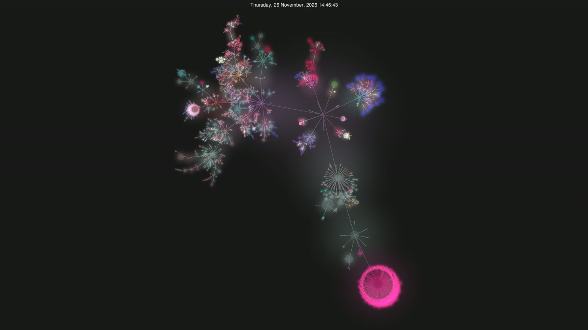

# Vibe-Coding - Ateliers IA Generative pour le Développement

<!-- CATALOG-STATUS
series: GenAI-Vibe-Coding
pedagogical_count: 7
breakdown: Vibe-Coding=7
maturity: BETA=7
-->

[← Documentation GenAI](../README.md) | [↑ ..](../README.md) | [→ Claude Discovery](Claude-Code/01-decouverte/README.md)

Cette série couvre les ateliers de **vibe-coding** : décrire ce que vous voulez construire en langage naturel, et l'IA écrit le code. Deux assistants majeurs sont couverts (Claude Code et Roo Code), avec des exercices progressifs allant de la découverte à l'automatisation avancée, plus un module d'agents autonomes (Claw Systems).

## Structure du répertoire

```text
Vibe-Coding/
├── Claude-Code/          # Ateliers Claude Code
├── Roo-Code/             # Ateliers Roo Code et modules avancés
├── Claw-Systems/         # Agents IA autonomes (NanoClaw, OpenClaw)
├── Claudish/             # Proxy multi-provider (route assistants vers Anthropic/GLM/Qwen)
├── analyzers/            # Sous-série Roslyn : MyIA.AgentSafetyAnalyzer + carnet de démonstration
└── docs/                 # Documentation commune et introductions
```

## Claude Code - Ateliers

Assistant de codage agentique développé par Anthropic. Interface CLI + Extension VS Code.

| Module | Nom | Durée | Niveau | Description |
|--------|-----|-------|--------|-------------|
| 01 | [Découverte](Claude-Code/01-decouverte/) | 2-3h | Débutant | Installation, sessions, @-mentions, CLAUDE.md |
| 02 | [Orchestration](Claude-Code/02-orchestration-taches/) | 2-3h | Débutant+ | Agents Explore/Plan, recherche web |
| 03 | [Assistant Developpeur](Claude-Code/03-assistant-developpeur/) | 3h | Intermédiaire | /commit, /review, debug, refactoring |
| 04 | [Création de Code](Claude-Code/04-creation-code/) | 3h | Intermédiaire | Génération projet, tests, documentation |
| 05 | [Automatisation Avancée](Claude-Code/05-automatisation-avancee/) | 3-4h | Avancé | Skills, Subagents, MCP, Hooks |

**Durée totale : 13-16 heures**

### Ressources supplémentaires Claude Code

- `Scripts/` - Scripts PowerShell de preparation des workspaces
- `workspaces/` - Espaces de travail par participant
- `docs/` - Documentation spécifique Claude Code

### Installation Claude Code

```bash
# Installation CLI - chemin canonique : installation native (Node.js non requis)
#   Windows : installateur depuis https://claude.com/code
#   macOS   : brew install --cask claude-code
#   Linux   : curl -fsSL https://claude.ai/install.sh | bash
claude --version
```

Configuration OpenRouter : `ANTHROPIC_BASE_URL` pointe **directement** vers `https://openrouter.ai/api` — OpenRouter sert nativement le protocole Anthropic, **aucun proxy local n'est a installer**. Le montage par `openrouter-proxy` que cette ligne decrivait auparavant est obsolete. Guide pas-a-pas dans [OPENROUTER_SETUP.md](Claude-Code/docs/OPENROUTER_SETUP.md). Alternative npm : `npm install -g @anthropic-ai/claude-code` (voir le [guide d'installation](Claude-Code/docs/INSTALLATION-CLAUDE-CODE.md)).

## Roo Code - Ateliers

Framework de codage IA avec interface VS Code uniquement. Idéal pour les débutants.

| Module | Nom | Contenu |
|--------|-----|---------|
| 01 | [Découverte](Roo-Code/01-decouverte/) | Premiers pas, conversations, vision |
| 02 | [Orchestration des tâches](Roo-Code/02-orchestration-taches/) | Gestion des tâches et workflows |
| 03 | [Assistant Pro](Roo-Code/03-assistant-pro/) | Mode assistant professionnel |
| 04 | [Création de contenu](Roo-Code/04-creation-contenu/) | Génération de code et contenu |
| 05 | [Projets avancés](Roo-Code/05-projets-avances/) | Projets complexes et integration |

### Ressources supplémentaires Roo Code

- `Ateliers avances/` - Modules supplémentaires avancés
- `Corrections/` - Solutions des exercices
- `Demo-Roo-Capabilities/` - Démonstrations des capacités Roo
- `Scripts/` - Scripts de preparation
- `workspaces/` - Espaces de travail par participant
- `docs/` - Documentation spécifique Roo Code

### Préparation de l'environnement

```powershell
# Creer son workspace
./Scripts/prepare-workspaces.ps1 -UserName "VotreNom"

# Nettoyer après la formation
./Scripts/clean-workspaces.ps1 -UserName "VotreNom"
```

## Claw Systems - Agents Autonomes

Plateformes d'agents IA conteneurisés, self-hosted, opérant de manière autonome via Telegram et API.

| Document | Description |
|----------|-------------|
| [README](Claw-Systems/README.md) | Vue d'ensemble, comparaison avec Claude/Roo |
| [Architecture](Claw-Systems/docs/02-NanoClaw-Architecture.md) | Architecture technique NanoClaw |
| [Déploiement](Claw-Systems/docs/03-NanoClaw-Deploy.md) | Guide de déploiement Docker |
| [ASR Integration](Claw-Systems/docs/04-ASR-Integration.md) | Transcription vocale Whisper |

**Cas d'usage** : Agent Telegram avec transcription vocale, orchestration multi-agents, déploiement production.

## Claudish - Proxy Multi-Provider

Proxy/routeur qui rend les assistants (Claude Code, Roo Code) et les bots (Hermes, NanoClaw) **agnostiques du fournisseur** : un wire Anthropic en entrée, le provider budgeté en sortie (Anthropic, z.ai GLM, Qwen self-hosté), jamais de bascule silencieuse.

| Document | Description |
|----------|-------------|
| [README](Claudish/README.md) | Vue d'ensemble, écosystème 3 tiers, pipeline |
| [Proxy en détail](Claudish/docs/Claudish-Proxy.md) | Principe wire, topologie, router, connecter un agent, avancées du fork, troubleshooting |
| [Config](Claudish/configs/claudish.env.secrets.example) | Template de configuration (placeholders uniquement) |

## Mémoire sémantique et grounding — voir la section dédiée

Le **backend de mémoire sémantique** qui donne aux agents de codage une mémoire long-terme et les ancre dans des faits vérifiables (grounding) a été promu en **section top-level** : [RAG et Mémoire Sémantique](../RAG-et-Memoire-Semantique/). Là où les ateliers ci-dessus décrivent les front-ends agents, cette section documente l'infrastructure qui les alimente — base vectorielle Qdrant, embeddings, indexation, et un notebook pratique de grounding — avec les incidents d'ops réels (dérives de montage, pertes de données, durcissement des sauvegardes) comme matière pédagogique.

## Notre harnais réel — la couche sous les front-ends

Les sections précédentes ([Claude Code](#claude-code---ateliers), [Roo Code](#roo-code---ateliers), [Claw Systems](#claw-systems---agents-autonomes), [Claudish](#claudish---proxy-multi-provider)) décrivent les **front-ends agents** tels qu'un utilisateur final les voit. Cette section décrit la couche qui les fait *tenir à l'échelle d'une flotte* : un MCP maison d'orchestration, un écosystème de MCPs de domaine, et un pattern coordinateur/workers multi-machines. C'est le « vibe-coding » vu du côté opérationnel, pas du côté session unique.

### roo-state-manager — le MCP d'orchestration

[`roo-state-manager`](https://github.com/jsboige/roo-extensions) est un MCP maison qui regroupe **15 outils** d'orchestration inter-agents et de mémoire collective. La doc pérenne détaille le rôle de chacun : [HARNESS-OVERVIEW.md §2](https://github.com/jsboige/roo-extensions/blob/main/docs/harness/HARNESS-OVERVIEW.md) (6 coordination + 4 mémoire/recherche + 5 infrastructure). Pour le cycle de vie et le diagnostic des serveurs MCP eux-mêmes, voir [docs/reference/architecture_mcp_roo.md](../../../docs/reference/architecture_mcp_roo.md).

Les 15 outils, dans les trois catégories de `HARNESS-OVERVIEW.md` :

| Catégorie | Outil | Rôle |
|-----------|-------|------|
| **Coordination** (6) | `roosync_dashboard` | Canal principal entre agents — 3 types : `global`, `machine`, `workspace`. |
| | `roosync_messages` | DM point-à-point ; survit à la condensation du dashboard. |
| | `roosync_inventory` | Inventaire machines, heartbeats, santé du cluster. |
| | `roosync_config` | Collecte / publication / application de configuration entre machines. |
| | `roosync_baseline` | Versionnage et restauration d'une configuration de référence. |
| | `roosync_compare_config` | Diff de configuration entre deux machines. |
| **Mémoire & recherche** (4) | `codebase_search` | Recherche sémantique dans le code par concept, pas par mot-clé. |
| | `roosync_search` | Recherche sémantique ou plein-texte dans l'historique des tâches. |
| | `conversation_browser` | Navigation dans les sessions d'agents (lister d'abord, puis voir / arborer / résumer). |
| | `roosync_indexing` | Index Qdrant, cache, archivage — la mémoire collective elle-même. |
| **Infrastructure** (5) | `roosync_diagnose` | Diagnostic d'environnement, cycle de vie d'agent, santé du harnais. |
| | `roosync_mcp_management` | Gestion des serveurs MCP (lecture / écriture de config, rebuild, reload). |
| | `roosync_storage_management` | Inspection du stockage et maintenance (reconstruction de cache, réparation BOM). |
| | `read_vscode_logs` | Lecture des logs Extension Host / Renderer — le diagnostic de dernier recours. |
| | `export_data` | Export XML / JSON / CSV / Markdown d'une tâche, conversation ou projet. |

**Un point de modèle mental** qui trompe souvent quand on découvre MCP : dans cet écosystème, **une action n'est pas un outil**. `roosync_dashboard` est *un* outil dont le comportement est piloté par un paramètre (`action: "read" | "append" | "write" | …`) ; il n'existe pas de `roosync_dashboard_update` à côté. C'est un choix de conception délibéré — regrouper une famille d'actions derrière un outil paramétré garde la surface d'outils lisible pour l'agent (15 descriptions à charger, pas 60), au prix d'un schéma d'entrée plus riche. Un agent qui invente `<outil>_<action>` par analogie échoue à l'appel : la liste ci-dessus est exhaustive.

Ces outils sont le **câblage** sans lequel les agents travailleraient en silos : un dashboard workspace, c'est ce qui fait qu'un worker sur une machine sait ce que le coordinateur attend de lui, et inversement. Le détail de l'architecture (processus, cycle de vie, configuration `mcp_settings.json`, redémarrage Python avec nettoyage `.pyc`) est dans [architecture_mcp_roo.md](../../../docs/reference/architecture_mcp_roo.md).

### MCPs maison de domaine

L'écosystème autour de `roo-state-manager` est composé de MCPs ciblés sur des domaines opérationnels. En voici trois :

| MCP | Domaine | Quand il est utile |
|-----|---------|--------------------|
| **`jupyter-papermill`** | Exécution de notebooks Jupyter | Ré-exécuter un notebook bout-en-bout avec paramètres injectés (`execute_notebook`), inspecter les cellules (`read_cells`, `inspect_notebook`), gérer le cycle de vie d'un kernel Jupyter (`manage_kernel`). Indispensable pour valider qu'un notebook pédagogique tourne réellement. |
| **`qc-mcp-lite`** | QuantConnect (backtests cloud) | Cycle `create_compile` → `create_backtest` → `read_backtest` pour valider une stratégie de trading sur la plateforme cloud. Renvoie Sharpe, CAGR, MaxDD — le trio à surveiller en QC. |
| **`sk-agent`** | Vision / multi-agent local | Délégation à des agents locaux spécialisés (vision, OCR, analyse de slides), multi-agent conversation presets, ou simple appel LLM local avec attachment image/document. |

D'autres MCPs complètent la palette (recherche web canonique, navigation web automatisée, conversion document→Markdown, etc.). Le catalogue est volontairement modulaire : un MCP = un domaine, jamais un fourre-tout.

### Le pattern coordinateur / workers multi-machines

Le harnais réel fonctionne comme une **flotte** d'agents qui se coordonnent sans fusion. Le schéma est le suivant, anonymisé volontairement — pas de hostnames réels, pas de comptes sensibles, pas de clés.

```text
                 ┌──────────────────────────────────┐
                 │         Coordinateur             │
                 │  (merge, dispatch, dashboard)    │
                 │  Un seul agent dans ce rôle.     │
                 └──────────────────────────────────┘
                    │              │            │
                    │ DM RooSync   │ DM RooSync │ DM RooSync
                    ▼              ▼            ▼
            ┌──────────┐    ┌──────────┐    ┌──────────┐
            │ Worker A │    │ Worker B │    │ Worker C │
            │ (lane-1) │    │ (lane-2) │    │ (lane-N) │
            └────┬─────┘    └────┬─────┘    └────┬─────┘
                 │               │               │
                 ▼               ▼               ▼
            ┌─────────────────────────────────────┐
            │  Dashboards workspace (3 niveaux)   │
            │  global / par machine / par projet  │
            │  + DM inbox point-à-point           │
            └─────────────────────────────────────┘
                 │               │
                 ▼               ▼
            ┌─────────┐    ┌──────────┐
            │ Qdrant  │    │  GitHub  │
            │ (mémoire│    │ (PR /    │
            │  vector)│    │  issues) │
            └─────────┘    └──────────┘
```

**Coordinateur** : un seul agent dans ce rôle. Il review et merge les PRs, dispatche le travail via DM + dashboard, lit les deux dashboards workspace co-égaux (jamais un seul), et garde la cohérence cross-machine. Il ne commite jamais dans une branche feature et ne ferme jamais une issue qui ne lui appartient pas.

**Workers** : N agents, chacun portant typiquement une *lane* (machine × workspace). Un worker pioche dans le pool d'issues ouvertes (cross-lane, pas siloté par famille), livre une PR, et poste un rapport court sur son dashboard. Il peut aussi déléguer des side-tracks à des sous-agents spécialisés (exécution notebook, audit, prover Lean) en arrière-plan pendant qu'il tient une track principale. Chaque cycle vise **plusieurs grains, dont au moins un DEEP de contenu** ; le plancher est une substance, jamais un scan-générable.

**Gouvernance** : les règles de coordination (dispatch DM-first, jamais d'idle sanctionné, deep-queue par lane, fallback perenne quand la queue s'épuise) vivent dans `.claude/rules/coordinator-discipline.md` et `.claude/rules/proactive-coordination.md`. Elles sont **auto-chargées** au début de chaque session — c'est ce qui fait que le comportement du cluster est stable même quand un worker change.

**Côté pédagogique** : ce pattern montre qu'un « vibe-coding » professionnel n'est pas la délégation totale à un agent pendant une session : c'est l'orchestration de plusieurs agents, sur plusieurs machines, avec gouvernance explicite. C'est aussi une bonne introduction aux systèmes multi-agents (un coordinateur, N workers, une mémoire partagée).

### Voir le dépôt vivre — animation Gource de l'historique

Avec plus de 22 000 commits sur quatre ans, l'historique git de CoursIA se prête à une **animation [Gource](https://gource.io/)** : le dépôt comme arbre qui pousse, chaque commit est une étincelle sur un fichier. C'est le même harnais que vous venez de lire — vu de l'extérieur, dans le temps.

**Accès** : la vidéo (`gource-coursia-history-2160p.mp4`, 3840×2160, 30 images par seconde, 3 min 02, 252,6 Mo) est stockée **hors dépôt** — une vidéo de cette taille n'entre pas dans le dépôt. Elle vit dans le Google Drive du mainteneur, dossier `MyIA/IA/CoursIA-artefacts/`, qui garde aussi les rendus 1080p antérieurs (demander l'accès au mainteneur pour la consulter). Les huit trames clés ci-dessous sont dans le dépôt, sous `assets/gource/`, pour que l'histoire reste lisible sans la vidéo.

**Ce qu'elle montre** : l'arborescence réelle du dépôt telle que git la connaît, ses 22 732 commits réels (2022-08-19 → 2026-11-26, état du clone au moment du rendu), et les auteurs git tels qu'ils sont enregistrés dans l'historique public.

**Ce qu'elle ne montre pas** (bornes à garder en tête) :

- Gource ne distingue pas une contribution humaine d'une contribution agentique : sous un compte git partagé, les deux apparaissent mêlées.
- Les **sous-modules** (Z3.Linq, Argumentum, …) apparaissent comme un seul fichier (le *gitlink*) : leur historique interne ne se déploie pas dans l'animation.
- Un commit est un événement git, pas une mesure de valeur pédagogique.
- Le temps de la vidéo n'est **pas** proportionnel au temps calendaire : Gource saute les périodes sans commit. Mesuré sur le rendu livré par OCR du bandeau, une lecture par seconde (182 mesures, une seule illisible) : 2025 commence à 31 s, 2026 apparaît dans un saut entre 91 et 92 s, et la date se fige à 171 s sur le dernier commit (2026-11-26 14:46:43). De 31 à 171 s, 140 s sur 181,6 font 77 % du film : les trois quarts de la durée couvrent 2025 et 2026. À l'autre bout, les vingt et un mois qui séparent le premier commit des premiers carnets tiennent dans un seul saut, entre la 5ᵉ et la 6ᵉ seconde (2022-09-08 → 2024-05-18, 618 jours).

**Moins d'étiquettes.** Trois faits commandent la densité des noms ; deux sont des réglages, et le film livré les porte tous les deux. D'abord, la durée d'affichage d'un nom de répertoire n'est **pas** réglable : dans Gource 0.53, `RDirNode::drawDirName` (`src/dirnode.cpp`) dessine un nom pendant les **cinq secondes** qui suivent la dernière apparition d'un fichier dans ce répertoire ou dans l'un de ses descendants, avec un alpha qui décroît linéairement jusqu'à zéro, et cette constante n'est exposée par aucune option ; `--filename-time`, le seul réglage de durée d'affichage des noms, ne concerne que les noms de fichiers (masqués ici) et refuse moins de 2 s. Ensuite, deux leviers subsistent :

- **`--dir-name-depth 1`** : Gource nomme les répertoires jusqu'à la profondeur demandée **plus un** — le test du code est `dir_name_depth < depth - 1`, les répertoires de premier niveau étant à `depth 1` — donc les deux premiers niveaux : les sections du dépôt (`MyIA.AI.Notebooks`, `docs`, `scripts`, …) et, dessous, les séries (`SymbolicAI`, `GenAI`, `QuantConnect`, `IIT`, `GameTheory`, …). Le rendu précédent, en profondeur 2, nommait un niveau de plus, les sous-séries. Compté sur les 28 266 fichiers ajoutés de `main`, renommages compris comme ajouts, le vivier de noms que Gource peut avoir à dessiner passe de 739 répertoires (34 au niveau 1, 242 au niveau 2, 463 au niveau 3) à 276 : le niveau retiré est le plus peuplé des trois.
- **`--max-file-lag 0.3`** : les fichiers d'un commit apparaissent dans une fenêtre de 0,3 s au lieu de 5 s. Le minuteur de chaque répertoire parent est ré-armé à chaque apparition de fichier (`parent->nodeUpdated(true)`), donc cette fenêtre est ce qui étale les noms dans le temps.

Mesuré sur le même extrait 4K de la fin de l'historique, par OCR à une lecture par seconde, en comptant les lignes de texte autres que la date : 151 lignes et jusqu'à 25 noms simultanés en profondeur 2 ; 66 lignes et 10 noms en profondeur 1 ; 41 lignes et 9 noms en ajoutant `--max-file-lag 0.3`. Sur cet extrait le dernier nom s'éteint à 13 s, 10 s puis 6 s, et le troisième film dure 12,4 s au lieu de 17,0 s — l'écart entre les deux fenêtres de fichiers fait 4,7 s. Sur le film entier livré, la même mesure donne 828 lignes sur 182 trames (moyenne 4,55 par trame), un maximum de 12 vers 150 s, et plus aucun nom après 175 s. La police des noms passe de 26 à 20 : en 4K, les étiquettes que l'OCR restitue mesurent 30 à 38 pixels de haut.

Trois bornes de méthode. L'OCR de Windows lit mal un nom en fondu ou masqué par un autre : ces comptes sont des ordres de grandeur, pas des énumérations. Les 0,3 s demandées pour l'affichage lui-même ne sont pas atteignables sans recompiler Gource avec une constante plus petite ; `--max-file-lag 0.3` agit sur l'apparition des fichiers, pas sur le fondu des noms. Enfin ces chiffres viennent de l'OCR et de git, pas d'un regard humain : la relecture visuelle des trames n'a pas été faite.

**Jalons de l'historique** (date du premier commit touchant chaque périmètre, lue par `git log --reverse --diff-filter=A`) :

| Date | Jalon |
|------|-------|
| 2022-08-19 | Premier commit du dépôt |
| 2024-05-14 | Premier carnet Jupyter et premier projet .NET (`*.csproj`) |
| 2024-05-20 | Premier fichier C# (`*.cs`) |
| 2024-11-18 | Première série Search (GeneticSharp) |
| 2025-01-31 | Première série GenAI |
| 2026-01-23 | Premier fichier Lean et dossier `SymbolicAI/Lean/` |
| 2026-01-27 | Première série GameTheory |
| 2026-02-02 | Premier projet QuantConnect |
| 2026-06-11 | Première série Z3 / SMT, rangée sous `SMT/` le 2026-06-13 |

**Trames clés.** Chaque image est une trame extraite du film, réduite à 1600×900 pour le dépôt (de 13 à 116 Ko), et sa date est celle que Gource dessine lui-même en haut : la provenance est dans l'image, pas dans une correspondance externe. Six trames sont ancrées sur les jalons du tableau ci-dessus, la septième sur la zone la plus dense du film, la huitième sur la dernière seconde datée. Pour chacune, deux mesures indépendantes se lisent côte à côte : la date et les noms lus par OCR sur la trame, et l'arbre que git avait ce jour-là (`git ls-tree -r` sur le dernier commit du jour).



*Bandeau : mardi 23 août 2022. Trois fichiers à la racine, aucun répertoire — il n'y a donc rien à nommer, et l'OCR n'y lit aucun nom. L'arbre est exactement celui du premier commit, daté du 19 août : entre les deux, aucun fichier n'a été ajouté.*



*Bandeau : samedi 18 mai 2024. Douze fichiers, dont huit sous `MyIA.AI.Notebooks` — le seul répertoire de premier niveau. Premier carnet Jupyter et premier projet .NET le 14 mai, premier fichier C# le 20 : la trame est donc prise quatre jours après l'arrivée des carnets. L'OCR n'y restitue aucun nom, le seul présent étant en fondu.*



*Bandeau : vendredi 22 novembre 2024. Cinquante-huit fichiers et trois répertoires de premier niveau (`.vscode`, `MyIA.AI.Notebooks`, `MyIA.AI.Shared`), l'arbre laissé par le dernier commit du 21 novembre. La première série Search (GeneticSharp) est entrée le 18. Cinq lignes de texte sont lues sur la trame, aucune ne donne un nom entier.*



*Bandeau : dimanche, février 2025 — le quantième n'y est pas lisible ; la courbe date ↔ temps situe la trame au 2 février. Soixante-deux fichiers, trois répertoires, et un arbre qui n'a pas bougé depuis le commit du 31 janvier, celui qui fait entrer la série GenAI : à quatre jours d'historique par seconde, ce week-end tient dans une demi-seconde de film. L'OCR lit un fragment d'un seul nom (`. Notebooks`, 31 pixels de haut), reste de `MyIA.AI.Notebooks`, le seul répertoire de premier niveau de l'arbre.*



*Bandeau : vendredi 23 janvier 2026. Neuf cent cinquante-neuf fichiers et douze répertoires de premier niveau, un ordre de grandeur de plus que la trame précédente. Le premier fichier Lean et le dossier `SymbolicAI/Lean/` entrent ce jour-là. L'OCR lit `docs` (32 pixels) et deux fragments (`ookAp`, `cripts`), restes de `GradeBookApp` et de `scripts`.*



*Bandeau : vendredi 12 juin 2026. Cinq mille quatre cent dix-huit fichiers et onze répertoires de premier niveau ; la série Z3 / SMT a été créée la veille, et sera rangée sous `SMT/` le lendemain. L'OCR lit `slides` (30 pixels), `.github` (38 pixels) et des fragments restés illisibles.*



*Bandeau : dimanche 20 septembre 2026. Onze mille cent soixante et onze fichiers et dix-huit répertoires de premier niveau — le maximum des huit trames. C'est la zone la plus dense du film, celle où le nombre d'étiquettes devient le sujet. Les huit lignes de texte lues y sont toutes partielles (`…Unrading.Backtester.Tests`, `tran ions`, `.cl u`, `cripts`) : à cette densité les noms se chevauchent, et aucun ne se lit entier.*



*Bandeau : jeudi 26 novembre 2026, 14:46:43 — l'heure du dernier commit du rendu. Dix-neuf mille cent quarante et un fichiers et treize répertoires de premier niveau, les projets .NET désormais repartis sous `dotnet/` (GradeBookApp, MyIA.AI.Shared, les trois MyIA.Trading.*). L'OCR n'y lit aucun nom : sur cette trame, tous les noms sont éteints.*

**Comment la reproduire** (procédure reproductible) :

1. **Prérequis** : [Gource 0.53](https://github.com/acaudwell/Gource/releases/tag/gource-0.53) (archive `win64` : le binaire + ses DLLs, à dézipper dans un dossier) et **ffmpeg** dans le PATH ; un clone **complet** du dépôt (pas shallow — Gource lit tout l'historique, et sur un clone superficiel il produit une animation tronquée **sans erreur**).
2. **Rendu** (depuis la racine du clone ; `-s 0.25` = 0,25 s de vidéo par jour d'historique, l'auto-skip de Gource compresse les périodes sans commit) :

   ```bash
   gource --viewport 3840x2160 --multi-sampling \
          --hide filenames,usernames,mouse --dir-name-depth 1 \
          --dir-font-size 20 --file-font-size 12 --max-file-lag 0.3 \
          -s 0.25 -r 30 --stop-at-end --output-ppm-stream - . \
     | ffmpeg -y -v error -r 30 -f image2pipe -vcodec ppm -i - \
              -c:v libx264 -crf 18 -preset medium -pix_fmt yuv420p \
              gource-coursia-history-2160p.mp4
   ```

3. **Mesure de référence** : 5 449 trames, **181,6 s**, 252,6 Mo (252 631 744 octets) en 3840×2160 ; le rendu complet a tourné en arrière-plan en 7 min 32 s sur une machine du cluster (mesuré le 26/11/2026). Les rendus antérieurs, gardés dans le même dossier Drive : 6 294 trames en 209,8 s (99,77 Mo) en 1080p, et une première version (`-b:v 4000k`, sortie 1024×768) de 3 min 29 pour 119 Mo. Un film 4K pèse environ 250 Mo : c'est la raison pour laquelle il vit hors du dépôt.
4. **Trames clés, méthode** : la date d'une trame ne se projette pas depuis un index de commit, elle se lit sur le film. Une courbe date ↔ temps est d'abord établie par OCR du bandeau, une lecture par seconde (182 mesures sur ce film, une seule illisible) : c'est elle qui donne les instants des sauts et celui où la date se fige. Chaque trame est ensuite extraite en pleine résolution à la seconde qui atteint son jalon (puis réduite à 1600×900 pour le dépôt), son bandeau est relu par OCR **sur l'image extraite** — huit relectures, huit concordances — et les noms de répertoires sont comptés par le même OCR sur la trame entière. Le moteur est celui livré avec Windows (`Windows.Media.Ocr`, appelable depuis Windows PowerShell 5.1), appliqué à la trame pleine : en 4K, les noms y mesurent 30 à 38 pixels de haut. Pour comparer les réglages, trois extraits de la fin de l'historique ont été rendus en 4K (profondeur 2 ; profondeur 1 ; profondeur 1 avec `--max-file-lag 0.3`) et mesurés par le même compteur.
5. **Note Gource** : le flag `-a` n'est **pas** un booléen dans la 0.53 — c'est `--auto-skip-seconds SECONDS` (actif par défaut) ; il n'y a pas de `--auto-skip-times` dans ce binaire.

### Références croisées

- Pour aller plus loin sur ce qui précède (anatomie d'un cycle worker `/continue`, garde-fous auto-chargés, situation dans le parcours pédagogique) : [CLUSTER-ORCHESTRATION.md](docs/CLUSTER-ORCHESTRATION.md)
- Pour le passage de la topologie anonymisée à la galerie nominative fonctionnelle et la liste des séries-workspaces accessibles depuis la flotte : [CLUSTER-ORCHESTRATION.md § Séries-workspaces et page collective](docs/CLUSTER-ORCHESTRATION.md#séries-workspaces-et-page-collective)
- Architecture des MCPs (processus, cycle de vie, redémarrage Python) : [docs/reference/architecture_mcp_roo.md](../../../docs/reference/architecture_mcp_roo.md)
- Spécialisations infrastructure (machines, GPUs, dispatch par mission) : [docs/reference/cluster-agents.md](../../../docs/reference/cluster-agents.md)
- Mémoire sémantique (Qdrant, embeddings, indexation, notebook Hands-On) : [RAG et Mémoire Sémantique](../RAG-et-Memoire-Semantique/)
- Règles de coordination auto-chargées : [coordinator-discipline.md](../../../.claude/rules/coordinator-discipline.md), [proactive-coordination.md](../../../.claude/rules/proactive-coordination.md)

Tous les exemples de cette section sont volontairement **anonymisés** : pas de hostname machine réel, pas de clé d'API, pas de token, pas de compte nominatif. La doc pérenne (`architecture_mcp_roo.md`, `cluster-agents.md`) liste les rôles fonctionnels ; les détails d'infra sensibles restent dans des fichiers gitignored.

## Documentation commune

Le répertoire `docs/` contient :

| Document | Description |
|----------|-------------|
| [INTRO-GENAI.md](docs/INTRO-GENAI.md) | Introduction pratique à l'IA générative |
| [CLUSTER-ORCHESTRATION.md](docs/CLUSTER-ORCHESTRATION.md) | Orchestration cluster (coordinateur/workers, MCPs maison, RooSync) — le vibe-coding à l'échelle d'une flotte |
| [CARTE-ESPACES.md](docs/CARTE-ESPACES.md) | Carte des espaces de la série (#14526) : inventaire mesuré des workspaces et voisins, classification, arborescence cible et plan de PRs atomiques |
| [ROSTER-MACHINES.md](docs/ROSTER-MACHINES.md) | Roster daté des identités machine:workspace du cluster (#14527) : quatre groupes (actifs, dormants, joignables par WAKE, redondants) par faisceau de preuves, en attente du choix utilisateur |
| [Claude-Code/docs/](Claude-Code/docs/) | Documentation Claude Code (installation, concepts, aide-mémoire) |
| [Roo-Code/docs/](Roo-Code/docs/) | Documentation Roo Code (installation, guide) |
| [activites/](../activites/) | Activités pédagogiques (déménagées hors Vibe-Coding, #18223 — lieu unique `GenAI/activites/`) |
| [sessions/](docs/sessions/) | Sessions de formation |

### Guides disponibles

**Claude Code :**
- `INTRO-CLAUDE-CODE.md` - Concepts et fonctionnalités
- `INSTALLATION-CLAUDE-CODE.md` - Guide d'installation avec OpenRouter
- `CHEAT-SHEET.md` - Commandes essentielles
- `CONCEPTS-AVANCES.md` - Skills, Subagents, Hooks, MCP
- `COMPARAISON-CLAUDE-ROO.md` - Comparaison Claude Code vs Roo Code

**Roo Code :**
- `INSTALLATION-ROO.md` - Guide d'installation
- `ROO-GUIDED-PATH.md` - Parcours d'apprentissage guide

## Prérequis techniques

- **VS Code** 1.60.0+
- **Node.js** 18+ (pour le proxy OpenRouter et l'alternative npm uniquement — pas requis pour l'installation native de Claude Code)
- Un compte **OpenRouter** avec une clé API
- Connaissances de base en programmation

## Objectifs d'apprentissage

A l'issue de cette série, vous serez capable de :

1. **Décrire** un projet en langage naturel et obtenir du code fonctionnel via l'IA
2. **Orchestrer** des workflows multi-agents (recherche, planification, exécution)
3. **Automatiser** les tâches courantes du développeur (tests, documentation, déploiement)
4. **Configurer** des agents autonomes conteneurisés (Claw Systems)

## FAQ

### Claude Code ne s'installe pas ou erreur `command not found`

Claude Code (modules [01](Claude-Code/01-decouverte/) a [05](Claude-Code/05-automatisation-avancee/)) s'installe par le **chemin canonique : l'installation native** (défaut de la documentation officielle, Node.js non requis — guide : [INSTALLATION-CLAUDE-CODE.md](Claude-Code/docs/INSTALLATION-CLAUDE-CODE.md)). Si erreur `claude: command not found` après installation native : vérifier que `~/.local/bin` est dans le PATH, puis redémarrer le terminal.

Si vous avez utilisé l'alternative npm :

```bash
# Verifier Node.js (18+ requis)
node --version

# Installer globalement
npm install -g @anthropic-ai/claude-code

# Si toujours introuvable, verifier le PATH npm
npm config get prefix
# Ajouter au PATH si necessaire (Windows)
# $env:PATH += ";$(npm config get prefix)"
```

Si vous utilisez VS Code uniquement (sans CLI), l'extension Claude Code dans le Marketplace suffit. Le module [01](Claude-Code/01-decouverte/) couvre les deux modes d'installation.

### Quelle différence entre Claude Code et Roo Code ?

| Critère | Claude Code | Roo Code |
|---------|-------------|----------|
| **Interface** | CLI + VS Code | VS Code uniquement |
| **Agents paralleles** | Jusqu'a 10 simultanés | Séquentiel |
| **MCP** | Support complet | Partiel |
| **Skills/Commands** | Écosystème standardisé | Configuration manuelle |
| **Courbe d'apprentissage** | Moyenne | Facile |
| **OpenRouter** | Oui | Oui |

**Recommandation** : débutants complets -> commencer par Roo Code ([module 01](Roo-Code/01-decouverte/)) ; développeurs -> Claude Code ([module 01](Claude-Code/01-decouverte/)) offre plus de puissance. Les deux coexistent dans le même VS Code. Voir le tableau comparatif ci-dessus pour les différences détaillées.

### Erreur d'authentification OpenRouter ou "401 Unauthorized"

Les ateliers Claude Code et Roo Code utilisent OpenRouter comme fournisseur LLM. Si erreur 401 :

```powershell
# Verifier les variables d'environnement
$env:ANTHROPIC_BASE_URL    # doit etre "https://openrouter.ai/api" (direct, sans proxy local, cf OPENROUTER_SETUP.md)
$env:ANTHROPIC_AUTH_TOKEN   # doit commencer par "sk-or-v1-..."
```

Points fréquents :

- La clé OpenRouter doit être active sur [openrouter.ai/keys](https://openrouter.ai/keys) avec des credits disponibles.
- Ne pas confondre clé OpenAI (`sk-...`) et clé OpenRouter (`sk-or-v1-...`) -- les deux commencent par `sk-` mais ne sont pas interchangeables.
- Le guide d'installation ([INSTALLATION-CLAUDE-CODE.md](Claude-Code/docs/INSTALLATION-CLAUDE-CODE.md)) détaille la configuration pas-a-pas.

### Les scripts PowerShell de preparation échouent

Les scripts `Scripts/prepare-workspaces.ps1` et `Scripts/clean-workspaces.ps1` (référencés dans les modules Claude Code et Roo Code) préparent les espaces de travail individuels. Si erreur :

```powershell
# Verifier la politique d'execution PowerShell
Get-ExecutionPolicy
# Si "Restricted", autoriser les scripts locaux
Set-ExecutionPolicy -ExecutionPolicy RemoteSigned -Scope CurrentUser

# Executer depuis le bon repertoire
cd MyIA.AI.Notebooks/GenAI/Vibe-Coding/Claude-Code
./Scripts/prepare-workspaces.ps1 -UserName "VotreNom"
```

> **macOS / Linux** : `prepare-workspaces.ps1` est un script PowerShell (Windows-only). Le setup du poste contributeur Mac/Linux (kernels, clés, stack GenAI) : [setup-linux-macos.md](../../../docs/reference/setup-linux-macos.md).

Si `UserName` contient des espaces, l'entourer de guillemets. Les workspaces sont créés dans le dossier `workspaces/` de chaque sous-répertoire (Claude Code et Roo Code séparent leurs espaces).

### NanoClaw / OpenClaw : comment déployer un agent autonome ?

Les Claw Systems ([README](Claw-Systems/README.md)) sont des agents IA conteneurisés qui opèrent via Telegram et API. Pour demarrer :

1. Lire l'[Architecture](Claw-Systems/docs/02-NanoClaw-Architecture.md) pour comprendre les composants (LLM, ASR Whisper, Telegram bot).
2. Suivre le [Guide de déploiement](Claw-Systems/docs/03-NanoClaw-Deploy.md) pour Docker Compose.
3. Configurer l'[ASR Whisper](Claw-Systems/docs/04-ASR-Integration.md) si la transcription vocale est requise.

**Prérequis** : Docker + Docker Compose, un token Telegram Bot (`@BotFather`), une clé API LLM (OpenRouter ou OpenAI). Le déploiement complet tourne sur un VPS 4 GB RAM minimum.

### Peut-on faire les ateliers sans OpenRouter ?

Oui, partiellement. OpenRouter est le fournisseur par défaut car il aggrege plusieurs modèles (Claude, GPT, Gemini) sous une seule clé. Alternatives :

- **API Anthropic directe** : `$env:ANTHROPIC_API_KEY = "sk-ant-..."` (sans `ANTHROPIC_BASE_URL`). Fonctionne avec les modèles Claude uniquement.
- **API OpenAI directe** : configurée via les settings Claude Code (sans OpenRouter). Modèles GPT uniquement.
- **Mode hors-ligne** : les modules [01](Claude-Code/01-decouverte/) et [02](Claude-Code/02-orchestration-taches/) contiennent des exercices de découverte qui ne nécessitent pas d'API (exploration de l'interface, configuration CLAUDE.md, gestion de sessions).

Le module [05](Claude-Code/05-automatisation-avancee/) (Skills, Subagents, MCP) nécessite un LLM actif pour les démonstrations avancées.

---

*Version 1.0.0 - Février 2026*
