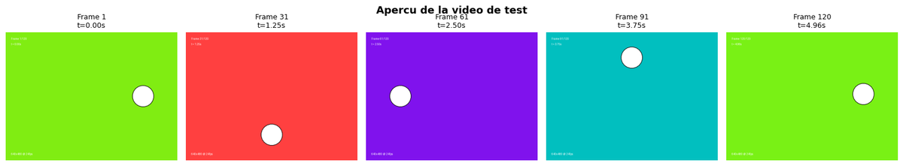
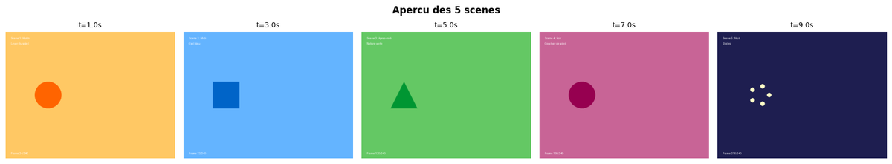
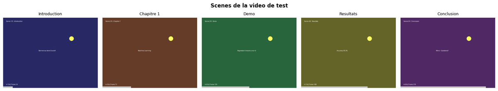
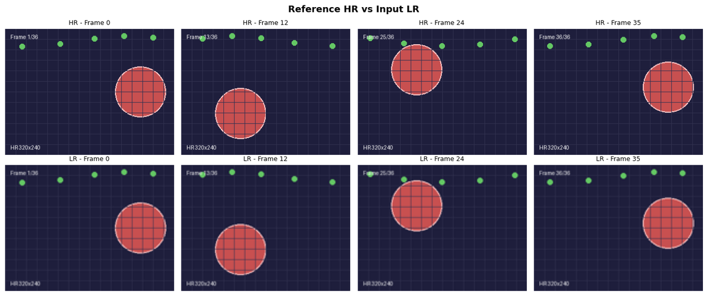
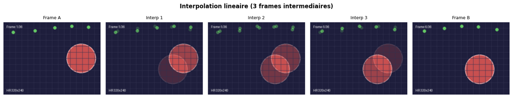
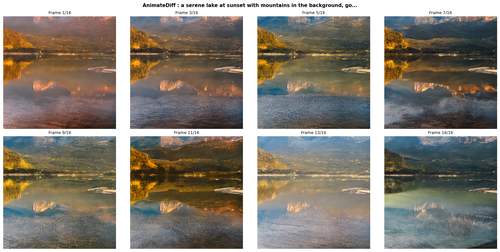

# 01-Foundation - Bases Vidéo & Compréhension

[← Documentation Video](../README.md) | [↑ ..](../README.md) | [→ Video Advanced](../02-Advanced/)

Ce module couvre les fondamentaux de la vidéo par IA : opérations vidéo, compréhension vidéo, et amélioration.

**Dans le cadre du fil rouge pipeline vidéo pédagogique** : avant de générer des vidéos, il faut savoir les analyser et les manipuler. [01-1](01-1-Video-Operations-Basics.ipynb) donne les bases techniques (ffmpeg, moviepy). [01-2](01-2-Comprehension-Video-API.ipynb) et [01-3](01-3-Comprehension-Video-Locale.ipynb) couvrent la compréhension vidéo (décomposition en scènes, Q&A sur le contenu). [01-4](01-4-Video-Enhancement.ipynb) améliore la qualité visuelle. [01-5](01-5-Generation-Text-to-Video-Intro.ipynb) introduit la génération de mouvement à partir de texte.

## Comment lire ce README

- Vous voulez **le socle technique** : [01-1](01-1-Video-Operations-Basics.ipynb) seul suffit pour découper, redimensionner, extraire l'audio et concaténer — les carnets suivants ingèrent tous ses sorties.
- Vous voulez **extraire du sens d'une vidéo** : [01-2](01-2-Comprehension-Video-API.ipynb) (GPT-5, analyse libre structurée) puis [01-3](01-3-Comprehension-Video-Locale.ipynb) (Qwen-VL, extraction structurée : scènes, entités, transitions) — deux approches du même problème, à comparer.
- Vous voulez **améliorer ou générer** : [01-4](01-4-Video-Enhancement.ipynb) (upscale spatial et interpolation temporelle) ou [01-5](01-5-Generation-Text-to-Video-Intro.ipynb) (texte → courte animation) ; le [bonus 01-1b](01-1b-Video-Slideshow-Bonus.ipynb) est un espace d'exercice facultatif, hors parcours.

Cette navigation par niveaux suit le principe des séries à plusieurs vitesses décrit dans [« Choisir sa vitesse de lecture »](https://github.com/jsboige/CoursIA#choisir-sa-vitesse-de-lecture).

## Vue d'overview

| Statistique | Valeur |
|-------------|--------|
| Notebooks | 6 (dont 1 bonus optionnel) |
| Kernel | Python 3 |
| Durée estimée | ~4-6h (+ 15 min bonus optionnel) |
| GPU requis | 0-12GB |

## Cinq opérations fondamentales

Ce module pose les fondamentaux du pipeline vidéo : opérations techniques (ffmpeg, moviepy), compréhension vidéo (GPT-5, Qwen-VL), amélioration de qualité (ESRGAN) et génération de mouvement (AnimateDiff). Plutôt qu'une mosaïque-bloc en tête de README, chaque opération est illustrée **dans le contexte narratif où elle sert** — une figure par concept, le paragraphe qui l'interprète adjacent. Doctrine **#5780** : pas de galerie générique, l'image **accompagne** la prose.

### Manipulation technique (ffmpeg, moviepy)

Le notebook [01-1-Video-Operations-Basics](01-1-Video-Operations-Basics.ipynb) part d'une vidéo de test (5 secondes, 24 fps, 120 frames) et expose les primitives du traitement : découpage, changement de résolution, extraction audio, concatenation. C'est le socle sans lequel les notebooks de compréhension (01-2, 01-3) et d'amélioration (01-4) ne peuvent rien ingérer.

<p align="center"></p>

*Figure extraite du notebook 01-1 (cellule 8, output 3). La grille présente 5 frames échantillonnées à intervalle régulier (t = 0.00s, 1.25s, 2.50s, 3.75s, 4.96s) sur une vidéo synthétique 5 secondes. Chaque frame change de couleur de fond (vert, rouge, violet, cyan, vert) et le cercle blanc se déplace à différentes positions — un terrain jouet volontairement contrasté pour valider visuellement que les opérations de découpage, sous-échantillonnage et concatenation préservent l'ordre temporel. La figure documente la capacité de moviepy à produire une mosaïque-frames à partir d'une source `.mp4`, pas le contenu sémantique de la vidéo.*

### Compréhension vidéo avec GPT-5

Une fois la vidéo techniquement manipulable, on veut en extraire du sens. Le notebook [01-2-Comprehension-Video-API](01-2-Comprehension-Video-API.ipynb) soumet une vidéo pédagogique à GPT-5 et lui demande d'en produire une analyse structurée : identification des scènes, transcription des sous-titres, Q&A sur le contenu. C'est le pont entre manipulation bas-niveau et compréhension haut-niveau.

<p align="center"></p>

*Figure extraite du notebook 01-2 (cellule 8, output 2). La mosaïque présente les 5 scènes extraites d'une vidéo pédagogique — chaque scène a un fond de couleur distinct (orange, bleu, vert, rose, bleu nuit), un objet géométrique différent (cercle, carré, triangle, cercle, 5 cercles) et un sous-titre identifiant la phase pédagogique (Intro, Concept clé, Démonstration, Résultats, Conclusion). Cette structure répétitive scène-sous-titre est exactement ce que GPT-5 détecte pour produire une analyse temporelle segmentée. Limitation illustrative assumée : la figure documente la **structure** d'une vidéo analysable par GPT-5 (variation de couleur + sous-titres), pas le contenu textuel de l'analyse GPT-5 elle-même (voir cellules 9-18 du notebook pour la sortie JSON structurée du modèle).*

### Analyse multimodale avec Qwen-VL

GPT-5 est généraliste ; Qwen-VL est spécialisé multimodal. Le notebook [01-3-Comprehension-Video-Locale](01-3-Comprehension-Video-Locale.ipynb) pousse plus loin : annotation automatique des scènes, Q&A ciblé, détection des entités visuelles (texte, objets, transitions). Utile quand on a besoin d'une extraction structurée plutôt que d'une analyse libre.

<p align="center"></p>

*Figure extraite du notebook 01-3 (cellule 10, output 2). La vidéo source est un mini-cours découpé en 5 segments titrés (Introduction, Chapitre 1, Demo, Résultats, Conclusion), chacun sur un fond de couleur distinct et marqué par un point jaune central (la zone d'attention que Qwen-VL doit suivre). Les sous-titres incrustés en bas de chaque frame donnent le contexte sémantique que Qwen-VL doit corréler avec la perception visuelle. Limitation illustrative assumée : la figure montre la vidéo **à analyser**, pas la sortie Qwen-VL — le JSON produit par le modèle est dans les cellules 11-15 du notebook.*

### Amélioration qualité avec ESRGAN

Quand la vidéo source est basse résolution (LR), on peut l'upscaller (vers HR) avec Real-ESRGAN, un réseau convolutif entraîné sur des paires LR/HR. Le notebook [01-4-Video-Enhancement](01-4-Video-Enhancement.ipynb) couvre deux usages : l'**upscale spatial** (chaque frame gagne en résolution) et l'**interpolation temporelle** (de nouvelles frames sont insérées entre deux frames existantes pour fluidifier le mouvement).

<p align="center"></p>

*Figure extraite du notebook 01-4 (cellule 8, output 3). La grille 2×4 juxtapose la version HR (Réference, ligne haute, HR320x240) et la version LR (Input, ligne basse, LR320x240) sur 4 frames échantillonnées (Frame 0, 12, 24, 35). Les frames HR portent un quadrillage blanc qui matérialise la grille de pixels upscale ; les frames LR sont plus pixelisées sur les bords du cercle rouge et des points verts. L'écart visuel entre les deux lignes illustre ce qu'ESRGAN apprend à reconstruire : textures fines, contours nets, séparation des objets superposés. Limitation illustrative assumée : la résolution HR reste 320×240 (l'upscale est de 1× ici à des fins pédagogiques — un upscale 4× est traité dans les cellules 12-18 du notebook avec un vrai modèle Real-ESRGAN chargé).*

<p align="center"></p>

*Figure extraite du notebook 01-4 (cellule 16, output 1). L'interpolation linéaire entre Frame A (Frame 1/36, début de la séquence) et Frame B (Frame 6/36, fin) produit 3 frames intermédiaires (Interp 1, 2, 3) où deux cercles rouges se superposent — l'un hérité de A, l'autre de B — montrant la transition continue des positions. C'est l'opération duale de l'upscale spatial : au lieu d'augmenter la résolution des pixels, on **augmente la fréquence temporelle** en synthétisant les frames manquantes. Limitation illustrative assumée : l'interpolation linéaire produit un fantôme visible (deux cercles semi-transparents superposés) ; un modèle d'interpolation par flux optique (RIFE, FILM) produit une fusion nette et est traité dans les cellules 17-22 du notebook.*

### Génération de mouvement avec AnimateDiff

Jusqu'ici on **analyse** ou **améliore** des vidéos existantes. AnimateDiff va plus loin : à partir d'un prompt textuel, il **génère** une vidéo courte (≈16 frames à 8 fps, soit 2 secondes) en injectant un module d'attention temporelle dans un UNet Stable Diffusion pré-entraîné. Le notebook [01-5-Generation-Text-to-Video-Intro](01-5-Generation-Text-to-Video-Intro.ipynb) montre comment combiner un prompt descriptif, un scheduler et un nombre de frames pour produire une animation cohérente.

<p align="center"></p>

*Figure extraite du notebook 01-5 (cellule 10, output 3). L'animation représente un lac au coucher de soleil avec des montagnes en arrière-plan, rendue dans un style painterly/pastel caractéristique des modèles Stable Diffusion + module AnimateDiff. Les 8 frames échantillonnées (Frame 1, 3, 5, 7, 9, 11, 13, 16 sur 16, via `np.linspace`) montrent une variation subtile de la lumière et de la position des reflets — le mouvement est continu mais lent, signature typique d'AnimateDiff sur 16 frames. Limitation illustrative assumée : la qualité visuelle varie entre frames (l'une des frames du milieu porte un artefact de flou) et la cohérence personnage-objets est limitée — AnimateDiff est adapté aux paysages et ambiances, pas aux scènes avec personnages articulés (limitation traitée dans les cellules 11-14 du notebook).*

## Notebooks

Référence tabulaire (Durée, Service, VRAM) pour les carnets de ce niveau — le tableau complète le narratif sans le répéter, et ajoute le bonus optionnel 01-1b que les figures ne présentent pas :

| # | Notebook | Contenu | Service | VRAM | Ce qu'on y apprend |
|---|----------|---------|---------|------ |--------------------|
| 1 | [01-1-Video-Operations-Basics](01-1-Video-Operations-Basics.ipynb) | Opérations de base (FFmpeg, moviepy) | Local | 0 | Découper, redimensionner, extraire l'audio et concaténer une vidéo — les primitives que les autres carnets ingèrent |
| 2 | [01-2-Comprehension-Video-API](01-2-Comprehension-Video-API.ipynb) | Compréhension vidéo | OpenAI API | 0 | Obtenir une analyse structurée d'une vidéo par GPT-5 : scènes, sous-titres, Q&A |
| 3 | [01-3-Comprehension-Video-Locale](01-3-Comprehension-Video-Locale.ipynb) | Analyse vidéo multimodale | Qwen | Variable | Extraire des annotations structurées (entités, transitions) avec un VLM spécialisé, et comparer avec l'analyse libre |
| 4 | [01-4-Video-Enhancement](01-4-Video-Enhancement.ipynb) | Amélioration qualité | Real-ESRGAN | ~4GB | Upscaler chaque frame et interpoler entre frames — deux opérations duales, avec leurs limites visibles |
| 5 | [01-5-Generation-Text-to-Video-Intro](01-5-Generation-Text-to-Video-Intro.ipynb) | Introduction à l'animation | AnimateDiff | ~12GB | Générer une courte animation depuis un prompt textuel en injectant de l'attention temporelle |

> **Provenance des figures** : [`assets/readme/MANIFEST.md`](assets/readme/MANIFEST.md) documente le notebook source, la cellule, l'output, le format, les dimensions et le poids de chaque PNG utilisé ci-dessus. Les 6 figures sont extraites des **outputs déjà committés** des notebooks (règle C.3 : aucune re-exécution) et respectent la borne EPIC #5654 (≤200 KB/fichier, ≤1200 px max-dim).

## Prérequis

### API Keys
```bash
# Dans GenAI/.env
OPENAI_API_KEY=sk-...
```

### Dépendances
```bash
pip install -r requirements.txt
pip install -r requirements-video.txt
```

### Logiciels système
- FFmpeg (pour le traitement vidéo)
- FFmpeg-python (Python binding)

## Progression recommandée

1. **01-1-Video-Operations-Basics** - Bases du traitement vidéo
2. **01-2-Comprehension-Video-API** - Intelligence vidéo
3. **01-3-Comprehension-Video-Locale** - Analyse multimodale
4. **01-4-Video-Enhancement** - Amélioration qualité
5. **01-5-Generation-Text-to-Video-Intro** - Animation de base

## Bonus optionnel — [01-1b, créer un slideshow vidéo](01-1b-Video-Slideshow-Bonus.ipynb)

Ce carnet prolonge l'exercice de montage de 01-1 : il sert d'espace de travail pour assembler des frames dessinées avec PIL en vidéo avec `imageio`, puis présente des exemples guidés. Il est facultatif et ne constitue pas une étape du parcours principal : passez directement de 01-1 à 01-2 pour suivre le fil manipulation → compréhension → amélioration → génération.

## Points clés

- **Formats supportés** : MP4, AVI, MOV, MKV
- **Résolutions** : 720p à 4K
- **Qualité** : ESRGAN pour upscale, AnimateDiff pour animation
- **Performance** : Traitement local CPU ou GPU selon les modèles

## Approfondissements

- **Manipulation → compréhension → amélioration → génération** : l'ordre recommandé ci-dessus est aussi l'ordre des dépendances — 01-2/01-3 consomment les vidéos produites par 01-1, et 01-4 s'applique aux sorties des précédents.
- **Les successeurs de niveau** : les modèles génératifs de pointe (HunyuanVideo, LTX, Wan, SVD, CogVideoX) et l'étude de licence MiniMax H3 vivent dans [02-Advanced](../02-Advanced/README.md) ; ce niveau garde les fondamentaux et un seul générateur d'introduction (AnimateDiff).
- **La provenance des figures** : [`assets/readme/MANIFEST.md`](assets/readme/MANIFEST.md) documente, pour chaque PNG, le carnet, la cellule et l'output source — les figures sont extraites des outputs déjà committés (règle C.3, aucune ré-exécution).

## Ressources

- [Documentation Video principale](../README.md)
- [Guide FFmpeg](01-1-Video-Operations-Basics.ipynb)
- [ComfyUI pour Video](../03-Orchestration/)
