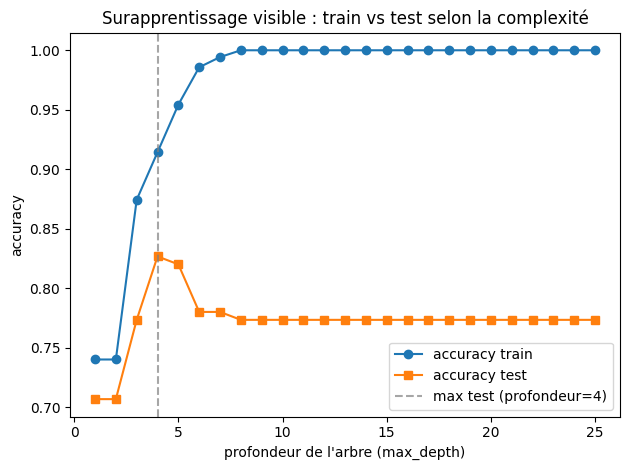
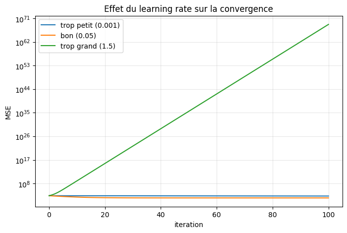
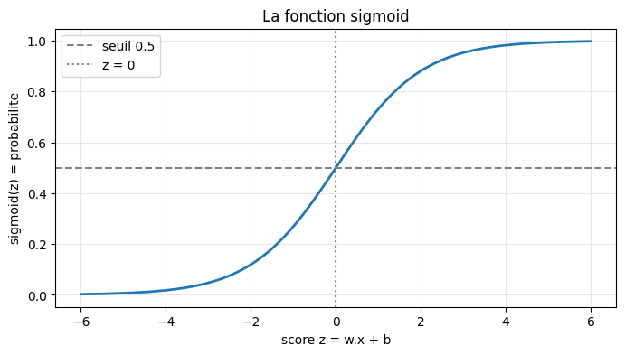
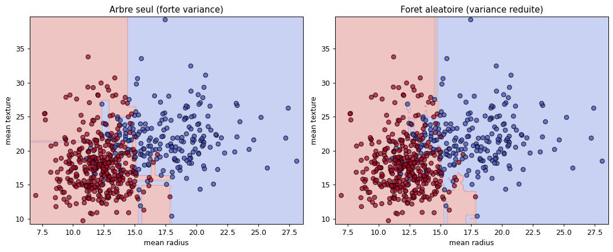
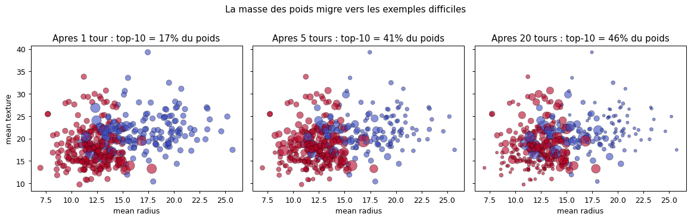
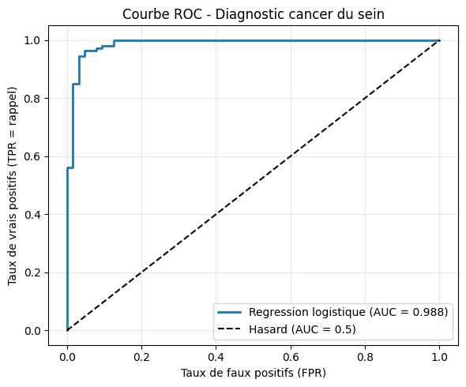
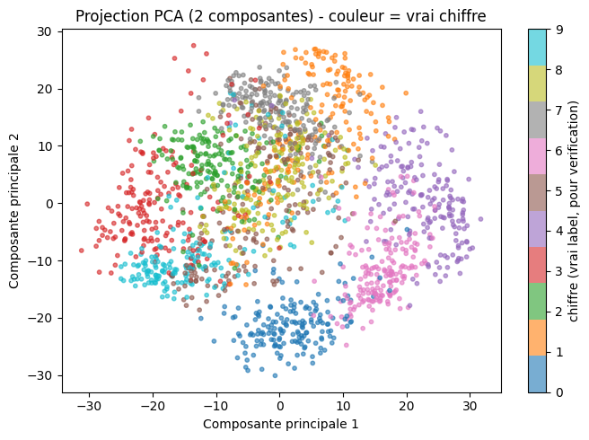
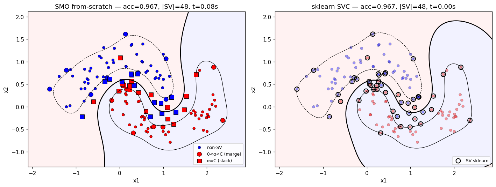
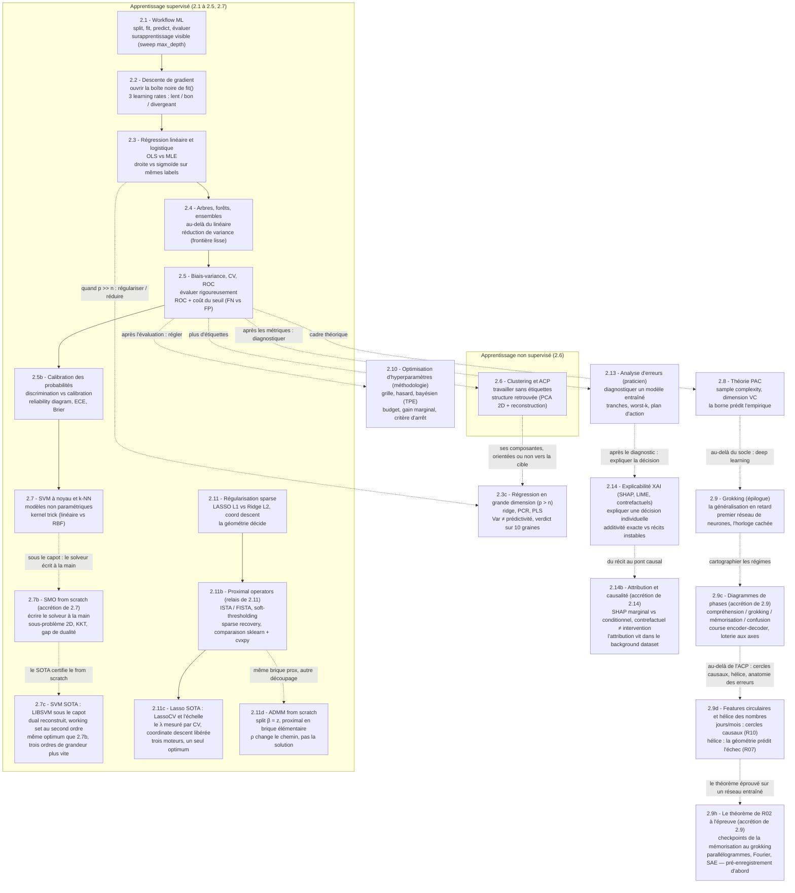

# 02-ML-Cours — Le socle Machine Learning canonique avec scikit-learn

[← DataScienceWithAgents (série parente)](../README.md) | [01-Python-For-Data-Science (prérequis) →](../01-Python-For-Data-Science/README.md)

**Kernel** : Python 3 · **Bibliothèque** : scikit-learn · **Niveau** : intermédiaire (post NumPy/Pandas)

**Environnement** : CPython 3.13 — `pip install -r [requirements.txt](requirements.txt)` installe toutes les dépendances de la série (relevées par imports : scikit-learn, optuna, shap, lime, dice-ml, diffprivlib, cvxpy, imbalanced-learn, umap-learn, statsmodels, torch). Sans lui, 2.10 / 2.12 / 2.14 / 2.14b / 2.15 lèvent une `ImportError` dès la première cellule.

## Pourquoi cette série — découverte

La formation `DataScienceWithAgents` saute aujourd'hui un maillon. Après les fondations NumPy/Pandas ([`01-Python-For-Data-Science`](../01-Python-For-Data-Science/README.md)), les *labs agentic* (LangChain, Google ADK) demandent à des agents LLM de produire et d'exécuter du code de data science — y compris du machine learning. Mais entre les deux, **aucun notebook n'enseigne le workflow ML, un modèle ou une métrique comme un sujet en soi** : scikit-learn n'apparaît que comme une séquence magique non expliquée (un `fit()` isolé dans un lab de visualisation, ou cité en litteral dans une chaîne LLM).

Cette série comble ce socle manquant. Elle pose, **à la main et de façon canonique**, les huit chapitres fondamentaux du machine learning supervisé et non supervisé — le référent qui rend *jugeable* ce qu'un agent produira ensuite. L'arc pédagogique suit la progression classique : le **workflow** d'ensemble, puis on ouvre les boîtes noires (**descente de gradient**, **fonction de lien**), on élargit la famille de modèles (**régression linéaire/logistique**, **arbres et ensembles**, **SVM à noyau et k plus proches voisins**), on formalise l'évaluation (**biais-variance, validation croisée, ROC, calibration des probabilités**), puis l'on bascule en **non supervisé** (**clustering, ACP**), avant de clore par le **cadre théorique** (**théorie PAC, dimension VC**). Chaque notebook rend visible un concept-phare — le surapprentissage, la divergence d'un learning rate, la frontière de décision, la réduction de variance, le coût d'un seuil, le kernel trick, la structure retrouvée sans étiquettes, et le nombre d'exemples suffisant pour généraliser.

La thèse est volontairement classique : on ne peut évaluer ce qu'un agent génère comme pipeline scikit-learn que si l'on sait soi-même ce que `fit()` minimise, pourquoi un arbre surapprend, et ce que mesure une AUC. Cette série fournit ce référent, en gardant les outils à leur juste place (vraies API scikit-learn, exécutées, sorties réelles committées).

## Comment lire ce README — découverte

Le principe [« Choisir sa vitesse de lecture »](../../../../README.md#choisir-sa-vitesse-de-lecture) distingue trois vitesses de lecture, qui suivent le même fil : le parcours principal, les approfondissements et la recherche.

- **Vous découvrez** : lisez les numéros nus du parcours principal, de 2.1 à 2.15, dans l'ordre, sans ouvrir une seule lettre. Ils forment à eux seuls le fil du socle : le workflow, l'optimisation, la famille de modèles, l'évaluation, le non supervisé, le cadre théorique, puis le geste du praticien.
- **Vous creusez un palier** : la section « Approfondissements » présente palier par palier ce que le carnet du palier montre et mesure, puis ce que chaque carnet **lettré** y ajoute — les accrétions 2.3b à 2.3d, 2.4b, 2.5b à 2.5d, 2.7b à 2.7c, 2.8b à 2.8d, 2.9b à 2.9h, 2.11b à 2.11f et 2.14b — et ce que chaque carnet **jumeau** (C#, Rust, Lean) apporte à côté.
- **Vous cherchez la recherche ou l'outillage** : « Références transverses » donne les travaux canoniques ancrés dans la série, « Pour aller plus loin » (au bas de ce README) donne les prolongements ; « Prérequis » et « Installation » donnent les prérequis et les noyaux.

Chaque section annonce son public dans son titre : découverte, Licence, recherche ou tous niveaux. Les jumeaux Python et C# d'un même carnet partagent leur numéro : choisissez l'implémentation, pas le contenu.

## Parcours principal — Licence

Les numéros nus forment le fil de la sous-série : le workflow d'abord, puis l'optimisation et la famille de modèles, l'évaluation, le non supervisé et le cadre théorique, enfin le geste du praticien (diagnostiquer, expliquer, protéger). Les carnets lettrés ne sont pas des étapes : ils approfondissent un palier et se lisent sous « Approfondissements », qui donne pour chacun son noyau, son jeu de données et ce qu'il ajoute.

| # | Notebook | Ce qu'on y apprend | Public et prérequis | Pour approfondir |
|---|---|---|---|---|
| 2.1 | [2.1-Workflow-ML](2.1-Workflow-ML.ipynb) | Le workflow ML (split → fit → predict → évaluer) et le surapprentissage rendu visible par un balayage `max_depth` 1 → 25 | Licence. Noyau `python3`. Données synthétiques `make_*`. Point d'entrée : NumPy et Pandas suffisent. | [Autour de 2.1](#autour-de-21) : le carnet en détail. |
| 2.2 | [2.2-Descente-de-gradient](2.2-Descente-de-gradient.ipynb) · [C#](2.2-Descente-de-gradient-CSharp.ipynb) | Ouvrir la boîte noire de `fit()` : trois learning rates (lent / bon / **divergeant**) sur la même fonction de coût | Licence. Noyau `python3` ; le jumeau C# tourne sous `.net-csharp`. Données synthétiques `make_regression`. | [Autour de 2.2](#autour-de-22) : le carnet et son jumeau C#. |
| 2.3 | [2.3-Regression-lineaire-logistique](2.3-Regression-lineaire-logistique.ipynb) | Régression linéaire (OLS) contre logistique (MLE) : la droite ou la sigmoïde sur les mêmes labels binaires | Licence. Noyau `python3`. Notions de dérivée, de variance et de probabilité. | [Autour de 2.3](#autour-de-23) : [2.3b](#autour-de-23) · [2.3c](#autour-de-23) · [2.3d](#autour-de-23). |
| 2.4 | [2.4-Arbres-Forets-Ensembles](2.4-Arbres-Forets-Ensembles.ipynb) | Arbres, forêt aléatoire, gradient boosting : la réduction de variance, frontière en escalier contre frontière lissée | Licence. Noyau `python3`. Jeu réel `load_breast_cancer`. | [Autour de 2.4](#autour-de-24) : [2.4b](#autour-de-24). |
| 2.5 | [2.5-Biais-Variance-CV-ROC](2.5-Biais-Variance-CV-ROC.ipynb) · [C#](2.5-Biais-Variance-CV-ROC-CSharp.ipynb) | Compromis biais-variance, validation croisée, ROC/AUC et le coût du seuil (faux négatifs contre faux positifs) | Licence. Noyau `python3` ; jumeau C# sous `.net-csharp`. Jeu réel `load_breast_cancer`. | [Autour de 2.5](#autour-de-25) : [2.5b](#autour-de-25) · [2.5c](#autour-de-25) · [2.5d](#autour-de-25). |
| 2.6 | [2.6-Clustering-KMeans-PCA](2.6-Clustering-KMeans-PCA.ipynb) · [Rust](2.6-Clustering-KMeans-PCA-Rust.ipynb) | Apprentissage non supervisé : KMeans et ACP, la structure retrouvée sans étiquettes (projection 2D et reconstruction) | Licence. Noyau `python3` ; le jumeau Rust tourne sous `rust` (crate `smartcore`). Jeu réel `load_digits`. | [Autour de 2.6](#autour-de-26) : le carnet et son jumeau Rust. |
| 2.7 | [2.7-Modeles-Non-Parametriques](2.7-Modeles-Non-Parametriques.ipynb) · [Rust](2.7-Modeles-Non-Parametriques-Rust.ipynb) | SVM à noyau et k plus proches voisins : le kernel trick rendu visible (linéaire contre RBF sur les demi-lunes) | Licence. Noyau `python3` ; jumeau Rust sous `rust`. Données `make_moons` et jeu réel `load_breast_cancer`. | [Autour de 2.7](#autour-de-27) : [2.7b](#autour-de-27) · [2.7c](#autour-de-27) et le jumeau Rust. |
| 2.8 | [2.8-Theorie-PAC](2.8-Theorie-PAC.ipynb) | Théorie PAC : sample complexity et dimension VC, la borne qui prédit l'erreur empirique | Licence. Noyau `python3`. Arithmétique et logarithmes suffisent. | [Autour de 2.8](#autour-de-28) : [2.8b](#autour-de-28) · [2.8c](#autour-de-28) · [2.8d](#autour-de-28). |
| 2.9 | [2.9-Grokking-Generalisation](2.9-Grokking-Generalisation.ipynb) | Épilogue : le grokking, la généralisation qui arrive en retard, et l'horloge cachée que révèle l'ACP | Licence. Noyau `python3` (PyTorch, quelques minutes sur CPU). Amorce du [3.5 — Phénomènes de généralisation](../03-Deep-Learning/3.5-Phenomenes-de-Generalisation.ipynb). | [Autour de 2.9](#autour-de-29) : [2.9b](#autour-de-29) · [2.9c](#autour-de-29) · [2.9d](#autour-de-29) · [2.9e](#autour-de-29) · [2.9f](#autour-de-29) · [2.9g](#autour-de-29) · [2.9h](#autour-de-29). |
| 2.10 | [2.10-Optimisation-Hyperparametres](2.10-Optimisation-Hyperparametres.ipynb) | La méthodologie du réglage : grille, hasard, bayésien (TPE) — et le critère d'arrêt qui économise le budget | Licence. Noyau `python3` ; exige Optuna, donc `requirements.txt`. MLP sur `make_classification`. | [Autour de 2.10](#autour-de-210) : le carnet en détail. |
| 2.11 | [2.11-Regularisation-Sparse-LASSO](2.11-Regularisation-Sparse-LASSO.ipynb) | Régularisation sparse : LASSO (L1, polyèdre) contre Ridge (L2, boule), coord descent, sélection de λ, cas pathologique de colinéarité | Licence. Noyau `python3`. Design synthétique `design_sparse(n, p, k, snr)`. | [Autour de 2.11](#autour-de-211) : [2.11b](#autour-de-211) · [2.11c](#autour-de-211) · [2.11d](#autour-de-211) · [2.11e](#autour-de-211) · [2.11f](#autour-de-211). |
| 2.12 | [2.12-Donnees-Desequilibrees](2.12-Donnees-Desequilibrees.ipynb) | Classes déséquilibrées : la métrique qui ment (accuracy contre PR), les stratégies de rééchantillonnage, le seuil par coût | Licence. Noyau `python3` ; exige `imbalanced-learn`, donc `requirements.txt`. Classe positive à ~3 %. | [Autour de 2.12](#autour-de-212) : le carnet en détail. |
| 2.13 | [2.13-Analyse-Erreurs](2.13-Analyse-Erreurs.ipynb) · [C#](2.13-Analyse-Erreurs-CSharp.ipynb) | Le geste du praticien : diagnostiquer un modèle entraîné (tranches, worst-k, plan d'action) | Licence. Noyau `python3` ; jumeau C# sous `.net-csharp`. Dataset télécom synthétique (churn, incident d'étiquetage). | [Autour de 2.13](#autour-de-213) : le carnet et son jumeau C#. |
| 2.14 | [2.14-Explicabilite-SHAP-LIME-Contrefactuels](2.14-Explicabilite-SHAP-LIME-Contrefactuels.ipynb) | Expliquer une décision individuelle : SHAP (arbre et noyau), LIME, contrefactuels DiCE — et leurs limites communes | Licence. Noyau `python3` ; exige `shap` et `lime`, donc `requirements.txt`. Jeu réel German Credit (credit-g, 1000×21, CSV vendé). | [Autour de 2.14](#autour-de-214) : [2.14b](#autour-de-214). |
| 2.15 | [2.15-Donnee-Comme-Responsabilite-Python](2.15-Donnee-Comme-Responsabilite-Python.ipynb) | La donnée comme responsabilité : inférence d'appartenance menée pour de vrai, confidentialité différentielle (DP-SGD écrit à la main contre diffprivlib), datasheet et model card | Licence. Noyau `python3` ; exige `diffprivlib`, donc `requirements.txt`. Jeu réel `load_breast_cancer`. | [Autour de 2.15](#autour-de-215) : le carnet en détail. |

## Approfondissements — Licence et lectures avancées

Chaque palier a sa sous-section : ce que le carnet du palier montre et mesure, son noyau et son jeu de données, puis ce que chaque carnet lettré et chaque carnet jumeau y ajoutent.

### Autour de 2.1

Le geste de départ de toute la série : un workflow en quatre temps, et un surapprentissage que l'on regarde au lieu de le subir.

**2.1** — [2.1-Workflow-ML](2.1-Workflow-ML.ipynb)

- *Ce qu'on y apprend* : le workflow ML (split → fit → predict → évaluer) et le surapprentissage rendu visible par un balayage `max_depth` 1 → 25.
- *Noyau* : python3. *Dataset* : synthétique `make_*`.

### Autour de 2.2

La boîte noire de `fit()` : ce que minimise l'optimisation, et le scalier qui la fait diverger.

**2.2** — [2.2-Descente-de-gradient](2.2-Descente-de-gradient.ipynb) · [C#](2.2-Descente-de-gradient-CSharp.ipynb)

- *Ce qu'on y apprend* : trois learning rates (lent / bon / **divergeant**) sur la même fonction de coût — la frontière entre convergence et divergence tient à un seul scalaire.
- *Noyau* : python3 (jumeau : .net-csharp). *Dataset* : synthétique `make_regression`.

Le jumeau [2.2 — Descente de gradient C#](2.2-Descente-de-gradient-CSharp.ipynb) accompagne la [version Python](2.2-Descente-de-gradient.ipynb). Les gradients et mises à jour sont calculés en C# ; Python.NET appelle les vrais générateurs et estimateurs scikit-learn. Les figures SVG montrent les mêmes expériences et seuils.

### Autour de 2.3

La famille linéaire, puis ses trois variantes : le bayésien génératif, la grande dimension et le modèle gaussien.

**2.3** — [2.3-Regression-lineaire-logistique](2.3-Regression-lineaire-logistique.ipynb)

- *Ce qu'on y apprend* : régression linéaire (OLS) contre logistique (MLE) — une droite ou une sigmoïde sur les mêmes labels binaires.
- *Noyau* : python3. *Dataset* : synthétique `make_*`.

Les carnets suivants approfondissent ce palier.

- **2.3b** — [2.3b-Naive-Bayes-Generatif](2.3b-Naive-Bayes-Generatif.ipynb) · [C#](2.3b-Naive-Bayes-Generatif-CSharp.ipynb) · [Rust](2.3b-Naive-Bayes-Generatif-Rust.ipynb)
  - *Ce qu'on y apprend* : bayésien naïf génératif contre régression logistique discriminative — modéliser P(x|y) puis Bayes, ou P(y|x) directement ; l'hypothèse d'indépendance peut modifier le compromis biais–variance.
  - *Noyau* : python3 (jumeaux : .net-csharp, rust). *Dataset* : synthétique, corrélations homogènes et en bloc.
  - *Jumeau Rust* : le [2.3b — Naive Bayes génératif Rust](2.3b-Naive-Bayes-Generatif-Rust.ipynb) écrit d'abord le classifieur gaussien à la main — ajustement des moyennes et des variances par classe, log-densité calculée terme à terme, décision par argmax — puis le confronte au `GaussianNB` de `smartcore` (version 0.7.0) sous le kernel `rust` : sur le même échantillon, les deux modèles rendent les mêmes prédictions et la même précision (0,965). Les cartes ASCII remplacent les figures et portent la courbe d'accuracy en fonction de la taille d'échantillon : sur les corrélations homogènes, le génératif part devant puis se fait rejoindre, le croisement tombant vers n = 480 ; sur les corrélations en bloc, où l'hypothèse d'indépendance est fausse, la logistique reste devant et l'écart ne se referme pas quand n grandit. Le carnet Python ne montre pas le croisement du premier scénario : son écart se resserre sans changer de signe. La différence vient de la règle d'étiquette, pas du générateur de nombres aléatoires (xorshift64 et Box-Muller, en remplacement de `numpy.random`) : dans le portage Rust, l'étiquette dépend des variables avant tout décalage de classe, dans le carnet Python elle est tirée à pile ou face. Les niveaux absolus diffèrent ; le registre de conformité compare le signe de l'écart aux budgets où il ne dépend pas de la graine du scénario. Les trois exercices restent à compléter.
- **2.3c** — [2.3c-Regression-Grande-Dimension](2.3c-Regression-Grande-Dimension.ipynb) · [C#](2.3c-Regression-Grande-Dimension-CSharp.ipynb) · [Rust](2.3c-Regression-Grande-Dimension-Rust.ipynb)
  - *Ce qu'on y apprend* : le régime p > n — ridge, PCR (composantes principales) et PLS (composantes supervisées) ; la variance d'une direction de X ne suffit pas à établir sa valeur prédictive.
  - *Noyau* : python3 (jumeaux : .net-csharp, rust). *Dataset* : synthétique, blocs corrélés, SEED=42.
  - *Mesure* : sur ce tirage, la PLS atteint son meilleur score en 5 composantes et la PCR en 44.
  - *Jumeau Rust* : le [2.3c — Régression en grande dimension Rust](2.3c-Regression-Grande-Dimension-Rust.ipynb) recalcule le régime p > n sous le kernel `rust`, sans bibliothèque tierce : 205 variables pour 120 observations d'entraînement, rang 119 = n − 1 et 86 directions dans le noyau de XᵀX ; puis ridge par validation croisée (λ = 1, RMSE test 0,2094 contre 0,2206 pour OLS), PCR et PLS écrites à la main — la PLS atteint dès 5 composantes (RMSE 0,1909) ce que la PCR n'atteint qu'à 45 (à k = 5, PCR 0,967 contre PLS 0,191, soit 5,1× d'écart à budget égal), et les loadings montrent la première composante d'ACP répartir sa masse sur le bloc leurre (11,20 contre 0,34 sur le bloc signal) là où la PLS la concentre sur le signal (1,85). Le verdict est donné par régime (leurre et aligné), puis robustesse sur dix graines, où l'OLS min-norme arrive dernier 7 fois sur 10 dans le régime leurre. Les trois exercices restent à compléter.

> **La grande dimension.** Le notebook [2.3c](2.3c-Regression-Grande-Dimension.ipynb) ouvre le régime que le 2.3 ne faisait qu’annoncer (VIF 52) : p = 205 variables pour n = 120 observations. La variance d'une direction de X ne suffit pas à établir sa valeur prédictive : l’ACP (donc la PCR) trie par Var et atteint sa composante la plus chargée en bloc B à l'indice 38 (rang 39) ; la PLS trie par Cov et le capture en 5 composantes (RMSE test 0.244 contre 0.942 à budget égal), loadings à l’appui. Ridge (λ par CV) rend le problème déterminé et referme la promesse du 2.3. Sur les dix graines du protocole (section 9bis), les moyennes favorisent PLS et PCR dans le leurre, et ridge dans l'aligné. Les k sont choisis sur le leurre puis réutilisés sur l'aligné ; la standardisation du train complet précède les plis internes.

- **2.3d** — [2.3d-Modele-Gaussien-LDA-QDA](2.3d-Modele-Gaussien-LDA-QDA.ipynb) · [C#](2.3d-Modele-Gaussien-LDA-QDA-CSharp.ipynb)
  - *Ce qu'on y apprend* : le modèle gaussien, l'analyse discriminante linéaire (LDA) contre quadratique (QDA) — c'est l'hypothèse de covariance, partagée ou propre, qui décide linéaire ou quadratique.
  - *Noyau* : python3 (jumeau : .net-csharp). *Dataset* : synthétique `make_*`, régimes contrôlés.

> **La frontière, signature de l'hypothèse.** Le notebook [2.3d](2.3d-Modele-Gaussien-LDA-QDA.ipynb) tisse le pont génératif que la série laissait en creux entre [2.3](2.3-Regression-lineaire-logistique.ipynb) (OLS vs logistique) et [2.3b](2.3b-Naive-Bayes-Generatif.ipynb) (hypothèse d'indépendance) : il dérive la frontière depuis la log-densité gaussienne et montre que c'est **l'hypothèse de covariance** — partagée vs propre — qui décide linéaire ou quadratique. Mesure phare : sur des régimes contrôlés, QDA devance LDA de **+5.7 pts** dans le régime B étudié ; avec `n_c=30`, la covariance empirique devient singulière à `d=30` (rang mesuré 29) : selon le solveur et sa version, le calcul QDA peut échouer ou fournir un résultat avec avertissement. Le concept-phare n'est pas une course d'accuracy mais la **signature d'une hypothèse** — et le prix de la flexibilité (`O(d²)` pour QDA) devient une singularité. Cross-référé à [2.3b](2.3b-Naive-Bayes-Generatif.ipynb) et [2.6](2.6-Clustering-KMeans-PCA.ipynb).

### Autour de 2.4

Au-delà du linéaire : les arbres, l'ensemble, et la réduction de variance rendue géométrique.

**2.4** — [2.4-Arbres-Forets-Ensembles](2.4-Arbres-Forets-Ensembles.ipynb)

- *Ce qu'on y apprend* : arbres, forêt aléatoire et gradient boosting — la frontière en escalier d'un arbre seul contre la frontière lissée de l'ensemble.
- *Noyau* : python3. *Dataset* : réel `load_breast_cancer`.

- **2.4b** — [2.4b-AdaBoost-From-Scratch](2.4b-AdaBoost-From-Scratch.ipynb)
  - *Ce qu'on y apprend* : AdaBoost (SAMME) écrit à la main — stump à erreur pondérée, vote α = ½ln((1−ε)/ε), repondération des exemples, borne d'erreur ∏2√(ε(1−ε)) vérifiée.
  - *Noyau* : python3. *Dataset* : réel `load_breast_cancer`.
  - *Mesure* : les poids rendus visibles — la masse migre vers les exemples difficiles, l'escalier du comité émerge des demi-plans pondérés.

### Autour de 2.5

Évaluer rigoureusement : le compromis, la validation croisée, la ROC et le coût du seuil — puis la fiabilité des probabilités, l'équité entre sous-groupes et la dérive au déploiement.

**2.5** — [2.5-Biais-Variance-CV-ROC](2.5-Biais-Variance-CV-ROC.ipynb) · [C#](2.5-Biais-Variance-CV-ROC-CSharp.ipynb)

- *Ce qu'on y apprend* : compromis biais-variance, validation croisée, ROC/AUC et le coût du seuil (faux négatifs contre faux positifs).
- *Noyau* : python3 (jumeau : .net-csharp). *Dataset* : réel `load_breast_cancer`.

Les carnets suivants approfondissent ce palier.

- **2.5b** — [2.5b-Calibration-Probabilites](2.5b-Calibration-Probabilites.ipynb) · [C#](2.5b-Calibration-Probabilites-CSharp.ipynb)
  - *Ce qu'on y apprend* : calibration des probabilités — reliability diagrams, ECE, Brier ; pourquoi 0.87 n'est pas 87 % de chances.
  - *Noyau* : python3 (jumeau : .net-csharp). *Dataset* : réel `load_breast_cancer`.
  - *Mesure* : discrimination contre calibration, et la diagonale du reliability diagram.
- **2.5c** — [2.5c-Equite-Sous-Groupes](2.5c-Equite-Sous-Groupes.ipynb) · [C#](2.5c-Equite-Sous-Groupes-CSharp.ipynb)
  - *Ce qu'on y apprend* : équité par sous-groupe — parité démographique, equalized odds, les tensions conditionnelles entre calibration et taux d'erreur (Chouldechova), et le post-traitement par seuils par groupe (Hardt).
  - *Noyau* : python3 (jumeau : .net-csharp). *Dataset* : synthétique contrôlé (2 groupes, prévalences réglables).
  - *Mesure* : l'accuracy globale ne suffit pas — 96,4 % global coexiste avec deux groupes à [0,977–0,995] et [0,922–0,957].
- **2.5d** — [2.5d-Derive-Distribution-Deploiement](2.5d-Derive-Distribution-Deploiement.ipynb)
  - *Ce qu'on y apprend* : dérive de distribution au déploiement — trois dérives construites volontairement (covariable, étiquette, concept), chacune mesurée par l'écart entre ce que la validation croisée annonce et ce que le déploiement produit ; trois détecteurs (test à deux échantillons, classifieur discriminant, MMD) réimplémentés puis confrontés à `alibi-detect`.
  - *Noyau* : coursia-drift. *Dataset* : synthétique contrôlé (régimes entraînement/déploiement réglables).
  - *Mesure* : deux dérives sur trois se corrigent — la covariable par pondération d'importance, l'étiquette par BBSE ; la dérive de concept ne se corrige pas sans nouvelles étiquettes, et le carnet le montre.

### Autour de 2.6

Travailler sans étiquettes : la structure retrouvée, et ce que le portage Rust recalcule à la main.

**2.6** — [2.6-Clustering-KMeans-PCA](2.6-Clustering-KMeans-PCA.ipynb) · [Rust](2.6-Clustering-KMeans-PCA-Rust.ipynb)

- *Ce qu'on y apprend* : apprentissage non supervisé — KMeans et ACP, la structure retrouvée sans étiquettes (projection 2D et reconstruction).
- *Noyau* : python3 (jumeau : rust). *Dataset* : réel `load_digits`.

Le jumeau [2.6 — Clustering et ACP Rust](2.6-Clustering-KMeans-PCA-Rust.ipynb) accompagne la [version Python](2.6-Clustering-KMeans-PCA.ipynb). KMeans, l'ACP, DBSCAN et le clustering hiérarchique sont ajustés par la crate `smartcore` (version 0.7.0) sous le kernel `rust` ; les chiffres manuscrits sont lus par `smartcore::dataset`. Ce que scikit-learn rend d'un appel y est recalculé à la main — l'inertie depuis les étiquettes de cluster, la part de variance expliquée depuis les colonnes projetées, la reconstruction `mu + z · V`, l'indice de Rand ajusté et ses témoins — parce que la crate ne les expose pas. Les figures de la source deviennent des tables et des vignettes ASCII : la courbe du coude devient une colonne de gains, la matrice de confusion une table de contingence. Sur les demi-lunes et les anneaux, KMeans échoue là où DBSCAN et le clustering hiérarchique à lien simple réussissent. La section t-SNE et UMAP de la source n'est pas portée et le dit : aucune crate du lot de portage ne la porte. Les exercices restent à compléter, et un registre de conformité compare les sorties des deux carnets.

### Autour de 2.7

Les modèles non paramétriques, leur solveur écrit à la main, et la comparaison au SOTA.

**2.7** — [2.7-Modeles-Non-Parametriques](2.7-Modeles-Non-Parametriques.ipynb) · [Rust](2.7-Modeles-Non-Parametriques-Rust.ipynb)

- *Ce qu'on y apprend* : SVM à noyau et k plus proches voisins — le kernel trick rendu visible (linéaire contre RBF sur les demi-lunes).
- *Noyau* : python3 (jumeau : rust). *Dataset* : synthétique `make_moons` et réel `load_breast_cancer`.

Les carnets suivants approfondissent ce palier.

- **2.7b** — [2.7b-SMO-From-Scratch](2.7b-SMO-From-Scratch.ipynb) · [C#](2.7b-SMO-From-Scratch-CSharp.ipynb)
  - *Ce qu'on y apprend* : SMO (Platt) écrit à la main — sous-problème 2D (dont la branche dégénérée `η ≤ 0`), cascade de working set, KKT et gap de dualité.
  - *Noyau* : python3 (jumeau : .net-csharp). *Dataset* : synthétique `make_moons`.
  - *Mesure* : le solveur écrit à la main retrouve sklearn — même biais à 4·10⁻⁴ près, gap de dualité ≈ 3·10⁻³, pire violation KKT ponctuelle ≈ 10⁻³.
- **2.7c** — [2.7c-SVM-SOTA-Comparison](2.7c-SVM-SOTA-Comparison.ipynb) · [C#](2.7c-SVM-SOTA-Comparison-CSharp.ipynb)
  - *Ce qu'on y apprend* : le SOTA (LIBSVM sous `sklearn.svm.SVC`) lu sous le capot — dual reconstruit depuis `dual_coef_`, gap de dualité et violations KKT mesurés sur LIBSVM, working set au second ordre et shrinking, tolérance d'arrêt comme contrat.
  - *Noyau* : python3 (jumeau : .net-csharp). *Dataset* : synthétique `make_moons` (graine de 2.7b).
  - *Mesure* : le SOTA n'achète pas la solution, il achète le temps — même optimum et mêmes 48 supports que la SMO maison, trois ordres de grandeur plus vite (fit sub-milliseconde contre 1,19 s) ; les deux solveurs s'arrêtent à `tol` près.

> **Le SOTA côté SVM, la boîte noire ouverte.** Le notebook [2.7c](2.7c-SVM-SOTA-Comparison.ipynb) applique au SVM la règle pratique de l'EPIC optimisation convexe ([#16061](https://github.com/jsboige/CoursIA/issues/16061), bloc B.5) : *from scratch pour comprendre, SOTA pour produire* — et il montre que les deux se **certifient mutuellement**. Sur le même terrain que 2.7b (graine près), LIBSVM (`sklearn.svm.SVC`) rend exactement le même classifieur : même accuracy (0,967), mêmes 48 supports, écart de score de décision déjà mesuré à 0,005 en 2.7b — mais **trois ordres de grandeur plus vite** (fit sub-milliseconde contre 1,19 s de la boucle Python). Le geste distinctif : le dual que `SVC` ne rend pas se **reconstruit** depuis `dual_coef_` (contrainte `Σ α_i y_i` exacte à `10⁻¹⁶`), et le gap de dualité comme les violations KKT se mesurent sur LIBSVM exactement comme sur la SMO maison — les deux solveurs s'arrêtent à `tol = 10⁻³` près, chacun avec son critère. Le notebook détaille aussi ce que LIBSVM fait que la cascade de Platt ne fait pas (working set au second ordre, shrinking, cache de noyau) et l'exercice 3 pose le geste de production : `GridSearchCV` sur `C × gamma`.

Le jumeau [2.7 — Modèles non paramétriques Rust](2.7-Modeles-Non-Parametriques-Rust.ipynb) accompagne la [version Python](2.7-Modeles-Non-Parametriques.ipynb). SVM et k plus proches voisins sont ajustés par la crate `smartcore` (version 0.7.0) sous le kernel `rust` ; le jeu de données du cancer du sein est lu par `smartcore::dataset`. Les cartes ASCII tiennent lieu de figures et retrouvent les mêmes enseignements : la frontière droite du SVM linéaire sur les demi-lunes, le surajustement à k = 1, la déformation que la standardisation corrige. Les demi-lunes et les cercles viennent d'un générateur maison : les précisions sont proches de celles du carnet Python, non identiques. Les trois exercices restent à compléter, et un registre de conformité compare les sorties des deux carnets.

### Autour de 2.8

Le cadre théorique, et ses trois compagnons : la preuve Lean, la carte transversale numérique, et le perceptron exécuté.

**2.8** — [2.8-Theorie-PAC](2.8-Theorie-PAC.ipynb)

- *Ce qu'on y apprend* : théorie PAC — sample complexity et dimension VC ; la borne prédit l'erreur empirique.
- *Noyau* : python3. *Dataset* : synthétique `make_*`.

Les carnets suivants approfondissent ce palier.

- **2.8b** — [2.8b-Theorie-PAC-Lean](2.8b-Theorie-PAC-Lean.ipynb)
  - *Ce qu'on y apprend* : la même borne, **démontrée** plutôt que mesurée — Hoeffding, borne de l'union, ERM, complexité d'échantillon, avec les noms de déclarations du lake.
  - *Noyau* : lean4-wsl. *Dataset* : aucun (arithmétique exacte).
- **2.8c** — [2.8c-Borne-Temoin-Concentration](2.8c-Borne-Temoin-Concentration.ipynb)
  - *Ce qu'on y apprend* : Novikoff, témoin extrémal et Hoeffding bilatérale sur des instances seedées — la carte transversale et le compagnon numérique Python.
  - *Noyau* : coursia-ml-training. *Dataset* : synthétique seedé.
- **2.8d** — [2.8d-Lean-Novikoff-Convergence](2.8d-Lean-Novikoff-Convergence.ipynb)
  - *Ce qu'on y apprend* : la moitié Perceptron du lake, **exécutée** — Novikoff `n·γ² ≤ R²`, ses deux lemmes, son témoin de saturation, interrogés en direct.
  - *Noyau* : lean4-wsl. *Dataset* : aucun (arithmétique exacte).

> **Les compagnons formels et numériques.** Le notebook [2.8b](2.8b-Theorie-PAC-Lean.ipynb) tourne sous kernel **Lean 4** (`lean4-wsl`) et suit module par module la moitié statistique du lake [`learning_theory_lean/`](../../learning_theory_lean/README.md). Là où 2.8 *observe* que la borne PAC prédit la courbe d'erreur empirique, 2.8b en rend les étapes exécutables — `expect`/Markov, MGF de Bernoulli, Hoeffding, borne de l'union, ERM, complexité d'échantillon — avec les **noms de déclarations du lake**. Le compagnon [2.8d](2.8d-Lean-Novikoff-Convergence.ipynb) fait de même pour la **moitié Perceptron** : borne de Novikoff `n·γ² ≤ R²`, lemmes de croissance et témoin de saturation, interrogés en direct sous `lean4-wsl`, avec une dynamique rejouée sur entiers. Entre eux, [2.8c](2.8c-Borne-Temoin-Concentration.ipynb) reste la **carte transversale et le compagnon numérique Python** : il rejoue en NumPy la borne, le témoin et Hoeffding sous kernel `coursia-ml-training`. Ainsi, 2.8c mesure sur des instances explicites tandis que 2.8b et 2.8d certifient les énoncés généraux. C'est la même paire empirique/formel que la série ML annonce dans sa section [Formalisations Lean](../../README.md#formalisations-lean) (EPIC #11703). Le compagnon [2.9f](2.9f-Grokking-Theorie-Effective-Lean.ipynb) porte le même geste sur l'autre versant du lake — le module `EffectiveTheory` (théorie effective de la représentation, R02) : là où le carnet `SL-1b` de la série `SymbolicAI/SymbolicLearning` (§8) présente ces déclarations par `#check`, 2.9f les **instancie** (`prop1_zeroLoss` monté en `example`, `parallelogram_iff_eq` employé comme réécriture, `#print axioms` pour l'intégrité de la preuve) et **mesure** sur un embedding entraîné l'identité d'Euler que `loss0_grad_dot_self` démontre — une preuve sans mesure ne dit pas que le modèle étudié est dans son domaine, une mesure sans preuve ne dit pas pourquoi elle tient.

### Autour de 2.9

L'épilogue et ses sept accrétions : la théorie effective, la carte des phases, la géométrie du latent, l'extraction de programme, la vérité comme direction, et le théorème à l'épreuve d'un réseau entraîné.

**2.9** — [2.9-Grokking-Generalisation](2.9-Grokking-Generalisation.ipynb)

- *Ce qu'on y apprend* : le grokking — la généralisation qui surgit longtemps *après* la mémorisation parfaite — et l'**horloge cachée** que l'ACP révèle (embeddings rangés en cercle après le grok).
- *Noyau* : python3 (PyTorch, quelques minutes sur CPU). *Dataset* : synthétique `(a+b) mod 97`.

> **Épilogue — au-delà du socle scikit-learn.** Les huit chapitres ci-dessus posent le socle canonique. Le notebook [2.9](2.9-Grokking-Generalisation.ipynb) fait un pas de côté vers le **deep learning** : il entraîne le premier réseau de neurones de la série (PyTorch, quelques minutes sur CPU) pour montrer le **grokking** — la généralisation qui surgit longtemps *après* la mémorisation parfaite, un phénomène que la borne PAC (2.8) ne laissait pas prévoir — et réutilise l'ACP du 2.6 pour révéler la structure apprise. Il joue le rôle d'**amorce** : le traitement canonique — montage réécrit en NumPy pur (gradient à la main), contre-témoin isolant le weight-decay, double descente — est le [3.5 — Phénomènes de généralisation](../03-Deep-Learning/3.5-Phenomenes-de-Generalisation.ipynb) de la série Deep Learning, dont les exercices portent les leviers classiques (weight-decay, seuil de données) ; ceux du 2.9 lui sont propres (horloge, modulus, dimension d'embedding). Son accrétion [2.9b](2.9b-GenEFT-Theorie-Effective.ipynb) apporte la contrepartie théorique — **GenEFT**, la théorie effective de la généralisation : la longueur en bits de la relation fixe la **fraction critique** de données, et la dynamique encodeur/décodeur (les « repons », leur quantité conservée) prédit une **frontière arctan** entre mémorisation et généralisation qui ne dépend que du ratio des learning rates — le grokking devient un régime calculable. Son accrétion [2.9c](2.9c-Grokking-Diagrammes-Phases.ipynb) fait la **cartographie** : les quatre phases de l'apprentissage définies par la théorie effective de R02 (Liu, Michaud & Tegmark 2022) — compréhension, grokking, mémorisation, confusion — mesurées sur un toy à decoder appris multi-seed (le grokking y apparaît comme une **zone frontière** entre compréhension et mémorisation, pas un régime à rechercher), confirmées sur MNIST (App J), puis relues par le **ticket de loterie aux axes** (App K) — où le ticket se révèle **forgé par l'entraînement** plutôt qu'hérité de l'initialisation.

Les carnets suivants approfondissent ce palier.

- **2.9b** — [2.9b-GenEFT-Theorie-Effective](2.9b-GenEFT-Theorie-Effective.ipynb)
  - *Ce qu'on y apprend* : GenEFT (Baek, Liu & Tegmark 2024) — bits de description, fraction critique, gap inductif, puis la dynamique des « repons ».
  - *Noyau* : python3. *Dataset* : synthétique (graphe de connaissances n=30 : mod 3, mod 5, greater-than, biparti).
  - *Mesure* : le ratio des learning rates décide — frontière arctan (Théorème 3), diagramme de phase en pente −1, règle η_dec/η_enc ≲ 10.
- **2.9c** — [2.9c-Grokking-Diagrammes-Phases](2.9c-Grokking-Diagrammes-Phases.ipynb)
  - *Ce qu'on y apprend* : la cartographie de R02 — les 4 phases (compréhension, grokking, mémorisation, confusion), la course encoder/decoder, RQI et généralisation par parallélogrammes, grokking MNIST, ticket de loterie aux axes.
  - *Noyau* : python3. *Dataset* : synthétique `(a+b)` non modulaire et réel MNIST (1 000 exemples, App J).
  - *Mesure* : le grokking est une zone frontière — carte des phases multi-seed (Table 1 exacte) où le grokking apparaît coincé entre compréhension et mémorisation.

> **La carte des phases du grokking.** L'accrétion [2.9c](2.9c-Grokking-Diagrammes-Phases.ipynb) transforme la courbe isolée du 2.9 en cartographie, avec les critères **exacts** de la Table 1 de R02 (seuils 90 %, retard 10³ steps). Le toy à decoder hard-codé ne peut **pas** mémoriser : RQI = 1.000 et validation parfaite à toute fraction de données, et la généralisation par **parallélogrammes** dAcc borne inférieurement l'accuracy réelle (0.609 ≤ 0.890 à 25 % des paires, convergence à 75 %) sans toucher au jeu de validation. Sur le toy à decoder appris (100 runs multi-seed vectorisés en ~36 s), la carte learning-rate-decoder × fraction révèle le grokking comme **une seule cellule frontière** entre compréhension et mémorisation, sur un paysage d'accuracy continue (0.03 → 0.90) — pas un régime à rechercher, un symptôme de réglage. Sur MNIST (App J : 1 000 exemples, MSE one-hot, tête lente), un seul levier sépare les phases : init ×10 → mémorisation figée (train 1.000, val 0.130 sur 25 000 steps), init standard → compréhension (val 0.905, seuil 60 % franchi au step 500). Et le **ticket de loterie aux axes** (App K) referme le questionnement du 2.9 : la structure circulaire n'est **pas** en germe à l'initialisation (corrélation circulaire r = 0.075 ≈ bruit) — le ticket est forgé — mais la solution vit sur peu d'axes : 10 directions sur 32 suffisent à 0.930 d'accuracy (protocole Fig 22 exact : projection sur les n PCs du final, reconstruction, decoder gelé).

- **2.9d** — [2.9d-Features-Circulaires-Helice-Nombres](2.9d-Features-Circulaires-Helice-Nombres.ipynb)
  - *Ce qu'on y apprend* : features circulaires des jours/mois (R10, Engels et al.) et hélice des nombres (R07, Kantamneni & Tegmark) sur modèles-jouets white-box — ACP des activations, intervention causale par rotation, FFT des états cachés.
  - *Noyau* : coursia-ml-training (GPU). *Dataset* : synthétique `days/months later`, `(a+b) mod 97`, `a+b` (0..149).
  - *Mesure* : la géométrie latente prédit les échecs — une droite à R²=0.974 condamne l'addition linéaire à 6.8 % (le modèle : ~100 %) ; les erreurs se concentrent à ±5, un tour de l'horloge dominante.

> **Les cercles et l'hélice — la géométrie du latent.** Le notebook [2.9d](2.9d-Features-Circulaires-Helice-Nombres.ipynb) poursuit l'épilogue en remontant d'un cran : si l'horloge du 2.9 est un cercle, ces cercles sont-ils des objets de calcul à part entière — et que deviennent les nombres hors du monde modulaire ? Deux papiers de la même école servent de fil. **R10** (Engels et al., ICLR 2025) : les jours et les mois vivent sur des **features circulaires irréductibles**, causalement actives chez Mistral 7B — tourner la représentation décale la réponse. **R07** (Kantamneni & Tegmark) : les entiers vivent sur une **hélice** — une massue linéaire enroulée d'horloges périodiques — et cette géométrie **prédit les performances avant toute prédiction**. Sur des modèles-jouets entraînés from scratch (white-box total, kernel GPU `coursia-ml-training` comme le 2.8c), le notebook mesure chaque pièce : le cercle des jours, déformé en ACP brute mais causal (rotation 6/7 de tour → +2 jours cohérents 7/7) ; le cercle des mois au même montage ; l'horloge mod-97 rangée à la fréquence dominante k\*=35 (R²=0.998 là où l'ACP naïve à la fréquence 1 donne ~0) mais **sans plan causal unique** (rotation : 0 % — négatif honnête, contrasté avec les LLM du papier) ; le contrepoint P=7 ; l'hélice de l'addition 0..149 avec les horloges **mesurées** du jouet (T ≈ 2.4/3.4/5.4, pas les {2,5,10,100} héritées de Qwen) ; la punchline de l'annexe E (une droite explique R²=0.974 de la représentation, donc l'addition linéaire échoue : 6.8 % contre ~100 % pour le modèle — le modèle comme **code correcteur d'erreurs**) ; et l'anatomie des erreurs de l'annexe F (88 % des erreurs à ±5, exactement un tour de l'horloge dominante T=5.36 — le quantum d'erreur d'un modèle qui calcule en trigonométrie). Les exercices portent les indices d'irréductibilité S(f) et Mϵ(f) de R10 et le test du χ² sur quanta arbitraires.

- **2.9e** — [2.9e-MIPS-Extraction-Programme](2.9e-MIPS-Extraction-Programme.ipynb)
  - *Ce qu'on y apprend* : MIPS — extraire le programme qu'un réseau entraîné implémente déjà (Michaud et al. 2024, [arXiv:2402.05110](https://arxiv.org/abs/2402.05110)).
  - *Noyau* : python3. *Dataset* : synthétique `s + t` sur 6 bits.
  - *Mesure* : du réseau au programme vérifié — états cachés → machine à états → autoencodeur booléen (les $4!$ assignations essayées) → régression symbolique → **ripple-carry adder**, vérifié exhaustivement.
- **2.9f** — [2.9f-Grokking-Theorie-Effective-Lean](2.9f-Grokking-Theorie-Effective-Lean.ipynb)
  - *Ce qu'on y apprend* : le module `EffectiveTheory` (théorie effective de la représentation, R02), **instancié** — `prop1_zeroLoss` monté en `example`, `parallelogram_iff_eq` employé comme réécriture, `#print axioms` lu, identité d'Euler du théorème `loss0_grad_dot_self` **mesurée** sur un embedding effectivement entraîné.
  - *Noyau* : lean4-wsl. *Dataset* : aucun (arithmétique exacte).
  - *Mesure* : les parallélogrammes et la conservation de `Z₀` cessent d'être des signatures pour devenir des théorèmes appliqués et des quantités vérifiées.
- **2.9g** — [2.9g-Geometrie-de-la-Verite](2.9g-Geometrie-de-la-Verite.ipynb)
  - *Ce qu'on y apprend* : la vérité comme direction géométrique (Marks & Tegmark, COLM 2024) — sondes MM/LR, PCA ancrée par label, patching et interventions NIE sur la paire Qwen 1.5B (base Math contre R1-Distill) et un regard 7B 4-bit ; carnet descendu de la série ICT (ex-ICT-22c, #16741), l'organe `ict/probes` reste sa source.
  - *Noyau* : coursia-ml-training. *Dataset* : officiels cities / sp_en_trans / larger_than / likely (saprmarks).
  - *Mesure* : la négation tue le transfert (0,49) et les énoncés+négations le réparent (0,74) — la vérité vit dans une direction, pas dans le token.

> **La vérité comme direction.** L’accrétion [2.9g](2.9g-Geometrie-de-la-Verite.ipynb) descend de la série ICT (ex-ICT-44, puis ICT-22c — mouvement 2 de la redescente #16741) et porte la question du 2.9d à l’échelle des LLM : un modèle croit-il ce qu’il dit ? Marks & Tegmark (COLM 2024) montrent que la vérité d’un énoncé vit dans une **direction de l’espace latent** — sondes MM/LR, PCA ancrée par label, patching, interventions NIE honnêtes — sur la paire Qwen 1.5B (base Math vs R1-Distill) et un regard 7B 4-bit. L’organe `ict/probes` (PCA ancrée, sondes) reste dans la série ICT, qui continue de le porter.

- **2.9h** — [2.9h-Grokking-Theoreme-Checkpoints-SAE-Python](2.9h-Grokking-Theoreme-Checkpoints-SAE-Python.ipynb)
  - *Ce qu'on y apprend* : le théorème de R02 (que le [2.9f](2.9f-Grokking-Theorie-Effective-Lean.ipynb) démontre en Lean) mis à l'épreuve sur **un** réseau entraîné — checkpoints de la mémorisation au grokking, hypothèses de `prop1_zeroLoss` vérifiées check par check, recensement des parallélogrammes approchés (tolérance pré-enregistrée, le checkpoint mémorisant sert de nul, contrôles positifs et nuls en tête) et SAE de la méthode [PT-15b](../../../GenAI/PostTraining/PT_15b_geometrie_features_sae.ipynb) (`ict.sae_dictionary.TopKSae`) entraîné sur les activations, interrogé sur la structure de Fourier prédite.
  - *Noyau* : coursia-ml-training. *Dataset* : synthétique `(a+b) mod 97` (recette 2.9c, CPU).
  - *Mesure* : le théorème ne s'applique pas tel quel, et le négatif se rapporte tel quel — le réseau est `MLP(E a + E b)`, pas `Dec(E a + E b)` ; la théorie est donc éprouvée dans sa *prédiction structurelle* (parallélogrammes, fréquences), pas sous la forme du théorème ; les deux issues affaiblissantes sont écrites **avant** la première mesure.

> **Le théorème à l'épreuve d'un réseau entraîné.** L'accrétion [2.9h](2.9h-Grokking-Theoreme-Checkpoints-SAE-Python.ipynb) revient sur l'arc R02 ouvert par le [2.9c](2.9c-Grokking-Diagrammes-Phases.ipynb) et le [2.9f](2.9f-Grokking-Theorie-Effective-Lean.ipynb) : sur **un** réseau de la recette 2.9c (addition modulaire P=97, CPU), il suit une série de checkpoints de la mémorisation au grokking et vérifie **numériquement, check par check**, les hypothèses du théorème instancié en Lean (`prop1_zeroLoss`) ; il recense les parallélogrammes approchés à une tolérance déclarée d'avance — le checkpoint **mémorisant sert de nul**, les contrôles positifs et nuls passent en tête — et entraîne un SAE de la méthode [PT-15b](../../../GenAI/PostTraining/PT_15b_geometrie_features_sae.ipynb) (`ict.sae_dictionary.TopKSae`) sur les activations du réseau pour voir si ses features récupèrent la structure de Fourier prédite. Les deux issues qui affaibliraient l'affirmation sont écrites **avant** la première mesure, et les négatifs se rapportent tels quels.

### Autour de 2.10

La méthodologie du réglage, faite honnêtement : ce que coûte chaque stratégie, et quand s'arrêter.

**2.10** — [2.10-Optimisation-Hyperparametres](2.10-Optimisation-Hyperparametres.ipynb)

- *Ce qu'on y apprend* : la méthodologie du réglage — grille, hasard, bayésien (TPE) — et le critère d'arrêt qui économise le budget.
- *Noyau* : python3 (exige Optuna). *Dataset* : synthétique `make_classification` (MLP).

> **La méthodologie du réglage.** Le notebook [2.10](2.10-Optimisation-Hyperparametres.ipynb) assume le rôle que le 2.13 laisse en creux — celui du « tourneur d'hyperparamètres » — et le fait **honnêtement** : un espace de recherche mixte (continu, discret, conditionnel) sur un MLP, un budget commun de 45 essais, et les trois stratégies superposées sur la courbe *meilleur score vs nombre d'essais* (médiane sur 3 graines, bande min–max). La grille exhaustive y explose en dimension (6300 configurations, 0.7 % couvertes), le hasard tient l'argument de couverture de Bergstra & Bengio, et le search bayésien (TPE/Optuna, **consommé**, pas réécrit) s'installe dès le premier tiers du budget. Le vrai concept-phare est le **critère d'arrêt** : un gain marginal explicite (arrêter si le meilleur n'a pas gagné δ sur les K derniers essais) qui économise 21 à 31 essais sur 45 pour un coût de 2 à 8 millièmes d'AUC. C'est la méthodologie transverse que réutilisent les sweeps du ML-Training-Pipeline et l'ablation du Lab14.

### Autour de 2.11

La chaîne de l'optimisation convexe : LASSO, opérateurs proximaux, comparaison au SOTA, ADMM, déclaratif, et la synthèse.

**2.11** — [2.11-Regularisation-Sparse-LASSO](2.11-Regularisation-Sparse-LASSO.ipynb)

- *Ce qu'on y apprend* : régularisation sparse — LASSO (L1, polyèdre) contre Ridge (L2, boule), coord descent, sélection de λ, cas pathologique de colinéarité (ElasticNet).
- *Noyau* : python3. *Dataset* : synthétique `design_sparse(n, p, k, snr)`.
- *Mesure* : la géométrie décide — polyèdre L1 → sparsity (sélection de variables), boule L2 → shrink continu ; sur features corrélées, LASSO est arbitraire et ElasticNet stabilise.

> **La régularisation sparse.** Le notebook [2.11](2.11-Regularisation-Sparse-LASSO.ipynb) comble le trou que la série laissait en suspens entre [2.3c](2.3c-Regression-Grande-Dimension.ipynb) (Ridge L2 en grande dimension) et [2.10](2.10-Optimisation-Hyperparametres.ipynb) (méthodologie du réglage, où LassoCV apparaissait en passant) : la **géométrie** de la contrainte — boule L2 pour Ridge (shrink continu) vs polyèdre L1 pour LASSO (sparsity, sélection de variables). Sur 50 features dont 5 vraiment actives (SNR ≈ 4), LASSO retrouve ~80-100 % du support actif en 5-7 coefficients non-nuls, Ridge distribue les poids sur les 50. La **coord descent** from-scratch (10-50 itérations, soft-thresholding `S(z,λ) = sign(z)·max(|z|-λ, 0)`) est validée à 1e-3 près contre `sklearn.linear_model.Lasso`. **LassoCV** sélectionne λ automatiquement (grille logspace + CV 5 folds, sub-seconde). Le **cas pathologique** : sur 3 paires de features corrélées à ρ = 0.7, LASSO devient **arbitraire** (alterne `b₀ = 0` ou `b₁ = 0` selon le tirage) ; **ElasticNet** (`l1_ratio = 0.7`) distribue le poids sur les deux features de chaque paire — la **règle pratique** : ElasticNet dès que des features corrélées sont attendues. Le **chemin de régularisation** `β(λ)` trace l'arrivée progressive des features : λ grand → 0 non-nuls, λ intermédiaire → les 5 vraies features, λ petit → bruit. Le tout avec 3 exercices (C.1 stubs) sur le λ qui tue la sélection, le SNR faible où Ridge bat LASSO en MSE, et la stabilité d'ElasticNet sur paires corrélées.

Les carnets suivants approfondissent ce palier.

- **2.11b** — [2.11b-Proximal-Operators-From-Scratch](2.11b-Proximal-Operators-From-Scratch.ipynb) · [C#](2.11b-Proximal-Operators-From-Scratch-CSharp.ipynb)
  - *Ce qu'on y apprend* : opérateurs proximaux — ISTA (forward-backward splitting) et FISTA (inertie de Nesterov, `O(1/k²)`) pour le Lasso.
  - *Noyau* : python3 (jumeau : .net-csharp). *Dataset* : synthétique, sparse recovery `n=200, p=500, k=30`.
  - *Mesure* : quatre solveurs convergent vers la même solution — ISTA, FISTA, `sklearn.Lasso` (coord descent) et `cvxpy` CLARABEL (SOCP) donnent tous `‖x−x*‖₂ ≈ 0.13` ; FISTA gagne ~k fois en itérations vs ISTA.

> **Les opérateurs proximaux.** Le notebook [2.11b](2.11b-Proximal-Operators-From-Scratch.ipynb) prend le **relais algorithmique** que le 2.11 (LASSO coord descent) laissait en suspens : comment minimiser un objectif composite `f(x) + λ·‖x‖₁` où `f` est lisse et `‖x‖₁` ne l'est pas ? **ISTA** alterne un pas de gradient sur `f` et un **soft-thresholding** `S_λ(x) = sign(x)·max(|x|−λ, 0)` ; **FISTA** ajoute l'inertie de Nesterov et passe d'une convergence `O(1/k)` à `O(1/k²)`. Le notebook pose un problème de **sparse recovery** canonique (signal `x* ∈ ℝ^500` à `k=30` coefficients actifs, `n=200` mesures bruitées, ratio `n/p = 0.40`) et confronte **quatre solveurs** sur le même problème : ISTA from-scratch (numpy), FISTA from-scratch (numpy), `sklearn.Lasso` (coordinate descent) et `cvxpy` CLARABEL (SOCP, vérité terrain). Mesure : les quatre convergent vers la même solution à `‖x−x*‖₂ ≈ 0.13` près (rappel du support ≈ 93 %), FISTA gagne un facteur `~k` en itérations vs ISTA, et `sklearn.Lasso` reste le plus rapide (coord descent par colonne). Trois exercices (C.1 stubs) ferment le notebook : soft-thresholding vectorisé sur matrice, ISTA avec backtracking de Lipschitz (Beck & Teboulle 2009 Algo 3.1), et FISTA sur **Elastic Net proximal** (L1 + ridge). Pont direct vers 2.11 (Lasso coord descent) et 2.7b (SMO, autre solveur d'un problème dual).

- **2.11c** — [2.11c-Lasso-SOTA-Comparison](2.11c-Lasso-SOTA-Comparison.ipynb)
  - *Ce qu'on y apprend* : le SOTA du bloc LASSO — coordinate descent from scratch (le moteur réel de `sklearn.Lasso`), `LassoCV` pour le λ, mise à l'échelle `p` croissant (500 → 4000).
  - *Noyau* : python3. *Dataset* : synthétique (même problème sparse que 2.11b, seed partagé).
  - *Mesure* : le λ se mesure, il ne se déclare pas — LassoCV retient ~100× le seuil Donoho-Johnstone théorique (λ ≈ 0,25 contre 0,0125) et restitue la parcimonie juste (30 non-nuls, 26/30 du support) là où l'a priori surestime (92).

> **Le λ mesuré, le SOTA libéré.** Le notebook [2.11c](2.11c-Lasso-SOTA-Comparison.ipynb) referme le geste SOTA côté Lasso, symétrique du [2.7c](2.7c-SVM-SOTA-Comparison.ipynb) côté SVM : la **coordinate descent from scratch** y est écrite comme le *moteur réel* de `sklearn.Lasso` (pas une réimplémentation jouet — le même algorithme, `α = λ/n` près), puis `LassoCV` prend le relais pour le choix de λ. La mesure phare est un désaveu de l'a priori : le seuil universel de Donoho-Johnstone (`λ = 0.0125`) surestime le support (92 non-nuls, vérité : 30), quand la CV retient `λ ≈ 0.25` — **cent fois le théorique** — et restitue la parcimonie juste (30 non-nuls, 26/30 du support). Les trois moteurs (ISTA, CD scratch, sklearn) coïncident à l'objectif près (`10⁻⁶`) et à `4·10⁻³` en solution, et l'échelle `p` (500 → 4000) montre le **quand SOTA** : à `p=4000`, ISTA vectorisé et sklearn convergent au même ordre (~0,2 s) quand la boucle Python paie ~1 s — le from scratch est la compréhension, le SOTA est l'échelle.

- **2.11d** — [2.11d-Optimisation-ADMM-From-Scratch](2.11d-Optimisation-ADMM-From-Scratch.ipynb) · [C#](2.11d-Optimisation-ADMM-From-Scratch-CSharp.ipynb)
  - *Ce qu'on y apprend* : ADMM from scratch — split `β = z`, opérateur proximal en brique élémentaire, pré-factorisation Cholesky, balayage du paramètre `ρ`.
  - *Noyau* : python3 (jumeau : .net-csharp). *Dataset* : synthétique (design AR(1) corrélé, formulation `β = z` scindée).
  - *Mesure* : un seul optimum, plusieurs chemins — sur design corrélé `ρ_corr = 0,95` (κ ≈ 80), coord-descente, sklearn et cvxpy coïncident à ~10⁻⁷ et ADMM à 2,1·10⁻³, exactement sa tolérance d'arrêt ; `ρ` change la trajectoire, pas la solution.

> **ADMM : découper pour régner.** Le notebook [2.11d](2.11d-Optimisation-ADMM-From-Scratch.ipynb) complète la famille en réécrivant le Lasso sous forme **scindée** `min ½‖Xβ−y‖² + λ‖z‖₁ sous β = z` : chaque rôle a son update (β prend le data-fit via une Cholesky pré-factorisée, z prend la parcimonie via le soft-thresholding — la même brique proximale que 2.11b, ici en `argmin` par coordonnée), et le paramètre `ρ` arbitre la vitesse. Le résultat central est un certificat croisé : sur un design corrélé AR(1) (`ρ_corr = 0,95`, conditionnement κ ≈ 80), coord-descente, `sklearn` et `cvxpy` (l'arbitre) coïncident à ~`10⁻⁷`, et ADMM à `2,1·10⁻³` — précisément sa tolérance d'arrêt. Le balayage de `ρ` montre le concept honnête : `ρ` change la **trajectoire** (budget d'itérations, palier de `z` à zéro tant que `λ/ρ` domine), jamais la **solution** — l'optimum d'un problème convexe est unique. Trois exercices (trajectoires `β(ρ)`, `ρ` empirique sur cas pathologique, extension ridge) ferment le notebook. Pont direct vers 2.11b (proximal) et 2.7b (autre split d'un problème dual).

- **2.11e** — [2.11e-CVXPY-Optimisation](2.11e-CVXPY-Optimisation.ipynb)
  - *Ce qu'on y apprend* : la troisième voie, le déclaratif — le problème écrit, pas la méthode : le Lasso en une ligne `cvxpy`, la reformulation canonique lue sur ce que le solveur reçoit (500 inconnues déclarées → 1200 variables, épigraphe), un problème trois solveurs (CLARABEL, SCS, OSQP), le certificat KKT lu dans les variables duales, `λmax = ‖Aᵀb‖∞` calculé par le solveur seul.
  - *Noyau* : python3 (exige `cvxpy`). *Dataset* : synthétique (même problème sparse que 2.11b, seed partagé).
  - *Mesure* : quatre moteurs, un optimum à 10⁻⁶ près — cvxpy, coord descent scratch, ISTA et sklearn coïncident sur P1 ; le déclaratif paie sa généralité à l'échelle mais gagne la course du changement — group Lasso ou forme contrainte sans écrire un nouvel algorithme, convexité certifiée par le ruleset DCP.
- **2.11f** — [2.11f-Comparaison-Optimisation-Convexe](2.11f-Comparaison-Optimisation-Convexe.ipynb)
  - *Ce qu'on y apprend* : la clôture de la chaîne — le tableau croisé bloc A / bloc B : six solveurs Lasso (ISTA, FISTA, ADMM, coord descent, sklearn, cvxpy) re-mesurés dans un même processus sur P1 et deux solveurs SVM (SMO maison contre LIBSVM) sur le terrain de 2.7b/2.7c ; objectif, itérations à unités nommées, LOC à deux portées étiquetées, sondes d'échelle (`n` et `p` croissants).
  - *Noyau* : python3. *Dataset* : synthétiques des parents (`make_moons` seed 42 ; P1 sparse seed 42).
  - *Mesure* : le SOTA achète le temps, le from scratch achète la visibilité — mêmes optima et mêmes vecteurs supports partout (certificats croisés, dont l'égalité calculée avec la baseline committée de 2.7b) ; des itérations non comparables d'une ligne à l'autre sans nommer l'unité ; LOC bibliothèque = surface d'appel, jamais l'implémentation.

> **Le déclaratif, puis la synthèse — la chaîne optimisation convexe se referme.** Le notebook [2.11e](2.11e-CVXPY-Optimisation.ipynb) prend le **troisième chemin** : on n'écrit plus l'algorithme du tout — on **écrit le problème** (`cvxpy`), on choisit le solveur par son nom (CLARABEL, SCS, OSQP), et le ruleset DCP refuse une formulation non convexe avant même de la résoudre. Son certificat : quatre moteurs (cvxpy, coord descent from scratch, ISTA, `sklearn`) atteignent le même objectif à `10⁻⁶` près sur P1, la dualité sort des variables duales sans être recodée, et `λmax = ‖Aᵀb‖∞` se calcule par le solveur seul — la contrepartie est le prix de la généralité (500 inconnues déclarées deviennent 1200 variables canoniques), la valeur est la **course du changement** : un group Lasso ou une forme contrainte sans écrire un nouvel algorithme. La clôture [2.11f](2.11f-Comparaison-Optimisation-Convexe.ipynb) assemble enfin le tableau croisé demandé par l'EPIC ([#16061](https://github.com/jsboige/CoursIA/issues/16061), bloc B.8) : six solveurs Lasso et deux solveurs SVM re-mesurés **dans un même processus, mêmes graines, mêmes normalisations**, sous un contrat de comparaison explicite — itérations à **unités nommées** (appels d'examen vs sélections de working set vs epochs : elles ne s'additionnent pas), LOC à **deux portées étiquetées** (corps de solveur défini dans le notebook vs surface d'appel publique), sondes d'échelle en `n` et en `p`. Le verdict mesuré : partout les mêmes optima et les mêmes vecteurs supports (certificats croisés, dont l'égalité calculée avec la baseline committée de 2.7b) — le SOTA achète le temps et l'échelle, le from scratch achète la **visibilité** (α, caches d'erreurs, résidus, compteurs dans leur propre unité).

### Autour de 2.12

Au-delà du socle : le cas où la classe d'intérêt est rare, et la métrique qui y ment.

**2.12** — [2.12-Donnees-Desequilibrees](2.12-Donnees-Desequilibrees.ipynb)

- *Ce qu'on y apprend* : classes déséquilibrées — la métrique qui ment (accuracy contre PR), les stratégies de rééchantillonnage, le seuil par coût.
- *Noyau* : python3 (exige `imbalanced-learn`). *Dataset* : synthétique `make_classification` (~3 % de positifs).
- *Mesure* : la courbe PR dit la vérité — sur une classe à ~3 %, la ROC flatte, seule l'average precision rend l'arbitrage visible.

> **Au-delà du socle — classes déséquilibrées.** Le notebook [2.12](2.12-Donnees-Desequilibrees.ipynb) sort du cadre des huit chapitres pour traiter le cas où la classe d'intérêt est rare (fraude, défaut, anomalie, régime de marché). La ROC y apparaît comme une métrique qui **ment** — sur une classe à ~3 %, le taux de faux positifs reste bas *par construction* — et la **courbe Precision-Recall** comme la métrique honnête. Cinq stratégies y sont comparées sur le même protocole multi-seed (`class_weight`, sous-échantillonnage, sur-échantillonnage naïf, SMOTE, et « ne rien faire »), avec la matrice de confusion et la courbe PR pour chacune ; le tableau final montre qu'**aucune stratégie ne domine partout** — le choix dépend du coût d'un faux négatif face à un faux positif. Le seuil optimal n'y est pas `0.5` mais celui qui minimise le **coût attendu** (pont vers la théorie de la décision), et le piège de la **fuite SMOTE-avant-split** y est démontré puis corrigé.

### Autour de 2.13

Le geste du praticien : mesurer ne suffit pas, il faut diagnostiquer.

**2.13** — [2.13-Analyse-Erreurs](2.13-Analyse-Erreurs.ipynb) · [C#](2.13-Analyse-Erreurs-CSharp.ipynb)

- *Ce qu'on y apprend* : diagnostiquer un modèle entraîné — tranches, worst-k des deux côtés de la matrice, erreurs affirmées contre hésitantes, plan d'action cause → remède.
- *Noyau* : python3 (jumeau : .net-csharp). *Dataset* : synthétique télécom (churn, incident d'étiquetage).
- *Mesure* : la poche invisible — 67.6 % d'erreur sur ~5 % de la population, cachée dans un score global correct (82.2 % dans le carnet Python).

> **Le geste du praticien.** Le notebook [2.13](2.13-Analyse-Erreurs.ipynb) ferme la boucle : mesurer (2.4, 2.5) ne suffit pas, il faut **diagnostiquer**. Sur un modèle au score global correct (accuracy 82.2%, aucune alerte), l'analyse par tranches révèle une **poche** à 67.6% d'erreur — 115 étiquettes d'entraînement corrompues par un incident d'intégration, invisibles de toute métrique globale. Le workflow : tranches → worst-k (les deux côtés de la matrice) → confiance → cause → correction **mesurée** (−42.3 points sur la poche) — ce qui distingue un praticien d'un tourneur d'hyperparamètres (le tuning, lui, ne répare rien : 67.6% → 67.6%).

### Autour de 2.14

Expliquer une décision individuelle, et le pont vers la causalité.

**2.14** — [2.14-Explicabilite-SHAP-LIME-Contrefactuels](2.14-Explicabilite-SHAP-LIME-Contrefactuels.ipynb)

- *Ce qu'on y apprend* : expliquer une décision individuelle — pourquoi ce dossier-là, à 70.7 % de risque ? — par SHAP (arbre et noyau), LIME et les contrefactuels DiCE, et leurs limites communes.
- *Noyau* : python3 (exige `shap` et `lime`). *Dataset* : réel German Credit (credit-g, 1000×21, CSV vendé).
- *Mesure* : additivité exacte contre récits instables — Tree SHAP se vérifie à 1e-16, LIME varie de seed en seed (σ jusqu'à 0.035), le contrefactuel est un autre récit.

> **Ouvrir la boîte noire, honnêtement.** Le notebook [2.14](2.14-Explicabilite-SHAP-LIME-Contrefactuels.ipynb) prend le relais du diagnostic : expliquer **une décision individuelle** — pourquoi ce dossier-là, à 70.7% de risque ? Trois moteurs réels consommés (pas de réimplémentation jouet) : **Tree SHAP** (exact, additivité vérifiée à 1.1e-16), **Kernel SHAP** (espace brut, le pipeline comme boîte noire — même top-5, reconstruction exacte), **LIME** (surrogate local linéaire, R² 0.496) et **DiCE** pour les contrefactuels (3 plans d'action, probabilité ramenée de 0.707 à ~0.35-0.40). Le fil rouge honnête : ces outils produisent des **récits**, pas des causes — LIME instable de seed en seed (σ jusqu'à 0.0352), la base de référence SHAP déplace la valeur de base (0.3135 vs 0.2132) sans changer le classement, et Rudin 2019 rappelle qu'un modèle intrinsèquement interprétable évite le problème. Ponts posés vers Causalite/ (SHAP n'est **pas** de la causalité), PyMC-05 et Infer-5 (inférence causale), Tweety-11 (argumentation).

- **2.14b** — [2.14b-XAI-Shap-Attribution-Causal-Bridge](2.14b-XAI-Shap-Attribution-Causal-Bridge.ipynb)
  - *Ce qu'on y apprend* : le pont attribution ↔ causalité — Kernel SHAP marginal contre Tree SHAP conditionnel sur un DAG explicite (`age -> credit_amount -> default`), sur l'individu idx=773 ; puis LIME, DiCE et un contrefactuel `age=42`.
  - *Noyau* : coursia-ml-training. *Dataset* : DAG simulé (2 features, 1000 individus).
  - *Mesure* : l'attribution reste une fonction du background dataset — écarts marginal/conditionnel en valeur absolue mais même signe des contributions ; l'additivité se vérifie (base + somme φ = 0.9400 vs P(default|x) = 0.940) ; un contrefactuel (`age=42`, f(x') = 0.7200) n'est **pas** une intervention `do(.)` — l'exercice 3 (les distinguer) reste à compléter.

> **L'attribution face à la causalité.** Le notebook [2.14b](2.14b-XAI-Shap-Attribution-Causal-Bridge.ipynb) franchit le pont annoncé par 2.14 : sur un DAG explicite (`age → credit_amount → default`), il confronte **Kernel SHAP marginal** et **Tree SHAP conditionnel** sur le même individu (idx=773) — l'additivité se vérifie au dix-millième (base + somme φ = 0.9400 vs P(default|x) = 0.940), mais les écarts marginal/conditionnel rappellent que **l'attribution est une fonction du background dataset**, pas de la structure causale. Et le geste décisif : un contrefactuel DiCE (`age=42`, f(x') = 0.7200) n'est **pas** une intervention `do(·)` — l'exercice 3 demande de les distinguer. C'est le même honnête « récit ≠ cause » que 2.14, descendu d'un cran, jusqu'au seuil de l'inférence causale proprement dite (PyMC-05, Infer-5).

### Autour de 2.15

Refermer le triptyque du praticien : diagnostiquer, expliquer, puis protéger les personnes derrière les données.

**2.15** — [2.15-Donnee-Comme-Responsabilite-Python](2.15-Donnee-Comme-Responsabilite-Python.ipynb)

- *Ce qu'on y apprend* : la donnée comme responsabilité — inférence d'appartenance (MIA) menée pour de vrai, confidentialité différentielle (mécanisme de Laplace, DP-SGD écrit à la main), datasheet et model card.
- *Noyau* : python3 (exige `diffprivlib`). *Dataset* : réel `load_breast_cancer`.
- *Mesure* : la protection se mesure, elle ne se déclare pas — la forêt qui mémorise laisse fuir ses données (avantage d'attaque +0.439, AUC 0.719) quand la régression régularisée, qui généralise, retombe à +0.057 ; face à diffprivlib, le DP-SGD maison est « cohérent en tendance, divergent en ampleur ».

> **La donnée comme responsabilité.** Le notebook [2.15](2.15-Donnee-Comme-Responsabilite-Python.ipynb) referme le triptyque du praticien : diagnostiquer (2.13), expliquer (2.14), puis **protéger les personnes derrière les données**. L'attaque par inférence d'appartenance y est menée pour de vrai : la confiance du modèle en ses exemples d'entraînement sert de signal, et la forêt qui mémorise offre un avantage d'attaque de +0.439 (AUC 0.719) là où la régression régularisée, qui généralise, retombe à +0.057 — la première protection contre la fuite est la généralisation elle-même. Vient ensuite la confidentialité différentielle : le mécanisme de Laplace (bruit calibré par le budget epsilon), le **DP-SGD écrit à la main** (clipper chaque gradient, bruiter chaque lot, composer le budget), la courbe utilité/confidentialité mesurée, puis la confrontation au SOTA **diffprivlib** consommé tel quel — verdict honnête du notebook : cohérent en tendance, divergent en ampleur. La datasheet (Gebru et al. 2018) et la model card (Mitchell et al. 2019) ferment le parcours : sur un jeu de données médical, documenter provenance, limites et usages est une responsabilité, pas une formalité.

## Aperçu — les concepts-phare en images — découverte

La série ne se contente pas d'ajuster des modèles : chaque chapitre **rend visible** un concept distinct, dans une figure extraite des sorties réelles des notebooks. Les voici replacées dans leur progression pédagogique — chacune illustre la capacité distinctive d'une technique et l'exerce sur un cas non trivial.

**[2.1 — Le surapprentissage, rendu observable.](2.1-Workflow-ML.ipynb)** On balaie la profondeur d'un arbre de décision de 1 à 25 et l'on trace, côte à côte, le score d'entraînement et le score de test. Tant que la profondeur reste modeste, les deux courbes suivent la même trajectoire ; passé un seuil, elles se séparent, et l'écart ne cesse de grandir à mesure que le modèle mémorise le bruit de l'entraînement. Ce geste diagnostique — voir le surapprentissage plutôt que le subir — est le fil rouge du workflow ML.

**[2.2 — Trois régimes de learning rate.](2.2-Descente-de-gradient.ipynb)** On ouvre la boîte noire de `fit()` en lançant la descente de gradient sur la même fonction de coût avec trois pas d'apprentissage. L'un converge trop lentement, le second trouve le minimum sans errer, le troisième oscille puis s'envole : la frontière entre une bonne convergence et la divergence tient à un seul scalaire, le *learning rate*.

**[2.3 — Une sigmoïde plutôt qu'une droite.](2.3-Regression-lineaire-logistique.ipynb)** À partir des mêmes étiquettes binaires, on ajuste d'abord une droite (moindres carrés, OLS), puis une sigmoïde (maximum de vraisemblance, MLE). La droite sort du cadre dès qu'elle doit prédire une probabilité ; la sigmoïde écrase le score linéaire dans [0, 1] et donne à chaque point sa probabilité d'appartenance à la classe — c'est tout l'écart entre régression linéaire et logistique.

**[2.4 — La frontière, de l'escalier au lissage.](2.4-Arbres-Forets-Ensembles.ipynb)** Sur le jeu de cancer du sein, on trace la frontière de décision d'un arbre unique, puis celle d'une forêt aléatoire. L'arbre seul découpe l'espace en escaliers rigides, sensible au bruit ; l'ensemble moyenne ces coupes et lisse la frontière. C'est la réduction de variance rendue géométrique — la raison pour laquelle les forêts battent l'arbre isolé.

**[2.4b — Le comité qui concentre ses poids.](2.4b-AdaBoost-From-Scratch.ipynb)** AdaBoost (SAMME) reconstruit à la main sur le même jeu que 2.4 : chaque tour retient le stump d'erreur pondérée minimale, lui donne un vote α = ½ln((1−ε)/ε), puis fait monter le poids des exemples mal classés — et descendre les autres. La figure montre la conséquence : la masse des poids migre vers les exemples difficiles (les dix plus lourds portent 17 % de la masse au tour 1, 46 % au tour 20), pendant que la frontière du comité émerge en escalier de la superposition des demi-plans pondérés. Le comité écrit à la main classe le jeu de test à l'identique de `sklearn.ensemble.AdaBoostClassifier` (0,959, accord des prédictions 1,000) — la réimplémentation est validée par recoupement avec la référence.

**[2.5 — Le coût d'un seuil.](2.5-Biais-Variance-CV-ROC.ipynb)** La courbe ROC balaye tous les seuils de décision possibles et échange les faux positifs contre les faux négatifs ; l'aire sous la courbe (AUC) résume ce compromis en un nombre. Mais le bon seuil n'est pas celui qui maximise l'AUC : il dépend du coût métier d'un faux négatif (rater un cancer) face à un faux positif. La figure impose cette lecture économique de la décision.

**[2.6 — La structure retrouvée sans étiquettes.](2.6-Clustering-KMeans-PCA.ipynb)** Sur les chiffres manuscrits, sans jamais fournir les étiquettes, l'analyse en composantes principales projette les images en deux dimensions — et les amas qui émergent suivent déjà les classes de chiffres. C'est la promesse de l'apprentissage non supervisé : retrouver la structure latente que les étiquettes confirmeraient a posteriori.

**[2.7b — Le solveur écrit à la main retrouve la bibliothèque.](2.7b-SMO-From-Scratch.ipynb)** Sur les deux demi-lunes, on écrit SMO (l'algorithme de Platt) à la main, puis on superpose sa frontière de décision à celle de `sklearn.svm.SVC`. Les deux panneaux montrent la même frontière, les mêmes marges à −1 / 0 / +1 et les mêmes régimes de vecteurs supports (non-support, `0 < α < C` sur la marge, `α = C` en slack actif — point dans la marge ou mal classé). Le concept-phare est le contrôle : le biais appris à la main et celui de sklearn coïncident à 4·10⁻⁴, l'écart maximal de score de décision reste à 5·10⁻³ au plus sur les deux ensembles (0,0049 en test, 0,0050 en entraînement), et le **gap de dualité** chiffre l'écart à l'optimum à environ 3·10⁻³ — un **recoupement empirique** entre deux solveurs aux heuristiques distinctes, dans un cas où l'optimum dual est unique (Gram RBF définie positive sur des points deux à deux distincts).

Chaque figure renvoie au notebook dont elle est extraite ; la provenance détaillée (cellule, output, poids, alt-text) figure dans [`assets/readme/MANIFEST.md`](assets/readme/MANIFEST.md).

## L'arc pédagogique — découverte

Le fil rouge de la série : on pose le **workflow**, on ouvre les **boîtes noires** (descente de gradient, fonction de lien), on élargit la **famille de modèles** (linéaire/logistique, arbres, ensembles, SVM à noyau et k-NN), on formalise l'**évaluation** (biais-variance, validation croisée, ROC, calibration des probabilités), puis l'on bascule en **non supervisé** (clustering, ACP), avant de clore par le **cadre théorique** (théorie PAC, dimension VC). Chaque notebook rend visible un concept-phare distinct.

## Pédagogie — tous niveaux

Chaque notebook suit les mêmes conventions :

- **Concept-phare rendu visible.** Plutôt qu'un seul ajustement dégénéré, chaque notebook pose une démonstration non-triviale qui **exerce la capacité distinctive** de la technique (le compromis biais-variance, le choix du learning rate, l'effet du seuil de décision) et la rend lisible dans une figure réelle.
- **Exemples résolus et exercices cohabitent.** Les cellules d'exemple (solutions complètes) ne sont jamais stubbées ; les cellules d'exercice sont laissées à compléter (`# TODO etudiant`), avec indices et `# Etape N`. Le notebook s'exécute de bout en bout même exercices non complétés (jamais d'erreur volontaire).
- **≥ 3 exercices par notebook**, répartis dans le flux, chacun précédé d'un énoncé avec objectif et indices.
- **Citations ancrées.** Chaque concept fondateur renvoie à son article canonique (blocknote inline `> **Référence.**` + cellule `## References` finale avec glose en français).
- **Sorties réelles committées.** Les notebooks sont exécutés via papermill (kernel `python3`, environnement `coursia-ml-training`), outputs et `execution_count` inclus — la preuve d'exécution fait partie du livrable.

## Objectifs d'apprentissage (série) — découverte

À l'issue de la série, l'étudiant sait :

1. **Mettre en place un workflow ML** complet (séparation train/test, ajustement, prédiction, métrique) et **diagnostiquer le surapprentissage**.
2. **Ouvrir la boîte noire** de l'optimisation : ce que minimise la descente de gradient, et pourquoi le learning rate contrôle la convergence.
3. **Choisir un modèle** linéaire ou logistique selon la nature de la cible (continue vs binaire), et **interpréter les coefficients** (OLS, MLE, odds ratios).
4. **Aller au-delà du linéaire** avec les arbres et les ensembles, et **comprendre la réduction de variance** qu'apportent les forêts.
5. **Évaluer rigoureusement** : compromis biais-variance, validation croisée k-fold, courbe ROC / AUC, choix de seuil selon le coût des erreurs, et **calibrer les probabilités** (reliability diagram, ECE, Brier — pourquoi 0.87 n'est pas 87 % de chances, 2.5b).
6. **Travailler sans étiquettes** : regrouper (KMeans, méthode du coude) et réduire la dimension (ACP, variance expliquée).
7. **Aller au-delà des modèles paramétriques** : SVM (maximisation de la marge, kernel trick, vecteurs supports) et k plus proches voisins, et comprendre pourquoi la standardisation devient indispensable.
8. **Formaliser le cadre théorique** : théorie PAC (Valiant 1984), complexité d'échantillon `m ≥ (1/ε)(ln|H| + ln(1/δ))`, dimension VC (Vapnik-Chervonenkis 1971), borne de Novikoff `n ≤ (R/γ)²` sur le perceptron (2.8d) — combien d'exemples suffisent pour généraliser et combien d'erreurs coûte l'apprentissage, et le pont entre borne théorique et erreur empirique.
9. **Diagnostiquer un modèle entraîné** : analyse par tranches (heatmap tranches × métrique, effectifs lus), inspection worst-k des deux côtés de la matrice, erreurs affirmées vs hésitantes (pont vers la calibration, 2.5b), et plan d'action cause → remède dont le gain est **mesuré par tranche** (2.13).
10. **Régler les hyperparamètres honnêtement** : poser un espace de recherche mixte (continu, discret, conditionnel), mesurer pourquoi la grille exhaustive explose en dimension, lire l'argument de couverture du hasard, consommer un search bayésien (TPE/Optuna), et s'arrêter sur un critère de gain marginal explicite — budget, multi-seed, médiane (2.10).
11. **Régulariser et réduire en grande dimension** : comprendre pourquoi OLS devient indéterminée quand $p > n$ (rang $< p$, solutions non uniques), ce que la pénalité ridge ($\lambda$ par CV) change, la différence entre composantes **ignorantes de la cible** (PCR) et **supervisées** (PLS), et re-vérifier tout verdict sur plusieurs graines — la min-norme est dernière ou ex æquo 8/10 et 6/10 selon le régime (2.3c).

## Prérequis — découverte

- **NumPy et Pandas** : manipulation de tableaux et DataFrames ([`01-Python-For-Data-Science`](../01-Python-For-Data-Science/README.md)).
- Notions de base : fonction, dérivée, variance, probabilité.

## Installation — pratique, tous niveaux

Cinq noyaux portent la série. Aucun n'est optionnel pour les carnets qui le déclarent.

- **`python3`** : la majorité des carnets. Les dépendances heavier passent par `pip install -r requirements.txt` (scikit-learn, optuna, shap, lime, dice-ml, diffprivlib, cvxpy, imbalanced-learn, umap-learn, statsmodels, torch).
- **`.net-csharp`** : les jumeaux C# — 2.2, 2.3b, 2.3c, 2.3d, 2.5, 2.5b, 2.5c, 2.7b, 2.7c, 2.11b, 2.11d et 2.13.
- **`rust`** : les jumeaux Rust — 2.3b, 2.3c, 2.6 et 2.7 (crate `smartcore` 0.7.0 pour 2.3b, 2.6 et 2.7 ; 2.3c n'utilise que la bibliothèque standard).
- **`lean4-wsl`** : les compagnons formels — 2.8b, 2.8d et 2.9f (le lake `learning_theory_lean` et son module `EffectiveTheory`).
- **`coursia-ml-training`** : les carnets qui entraînent un vrai modèle — 2.8c, 2.9d, 2.9g, 2.9h et 2.14b. Le noyau **`coursia-drift`** porte 2.5d (détection de dérive).

## Suite logique — découverte

Cette série est le **référent manuel** des labs agentic qui suivent. Une fois le socle ML posé, le track [06-Agents-de-Donnees](../06-Agents-de-Donnees/README.md) (LangChain) et [07-Orchestration-d-Agents](../07-Orchestration-d-Agents/README.md) (Google ADK) demandent à des agents LLM de produire ce même type de pipeline — la valeur de ce qu'ils génèrent ne se juge qu'au regard de ce socle.

## Références transverses — recherche

Les citations canoniques ancrées dans la série (cellule `## References` de chaque notebook) incluent : Mitchell 1997 (généralisation), Cauchy 1847 (descente de gradient), Nelder & Wedderburn 1972 (modèles linéaires généralisés), Cox 1958 (régression logistique), Breiman et al. 1984 (CART), Breiman 2001 (forêts aléatoires), Friedman 2001 (gradient boosting), Stone 1974 (validation croisée), Bradley 1997 (AUC), Brier 1950 (score de Brier), Niculescu-Mizil & Caruana 2005 (calibration par famille de modèles), Platt 1999 (Platt scaling), Zadrozny & Elkan 2002 (régression isotonique), Guo et al. 2017 (ECE, temperature scaling), MacQueen 1967 (k-means), Pearson 1901 (ACP), Cortes & Vapnik 1995 (réseaux de vecteurs supports), Platt 1998 (*Sequential Minimal Optimization — a fast algorithm for training support vector machines*), Fan, Chen & Lin 2005 (sélection du working set au second ordre), Chang & Lin 2011 (LIBSVM), Cover & Hart 1967 (k plus proches voisins), Valiant 1984 (théorie PAC), Vapnik & Chervonenkis 1971 (dimension VC), Novikoff 1962 (convergence du perceptron), Bergstra et al. 2011 (TPE), Bergstra & Bengio 2012 (random search), Akiba et al. 2019 (Optuna), Hoerl & Kennard 1970 (ridge), Tibshirani 1996 (LASSO), Zou & Hastie 2005 (elastic net), Donoho & Johnstone 1994 (seuil universel), Beck & Teboulle 2009 (ISTA/FISTA), Friedman, Hastie & Tibshirani 2010 (glmnet, coordinate descent), Boyd et al. 2011 (ADMM), Wold 1975 (NIPALS/PLS), de Jong 1993 (SIMPLS), Frank & Friedman 1993 (continuum ridge/PCR/PLS), Jolliffe 2002 (ACP), Hastie/Tibshirani/Friedman 2009 (*The Elements of Statistical Learning*), **Goodfellow/Bengio/Courville 2016 (*Deep Learning*, MIT Press — la référence canonique du deep learning, ancrée par la série [03-Deep-Learning](../03-Deep-Learning/README.md), notamment la ch. 6.5 dans [3.1-Rétropropagation](../03-Deep-Learning/3.1-Retropropagation.ipynb) et la ch. 8 dans [2.2-Descente-de-gradient](2.2-Descente-de-gradient.ipynb) — ch. 20 « Deep Generative Models » dans [3.6-Modeles-Generatifs](../03-Deep-Learning/3.6-Modeles-Generatifs.ipynb) et [3.6b](../03-Deep-Learning/3.6b-Modeles-Generatifs-PyTorch.ipynb))** et Pedregosa et al. 2011 (scikit-learn).

## Conclusion — ce que vous emportez — découverte

Au terme des huit chapitres, le machine learning supervisé et non supervisé n'est plus une suite d'appels `fit()` opaques mais un **paysage cartographié**. Vous savez désormais *ce que* minimise un modèle (moindres carrés ou vraisemblance), *comment* il le minimise (la descente de gradient et la sensibilité au learning rate), *pourquoi* il sur- ou sous-apprend (le compromis biais-variance), et *combien* d'exemples il faut pour généraliser (la borne PAC, la dimension VC) et *combien d'erreurs* peut coûter l'apprentissage (la borne de Novikoff, prouvée et saturée en 2.8d). Vous savez aussi élargir la famille au-delà du linéaire (arbres, ensembles, SVM à noyau, k plus proches voisins), travailler sans étiquettes (clustering, ACP), et juger une décision au regard du **coût réel de ses erreurs** (courbe ROC, choix de seuil) et de la **fiabilité de ses probabilités** (calibration, ECE).

### Le fil rouge

La série s'ouvrait sur une thèse : *on ne peut juger ce qu'un agent LLM produit comme pipeline scikit-learn que si l'on sait soi-même ce que ce pipeline fait*. Ce socle vient de fournir ce référent. Là où un lab agentic vous montrera un agent appeler `RandomForestClassifier().fit(X, y)` puis afficher une AUC flatteuse, vous lisez désormais cet enchaînement d'un œil critique : la séparation train/test est-elle honnête (pas de fuite de données) ? La métrique est-elle adaptée au déséquilibre des classes ? Le seuil de décision correspond-il au coût métier des faux négatifs ? L'évaluation repose-t-elle sur une validation croisée ou sur un seul découpage chanceux ? Le socle rend l'agent **jugeable** — et c'est exactement la compétence que les tracks agentic suivants présupposent acquise.

### Pour prolonger

- **Approfondir la théorie** : Hastie, Tibshirani & Friedman, *The Elements of Statistical Learning* (2009) reprend et formalise l'ensemble de ces chapitres ; le [guide utilisateur scikit-learn](https://scikit-learn.org/stable/user_guide.html) (Pedregosa et al. 2011) en est le prolongement pratique direct.
- **Exercer le jugement** : reprenez un notebook des tracks [06-Agents-de-Donnees](../06-Agents-de-Donnees/README.md) ou [07-Orchestration-d-Agents](../07-Orchestration-d-Agents/README.md) et confrontez le pipeline produit par l'agent aux quatre questions ci-dessus — c'est le meilleur exercice de consolidation, car il met le socle au travail.
- **Vers le deep learning et le RL** : la descente de gradient (2.2) et la notion de capacité d'un modèle (2.8) sont les deux fondations directement réinvesties par les réseaux de neurones ; l'épilogue [2.9](2.9-Grokking-Generalisation.ipynb) fait ce premier pas (un réseau de neurones qui *grokke*, entraîné en quelques minutes sur CPU), et la série [RL](../../../RL/README.md) montre cette même descente de gradient à l'œuvre dans l'apprentissage par renforcement profond (DQN, PPO).

---

## Licence — tous niveaux

Voir la licence du repository principal.
