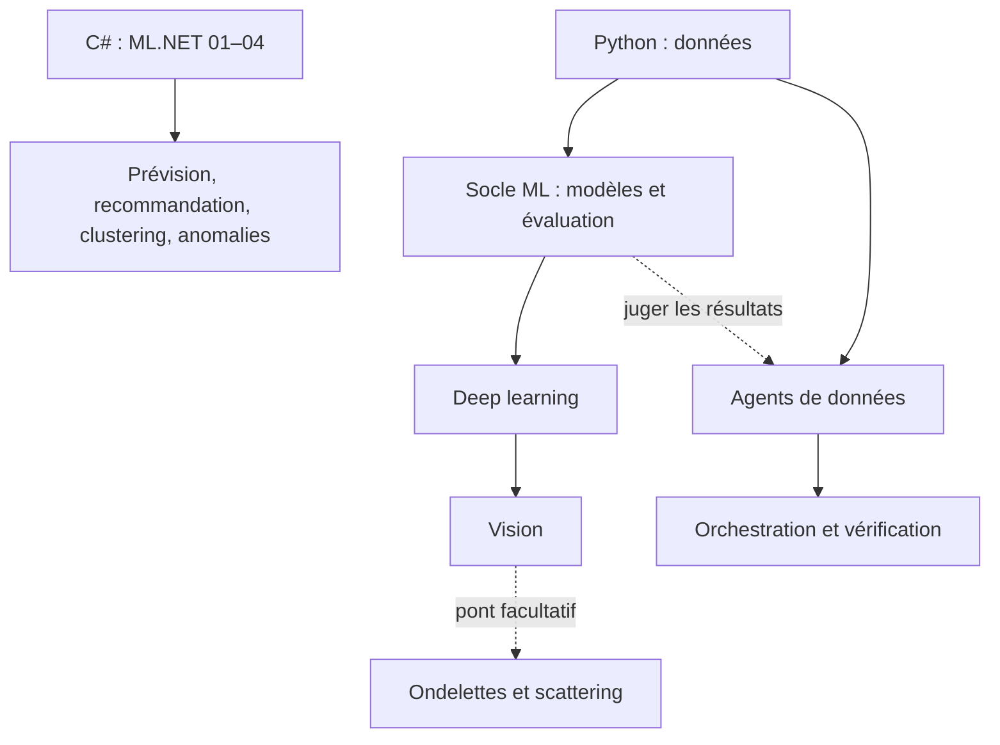
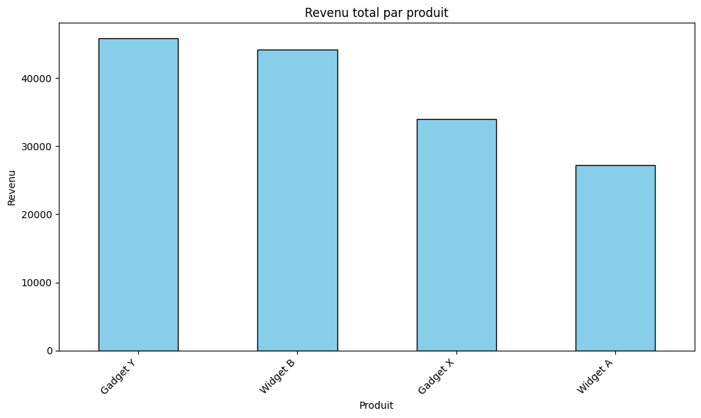

# Machine learning — données, modèles et agents

<!-- CATALOG-STATUS
series: ML
pedagogical_count: 137
breakdown: DataScienceWithAgents=113, ML.Net=24
maturity: BETA=122, ALPHA=10, DRAFT=5
-->

[↑ Parcours de notebooks](../README.md) · [Cours et supports sur l'apprentissage](../../slides/06-apprentissage/)

Comment transformer des données en un modèle utile, puis vérifier que ses résultats tiennent au-delà de l'exemple d'entraînement ? Cette famille suit le cycle **données → représentation → entraînement → évaluation → usage**. Elle relie les pipelines classiques, les réseaux profonds et les agents de data science autour d'une même exigence : comprendre ce qui a été ajusté, sur quelles données et avec quel critère de réussite.

Trois portes s'adressent à des besoins différents. Les développeurs C# peuvent commencer par ML.NET ; les lecteurs Python peuvent construire leurs bases en manipulation de données puis en apprentissage ; les praticiens des agents apprennent à déléguer des opérations qu'ils savent contrôler. Les variantes C# et Python de ML.NET permettent de comparer les mêmes questions avec des bibliothèques différentes, sans imposer de suivre les deux langages.

Les bases de programmation suffisent pour l'entrée. Algèbre linéaire, probabilités et dérivées deviennent utiles pour comprendre l'optimisation et la généralisation ; les parcours profonds et formels précisent leurs prérequis supplémentaires. Vous apprendrez à préparer un jeu de données sans fuite d'information, choisir une métrique, comparer des modèles, interpréter leurs limites et évaluer un workflow automatisé.

## Comment lire ce README — Découverte

Le principe [« Choisir sa vitesse de lecture »](https://github.com/jsboige/CoursIA#choisir-sa-vitesse-de-lecture) sépare parcours principal, approfondissements et recherche.

- **Vous découvrez** : choisissez ML.NET ou les fondations Python dans la table. La compréhension du cycle d'apprentissage précède le choix d'un modèle complexe.
- **Vous approfondissez** : ouvrez un thème — séries temporelles, vision, représentations du signal ou orchestration — après ses prérequis. Les lettres et variantes spécialisées restent regroupées dans les README de sous-série.
- **Vous cherchez des garanties ou des limites** : la section Recherche relie évaluation empirique, théorie de l'apprentissage et formalisations Lean. Elle distingue une observation sur un jeu de données d'un résultat sous hypothèses.

Ce README donne les articulations de la famille. Les pages locales portent le parcours carnet par carnet, les exercices et les environnements spécifiques.

## Parcours principal — choisir son entrée

| Entrée | Ce qu'on y apprend | Public et prérequis | Suite naturelle |
|---|---|---|---|
| [ML.NET et jumeaux Python](ML.Net/README.md) | Construire des pipelines, entraîner et évaluer, puis aborder classification, prévision, recommandation, clustering et anomalies. | Développeur C# ; les jumeaux Python proposent une autre voie pour les mêmes questions. | Socle ML-01 à ML-04, puis thèmes ML-05 à ML-09 selon le besoin. |
| [Fondations Python pour les données](DataScienceWithAgents/01-Python-For-Data-Science/README.md) | Manipuler tableaux et DataFrames, charger, nettoyer, joindre et explorer des données. | Débutant en data science avec des bases de Python. | Socle ML ou agents de données. |
| [Socle de machine learning](DataScienceWithAgents/02-ML-Cours/README.md) | Comprendre le workflow, le gradient, les modèles classiques, la généralisation, l'explicabilité et la confidentialité. | Après les fondations ; probabilités et dérivées introduites selon les paliers. | Deep learning, évaluation des agents et approfondissements théoriques. |
| [Deep learning](DataScienceWithAgents/03-Deep-Learning/README.md) | Construire la rétropropagation, les réseaux et l'attention, puis étudier entraînement et passage à l'échelle. | Après le socle ML ; NumPy, gradient et algèbre linéaire. | Vision ou approfondissements d'architecture et d'entraînement. |
| [Vision](DataScienceWithAgents/04-Vision/README.md) | Relier convolution, réseaux résiduels, transfert et détection à des tâches d'image évaluables. | Après le deep learning ; PyTorch et manipulation des images. | Analyse d'erreurs, adaptation de modèles et représentations du signal. |
| [Ondelettes et scattering](DataScienceWithAgents/05-Wavelet-Scattering/README.md) | Construire des représentations du signal et comparer invariances conçues et caractéristiques apprises. | Algèbre linéaire et traitement du signal ; les parcours ML et vision facilitent la comparaison. | Confronter une implémentation construite pas à pas à des bibliothèques de référence. |
| [Agents de données — LangChain/LangGraph](DataScienceWithAgents/06-Data-Agents/README.md) | Passer de la manipulation manuelle aux outils d'un agent, puis vérifier les analyses produites. | Fondations Python nécessaires ; socle ML conseillé pour juger les résultats. | Orchestration de workflows plus longs. |
| [Orchestration — Google ADK](DataScienceWithAgents/07-Agent-Orchestration/README.md) | Séparer planification, code, exécution et vérification ; gérer outils, mémoire et expériences. | Après les agents de données et les bases ML ; services externes selon le lab. | Comparaison de workflows, ablations, Kaggle et BigQuery. |

Le portail [DataScienceWithAgents](DataScienceWithAgents/README.md) rassemble le fil Python et les ateliers agents. La progression deep learning → vision constitue une branche d'approfondissement ; elle n'est pas un passage obligatoire avant les premiers agents.



## Du pipeline aux décisions — Découverte et Licence

### Préparer et séparer les données

Une table propre n'est pas encore une expérience valide. Les fondations Python enseignent le calcul sur tableaux, les types, les valeurs manquantes et les jointures ; le socle ML ajoute la séparation entre données d'entraînement et de test. Un normaliseur ajusté sur tout le jeu peut transmettre au modèle des informations qui devraient lui rester inconnues lors de l'évaluation. Le `Pipeline` de [2.1 — Workflow ML](DataScienceWithAgents/02-ML-Cours/2.1-Workflow-ML.ipynb) montre comment ajuster les transformations sur l'entraînement puis les appliquer au test.

Le [Lab 1](DataScienceWithAgents/06-Data-Agents/Day1-Foundations/Labs/Lab1-PythonForDataScience.ipynb) offre une entrée concrète : construire un DataFrame de ventes synthétiques, grouper, tracer et examiner une première régression. Les données synthétiques rendent les opérations lisibles ; leur simplicité ne constitue pas une validation sur des ventes réelles.

[](DataScienceWithAgents/06-Data-Agents/Day1-Foundations/Labs/Lab1-PythonForDataScience.ipynb)

**À essayer :** conserver un jeu de test intact, modifier une étape de préparation et expliquer pourquoi la métrique change. La question porte autant sur les données disponibles au moment de la prédiction que sur le choix de l'algorithme.

### Apprendre, comparer et regarder les erreurs

Dans [ML-01 — Introduction](ML.Net/ML-01-Introduction-Python.ipynb), une droite de régression relie une caractéristique à un prix immobilier. Les points d'entraînement, les points de test et la prédiction d'un nouvel exemple rendent visibles les rôles distincts de ces données.

[](ML.Net/ML-01-Introduction-Python.ipynb)

La droite sous-estime visuellement certains prix élevés du jeu illustré. Cette observation motive l'examen des résidus et d'autres représentations ; elle ne suffit pas à décider qu'une famille de modèles est toujours inadaptée. Une métrique agrège des erreurs et peut masquer des régions où le comportement diffère.

[ML-03 — Entraînement et AutoML](ML.Net/ML-03-Entrainement-AutoML-CSharp.ipynb) compare plusieurs entraîneurs et configurations. Le classement dépend du jeu, de la métrique, des hyperparamètres essayés et du budget alloué. Un mauvais essai d'une famille ne démontre pas sa faiblesse générale ; augmenter le nombre d'essais ne dispense pas de conserver une évaluation indépendante. Les jumeaux Python et C# permettent d'examiner le même cycle avec leurs interfaces respectives.

Le [socle Python](DataScienceWithAgents/02-ML-Cours/README.md) prolonge ces questions par la validation, les modèles supervisés et non supervisés, l'explicabilité et la confidentialité. Ses approfondissements sur calibration et équité invitent à dépasser le score global : une bonne précision moyenne peut coexister avec des probabilités mal calibrées ou des écarts entre sous-groupes.

### Temps, groupes et anomalies demandent des critères propres

Une série temporelle impose de respecter l'ordre des observations. [ML-05 — Time Series](ML.Net/ML-05-TimeSeries-Python.ipynb) sépare tendance, saisonnalité et résidu avec une décomposition STL, puis examine la prévision. La décomposition du signal d'entraînement aide à comprendre sa structure ; la qualité prédictive se juge sur une période tenue à l'écart.

[](ML.Net/ML-05-TimeSeries-Python.ipynb)

Le clustering soulève une autre difficulté : un numéro de cluster n'a pas de signification métier intrinsèque. Dans [ML-08](ML.Net/ML-08-Clustering-Python.ipynb), K-Means retrouve les groupes de clients synthétiques après normalisation. Les identifiants sont permutés : Dormants correspond au cluster 2, Réguliers au 0 et VIP au 1. Comparer directement ces numéros aux noms de groupe ferait conclure à tort à une erreur ; l'interprétation passe par les profils et les centroïdes.

[](ML.Net/ML-08-Clustering-Python.ipynb)

La recommandation et la détection d'anomalies du parcours ML.NET complètent cette diversité. Les approfondissements autour de 09 introduisent notamment des anomalies de forme et le Matrix Profile. Une anomalie signale une différence par rapport à une référence ; sa pertinence dépend de l'usage et doit être examinée avec les exemples détectés.

## Ouvrir les modèles profonds — Licence et Master

### Du gradient calculé à la représentation apprise

Le parcours [Deep Learning](DataScienceWithAgents/03-Deep-Learning/README.md) commence par rendre l'entraînement inspectable : une rétropropagation écrite à la main est confrontée à des gradients numériques et à l'autodifférentiation. Cette vérification prépare l'emploi de PyTorch et l'étude d'architectures plus riches. Le passage à l'attention puis à un mini-GPT relie les opérations élémentaires à un modèle de séquence entraînable.

Les démonstrations accessibles sur CPU servent à comprendre les mécanismes. Les approfondissements sur l'entraînement distribué ajoutent des contraintes matérielles et des questions de synchronisation : un résultat sur une petite démonstration ne permet pas de prévoir seul le coût d'un entraînement à plusieurs GPU. Les README locaux distinguent ces expériences et leurs prérequis.

### Images : du filtre au transfert

Dans [Vision](DataScienceWithAgents/04-Vision/README.md), construire une convolution NumPy puis la comparer à PyTorch donne un premier contrôle de l'opérateur. Les réseaux résiduels et le transfert changent ensuite ce que l'on apprend : une tête peut être entraînée sur des caractéristiques gelées, ou une partie du réseau peut être ajustée à la tâche.

La comparaison doit conserver les données, les métriques et les conditions d'évaluation. Un gain observé sur quelques graines reste une expérience locale, dont l'incertitude mérite d'être examinée. La détection ajoute localisation, seuils et erreurs par objet : une image réussie ne résume pas la qualité d'un détecteur. Les carnets conduisent ainsi du fonctionnement interne à l'analyse d'erreurs.

### Signal : concevoir une invariance ou l'apprendre

La branche [Ondelettes et scattering](DataScienceWithAgents/05-Wavelet-Scattering/README.md) construit des ondelettes puis des représentations par convolutions, module et moyennage. Elle permet de demander quelles variations doivent être conservées, atténuées ou rendues invariantes. Cette question rejoint la vision, mais la représentation peut ici être construite à partir de propriétés mathématiques explicites.

Les expériences confrontent une implémentation pédagogique à des bibliothèques telles que Kymatio. Comparer précision prédictive, coût et stabilité de la représentation donne plusieurs critères : un modèle plus rapide n'est pas nécessairement le meilleur sur le jeu choisi. Les paliers de construction et les approfondissements sont détaillés dans la feuille ; cette branche reste un choix thématique.

## Des analyses aux agents — Licence et lectures avancées

### Donner des outils dont on comprend les résultats

Le parcours [Agents de données](DataScienceWithAgents/06-Data-Agents/README.md) relie calcul manuel et délégation. Les premiers travaux manipulent des données et des documents ; les suivants ajoutent un modèle de langage et des outils. Une extraction de champs ou une proposition générée sur un document synthétique permet de comprendre le flux, puis doit être évaluée sur des cas variés avant d'en déduire une fiabilité.

Le [Lab 5](DataScienceWithAgents/06-Data-Agents/Day3-Data-Agents/Labs/Lab5-Viz-ML/Lab5-Viz-ML.ipynb) réutilise le fichier de transactions fourni avec le Lab 4 et lui applique les opérations de nettoyage. Le graphique agrège le chiffre d'affaires par jour avec Pandas et Seaborn/Matplotlib. Cette dépendance entre les labs fait partie du parcours : le bon résultat suppose aussi que le bon fichier ait été chargé et correctement préparé.

[](DataScienceWithAgents/06-Data-Agents/Day3-Data-Agents/Labs/Lab5-Viz-ML/Lab5-Viz-ML.ipynb)

Une courte fenêtre aide à examiner une agrégation ; elle ne suffit pas à établir une tendance durable. Lorsqu'un agent produit une analyse, vérifier les colonnes, les filtres, l'opération effectuée et les données utilisées permet de contrôler ce même raisonnement. Les labs précisent le périmètre des outils d'exécution de code ; choisir ce périmètre fait partie de la conception de l'agent.

### Orchestrer une expérience et conserver une trace vérifiable

Le parcours [Google ADK](DataScienceWithAgents/07-Agent-Orchestration/README.md) rend explicites les rôles de planification, de code, d'exécution et de vérification. Le [Lab 11](DataScienceWithAgents/07-Agent-Orchestration/Day5-DS-Star/Lab11-Planner-Coder-Loop.ipynb) étudie la boucle planificateur–codeur ; les approfondissements du Lab 12 examinent notamment plans, outils, évaluations et persistance de session. La séparation des rôles permet de localiser un échec : plan inadéquat, code invalide, mauvais résultat ou vérification insuffisante.

Le [Lab 9](DataScienceWithAgents/07-Agent-Orchestration/Day4-Foundations/Lab9-First-ADK-Agent.ipynb) introduit les outils de calcul sur les ventes. Le carnet actuel fournit notamment un classement textuel calculé par un outil Pandas. L'illustration ci-dessous est une figure archivée sur ce jeu de ventes ; elle n'est plus une sortie produite par la version actuelle du carnet.

[](DataScienceWithAgents/07-Agent-Orchestration/Day4-Foundations/Lab9-First-ADK-Agent.ipynb)

Pour comparer deux workflows, conserver la tâche, les données et les critères, puis examiner les appels d'outils et leurs résultats. Une ablation — retirer un outil ou une étape de vérification — aide à comprendre ce qui contribue au résultat. Les expériences de mémoire distinguent la persistance au sein d'une session de l'isolation entre sessions. Les prolongements Kaggle et BigQuery ajoutent leurs propres données, accès et conditions d'exécution.

## Installation — choisir l'environnement du parcours

| Parcours | Préparation | Premier contrôle |
|---|---|---|
| ML.NET en C# | SDK .NET et noyau .NET Interactive ; directives NuGet dans les carnets. Voir [ML.Net](ML.Net/README.md). | Le carnet s'exécute avec le noyau C#, et ses données sont accessibles par les chemins relatifs attendus. |
| Fondations et socle Python | Python, Jupyter, NumPy/Pandas/scikit-learn ; [dépendances du socle](DataScienceWithAgents/02-ML-Cours/requirements.txt). | Le noyau correspond à l'environnement installé ; les transformations sont ajustées sur les données prévues. |
| Deep learning, vision et signal | PyTorch et dépendances de la feuille choisie ; [manifeste Vision](DataScienceWithAgents/04-Vision/requirements.txt). | CPU ou GPU selon le carnet ; vérifier le dispositif utilisé avant de lancer un entraînement. |
| Agents LangChain/LangGraph | [Dépendances agents](DataScienceWithAgents/06-Data-Agents/requirements.txt) et configuration du fournisseur pour les labs qui appellent un LLM. | Commencer par les opérations locales de données, puis tester le service du modèle. |
| Orchestration ADK | [Dépendances ADK](DataScienceWithAgents/07-Agent-Orchestration/requirements.txt), [exemple de configuration](DataScienceWithAgents/07-Agent-Orchestration/.env.example) et accès propres au lab. | Vérifier séparément modèle, outils et services externes avant le workflow complet. |
| Formalisations | Noyau Lean et toolchain du projet ; instructions dans [learning_theory_lean](learning_theory_lean/README.md). | Construire le projet avec sa version de Lean avant d'ouvrir les compagnons formels. |

Une première séance Python sur les données ne nécessite pas de clé API. Depuis la racine du dépôt :

```bash
python -m venv .venv-ml
source .venv-ml/bin/activate
python -m pip install jupyterlab ipykernel numpy pandas matplotlib scikit-learn
python -m ipykernel install --user --name coursia-ml --display-name "Python — ML"
jupyter lab MyIA.AI.Notebooks/ML/DataScienceWithAgents/01-Python-For-Data-Science/notebooks/1.1-Python_pour_la_Data_Science.ipynb
```

Sous Windows, activer l'environnement avec `.\.venv-ml\Scripts\Activate.ps1`. Pour la suite, installer le manifeste du parcours choisi ; cette commande de départ ne couvre pas tous les ateliers. Si un import manque, vérifier le noyau Jupyter avant d'installer à nouveau le paquet. Si un CSV est absent, vérifier le répertoire de travail et le lab qui le produit.

Pour les agents, la configuration est propre au fournisseur et au lab. L'exemple `.env.example` lié ci-dessus se trouve dans `07-Agent-Orchestration`, pas à la racine ML. Les appels externes, accès Kaggle et projets BigQuery demandent les identifiants correspondants. Les sorties conservées dans les carnets permettent la lecture, mais ne garantissent pas la disponibilité future d'un service.

## Pour aller plus loin — Recherche

### Généralisation : relier la mesure aux hypothèses

Le carnet [2.8 — Théorie PAC](DataScienceWithAgents/02-ML-Cours/2.8-Theorie-PAC.ipynb) demande sous quelles hypothèses l'erreur observée renseigne l'erreur sur de nouvelles données. Dans le cas réalisable d'une classe finie d'hypothèses `H`, avec exemples indépendants et de même distribution, une borne classique pour un apprenant cohérent est `m ≥ (ln |H| + ln(1/δ)) / ε` : avec probabilité au moins `1 − δ`, l'erreur est au plus `ε`. Les hypothèses de réalisabilité, d'échantillonnage et de cohérence font partie de l'énoncé ; elles ne sont pas automatiquement satisfaites par un pipeline réel.

La convergence du perceptron donne un autre type de garantie. Pour des exemples de norme au plus `R`, séparables avec une marge `γ` par un vecteur unitaire, chaque erreur augmente suffisamment l'alignement avec ce séparateur, tandis que la norme du vecteur appris croît de façon contrôlée. En combinant les deux inégalités avec Cauchy–Schwarz, on obtient la borne de Novikoff `(R/γ)²` sur les erreurs. Cette conclusion concerne ce modèle et ces hypothèses, pas tout réseau entraîné par descente de gradient.

Le carnet [2.9 — Grokking et généralisation](DataScienceWithAgents/02-ML-Cours/2.9-Grokking-Generalisation.ipynb) ouvre sur des dynamiques où mémorisation et généralisation apparaissent à des moments différents. Les approfondissements explorent des mécanismes et modèles explicatifs ; une courbe particulière et une théorie effective doivent être confrontées à leurs conditions d'observation.

### Formalisations Lean

Le projet [learning_theory_lean](learning_theory_lean/README.md) accompagne ces questions avec des définitions et énoncés formels. Le carnet [2.8b — PAC en Lean](DataScienceWithAgents/02-ML-Cours/2.8b-Theorie-PAC-Lean.ipynb) permet de lire les signatures et hypothèses des résultats ; [2.8d — Novikoff](DataScienceWithAgents/02-ML-Cours/2.8d-Lean-Novikoff-Convergence.ipynb) accompagne la borne de convergence ; [2.9f — Théorie effective du grokking](DataScienceWithAgents/02-ML-Cours/2.9f-Grokking-Theorie-Effective-Lean.ipynb) prolonge le fil théorique.

Le statut des modules, leurs toolchains et leurs points d'entrée sont rassemblés dans [LEAN_INVENTORY.md](LEAN_INVENTORY.md). Lire les hypothèses et dépendances d'un théorème permet de préciser ce qu'il certifie. Une preuve sur un modèle mathématique ne valide pas à elle seule les données, l'implémentation ou le résultat expérimental d'un autre carnet. Les exercices formels restent des activités à compléter lorsque le carnet les présente ainsi.

### Concevoir une comparaison qui puisse être contredite

Choisir une métrique avant les essais, réserver un jeu d'évaluation, fixer un budget et conserver les graines aide à rendre les comparaisons interprétables. Les répétitions d'un entraînement mesurent une variabilité différente de celle obtenue en changeant les données. Une ablation permet d'interroger un composant ; une analyse par sous-groupes peut révéler un défaut caché par la moyenne.

Ces principes relient toutes les branches de la famille : comparer des entraîneurs AutoML, une représentation de scattering, un fine-tuning en vision ou un workflow d'agents exige de définir ce qui reste fixe et ce qui change. Une expérience qui échoue ou un modèle simple qui résiste à la comparaison peut être aussi instructif qu'un meilleur score.

## Ressources — tous niveaux

- [ML.NET](https://learn.microsoft.com/dotnet/machine-learning/) et [exemples officiels](https://github.com/dotnet/machinelearning-samples) pour les pipelines C#.
- [Pandas](https://pandas.pydata.org/docs/) et [scikit-learn](https://scikit-learn.org/stable/user_guide.html) pour les données, modèles et protocoles d'évaluation.
- [PyTorch](https://pytorch.org/tutorials/) pour les réseaux, l'autodifférentiation et l'entraînement.
- [LangChain](https://docs.langchain.com/) et [Google ADK](https://google.github.io/adk-docs/) pour les outils et workflows des parcours agents.
- [Supports du cours sur l'apprentissage](../../slides/06-apprentissage/) pour le fil théorique ; les README locaux portent la bibliographie de leurs approfondissements.
- [Manifeste des figures](assets/readme/MANIFEST.md) pour les exports conservés ; les légendes ci-dessus précisent leur interprétation et le cas de la figure ADK archivée.

[Retour aux notebooks](../README.md) · [Catalogue du dépôt](../../COURSE_CATALOG.generated.md) · [Licence](../../LICENSE)
