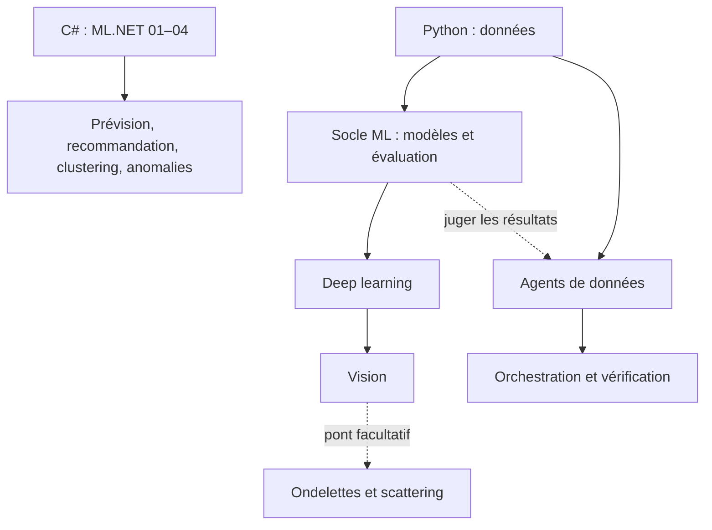
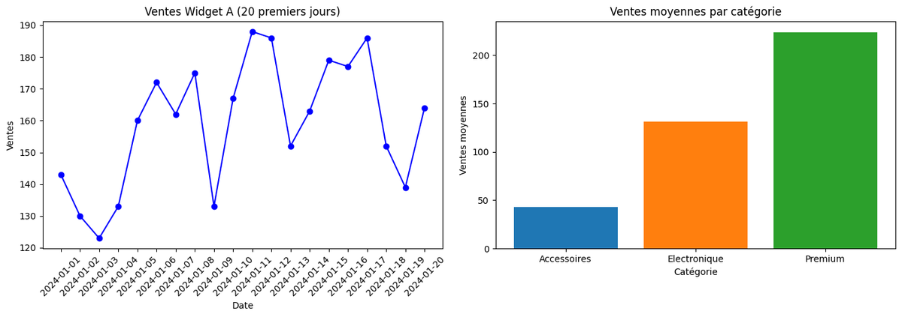
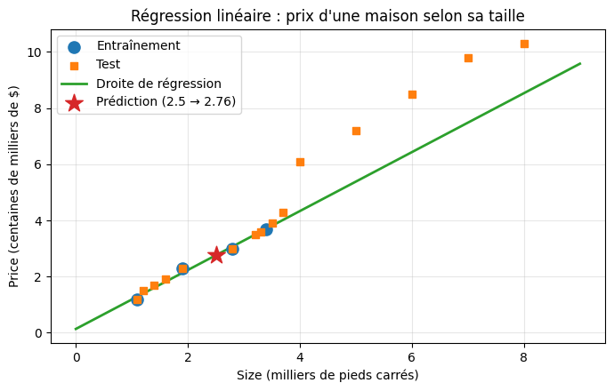
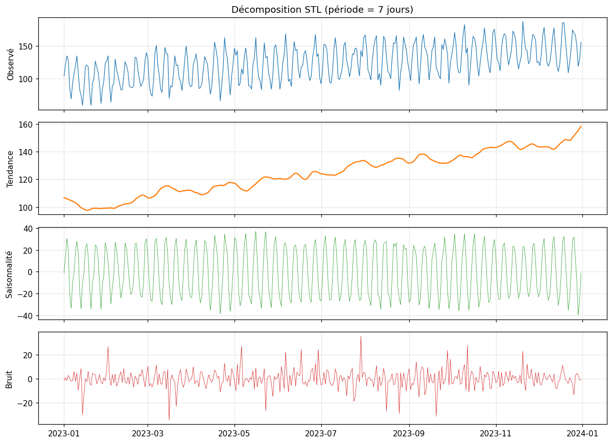
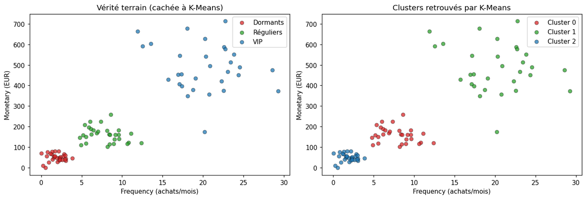
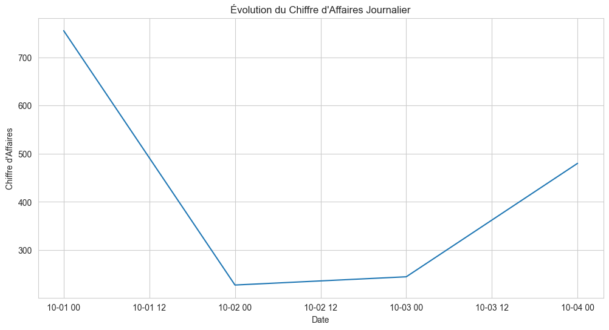

# Machine learning — données, modèles et agents

<!-- CATALOG-STATUS
series: ML
pedagogical_count: 140
breakdown: DataScienceWithAgents=115, ML.Net=25
maturity: BETA=129, ALPHA=7, DRAFT=4
-->

[↑ Parcours de notebooks](../README.md) · [Cours et supports sur l'apprentissage](../../slides/06-apprentissage/)

Comment transformer des données en un modèle utile, puis vérifier que ses résultats tiennent au-delà de l'exemple d'entraînement ? Cette famille suit le cycle **données → représentation → entraînement → évaluation → usage**. Elle relie les pipelines classiques, les réseaux profonds et les agents de data science autour d'une même exigence : comprendre ce qui a été ajusté, sur quelles données et avec quel critère de réussite.

Trois portes s'adressent à des besoins différents. Les développeurs C# peuvent commencer par ML.NET ; les lecteurs Python peuvent construire leurs bases en manipulation de données puis en apprentissage ; les praticiens des agents apprennent à déléguer des opérations qu'ils savent contrôler. Les variantes C# et Python de ML.NET permettent de comparer les mêmes questions avec des bibliothèques différentes, sans imposer de suivre les deux langages.

Les bases de programmation suffisent pour l'entrée. Algèbre linéaire, probabilités et dérivées deviennent utiles pour comprendre l'optimisation et la généralisation ; les parcours profonds et formels précisent leurs prérequis supplémentaires. Vous apprendrez à préparer un jeu de données sans fuite d'information, choisir une métrique, comparer des modèles, interpréter leurs limites et évaluer un workflow automatisé.

## Comment lire ce README — Découverte

Le principe [« Choisir sa vitesse de lecture »](https://github.com/jsboige/CoursIA#choisir-sa-vitesse-de-lecture) sépare parcours principal, approfondissements et recherche.

- **Vous découvrez** : choisissez ML.NET ou les fondations Python dans la table. La compréhension du cycle d'apprentissage précède le choix d'un modèle complexe.
- **Vous approfondissez** : ouvrez un thème — séries temporelles, vision, représentations du signal ou orchestration — après ses prérequis. Les lettres et variantes spécialisées restent regroupées dans les README de sous-série.
- **Vous cherchez des garanties ou des limites** : la section Recherche relie évaluation empirique, théorie de l'apprentissage et formalisations Lean. Elle distingue une observation sur un jeu de données d'un résultat sous hypothèses.

Ce README donne les articulations de la famille. Les pages locales portent le parcours carnet par carnet, les exercices et les environnements spécifiques.

Accès directs : [parcours](#parcours-principal--choisir-son-entrée) · [modèles et évaluation](#du-pipeline-aux-décisions--découverte-et-licence) · [interopérabilité](#du-modèle-au-programme-qui-lutilise--licence) · [réseaux, vision et signal](#ouvrir-les-modèles-profonds--licence-et-master) · [agents](#des-analyses-aux-agents--licence-et-lectures-avancées) · [projets](#mettre-les-acquis-en-pratique--licence-et-master) · [installation](#installation--choisir-lenvironnement-du-parcours) · [recherche](#pour-aller-plus-loin--recherche).

## Parcours principal — choisir son entrée

| Entrée | Ce qu'on y apprend | Public et prérequis | Suite naturelle |
|---|---|---|---|
| [ML.NET et jumeaux Python](ML.Net/README.md) | Construire des pipelines, entraîner et évaluer, puis aborder classification, prévision, recommandation, clustering et anomalies. | Développeur C# ; les jumeaux Python proposent une autre voie pour les mêmes questions. | Socle ML-01 à ML-04, puis thèmes ML-05 à ML-09 selon le besoin. |
| [Fondations Python pour les données](DataScienceWithAgents/01-Python-For-Data-Science/README.md) | Manipuler tableaux et DataFrames, charger, nettoyer, joindre et explorer des données. | Débutant en data science avec des bases de Python. | Socle ML ou agents de données. |
| [Socle de machine learning](DataScienceWithAgents/02-ML-Cours/README.md) | Comprendre le workflow, le gradient, les modèles classiques, la généralisation, l'explicabilité et la confidentialité. | Après les fondations ; probabilités et dérivées introduites selon les paliers. | Deep learning, évaluation des agents et approfondissements théoriques. |
| [Deep learning](DataScienceWithAgents/03-Deep-Learning/README.md) | Construire la rétropropagation, les réseaux et l'attention, puis étudier entraînement et passage à l'échelle. | Après le socle ML ; NumPy, gradient et algèbre linéaire. | Vision ou approfondissements d'architecture et d'entraînement. |
| [Vision](DataScienceWithAgents/04-Vision/README.md) | Relier convolution, réseaux résiduels, transfert et détection à des tâches d'image évaluables. | Après le deep learning ; PyTorch et manipulation des images. | Analyse d'erreurs, adaptation de modèles et représentations du signal. |
| [Ondelettes et scattering](DataScienceWithAgents/05-Wavelet-Scattering/README.md) | Construire des représentations du signal et comparer invariances conçues et caractéristiques apprises. | Algèbre linéaire et traitement du signal ; les parcours ML et vision facilitent la comparaison. | Confronter une implémentation construite pas à pas à des bibliothèques de référence. |
| [Agents de données — LangChain/LangGraph](DataScienceWithAgents/06-Data-Agents/README.md) | Passer de la manipulation manuelle aux outils d'un agent, puis vérifier les analyses produites. | Fondations Python nécessaires ; socle ML conseillé pour juger les résultats. | Orchestration de workflows plus longs. |
| [Orchestration — Google ADK](DataScienceWithAgents/07-Agent-Orchestration/README.md) | Séparer planification, code, exécution et vérification ; gérer outils, mémoire et expériences. | Après les agents de données et les bases ML ; services externes selon le lab. | Comparaison de workflows, ablations, Kaggle et BigQuery. |

Le portail [DataScienceWithAgents](DataScienceWithAgents/README.md) rassemble le fil Python et les ateliers agents. La progression deep learning → vision constitue une branche d'approfondissement ; elle n'est pas un passage obligatoire avant les premiers agents.



## Des itinéraires pour commencer — Découverte et Licence

Les parcours suivants donnent un premier objectif réalisable et une question à examiner à chaque passage. Un lecteur déjà à l'aise avec les données peut rejoindre directement l'étape d'entraînement ou d'évaluation ; un lecteur C# peut suivre ML.NET sans commencer par Python.

| Votre objectif | Enchaînement conseillé | Ce que vous devez pouvoir expliquer à l'arrivée |
|---|---|---|
| Construire votre première analyse prédictive en Python | [NumPy](DataScienceWithAgents/01-Python-For-Data-Science/notebooks/1.2-Manipulation_de_Donnees_avec_NumPy.ipynb) → [Pandas](DataScienceWithAgents/01-Python-For-Data-Science/notebooks/1.3-Analyse_de_Donnees_avec_Pandas.ipynb) → [workflow ML](DataScienceWithAgents/02-ML-Cours/2.1-Workflow-ML.ipynb) → [régressions](DataScienceWithAgents/02-ML-Cours/2.3-Regression-lineaire-logistique.ipynb) → [évaluation](DataScienceWithAgents/02-ML-Cours/2.5-Biais-Variance-CV-ROC.ipynb). | Quelle est la cible, quelles données sont disponibles pour la prédire et comment estimer l'erreur sur de nouveaux exemples ? |
| Intégrer un modèle dans une application .NET | [Introduction](ML.Net/ML-01-Introduction-CSharp.ipynb) → [données et features](ML.Net/ML-02-Data-Features-CSharp.ipynb) → [entraînement](ML.Net/ML-03-Entrainement-AutoML-CSharp.ipynb) → [évaluation](ML.Net/ML-04-Evaluation-CSharp.ipynb) → [ONNX](ML.Net/ML-06-ONNX-CSharp.ipynb). | Quelles transformations accompagnent le modèle et quel contrat d'entrée doit respecter l'application qui l'appelle ? |
| Comprendre puis entraîner un réseau | [Gradient](DataScienceWithAgents/02-ML-Cours/2.2-Descente-de-gradient.ipynb) → [rétropropagation](DataScienceWithAgents/03-Deep-Learning/3.1-Retropropagation.ipynb) → [optimisateurs](DataScienceWithAgents/03-Deep-Learning/3.2-Optimisateurs.ipynb) → [régularisation](DataScienceWithAgents/03-Deep-Learning/3.3-Regularisation.ipynb), puis [attention](DataScienceWithAgents/03-Deep-Learning/3.4-Attention-Transformer-From-Scratch.ipynb) ou [vision](DataScienceWithAgents/04-Vision/README.md). | D'où vient le gradient, comment les poids sont-ils mis à jour et comment distinguer défaut d'optimisation et surapprentissage ? |
| Déléguer une analyse de données à un agent | [Lab 1 : données](DataScienceWithAgents/06-Data-Agents/Day1-Foundations/Labs/Lab1-PythonForDataScience.ipynb) → [agents de données](DataScienceWithAgents/06-Data-Agents/README.md) → [Lab 9 : outils ADK](DataScienceWithAgents/07-Agent-Orchestration/Day4-Foundations/Lab9-First-ADK-Agent.ipynb) → [Lab 11 : planifier et coder](DataScienceWithAgents/07-Agent-Orchestration/Day5-DS-Star/Lab11-Planner-Coder-Loop.ipynb) → [Lab 12 : workflow complet](DataScienceWithAgents/07-Agent-Orchestration/Day5-DS-Star/Lab12-DS-Star-Workshop.ipynb). | Qu'a calculé l'agent, avec quel outil, et comment vérifier son résultat indépendamment de sa réponse ? |
| Étudier les représentations du signal et de l'image | [Ondelettes 1D](DataScienceWithAgents/05-Wavelet-Scattering/WS-00a-Ondelettes-1D-from-scratch.ipynb) → [ondelettes 2D](DataScienceWithAgents/05-Wavelet-Scattering/WS-00b-Ondelettes-2D-from-scratch.ipynb) → [scattering](DataScienceWithAgents/05-Wavelet-Scattering/WS-00c-Scattering-from-scratch.ipynb), puis [comparaison avec ResNet](DataScienceWithAgents/05-Wavelet-Scattering/WS-03-Synthese-Scattering-vs-ResNet.ipynb). | Quelles variations la représentation conserve-t-elle, et quelles invariances sont construites plutôt qu'apprises ? |

Pour une séance de cours, choisir un problème, une représentation et un contrôle donne un fil conducteur plus précis que parcourir des bibliothèques. Par exemple : prévoir une quantité et inspecter les résidus ; détecter une classe rare et déplacer le seuil ; comparer deux représentations d'une image ; faire vérifier une agrégation produite par un agent.

## Du pipeline aux décisions — Découverte et Licence

### Poser la question avant de choisir un algorithme

En apprentissage supervisé, on dispose d'exemples d'entrée `X` et d'une cible `y` : une régression prédit une quantité, une classification prédit une classe ou ses probabilités. En non-supervisé, on cherche une structure sans disposer de cette cible pour guider l'ajustement : groupes, directions de variation ou observations atypiques. Une même table peut servir à plusieurs de ces questions ; le choix de la cible et de la mesure de réussite change le problème.

Les **paramètres** sont ajustés par l'apprentissage, comme les coefficients d'une régression ou les poids d'un réseau. Les **hyperparamètres** fixent des choix d'entraînement ou de modèle : profondeur d'un arbre, force de régularisation, pas d'apprentissage. Les choisir à partir de scores de validation constitue déjà une forme de sélection ; le jeu de test doit rester disponible pour juger le résultat retenu.

| Problème | Formulation et exemple dans la famille | Mesure à lire |
|---|---|---|
| Prédire une quantité | Régression de prix dans ML-01, puis prévision de ventes. | MAE pour l'erreur absolue moyenne ; RMSE pour pénaliser davantage les grandes erreurs ; R² pour comparer au prédicteur constant fondé sur la moyenne. |
| Détecter une classe | Régression logistique et classification du socle Python. | Matrice de confusion, précision et rappel selon les erreurs que l'on cherche à éviter ; score global complété par l'examen du seuil. |
| Former des groupes | K-Means sur les profils clients dans ML-08. | Compacité et séparation, puis interprétation des groupes à partir des données. |
| Recommander un objet | Factorisation des préférences utilisateur–item dans ML-07. | Erreur sur des préférences tenues à l'écart, puis pertinence des propositions pour l'usage choisi. |
| Repérer une anomalie | Score de reconstruction PCA dans ML-09 ; anomalies de forme dans ses approfondissements. | Distribution des scores, choix du seuil et examen des faux positifs comme des événements manqués. |

Un modèle simple constitue un point de comparaison utile : prédire une moyenne, la classe majoritaire ou une référence temporelle permet de mesurer ce qu'apporte réellement l'apprentissage. Le reste du parcours explique comment améliorer cette référence et comment comprendre les cas où elle résiste.

### Préparer et séparer les données

Une table propre n'est pas encore une expérience valide. Les fondations Python enseignent le calcul sur tableaux, les types, les valeurs manquantes et les jointures ; le socle ML ajoute la séparation entre données d'entraînement et de test. Un normaliseur ajusté sur tout le jeu peut transmettre au modèle des informations qui devraient lui rester inconnues lors de l'évaluation. Le `Pipeline` de [2.1 — Workflow ML](DataScienceWithAgents/02-ML-Cours/2.1-Workflow-ML.ipynb) montre comment ajuster les transformations sur l'entraînement puis les appliquer au test.

La préparation transforme les observations en **caractéristiques** (*features*) utilisables par le modèle. Une catégorie comme le type de produit peut être encodée par indicateurs ; une grandeur numérique peut être normalisée ; un texte peut devenir un vecteur. Ces opérations imposent des choix : coder des catégories par des entiers peut introduire un ordre artificiel, tandis qu'une variable dont l'échelle domine les autres peut gouverner une distance.

[ML-02](ML.Net/ML-02-Data-Features-Python.ipynb) montre comment traiter différemment colonnes numériques et catégorielles avec `ColumnTransformer`, puis réunir ces transformations dans un pipeline. Son [jumeau C#](ML.Net/ML-02-Data-Features-CSharp.ipynb) utilise `IDataView` et les transformations ML.NET. Les deux voies rendent explicite ce que reçoit l'entraîneur : une représentation construite à partir des données, dont l'ordre, les types et les règles devront être conservés à l'inférence.

Dans l'exemple taxi de ML-02 C#, `vendor_id` et `payment_type` sont encodés, une valeur manquante est remplacée, puis les colonnes sont réunies dans `Features`. L'inspection du schéma permet de vérifier que ce vecteur existe réellement. Pour voir concrètement l'effet de l'échelle, le carnet [2.7](DataScienceWithAgents/02-ML-Cours/2.7-Modeles-Non-Parametriques.ipynb) déforme les variables d'un jeu : le k-NN passe d'une accuracy de `0,770` à `0,900` après standardisation dans cette expérience. La transformation change les voisins que le modèle consulte.

Le [Lab 1](DataScienceWithAgents/06-Data-Agents/Day1-Foundations/Labs/Lab1-PythonForDataScience.ipynb) offre une entrée concrète : construire un DataFrame de ventes synthétiques, grouper, tracer et examiner une première régression. Les données synthétiques rendent les opérations lisibles ; leur simplicité ne constitue pas une validation sur des ventes réelles.

[](DataScienceWithAgents/06-Data-Agents/Day1-Foundations/Labs/Lab1-PythonForDataScience.ipynb)

**À essayer :** conserver un jeu de test intact, modifier une étape de préparation et expliquer pourquoi la métrique change. La question porte autant sur les données disponibles au moment de la prédiction que sur le choix de l'algorithme.

### Apprendre, comparer et regarder les erreurs

Dans [ML-01 — Introduction](ML.Net/ML-01-Introduction-Python.ipynb), une droite de régression relie une caractéristique à un prix immobilier. Les points d'entraînement, les points de test et la prédiction d'un nouvel exemple rendent visibles les rôles distincts de ces données.

[](ML.Net/ML-01-Introduction-Python.ipynb)

La droite sous-estime visuellement certains prix élevés du jeu illustré. Cette observation motive l'examen des résidus et d'autres représentations ; elle ne suffit pas à décider qu'une famille de modèles est toujours inadaptée. Une métrique agrège des erreurs et peut masquer des régions où le comportement diffère.

[ML-03 — Entraînement et AutoML](ML.Net/ML-03-Entrainement-AutoML-CSharp.ipynb) compare plusieurs entraîneurs et configurations. Le classement dépend du jeu, de la métrique, des hyperparamètres essayés et du budget alloué. Un mauvais essai d'une famille ne démontre pas sa faiblesse générale ; augmenter le nombre d'essais ne dispense pas de conserver une évaluation indépendante. Les jumeaux Python et C# permettent d'examiner le même cycle avec leurs interfaces respectives.

Le carnet ML-03 donne un contraste utile : SDCA obtient une RMSE de `2,927`, contre `119,860` pour LightGBM sur son premier jeu ; l'expérience AutoML menée sur un autre jeu quadratique place au contraire LightGBM en tête des essais réalisés. Ces deux expériences donnent une raison de comparer les modèles : leur nom ne permet pas de déduire lequel convient au signal, aux réglages et au budget choisis.

Le [socle Python](DataScienceWithAgents/02-ML-Cours/README.md) prolonge ces questions par la validation, les modèles supervisés et non supervisés, l'explicabilité et la confidentialité. Ses approfondissements sur calibration et équité invitent à dépasser le score global : une bonne précision moyenne peut coexister avec des probabilités mal calibrées ou des écarts entre sous-groupes.

### Ce qui change entre les familles de modèles

Le [gradient](DataScienceWithAgents/02-ML-Cours/2.2-Descente-de-gradient.ipynb) donne une règle locale de mise à jour : déplacer les paramètres dans une direction qui réduit la perte. Un pas trop petit ralentit l'apprentissage ; un pas trop grand peut faire osciller ou diverger les itérations. Les [régressions linéaire et logistique](DataScienceWithAgents/02-ML-Cours/2.3-Regression-lineaire-logistique.ipynb) permettent d'observer ce mécanisme sur des modèles dont la prédiction et la fonction de coût restent lisibles.

Un arbre découpe l'espace des données par des décisions successives. Une forêt agrège des arbres diversifiés, tandis que le boosting construit des corrections successives : ces mécanismes expliquent pourquoi les [ensembles](DataScienceWithAgents/02-ML-Cours/2.4-Arbres-Forets-Ensembles.ipynb) ne sont pas seulement des arbres plus gros. Les [méthodes de voisinage et à noyaux](DataScienceWithAgents/02-ML-Cours/2.7-Modeles-Non-Parametriques.ipynb) proposent d'autres façons de tracer une frontière, dont la géométrie dépend des distances, de la normalisation et des hyperparamètres.

La [régularisation LASSO](DataScienceWithAgents/02-ML-Cours/2.11-Regularisation-Sparse-LASSO.ipynb) ajoute une pénalité qui favorise des coefficients nuls. Elle relie ainsi prédiction, sélection de variables et optimisation. En non-supervisé, [PCA et K-Means](DataScienceWithAgents/02-ML-Cours/2.6-Clustering-KMeans-PCA.ipynb) répondent à deux questions distinctes : trouver des directions de variation pour représenter les observations, ou les répartir en groupes. Réduire la dimension peut aider à visualiser ou à calculer ; les directions les plus variables ne sont pas nécessairement les plus utiles à une cible donnée.

**À comparer :** partir d'un même découpage de données, entraîner une référence linéaire, un arbre puis un ensemble, et examiner les erreurs qu'ils corrigent ou introduisent. Faire ensuite varier la complexité du modèle et la quantité de données aide à lire le compromis biais–variance : capacité insuffisante d'un côté, sensibilité excessive aux exemples d'entraînement de l'autre.

### Évaluer une prédiction, une probabilité et une décision

[ML-04](ML.Net/ML-04-Evaluation-Python.ipynb) et [2.5 — Biais, variance et validation](DataScienceWithAgents/02-ML-Cours/2.5-Biais-Variance-CV-ROC.ipynb) rendent la comparaison plus rigoureuse. La validation croisée répète l'ajustement sur plusieurs découpages ; ses transformations doivent être apprises dans chaque pli. Les scores renseignent alors la variabilité liée au découpage, en respectant les conditions d'échantillonnage du problème. Pour des données temporelles ou des observations liées à un même individu, une séparation aléatoire ordinaire peut être inadéquate.

En classification, l’accuracy est la proportion de classes correctement prédites. Déplacer le seuil change le compromis entre faux positifs et faux négatifs. La précision demande quelle part des alertes est correcte ; le rappel demande quelle part des cas recherchés a été trouvée. Le carnet sur les [données déséquilibrées](DataScienceWithAgents/02-ML-Cours/2.12-Donnees-Desequilibrees.ipynb) donne un point d'entrée lorsque la classe d'intérêt est rare. Une accuracy élevée peut alors provenir d'un modèle qui ne la détecte presque jamais.

La [calibration](DataScienceWithAgents/02-ML-Cours/2.5b-Calibration-Probabilites.ipynb) examine une autre propriété : parmi les exemples auxquels le modèle attribue une probabilité proche de 0,8, la fréquence observée est-elle voisine de 80 % ? Bien ordonner les exemples par score et fournir des probabilités fiables sont des acquis différents. L'[équité par sous-groupes](DataScienceWithAgents/02-ML-Cours/2.5c-Equite-Sous-Groupes.ipynb) et l'[analyse d'erreurs](DataScienceWithAgents/02-ML-Cours/2.13-Analyse-Erreurs.ipynb) complètent cette lecture en montrant où se concentrent les échecs.

La **Permutation Feature Importance** de ML-04 mesure combien le score se dégrade lorsqu'une variable est mélangée, pour le modèle et les données évalués. Les carnets d'[explicabilité](DataScienceWithAgents/02-ML-Cours/2.14-Explicabilite-SHAP-LIME-Contrefactuels.ipynb) ajoutent attributions et contrefactuels. Ces outils aident à interroger une prédiction ; l'influence prédictive d'une variable ne suffit pas à établir un effet causal. Les données, leurs conditions d'usage et la confidentialité font également l'objet du palier [2.15 — La donnée comme responsabilité](DataScienceWithAgents/02-ML-Cours/2.15-Donnee-Comme-Responsabilite-Python.ipynb).

### Lire des résultats qui changent le diagnostic

Les expériences du socle rendent visibles plusieurs erreurs de raisonnement fréquentes. Elles donnent des questions à reprendre sur d'autres données, avec un protocole adapté.

| Expérience conservée | Résultat observé | Ce qu'il fait comprendre |
|---|---|---|
| [2.5 : prédire une série synthétique](DataScienceWithAgents/02-ML-Cours/2.5-Biais-Variance-CV-ROC.ipynb) | Le même k-NN obtient un R² moyen de `0,990` en validation aléatoire, contre `−2,566` avec `TimeSeriesSplit`. | Interpoler entre observations passées et futures est beaucoup plus facile ici que prévoir après la période d'entraînement. Le découpage doit représenter l'usage annoncé. |
| [2.5b : calibrer une forêt](DataScienceWithAgents/02-ML-Cours/2.5b-Calibration-Probabilites.ipynb) | L'erreur de calibration ECE passe de `0,0909` à `0,0552` avec Platt ; l'AUC reste à `0,9129`. | Les probabilités peuvent devenir plus fiables sans changer le classement des exemples. L'ECE dépend aussi du découpage en intervalles utilisé pour la mesurer. |
| [2.5c : examiner un crédit synthétique](DataScienceWithAgents/02-ML-Cours/2.5c-Equite-Sous-Groupes.ipynb) | La référence affiche `96,4 %` d'accuracy mais ne détecte aucun défaut. | Le score global et une apparente égalité entre groupes peuvent masquer l'échec de la tâche recherchée. |
| [2.13 : diagnostiquer une poche d'erreurs](DataScienceWithAgents/02-ML-Cours/2.13-Analyse-Erreurs.ipynb) | Augmenter la capacité laisse l'erreur de la poche à `67,6 %` ; auditer ses étiquettes d'entraînement la fait passer à `25,4 %`. | Le défaut vient ici de la donnée. Dans cette simulation, les étiquettes vraies sont connues ; dans une application, il faudrait retourner aux sources pour réaliser cet audit. |

Ces résultats sont ceux des jeux et exécutions des carnets. L'analyse d'erreurs illustre aussi un arbitrage : après correction, l'erreur globale diminue mais celle du reste du portefeuille augmente légèrement. Examiner plusieurs mesures aide à décider si l'amélioration sert bien l'objectif.

### Temps, groupes et anomalies demandent des critères propres

Une série temporelle impose de respecter l'ordre des observations. [ML-05 — Time Series](ML.Net/ML-05-TimeSeries-Python.ipynb) sépare tendance, saisonnalité et résidu avec une décomposition STL, puis examine la prévision. La décomposition du signal d'entraînement aide à comprendre sa structure ; la qualité prédictive se juge sur une période tenue à l'écart.

[](ML.Net/ML-05-TimeSeries-Python.ipynb)

Le clustering soulève une autre difficulté : un numéro de cluster n'a pas de signification métier intrinsèque. Dans [ML-08](ML.Net/ML-08-Clustering-Python.ipynb), K-Means retrouve les groupes de clients synthétiques après normalisation. Les identifiants sont permutés : Dormants correspond au cluster 2, Réguliers au 0 et VIP au 1. Comparer directement ces numéros aux noms de groupe ferait conclure à tort à une erreur ; l'interprétation passe par les profils et les centroïdes.

[](ML.Net/ML-08-Clustering-Python.ipynb)

La recommandation et la détection d'anomalies du parcours ML.NET complètent cette diversité. Les approfondissements autour de 09 introduisent notamment des anomalies de forme et le Matrix Profile. Une anomalie signale une différence par rapport à une référence ; sa pertinence dépend de l'usage et doit être examinée avec les exemples détectés.

Dans [ML-07](ML.Net/ML-07-Recommendation-CSharp.ipynb), la factorisation apprend des vecteurs latents pour représenter utilisateurs et produits ; leur interaction sert à estimer une préférence absente. Le très petit exemple initial donne un R² test fortement négatif. Sur le jeu plus fourni de 500 notes, la RMSE de la factorisation vaut `0,388`, contre `0,613` pour la moyenne de référence. Cet exemple introduit aussi le *cold start* : un utilisateur ou un produit sans historique demande une autre source d'information, comme le contenu ou une règle de popularité.

[ML-09](ML.Net/ML-09-Anomaly-Detection-CSharp.ipynb) apprend une structure commune entre capteurs par PCA et attribue un score aux observations qui s'en écartent. Une anomalie peut rompre une relation entre capteurs tout en gardant chaque valeur individuelle dans une plage ordinaire. Dans le banc du carnet, abaisser le seuil de `0,10` à `0,05` augmente le rappel de `0,93` à `1,00`, mais aussi le taux de fausses alarmes de `0,23` à `0,41`. Le choix du seuil traduit ainsi une décision d'usage, au-delà du calcul du score.

Pour une prévision, reprendre ML-05 avec une référence naïve et des périodes futures alignées ; pour une recommandation, réserver des notes observées à l'évaluation ; pour une anomalie, vérifier ce que deviennent les alertes quand le seuil change. Ces gestes donnent un sens différent au mot « meilleur » selon le problème.

## Du modèle au programme qui l'utilise — Licence

### Traverser les deux écosystèmes

Les jumeaux ML.NET/Python donnent des correspondances concrètes entre concepts. Ils permettent de choisir une langue familière, puis d'examiner comment une autre bibliothèque expose la même étape. Certaines paires emploient des algorithmes différents pour traiter une même tâche : les comparer apprend aussi à distinguer parité pédagogique et identité des implémentations.

| Étape | Voie ML.NET | Voie Python | Question commune |
|---|---|---|---|
| Préparer les variables — [ML-02](ML.Net/ML-02-Data-Features-CSharp.ipynb) | `IDataView`, transformations et concaténation des features. | `ColumnTransformer` et `Pipeline`. | Où sont définis types, encodages et normalisations ? |
| Entraîner et sélectionner — [ML-03](ML.Net/ML-03-Entrainement-AutoML-CSharp.ipynb) | Entraîneurs ML.NET et recherche AutoML. | Estimateurs scikit-learn et recherche de configurations. | Quels modèles sont réellement ajustés, et sur quelle métrique sont-ils retenus ? |
| Évaluer — [ML-04](ML.Net/ML-04-Evaluation-CSharp.ipynb) | Validation croisée et importance par permutation. | Validation croisée et `permutation_importance`. | Le score et l'importance sont-ils calculés sur des données distinctes de l'ajustement ? |
| Prévoir une série — [ML-05](ML.Net/ML-05-TimeSeries-CSharp.ipynb) | Prévision par SSA. | Décomposition STL et modèles SARIMA. | Quelle structure temporelle est exploitée, et comment réserver une période future ? |
| Consommer un modèle — [ML-06](ML.Net/ML-06-ONNX-CSharp.ipynb) | Chargement ONNX et intégration au pipeline .NET. | Export avec `skl2onnx`, exécution avec `onnxruntime`. | Le modèle exporté conserve-t-il les sorties et le contrat d'entrée attendus ? |
| Recommander — [ML-07](ML.Net/ML-07-Recommendation-CSharp.ipynb) | Factorisation de matrice utilisateur–item. | Factorisation non négative dans le jumeau Python. | Que représentent les facteurs latents et comment traiter les préférences non observées ? |

La comparaison des jumeaux permet aussi de repérer des différences de protocole. Dans ML-04, le carnet Python calcule l'importance par permutation sur le test, tandis que le carnet C# la calcule sur les données utilisées pour ajuster son modèle PFI. La seconde mesure décrit la dépendance du modèle sur l'entraînement ; pour examiner cette importance sur des données non vues, il faut refaire le calcul sur un jeu tenu à l'écart. C'est une expérience utile à mener en traversant les deux implémentations.

### Exporter un modèle et vérifier son contrat

[ML-06 Python](ML.Net/ML-06-ONNX-Python.ipynb) entraîne une forêt sur Iris, l'exporte en ONNX puis l'exécute avec un autre moteur. ONNX décrit un graphe d'opérations avec des entrées et sorties nommées et typées. La conversion doit donc préciser la forme des tenseurs, leur type et les versions d'opérateurs acceptées par le moteur consommateur.

La sortie conservée retrouve les mêmes étiquettes avec scikit-learn et ONNX Runtime ; l'écart maximal des probabilités est de `1,19 × 10⁻⁷`. Cette expérience montre ce que vérifier avant de brancher un modèle dans une application : la conversion structurelle réussit-elle, les données ont-elles les bons types, et les prédictions restent-elles équivalentes ? Le jumeau C# consomme un artefact Iris sérialisé séparément ; les noms de tenseurs constituent le contrat entre producteurs et consommateurs.

**À expérimenter :** exporter un autre estimateur, puis un pipeline comprenant une normalisation, et comparer les opérateurs et les prédictions avant/après conversion. Les exercices du carnet font ainsi passer d'un fichier exporté à une interopérabilité vérifiée.

### Prévision de ventes : relier estimation et incertitude

Le [TP de prévision de ventes](ML.Net/TP-Prevision-Ventes-CSharp.ipynb) assemble préparation, régression SDCA et évaluation. Ses sorties donnent un R² d'entraînement de `0,939` et un R² de test de `−0,091`, avec seulement deux observations de test. Le R² négatif signifie que, sur ce minuscule jeu, les erreurs quadratiques du modèle dépassent celles de la référence constante égale à la moyenne des cibles de test. Cette moyenne intervient dans la définition du score ; elle n’est connue qu’après observation des cibles et ne constitue pas une prévision disponible à l’avance. L'écart train/test invite à examiner le découpage et les résidus avant de conclure sur l'algorithme.

Le TP initialise aussi l'infrastructure Infer.NET, mais n'entraîne pas de modèle bayésien dans sa version conservée. Ce point délimite un prolongement possible vers [Probas/Infer](../Probas/Infer/README.md) : définir des distributions sur les paramètres et une distribution prédictive, puis comparer prédiction ponctuelle et incertitude. L'exécution de cette régression bayésienne constitue un travail supplémentaire, distinct du résultat SDCA affiché.

## Ouvrir les modèles profonds — Licence et Master

### Du gradient calculé à la représentation apprise

Le parcours [Deep Learning](DataScienceWithAgents/03-Deep-Learning/README.md) commence par rendre l'entraînement inspectable : une rétropropagation écrite à la main est confrontée à des gradients numériques et à l'autodifférentiation. Cette vérification prépare l'emploi de PyTorch et l'étude d'architectures plus riches. Le passage à l'attention puis à un mini-GPT relie les opérations élémentaires à un modèle de séquence entraînable.

Dans [3.1 — Rétropropagation](DataScienceWithAgents/03-Deep-Learning/3.1-Retropropagation.ipynb), la règle de chaîne transmet de couche en couche l'effet des poids sur la perte. On peut vérifier ce calcul en perturbant légèrement un poids et en mesurant la variation de la perte : la différence finie fournit un contrôle indépendant. La sortie du carnet trouve un écart maximal d'environ `1,26 × 10⁻¹¹` entre gradients analytique et numérique, puis compare les mises à jour NumPy et PyTorch aux mêmes poids. Le contre-exemple d'une initialisation à zéro montre pourquoi des neurones initialement indifférenciés peuvent rester bloqués.

Les [optimisateurs de 3.2](DataScienceWithAgents/03-Deep-Learning/3.2-Optimisateurs.ipynb) changent la façon d'utiliser ce gradient : pas simple, mémoire des directions ou adaptation de l'échelle des mises à jour. La [régularisation de 3.3](DataScienceWithAgents/03-Deep-Learning/3.3-Regularisation.ipynb) traite une autre question, celle du comportement sur les données non vues. Dropout perturbe les activations pendant l'entraînement, la pénalisation des poids limite certaines solutions, et l'arrêt précoce retient un état choisi sur la validation. Sur le jeu bruité du carnet, restaurer l'état retenu par arrêt précoce donne `91 %` d'accuracy, contre `84 %` en poursuivant jusqu'à la fin du run : minimiser davantage la perte d'entraînement ne garantit pas une meilleure généralisation.

### De l'attention à un modèle de séquence

Le carnet [3.4](DataScienceWithAgents/03-Deep-Learning/3.4-Attention-Transformer-From-Scratch.ipynb) construit l'attention à partir de **requêtes** `Q`, de **clés** `K` et de **valeurs** `V`. Le produit `QKᵀ` mesure quelles positions se répondent ; après mise à l'échelle et softmax, ces scores pondèrent les valeurs : `softmax(QKᵀ/√d)V`. Plusieurs têtes permettent différentes lectures, tandis que l'information de position rend l'ordre accessible au modèle.

Pour prédire le caractère suivant, le masque causal empêche une position de consulter les caractères futurs. Des connexions résiduelles et une normalisation avant chaque sous-bloc permettent ensuite d'empiler attention et transformations non linéaires. Le mini-GPT caractère du carnet assemble ces éléments et s'entraîne sur un extrait du *Horla* : la perte de validation conservée passe de `4,186` à `2,289` pendant le run CPU. L'expérience relie ainsi la formule de l'attention à un apprentissage et à une génération observables.

Les exercices invitent à déplacer la tâche de copie, modifier l'échantillonnage ou retirer un composant d'architecture. Les branches de [modèles génératifs](DataScienceWithAgents/03-Deep-Learning/3.6-Modeles-Generatifs.ipynb), de [distillation](DataScienceWithAgents/03-Deep-Learning/3.7-Distillation-Maitre-Eleve.ipynb) et de [représentations contrastives](DataScienceWithAgents/03-Deep-Learning/3.8-Representations-Contrastives.ipynb) prolongent trois questions : apprendre une distribution, transmettre le comportement d'un modèle à un autre, ou rapprocher des représentations d'exemples liés.

Les démonstrations accessibles sur CPU servent à comprendre les mécanismes. Les approfondissements sur l'entraînement distribué ajoutent des contraintes matérielles et des questions de synchronisation : un résultat sur une petite démonstration ne permet pas de prévoir seul le coût d'un entraînement à plusieurs GPU. Les README locaux distinguent ces expériences et leurs prérequis.

### Images : du filtre au transfert

Dans [Vision](DataScienceWithAgents/04-Vision/README.md), construire une convolution NumPy puis la comparer à PyTorch donne un premier contrôle de l'opérateur. Les réseaux résiduels et le transfert changent ensuite ce que l'on apprend : une tête peut être entraînée sur des caractéristiques gelées, ou une partie du réseau peut être ajustée à la tâche.

La comparaison doit conserver les données, les métriques et les conditions d'évaluation. Un gain observé sur quelques graines reste une expérience locale, dont l'incertitude mérite d'être examinée. La détection ajoute localisation, seuils et erreurs par objet : une image réussie ne résume pas la qualité d'un détecteur. Les carnets conduisent ainsi du fonctionnement interne à l'analyse d'erreurs.

La [convolution de 4.1](DataScienceWithAgents/04-Vision/4.1-Conv-NumPy-Torch-Allclose.ipynb) applique les mêmes poids à des voisinages successifs de l'image. Ce partage des poids permet de reconnaître un motif à plusieurs positions. La convolution est équivariante à certaines translations dans les conditions adéquates ; rendre la prédiction insensible à une translation demande d'autres opérations et dépend aussi des bords, des pas et de l'agrégation.

Le carnet [4.2 — Réseaux profonds et résiduelles](DataScienceWithAgents/04-Vision/4.2-ConvNet-Profonde-Residuelles.ipynb) explique le passage `h → h + F(h)`. Sa dérivée contient un chemin direct par l'identité, ce qui aide le gradient à traverser les couches. Mais l'expérience montre aussi qu'un ajout résiduel naïf peut faire grossir les activations : la normalisation de la branche avant le calcul résiduel traite ce second problème. C'est le même principe de pré-normalisation que dans le bloc d'attention, appliqué à une autre architecture.

En [transfert avec ResNet](DataScienceWithAgents/04-Vision/4.3-TransferLearning-ResNet.ipynb), réutiliser des caractéristiques gelées donne une référence rapide ; ajuster le réseau peut adapter ses représentations à la nouvelle tâche. Le banc apparié conservé donne `89,3 ± 1,3 %` de précision de validation pour la tête gelée, contre `95,4 ± 0,8 %` après fine-tuning. L'écart apparaît dans le même sens sur les trois graines, mais le test exact bilatéral reste à `p = 0,250` : la taille de cette comparaison limite la force de la conclusion statistique.

Le [détecteur construit pas à pas en 4.4](DataScienceWithAgents/04-Vision/4.4-Detection-Anchor-From-Scratch.ipynb) ajoute la localisation. Une tête prédit une classe, une autre une boîte ; l'**IoU**, intersection divisée par union des surfaces, mesure leur recouvrement avec les annotations. Le seuil de confiance et la suppression des boîtes redondantes changent précision et rappel. L'AP résume une courbe précision–rappel selon une convention qu'il faut annoncer. Le [palier 4.5](DataScienceWithAgents/04-Vision/4.5-Detection-SOTA-Torchvision.ipynb) confronte ensuite ces idées à des détecteurs de référence ; ses budgets d'entraînement différents font partie de la lecture du résultat.

### Signal : concevoir une invariance ou l'apprendre

La branche [Ondelettes et scattering](DataScienceWithAgents/05-Wavelet-Scattering/README.md) construit des ondelettes puis des représentations par convolutions, module et moyennage. Elle permet de demander quelles variations doivent être conservées, atténuées ou rendues invariantes. Cette question rejoint la vision, mais la représentation peut ici être construite à partir de propriétés mathématiques explicites.

Les expériences confrontent une implémentation pédagogique à des bibliothèques telles que Kymatio. Comparer précision prédictive, coût et stabilité de la représentation donne plusieurs critères : un modèle plus rapide n'est pas nécessairement le meilleur sur le jeu choisi. Les paliers de construction et les approfondissements sont détaillés dans la feuille ; cette branche reste un choix thématique.

Les [ondelettes 1D](DataScienceWithAgents/05-Wavelet-Scattering/WS-00a-Ondelettes-1D-from-scratch.ipynb) commencent par moyennes et différences : les unes décrivent une tendance locale, les autres les détails perdus par la moyenne. La reconstruction permet de contrôler ce que conserve la transformation. Le [passage en 2D](DataScienceWithAgents/05-Wavelet-Scattering/WS-00b-Ondelettes-2D-from-scratch.ipynb) sépare échelles et orientations ; le seuillage des coefficients donne des expériences de débruitage et de compression.

Le [scattering construit pas à pas](DataScienceWithAgents/05-Wavelet-Scattering/WS-00c-Scattering-from-scratch.ipynb) applique des filtres orientés, prend leur module puis moyenne les réponses. Le module évite que des oscillations de signes opposés s'annulent ; la moyenne atténue la sensibilité à de petits déplacements. Cette stabilité reste locale : augmenter la translation au-delà de l'échelle pertinente peut faire varier fortement les coefficients.

La [synthèse WS-03](DataScienceWithAgents/05-Wavelet-Scattering/WS-03-Synthese-Scattering-vs-ResNet.ipynb) compare pixels, scattering et caractéristiques ResNet18 avec une même sonde de régression logistique sur features standardisées, dans son protocole Fashion-MNIST :

| Représentation | Accuracy sur le test d'origine | Accuracy sur le test translaté |
|---|---|---|
| Pixels bruts | 0,780 | 0,311 |
| Scattering Kymatio (représentation construite) | 0,836 | 0,577 |
| Caractéristiques ResNet18 pré-entraîné | 0,811 | 0,751 |

Le scattering donne le meilleur score sur les images d'origine de ce banc ; les caractéristiques ResNet conservent mieux leur pouvoir prédictif sous translation. La même représentation peut donc être préférable selon un critère et moins adaptée selon un autre. Les exercices proposent d'examiner l'effet de la quantité de données ou de combiner les représentations. Les nombres des autres carnets ne doivent pas être amalgamés à ce tableau : sondes et prétraitements peuvent différer.

## Des analyses aux agents — Licence et lectures avancées

### Donner des outils dont on comprend les résultats

Le parcours [Agents de données](DataScienceWithAgents/06-Data-Agents/README.md) relie calcul manuel et délégation. Les premiers travaux manipulent des données et des documents ; les suivants ajoutent un modèle de langage et des outils. Une extraction de champs ou une proposition générée sur un document synthétique permet de comprendre le flux, puis doit être évaluée sur des cas variés avant d'en déduire une fiabilité.

Le [Lab 5](DataScienceWithAgents/06-Data-Agents/Day3-Data-Agents/Labs/Lab5-Viz-ML/Lab5-Viz-ML.ipynb) réutilise le fichier de transactions fourni avec le Lab 4 et lui applique les opérations de nettoyage. Le graphique agrège le chiffre d'affaires par jour avec Pandas et Seaborn/Matplotlib. Cette dépendance entre les labs fait partie du parcours : le bon résultat suppose aussi que le bon fichier ait été chargé et correctement préparé.

[](DataScienceWithAgents/06-Data-Agents/Day3-Data-Agents/Labs/Lab5-Viz-ML/Lab5-Viz-ML.ipynb)

Une courte fenêtre aide à examiner une agrégation ; elle ne suffit pas à établir une tendance durable. Lorsqu'un agent produit une analyse, vérifier les colonnes, les filtres, l'opération effectuée et les données utilisées permet de contrôler ce même raisonnement. Les labs précisent le périmètre des outils d'exécution de code ; choisir ce périmètre fait partie de la conception de l'agent.

### Orchestrer une expérience et conserver une trace vérifiable

Le parcours [Google ADK](DataScienceWithAgents/07-Agent-Orchestration/README.md) rend explicites les rôles de planification, de code, d'exécution et de vérification. Le [Lab 11](DataScienceWithAgents/07-Agent-Orchestration/Day5-DS-Star/Lab11-Planner-Coder-Loop.ipynb) étudie la boucle planificateur–codeur ; les approfondissements du Lab 12 examinent notamment plans, outils, évaluations et persistance de session. La séparation des rôles permet de localiser un échec : plan inadéquat, code invalide, mauvais résultat ou vérification insuffisante.

Le [Lab 9](DataScienceWithAgents/07-Agent-Orchestration/Day4-Foundations/Lab9-First-ADK-Agent.ipynb) introduit les outils de calcul sur les ventes et fournit notamment un classement textuel calculé par un outil Pandas.

Pour comparer deux workflows, conserver la tâche, les données et les critères, puis examiner les appels d'outils et leurs résultats. Une ablation — retirer un outil ou une étape de vérification — aide à comprendre ce qui contribue au résultat. Les expériences de mémoire distinguent la persistance au sein d'une session de l'isolation entre sessions. Les prolongements Kaggle et BigQuery ajoutent leurs propres données, accès et conditions d'exécution.

### Suivre une analyse complète, puis éprouver ses composants

Le [workshop DS-STAR du Lab 12](DataScienceWithAgents/07-Agent-Orchestration/Day5-DS-Star/Lab12-DS-Star-Workshop.ipynb) donne un exemple complet sur des ventes synthétiques. La question « quel produit génère le plus de revenu total ? » traverse des étapes observables :

1. Le **FileAnalyzer** décrit le schéma et les données disponibles.
2. Le **Planner** consulte le schéma par un outil et prépare un plan.
3. Le **Coder** produit du code Pandas sur le DataFrame fourni.
4. L'**Executor** exécute ce code et capture sa sortie ou son erreur.
5. Le **Verifier** examine la réponse ; une agrégation Pandas calculée indépendamment contrôle aussi le résultat métier.

Dans la sortie conservée, l'agent désigne `Gadget X` avec un revenu total de `59 242,44`, identique à celui de l'agrégation de référence à la tolérance du carnet. La trace contient l'appel et la réponse de l'outil de schéma, les sessions des rôles et le résultat d'exécution. Le lecteur peut donc relier une réponse à une opération précise sur les données. L'exercice consiste ensuite à changer la question et à construire le contrôle indépendant correspondant.

Le [Lab 14](DataScienceWithAgents/07-Agent-Orchestration/Day6-MLE-Star/Lab14-Ablation-Refinement.ipynb) propose une autre démarche : décomposer un pipeline en blocs, estimer leur importance avec un LLM et suggérer un raffinement ciblé. Cette estimation n'est pas encore une ablation mesurée par réentraînement. Pour passer de l'idée au résultat expérimental, retirer ou modifier le composant retenu, réexécuter et comparer sous le même protocole. La distinction rend explicite le passage d'une suggestion d'agent à une amélioration établie.

Le [Lab 16](DataScienceWithAgents/07-Agent-Orchestration/Day7-Production/Lab16-Data-Science-Agent.ipynb) étudie le routage d'une question vers une génération SQL ou Python. La trace permet d'observer le transfert choisi ; le code généré demande ensuite validation et exécution dans l'environnement visé. Le volet BigQuery nécessite un projet et ses accès : la sortie archivée indique l'absence des identifiants et n'atteste donc pas un entraînement BQML exécuté. Ces étapes permettent de distinguer raisonnement sur un schéma, production de code et calcul dans un service réel.

## Mettre les acquis en pratique — Licence et Master

Ces propositions de travail combinent les acquis de la famille ; elles servent de trames à adapter, avec les exercices des carnets comme points de départ.

| Projet | Points d'appui | Résultat à produire et à discuter |
|---|---|---|
| Comparer des prédicteurs tabulaires | Workflow, régressions, ensembles, validation et analyse d'erreurs du socle 02. | Un pipeline, une référence simple, un découpage justifié et un compte rendu des erreurs par cas ou sous-groupe. |
| Fournir un modèle à une application | ML-02 à ML-04, puis ML-06 ONNX. | Artefact exporté, description des entrées et test d'équivalence des prédictions entre ajustement et consommation. |
| Adapter un classifieur d'images | Rétropropagation et régularisation, puis Vision et transfert. | Comparaison tête gelée/fine-tuning, exemples d'erreurs et discussion de la variabilité des résultats. |
| Comparer une représentation conçue et une représentation apprise | Ondelettes/scattering, puis synthèse avec ResNet. | Mesures sur les mêmes données et perturbations, avec coût de calcul et qualité prédictive présentés séparément. |
| Construire un assistant d'analyse | Labs de données, outils ADK, boucle planificateur–codeur et workshop DS-STAR. | Questions de test, traces d'outils, résultats exécutés et vérifications indépendantes ; analyse des cas qui exigent une correction. |

Pour préparer une séance, choisir d'abord ce que l'étudiant doit expliquer : effet d'une transformation, choix d'une métrique, rôle d'un composant ou limite d'une généralisation. Un graphique, un test d'équivalence ou un contre-exemple devient alors un objet de discussion, au-delà du score final.

## Installation — choisir l'environnement du parcours

| Parcours | Préparation | Premier contrôle |
|---|---|---|
| ML.NET en C# | SDK .NET et noyau .NET Interactive ; directives NuGet dans les carnets. Voir [ML.Net](ML.Net/README.md). | Le carnet s'exécute avec le noyau C#, et ses données sont accessibles par les chemins relatifs attendus. |
| Fondations et socle Python | Python, Jupyter, NumPy/Pandas/scikit-learn ; [dépendances du socle](DataScienceWithAgents/02-ML-Cours/requirements.txt). | Le noyau correspond à l'environnement installé ; les transformations sont ajustées sur les données prévues. |
| Deep learning, vision et signal | PyTorch et dépendances de la feuille choisie ; [manifeste Vision](DataScienceWithAgents/04-Vision/requirements.txt). | CPU ou GPU selon le carnet ; vérifier le dispositif utilisé avant de lancer un entraînement. |
| Agents LangChain/LangGraph | [Dépendances agents](DataScienceWithAgents/06-Data-Agents/requirements.txt) et configuration du fournisseur pour les labs qui appellent un LLM. | Commencer par les opérations locales de données, puis tester le service du modèle. |
| Orchestration ADK | [Dépendances ADK](DataScienceWithAgents/07-Agent-Orchestration/requirements.txt), [exemple de configuration](DataScienceWithAgents/07-Agent-Orchestration/.env.example) et accès propres au lab. | Vérifier séparément modèle, outils et services externes avant le workflow complet. |
| Formalisations | Noyau Lean et toolchain du projet ; instructions dans [learning_theory_lean](learning_theory_lean/README.md). | Construire le projet avec sa version de Lean avant d'ouvrir les compagnons formels. |

Une première séance Python sur les données ne nécessite pas de clé API. Depuis la racine du dépôt :

```bash
python -m venv .venv-ml
source .venv-ml/bin/activate
python -m pip install jupyterlab ipykernel numpy pandas matplotlib scikit-learn
python -m ipykernel install --user --name coursia-ml --display-name "Python — ML"
jupyter lab MyIA.AI.Notebooks/ML/DataScienceWithAgents/01-Python-For-Data-Science/notebooks/1.1-Python_pour_la_Data_Science.ipynb
```

Sous Windows, activer l'environnement avec `.\.venv-ml\Scripts\Activate.ps1`. Pour la suite, installer le manifeste du parcours choisi ; cette commande de départ ne couvre pas tous les ateliers.

Les constructions du gradient et du mini-GPT disposent d'expériences CPU. Certaines recettes complètes de compression utilisent un GPU, et le banc [3.13b](DataScienceWithAgents/03-Deep-Learning/3.13b-Deux-Cartes-Reelles-DDP-FSDP-nccl.ipynb) demande réellement deux cartes pour DDP/FSDP avec NCCL. En vision, les premières expériences sont bornées pour rester accessibles sur CPU, tandis que les entraînements de détecteurs sont plus coûteux. Les parcours de scattering peuvent aussi télécharger jeux de données ou poids pré-entraînés : ces ressources s'ajoutent aux bibliothèques Python.

Si un import manque, vérifier le noyau Jupyter avant d'installer à nouveau le paquet. Si un CSV est absent, vérifier le répertoire de travail et le lab qui le produit.

Pour les agents, la configuration est propre au fournisseur et au lab. L'exemple `.env.example` lié ci-dessus se trouve dans `07-Agent-Orchestration`, pas à la racine ML. Les appels externes, accès Kaggle et projets BigQuery demandent les identifiants correspondants. Les sorties conservées dans les carnets permettent la lecture, mais ne garantissent pas la disponibilité future d'un service.

### Dépannage

| Problème | Vérification ou correction |
|---|---|
| Noyau C# absent | Installer l'outil avec `dotnet tool install -g Microsoft.dotnet-interactive --version 1.0.712001`, puis exécuter `dotnet interactive jupyter install` et `jupyter kernelspec list`. S'il est déjà installé, utiliser `dotnet tool update -g Microsoft.dotnet-interactive --version 1.0.712001`. Voir les [instructions des noyaux](../../docs/reference/kernels-runtime.md). |
| Jupyter absent | Installer `python -m pip install jupyterlab ipykernel` dans l’environnement choisi, puis sélectionner son noyau. |
| Import Python absent | Vérifier le noyau actif et installer les dépendances du parcours dans son environnement. |
| Clé OpenAI absente | Pour les labs concernés, renseigner `OPENAI_API_KEY` dans le fichier `.env` lu par le carnet ; ne pas committer la clé. |
| `google.adk` absent | Installer les [dépendances ADK](DataScienceWithAgents/07-Agent-Orchestration/requirements.txt) dans l'environnement du noyau avec `python -m pip install -r MyIA.AI.Notebooks/ML/DataScienceWithAgents/07-Agent-Orchestration/requirements.txt` depuis la racine du dépôt. |
| CSV introuvable | Vérifier le répertoire de travail et le chemin attendu par le carnet. |

## Pour aller plus loin — Recherche

### Généralisation : relier la mesure aux hypothèses

Le carnet [2.8 — Théorie PAC](DataScienceWithAgents/02-ML-Cours/2.8-Theorie-PAC.ipynb) demande sous quelles hypothèses l'erreur observée renseigne l'erreur sur de nouvelles données. Dans le cas réalisable d'une classe finie d'hypothèses `H`, avec exemples indépendants et de même distribution, une borne classique pour un apprenant cohérent est `m ≥ (ln |H| + ln(1/δ)) / ε` : avec probabilité au moins `1 − δ`, l'erreur est au plus `ε`. Les hypothèses de réalisabilité, d'échantillonnage et de cohérence font partie de l'énoncé ; elles ne sont pas automatiquement satisfaites par un pipeline réel.

La convergence du perceptron donne un autre type de garantie. Pour des exemples de norme au plus `R`, séparables avec une marge `γ` par un vecteur unitaire, chaque erreur augmente suffisamment l'alignement avec ce séparateur, tandis que la norme du vecteur appris croît de façon contrôlée. En combinant les deux inégalités avec Cauchy–Schwarz, on obtient la borne de Novikoff `(R/γ)²` sur les erreurs. Cette conclusion concerne ce modèle et ces hypothèses, pas tout réseau entraîné par descente de gradient.

Le carnet [2.9 — Grokking et généralisation](DataScienceWithAgents/02-ML-Cours/2.9-Grokking-Generalisation.ipynb) ouvre sur des dynamiques où mémorisation et généralisation apparaissent à des moments différents. Les approfondissements explorent des mécanismes et modèles explicatifs ; une courbe particulière et une théorie effective doivent être confrontées à leurs conditions d'observation.

### Formalisations Lean

Le projet [learning_theory_lean](learning_theory_lean/README.md) accompagne ces questions avec des définitions et énoncés formels. Le carnet [2.8b — PAC en Lean](DataScienceWithAgents/02-ML-Cours/2.8b-Theorie-PAC-Lean.ipynb) permet de lire les signatures et hypothèses des résultats ; [2.8d — Novikoff](DataScienceWithAgents/02-ML-Cours/2.8d-Lean-Novikoff-Convergence.ipynb) accompagne la borne de convergence ; [2.9f — Théorie effective du grokking](DataScienceWithAgents/02-ML-Cours/2.9f-Grokking-Theorie-Effective-Lean.ipynb) prolonge le fil théorique.

Le compagnon [SL-1b — apprentissage logique en Lean](../SymbolicAI/SymbolicLearning/SL-1b-LogicalLearning-Lean-Native.ipynb) explore aussi les bornes PAC et le perceptron. Les projets voisins offrent des rapprochements thématiques, à lire avec leurs hypothèses propres :

| Notion abordée en ML | Formalisation voisine |
|---|---|
| Décision sous incertitude et apprentissage | [decision_theory_lean](../Probas/DecisionTheory/decision_theory_lean/) |
| Allocation et croissance | [kelly_lean](../QuantConnect/kelly_lean/) |
| Vote et attribution | [Choix social](../GameTheory/SocialChoice/social_choice_core_lean/) et [jeux coopératifs](../GameTheory/game_theory_lean/CooperativeGames/) |
| Recherche de chemin et heuristiques | [search_lean](../Search/search_lean/) |
| Argumentation | [argumentation_lean](../SymbolicAI/Tweety/argumentation_lean/) |

Le statut des modules, leurs toolchains et leurs points d'entrée sont rassemblés dans [LEAN_INVENTORY.md](LEAN_INVENTORY.md). Lire les hypothèses et dépendances d'un théorème permet de préciser ce qu'il certifie. Une preuve sur un modèle mathématique ne valide pas à elle seule les données, l'implémentation ou le résultat expérimental d'un autre carnet. Les exercices formels restent des activités à compléter lorsque le carnet les présente ainsi.

### Concevoir une comparaison qui puisse être contredite

Choisir une métrique avant les essais, réserver un jeu d'évaluation, fixer un budget et conserver les graines aide à rendre les comparaisons interprétables. Les répétitions d'un entraînement mesurent une variabilité différente de celle obtenue en changeant les données. Une ablation permet d'interroger un composant ; une analyse par sous-groupes peut révéler un défaut caché par la moyenne.

Ces principes relient toutes les branches de la famille : comparer des entraîneurs AutoML, une représentation de scattering, un fine-tuning en vision ou un workflow d'agents exige de définir ce qui reste fixe et ce qui change. Une expérience qui échoue ou un modèle simple qui résiste à la comparaison peut être aussi instructif qu'un meilleur score.

### Prolonger vers les autres familles

- [Probas](../Probas/README.md) approfondit la modélisation de l'incertitude : passer d'un point prédit à une distribution demande un modèle probabiliste et une procédure d'inférence.
- [RL](../RL/README.md) traite les décisions séquentielles lorsque les actions influencent les observations futures. Les notions de validation et de généralisation restent utiles, mais l'évaluation doit tenir compte de cette interaction.
- [QuantConnect](../QuantConnect/README.md) fournit un domaine d'application où l'ordre temporel, les coûts et le protocole d'évaluation des stratégies deviennent essentiels.
- [GenAI](../GenAI/README.md) prolonge architectures génératives, adaptation et applications à outils. Le fil ML donne les mécanismes d'apprentissage et les critères nécessaires pour interpréter ces modèles et leurs évaluations.

## Ressources — tous niveaux

- [ML.NET](https://learn.microsoft.com/dotnet/machine-learning/) et [exemples officiels](https://github.com/dotnet/machinelearning-samples) pour les pipelines C#.
- [Pandas](https://pandas.pydata.org/docs/) et [scikit-learn](https://scikit-learn.org/stable/user_guide.html) pour les données, modèles et protocoles d'évaluation.
- [PyTorch](https://pytorch.org/tutorials/) pour les réseaux, l'autodifférentiation et l'entraînement.
- [LangChain](https://docs.langchain.com/) et [Google ADK](https://google.github.io/adk-docs/) pour les outils et workflows des parcours agents.
- [Supports du cours sur l'apprentissage](../../slides/06-apprentissage/) pour le fil théorique ; les README locaux portent la bibliographie de leurs approfondissements.
- [Hands-On AI Trading](https://www.hands-on-ai-trading.com/) pour les applications financières et les ponts avec les pipelines ML.NET, à lire avec les prérequis du domaine.
- [Manifeste des figures](assets/readme/MANIFEST.md) pour les exports conservés ; les légendes ci-dessus précisent leur interprétation et le cas de la figure ADK archivée.

[Retour aux notebooks](../README.md) · [Catalogue du dépôt](../../COURSE_CATALOG.generated.md) · [Licence](../../LICENSE)
