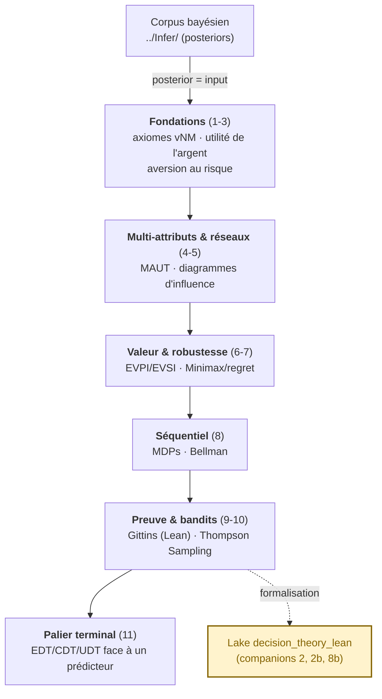

# Théorie de la Décision Bayésienne (Infer.NET)

[← Série Probas](../../README.md) | [↑ Arc Théorie de la Décision](../README.md) | [Corpus bayésien Infer (C#) →](../../Infer/README.md) | [Lake Lean `decision_theory_lean` →](../decision_theory_lean/)

Arc autonome de **théorie de la décision bayésienne** en Infer.NET : les notebooks 1-11 et les accrétions Lean prolongent la modélisation probabiliste (le corpus bayésien [`../../Infer/`](../../Infer/README.md)) jusqu'au **choix d'action sous incertitude**. Un posterior n'est pas une fin — c'est l'**input** d'une politique optimale. Cette série formalise ce passage, de l'utilité espérée aux processus markoviens, jusqu'à la **preuve formelle Lean 4** de l'indice de Gittins, puis aux **théories de la décision face à un prédicteur** (EDT, CDT, UDT — notebook 11, venu de GameTheory).

**Prérequis** : le corpus bayésien [`../../Infer/`](../../Infer/README.md) (notamment [Infer-04-Bayesian-Networks](../../Infer/Infer-04-Bayesian-Networks.ipynb), [Infer-07-Skills-IRT](../../Infer/Infer-07-Skills-IRT.ipynb) pour les posteriors Beta). Aucun prérequis en théorie de la décision : les axiomes de Von Neumann-Morgenstern sont introduits ex nihilo.

**Stack** : Infer.NET (.NET 9.0 + dotnet-interactive), EP/VMP par défaut. Les notebooks companions (2, 2b, 8b) utilisent le **kernel Lean 4** (WSL) et le lake [`decision_theory_lean`](../decision_theory_lean/) ; le notebook 11 (descendu de GameTheory) utilise le **kernel Python**.

> **Paires jumelles (Infer.NET ↔ PyMC, théorie de la décision)** — déclaration de maintenance (issue #24197, section C) : `DecInfer/` et `DecPyMC/` enseignent le *même plan* — 7 étapes communes — sur *deux moteurs* (message passing compilé vs échantillonnage MCMC) ; ce ne sont pas des doublons. Un changement pédagogique commun (une étape ajoutée, retirée ou renvoyée de l'une à l'autre) se porte **dans les deux** : si tu modifies l'une, vérifie l'autre.

**Paire symétrique, sans canonique** : les deux arcs ont le même statut — aucun n'est le port de l'autre, et chacun porte des carnets que l'autre n'a pas. La déclaration porte donc sur l'**invariant de maintenance** ci-dessus et sur les exceptions ci-dessous, pas sur une hiérarchie.

**Le plan commun, et ses numéros divergents** — le titre fait foi, pas le numéro :

| Étape | `DecInfer` | `DecPyMC` |
|---|---|---|
| Fondements axiomatiques (VNM) | `01-Utility-Foundations` | `01-Utility-Foundations` |
| Utilité de l'argent, aversion au risque | `03-Utility-Money` | `02-Utility-Money` |
| Utilité multi-attributs | `04-Multi-Attribute` | `03-Multi-Attribute` |
| Réseaux de décision | `05-Decision-Networks` | `04-Decision-Networks` |
| Valeur de l'information | `06-Value-Information` | `05-Value-Information` |
| Systèmes experts, décisions robustes | `07-Expert-Systems` | `06-Expert-Systems` |
| MDPs, bandits, POMDPs | `08-Sequential` (+ `10-Thompson-Sampling`) | `07-Sequential` |

**Sans jumeau de l'autre côté** : côté Infer, les trois companions formels Lean 4 — `02-Lean-ExpectedUtility`, `02b-Lean-Coherence`, `08b-Lean-Gittins` — n'ont pas d'équivalent Python, et l'étape « MDPs, bandits, POMDPs » y est **découpée** en `08` + `10`. Côté PyMC, `08-Actuariat-Capstone` ouvre la sous-série [`Actuariat/`](../Actuariat/README.md) (T1-T5) et n'a pas de jumeau Infer.

## Pourquoi un arc autonome

Jusqu'à la restructuration de la série, la théorie de la décision était imbriquée dans le corpus bayésien Infer, ce qui masquait la **dualité des deux fils** : *modéliser l'incertitude* (inférence bayésienne) vs *décider face à l'incertitude* (théorie de la décision). L'extraction dans [`DecisionTheory/DecInfer/`](./) rend ces deux arcs **physiquement indépendants** tout en préservant le continuum pédagogique (le fil décision s'appuie sur les posteriors du corpus bayésien). Le lake [`decision_theory_lean`](../decision_theory_lean/), à la **racine de la série Probas**, reste visible des deux pistes (Infer.NET et PyMC).

## Vue d'ensemble

| # | Notebook | Durée | Concepts |
|---|----------|-------|----------|
| 1 | [DecInfer-01-Utility-Foundations](DecInfer-01-Utility-Foundations.ipynb) | 50 min | Loteries, axiomes VNM, utilité espérée |
| 2 | [DecInfer-02-Lean-ExpectedUtility](DecInfer-02-Lean-ExpectedUtility.ipynb) | 45 min | **Companion natif** (kernel Lean) : preuve formelle 0-sorry de la direction sound du théorème vNM dans le lake `decision_theory_lean` |
| 2b | [DecInfer-02b-Lean-Coherence](DecInfer-02b-Lean-Coherence.ipynb) | 20 min | **Companion natif** (kernel Lean) : cohérence de de Finetti — Dutch Book à quatre tickets, caractérisation mono-livret ⟺ bornes de probabilité (lib `Coherence`) |
| 3 | [DecInfer-03-Utility-Money](DecInfer-03-Utility-Money.ipynb) | 45 min | Paradoxe St-Petersbourg, CARA, CRRA |
| 4 | [DecInfer-04-Multi-Attribute](DecInfer-04-Multi-Attribute.ipynb) | 50 min | MAUT, SMART, swing weights |
| 5 | [DecInfer-05-Decision-Networks](DecInfer-05-Decision-Networks.ipynb) | 55 min | Diagrammes d'influence, politique optimale |
| 6 | [DecInfer-06-Value-Information](DecInfer-06-Value-Information.ipynb) | 45 min | EVPI, EVSI, valeur de l'information |
| 7 | [DecInfer-07-Expert-Systems](DecInfer-07-Expert-Systems.ipynb) | 50 min | Systèmes experts, Minimax, regret |
| 8 | [DecInfer-08-Sequential](DecInfer-08-Sequential.ipynb) | 60 min | MDPs, itération valeur/politique |
| 08b | [DecInfer-08b-Lean-Gittins](DecInfer-08b-Lean-Gittins.ipynb) | 45 min | Preuves formelles Lean 4, indice de Gittins, SFABP |
| 10 | [DecInfer-10-Thompson-Sampling](DecInfer-10-Thompson-Sampling.ipynb) | 60 min | Thompson Sampling bayésien, posterior Beta-Bernoulli par le moteur, regret vs ε-greedy/UCB1 |
| 11 | [DecInfer-11-Theories-Decision-Predicteur](DecInfer-11-Theories-Decision-Predicteur-Python.ipynb) | 75 min | EDT, CDT, CCDT, UDT/FDT sur Newcomb et la lésion de Fisher dans un cadre générique ; 2TDT-1CDT ; inattention rationnelle (Blahut-Arimoto) |

**Durée totale** : ~9h15

## Progression Pédagogique

Le socle des **fondations** (1-3) pose les axiomes de rationalité et la notion d'aversion au risque ; les notebooks 4-5 étendent aux décisions multi-critères et aux réseaux de décision (nœuds de chance/décision/utilité) ; 6-7 mesurent la valeur de l'information et la robustesse sous incertitude sévère ; 8 introduit le séquentiel (MDPs, équation de Bellman) ; 9-10 clôturent par les **bandits bayésiens** (Thompson Sampling calculé par le moteur Infer.NET) et la **preuve formelle Lean 4** de l'indice de Gittins ; le palier terminal (11) change de question : non plus *quelle action choisir sous incertitude*, mais *que faut-il compter comme conséquence de mon choix* quand un prédicteur est corrélé à lui — EDT, CDT, UDT.

## Détail des notebooks

### DecInfer-01 : Fondements de l'utilité (axiomes VNM)

**Durée** : 50 min | **Prérequis** : corpus bayésien [Infer-4](../../Infer/Infer-04-Bayesian-Networks.ipynb)

Les loteries comme représentation des choix stochastiques ; les **axiomes de Von Neumann-Morgenstern** (complétude, transitivité, continuité, indépendance) ; dérivation de la fonction d'utilité par calibration ; l'agent rationnel maximise E[U]. Applications : décision médicale, assurance, investissement.

### DecInfer-02 : Companion Lean — théorème vNM (sound) + cohérence de de Finetti

**Durée** : 45 min | **Kernel** : Lean 4 (WSL) | **Prérequis** : DecInfer-01, bases Lean 4

**Companion natif** de [DecInfer-01](DecInfer-01-Utility-Foundations.ipynb) : preuve formelle **0-sorry** de la direction *sound* du théorème de représentation vNM (représentation ⟹ rationalité) dans le lake [`decision_theory_lean`](../decision_theory_lean/) (lib `Utility`). Vérification in-kernel via `#check` + `#print axioms`. Les sections 7-8 d'origine — la **cohérence de de Finetti** (lib `Coherence`, EPIC #11703) : prix incohérents ⟹ Dutch Book à quatre tickets, et la caractérisation mono-livret `SingleCoherent q ↔ ProbBounds q` — ont été extraites vers le companion dédié [DecInfer-02b-Lean-Coherence](DecInfer-02b-Lean-Coherence.ipynb) (G4b, #14873).

### DecInfer-02b : Companion Lean — cohérence de de Finetti (Dutch Book)

**Durée** : 20 min | **Kernel** : Lean 4 (WSL) | **Prérequis** : DecInfer-02, bases Lean 4

**Companion natif** extrait des sections 7-8 de [DecInfer-02](DecInfer-02-Lean-ExpectedUtility.ipynb) (G4b, #14873) : la **cohérence de de Finetti** (1937) dans la lib `Coherence` du lake [`decision_theory_lean`](../decision_theory_lean/). Un système de prix arbitrage-incohérent est exploitable par un **Dutch Book** à quatre tickets (`non_additive_implies_dutch_book`, witness constructif) ; dans le cadre mono-livret, la cohérence coïncide exactement avec les **bornes de probabilité** (`single_coherent_iff_prob_bounds`, quatre témoins explicites — un par borne violée). Vérification in-kernel via `#check` + `#print axioms`, 0 sorry.

### DecInfer-03 : Utilité de l'argent et aversion au risque

**Durée** : 45 min | **Prérequis** : DecInfer-01

Paradoxe de Saint-Petersbourg (valeur espérée infinie), fonctions **CARA** et **CRRA**, coefficients Arrow-Pratt (aversion absolue/relative), dominance stochastique (1er et 2nd ordre), équivalent certain et prime de risque. Application : sélection de portefeuille (Livret A vs Fonds vs Actions).

La concavité de la fonction d'utilité — fondement de l'aversion au risque et de l'utilité marginale décroissante — s'illustre par les trois fonctions fondamentales `U(x) = √x`, `U(x) = ln(x)` (toutes deux strictement concaves) et `U(x) = x` (neutre au risque, en référence) tracées côte-à-côte sur la figure de la racine Probas :

*Figure reprise de la racine Probas (MANIFEST c.491 audit G.1, 1/1 ACCURATE). Source originale : [`DecPyMC-02-Utility-Money.ipynb`](../../DecisionTheory/DecPyMC/DecPyMC-02-Utility-Money.ipynb), cellule 10 « Démonstration numérique : utilité marginale décroissante ». Voir aussi le [README racine Probas § De la distribution à l'utilité](../../README.md#de-la-distribution-à-lutilité--pourquoi-la-courbe-est-concave) pour le cadrage théorique (Pratt 1964, Arrow 1965).*

### DecInfer-04 : Utilité multi-attributs

**Durée** : 50 min | **Prérequis** : DecInfer-01, DecInfer-03

Décisions multi-critères, fonctions de valeur vs utilité, indépendance préférentielle, théorèmes d'additivité (Debreu-Gorman) et multiplicativité, méthode **SMART** (swing weights). Applications : achat automobile (prix, sécurité, conso, confort), choix de carrière.

### DecInfer-05 : Réseaux de décision

**Durée** : 55 min | **Prérequis** : [Infer-4 bayésien](../../Infer/Infer-04-Bayesian-Networks.ipynb), Infer-1, Infer-4

Extension des réseaux bayésiens par les nœuds de **décision** (rectangle) et d'**utilité** (losange) ; arcs informationnels ; calcul de la politique optimale par backward induction ; décisions séquentielles. Applications : diagnostic médical avec décision de traitement, investissement avec étude de marché.

### DecInfer-06 : Valeur de l'information

**Durée** : 45 min | **Prérequis** : DecInfer-01 à DecInfer-05

**EVPI** (valeur de l'information parfaite) et **EVSI** (valeur de l'information d'échantillon) ; quand l'information a-t-elle de la valeur ; efficacité relative d'un test (EVSI/EVPI). Applications : droits pétroliers (test sismique), diagnostic médical itératif.

### DecInfer-07 : Systèmes experts et robustesse

**Durée** : 50 min | **Prérequis** : DecInfer-01 à DecInfer-06

Systèmes experts (architecture, historique) ; décision sous **incertitude sévère** (knightienne) ; critères **Minimax**, **Minimax Regret**, Maximax, Hurwicz ; robustesse aux erreurs de modélisation. Applications : diagnostic informatique, décisions financières robustes.

### DecInfer-08 : Décisions séquentielles (MDPs)

**Durée** : 60 min | **Prérequis** : DecInfer-01 à DecInfer-07

**Processus de Décision Markoviens** (MDPs) ; équation de Bellman `V(s) = max_a [R(s,a) + γ·Σ P(s'|s,a)·V(s')]` ; **itération de valeur** et **itération de politique** ; alternatives (LP, Expectimax, RTDP) ; reward shaping ; POMDPs. Pont vers la série [RL](../../../RL/README.md).

### DecInfer-08b : Companion Lean — indice de Gittins

**Durée** : 45 min | **Kernel** : Lean 4 (WSL) | **Prérequis** : DecInfer-08, bases Lean 4

**Companion natif** de [DecInfer-08](DecInfer-08-Sequential.ipynb) : preuves formelles en Lean 4. Formalisation du cadre **SFABP** (Simple Family of Alternative Bandit Processes), optimalité de l'indice de Gittins via l'argument des prevailing charges, limitations (geometric discount, NP-difficulté du calcul exact). Le théorème d'optimalité est énoncé dans le lake [`decision_theory_lean`](../decision_theory_lean/) ; sa preuve complète exige une formalisation des MDP qui manque encore à Mathlib.

### DecInfer-10 : Thompson Sampling bayésien

**Durée** : 60 min | **Prérequis** : [Infer-7 bayésien](../../Infer/Infer-07-Skills-IRT.ipynb) (posterior Beta), Infer-8 (bandits, ε-greedy, UCB1)

Le **bandit multi-bras** vu comme un programme probabiliste Infer.NET : le moteur d'inférence (EP/VMP) calcule le posterior Beta-Bernoulli de chaque bras plutôt que d'appliquer la formule conjuguée à la main. **Thompson Sampling** : jouer le bras dont l'échantillon posterior est le plus élevé. Mesure du **regret cumulé** face à ε-greedy et UCB1 (Thompson exploite l'incertitude posterior). Extension au **best-arm identification**. La généralisation à des modèles non conjugués (où seule l'inférence approchée sait calculer le posterior) justifie l'usage du moteur.

Applications : A/B testing adaptatif, recommandation en ligne, essais cliniques séquentiels.

### DecInfer-11 : Théories de la décision face à un prédicteur

**Durée** : 75 min | **Kernel** : Python | **Prérequis** : [GT-04e Oracles réflexifs](../../../GameTheory/GameTheory-04e-Reflective-Oracles-Python.ipynb) (inter-séries — l'écart CDT/EDT), probabilités conditionnelles

**Palier terminal de l'arc**, descendu de GameTheory (où il portait le numéro 04f) : les théories de la décision relèvent de l'arc décision, non de la théorie des équilibres. La question n'est plus *quelle action maximise l'utilité espérée* mais **que faut-il compter comme conséquence de mon choix** quand un autre agent ou la nature est corrélé à ce choix. EDT (l'acte comme indice), CDT (l'acte comme intervention), CCDT (Edgington), UDT/FDT (une politique choisie avant toute observation) sont évaluées **dans un seul cadre générique** — sans coder les verdicts à la main — sur le problème de Newcomb, la lésion de Fisher et le 2TDT-1CDT de Wei Dai, avec seuils exacts en `fractions.Fraction` recoupés par simulation et par un modèle causal ajusté (`dowhy`). L'inattention rationnelle (Sims) clôt le notebook par l'algorithme de Blahut-Arimoto. Le notebook ne tranche pas entre les théories : il mesure ce que chacune recommande et ce que cette recommandation rapporte.

## Ponts inter-series

| Série | Lien | Relation |
| --- | --- | --- |
| [Corpus bayésien Infer](../../Infer/README.md) | Posteriors (Beta, gaussianes) | Le posterior est l'input de la politique de décision |
| [PyMC](../DecPyMC/README.md) | DecPyMC-01 à DecPyMC-07 | Même arc décision en Python/NUTS (Thompson MCMC, diagnostics ArviZ) |
| [Lake `decision_theory_lean`](../decision_theory_lean/) | Companions 2, 2b, 8b | Preuves formelles Lean 4 (vNM, de Finetti, Gittins) |
| [GameTheory](../../../GameTheory/README.md) | Décision sous incertitude | Miroir : adversaire rationnel vs processus stochastique ; [GT-04e Oracles réflexifs](../../../GameTheory/GameTheory-04e-Reflective-Oracles-Python.ipynb), prérequis de DecInfer-11, et le palier 04 de GameTheory renvoient ici
| [RL](../../../RL/README.md) | MDPs (DecInfer-08) | L'agent apprend la politique par interaction |

## Conclusion

La théorie de la décision bayésienne ferme la boucle ouverte par le corpus bayésien : un posterior n'est utile que s'il informe une **action**. De l'**utilité espérée** (DecInfer-01) aux **MDPs** (DecInfer-08) et aux **théories de la décision face à un prédicteur** (DecInfer-11), cet arc montre que décider sous incertitude est un calcul rigoureux — et les companions Lean 4 (DecInfer-02, DecInfer-02b, DecInfer-08b) ancrent ce calcul dans la **preuve formelle** : l'indice de Gittins n'est pas une heuristique, c'est un théorème.

Bonne exploration de la théorie de la décision bayésienne !
