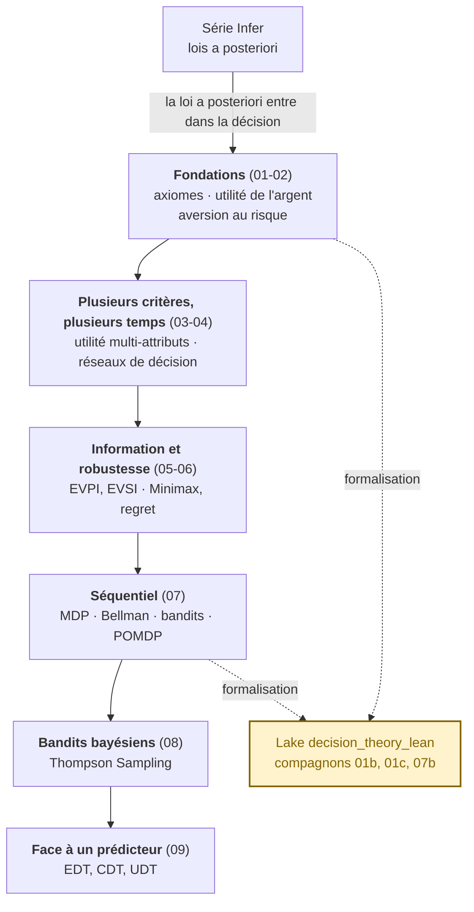
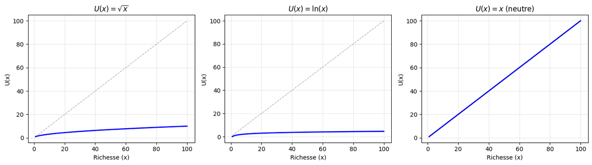

# DecInfer — décider sous incertitude avec Infer.NET

[↑ Théorie de la décision](../README.md)

Une loi a posteriori ne dit pas quoi faire. Savoir qu'un patient a `65,9 %` de chances d'être malade ne dit pas s'il faut le traiter : il manque ce que coûte chaque erreur, et une règle pour arbitrer. La théorie de la décision apporte les deux, une fonction d'utilité et le principe de l'utilité espérée maximale. Cette sous-série la construit pas à pas en C#, sur le moteur d'inférence Infer.NET : des axiomes de préférence au choix d'un traitement, d'un portefeuille ou d'un forage, puis aux décisions répétées, où chaque action modifie ce que l'on saura ensuite.

Elle forme une paire avec [DecPyMC](../DecPyMC/README.md), qui suit le même plan en Python avec un échantillonneur MCMC : les sept premières étapes portent le même numéro des deux côtés. DecInfer ajoute trois choses. Des carnets compagnons, 01b, 01c et 07b, énoncent et vérifient en Lean 4 les théorèmes sur lesquels le cours repose. Le carnet 08 fait calculer au moteur les lois a posteriori d'un bandit. Le carnet 09, en Python, examine ce que devient la règle de décision quand un prédicteur est corrélé au choix. La sous-série s'adresse à des étudiants de licence avancée et de master qui connaissent les réseaux bayésiens de la série [Infer](../../Infer/README.md), en particulier [Infer-04](../../Infer/Infer-04-Bayesian-Networks.ipynb). Aucune connaissance de la théorie de la décision n'est supposée : les axiomes sont introduits depuis le début.

## Comment lire ce README — Découverte

Le principe [« Choisir sa vitesse de lecture »](https://github.com/jsboige/CoursIA#choisir-sa-vitesse-de-lecture) distingue le parcours principal, les approfondissements et les prolongements de recherche.

- **Vous découvrez** : suivez le parcours principal dans l'ordre des numéros, de 01 à 07. Chaque carnet reprend les notions du précédent.
- **Vous creusez un palier** : la dernière colonne de la table renvoie aux carnets compagnons. La section « Approfondissements » les décrit, compare les deux moteurs de la paire et liste les exercices.
- **Vous cherchez la recherche en cours** : « Pour aller plus loin » dit ce que la formalisation Lean démontre, ce qu'elle laisse énoncé sans preuve, et où se prolongent les questions du carnet 09.

## Parcours principal — Licence avancée et Master

| # | Notebook | Ce qu'on y apprend | Public | Pour approfondir |
|---|---|---|---|---|
| 01 | [DecInfer-01 — Fondements de l'utilité](DecInfer-01-Utility-Foundations.ipynb) | Une loterie représente un choix risqué. Quatre axiomes (complétude, transitivité, continuité, indépendance) décrivent des préférences rationnelles, et le théorème de représentation en tire une fonction d'utilité : préférer revient à maximiser une utilité espérée. Le carnet l'applique à une décision médicale : après un test positif la probabilité d'être malade vaut `65,9 %`, et traiter l'emporte, `73,2` contre `34,1` en utilité espérée. Il montre ensuite comment mesurer une utilité par indifférence : d'un équivalent certain de 400 euros se déduit un coefficient d'aversion au risque de `0,25`. | Licence avancée : probabilités conditionnelles, règle de Bayes. Outils : C#, Infer.NET. | [01b](DecInfer-01b-Lean-ExpectedUtility.ipynb) : le théorème de représentation en Lean 4. [01c](DecInfer-01c-Lean-Coherence.ipynb) : pourquoi les prix d'un parieur cohérent sont des probabilités. |
| 02 | [DecInfer-02 — Utilité de l'argent](DecInfer-02-Utility-Money.ipynb) | Le paradoxe de Saint-Pétersbourg : un jeu dont l'espérance croît sans borne alors que son équivalent certain, sous utilité logarithmique, reste à `4,0 EUR`. Les familles CARA et CRRA, les coefficients d'Arrow-Pratt, l'équivalent certain et la prime de risque : pour une loterie d'espérance 11 800 euros, la prime passe de `742 EUR` à `1 506 EUR` quand le coefficient d'aversion passe de 1 à 2. Dominance stochastique, choix entre livret, fonds et actions selon l'aversion au risque, estimation d'un profil de risque à partir de choix observés. Le paradoxe d'Allais marque la limite : un agent à utilité espérée ne peut pas faire les deux choix que l'on observe couramment. | Licence avancée : dérivées, espérance. Outils : C#, Infer.NET. | Exercices : sélection de portefeuille par dominance, contraintes de risque, comparaison de fonctions d'utilité. |
| 03 | [DecInfer-03 — Utilité multi-attributs](DecInfer-03-Multi-Attribute.ipynb) | Décider sur plusieurs critères à la fois. Le carnet distingue fonction de valeur et fonction d'utilité, pose l'indépendance préférentielle qui autorise la forme additive, puis fixe les poids par la méthode des swing weights. Sur l'achat d'une voiture notée sur quatre critères, l'hybride l'emporte avec une valeur de `0,768`. La forme multiplicative ajoute un paramètre d'interaction, ici `-0,2565` : les attributs se substituent l'un à l'autre. Méthode SMART, analyse de sensibilité où le gagnant change avec un seul poids, puis apprentissage bayésien des poids à partir de choix observés. | Licence avancée : carnets 01 et 02. Outils : C#, Infer.NET. | Exercices : swing weights pour un appartement, forme multiplicative, sensibilité, critères incertains. |
| 04 | [DecInfer-04 — Réseaux de décision](DecInfer-04-Decision-Networks.ipynb) | Un réseau de décision ajoute au réseau bayésien des nœuds de décision et d'utilité, et des arcs informationnels qui disent ce que l'on sait au moment de choisir. La politique optimale se calcule par induction arrière. Un test médical ressort positif dans `18,5 %` des cas et porte alors la probabilité de maladie à `51,4 %`. Une étude de marché fait passer le profit espéré de 80 000 à 104 000 euros : elle vaut `24 000 EUR`. Suivent une décision en deux temps, tester puis traiter, et le choix d'un site d'aéroport sur plusieurs attributs incertains. Les modèles sont compilés par Infer.NET et leurs graphes de facteurs affichés. | Licence avancée et Master : réseaux bayésiens ([Infer-04](../../Infer/Infer-04-Bayesian-Networks.ipynb)). Outils : C#, Infer.NET, Graphviz. | Exercices : lancement de produit, maintenance préventive, réseau personnalisé, assurance qualité. |
| 05 | [DecInfer-05 — Valeur de l'information](DecInfer-05-Value-Information.ipynb) | Combien vaut une information avant de l'avoir ? La valeur de l'information parfaite (EVPI) plafonne ce que l'on paierait pour tout savoir, celle d'un test imparfait (EVSI) se compare à son coût, et leur rapport mesure l'efficacité du test. Sur des droits de forage, l'information parfaite vaut `390 000 EUR` ; un test sismique vaut `253 000 EUR` avant son coût et `203 000 EUR` après, soit `65 %` du plafond. En diagnostic médical, une IRM qui atteint `77 %` du plafond coûte plus qu'elle n'apporte : sa valeur nette est de `-227 EUR`. Le carnet généralise le calcul avec Infer.NET et enchaîne plusieurs tests. | Master : carnets 01 à 04. Outils : C#, Infer.NET. | Exercices : investissement immobilier, choix d'une source d'information, portefeuille. Suite : [Actuariat-05](../Actuariat/Actuariat-05-Valeur-Info-Souscription.ipynb). |
| 06 | [DecInfer-06 — Systèmes experts et décision robuste](DecInfer-06-Expert-Systems.ipynb) | L'architecture d'un système expert et son histoire, puis un diagnostic à plusieurs sources en Infer.NET : devant fièvre, toux et fatigue, le modèle rend `Grippe: 67,7 %` et `Covid: 30,5 %`. Quand les probabilités manquent, d'autres critères remplacent l'utilité espérée : Minimax, Minimax Regret, Hurwicz. Sur un même tableau de placements ils ne retiennent pas la même option : l'utilité espérée choisit les actions, le Minimax les obligations, le regret minimax l'immobilier. | Master : carnets 01 à 05. Outils : C#, Infer.NET. | Exercices : fournisseur cloud, local commercial, système expert de diagnostic. |
| 07 | [DecInfer-07 — Décisions séquentielles](DecInfer-07-Sequential.ipynb) | Les processus de décision markoviens et l'équation de Bellman. L'itération de valeur converge en `14` itérations sur l'exemple du carnet, l'itération de politique se stabilise à la troisième ; programmation linéaire, Expectimax et RTDP sont présentés comme alternatives, avec le reward shaping. Les bandits manchots posent le dilemme entre explorer et exploiter, et introduisent l'indice de Gittins. Dans un POMDP l'état n'est plus observé : sur le problème du tigre, trois écoutes concordantes portent la croyance de 50 % à `85,0 %`, `97,0 %` puis `99,5 %`. Une maintenance prédictive modélisée en Infer.NET conclut de continuer, avec une utilité espérée de `96,8`. | Master : carnets 01 à 06. Outils : C#, Infer.NET. | [07b](DecInfer-07b-Lean-Gittins.ipynb) : le bandit actualisé et l'indice de Gittins écrits en Lean 4. Suite pratique : la série [RL](../../../RL/README.md). |
| 08 | [DecInfer-08 — Thompson Sampling](DecInfer-08-Thompson-Sampling.ipynb) | Le bandit devient un programme probabiliste : le moteur calcule lui-même la loi a posteriori de chaque bras. Après 7 succès et 3 échecs il rend `Beta(8,0, 4,0)`, identique à la formule conjuguée. Thompson Sampling joue le bras dont un tirage de la loi a posteriori est le plus élevé. Sur 15 répétitions de 200 tours, son regret cumulé moyen vaut `6,1`, contre `17,5` pour ε-greedy et `19,3` pour UCB1. Le carnet identifie ensuite le meilleur bras, avec une probabilité de `0,986` après 60 tirages, et discute les limites de la méthode. | Master : bandits du carnet 07, lois Beta ([Infer-06](../../Infer/Infer-06-Skills-IRT.ipynb)). Outils : C#, Infer.NET. | Exercices : quatrième bras, bandit non stationnaire avec facteur d'oubli, loi a priori informative. |
| 09 | [DecInfer-09 — Théories de la décision face à un prédicteur](DecInfer-09-Theories-Decision-Predicteur-Python.ipynb) | Que compte-t-on comme conséquence de son choix quand un prédicteur, ou la nature, est corrélé à ce choix ? Conditionner sur l'acte (EDT), intervenir sur l'acte (CDT) et choisir une politique avant toute observation (UDT) ne donnent pas la même réponse. Le carnet évalue ces règles dans un cadre unique, sans coder les verdicts à la main. Sur le problème de Newcomb, la règle évidentielle prend une seule boîte dès que la fiabilité du prédicteur dépasse `p* = 1001/2000 = 0.5005`, alors que la règle causale garde un avantage constant de `1000 dollars` pour les deux boîtes. Sur la lésion de Fisher les rôles s'inversent. Suivent la décision causale conditionnelle (CCDT), ramenée à la règle évidentielle, un dilemme où une minorité causaliste exploite la coopération des autres, et l'inattention rationnelle calculée par l'algorithme de Blahut-Arimoto. | Master : probabilités conditionnelles, opérateur `do`. Outils : Python, numpy, scipy, pandas, networkx, dowhy. | Avant : [ReglesDeDecision-01](../ReglesDeDecision-01-EDT-CDT-CCDT-UDT.ipynb), les mêmes règles sur un modèle causal fini. Exercices : prédicteur asymétrique, chantage, dilemme modifié, inattention rationnelle. |



## Approfondissements — Master et Recherche

### Autour de 01 : l'utilité espérée et la cohérence, vérifiées en Lean

[DecInfer-01b](DecInfer-01b-Lean-ExpectedUtility.ipynb) reprend le théorème de représentation du carnet 01 dans la bibliothèque `Utility` du lake [`decision_theory_lean/`](../decision_theory_lean/). Il en démontre une direction : si une fonction d'utilité représente une préférence, cette préférence satisfait les quatre axiomes. La commande `#print axioms` exécutée dans le carnet rend `[propext, Classical.choice, Quot.sound]`, c'est-à-dire aucun `sorry`. Le carnet établit aussi qu'une utilité n'est déterminée qu'à une transformation affine croissante près. La direction réciproque, des axiomes vers l'existence d'une utilité, n'est pas formalisée, et le carnet le dit. Trois exercices sont proposés dans le texte, deux en Python et un en Lean.

[DecInfer-01c](DecInfer-01c-Lean-Coherence.ipynb) répond à une question que le carnet 01 laisse de côté : pourquoi les degrés de croyance d'un agent seraient-ils des probabilités ? La bibliothèque `Coherence` démontre qu'un système de prix de paris qui n'est pas additif expose à un Dutch Book, un livret de quatre mises perdant dans tous les états du monde. Dans le cadre à un seul ticket, être cohérent équivaut exactement à respecter les bornes d'une probabilité. Une dernière section relit ces énoncés du côté de l'assureur : un barème de primes incohérent garantit une perte à l'assureur, et un barème calculé comme une prime pure n'offre aucun profit sûr. C'est le point de contact avec la sous-série [Actuariat](../Actuariat/README.md).

Ces deux carnets demandent des bases de Lean 4. Ils se lisent sans exécuter : les signatures et les axiomes utilisés sont affichés dans les sorties.

### Autour de 07 : l'indice de Gittins écrit en Lean

[DecInfer-07b](DecInfer-07b-Lean-Gittins.ipynb) réécrit en Lean 4 les objets du bandit du carnet 07 : bras, instance, politique, historique de récompenses. Il calcule des valeurs actualisées (la somme de 50 termes à γ = 0,9 vaut `9.948462`, proche de sa limite 10), compare une politique gloutonne à UCB1, définit un indice de Gittins et énonce le théorème d'optimalité. Le carnet travaille en nombres flottants, sans Mathlib, pour rester lisible. Il tient en conséquence le répertoire de ce qu'il admet sans preuve. Les démonstrations vérifiées vivent dans le lake, décrit plus bas sous « Formalisations Lean ».

### La paire DecInfer et DecPyMC : un plan, deux moteurs

Les deux dossiers enseignent le même plan sur deux moteurs d'inférence. Aucun n'est la traduction de l'autre, et chacun porte des carnets que l'autre n'a pas.

| Étape | DecInfer (C#, Infer.NET) | DecPyMC (Python, PyMC) |
|---|---|---|
| Fondements de l'utilité | [DecInfer-01](DecInfer-01-Utility-Foundations.ipynb) | [DecPyMC-01](../DecPyMC/DecPyMC-01-Utility-Foundations.ipynb) |
| Utilité de l'argent, aversion au risque | [DecInfer-02](DecInfer-02-Utility-Money.ipynb) | [DecPyMC-02](../DecPyMC/DecPyMC-02-Utility-Money.ipynb) |
| Utilité multi-attributs | [DecInfer-03](DecInfer-03-Multi-Attribute.ipynb) | [DecPyMC-03](../DecPyMC/DecPyMC-03-Multi-Attribute.ipynb) |
| Réseaux de décision | [DecInfer-04](DecInfer-04-Decision-Networks.ipynb) | [DecPyMC-04](../DecPyMC/DecPyMC-04-Decision-Networks.ipynb) |
| Valeur de l'information | [DecInfer-05](DecInfer-05-Value-Information.ipynb) | [DecPyMC-05](../DecPyMC/DecPyMC-05-Value-Information.ipynb) |
| Systèmes experts, décision robuste | [DecInfer-06](DecInfer-06-Expert-Systems.ipynb) | [DecPyMC-06](../DecPyMC/DecPyMC-06-Expert-Systems.ipynb) |
| MDP, bandits, POMDP | [DecInfer-07](DecInfer-07-Sequential.ipynb) | [DecPyMC-07](../DecPyMC/DecPyMC-07-Sequential.ipynb) |
| Thompson Sampling par le moteur | [DecInfer-08](DecInfer-08-Thompson-Sampling.ipynb) | traité dans DecPyMC-07 |
| Face à un prédicteur | [DecInfer-09](DecInfer-09-Theories-Decision-Predicteur-Python.ipynb) | sans jumeau |
| Formalisation Lean | compagnons 01b, 01c, 07b | sans jumeau |
| Passage à l'actuariat | sans jumeau | [DecPyMC-08](../DecPyMC/DecPyMC-08-Actuariat-Capstone.ipynb) |

Ce qui change d'un moteur à l'autre tient à la façon de calculer. Infer.NET compile le modèle en un algorithme de passage de messages et rend une loi a posteriori sans tirage ; PyMC échantillonne et accompagne ses résultats de diagnostics. Le test médical de l'étape 01 le montre : Infer.NET affiche `65,9 %`, la valeur exacte, quand l'échantillonneur du carnet jumeau affiche `66.3%` à côté de la valeur analytique `65.9%`. Sur les étapes 03, 04 et 06, et sur les processus de décision markoviens de l'étape 07, les deux carnets traitent les mêmes exemples et retrouvent les mêmes valeurs.

L'étape 05 fait exception : le forage pétrolier n'a pas les mêmes montants dans les deux carnets, et l'information parfaite y vaut `390 000 EUR` ici, `90k EUR` dans le carnet jumeau. La comparaison des deux moteurs sur un problème strictement identique est faite à part, dans le banc [`voi/`](../voi/README.md), dont le contrat reprend les gains et les probabilités de DecInfer-05. Les deux moteurs y rendent la même valeur du test sismique à l'échantillonnage près, et un calcul exact en Lean les arbitre ; l'annexe D de [DecPyMC-05](../DecPyMC/DecPyMC-05-Value-Information.ipynb) en donne la lecture.

Qui modifie une étape commune dans l'un des deux dossiers vérifie l'autre.

### L'utilité marginale décroissante en une figure

L'aversion au risque du carnet 02 tient à la concavité de la fonction d'utilité : chaque euro supplémentaire apporte moins que le précédent. La figure ci-dessous, tracée par le carnet jumeau [DecPyMC-02](../DecPyMC/DecPyMC-02-Utility-Money.ipynb), place côte à côte deux utilités concaves et l'utilité linéaire d'un agent neutre au risque.



### Exercices des carnets

- **DecInfer-01** : décision médicale avec test séquentiel, primes de risque comparées sous CARA et CRRA, aversion au risque déduite d'un équivalent certain.
- **DecInfer-02** : sélection de portefeuille par dominance stochastique, portefeuille sous contraintes de risque (VaR et CVaR), comparaison de fonctions d'utilité pour un investissement.
- **DecInfer-03** : swing weights pour le choix d'un appartement, forme multiplicative pour un investissement, analyse de sensibilité, décision multi-critères avec incertitude.
- **DecInfer-04** : réseau de décision d'un lancement de produit, maintenance préventive d'une machine, réseau personnalisé, assurance qualité avec Infer.NET.
- **DecInfer-05** : EVPI d'un investissement immobilier, choix d'une source d'information pour un lancement, valeur de l'information sur un portefeuille.
- **DecInfer-06** : choix d'un fournisseur cloud par Minimax et regret, choix d'un local commercial par le critère de Hurwicz, système expert de diagnostic.
- **DecInfer-07** : comparer itération de valeur et itération de politique sur un MDP modifié, comparer des stratégies de bandits, résoudre un MDP par itération de valeur.
- **DecInfer-08** : ajouter un quatrième bras, traiter un bandit non stationnaire avec un facteur d'oubli, comparer une loi a priori informative à la loi uniforme.
- **DecInfer-09** : frontière de décision pour un prédicteur asymétrique, problème de chantage dans le cadre générique, dilemme où coopérer rapporte davantage, inattention rationnelle avec une loi a priori décalée.

Les cellules d'exercice s'exécutent sans erreur tant qu'elles ne sont pas complétées.

## Installation — pratique, tous niveaux

Le dossier utilise trois noyaux Jupyter. Aucun carnet ne demande de GPU.

**Carnets C# (01 à 08, hors lettres).** Noyau `.net-csharp` de .NET Interactive, avec le SDK .NET 9. Chaque carnet télécharge lui-même les paquets NuGet d'Infer.NET. Il charge aussi, par chemin relatif, deux fichiers d'aide de la série Infer, `FactorGraphHelper.cs` et `SvgChartHelper.cs` : ouvrez donc les carnets depuis leur dossier, dans un clone complet du dépôt. Graphviz est facultatif. Sans lui les graphes de facteurs ne sont pas dessinés, et le carnet l'indique.

```bash
dotnet tool install --global Microsoft.dotnet-interactive
dotnet interactive jupyter install
jupyter lab MyIA.AI.Notebooks/Probas/DecisionTheory/DecInfer/DecInfer-01-Utility-Foundations.ipynb
```

**Carnets Lean (01b, 01c, 07b).** Noyau `lean4-wsl`, Lean 4 exécuté sous WSL. Les carnets 01b et 01c importent les bibliothèques `Utility` et `Coherence` du lake, qui doit avoir été construit avec Mathlib ; le premier import prend environ trois minutes. Le carnet 07b n'importe rien. La construction du lake est décrite dans son [README](../decision_theory_lean/README.md), l'installation du noyau dans [kernels-runtime.md](../../../../docs/reference/kernels-runtime.md).

**Carnet Python (09).** Noyau `python3`, avec numpy, scipy, pandas, matplotlib, networkx et dowhy, tous listés dans [requirements.txt](../../requirements.txt).

```bash
python -m pip install -r MyIA.AI.Notebooks/Probas/requirements.txt
```

## Pour aller plus loin — Recherche

**Formalisations Lean.** Le lake [`decision_theory_lean/`](../decision_theory_lean/) regroupe trois bibliothèques. `Utility` et `Coherence` sont démontrées sans `sorry` : la direction du théorème de représentation lue dans 01b, le Dutch Book et sa lecture actuarielle lus dans 01c. Deux résultats y sont nommés comme jalons ouverts et ne sont pas formalisés : l'existence d'une utilité pour toute préférence rationnelle, et la caractérisation complète de la cohérence par une mesure de probabilité. Dans `Gittins`, les identités de l'actualisation géométrique sont prouvées ; le théorème d'optimalité de l'indice est énoncé, non prouvé. Sa démonstration demande une formalisation des processus de décision markoviens que Mathlib ne fournit pas encore. L'indice de Gittins n'est donc pas, dans ce dépôt, un résultat vérifié par machine.

**Du calcul d'une politique à son apprentissage.** Le carnet 07 calcule une politique optimale à partir d'un modèle connu. La série [RL](../../../RL/README.md) traite le cas où l'agent doit l'apprendre par interaction.

**Décider face à un autre décideur.** Le carnet 09 s'arrête à un prédicteur donné. La série [Théorie des jeux](../../../GameTheory/README.md) étudie le cas où chaque agent modélise l'autre ; [GameTheory-04e](../../../GameTheory/GameTheory-04e-Reflective-Oracles-Python.ipynb) en donne le point de départ, sur une chasse au cerf corrélée où règle causale et règle évidentielle désignent des actions différentes.

**Ce que le carnet 09 ne résout pas.** Sa section 7 situe ses calculs par rapport à sept problèmes ouverts de la théorie de la décision. Le prédicteur y est donné par l'énoncé, et la mesure retenue localise les désaccords entre règles sans les arbitrer.

## Ressources — tous niveaux

- [La série Infer](../../Infer/README.md) : les fondations d'inférence bayésienne en C#, dont [Infer-04](../../Infer/Infer-04-Bayesian-Networks.ipynb) pour les réseaux bayésiens et [Infer-06](../../Infer/Infer-06-Skills-IRT.ipynb) pour les lois Beta.
- [DecPyMC](../DecPyMC/README.md) : le même plan en Python, et son prolongement vers l'[Actuariat](../Actuariat/README.md).
- [La série Causalité](../../Causalite/README.md) : l'opérateur `do` utilisé par le carnet 09.
- Chaque carnet se termine par sa bibliographie : théorie de l'utilité, analyse de la décision, valeur de l'information, processus de décision markoviens, bandits, théories de la décision.

[↑ Théorie de la décision](../README.md) · [Série Probas](../../README.md) · [Catalogue du dépôt](../../../../COURSE_CATALOG.generated.md)
