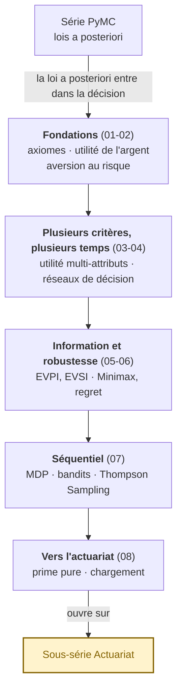
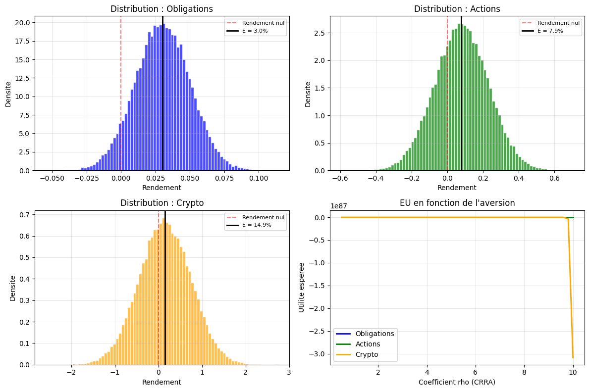
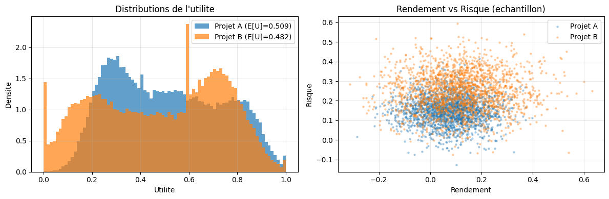
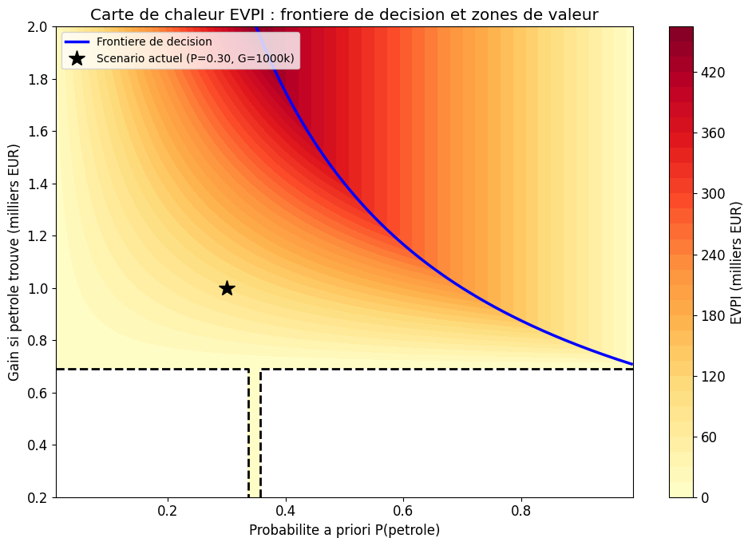
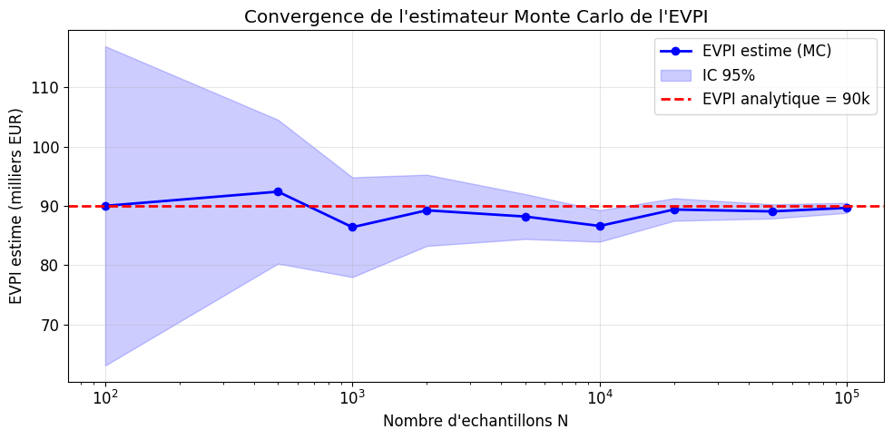
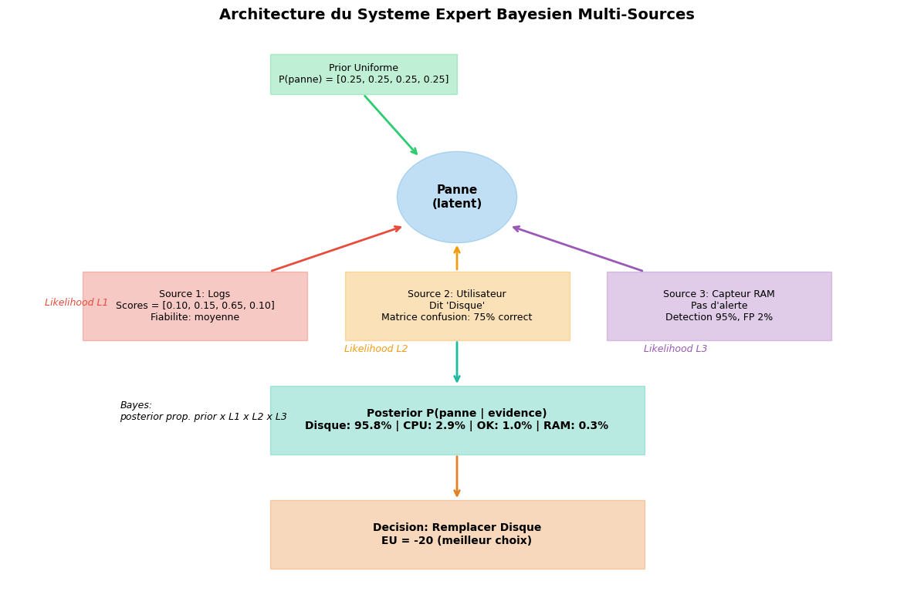
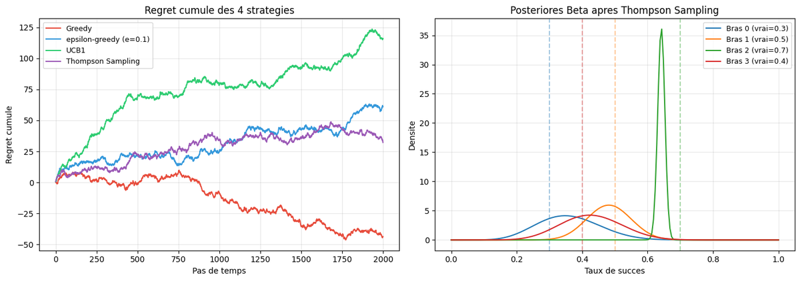

# DecPyMC — décider sous incertitude avec PyMC

[↑ Théorie de la décision](../README.md)

Une loi a posteriori ne dit pas quoi faire : il faut encore dire ce que l'on préfère, et choisir une règle. Cette sous-série construit la théorie de la décision en Python sur PyMC, des axiomes de préférence au choix d'un traitement, d'un placement ou d'un forage, puis aux décisions répétées. L'échantillonneur donne sa couleur à l'ensemble. Il rend des tirages de la loi a posteriori, pas une formule, et la décision hérite de cette incertitude : au lieu d'un seul classement, le carnet 04 calcule la probabilité que chaque site d'aéroport soit le meilleur, `76.0%` pour le site retenu.

Elle forme une paire avec [DecInfer](../DecInfer/README.md), qui suit le même plan en C# sur Infer.NET : les sept premières étapes portent le même numéro des deux côtés. DecPyMC ajoute, de l'étape 01 à l'étape 06, un modèle que la formule ne résout pas, et se termine par un carnet 08 qui ouvre sur la sous-série [Actuariat](../Actuariat/README.md). Elle s'adresse à des étudiants de licence avancée et de master qui connaissent la modélisation bayésienne de la série [PyMC](../../PyMC/README.md), en particulier [PyMC-04](../../PyMC/PyMC-04-Bayesian-Networks.ipynb). Aucune connaissance de la théorie de la décision n'est supposée : les axiomes sont introduits depuis le début.

## Comment lire ce README — Découverte

Le principe [« Choisir sa vitesse de lecture »](https://github.com/jsboige/CoursIA#choisir-sa-vitesse-de-lecture) distingue le parcours principal, les approfondissements et les prolongements de recherche.

- **Vous découvrez** : suivez le parcours principal dans l'ordre des numéros, de 01 à 07. Chaque carnet reprend les notions du précédent.
- **Vous creusez un palier** : la section « Approfondissements » dit ce que l'échantillonnage apporte à chaque étape, montre la progression en six figures, compare les deux moteurs de la paire et liste les exercices.
- **Vous cherchez la recherche en cours** : « Pour aller plus loin » mène à l'actuariat, au banc qui confronte les deux moteurs à une valeur exacte, et à la formalisation Lean.

## Parcours principal — Licence avancée et Master

| # | Notebook | Ce qu'on y apprend | Public | Pour approfondir |
|---|---|---|---|---|
| 01 | [DecPyMC-01 — Fondements de l'utilité](DecPyMC-01-Utility-Foundations.ipynb) | Une loterie représente un choix risqué. Quatre axiomes (complétude, transitivité, continuité, indépendance) décrivent des préférences rationnelles, et le théorème de représentation en tire une fonction d'utilité. Sur une décision médicale, l'échantillonneur rend `66.3%` de chances d'être malade après un test positif, à côté de la valeur analytique `65.9%` : sur un modèle conjugué, MCMC retrouve la formule. Le carnet passe donc à un cas sans forme fermée, la prévalence d'une maladie dans huit hôpitaux, où un modèle hiérarchique tire les estimations des petits sites vers la moyenne commune. Il mesure ensuite une utilité par indifférence et l'applique à une assurance : avec une utilité logarithmique, l'agent paierait jusqu'à `3691 EUR` pour se couvrir d'une perte espérée de 500 euros. | Licence avancée : probabilités conditionnelles, règle de Bayes. Outils : Python, PyMC, ArviZ. | Jumeau : [DecInfer-01](../DecInfer/DecInfer-01-Utility-Foundations.ipynb). Exercices : axiome d'indépendance, loterie d'assurance, CARA et CRRA. |
| 02 | [DecPyMC-02 — Utilité de l'argent](DecPyMC-02-Utility-Money.ipynb) | Le paradoxe de Saint-Pétersbourg, simulé : l'espérance du jeu diverge alors que son équivalent certain, sous utilité logarithmique, reste à `4.0 EUR`. Utilité marginale décroissante, familles CARA et CRRA, coefficients d'Arrow-Pratt, équivalent certain, prime de risque, dominance stochastique, puis un choix entre obligations, actions et crypto-actifs selon l'aversion au risque. Le carnet estime enfin l'aversion au risque d'un agent à partir de ses choix. Pour une vraie valeur de 2,5, la loi a posteriori du coefficient est `2.990 +/- 0.729`, et cette incertitude se propage à la prime de risque : son intervalle à 89 % va de `742.7` à `1416.4` euros. | Licence avancée : dérivées, espérance. Outils : Python, PyMC, ArviZ, scipy. | Jumeau : [DecInfer-02](../DecInfer/DecInfer-02-Utility-Money.ipynb). Exercices : équivalent certain et prime de risque, dominance stochastique, VaR et CVaR. |
| 03 | [DecPyMC-03 — Utilité multi-attributs](DecPyMC-03-Multi-Attribute.ipynb) | Décider sur plusieurs critères : fonction de valeur et fonction d'utilité, indépendance préférentielle, forme additive, swing weights, forme multiplicative, méthode SMART, analyse de sensibilité. Sur l'achat d'une voiture, l'hybride l'emporte avec une valeur de `0.768`, comme dans le carnet jumeau. Le carnet traite ensuite l'incertitude : une simulation de Monte Carlo quand les attributs sont incertains, où deux projets d'utilités espérées `0.509` et `0.482` ont des distributions qui se recouvrent largement ; l'apprentissage bayésien des poids à partir de choix observés ; un modèle de choix discret logit, sans forme conjuguée. | Licence avancée : carnets 01 et 02. Outils : Python, PyMC, ArviZ. | Jumeau : [DecInfer-03](../DecInfer/DecInfer-03-Multi-Attribute.ipynb). Exercices : poids personnalisés, swing weights, forme multiplicative, sensibilité, attributs incertains. |
| 04 | [DecPyMC-04 — Réseaux de décision](DecPyMC-04-Decision-Networks.ipynb) | Nœuds de chance, de décision et d'utilité, arcs informationnels, politique optimale par induction arrière. Les exemples sont ceux du carnet jumeau : un test médical positif dans `18.5%` des cas, une étude de marché qui vaut `24,000 EUR`, une décision en deux temps. PyMC ajoute l'estimation de la vraie prévalence d'une maladie quand le test est imparfait, par un modèle hiérarchique dont l'état du patient est latent. Sur le choix d'un site d'aéroport, la simulation rend la probabilité que chaque site soit le meilleur : `76.0%` pour le site rural. | Licence avancée et Master : réseaux bayésiens ([PyMC-04](../../PyMC/PyMC-04-Bayesian-Networks.ipynb)). Outils : Python, PyMC, ArviZ. | Jumeau : [DecInfer-04](../DecInfer/DecInfer-04-Decision-Networks.ipynb). Exercices : recrutement avec lettre de référence, achat immobilier et expertise, réseau personnalisé. |
| 05 | [DecPyMC-05 — Valeur de l'information](DecPyMC-05-Value-Information.ipynb) | Combien vaut une information avant de l'avoir ? Valeur de l'information parfaite (EVPI) et d'un test imparfait (EVSI), sur le parapluie, le forage pétrolier, la chasse au trésor et le diagnostic médical. Avec les montants du carnet, l'information parfaite sur le forage vaut `90k EUR` ; le test sismique n'en récupère que `26%` et ne paie pas son coût, sa valeur nette est de `-27k EUR`. Une carte de chaleur situe les zones où l'information a de la valeur. L'estimation de l'EVPI par 200 000 tirages retrouve la valeur analytique avec une erreur relative de `0.16%`. Quatre annexes prolongent : deux tests en séquence, convergence de l'EVSI vers l'EVPI, portefeuille hiérarchique, et un même problème calculé par trois instruments indépendants. | Master : carnets 01 à 04. Outils : Python, PyMC, ArviZ. | Jumeau : [DecInfer-05](../DecInfer/DecInfer-05-Value-Information.ipynb). Banc [`voi/`](../voi/README.md). Suite : [Actuariat-05](../Actuariat/Actuariat-05-Valeur-Info-Souscription.ipynb). |
| 06 | [DecPyMC-06 — Systèmes experts et décision robuste](DecPyMC-06-Expert-Systems.ipynb) | L'architecture d'un système expert bayésien et un premier diagnostic, `Grippe : 67.7%` et `Covid : 30.5%`. Quand les probabilités manquent, les critères Minimax, Minimax Regret et Hurwicz remplacent l'utilité espérée, et un arbre aide à choisir entre eux. Sur le même tableau de placements que le carnet jumeau, l'utilité espérée retient les actions, le Minimax les obligations et le regret minimax l'immobilier. Un système expert à trois sources (journaux, utilisateur, capteur) conclut à une panne de disque avec une probabilité de `95.8%`. PyMC sert enfin à estimer la fiabilité des capteurs, et le carnet compare le modèle conjugué, exact, au modèle hiérarchique, où l'échantillonnage devient nécessaire. | Master : carnets 01 à 05. Outils : Python, PyMC, ArviZ. | Jumeau : [DecInfer-06](../DecInfer/DecInfer-06-Expert-Systems.ipynb). Exercices : choix de poste, système expert météo, système expert informatique. |
| 07 | [DecPyMC-07 — Décisions séquentielles](DecPyMC-07-Sequential.ipynb) | Processus de décision markoviens et équation de Bellman. L'itération de valeur converge en `14` itérations sur l'exemple du carnet, l'itération de politique se stabilise à la troisième ; RTDP et reward shaping complètent. Bandits manchots, dilemme entre explorer et exploiter, indice de Gittins. Dans le POMDP du tigre, trois écoutes concordantes portent la croyance à `85.0%`, `97.0%` puis `99.5%`. Une maintenance prédictive conclut de continuer, avec une utilité espérée de `96.8`. La partie propre à PyMC est le Thompson Sampling : par la formule conjuguée d'abord, par échantillonnage ensuite, avec les diagnostics de convergence d'ArviZ. | Master : carnets 01 à 06. Outils : Python, PyMC, ArviZ, pytensor. | Jumeau : [DecInfer-07](../DecInfer/DecInfer-07-Sequential.ipynb), et [DecInfer-08](../DecInfer/DecInfer-08-Thompson-Sampling.ipynb) pour le Thompson Sampling. Suite pratique : la série [RL](../../../RL/README.md). |
| 08 | [DecPyMC-08 — Capstone : vers l'actuariat](DecPyMC-08-Actuariat-Capstone.ipynb) | Le passage au métier de l'assurance. Le carnet pose les quatre questions de l'assureur (tarifer, mutualiser, capitaliser, souscrire), présente les carnets de la sous-série Actuariat qui y répondent, puis calcule de bout en bout un premier tarif : une prime pure de `208.50`, une prime commerciale de `305.79` après deux chargements, pour une charge dont l'écart-type atteint `317%` de la prime pure. | Master : carnets 02 et 07 au minimum. Outils : Python, numpy. | Suite : la sous-série [Actuariat](../Actuariat/README.md). Exercices : réassurance stop-loss, probabilité de ruine sur un an, table des carnets régénérée. |



## Approfondissements — Master et Recherche

### Ce que l'échantillonnage apporte à la décision

Sur un modèle conjugué, l'échantillonneur ne fait que retrouver une formule : le carnet 01 l'écrit à propos de son test médical, et l'annexe C du carnet 05 le montre sur un cas où NUTS se borne à reproduire la loi a priori. Les carnets 01 à 06 ajoutent donc chacun à leur étape un modèle sans forme fermée, où l'échantillonnage est nécessaire :

- **01** : la prévalence d'une maladie dans plusieurs hôpitaux, par un modèle hiérarchique ;
- **02** : l'aversion au risque d'un agent, inférée de ses choix ;
- **03** : les poids d'une décision multi-critères, par un modèle de choix discret logit ;
- **04** : la vraie prévalence derrière un test imparfait ;
- **05** : la valeur de l'information sur un portefeuille de sites, par un modèle hiérarchique non centré ;
- **06** : la fiabilité des capteurs d'un système expert.

Le second apport est la forme du résultat. Une loi a posteriori échantillonnée donne une loi sur la décision elle-même : la probabilité qu'une option soit la meilleure (carnet 04), un intervalle pour une prime de risque (carnet 02). Les carnets affichent les diagnostics de convergence de ces modèles : divergences, R-hat, taille d'échantillon effective.

### La progression en six figures

Ces figures sont extraites des sorties des carnets. Leur provenance, cellule par cellule, est tenue dans [`assets/readme/MANIFEST.md`](assets/readme/MANIFEST.md).

**[Carnet 02](DecPyMC-02-Utility-Money.ipynb) — trois placements, trois distributions de rendement.** Obligations, actions et crypto-actifs ont des rendements espérés croissants (`E = 3.0%`, `E = 7.9%`, `E = 14.9%`) et des dispersions croissantes. L'espérance seule ne départage pas un agent averse au risque.

<p align="center"><a href="DecPyMC-02-Utility-Money.ipynb"></a></p>

**[Carnet 03](DecPyMC-03-Multi-Attribute.ipynb) — deux projets que l'incertitude ne départage pas.** Les distributions d'utilité des deux projets se recouvrent presque entièrement, et leurs nuages de points rendement-risque se chevauchent.

<p align="center"><a href="DecPyMC-03-Multi-Attribute.ipynb"></a></p>

**[Carnet 05](DecPyMC-05-Value-Information.ipynb) — où l'information a de la valeur.** La valeur de l'information parfaite dépend de la probabilité de trouver du pétrole et du gain espéré. Le scénario du carnet, marqué d'une étoile, tombe dans une zone de faible valeur.

<p align="center"><a href="DecPyMC-05-Value-Information.ipynb"></a></p>

**[Carnet 05](DecPyMC-05-Value-Information.ipynb) — l'estimateur de Monte Carlo rejoint la valeur analytique.** L'intervalle de confiance, large pour cent tirages, se resserre autour de 90 milliers d'euros quand leur nombre augmente.

<p align="center"><a href="DecPyMC-05-Value-Information.ipynb"></a></p>

**[Carnet 06](DecPyMC-06-Expert-Systems.ipynb) — trois sources, un diagnostic, une décision.** Une loi a priori uniforme sur quatre pannes est mise à jour par les journaux, le témoignage de l'utilisateur et un capteur. La loi a posteriori désigne le disque, et la décision en découle.

<p align="center"><a href="DecPyMC-06-Expert-Systems.ipynb"></a></p>

**[Carnet 07](DecPyMC-07-Sequential.ipynb) — quatre stratégies de bandit sur un même tirage.** À gauche, le regret cumulé de chaque stratégie au fil des tours. À droite, les lois a posteriori que Thompson Sampling a construites pour chaque bras : celle du meilleur bras, le plus joué, est de loin la plus resserrée.

<p align="center"><a href="DecPyMC-07-Sequential.ipynb"></a></p>

### La paire DecPyMC et DecInfer : un plan, deux moteurs

Les deux dossiers enseignent le même plan sur deux moteurs d'inférence. Aucun n'est la traduction de l'autre, et chacun porte des carnets que l'autre n'a pas.

| Étape | DecPyMC (Python, PyMC) | DecInfer (C#, Infer.NET) |
|---|---|---|
| Fondements de l'utilité | [DecPyMC-01](DecPyMC-01-Utility-Foundations.ipynb) | [DecInfer-01](../DecInfer/DecInfer-01-Utility-Foundations.ipynb) |
| Utilité de l'argent, aversion au risque | [DecPyMC-02](DecPyMC-02-Utility-Money.ipynb) | [DecInfer-02](../DecInfer/DecInfer-02-Utility-Money.ipynb) |
| Utilité multi-attributs | [DecPyMC-03](DecPyMC-03-Multi-Attribute.ipynb) | [DecInfer-03](../DecInfer/DecInfer-03-Multi-Attribute.ipynb) |
| Réseaux de décision | [DecPyMC-04](DecPyMC-04-Decision-Networks.ipynb) | [DecInfer-04](../DecInfer/DecInfer-04-Decision-Networks.ipynb) |
| Valeur de l'information | [DecPyMC-05](DecPyMC-05-Value-Information.ipynb) | [DecInfer-05](../DecInfer/DecInfer-05-Value-Information.ipynb) |
| Systèmes experts, décision robuste | [DecPyMC-06](DecPyMC-06-Expert-Systems.ipynb) | [DecInfer-06](../DecInfer/DecInfer-06-Expert-Systems.ipynb) |
| MDP, bandits, POMDP | [DecPyMC-07](DecPyMC-07-Sequential.ipynb) | [DecInfer-07](../DecInfer/DecInfer-07-Sequential.ipynb) |
| Thompson Sampling par le moteur | traité dans DecPyMC-07 | [DecInfer-08](../DecInfer/DecInfer-08-Thompson-Sampling.ipynb) |
| Passage à l'actuariat | [DecPyMC-08](DecPyMC-08-Actuariat-Capstone.ipynb) | sans jumeau |
| Face à un prédicteur | sans jumeau | [DecInfer-09](../DecInfer/DecInfer-09-Theories-Decision-Predicteur-Python.ipynb) |
| Formalisation Lean | sans jumeau | compagnons 01b, 01c, 07b |

Ce qui change d'un moteur à l'autre tient à la façon de calculer. Infer.NET compile le modèle en un algorithme de passage de messages et rend une loi a posteriori sans tirage ; PyMC échantillonne et accompagne ses résultats de diagnostics. Sur les étapes 03, 04 et 06, et sur les processus de décision markoviens de l'étape 07, les deux carnets traitent les mêmes exemples et retrouvent les mêmes valeurs.

L'étape 05 fait exception : le forage pétrolier n'a pas les mêmes montants dans les deux carnets, et l'information parfaite y vaut `90k EUR` ici, `390 000 EUR` dans le carnet jumeau. L'annexe D du carnet 05 le signale et reprend le contrat du banc [`voi/`](../voi/README.md), dont les gains et les probabilités sont ceux du carnet jumeau. Sur ce contrat unique, la valeur du test sismique est de `253000` pour le calcul du carnet, pour le calcul exact en Lean et pour Infer.NET, et de `252796` pour PyMC : l'écart est le bruit de l'échantillonnage.

Qui modifie une étape commune dans l'un des deux dossiers vérifie l'autre.

### Exercices des carnets

- **DecPyMC-01** : vérifier l'axiome d'indépendance, modéliser une loterie d'assurance en PyMC, comparer CARA et CRRA.
- **DecPyMC-02** : équivalent certain et prime de risque d'une loterie, comparaison de deux investissements par dominance stochastique, VaR et CVaR d'un portefeuille.
- **DecPyMC-03** : poids personnalisés et comparaison de profils, swing weights pour un appartement, forme multiplicative pour un investissement, sensibilité à plusieurs poids, décision SMART avec attributs incertains.
- **DecPyMC-04** : recrutement avec lettre de référence, achat immobilier et expertise structurelle, réseau de décision personnalisé.
- **DecPyMC-05** : EVPI d'un diagnostic médical, achat d'un indice dans la chasse au trésor, EVSI d'une politique à deux tests, valeur de l'information sur un portefeuille hiérarchique.
- **DecPyMC-06** : Minimax et regret pour un choix de poste, système expert de prévision météorologique, système expert informatique.
- **DecPyMC-07** : effet de la récompense et du facteur d'actualisation sur l'itération de valeur, Thompson Sampling contre ε-greedy sur cinq bras, itération de politique sur une grille 3×3.
- **DecPyMC-08** : réassurance stop-loss, probabilité de ruine sur un an, table des carnets de la sous-série régénérée depuis les fichiers.

Les cellules d'exercice s'exécutent sans erreur tant qu'elles ne sont pas complétées.

## Installation — pratique, tous niveaux

Tous les carnets utilisent le noyau `python3`. Aucun ne demande de GPU.

Les dépendances sont celles de la série Probas, listées dans [requirements.txt](../../requirements.txt) : PyMC 6 et ArviZ 1, qui demandent Python 3.12 ou plus récent, avec numpy, scipy, pandas et matplotlib.

```bash
python -m pip install -r MyIA.AI.Notebooks/Probas/requirements.txt
jupyter lab MyIA.AI.Notebooks/Probas/DecisionTheory/DecPyMC/DecPyMC-01-Utility-Foundations.ipynb
```

Le carnet 05 charge en annexe un module du banc [`voi/`](../voi/README.md), qu'il cherche dans les dossiers parents : ouvrez-le depuis un clone complet du dépôt. Le carnet 08 relit les fichiers de la sous-série Actuariat, avec la même contrainte.

## Pour aller plus loin — Recherche

**De la décision au métier.** La sous-série [Actuariat](../Actuariat/README.md) reprend les outils de ce parcours sur les questions de l'assureur : prime pure et chargement, modèle fréquence-sévérité, crédibilité, ruine, valeur de l'information en souscription.

**Arbitrer entre deux moteurs.** Deux moteurs qui s'accordent à peu près ne disent pas lequel a raison. Le banc [`voi/`](../voi/README.md) fait calculer la même valeur de l'information à Infer.NET et à PyMC à partir d'un contrat commun, et un adaptateur en tire une instance Lean dont la valeur est exacte. L'annexe D du carnet 05 en donne la lecture.

**Formalisations Lean.** Le lake [`decision_theory_lean/`](../decision_theory_lean/) démontre une direction du théorème de représentation du carnet 01 (une utilité qui représente une préférence la rend rationnelle) et le lien entre cohérence des croyances et probabilités ; le théorème d'optimalité de l'indice de Gittins, cité au carnet 07, y est énoncé sans être prouvé. Les carnets qui lisent ces énoncés sont du côté DecInfer : [DecInfer-01b](../DecInfer/DecInfer-01b-Lean-ExpectedUtility.ipynb), [DecInfer-01c](../DecInfer/DecInfer-01c-Lean-Coherence.ipynb) et [DecInfer-07b](../DecInfer/DecInfer-07b-Lean-Gittins.ipynb).

**Du calcul d'une politique à son apprentissage.** Le carnet 07 calcule une politique optimale à partir d'un modèle connu. La série [RL](../../../RL/README.md) traite le cas où l'agent doit l'apprendre par interaction.

**Intervenir avant de décider.** [PyMC-05](../../PyMC/PyMC-05-Causal-Inference.ipynb) introduit l'opérateur `do`, et [DecInfer-09](../DecInfer/DecInfer-09-Theories-Decision-Predicteur-Python.ipynb), écrit en Python, examine ce que devient la règle de décision quand un prédicteur est corrélé au choix.

## Ressources — tous niveaux

- [La série PyMC](../../PyMC/README.md) : les fondations de modélisation bayésienne en Python, dont [PyMC-04](../../PyMC/PyMC-04-Bayesian-Networks.ipynb) pour les réseaux bayésiens.
- [DecInfer](../DecInfer/README.md) : le même plan en C# sur Infer.NET, avec ses compagnons Lean.
- [Le manifeste des figures](assets/readme/MANIFEST.md) : d'où vient chaque image de ce README.
- Chaque carnet se termine par sa bibliographie : théorie de l'utilité, analyse de la décision, valeur de l'information, processus de décision markoviens, bandits.

[↑ Théorie de la décision](../README.md) · [Série Probas](../../README.md) · [Catalogue du dépôt](../../../../COURSE_CATALOG.generated.md)
