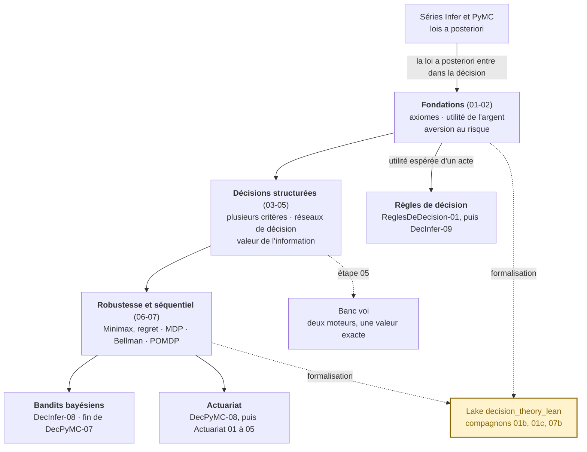

# Théorie de la décision — de la croyance à l'action

[↑ Série Probas](../README.md)

Une loi a posteriori est l'entrée d'une décision, pas son résultat. Savoir qu'un patient est probablement malade ne dit pas s'il faut le traiter ; connaître la loi du rendement d'un actif ne dit pas combien y investir. Il manque ce que vaut chaque issue pour celui qui décide, et une règle pour arbitrer entre des actes aux conséquences incertaines. Ce dossier construit les deux. Il part de la fonction d'utilité et du principe de l'utilité espérée maximale, passe aux décisions structurées par un réseau, au prix d'une information et aux critères qui tiennent quand les probabilités manquent, puis aux décisions répétées, où chaque action modifie ce que l'on saura ensuite.

Le même cours y est écrit deux fois. [DecInfer](DecInfer/README.md) le déroule en C# sur Infer.NET, [DecPyMC](DecPyMC/README.md) en Python sur PyMC, et les sept premières étapes portent le même numéro des deux côtés. La théorie ne dépend pas du moteur : une utilité espérée se calcule aussi bien par propagation de messages que par échantillonnage, et lire les deux versions montre ce que la méthode numérique change sans la confondre avec le principe. Autour de cette paire, la sous-série [Actuariat](Actuariat/README.md) applique la décision bayésienne au métier de l'assurance, un carnet posé à la racine du dossier compare les règles de décision elles-mêmes, un banc fait calculer la même valeur de l'information par les deux moteurs, et un projet Lean 4 énonce et vérifie les théorèmes que le cours cite. Le dossier s'adresse à des étudiants de licence avancée et de master qui ont suivi l'une des deux séries bayésiennes, [Infer](../Infer/README.md) ou [PyMC](../PyMC/README.md). Aucune connaissance de la théorie de la décision n'est supposée : les axiomes sont introduits depuis le début.

## Comment lire ce README — Découverte

Le principe [« Choisir sa vitesse de lecture »](https://github.com/jsboige/CoursIA#choisir-sa-vitesse-de-lecture) distingue le parcours principal, les approfondissements et les prolongements de recherche.

- **Vous découvrez** : choisissez un moteur, C# ou Python, et suivez sa sous-série dans l'ordre des numéros. La table du parcours principal donne, question par question, le carnet de chaque côté.
- **Vous creusez un palier** : la dernière colonne de la table renvoie aux carnets compagnons et aux suites. La section « Approfondissements » décrit les compagnons Lean, le banc qui confronte les deux moteurs et les exercices du carnet sur les règles de décision.
- **Vous cherchez la recherche en cours** : « Pour aller plus loin » dit ce que la formalisation Lean démontre et ce qu'elle laisse énoncé sans preuve, et où se prolongent les questions de causalité, d'apprentissage et de jeux.

## Parcours principal — Licence avancée et Master

Chaque ligne pose une question et donne le carnet qui y répond de chaque côté de la paire. Il suffit de suivre un seul des deux moteurs : les numéros se suivent dans chaque sous-série.

| Question | Carnets | Ce qu'on y apprend | Prérequis et public | Pour approfondir |
|---|---|---|---|---|
| Qu'est-ce qu'un choix rationnel ? | [DecInfer-01](DecInfer/DecInfer-01-Utility-Foundations.ipynb) · [DecPyMC-01](DecPyMC/DecPyMC-01-Utility-Foundations.ipynb) | Une loterie représente un choix risqué. Quatre axiomes (complétude, transitivité, continuité, indépendance) décrivent des préférences rationnelles, et le théorème de représentation en tire une fonction d'utilité : préférer revient à maximiser une utilité espérée. Les deux carnets l'appliquent à la même décision médicale. Après un test positif, la probabilité d'être malade vaut `65,9 %` du côté Infer.NET ; l'échantillonneur de PyMC rend `66.3%`, à côté de la même valeur analytique. Tous deux montrent ensuite comment mesurer une utilité par indifférence. | Licence avancée : probabilités conditionnelles, règle de Bayes. | [DecInfer-01b](DecInfer/DecInfer-01b-Lean-ExpectedUtility.ipynb) : le théorème de représentation en Lean 4. [DecInfer-01c](DecInfer/DecInfer-01c-Lean-Coherence.ipynb) : pourquoi les prix d'un parieur cohérent sont des probabilités. |
| Combien vaut un pari risqué ? | [DecInfer-02](DecInfer/DecInfer-02-Utility-Money.ipynb) · [DecPyMC-02](DecPyMC/DecPyMC-02-Utility-Money.ipynb) | Le paradoxe de Saint-Pétersbourg : l'espérance du jeu croît sans borne alors que son équivalent certain, sous utilité logarithmique, reste à 4 euros. Suivent les familles CARA et CRRA, les coefficients d'Arrow-Pratt, l'équivalent certain, la prime de risque et la dominance stochastique, puis un choix de placements selon l'aversion au risque. Chaque carnet estime enfin le profil de risque d'un agent à partir de ses choix ; côté PyMC, l'incertitude sur ce profil se propage jusqu'à la prime de risque. DecInfer-02 ajoute le paradoxe d'Allais, que l'utilité espérée ne reproduit pas. | Licence avancée : dérivées, espérance. | Suite métier : [Actuariat-01](Actuariat/Actuariat-01-Prime-Pure-Chargement.ipynb), où la prime de risque est distinguée de la prime pure et de la prime commerciale. |
| Comment décider sur plusieurs critères ? | [DecInfer-03](DecInfer/DecInfer-03-Multi-Attribute.ipynb) · [DecPyMC-03](DecPyMC/DecPyMC-03-Multi-Attribute.ipynb) | Fonction de valeur et fonction d'utilité, indépendance préférentielle qui autorise la forme additive, poids fixés par la méthode des swing weights, forme multiplicative, méthode SMART, analyse de sensibilité. Sur l'achat d'une voiture, les deux carnets retiennent l'hybride avec la même valeur, `0,768` et `0.768`. Tous deux apprennent ensuite les poids à partir de choix observés ; DecPyMC-03 ajoute une simulation quand les attributs sont incertains et un modèle de choix discret. | Licence avancée : étapes 01 et 02. | Les exercices des deux carnets, listés dans les README des sous-séries. |
| Dans quel ordre observer et décider ? | [DecInfer-04](DecInfer/DecInfer-04-Decision-Networks.ipynb) · [DecPyMC-04](DecPyMC/DecPyMC-04-Decision-Networks.ipynb) | Un réseau de décision ajoute au réseau bayésien des nœuds de décision et d'utilité, et des arcs informationnels qui disent ce que l'on sait au moment de choisir. La politique optimale se calcule par induction arrière. Les exemples sont communs aux deux carnets : un test médical positif dans `18,5 %` des cas, une étude de marché qui vaut `24 000 EUR`, une décision en deux temps, le choix d'un site d'aéroport. DecInfer-04 affiche les graphes de facteurs compilés par le moteur ; DecPyMC-04 rend la probabilité que chaque site soit le meilleur. | Licence avancée et Master : réseaux bayésiens ([Infer-04](../Infer/Infer-04-Bayesian-Networks.ipynb) ou [PyMC-04](../PyMC/PyMC-04-Bayesian-Networks.ipynb)). | Les exercices des deux carnets, listés dans les README des sous-séries. |
| Faut-il payer pour savoir ? | [DecInfer-05](DecInfer/DecInfer-05-Value-Information.ipynb) · [DecPyMC-05](DecPyMC/DecPyMC-05-Value-Information.ipynb) | La valeur de l'information parfaite (EVPI) plafonne ce que l'on paierait pour tout savoir ; celle d'un test imparfait (EVSI) se compare à son coût. Les deux carnets traitent un forage pétrolier, avec des montants différents : l'information parfaite vaut `390 000 EUR` dans DecInfer-05 et `90k EUR` dans DecPyMC-05, et le test sismique paie son coût dans le premier, pas dans le second. Une annexe de DecPyMC-05 reprend les gains et les probabilités du carnet jumeau et les fait calculer par trois instruments indépendants. | Master : étapes 01 à 04. | Le banc [`voi/`](voi/README.md), décrit plus bas. Suite métier : [Actuariat-05](Actuariat/Actuariat-05-Valeur-Info-Souscription.ipynb). |
| Que faire quand les probabilités manquent ? | [DecInfer-06](DecInfer/DecInfer-06-Expert-Systems.ipynb) · [DecPyMC-06](DecPyMC/DecPyMC-06-Expert-Systems.ipynb) | Un système expert bayésien pose d'abord un diagnostic à plusieurs sources, qui conclut à une grippe à `67,7 %` des deux côtés. Quand les probabilités manquent, les critères Minimax, Minimax Regret et Hurwicz remplacent l'utilité espérée. Sur un même tableau de placements ils ne retiennent pas la même option : l'utilité espérée choisit les actions, le Minimax les obligations, le regret minimax l'immobilier. DecPyMC-06 estime en plus la fiabilité de capteurs et compare un modèle conjugué, exact, à un modèle hiérarchique, où l'échantillonnage devient nécessaire. | Master : étapes 01 à 05. | Les exercices des deux carnets, listés dans les README des sous-séries. |
| Comment décider plusieurs fois de suite ? | [DecInfer-07](DecInfer/DecInfer-07-Sequential.ipynb) · [DecPyMC-07](DecPyMC/DecPyMC-07-Sequential.ipynb) | Les processus de décision markoviens et l'équation de Bellman : l'itération de valeur converge en `14` itérations sur l'exemple commun, l'itération de politique se stabilise à la troisième. Les bandits manchots posent le dilemme entre explorer et exploiter et introduisent l'indice de Gittins. Dans un POMDP l'état n'est plus observé : sur le problème du tigre, trois écoutes concordantes portent la croyance de 50 % à `85,0 %`, `97,0 %` puis `99,5 %`. Une maintenance prédictive conclut de continuer. | Master : étapes 01 à 06. | [DecInfer-07b](DecInfer/DecInfer-07b-Lean-Gittins.ipynb) : le bandit actualisé et l'indice de Gittins écrits en Lean 4. Suite pratique : la série [RL](../../RL/README.md). |
| Explorer ou exploiter ? | [DecInfer-08](DecInfer/DecInfer-08-Thompson-Sampling.ipynb) · dernière partie de [DecPyMC-07](DecPyMC/DecPyMC-07-Sequential.ipynb) | Le bandit devient un programme probabiliste : le moteur calcule lui-même la loi a posteriori de chaque bras, et le Thompson Sampling joue le bras dont un tirage de cette loi est le plus élevé. Dans DecInfer-08, sur 15 répétitions de 200 tours, son regret cumulé moyen vaut `6,1`, contre `17,5` pour ε-greedy et `19,3` pour UCB1. DecPyMC-07 traite le même algorithme par la formule conjuguée, puis par échantillonnage. | Master : bandits de l'étape 07, lois Beta. | Exercices de DecInfer-08 : quatrième bras, bandit non stationnaire, loi a priori informative. |
| Comment une décision devient-elle un tarif ? | [DecPyMC-08](DecPyMC/DecPyMC-08-Actuariat-Capstone.ipynb), puis [Actuariat-01](Actuariat/Actuariat-01-Prime-Pure-Chargement.ipynb) | Le passage au métier de l'assurance. DecPyMC-08 pose les quatre questions de l'assureur (tarifer, mutualiser, capitaliser, souscrire) et calcule de bout en bout un premier tarif : une prime pure de `208.50`, une prime commerciale de `305.79` après deux chargements. La sous-série Actuariat reprend ensuite chaque question avec des modèles bayésiens. | Master : étapes 02 et 07 au minimum. | La sous-série [Actuariat](Actuariat/README.md), décrite plus bas. |
| Que compte-t-on comme conséquence de son choix ? | [ReglesDeDecision-01](ReglesDeDecision-01-EDT-CDT-CCDT-UDT.ipynb), puis [DecInfer-09](DecInfer/DecInfer-09-Theories-Decision-Predicteur-Python.ipynb) | Sur un même modèle causal fini, énuméré exactement, trois calculs distincts : conditionner sur l'acte (règle évidentielle, EDT), intervenir sur l'acte (règle causale, CDT), intervenir sur la procédure qui produit l'acte (lignée UDT). Deux versions du cas du tabagisme ont les mêmes probabilités conditionnelles. Quand fumer cause le cancer, les deux règles recommandent d'arrêter. Dans le cas de Fisher, où un gène cause à la fois l'envie de fumer et le cancer, la règle évidentielle recommande encore d'arrêter (`8.0` contre `5.0`) et la règle causale de fumer (`7.0` contre `6.0`). Le carnet traite ensuite le problème de Newcomb, la décision causale conditionnelle (CCDT), qui coïncide avec la règle évidentielle sur toute une famille de mondes générés, et un dilemme du prisonnier où choisir une politique mène à coopérer. DecInfer-09 reprend ces règles face à un prédicteur. | Master : probabilités conditionnelles, différence entre observer et intervenir ([Causalite-00](../Causalite/Causalite-00-Echelle-de-Pearl-Intro-Python.ipynb)). Outils : Python, numpy, pandas, dowhy. | Trois exercices, décrits plus bas. Le dossier frère [Causalité](../Causalite/README.md). |



À la sortie du parcours, on sait :

- fonder une décision sur des axiomes de préférence et maximiser une utilité espérée plutôt qu'une valeur monétaire ;
- modéliser l'aversion au risque (CARA, CRRA, coefficients d'Arrow-Pratt) et décider sur plusieurs critères (utilité multi-attributs, swing weights) ;
- structurer une décision par un réseau et en extraire la politique optimale ;
- chiffrer la valeur d'une information avant de l'acquérir (EVPI, EVSI) et choisir un critère quand les probabilités manquent (Minimax, regret) ;
- résoudre une décision séquentielle par programmation dynamique (processus de décision markoviens, équation de Bellman) et arbitrer entre explorer et exploiter (Thompson Sampling, UCB1, indice de Gittins) ;
- distinguer ce qu'un acte indique de ce qu'il cause, et dire sur lequel des deux s'appuie chaque règle de décision ;
- lire dans un assistant de preuve ce qui est démontré et ce qui reste énoncé.

## Approfondissements — Master et Recherche

### Autour de 01 et de 07 : les carnets compagnons en Lean 4

[DecInfer-01b](DecInfer/DecInfer-01b-Lean-ExpectedUtility.ipynb) reprend le théorème de représentation de l'étape 01 et en démontre une direction : si une fonction d'utilité représente une préférence, cette préférence satisfait les quatre axiomes. [DecInfer-01c](DecInfer/DecInfer-01c-Lean-Coherence.ipynb) explique pourquoi les degrés de croyance d'un agent cohérent sont des probabilités : un système de prix de paris qui n'est pas additif expose à un livret de mises perdant dans tous les états du monde. Ces deux carnets demandent des bases de Lean 4, mais se lisent sans exécuter : les signatures et les axiomes utilisés sont affichés dans les sorties.

[DecInfer-07b](DecInfer/DecInfer-07b-Lean-Gittins.ipynb) réécrit en Lean 4 le bandit actualisé de l'étape 07, définit un indice de Gittins et énonce son théorème d'optimalité, sans le prouver. Il travaille en nombres flottants, sans Mathlib, pour rester lisible. Le [README de DecInfer](DecInfer/README.md) décrit ces carnets en détail.

### La paire et le banc `voi/` : deux moteurs, une valeur exacte

Les étapes 01 à 07 ont le même numéro et le même titre des deux côtés. Sur les étapes 03, 04 et 06, et sur les processus de décision markoviens de l'étape 07, les deux carnets traitent les mêmes exemples et retrouvent les mêmes valeurs. Ils se séparent là où le moteur change la question. Infer.NET propage des messages dans un graphe de facteurs et rend une loi ; PyMC rend des tirages, et la décision hérite de leur dispersion. Chaque README de la paire donne la correspondance étape par étape. Qui modifie une étape commune dans l'un des deux dossiers vérifie l'autre.

L'étape 05 est la seule où les deux carnets ne posent pas le même problème chiffré. Le banc [`voi/`](voi/README.md) y remédie. Un contrat JSON décrit un problème de valeur de l'information : états, lois a priori, actions, gains, vraisemblance du signal, coût du test. Deux adaptateurs indépendants le font calculer par Infer.NET et par PyMC, et un comparateur journalise l'accord ou le désaccord à partir de leurs sorties. Deux moteurs qui s'accordent à peu près ne disent pas lequel a raison : un troisième adaptateur traduit le même contrat en fractions exactes pour une formalisation Lean hébergée dans la série GameTheory, qui donne la valeur de référence.

L'annexe D de [DecPyMC-05](DecPyMC/DecPyMC-05-Value-Information.ipynb) exécute les trois instruments. Sur le forage, la valeur du test imparfait vaut `253000` pour le calcul du carnet, pour Lean et pour Infer.NET, et `252796` pour PyMC : l'écart est le bruit de l'échantillonnage. Un second contrat, où le signal ne dépend pas de l'état, sert de contrôle ; la valeur y est nulle pour les quatre calculs.

### Exercices des carnets

Chaque sous-série liste ses exercices dans son README. Le carnet [ReglesDeDecision-01](ReglesDeDecision-01-EDT-CDT-CCDT-UDT.ipynb) en propose trois, du plus mécanique au plus ouvert.

- **Un gène moins déterminant** : relâcher l'hypothèse selon laquelle le gène décide entièrement du fait de fumer, puis chercher à partir de quand la recommandation de la règle évidentielle bascule alors que celle de la règle causale ne change pas.
- **La description des conséquences** : retirer ou ajouter une composante à la conséquence d'un acte, et observer si la coïncidence entre CCDT et la règle évidentielle tient encore.
- **Une population qui apprend** : faire varier la part d'agents causalistes, ajouter une réplication proportionnelle au gain, et discuter ce que cette dynamique mesure.

Les cellules d'exercice s'exécutent sans erreur tant qu'elles ne sont pas complétées.

## Sous-séries — ce que contient chaque dossier

### DecInfer — Licence avancée et Master

[DecInfer](DecInfer/README.md) est la version C# du cours, sur le moteur Infer.NET. Ses carnets 01 à 07 suivent le plan commun, des axiomes de préférence aux processus de décision markoviens. Des carnets compagnons, 01b, 01c et 07b, énoncent et vérifient en Lean 4 les théorèmes sur lesquels le cours repose. Le carnet 08 fait calculer au moteur les lois a posteriori d'un bandit et compare le Thompson Sampling à deux autres stratégies. Le carnet 09, en Python, examine ce que devient la règle de décision quand un prédicteur est corrélé au choix ; il se lit après le carnet des règles de décision de ce dossier. Prérequis : les réseaux bayésiens de la série [Infer](../Infer/README.md).

### DecPyMC — Licence avancée et Master

[DecPyMC](DecPyMC/README.md) est la version Python, sur PyMC. Ses carnets 01 à 07 suivent le même plan. L'échantillonneur rend des tirages de la loi a posteriori, pas une formule, et la décision hérite de cette incertitude : le carnet 04 calcule la probabilité que chaque site d'aéroport soit le meilleur. De l'étape 01 à l'étape 06, chaque carnet ajoute un modèle que la formule ne résout pas et affiche ses diagnostics de convergence. Six figures tirées des carnets illustrent la progression dans le README. Le carnet 08 ouvre sur l'actuariat. Prérequis : la modélisation bayésienne de la série [PyMC](../PyMC/README.md).

### Actuariat — Master

[Actuariat](Actuariat/README.md) applique la décision bayésienne au métier de l'assurance, dans l'ordre où les questions se posent à un assureur : à quel prix couvrir un risque (01), comment tarifer des segments dont les historiques sont inégaux (02), quel poids donner à l'expérience propre d'un groupe (03), combien de capital immobiliser pour traverser les mauvaises années (04), quand payer pour mieux connaître un candidat (05). Les données sont simulées, à vérité connue, ce qui permet de mesurer l'erreur d'un tarif. Deux portefeuilles reviennent d'un carnet à l'autre : une assurance automobile aux sinistres fréquents et légers, une responsabilité civile médicale aux sinistres rares et lourds. Aucune connaissance actuarielle n'est supposée. La porte d'entrée est [DecPyMC-08](DecPyMC/DecPyMC-08-Actuariat-Capstone.ipynb).

### `voi/` et `decision_theory_lean/` — Master et Recherche

Ces deux dossiers ne contiennent pas de carnets. [`voi/`](voi/README.md) est le banc décrit plus haut : deux contrats JSON, un adaptateur C# qui appelle Infer.NET, un adaptateur Python qui appelle PyMC, un adaptateur vers Lean, un comparateur et ses tests. Le résultat de sa dernière comparaison est conservé dans `comparison.json`. [`decision_theory_lean/`](decision_theory_lean/README.md) est le projet Lean 4 que lisent les carnets compagnons. Il regroupe trois bibliothèques, `Utility`, `Coherence` et `Gittins` ; « Pour aller plus loin » dit ce que chacune démontre.

## Installation — pratique, tous niveaux

Le dossier utilise trois noyaux Jupyter. Aucun carnet ne demande de GPU.

- **Carnets C#** (DecInfer 01 à 08, hors lettres) : noyau `.net-csharp` de .NET Interactive, avec le SDK .NET 9. Chaque carnet télécharge lui-même les paquets NuGet d'Infer.NET. Les commandes d'installation sont dans le [README de DecInfer](DecInfer/README.md).
- **Carnets Python** (DecPyMC, Actuariat, `ReglesDeDecision-01`, DecInfer-09) : noyau `python3`. Les dépendances sont celles de la série Probas, listées dans [requirements.txt](../requirements.txt) : PyMC 6 et ArviZ 1, qui demandent Python 3.12 ou plus récent, et `dowhy` pour les deux carnets sur les règles de décision.
- **Carnets Lean** (DecInfer 01b, 01c et 07b) : noyau `lean4-wsl`, Lean 4 exécuté sous WSL. Les deux premiers importent le lake, qui doit avoir été construit avec Mathlib. La construction est décrite dans le [README du lake](decision_theory_lean/README.md), l'installation du noyau dans [kernels-runtime.md](../../../docs/reference/kernels-runtime.md).

```bash
python -m pip install -r MyIA.AI.Notebooks/Probas/requirements.txt
jupyter lab MyIA.AI.Notebooks/Probas/DecisionTheory/ReglesDeDecision-01-EDT-CDT-CCDT-UDT.ipynb
```

Plusieurs carnets chargent des fichiers voisins par chemin relatif : ouvrez-les depuis leur dossier, dans un clone complet du dépôt.

## Pour aller plus loin — Recherche

**Formalisations Lean.** Le lake [`decision_theory_lean/`](decision_theory_lean/README.md) regroupe trois bibliothèques, chacune avec un jumeau anglais suffixé `_en`. `Utility` et `Coherence` sont démontrées sans `sorry` : une direction du théorème de représentation (une utilité qui représente une préférence la rend rationnelle), et le lien entre cohérence des paris et probabilités, avec sa lecture du côté de l'assureur. Deux résultats y sont nommés comme jalons ouverts et ne sont pas formalisés : l'existence d'une utilité pour toute préférence rationnelle, et la caractérisation complète de la cohérence par une mesure de probabilité. Dans `Gittins`, les identités de l'actualisation géométrique sont prouvées ; le théorème d'optimalité de l'indice est énoncé, non prouvé. Sa démonstration demande une formalisation des processus de décision markoviens que Mathlib ne fournit pas encore.

**Ce que le carnet des règles de décision ne tranche pas.** Il exhibe les conséquences chiffrées de définitions précises et s'arrête là. La coïncidence entre CCDT et la règle évidentielle est vérifiée sur une famille de modèles, pas démontrée en général ; elle dépend de la façon dont on décrit les conséquences d'un acte, et le problème de Newcomb sert de témoin où elle ne s'applique pas. La corrélation entre deux exécutions d'une même procédure est représentée par une disposition commune : c'est un modèle de l'idée, pas une preuve de sa validité. Dans une population où personne ne reconnaît les types, les agents causalistes gagnent davantage (`4.638` contre `2.690` en gain moyen) ; l'avantage s'inverse dès que la reconnaissance dépasse un seuil, `r* = 0.5135` pour une minorité de 10 %. Un gain dans un environnement mesure le succès d'une politique, pas sa rationalité.

**Observer ou intervenir.** Le carnet des règles de décision suppose acquise la différence entre conditionner et intervenir. Le dossier frère [Causalité](../Causalite/README.md) de la série Probas la construit, de l'association au contrefactuel, avec l'outil `dowhy` : [Causalite-00](../Causalite/Causalite-00-Echelle-de-Pearl-Intro-Python.ipynb) suffit comme prérequis, [Causalite-01](../Causalite/Causalite-01-Calcul-Do-Python.ipynb) développe le do-calculus.

**Du calcul d'une politique à son apprentissage.** L'étape 07 calcule une politique optimale à partir d'un modèle connu. La série [RL](../../RL/README.md) traite le cas où l'agent doit l'apprendre par interaction.

**Décider face à un autre décideur.** Les carnets sur les règles de décision s'arrêtent à un prédicteur ou à une population donnés. La série [Théorie des jeux](../../GameTheory/README.md) étudie le cas où chaque agent modélise l'autre ; [GameTheory-04e](../../GameTheory/GameTheory-04e-Reflective-Oracles-Python.ipynb) en donne le point de départ.

## Ressources — tous niveaux

- [La série Infer](../Infer/README.md) et [la série PyMC](../PyMC/README.md) : les fondations d'inférence bayésienne, en C# et en Python.
- Les README des sous-séries, [DecInfer](DecInfer/README.md), [DecPyMC](DecPyMC/README.md) et [Actuariat](Actuariat/README.md) : le détail carnet par carnet, les exercices et l'installation.
- Chaque carnet se termine par sa bibliographie. Cinq textes fondent l'ensemble :
  - Von Neumann, J. & Morgenstern, O. (1944). *Theory of Games and Economic Behavior*.
  - Howard, R. A. & Matheson, J. E. (1984). *Influence Diagrams*.
  - Gittins, J. C. (1979). *Bandit Processes and Dynamic Allocation Indices*. Weber, R. (1992), preuve simplifiée.
  - Pearl, J. (2009). *Causality: Models, Reasoning, and Inference* (2ᵉ éd.).
  - de Finetti, B. (1937). *La prévision : ses lois logiques, ses sources subjectives*.

[↑ Série Probas](../README.md) · [Catalogue du dépôt](../../../COURSE_CATALOG.generated.md)
