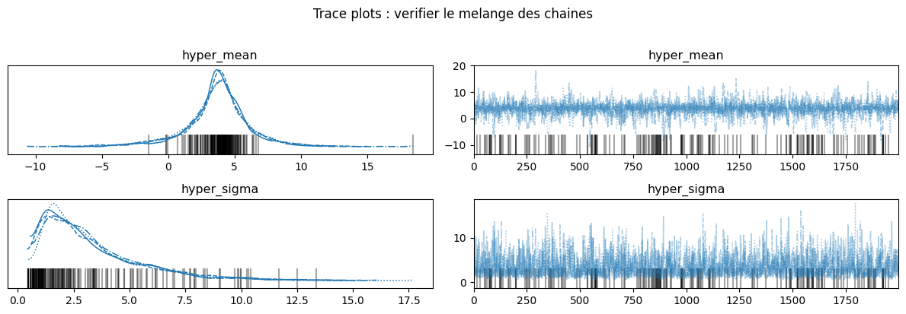
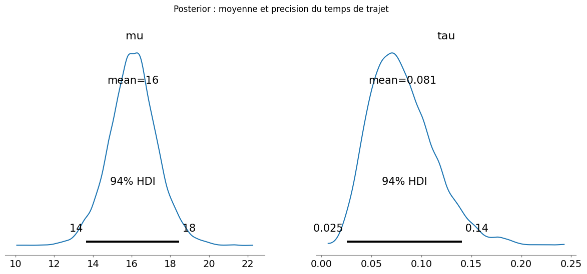
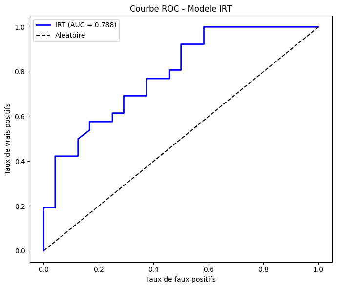
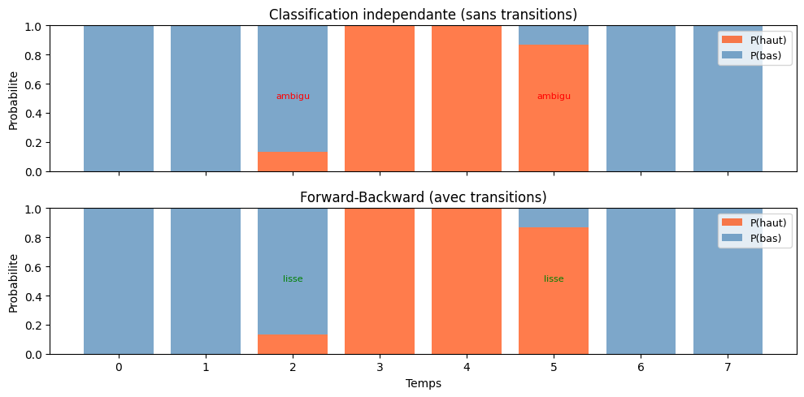
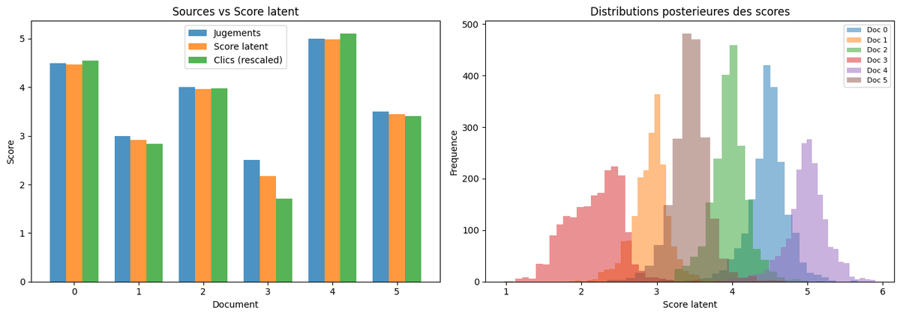
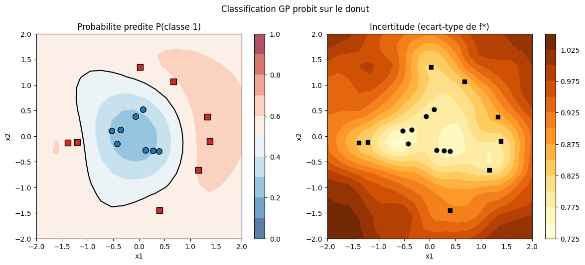

# PyMC — apprendre une distribution et vérifier ses prédictions

[↑ Série Probas](../README.md) · [Les mêmes modèles en C#](../Infer/README.md)

Une pièce a produit davantage de piles que de faces : quelle gamme de biais reste plausible ? Le premier modèle répond par une distribution. Les suivants demandent si le modèle reproduit les observations, puis si les tirages explorent bien cette distribution. Une pratique élémentaire de Python et des probabilités conditionnelles suffit ; le C# n'est pas requis.

## Comment lire ce README — découverte

Pour [choisir sa vitesse de lecture](https://github.com/jsboige/CoursIA#choisir-sa-vitesse-de-lecture), partez de la question que vous voulez résoudre.

- Vous découvrez : suivez les numéros du parcours, à partir de la pièce biaisée.
- Vous creusez un palier : ouvrez 02b pour un diagnostic ou l'instrumentation après 12 pour mesurer le temps de calcul.
- Vous cherchez la recherche en cours : essayez le problème inverse de percolation après les modèles hiérarchiques.

## Parcours principal — licence et master

### Des observations au graphe — licence

| # | Notebook | Ce qu'on y apprend | Public | Pour approfondir |
|---|---|---|---|---|
| 01 | [Une pièce biaisée](PyMC-01-Setup.ipynb) | Mettre à jour la probabilité de pile après observation et confronter les tirages à une solution conjuguée. | Licence | — |
| 02 | [Les trajets du cycliste](PyMC-02-Gaussian-Mixtures.ipynb) | Une moyenne peut tomber entre deux régimes peuplés. Comparer la prédiction d’une gaussienne à celle d’un mélange, puis examiner les poids des composantes. | Licence | [Diagnostics](PyMC-02b-Debugging-Python.ipynb) |
| 03 | [Une enquête discrète](PyMC-03-Factor-Graphs.ipynb) | Réviser les probabilités des suspects après un indice. Le jeu des portes montre pourquoi la manière de révéler une information compte. | Licence | — |
| 04 | [La pelouse mouillée](PyMC-04-Bayesian-Networks.ipynb) | Une fois la pelouse mouillée observée, apprendre que l’arroseur a fonctionné change la probabilité de pluie : deux causes initialement indépendantes deviennent dépendantes. | Licence | — |
| 05 | [Observer ou intervenir](PyMC-05-Causal-Inference.ipynb) | Utiliser `pm.do`, comparer les ajustements par cause commune ou médiateur, puis distinguer effet direct et effet indirect. | Licence | — |

### Apprendre des paramètres partagés — licence avancée

| # | Notebook | Ce qu'on y apprend | Public | Pour approfondir |
|---|---|---|---|---|
| 07 | [Évaluer une compétence](PyMC-06-Skills-IRT.ipynb) | Séparer difficulté de la question et aptitude de l’élève ; interpréter une réussite sans confondre les deux paramètres. | Master | — |
| 08 | [Classer des joueurs](PyMC-07-TrueSkill.ipynb) | Après un match, réviser à la fois le niveau estimé et son incertitude ; un débutant et un vétéran ne reçoivent pas la même correction. | Master | — |
| 09 | [Classifier](PyMC-08-Classification.ipynb) | Transformer un score latent en probabilité, puis vérifier si les fréquences observées correspondent aux probabilités annoncées. | Master | — |
| 10 | [Choisir un modèle](PyMC-09-Model-Selection.ipynb) | Comparer les performances prédictives avec LOO, puis vérifier ce que les simulations du modèle reproduisent réellement. | Master | — |
| 11 | [Extraire des thèmes](PyMC-10-Topic-Models.ipynb) | Relier documents, thèmes et mots ; étudier comment les lois a priori influencent les thèmes que l’on peut distinguer. | Master | — |
| 12 | [Partager entre groupes](PyMC-11-Modeles-Hierarchiques.ipynb) | Entre une moyenne commune et une moyenne indépendante par groupe, le partage partiel ramène davantage les groupes peu observés vers la population. | Master | [Instrumentation](PyMC-Observabilite-OTel.ipynb) |
| 13 | [Agréger des annotations](PyMC-12-Crowdsourcing.ipynb) | Comparer le vote majoritaire à une estimation qui apprend la fiabilité des annotateurs en même temps que les étiquettes. | Master | — |

### Exploiter une structure temporelle ou spatiale — master

| # | Notebook | Ce qu'on y apprend | Public | Pour approfondir |
|---|---|---|---|---|
| 14 | [Suivre un état caché](PyMC-13-Sequences.ipynb) | Comparer un classement instantané au lissage avant-arrière : deux observations identiques peuvent recevoir des états différents selon leur voisinage. | Master | — |
| 15 | [Recommander](PyMC-14-Recommenders.ipynb) | Inférer les préférences à partir d’une matrice incomplète ; distinguer l’incertitude sur un score d’un désaccord entre clics et jugements. | Master | — |
| 16 | [Classer par processus gaussien](PyMC-15-Sparse-Gaussian-Process.ipynb) | Apprendre une frontière non linéaire avec un noyau RBF ; comparer le modèle dense à une approximation spectrale dont on règle le budget. | Master | — |
| 17 | [Filtrer une trajectoire](PyMC-16-Kalman-Filter.ipynb) | Séparer bruit de mesure et bruit de dynamique : la récursion de Kalman filtre un état continu ; le carnet Python examine aussi les réglages de l’échantillonnage. | Master | — |
| 18 | [Dater une rupture](PyMC-17-Change-Point.ipynb) | Inférer une distribution sur l’instant du changement, puis se demander si les données exigent vraiment deux régimes. | Master | — |
| 19 | [Étudier la survie](PyMC-18-Survival-Analysis.ipynb) | Une observation censurée indique que l’événement n’a pas encore eu lieu. L’intégrer par la fonction de survie plutôt que comme une durée complète. | Master | — |

## Approfondissements — master

### Autour de 02 : un résultat précis peut être faux

Dans [le diagnostic des modèles](PyMC-02b-Debugging-Python.ipynb), une loi a priori trop serrée près de zéro empêche les observations de déplacer la moyenne. Ailleurs, `R-hat` arrondi à 1,00 coexiste avec 165 divergences. Vérifiez d'abord le support et les échelles, puis les divergences, les traces et la taille effective ; davantage de tirages ne corrige pas une mauvaise spécification.



Les densités se superposent à gauche. Ce graphique ne suffit pas pour écarter les divergences signalées dans la sortie de l'échantillonneur.

### Autour de 12 : partager les observations sans confondre les groupes

Écrire `θ = μ + σ z` avec `z` gaussien standard permet de faire varier l'écart d'un groupe sur une échelle indépendante de `σ`. Cette paramétrisation non centrée évite le « funnel de Neal », l'entonnoir que révèlent les divergences du modèle centré quand `σ` devient petit ; elle aide lorsque les données renseignent peu chaque groupe. [L'instrumentation OpenTelemetry](PyMC-Observabilite-OTel.ipynb) reprend le modèle hiérarchique pour séparer compilation et échantillonnage ; la durée d'une exécution ne mesure pas la qualité des tirages.

### Lire les figures — licence avancée

**Temps de trajet (02).** Les barres noires sont les intervalles de haute densité à 94 % pour la moyenne et la précision du modèle normal simple. Ce ne sont pas les deux composantes du mélange.



**Réussite à un item (07).** La courbe ROC compare taux de vrais et de faux positifs quand on déplace le seuil de décision. L'image affiche une aire de 0,788 ; la sortie numérique du carnet donne 0,784. Ni l'une ni l'autre ne représente une probabilité de réussite individuelle.



**États cachés (14).** Les barres empilées représentent les probabilités des états haut et bas, sans transitions en haut et avec transitions en bas. Pour observer nettement l'effet du voisinage, comparer les deux observations égales à 17,5 dans la table du carnet.



**Recommandation (15).** À gauche, le document 3 présente un écart entre clics et jugements. À droite, son histogramme rappelle que le score latent est une distribution et non la simple moyenne des deux barres.



**Processus gaussien (16).** La carte de gauche montre la frontière entre le centre et la couronne ; celle de droite, l'incertitude sur la fonction latente. Le titre de l'illustration indique « probit » ; le modèle Python du carnet utilise un lien logistique. Il s'agit ici du modèle dense, pas de l'approximation spectrale.



## Installation et ressources — pratique

Depuis la racine du dépôt, dans un environnement Python 3.12 ou supérieur :

```sh
python -m pip install -r MyIA.AI.Notebooks/Probas/requirements.txt
python -c "import pymc, arviz; print(pymc.__version__, arviz.__version__)"
```

Choisissez le noyau Python de cet environnement. Les carnets utilisent PyMC 6 et ArviZ 1. Si l'import échoue seulement dans Jupyter, comparez `sys.executable` dans le carnet et dans le terminal. [Documentation PyMC](https://www.pymc.io/projects/docs/en/stable/) · [Diagnostics ArviZ](https://python.arviz.org/). Pour un cours suivi, [Statistical Rethinking](https://xcelab.net/rm/statistical-rethinking/) (McElreath) est le manuel de référence de l'inférence bayésienne appliquée ; [Bayesian Methods for Hackers](https://github.com/CamDavidsonPilon/Probabilistic-Programming-and-Bayesian-Methods-for-Hackers) aborde les mêmes modèles par le code.

## Pour aller plus loin — recherche

Le [pont causal](../Causalite/README.md) demande si l'effet est identifiable avant de l'estimer. La [décision en Python](../DecisionTheory/DecPyMC/README.md) utilise la distribution obtenue pour choisir une action. Le [projet de percolation](../Probas-Capstone-Percolation-Bayesienne-Python.ipynb) confronte l'accord des moteurs à un seuil théorique indépendant.


### Passer d’Infer.NET à PyMC — pratique

| Geste | C# | Python |
|---|---|---|
| Déclarer une variable binaire | `Variable.Bernoulli(p)` | `pm.Bernoulli("x", p=p)` dans `pm.Model()` |
| Calculer puis lire la loi | `InferenceEngine` renvoie la distribution demandée | `pm.sample()` produit des tirages ; examiner le groupe `posterior` et ses dimensions chaîne et tirage |
| Inspecter la structure | `ShowFactorGraph` | `pm.model_to_graphviz()` ; compléter le graphe par les diagnostics des chaînes |

Gibbs est aussi disponible côté C# ; ADVI, côté Python, est une approximation variationnelle et non un échantillonneur. Sur un modèle conjugué, la loi analytique fournit un témoin. Sur des groupes clairsemés, une estimation indépendante peut être extrême : le partage partiel réduit cette variabilité sans imposer une moyenne identique à tous. Comparer le modèle de classes du palier 12 au [diagnostic multi-sites](../DecisionTheory/DecPyMC/DecPyMC-01-Utility-Foundations.ipynb), aux [réseaux de décision](../DecisionTheory/DecPyMC/DecPyMC-04-Decision-Networks.ipynb) et aux [systèmes experts](../DecisionTheory/DecPyMC/DecPyMC-06-Expert-Systems.ipynb).

### Dépannage et choix d’une entrée — pratique

- **Module introuvable** : installer les dépendances avec le Python du noyau. Dans un environnement activé, `python -m ipykernel install --user --name pymc-env` enregistre un noyau sélectionnable dans Jupyter.
- **Évaluation initiale impossible** : vérifier les dimensions et le support de la vraisemblance (par exemple, des durées négatives ne conviennent pas à une loi Gamma). Examiner aussi les valeurs initiales des paramètres et les prédictions a priori.
- **Divergences** : consulter les traces et `az.summary`, puis comparer la géométrie centrée et non centrée. Les carnets visent `r_hat < 1.01` et `ess_bulk > 400` (02b, 15, 18) ; `r_hat > 1.05` signale un échantillonnage non convergé (10). Relever `target_accept` de sa valeur par défaut, 0,8, à 0,95 réduit le pas et peut faire disparaître des divergences ; ne pas remplacer ce diagnostic par une augmentation aveugle du nombre de tirages.
- **Première séance Python** : pièce, pelouse puis classification (01, 04, 09). Pour la comparaison entre langages, garder le même numéro. Pour la décision, suivre plutôt [la piste Python](../DecisionTheory/DecPyMC/README.md) ; la souscription et la ruine continuent en [actuariat](../DecisionTheory/Actuariat/README.md).

Les [exemples PyMC](https://www.pymc.io/projects/examples/en/latest/) complètent la documentation de l'API. Pour replacer les applications, comparer les [modèles de prédiction](../../ML/README.md) et les [stratégies de marché](../../QuantConnect/README.md). La [provenance des illustrations](assets/readme/MANIFEST.md) permet de retrouver les figures sans confondre l'image conservée avec une nouvelle exécution.
