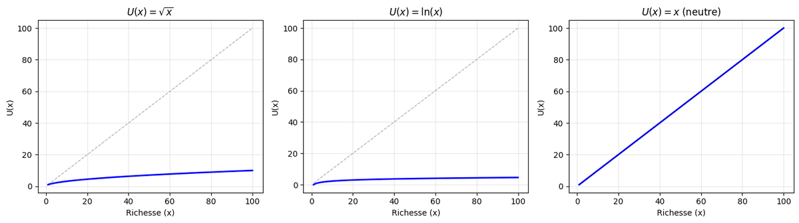

<!-- CATALOG-STATUS
series: Probas
pedagogical_count: 99
breakdown: DecisionTheory=28, Infer=22, PyMC=20, Applications=12, Causalite=12, Fondations=4, root=1
maturity: BETA=97, ALPHA=1, DRAFT=1
-->

# Programmation probabiliste — des observations à la décision

[↑ Notebooks](../README.md) · [Catalogue](../../COURSE_CATALOG.generated.md)

Deux cyclistes peuvent avoir le même temps moyen de trajet sans avoir le même risque de retard. Une distribution prédictive permet de poser la question utile : quelle est la probabilité de manquer le rendez-vous ? Cette série apprend à construire cette distribution, à vérifier ce qu'elle explique, puis à choisir une action quand les erreurs n'ont pas toutes le même coût. Elle s'adresse aux lecteurs familiers des probabilités conditionnelles et de Python ou C#. Les effectifs figurent dans le catalogue.

## Comment lire ce README — découverte

Vous pouvez [choisir sa vitesse de lecture](https://github.com/jsboige/CoursIA#choisir-sa-vitesse-de-lecture) sans changer de parcours.

- Vous découvrez : choisissez un langage et lisez les paliers numérotés dans l'ordre.
- Vous creusez un palier : ouvrez son jumeau ou suivez la dernière colonne ; les lettres désignent des détours facultatifs.
- Vous cherchez la recherche en cours : ouvrez le projet de percolation ou les formalisations pour distinguer constat numérique et garantie théorique.

## Quel stack choisir ? — découverte

Avec [Infer.NET](Infer/README.md), vous déclarez des variables en C# ; le moteur compile le modèle en code C#, puis propage des messages entre facteurs : c'est le choix naturel pour une inférence embarquée ou en temps réel. Avec [PyMC](PyMC/README.md), vous écrivez une loi a priori et une vraisemblance en Python, puis examinez des tirages de la loi postérieure. Il ne s'agit pas d'opposer « exact » à « approché » : EP et VMP sont en général des approximations déterministes ; NUTS est un échantillonneur pour paramètres continus. Infer.NET propose aussi Gibbs et PyMC propose l'inférence variationnelle. Pour comparer les moteurs, gardez le modèle fixe : comparez une prédiction ou un intervalle, pas les seules syntaxes.

## Qu’est-ce que la programmation probabiliste ? — découverte

On écrit comment les données auraient pu être produites : une loi a priori pour les quantités inconnues et une vraisemblance pour les observations. L’inférence lit ce programme en sens inverse. La distribution **postérieure** décrit ce qu’on a appris sur les inconnues ; la **prédictive** décrit ce qui pourrait arriver à la prochaine observation. Pour le cycliste, l’incertitude sur le temps *moyen* n’est pas la dispersion des temps de trajet individuels.

| Question | Objet à calculer | Usage |
|---|---|---|
| Quelle valeur est plausible ? | Loi postérieure, pas seulement son maximum | Donner un intervalle ou repérer plusieurs modes |
| Que manque-t-il dans les données ? | Distribution conditionnelle de la quantité absente | Intégrer son incertitude au lieu de la fixer arbitrairement |
| Comment concilier deux sources ? | Vraisemblances décrivant leurs fiabilités et leur dépendance | Combiner clics et évaluations sans traiter un clic comme une note |
| Quelle action préférer ? | Utilité espérée, moyennée sur les issues possibles | Arbitrer un test coûteux ou un départ plus tôt |

### Objectifs d’apprentissage — licence et master

Construire un modèle à partir d’hypothèses explicites ; interpréter un intervalle prédictif ; comparer deux approximations sur le même problème ; distinguer conditionnement et intervention ; enfin, intégrer coûts et préférences pour décider. Pour vérifier le dernier acquis, changer le coût du retard **sans changer la distribution** : la meilleure heure de départ peut changer, pas le modèle des trajets.

## Parcours principal — licence et master

### Des observations au graphe — licence

| # | Notebook | Ce qu'on y apprend | Public | Pour approfondir |
|---|---|---|---|---|
| 01 | Une pièce biaisée : [C#](Infer/Infer-01-Setup.ipynb) · [Python](PyMC/PyMC-01-Setup.ipynb) | Mettre à jour la probabilité de pile après observation et confronter les tirages à une solution conjuguée. | Licence | [01b](Infer/Infer-01b-Premiers-Modeles.ipynb) |
| 02 | Les trajets du cycliste : [C#](Infer/Infer-02-Gaussian-Mixtures.ipynb) · [Python](PyMC/PyMC-02-Gaussian-Mixtures.ipynb) | Une moyenne peut tomber entre deux régimes peuplés. Comparer la prédiction d’une gaussienne à celle d’un mélange, puis examiner les poids des composantes. | Licence | [Diagnostics](PyMC/PyMC-02b-Debugging-Python.ipynb) · [02b](Infer/Infer-02b-Debugging-Bonnes-Pratiques.ipynb) |
| 03 | Une enquête discrète : [C#](Infer/Infer-03-Factor-Graphs.ipynb) · [Python](PyMC/PyMC-03-Factor-Graphs.ipynb) | Réviser les probabilités des suspects après un indice. Le jeu des portes montre pourquoi la manière de révéler une information compte. | Licence | — |
| 04 | La pelouse mouillée : [C#](Infer/Infer-04-Bayesian-Networks.ipynb) · [Python](PyMC/PyMC-04-Bayesian-Networks.ipynb) | Une fois la pelouse mouillée observée, apprendre que l’arroseur a fonctionné change la probabilité de pluie : deux causes initialement indépendantes deviennent dépendantes. | Licence | — |
| 05 | Observer ou intervenir : [C#](Infer/Infer-05-Causal-Inference.ipynb) · [Python](PyMC/PyMC-05-Causal-Inference.ipynb) | Comparer la pression lue sur un baromètre à une intervention sur son aiguille. Modifier le graphe en C# ou appeler `pm.do` en Python. | Licence | — |

### Apprendre des paramètres partagés — licence avancée

| # | Notebook | Ce qu'on y apprend | Public | Pour approfondir |
|---|---|---|---|---|
| 07 | Évaluer une compétence : [C#](Infer/Infer-07-Skills-IRT.ipynb) · [Python](PyMC/PyMC-07-Skills-IRT.ipynb) | Séparer difficulté de la question et aptitude de l’élève ; interpréter une réussite sans confondre les deux paramètres. | Master | — |
| 08 | Classer des joueurs : [C#](Infer/Infer-08-TrueSkill.ipynb) · [Python](PyMC/PyMC-08-TrueSkill.ipynb) | Après un match, réviser à la fois le niveau estimé et son incertitude ; un débutant et un vétéran ne reçoivent pas la même correction. | Master | [08b](Infer/Infer-08b-TrueSkill-Formules-Fermees-CSharp.ipynb) |
| 09 | Classifier : [C#](Infer/Infer-09-Classification.ipynb) · [Python](PyMC/PyMC-09-Classification.ipynb) | Transformer un score latent en probabilité, puis vérifier si les fréquences observées correspondent aux probabilités annoncées. | Master | — |
| 10 | Choisir un modèle : [C#](Infer/Infer-10-Model-Selection.ipynb) · [Python](PyMC/PyMC-10-Model-Selection.ipynb) | Un ajustement plus précis aux observations n’est pas forcément plus prédictif. Comparer l’évidence en C# et la validation par retrait d’une observation en Python. | Master | — |
| 11 | Extraire des thèmes : [C#](Infer/Infer-11-Topic-Models.ipynb) · [Python](PyMC/PyMC-11-Topic-Models.ipynb) | Relier documents, thèmes et mots ; étudier comment les lois a priori influencent les thèmes que l’on peut distinguer. | Master | — |
| 12 | Partager entre groupes : [C#](Infer/Infer-12-Modeles-Hierarchiques.ipynb) · [Python](PyMC/PyMC-12-Modeles-Hierarchiques.ipynb) | Entre une moyenne commune et une moyenne indépendante par groupe, le partage partiel ramène davantage les groupes peu observés vers la population. | Master | [Instrumentation](PyMC/PyMC-Observabilite-OTel.ipynb) |
| 13 | Agréger des annotations : [C#](Infer/Infer-13-Crowdsourcing.ipynb) · [Python](PyMC/PyMC-13-Crowdsourcing.ipynb) | Comparer le vote majoritaire à une estimation qui apprend la fiabilité des annotateurs en même temps que les étiquettes. | Master | — |

### Exploiter une structure temporelle ou spatiale — master

| # | Notebook | Ce qu'on y apprend | Public | Pour approfondir |
|---|---|---|---|---|
| 14 | Suivre un état caché : [C#](Infer/Infer-14-Sequences.ipynb) · [Python](PyMC/PyMC-14-Sequences.ipynb) | Comparer un classement instantané au lissage avant-arrière : deux observations identiques peuvent recevoir des états différents selon leur voisinage. | Master | — |
| 15 | Recommander : [C#](Infer/Infer-15-Recommenders.ipynb) · [Python](PyMC/PyMC-15-Recommenders.ipynb) | Inférer les préférences à partir d’une matrice incomplète ; distinguer l’incertitude sur un score d’un désaccord entre clics et jugements. | Master | — |
| 16 | Classer par processus gaussien : [C#](Infer/Infer-16-Sparse-Gaussian-Process.ipynb) · [Python](PyMC/PyMC-16-Sparse-Gaussian-Process.ipynb) | Placer une loi sur des fonctions pour apprendre une frontière courbe. Comparer points inducteurs en C# et approximation spectrale en Python. | Master | — |
| 17 | Filtrer une trajectoire : [C#](Infer/Infer-17-Kalman-Filter.ipynb) · [Python](PyMC/PyMC-17-Kalman-Filter.ipynb) | Séparer bruit de mesure et bruit de dynamique : la récursion de Kalman filtre un état continu ; le carnet Python examine aussi les réglages de l’échantillonnage. | Master | — |
| 18 | Dater une rupture : [C#](Infer/Infer-18-Change-Point.ipynb) · [Python](PyMC/PyMC-18-Change-Point.ipynb) | Inférer une distribution sur l’instant du changement, puis se demander si les données exigent vraiment deux régimes. | Master | — |
| 19 | Étudier la survie : [C#](Infer/Infer-19-Survival-Analysis.ipynb) · [Python](PyMC/PyMC-19-Survival-Analysis.ipynb) | Une observation censurée indique que l’événement n’a pas encore eu lieu. L’intégrer par la fonction de survie plutôt que comme une durée complète. | Master | — |

## Approfondissements — master

### Autour de 01 : construire un premier modèle en C#

[Premiers modèles](Infer/Infer-01b-Premiers-Modeles.ipynb) part d'une variable de Bernoulli, puis reprend le trajet du cycliste en classes C# pour réutiliser les paramètres appris à l'observation suivante.

### Autour de 02 : quand les composantes changent de nom

Sur le mélange du cycliste, VMP attribue à la première composante une moyenne de 15,07 minutes et EP de 26,23 ; la seconde passe de 26,69 à 14,96. Les étiquettes se sont échangées : comparer les poids par rang sans regarder les moyennes ferait comparer le trajet court au trajet long. Les guides [C#](Infer/Infer-02b-Debugging-Bonnes-Pratiques.ipynb) et [Python](PyMC/PyMC-02b-Debugging-Python.ipynb) proposent deux diagnostics complémentaires : examiner la factorisation ou vérifier l'exploration par les chaînes.

### Autour de 08 et 12 : isoler le calcul

[Classement en forme fermée](Infer/Infer-08b-TrueSkill-Formules-Fermees-CSharp.ipynb) retrouve la mise à jour EP pour un duel avant de coupler plusieurs rencontres. [Instrumenter le modèle hiérarchique](PyMC/PyMC-Observabilite-OTel.ipynb) sépare le coût de compilation du coût de chaque campagne de tirages.

## Sous-séries — de la licence à la recherche

| Dossier | Point d'entrée | Ce qu'on y apprend |
|---|---|---|
| [Fondations](Fondations/README.md) | [Le théorème central limite mesuré](Fondations/Probas-CLT-Theoreme-Central-Limite.ipynb) | Mesurer l'erreur d'une approximation gaussienne, puis diagnostiquer une chaîne qui reste dans un seul mode. Les expériences existent en Python et C#. |
| [Pont causal](Causalite/README.md) | [Du mentorat observé au mentorat attribué](Causalite/Causalite-00-Echelle-de-Pearl-Intro-Python.ipynb) | Passer de l'association à l'intervention puis au contrefactuel. Poser l'hypothèse d'identification avant de calculer un effet. |
| [Décision](DecisionTheory/README.md) | [Utilité en C#](DecisionTheory/DecInfer/DecInfer-01-Utility-Foundations.ipynb) · [en Python](DecisionTheory/DecPyMC/DecPyMC-01-Utility-Foundations.ipynb) | Choisir sous incertitude, chiffrer la valeur d'une observation, puis décider en séquence. Le [parcours actuariel](DecisionTheory/Actuariat/README.md) applique ces idées aux primes, à la ruine et à la souscription. |
| [Applications](Applications/README.md) | [Marches aléatoires](Applications/Marches-01-Retour-Polya-Watson-Python.ipynb) | Distinguer retour observé avant une échéance et retour éventuel. Explorer aussi l'interprétation pragmatique, les quotients et la concentration de la mesure. |
| [Percolation](Applications/Percolation/README.md) | [Composante géante sur un tore](Applications/Percolation/Percolation-01-Supercritique-Python.ipynb) | Faire varier la probabilité d'ouverture et la taille du réseau ; distinguer une transition sur une grille finie d'une loi d'échelle. |

### Pont causal entre séries — master et recherche

| Question | Où l’éprouver | Comparaison utile |
|---|---|---|
| Que devient le système si l’on impose une valeur ? | [Raisonnement symbolique](../SymbolicAI/Tweety/Tweety-11-Causal-Python.ipynb) et [Infer-05](Infer/Infer-05-Causal-Inference.ipynb) | Modifier le mécanisme qui fixe la variable, non enregistrer une observation supplémentaire. |
| Quel effet serait identifiable, puis estimable ? | [Calcul do](Causalite/Causalite-01-Calcul-Do-Python.ipynb) et [PyMC-05](PyMC/PyMC-05-Causal-Inference.ipynb) | Le graphe justifie une expression ; le moteur estime une distribution. Un placebo peut révéler un défaut, jamais certifier le graphe. |
| Quelle échelle de description retenir ? | [Émergence causale](../IIT/ICT-Series/ICT-05-CausalEmergence/ICT-05-CausalEmergence-Python.ipynb) et [matrice de transition](../IIT/ICT-Series/ICT-05-CausalEmergence/ICT-06-SortingToTPM-CausalEmergence-Python.ipynb) | Comparer l’information effective des descriptions fine et grossière, plutôt que changer le traitement dans un graphe fixé. |

### Applications autonomes et fondations — licence avancée et master

- [Hyperbole](Applications/Pyro_RSA_Hyperbole.ipynb) : l’auditeur infère à la fois un prix et l’irritation du locuteur. Un nombre manifestement excessif peut être informatif sur l’affect plutôt que sur le prix.
- [Quotients et fibres](Applications/Quotients-Fibres-Recollement-Python.ipynb) : un bon résumé commun devrait réduire l’information mutuelle résiduelle. Ici, elle augmente après conditionnement ; le quotient essayé ne justifie donc pas le recollement.
- [Concentration KLS](Applications/Probas-KLS-Concentration.ipynb) : étalonner une marche et une sonde de demi-espaces sur des lois connues. Une bonne valeur sur les demi-espaces ne borne pas à elle seule tous les ensembles.
- [Percolation](Applications/Percolation/README.md) : comparer la taille de la composante géante, la pente près du seuil et l’effondrement des courbes selon la taille du tore. Les prolongements 03b et 03c fournissent les données du projet de synthèse.
- [Fondations](Fondations/README.md) : Metropolis accepte ou refuse une proposition ; Gibbs tire chaque coordonnée conditionnellement aux autres. Sur une cible bimodale, des chaînes coincées dans des modes opposés peuvent rendre une variance groupée plausible : inspecter aussi leurs moyennes individuelles.

### Décider : pourquoi une moyenne ne suffit pas — licence avancée

| # | Notebook | Ce qu'on y apprend | Public | Pour approfondir |
|---|---|---|---|---|
| 01 | [DecInfer 01](DecisionTheory/DecInfer/DecInfer-01-Utility-Foundations.ipynb) · [DecPyMC 01](DecisionTheory/DecPyMC/DecPyMC-01-Utility-Foundations.ipynb) | Passer de préférences entre loteries à une utilité espérée. | Master | [01b](DecisionTheory/DecInfer/DecInfer-01b-Lean-ExpectedUtility.ipynb) · [01c](DecisionTheory/DecInfer/DecInfer-01c-Lean-Coherence.ipynb) |
| 02 | [DecInfer 02](DecisionTheory/DecInfer/DecInfer-02-Utility-Money.ipynb) · [DecPyMC 02](DecisionTheory/DecPyMC/DecPyMC-02-Utility-Money.ipynb) | Comparer richesse moyenne et équivalent certain. | Master | — |
| 03 | [DecInfer 03](DecisionTheory/DecInfer/DecInfer-03-Multi-Attribute.ipynb) · [DecPyMC 03](DecisionTheory/DecPyMC/DecPyMC-03-Multi-Attribute.ipynb) | Expliciter les compromis entre plusieurs attributs. | Master | — |
| 04 | [DecInfer 04](DecisionTheory/DecInfer/DecInfer-04-Decision-Networks.ipynb) · [DecPyMC 04](DecisionTheory/DecPyMC/DecPyMC-04-Decision-Networks.ipynb) | Relier observations, actions et conséquences dans un réseau de décision. | Master | — |
| 05 | [DecInfer 05](DecisionTheory/DecInfer/DecInfer-05-Value-Information.ipynb) · [DecPyMC 05](DecisionTheory/DecPyMC/DecPyMC-05-Value-Information.ipynb) | Comparer le prix d’un test au gain attendu en décision. | Master | — |
| 06 | [DecInfer 06](DecisionTheory/DecInfer/DecInfer-06-Expert-Systems.ipynb) · [DecPyMC 06](DecisionTheory/DecPyMC/DecPyMC-06-Expert-Systems.ipynb) | Décider à partir d’informations imparfaites dans un système expert. | Master | — |
| 07 | [DecInfer 07](DecisionTheory/DecInfer/DecInfer-07-Sequential.ipynb) · [DecPyMC 07](DecisionTheory/DecPyMC/DecPyMC-07-Sequential.ipynb) | Choisir une politique plutôt qu’une action isolée ; comparer exploration et exploitation quand les récompenses changent. | Master | [07b](DecisionTheory/DecInfer/DecInfer-07b-Lean-Gittins.ipynb) |
| 08 | [DecInfer 08](DecisionTheory/DecInfer/DecInfer-08-Thompson-Sampling.ipynb) · [DecPyMC 08](DecisionTheory/DecPyMC/DecPyMC-08-Actuariat-Capstone.ipynb) | En C#, mesurer le regret d’une politique de bandit ; en Python, passer de la perte attendue à la prime d’assurance. | Master | — |
| 09 | [DecInfer 09](DecisionTheory/DecInfer/DecInfer-09-Theories-Decision-Predicteur-Python.ipynb) | Comparer les prescriptions des règles de décision face à un prédicteur. | Master | — |

Dans [Utilité et argent](DecisionTheory/DecPyMC/DecPyMC-02-Utility-Money.ipynb), un même gain de richesse apporte de moins en moins d'utilité sur les courbes racine et logarithme ; sur la droite, il apporte toujours le même supplément. C'est cette courbure, non la hauteur relative des courbes, qui explique la préférence pour un gain certain plutôt qu'une loterie de même espérance. Les coefficients d'Arrow-Pratt (Pratt, 1964 ; Arrow, 1965), calculés dans le même carnet, la mesurent.

### Projet de synthèse : inférer le seuil de percolation — master et recherche

[Le seuil comme problème inverse](Probas-Capstone-Percolation-Bayesienne-Python.ipynb) reprend les mesures sur réseaux finis. Metropolis, NUTS et le calcul sur grille s'accordent pour le modèle à deux paramètres. Pourtant, dans le modèle hiérarchique à exposant libre, l'intervalle de `p_c` va de 0,5084 à 0,5178 : il exclut le seuil théorique de 0,5. L'accord entre algorithmes n'est pas une validation du modèle physique. Le projet se termine sur une question de décision : que gagnerait-on à payer une simulation sur une grille plus grande ?

## Prérequis, concepts clés et domaines d’application — licence

| Notion à connaître | Où elle devient utile |
|---|---|
| Probabilité conditionnelle et règle de Bayes | Mettre à jour une croyance ; la conjugaison conserve la famille de la loi, pas ses paramètres. |
| Indépendance conditionnelle et graphe de facteurs | Décomposer la loi jointe. La d-séparation indique quelles observations peuvent ouvrir ou fermer un chemin. |
| Espérance, somme ou intégrale | Calculer une perte moyenne ou une utilité espérée ; EVPI et EVSI comparent la valeur d’informations parfaite et imparfaite. |
| Variance et covariance | Distinguer incertitude d’une mesure, variabilité entre groupes et dépendance entre paramètres. |

En **éducation** (07) et en **classement** (08), on infère une compétence plutôt qu’un résultat isolé. En **diagnostic** (04–05), demander le résultat d’un test n’équivaut pas à traiter le patient. En **analyse de textes** (11) et en **annotation** (13), thèmes et fiabilité sont latents. En **recommandation** (15), les clics renseignent imparfaitement les préférences. En **maintenance** (17–19), filtrer un signal, dater une rupture et estimer une durée de vie répondent à des questions distinctes. Les préférences face au risque et les décisions séquentielles prolongent ces usages en assurance et en finance.

## Installation — pratique

Pour Python, utiliser un environnement 3.12 ou plus récent et, depuis la racine du dépôt, `python -m pip install -r MyIA.AI.Notebooks/Probas/requirements.txt`. Pour C#, utiliser le SDK .NET 9 et le noyau `.net-csharp` de .NET Interactive ; le [guide de configuration](Infer/scripts/README.md) accompagne l'installation. `jupyter kernelspec list` permet de vérifier les noyaux enregistrés. Le [pont causal](Causalite/README.md) précise quels paliers utilisent son environnement spécialisé.

### Mise en route par environnement

**Python.** Utiliser `python -m venv .venv` avec Python 3.12+, activer cet environnement et y installer les dépendances indiquées ci-dessus. Vérifier les imports avec `python -c "import pymc, arviz; print(pymc.__version__, arviz.__version__)"`. Pour l’application pragmatique, vérifier aussi `python -c "import pyro, torch"`.

**C#.** Vérifier `dotnet --version`, puis suivre le [script de configuration](Infer/scripts/setup_environment.ps1). Après installation de l’outil .NET Interactive, `dotnet interactive jupyter install` enregistre le noyau. Le [validateur des carnets Infer](Infer/scripts/test_notebooks.py) propose `--validate-only` pour la structure : ce n’est pas une exécution du modèle.

### FAQ — dépannage par symptôme

| Symptôme | Vérification et action |
|---|---|
| C# absent de Jupyter | Relancer l’enregistrement du noyau depuis le terminal où le SDK est disponible, puis redémarrer Jupyter et vérifier `jupyter kernelspec list`. |
| Le modèle C# se déclare mais ne compile pas | Reprendre dans Infer-01 le réglage `CompilerChoice.Roslyn` du moteur : la compilation dynamique du modèle est une étape distincte de l’exécution d’une cellule C#. |
| Pas de dessin du graphe | Vérifier `dot -V` dans l’environnement de Jupyter. Installer Graphviz et rendre `dot` accessible sur le `PATH` ; conserver le `.gv` pour distinguer une panne de rendu d’une erreur de modèle. |
| PyMC ne s’installe pas sous Windows | Vérifier d’abord la version du Python actif. Si l’erreur porte sur la compilation native, créer un environnement conda et lancer `conda install -c conda-forge pymc`, qui apporte les dépendances binaires. Sinon, installer la chaîne C++ : les « Build Tools » de Visual Studio suffisent, sans l’environnement complet. |
| NUTS est lent ou divergent | Examiner support, priors, traces, ESS et divergences ; comparer une paramétrisation non centrée avant de modifier `target_accept`. Voir [le diagnostic PyMC](PyMC/PyMC-02b-Debugging-Python.ipynb). |
| Un import ou une commande Lean échoue dans un dossier mixte | Choisir le noyau du **carnet**, pas celui du dossier : `.net-csharp` pour Infer, `python3` pour PyMC, Python ou C# pour Fondations, noyau Lean pour les compagnons formels. Causalité précise ses exceptions au [guide local](Causalite/README.md). |

## Pour aller plus loin — recherche

**Formalisations Lean.** L'[inventaire des preuves](LEAN_INVENTORY.md) distingue les résultats formalisés de ce qui reste ouvert. Les compagnons de [l'utilité espérée](DecisionTheory/DecInfer/DecInfer-01b-Lean-ExpectedUtility.ipynb), de [la cohérence des préférences](DecisionTheory/DecInfer/DecInfer-01c-Lean-Coherence.ipynb) et de [l'escompte dans les bandits](DecisionTheory/DecInfer/DecInfer-07b-Lean-Gittins.ipynb) précisent quelles hypothèses portent le calcul. En [percolation](Applications/Percolation/README.md), lire les preuves d'inégalités à côté des expériences, non comme une preuve du seuil estimé.

**Décision séquentielle.** Le [parcours décisionnel](DecisionTheory/README.md) distingue le choix d'une action, l'apprentissage d'une politique par [renforcement](../RL/README.md) et la prise en compte des choix d'autrui en [théorie des jeux](../GameTheory/README.md). Pour comparer des règles de décision plutôt que des moteurs, commencer par [le cas du prédicteur](DecisionTheory/ReglesDeDecision-01-EDT-CDT-CCDT-UDT.ipynb).

## Ressources — tous niveaux

[Glossaire de l'inférence](Infer/Infer-Glossary.md) · [Correspondance entre les modèles et leurs sources](../../docs/reference/mbml-source-attribution.md) · [Documentation Infer.NET](https://dotnet.github.io/infer/) · [Documentation PyMC](https://www.pymc.io/projects/docs/en/stable/) · [Activités sur les chaînes de Markov et les préférences](../GenAI/activites/Activites-Vulgarisation.md).

### Pont vers les preuves formelles — recherche

Une simulation vérifie un cas ; une preuve établit une proposition pour toutes les entrées qui satisfont ses hypothèses. L’[inventaire Lean de Probas](LEAN_INVENTORY.md) précise les branchements réels et les obligations ouvertes : une identité d’escompte démontrée n’est pas une preuve complète du théorème d’indice.

| Question voisine | Où poursuivre | Distinction à conserver |
|---|---|---|
| Quand l’erreur empirique renseigne-t-elle sur la généralisation ? | [Théorie PAC](../ML/DataScienceWithAgents/02-ML-Cours/2.8-Theorie-PAC.ipynb) et [compagnon Lean](../ML/DataScienceWithAgents/02-ML-Cours/2.8b-Theorie-PAC-Lean.ipynb) | Une borne uniforme n’est pas la performance mesurée sur un échantillon. |
| Quelle fraction risquer avec une utilité logarithmique ? | [Compagnon de Kelly](../QuantConnect/kelly_lean/Kelly_companion-Python.ipynb) | Pour un pari de cote `b` gagné avec probabilité `p` (et perdu avec probabilité `q = 1 − p`), la fraction `f* = (b·p − q)/b` maximise la croissance logarithmique : aucune autre mise admissible ne croît plus vite. Comparer cette croissance au gain monétaire espéré. |
| Peut-on agréger des préférences individuelles ? | [Choix social](../GameTheory/SocialChoice/ChoixSocial-01-Arrow-Impossibility-Theorem-Python.ipynb) | Arrow : unanimité (Pareto faible) et indépendance des options non pertinentes (IIA) ne laissent que la dictature ; le carnet teste ces axiomes sur les règles de vote usuelles. Les axiomes d’un choix collectif ne sont pas ceux de la représentation d’une loterie individuelle. |
| Quand un algorithme garantit-il son résultat ? | [Recherche heuristique](../Search/search_lean/README.md) et [sémantiques d’argumentation](../SymbolicAI/ArgumentAnalysis/Argumentation-03-Dung-AF-Semantics-Python.ipynb) | Optimalité d’un chemin sous hypothèses sur l’heuristique et acceptabilité dans un cadre formel sont d’autres formes de garantie, pas des conséquences de l’inférence bayésienne. |

### Lectures et activités — tous niveaux

Pour les graphes et leurs algorithmes, voir *Probabilistic Graphical Models* ; pour les modèles gaussiens et les mélanges, *Pattern Recognition and Machine Learning* ; pour le moteur C#, Minka et al. (2018), *Infer.NET 2.4*, cité dès le premier carnet Python. [Model-Based Machine Learning](https://mbmlbook.com/) et la [table d’attribution](../../docs/reference/mbml-source-attribution.md) relient les scénarios aux modèles. Pour pratiquer sans code, essayer [la météo markovienne](../GenAI/activites/Activites-Vulgarisation.md#6-probabilités--chaîne-de-markov-de-la-météo) puis [les préférences rationnelles](../GenAI/activites/Activites-Vulgarisation.md#7-axiomes-de-préférences-rationnelles-et-irrationalité-humaine). Pour revenir à la prédiction appliquée, poursuivre par le [TP de prévision des ventes](../ML/ML.Net/TP-Prevision-Ventes-CSharp.ipynb).

[Licence du dépôt](../../LICENSE)
