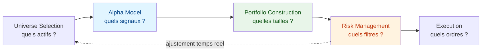
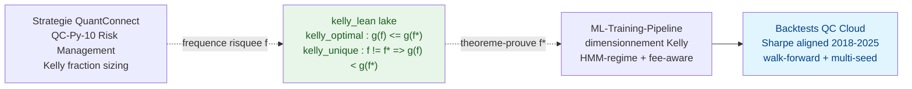
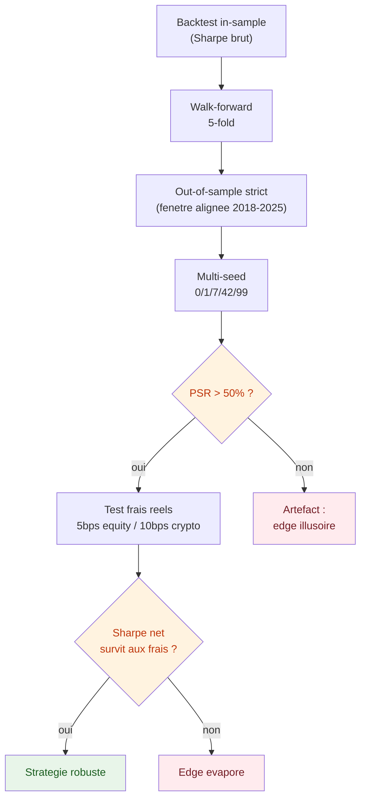

<!-- CATALOG-STATUS
series: QuantConnect
pedagogical_count: 125
breakdown: Python=66, projects=49, kelly_lean=6, ML-Training-Pipeline=4
maturity: BETA=85, DRAFT=32, ALPHA=7, TEMPLATE=1
-->

[← Notebooks](../README.md) | [↑ ..](../README.md) | [→ CaseStudies](../CaseStudies/README.md)

Le trading algorithmique transforme les marchés financiers : plus de 60 % des volumes aux États-Unis sont générés par des algorithmes. Cette série vous apprend à construire, tester et déployer vos propres stratégies de trading automatisées sur la plateforme **QuantConnect LEAN** — un framework open-source utilisé par des milliers de quants professionnels. Le parcours va des fondements (cycle de vie d'un algorithme, gestion des données) aux frontières de l'IA (Transformers, RL, LLMs pour signaux de trading).

Le parcours principal progresse par blocs : les **fondations** de l'écosystème QuantConnect (architecture LEAN, univers dynamiques, classes d'actifs), le **trading avancé et la gestion du risque**, l'**Algorithm Framework** modulaire, la **préparation ML** (données alternatives, feature engineering), puis le **machine learning** classique et profond appliqué aux séries temporelles financières, jusqu'à la **production** (RL, LLMs, déploiement). Chaque notebook du parcours s'exécute sur le cloud QuantConnect (offre gratuite) sans installation locale ; les compléments de recherche s'exécutent le plus souvent en local avec des données publiques.

**À qui s'adresse cette série** : étudiants en finance quantitative, ingénieurs ML souhaitant appliquer leurs compétences aux marchés, et développeurs curieux de trading algorithmique. Le livre de référence est *"Hands-On AI Trading"* (Jared Broad, 2025) — le fichier [BOOK_MAPPING.md](BOOK_MAPPING.md) rattache chaque exemple du livre aux notebooks et projets de la série. Aucun capital de départ n'est nécessaire : tout se passe en backtest et en paper trading.

## Comment lire ce README

- **Vous voulez apprendre** : suivez le [parcours principal](#parcours-principal) dans l'ordre, de 01 à 28. Les carnets sont des supports de cours, à lire sur GitHub ou en local ; les compléments numérotés au-delà de 28 approfondissent un palier ou ouvrent une voie de recherche.
- **Vous voulez backtester une stratégie** : allez directement dans [`projects/`](projects/README.md), copiez un `main.py` dans votre projet QuantConnect Lab, cliquez Backtest.
- **Vous voulez comprendre la rigueur méthodologique** : lisez [Pour aller plus loin](#pour-aller-plus-loin) — baselines vérifiées, échelle de complexité des modèles, formalisation Lean du critère de Kelly.
- Les nombres d'inventaire (carnets par sous-série, maturité) vivent dans le [catalogue généré](../../COURSE_CATALOG.generated.md) et dans les README feuilles ; ce README ne les recopie pas.

## Parcours principal

La séquence 01 à 28 se lit dans l'ordre : chaque palier suppose le précédent. Le livre de référence couvre les mêmes notions au fil des chapitres.

| # | Carnet | Durée | Ce qu'on y apprend | Pour approfondir |
|---|--------|------|--------------------|------------------|
| 01 | [QC-Py-01-Setup](Python/QC-Py-01-Setup.ipynb) | 45 min | Compte QC, premier backtest cloud, architecture LEAN | |
| 02 | [QC-Py-02-Platform-Fundamentals](Python/QC-Py-02-Platform-Fundamentals.ipynb) | 60 min | Cycle de vie `QCAlgorithm`, `Initialize`/`OnData`, croisement de moyennes mobiles | |
| 03 | [QC-Py-03-Data-Management](Python/QC-Py-03-Data-Management.ipynb) | 75 min | History API, normalisation des données, consolidators, multi-timeframe | |
| 04 | [QC-Py-04-Research-Workflow](Python/QC-Py-04-Research-Workflow.ipynb) | 75 min | QuantBook, intégration pandas, transition notebook vers algorithme | |
| 05 | [QC-Py-05-Universe-Selection](Python/QC-Py-05-Universe-Selection.ipynb) | 75 min | Sélection dynamique d'univers, coarse/fine, rebalancement | [05b — F-Score de Piotroski](Python/QC-Py-05b-FScore-Piotroski.ipynb) |
| 06 | [QC-Py-06-Options-Trading](Python/QC-Py-06-Options-Trading.ipynb) | 75 min | Chaînes d'options, grecques, covered calls, protective puts | [06b — valorisation from scratch](Python/QC-Py-06b-Derivatives-Valuation-From-Scratch.ipynb) |
| 07 | [QC-Py-07-Futures-Forex](Python/QC-Py-07-Futures-Forex.ipynb) | 75 min | Contrats à terme, rollover, paires Forex, levier | |
| 08 | [QC-Py-08-Multi-Asset-Strategies](Python/QC-Py-08-Multi-Asset-Strategies.ipynb) | 75 min | Portefeuille Equity + Options + Futures, corrélations | |
| 09 | [QC-Py-09-Order-Types](Python/QC-Py-09-Order-Types.ipynb) | 75 min | Market, Limit, Stop, Stop-Limit, ordres combinés | |
| 10 | [QC-Py-10-Risk-Portfolio-Management](Python/QC-Py-10-Risk-Portfolio-Management.ipynb) | 90 min | Position sizing (Kelly, fixed fractional), stop-loss, take-profit | |
| 11 | [QC-Py-11-Technical-Indicators](Python/QC-Py-11-Technical-Indicators.ipynb) | 75 min | Indicateurs intégrés, indicateurs custom, génération de signaux | |
| 12 | [QC-Py-12-Backtesting-Analysis](Python/QC-Py-12-Backtesting-Analysis.ipynb) | 75 min | Métriques de performance (Sharpe, Sortino, max drawdown), courbe d'équité | [12b — validité statistique d'un backtest](Python/QC-Py-12b-Backtest-Validity.ipynb) |
| 13 | [QC-Py-13-Alpha-Models](Python/QC-Py-13-Alpha-Models.ipynb) | 75 min | Algorithm Framework, modèles Alpha, insights | |
| 14 | [QC-Py-14-Portfolio-Construction-Execution](Python/QC-Py-14-Portfolio-Construction-Execution.ipynb) | 90 min | Modèles de construction de portefeuille, d'exécution, de risque | [14b — liquidité et coûts d'exécution](Python/QC-Py-14b-Liquidity-Execution-Costs.ipynb) |
| 15 | [QC-Py-15-Parameter-Optimization](Python/QC-Py-15-Parameter-Optimization.ipynb) | 75 min | Grilles de paramètres, cibles d'optimisation, prévention de l'overfitting | |
| 16 | [QC-Py-16-Alternative-Data](Python/QC-Py-16-Alternative-Data.ipynb) | 75 min | NewsAPI, fundamentals, sources de données custom | |
| 17 | [QC-Py-17-Sentiment-Analysis](Python/QC-Py-17-Sentiment-Analysis.ipynb) | 75 min | Scoring de sentiment (TextBlob, VADER), agrégation de news | |
| 18 | [QC-Py-18-ML-Features-Engineering](Python/QC-Py-18-ML-Features-Engineering.ipynb) | 90 min | Extraction de features, labellisation, train/test split, importance | |
| 19 | [QC-Py-19-ML-Supervised-Classification](Python/QC-Py-19-ML-Supervised-Classification.ipynb) | 75 min | Random Forest, XGBoost, prédiction de direction, walk-forward | |
| 20 | [QC-Py-20-ML-Regression-Prediction](Python/QC-Py-20-ML-Regression-Prediction.ipynb) | 75 min | Régression linéaire, SVR, prédiction de cible de prix | |
| 21 | [QC-Py-21-Portfolio-Optimization-ML](Python/QC-Py-21-Portfolio-Optimization-ML.ipynb) | 90 min | Markowitz augmenté ML, estimation de covariance par ML | |
| 22 | [QC-Py-22-Deep-Learning-LSTM](Python/QC-Py-22-Deep-Learning-LSTM.ipynb) | 90 min | LSTM pour séries temporelles, TensorFlow/Keras, design CPU-first | |
| 23 | [QC-Py-23-State-Space-Models](Python/QC-Py-23-State-Space-Models.ipynb) | 90 min | State Space Models (S4, Mamba) pour séries temporelles | [23b — PatchTST et iTransformer](Python/QC-Py-23b-PatchTST-iTransformer.ipynb) |
| 24 | [QC-Py-24-Autoencoders-Anomaly](Python/QC-Py-24-Autoencoders-Anomaly.ipynb) | 75 min | Autoencodeurs pour détection d'anomalies et changement de régime | |
| 25 | [QC-Py-25-Reinforcement-Learning](Python/QC-Py-25-Reinforcement-Learning.ipynb) | 90 min | Agents PPO/DQN, Stable-Baselines3, environnement Gym custom | |
| 26 | [QC-Py-26-LLM-Trading-Signals](Python/QC-Py-26-LLM-Trading-Signals.ipynb) | 90 min | APIs OpenAI/Anthropic, prompt engineering, signaux LLM + indicateurs | |
| 27 | [QC-Py-27-Production-Deployment](Python/QC-Py-27-Production-Deployment.ipynb) | 75 min | Paper trading, passage en live, monitoring, déploiement | |
| 28 | [QC-Py-28-Market-Regime-Detection](Python/QC-Py-28-Market-Regime-Detection.ipynb) | 75 min | HMM, détection de régime, allocation adaptative | |

Temps de lecture du parcours principal : 36 h 15 au total — fondations 4 h 15, univers et classes d'actifs 5 h, trading avancé et gestion du risque 5 h 15, Algorithm Framework 4 h, données alternatives et préparation ML 4 h, machine learning classique 4 h, deep learning 4 h 15, IA avancée et production 5 h 30. Les compléments de la section [Approfondissements](#approfondissements) s'ajoutent selon la voie choisie.

### L'Algorithm Framework (paliers 13 à 15)

Les paliers 13 à 15 portent sur l'architecture modulaire de QuantConnect pour des stratégies scalables :



Le flux de données traverse cinq modules découplables : l'**Universe** sélectionne les actifs, l'**Alpha** produit les signaux directionnels, la **Portfolio Construction** transforme les signaux en tailles cibles, le **Risk Management** filtre et ajuste ces cibles en continu, et l'**Execution** route les ordres. Chaque module est remplaçable indépendamment — c'est ce qui permet de composer une stratégie complexe sans réécrire l'ensemble.

## Approfondissements

Ces carnets approfondissent un palier du parcours principal. Ils se lisent après le palier auquel chacun se rattache ; ils ne sont pas des étapes supplémentaires de la progression principale.

| Carnet | Rattaché à | Ce qu'on y apprend |
|--------|------------|--------------------|
| [05b — F-Score de Piotroski](Python/QC-Py-05b-FScore-Piotroski.ipynb) | Palier 05 | Les neuf sous-scores du F-Score sur données réelles, convention de datation, critique de liquidité, variance d'un petit univers |
| [06b — Valorisation from scratch](Python/QC-Py-06b-Derivatives-Valuation-From-Scratch.ipynb) | Palier 06 | Les trois moteurs de valorisation reconstruits à la main, put américain, asiatique arithmétique, variables de contrôle |
| [06b C# — Valorisation from scratch (jumeau .NET)](CSharp/QC-06b-Valorisation-Derives-CSharp.ipynb) | Palier 06 | Les mêmes trois moteurs de valorisation en C#/.NET — Black-Scholes à fonction normale implémentée depuis le bas, arbre CRR, Monte-Carlo — et les mêmes chiffres, en BCL pur sans package |
| [12b — Backtest Validity](Python/QC-Py-12b-Backtest-Validity.ipynb) | Palier 12 | Erreur-type du Sharpe (Lo 2002), PSR (Bailey et López de Prado 2012) et ses pièges de saisie, signification statistique d'un backtest |
| [14b — Liquidité et coûts d'exécution](Python/QC-Py-14b-Liquidity-Execution-Costs.ipynb) | Palier 14 | Impact de la liquidité sur l'exécution, modélisation des coûts |
| [23b — PatchTST et iTransformer](Python/QC-Py-23b-PatchTST-iTransformer.ipynb) | Palier 23 | Patching de PatchTST, axes inversés d'iTransformer, prévision financière |
| [23c — TimesFM foundation models](Python/QC-Py-23c-TimesFM-Foundation-Models.ipynb) | Palier 23 | Modèle de fondation zéro-shot (TimesFM), univarié/multivarié/covariables, quantiles |
| [28b — Macro et cycles](Python/QC-Py-28b-Macro-Cycle-Regimes.ipynb) | Palier 28 | Diagnostic composite borné, des indicateurs macro vers un budget de risque |
| [28c — Prétraitement de facteurs](Python/QC-Py-28c-Factor-Preprocessing-Regime.ipynb) | Palier 28 | Prétraitement FFD, standardisation, ACP pour la détection de régime, comparaison à la classe majoritaire |
| [29 — Valorisation de dérivés](Python/QC-Py-29-Derivatives-Valuation.ipynb) | Paliers 06 et 10 | Black-Scholes, arbre binomial CRR et Monte-Carlo sur le même contrat : précision, convergence, flexibilité, coût, liquidité |

### Entraînement de modèles (checkpoints)

| Carnet | Ce qu'on y apprend |
|--------|--------------------|
| [QC-Py-30-LSTM-Training](Python/QC-Py-30-LSTM-Training.ipynb) | Entraînement complet d'un LSTM avec checkpoints PyTorch |
| [QC-Py-31-Transformer-Training](Python/QC-Py-31-Transformer-Training.ipynb) | Entraînement complet d'un Transformer avec checkpoints PyTorch |
| [QC-Py-32-RL-DQN-Trading](Python/QC-Py-32-RL-DQN-Trading.ipynb) | Entraînement d'un agent DQN avec checkpoints PyTorch |

### Reinforcement Learning avancé

| Carnet | Ce qu'on y apprend |
|--------|--------------------|
| [QC-Py-33-RL-PPO-Trading](Python/QC-Py-33-RL-PPO-Trading.ipynb) | Proximal Policy Optimization, clipped surrogate, Stable-Baselines3 |
| [QC-Py-34-RL-SAC-A2C-Trading](Python/QC-Py-34-RL-SAC-A2C-Trading.ipynb) | Soft Actor-Critic et A2C, comparatif d'algorithmes RL |
| [QC-Py-35-RL-Portfolio-Construction](Python/QC-Py-35-RL-Portfolio-Construction.ipynb) | RL pour l'allocation multi-actifs sous contraintes de risque |

### Paper trading

| Carnet | Ce qu'on y apprend |
|--------|--------------------|
| [QC-Py-40-PaperTrading-Binance](Python/QC-Py-40-PaperTrading-Binance.ipynb) | Paper trading crypto via Binance |
| [QC-Py-41-PaperTrading-IBKR](Python/QC-Py-41-PaperTrading-IBKR.ipynb) | Paper trading via Interactive Brokers |

### Recherche

Ces carnets portent chacun une question de recherche avec protocole complet (walk-forward, multi-seed, Diebold-Mariano, verdicts nets de frais). Le verdict mesure ce que le protocole a réellement établi — `BEATS`, `NO BEATS` ou `INCONCLUSIVE` — jamais une impression.

| Carnet | Question et verdict |
|--------|---------------------|
| [QC-Py-42-Alpha-Mining-Evolution](Python/QC-Py-42-Alpha-Mining-Evolution.ipynb) | Un moteur de recherche peut-il **produire** des alphas plausibles ? Évolution génétique d'expressions et bras LLM au même budget : l'évolution passe la conjonction (`BEATS` net de frais), le bras LLM, plus précis au quotidien mais plus dispersé entre seeds, reste `INCONCLUSIVE` |
| [QC-Py-43-Diffusion-Series-Synthetiques](Python/QC-Py-43-Diffusion-Series-Synthetiques.ipynb) | La diffusion synthétise-t-elle mieux qu'un bootstrap i.i.d. ? Oui sur le vol-clustering, sans égaler le réel ; l'augmentation de données reste `INCONCLUSIF` |
| [QC-Py-44-Agent-Trading-Multi-LLM](Python/QC-Py-44-Agent-Trading-Multi-LLM.ipynb) | La délibération multi-agents bat-elle le single-shot ? Un cadre complet (débat bull/bear, mémoire) ne se décrète pas significatif : verdict `INCONCLUSIVE` — l'edge mesuré vient de la précision, pas du biais |
| [QC-Py-45-Noyau-Risque-Deterministe](Python/QC-Py-45-Noyau-Risque-Deterministe.ipynb) | Un noyau de risque déterministe réduit-il le drawdown sans coûter de rendement ? Verdict `BEATS` sur le drawdown contre les deux témoins ; sur ces ETF, ce sont les stops qui font le travail |
| [QC-Py-46-External-Etalon-FinanceBench](Python/QC-Py-46-External-Etalon-FinanceBench.ipynb) | Que mesure un étalon externe ? Le même modèle s'effondre de 92,1 % à 25,0 % sans le cadre — l'étalon mesure la compétence du pipeline, pas la question seule |

### Stratégies déployées sur QC Cloud

| Carnet | Ce qu'on y apprend |
|--------|--------------------|
| [QC-Py-Cloud-01-FinBERT-Sentiment](Python/QC-Py-Cloud-01-FinBERT-Sentiment.ipynb) | Sentiment financier par FinBERT |
| [QC-Py-Cloud-02-ML-Classification](Python/QC-Py-Cloud-02-ML-Classification.ipynb) | Classification ML de signaux |
| [QC-Py-Cloud-03-Risk-Parity](Python/QC-Py-Cloud-03-Risk-Parity.ipynb) | Parité des risques |
| [QC-Py-Cloud-03b-RiskParity-Composite](Python/QC-Py-Cloud-03b-RiskParity-Composite.ipynb) | Parité des risques en composite |
| [QC-Py-Cloud-04-MeanReversion](Python/QC-Py-Cloud-04-MeanReversion.ipynb) | Retour à la moyenne |
| [QC-Py-Cloud-05-MLP-Forecasting](Python/QC-Py-Cloud-05-MLP-Forecasting.ipynb) | Prévision par perceptron multicouche |
| [QC-Py-Cloud-06-PCA-StatArb](Python/QC-Py-Cloud-06-PCA-StatArb.ipynb) | Arbitrage statistique par ACP |
| [QC-Py-Cloud-07-TemporalCNN](Python/QC-Py-Cloud-07-TemporalCNN.ipynb) | CNN temporel |
| [QC-Py-Cloud-08-ValueFactor-ZScore](Python/QC-Py-Cloud-08-ValueFactor-ZScore.ipynb) | Facteur value par z-scores |
| [QC-Py-Cloud-09-OptionWheel](Python/QC-Py-Cloud-09-OptionWheel.ipynb) | Wheel d'options (pédagogie du risque) |
| [QC-Py-Cloud-10-RL-DQN-Trading](Python/QC-Py-Cloud-10-RL-DQN-Trading.ipynb) | RL DQN avancé |
| [QC-Py-Cloud-11-RegimeSwitching](Python/QC-Py-Cloud-11-RegimeSwitching.ipynb) | Changement de régime |
| [QC-Py-Cloud-12-SectorRotation-Momentum](Python/QC-Py-Cloud-12-SectorRotation-Momentum.ipynb) | Rotation sectorielle et momentum multi-actifs |
| [QC-Py-Cloud-13-VolTargeting](Python/QC-Py-Cloud-13-VolTargeting.ipynb) | Ciblage de volatilité |
| [QC-Py-Cloud-14-DualMomentum](Python/QC-Py-Cloud-14-DualMomentum.ipynb) | Dual momentum |

### Gestion des datasets

| Carnet | Ce qu'on y apprend |
|--------|--------------------|
| [QC-Py-Dataset-Workflow](Python/QC-Py-Dataset-Workflow.ipynb) | Workflow de gestion des datasets QuantConnect |

## Sous-séries du dossier

Le matériel QuantConnect se répartit en zones, chacune avec son README feuille :

| Zone | Contenu | Entrée |
|------|---------|--------|
| **`Python/`** | Le parcours pédagogique et ses compléments, détaillés ci-dessus — parcourus en Python (kernel Jupyter), exécutables sur QC Cloud ou en local selon le carnet | [README Python](Python/README.md) |
| **`projects/`** | Les stratégies prêtes à backtester (`main.py`), classées par robustesse ; l'inventaire et le statut de chaque entrée vivent dans le doc canonique | [README projects](projects/README.md) · [statut des stratégies](../../docs/qc/qc-strategies-status.md) |
| **`research/`** | Recherche autonome sur données locales (yfinance, sklearn) : effets calendaires, anomalie IVOL, composites, volatilité HAR-RV-J | [README research](research/README.md) |
| **`ML-Training-Pipeline/`** | Campagnes d'entraînement systématiques (échelle de complexité des modèles, curriculum, registre des runs et checkpoints) | [README ML pipeline](ML-Training-Pipeline/README.md) |
| **`partner-course-quant-trading/`** | Exemples de recherche avancée du cours partenaire, kit de transition et templates de projets étudiants | [README cours partenaire](partner-course-quant-trading/README.md) |
| **`examens/`** | Sujets de rattrapage 2024 et 2025 avec corrigés et sources LaTeX, rattachés notion par notion aux notebooks | [README examens](examens/README.md) |

Une particularité de cette famille : le parcours et la recherche sont en **Python**, tandis que la preuve formelle du dimensionnement de position (critère de Kelly) vit dans le lake **Lean 4** [`kelly_lean/`](kelly_lean/README.md) — présenté sous [Pour aller plus loin](#pour-aller-plus-loin), car il formalise le parcours sans en être une étape.

Les carnets de la famille relèvent de quatre modalités d'exécution : **(a)** quantbook exécuté sur QC Cloud, **(b)** recherche compagnon d'un quantbook, **(c)** recherche autonome locale, **(d)** support de cours à lire (code à copier dans un projet QC). La classification détaillée par carnet vit dans [docs/qc/qc-strategies-status.md](../../docs/qc/qc-strategies-status.md).

## Installation

1. **Créer un compte gratuit** : [quantconnect.com/signup](https://www.quantconnect.com/signup) — le free tier suffit pour toute la série (backtests illimités dans un quota mensuel de calcul, données depuis 2010, paper trading inclus ; seuls le live trading, les données deep-learning payantes et le GPU cloud sont réservés aux offres payantes).
2. **Créer un projet Python** dans QC Lab (File > New Project).
3. **Copier un `main.py`** depuis `projects/` (par exemple `EMA-Cross-Stocks/`) dans votre projet, puis cliquer Backtest.

Les notebooks QC-Py du parcours sont des supports de cours à lire, pas à uploader dans QC Lab. Pour le travail local (carnets de recherche, entraînement) :

```bash
python -m venv venv
venv\Scripts\activate           # Windows
source venv/bin/activate        # Linux/macOS
pip install -r requirements.txt
python -m ipykernel install --user --name=quantconnect --display-name "Python (QuantConnect)"
```

Copiez `.env.example` vers `.env` et renseignez vos clés : `QC_API_USER_ID` et `QC_API_ACCESS_TOKEN` pour le cloud QuantConnect ; `OPENAI_API_KEY` / `ANTHROPIC_API_KEY` / `HUGGINGFACE_TOKEN` (notebooks 17 et 26) et `NEWSAPI_KEY` (notebook 17) en option. Le dossier [`shared/`](shared/SHARED_LIBRARY.md) fournit les modules Python réutilisables de la série : feature engineering, indicateurs custom, utilitaires ML, visualisations, helpers de backtest.

## Pour aller plus loin

### Formalisation Lean — le critère de Kelly

Le dépôt ne se limite pas aux notebooks Python : le lake Lean 4 [`kelly_lean/`](kelly_lean/README.md) (Mathlib, modules bilingues français/anglais `Bet`/`Growth`/`Kelly`) prouve l'**optimalité du critère de Kelly** pour le position sizing. Le théorème : pour un pari de Bernoulli (probabilité `p` de gain, cote nette `b`, `q = 1 − p`), la fraction optimale du capital à risquer est

> **f\* = (b·p − q) / b**

qui maximise de façon unique le taux de croissance espéré du capital composé. Tout sur-pari (`f > f*`) ou sous-pari (`f < f*`) est strictement sous-optimal. Référence : J. L. Kelly Jr., *A New Interpretation of Information Rate*, BSTJ (1956).



Sans la couche Lean, la pratique risquerait de s'appuyer sur une formule réputée « standard » mais jamais démontrée ; avec elle, la justification du fractionnement du capital est formellement garantie. Le détail des preuves : [`kelly_lean/README.md`](kelly_lean/README.md) et [`kelly_lean/Kelly.en.md`](kelly_lean/Kelly.en.md).

### La rigueur méthodologique — baselines vérifiées

Les projets de `projects/` ont été backtestés sur des périodes standardisées via QC Cloud. Le fil rouge de la série : un Sharpe spectaculaire en backtest court est presque toujours un artefact.



Les meilleures performances vérifiées (fenêtre alignée 2018-2025) :

| Stratégie | Type | Sharpe | CAGR % | MaxDD % | PSR % |
|-----------|------|--------|--------|---------|-------|
| LeveragedETFMomentum\* | IND | **1.779** | 126.4 | 53.3 | 79.8 |
| TrendFollowing | IND | **1.072** | 23.2 | 9.3 | 81.8 |
| Framework_Composite_TrendWeather | COMP | 0.948 | 24.6 | 27.5 | 56.6 |
| EMA-Cross-Stocks | IND | **0.891** | 26.2 | 35.7 | 40.5 |
| VolTarget-Momentum | COMP | 0.648 | 14.7 | 21.2 | 22.3 |

\* LeveragedETFMomentum utilise des ETF à levier 3x : profil de risque extrême (MaxDD 53 %), non comparable aux stratégies non leveragées. **TrendFollowing** : ce Sharpe vient d'un état du code cloud antérieur, non reproductible depuis le code versionné du dépôt (le clone du `main.py` du dépôt donne un Sharpe bien inférieur sur une fenêtre différente) — à citer avec ce caveat, pas comme leader incontesté.

Trois enseignements ressortent du comparatif complet : les stars du catalogue ne survivent pas toutes à l'alignement des fenêtres (un Sharpe publié sur une fenêtre glissante peut s'effondrer sur la fenêtre standardisée) ; les composites ne valent que par leur architecture (TrendWeather tient là où une combinaison mal conçue s'effondre) ; et le Sharpe net après frais, pas le Sharpe brut, juge une stratégie. Le catalogue complet des baselines, comparaisons et diagnostics : [docs/qc/qc-comparative-backtests.md](../../docs/qc/qc-comparative-backtests.md).

### L'échelle de complexité des modèles

La sous-série [`ML-Training-Pipeline/`](ML-Training-Pipeline/README.md) applique la même rigueur (walk-forward, multi-seed, Diebold-Mariano) à une question systématique : **quelle complexité de modèle apporte réellement un edge en trading ?**

- **L'échelle de complexité** monte des baselines linéaires jusqu'au **Decision Transformer**, seul modèle à battre significativement les baselines sur le panel nets de frais. L'enseignement central : les modèles **action-based** (qui apprennent directement la politique de trading) surclassent les modèles **forecast-based** (qui prédisent le rendement puis en dérivent une action) — la prédiction de prix est le maillon faible, pas la décision.
- **Le curriculum** balaye des familles de modèles sur des tâches de volatilité et de régime : seules quelques familles survivent aux coûts une fois la validation appliquée, le reste — y compris des architectures réputées — ne bat pas les baselines.

Le détail (registre des runs, checkpoints, carnets de recherche, curriculum) vit dans [`ML-Training-Pipeline/README.md`](ML-Training-Pipeline/README.md), [`CURRICULUM.md`](ML-Training-Pipeline/CURRICULUM.md) et [`REGISTRY.md`](ML-Training-Pipeline/REGISTRY.md).

### Ponts vers les autres séries

| Série | Lien |
|-------|------|
| [ML](../ML/README.md) | Les modèles de prédiction (régression, classification, XGBoost) s'appliquent directement aux stratégies (paliers 19 à 21) |
| [GenAI](../GenAI/README.md) | L'analyse de sentiment (palier 17) et les signaux LLM (palier 26) utilisent les LLMs couverts dans GenAI/Texte |
| [RL](../RL/README.md) | Les stratégies RL (palier 25, compléments 32 à 35) prolongent les fondamentaux RL de cette série |
| [Probas](../Probas/README.md) | La modélisation bayésienne des rendements et la gestion du risque s'appuient sur les modèles probabilistes |
| [Search](../Search/README.md) | L'optimisation d'hyperparamètres (grid search, bayésienne) rejoint les techniques de recherche |
| [ML.NET](../ML/ML.Net/README.md) | L'analyse technique (palier 11) partage les fondements du forecasting par SSA |

### Guides et documentation du dossier

- **[QUICK_TOUR.md](QUICK_TOUR.md)** : visite rapide de l'ensemble du matériel.
- **[GETTING-STARTED.md](GETTING-STARTED.md)** : guide de démarrage détaillé.
- **[BOOK_MAPPING.md](BOOK_MAPPING.md)** : inventaire des exemples de *Hands-On AI Trading*, rattachés aux notebooks et projets, avec leur statut de couverture.
- **[LEAN_INVENTORY.md](LEAN_INVENTORY.md)** : inventaire du lake Lean de la famille.
- **[docs/](docs/)** : guides spécialisés — [architecture du paper trading](docs/PAPER_TRADING_ARCHITECTURE.md), [transition paper vers live](docs/PAPER_TO_LIVE_TRANSITION.md), [procédure de déploiement](docs/PROCEDURE_DEPLOIEMENT.md), [catalogue des stratégies QC Cloud](docs/qc_strategies_catalog.md), [datasets requis](docs/HANDSON_DATA_REQUIREMENTS.md), protocole de veille et grille de preuves du socle RNCP41881, [rapports d'audit historiques](docs/audits/).

## Ressources

- [Documentation QuantConnect](https://www.quantconnect.com/docs) · [LEAN Engine sur GitHub](https://github.com/QuantConnect/Lean) · [Algorithm Framework](https://www.quantconnect.com/docs/v2/writing-algorithms/algorithm-framework/overview)
- Livre de référence : **"Hands-On AI Trading with Python, QuantConnect, and AWS"** (Janvier 2025, Wiley) — [site officiel](https://www.hands-on-ai-trading.com), [GitHub du livre](https://github.com/QuantConnect/HandsOnAITradingBook), [Amazon](https://www.amazon.com/dp/1394268432)
- [Forum QuantConnect](https://www.quantconnect.com/forum) · [Discussions LEAN](https://github.com/QuantConnect/Lean/discussions)

### Questions fréquentes

**Sharpe ou CAGR ?** Le CAGR mesure le rendement annualisé ; le Sharpe mesure le rendement ajusté au risque : Sharpe = (rendement − taux sans risque) / volatilité. Un CAGR élevé avec un Sharpe faible signale une stratégie volatile. Un Sharpe supérieur à 0,5 est considéré robuste dans cette série.

**Les performances backtestées sont-elles réalistes en live ?** Non, ou avec une décote significative. Les backtests souffrent de biais connus (look-ahead, survivorship, overfitting) et ignorent le slippage et l'impact de marché réels. La série enseigne le walk-forward et les coûts de transaction précisément pour évaluer la robustesse hors échantillon.

**Peut-on tout exécuter localement sans compte QuantConnect ?** Non. Les carnets du parcours utilisent `QuantBook()`, qui nécessite une connexion au cloud QuantConnect ; les carnets de recherche marqués standalone s'exécutent en local sur données publiques. Créez un compte gratuit pour obtenir votre token API.

**QuantBook ou QCAlgorithm ?** `QuantBook` est l'API interactive de QuantConnect pour les notebooks : charger des données, calculer des indicateurs, analyser. `QCAlgorithm` est la version production : callbacks (`OnData`, `OnEndOfDay`), portefeuille, moteur d'exécution. Le workflow standard explore en notebook, puis implémente en projet.

**Pourquoi LEAN plutôt que Backtrader ou Zipline ?** LEAN gère les données corporate (splits, dividendes, spinoffs), le slippage, les frais réels, la marge et le live trading. Backtrader et Zipline sont d'excellents outils pédagogiques mais ne gèrent pas ces aspects en production ; les compétences LEAN sont directement transférables au trading réel.

**Comment limiter le coût en calcul ?** Limiter la période historique (deux à trois ans suffisent pour un prototype), préférer la fréquence Daily à Minute, utiliser `qb.history()` avec des dates précises plutôt que l'historique complet. Les carnets de deep learning du parcours sont optimisés CPU pour le free tier.

**Peut-on trader avec de l'argent réel ?** Techniquement oui (LEAN supporte les brokers live : IBKR, Binance…), mais pas dans le cadre de cette série : tout y est conçu pour le backtest et le paper trading. Le passage en live exige un compte broker, du capital, et la discipline de validation enseignée tout au long du parcours.
