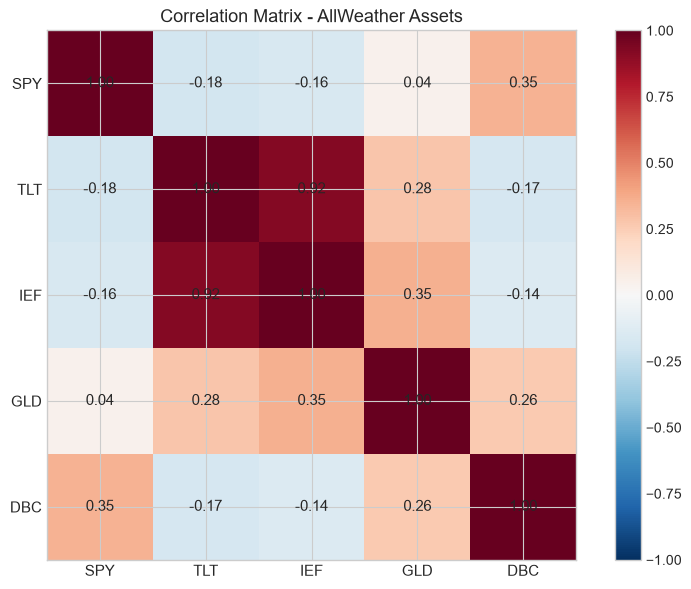
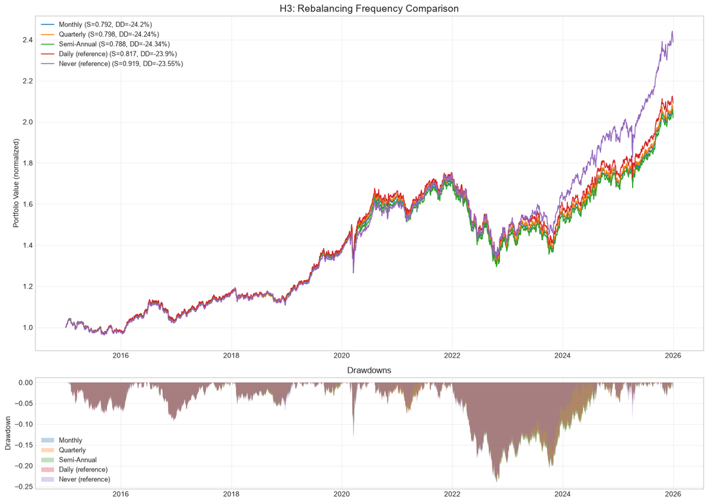
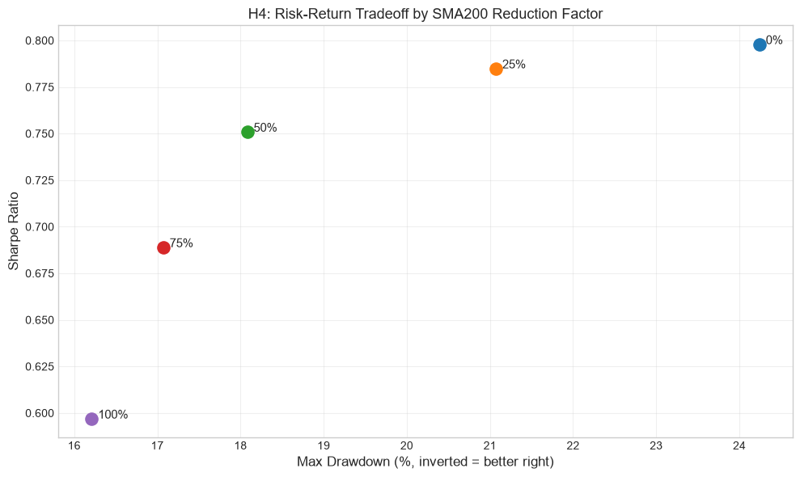
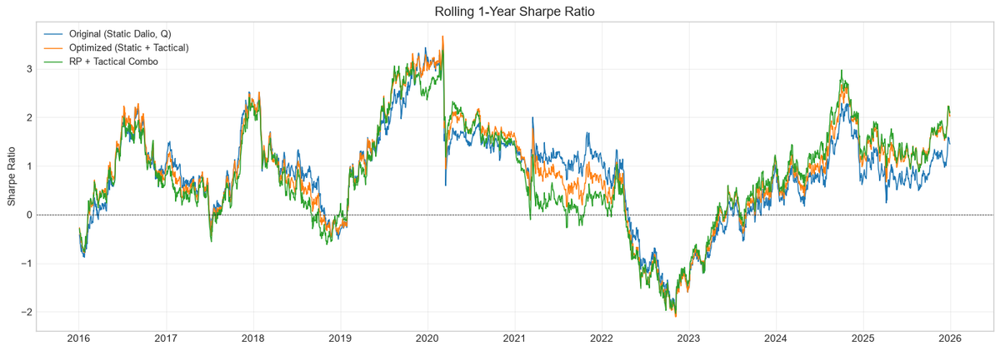

# All-Weather Portfolio Strategy

Portfolio multi-asset inspiré de l'All-Weather de Ray Dalio (Bridgewater Associates).

## Résumé

| Paramètre | Valeur |
|-----------|--------|
| **Type** | Multi-Asset, allocation fixe (v5.0) |
| **Allocation** | SPY 30 %, IEF 30 %, GLD 30 %, XLP 10 % |
| **Rebalancement** | Trimestriel (janvier, avril, juillet, octobre), plus un contrôle de dérive à 3 points au début de chaque mois |
| **Classes d'actifs** | Actions US, obligations du Trésor intermédiaires, or, consommation de base (XLP) |
| **Objectif** | Stabilité dans tous les environnements |

## Allocation Dalio originelle (baseline v1.0)

Cette allocation fixe est le point de départ historique du projet. `main.py` ne
l'implémente pas : sa docstring ne la cite que dans l'historique de conception
(« v1.0 … Dalio static »), et le code ne porte que l'allocation v5.0 décrite plus bas.
Elle reste la baseline du notebook de recherche (« Static Dalio », Sharpe 0,682 sur
2015-01-02 → 2025-12-31). Dans ce carnet, la parité de risque (0,702) et l'overlay
tactique SMA200 à 50 % (0,719) la dépassent de peu en Sharpe et nettement en perte
maximale. Le meilleur Sharpe du carnet, 0,798, est celui des poids « Gold Heavy »
(SPY 30 %, TLT 35 %, IEF 15 %, GLD 20 %, rebalancement trimestriel, sans overlay), pas
des poids Dalio. Le Sharpe de 0,858 que citaient les versions précédentes de ce README
(overlay à 50 % sur les poids Gold Heavy) venait d'une version antérieure du moteur du
carnet, décrite plus bas.

| Actif | Allocation | ETF | Rôle |
|-------|------------|-----|------|
| Actions US | 30% | SPY | Croissance |
| Bonds Long-terme | 40% | TLT | Déflation, récession |
| Bonds Intermédiaires | 15% | IEF | Stabilité |
| Or | 7.5% | GLD | Inflation, crise |
| Commodities | 7.5% | DBC | Inflation |

## Mesure au protocole de la ligue (2026-10-16, #21114)

Mesure standalone au protocole commun ([#19821](https://github.com/jsboige/CoursIA/issues/19821)),
2015-01 → 2026-06, références SPY détenu et 60/40 SPY/IEF :

| Variante | Sharpe (taux sans risque nul) | Verdict |
|----------|-------------------------------|---------|
| **v1.0 Dalio** (30/40/15/7.5/7.5, ex-ante) | 0,83 contre 1,01 (SPY) et 1,08 (60/40), p Holm 1,00 | **NO BEATS** |
| **v5.0** (SPY/IEF/GLD 30-30-30 + XLP 10, poids ajustés sur la fenêtre) | 1,28 — diffs positives, p 0,16 et 0,19, aucune significative | **NO BEATS** (en échantillon) |

La baseline Dalio v1.0 — les seuls poids publiés **avant** la fenêtre de mesure — finit
sous les deux références. La v5.0 courante (grid search 2015-2026, docstring « iter5 »)
les devance sur la fenêtre entière, mais celle-ci est entièrement **en échantillon** pour
ses poids et aucune différence n'est significative. L'écart v5.0 − v1.0 (+0,45 de Sharpe)
dit ce que l'itération sur la fenêtre a ajouté, à titre descriptif. Détail du protocole et
des chiffres : issue #21114.

## Backtest Results — fenêtre codée (2015-01-01 → 2024-12-31)

Mesure du backtest QC Cloud de [`main.py`](main.py) sur sa fenêtre codée : 2516 séances
négociables, 130 ordres.

| Métrique | Valeur mesurée |
|----------|----------------|
| Total Return | +107,2 % |
| CAGR | 7,551 % |
| Sharpe Ratio | 0,474 |
| Max Drawdown | −16,400 % |
| Frais | 131,56 $ |

Le modèle de portefeuille du carnet [`quantbook.ipynb`](quantbook.ipynb)
(`portfolio_backtest`, prix QC natifs, taux sans risque 3 %, sans coûts de transaction)
donne pour la même allocation Sharpe 0,603 / CAGR 8,0 % / MaxDD −17,2 % : modèle et
fenêtre différents du backtest d'exécution, les deux jeux de chiffres ne se comparent
pas directement.

Les chiffres de la campagne de recherche « iter5 » cités dans la docstring de `main.py`
(Sharpe yfinance 1,101 → 1,149, beta 0,328 → 0,337, alpha 0,033 → 0,043) ne figurent pas
dans le carnet [`research.ipynb`](research.ipynb) du dépôt, qui ne mesure que
l'exploration H1-H4.

## Figures du notebook de recherche

Le notebook [`research.ipynb`](research.ipynb) (prix yfinance, 2015-01-02 → 2025-12-31) déroule l'analyse : rendement, volatilité et corrélations de chaque actif, puis quatre hypothèses (statique vs parité de risque vs tactique, remplacement de DBC, fréquence de rebalancement, overlay SMA200) et une synthèse qui compare l'allocation d'origine, la configuration optimisée et la combinaison parité de risque + tactique. Provenance détaillée : [`MANIFEST.md`](assets/readme/MANIFEST.md).

Le moteur `backtest_portfolio` du carnet laisse dériver les poids avec les prix entre deux rebalancements et ne rétablit les poids cibles qu'aux dates de rebalancement. Une cellule de contrôle le vérifie avant les hypothèses : sans rebalancement, il coïncide avec un achat-conservation calculé directement depuis les prix. Une version antérieure réappliquait les poids cibles chaque jour, ce qui revenait à rebalancer quotidiennement quelle que soit la fréquence demandée : elle rendait H3 sans objet et donnait des Sharpe plus élevés, dont le 0,858 de l'overlay à 50 %. Les valeurs ci-dessous sont celles du moteur à dérive.

**Exploration.** L'analyse commence par le rendement annualisé, la volatilité, le Sharpe et le drawdown maximal de chaque actif, puis par la matrice de corrélation des cinq actifs de la baseline :

<p align="center">
  <br>
  <em>Exploration — matrice de corrélation des cinq actifs de la baseline.</em>
</p>

**H1 — Static vs Risk Parity vs Tactical.** Trois schémas sur les cinq actifs de la baseline : poids Dalio fixes, parité de risque par volatilité inverse sur 60 jours, et overlay SMA200 (le poids d'un actif passé sous sa moyenne à 200 jours est réduit de moitié, la part retirée reste en cash) :

<p align="center">
  <br>
  <em>H1 — Static vs Risk Parity vs Tactical.</em>
</p>

**H3 — Fréquence de rebalancement.** Mensuelle, trimestrielle et semestrielle, sur l'allocation retenue en H2 (« Gold Heavy »), avec deux références : le rebalancement quotidien et l'achat-conservation sans rebalancement. Les trois fréquences restent à un centième de Sharpe les unes des autres (0,792, 0,798, 0,788), trop peu pour trancher sur une seule période ; le carnet retient le trimestriel. L'achat-conservation fait mieux que toutes (0,919) parce que SPY et GLD ont monté presque sans interruption sur 2015-2025 et ont pris du poids : le résultat tient à la période, et le portefeuille finit loin de l'allocation voulue :

<p align="center">
  <br>
  <em>H3 — fréquence de rebalancement, avec les références quotidienne et sans rebalancement.</em>
</p>

**H4 — Overlay tactique SMA200.** Sur les poids Gold Heavy réévalués chaque trimestre (la fréquence retenue en H3), le poids d'un actif passé sous sa moyenne à 200 jours est réduit de 0 %, 25 %, 50 %, 75 % ou 100 %, la part retirée restant en cash, à rendement nul. Chaque cran réduit la perte maximale et baisse aussi le Sharpe : aucun ne bat le portefeuille sans overlay en Sharpe :

<p align="center">
  <br>
  <em>H4 — overlay tactique SMA200 sur les poids Gold Heavy.</em>
</p>

**Compromis Sharpe / drawdown (H4).** Le même résultat en nuage de points, un point par facteur de réduction :

<p align="center">
  <br>
  <em>H4 — Sharpe et drawdown maximal par facteur de réduction SMA200.</em>
</p>

**Synthèse — Sharpe glissant sur un an.** La synthèse du carnet combine le meilleur choix de chaque hypothèse. H4 retenant une réduction de 0 %, la configuration optimisée se réduit à l'allocation Gold Heavy rebalancée chaque trimestre, sans overlay, et la combinaison parité de risque + tactique à la parité de risque seule, rebalancée chaque mois. Le carnet compare l'allocation Dalio d'origine (Sharpe 0,682, drawdown maximal -23,59 %), la configuration optimisée (0,798, -24,24 %) et la combinaison (0,746, -20,83 %), puis trace leur Sharpe glissant sur 252 séances :

<p align="center">
  <br>
  <em>Synthèse — Sharpe glissant sur un an des trois configurations.</em>
</p>

## Fichiers

```
AllWeather/
├── main.py              # Allocation v5.0 (SPY/IEF/GLD/XLP), rebalancement trimestriel + dérive 3 points
├── config.json          # Identifiant local du projet QC
├── research.ipynb       # Recherche H1-H4 sur prix yfinance : corrélations, variantes d'allocation
├── quantbook.ipynb      # Modèle de portefeuille sur prix QC natifs (QuantBook)
├── assets/readme/       # Figures de ce README et leur MANIFEST.md
└── README.md            # Ce fichier
```

## Ce que `main.py` implémente

`main.py` (classe `AllWeatherPortfolio`) ne porte qu'une allocation, la v5.0 :

- poids fixes SPY 30 %, IEF 30 %, GLD 30 %, XLP 10 % : TLT et DBC de la baseline sont sortis ;
- rebalancement au début de chaque trimestre civil (janvier, avril, juillet, octobre), 30 minutes après l'ouverture ;
- les autres mois, contrôle de dérive au même moment : rebalancement si le poids d'un actif s'écarte de plus de 3 points de sa cible ;
- paramètre QC `brokerage` : par défaut, un modèle de courtage sur compte sur marge (frais et règles d'ordre) ; `none` le désactive.

La parité de risque (volatilité inverse sur 60 jours) et l'overlay tactique SMA200 ne vivent plus que dans [`research.ipynb`](research.ipynb) (H1, H4). Ils ont existé dans `main.py` : la version du 2026-02-02 (commit `4fe6218498`, allocation Dalio 30/40/15/7,5/7,5) portait les classes `RiskParityAllWeather` et `TacticalAllWeather`. Elles disparaissent le 2026-03-04 (`df4178cce7`), et la parité de risque devient le lendemain le projet séparé [`RiskParity`](../RiskParity/) (`4d26fccdff`). Ces commits ne sont pas des ancêtres de la branche `main` actuelle, où l'historique de ce fichier commence le 2026-09-27 : on les lit avec `git log --all`. La docstring cite des versions antérieures (v2.0 « Gold Heavy + SMA50% », v2.2 « SMA25% ») comme historique de conception seulement.

## Configuration

```python
# Allocations cibles (v5.0)
self.target_allocations = {
    "SPY": 0.30,   # 30% Actions US
    "IEF": 0.30,   # 30% Obligations intermediaires
    "GLD": 0.30,   # 30% Or
    "XLP": 0.10,   # 10% Consumer Staples
}

# Rebalancer hors trimestre si un poids derive de plus de 3 points
self.rebalance_threshold = 0.03
```

## Philosophie

L'All-Weather de Dalio (la baseline v1.0) est conçu pour performer dans 4 environnements :

| Environnement | Actifs performants |
|---------------|-------------------|
| Croissance ↑ | Actions |
| Croissance ↓ | Bonds |
| Inflation ↑ | Or, Commodities |
| Inflation ↓ | Bonds |

La v5.0 de `main.py` s'écarte de ce schéma : sans TLT ni DBC, elle confie la protection
contre l'inflation à l'or seul et ajoute XLP comme actif défensif.

## Risques

- **Sous-performance en bull market**: 60 % du portefeuille hors actions (IEF et GLD) dilue les gains quand les actions montent
- **Sensibilité aux taux**: Bonds souffrent quand les taux montent
- **Corrélations instables**: En crise, tout peut baisser ensemble
- **Commodities roll yield**: le contango érode le rendement des contrats à terme sur matières premières ; le risque porte sur DBC de la baseline v1.0, la v5.0 n'en détient pas

## Améliorations Possibles

- Ajouter TIPS (Treasury Inflation-Protected Securities) — testé en H2 du carnet à la place de DBC : Sharpe 0,650, sous la baseline (0,682)
- Diversification géographique (VEA, VWO)
- Dynamic risk targeting
- Factor tilts (Value, Momentum)

## Références

- Ray Dalio: "Principles" (chapitre sur l'All-Weather)
- Bridgewater Associates: "The All Weather Story"
- Notebook : [QC-Py-08-Multi-Asset-Strategies.ipynb](../../Python/QC-Py-08-Multi-Asset-Strategies.ipynb)
