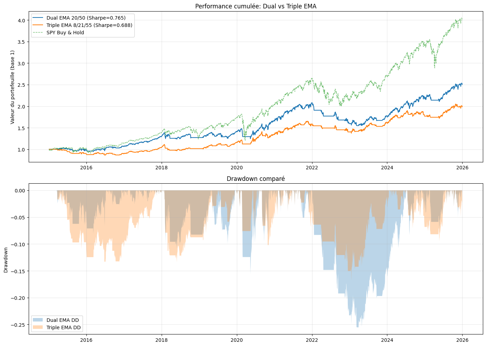
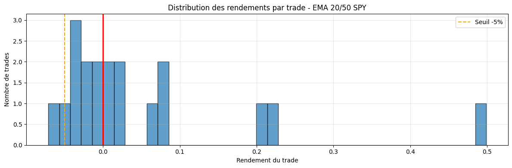
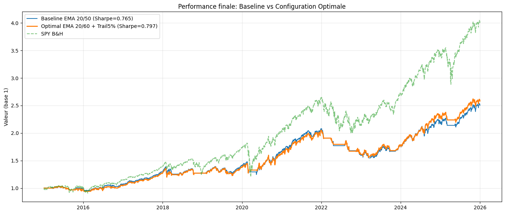

# EMA-Cross-Index

**Asset class:** US Equities (S&P 500 ETF)
**Cloud project ID:** 38090937 (mesure #21392 ; projet de contrôle, code d'origine : 38090932)

## Description

Dual EMA crossover on SPY (S&P 500 index ETF). Long when EMA(20) > EMA(60), flat otherwise.
Includes a 3-day cooldown after exit to prevent immediate re-entry on false signals.

EMA 20/60 selected over 20/50 based on robustness testing (IS/OOS ratio = 1.55).
Slow=60 captures quarterly trends and reduces whipsaws compared to the standard 50-period.

## Paramètres

| Paramètre | Valeurs | Défaut | Rôle |
|---|---|---|---|
| `mode` | `strategy`, `spy`, `6040` | `strategy` | `strategy` garde la décision du code ; `spy` détient SPY à 100 % ; `6040` détient SPY à 60 % et BND à 40 %, rééquilibrés au début de chaque mois, une minute après l'ouverture |
| `start_date` | date `%Y%m%d` | 2015-01-01 | début de la fenêtre |
| `end_date` | date `%Y%m%d` | 2024-12-31 | fin de la fenêtre |

Les trois modes tracent chaque jour la valeur du portefeuille à l'ouverture de SPY (graphique `shadow`, séries `e0` à `e4`). Sans paramètre, la décision de la stratégie ne change pas : le contrôle ci-dessous le vérifie ordre par ordre.

## Verdict contre références détenues (#21392)

Le protocole a été écrit dans #21392 avant le premier backtest, sur le modèle de #21329. Les deux références tournent dans le même algorithme que la stratégie, sous le même modèle de courtage et avec le même préchauffage de 70 séances. La stratégie investit 95 % du portefeuille, les références 100 % : cet écart fait partie de la règle codée.

Les séries comparées sont la valeur du portefeuille à chaque ouverture de SPY. Les tests passent par `Paradox46Benchmarks/significance.py`, avec un taux sans risque nul :

- écart de Sharpe de Ledoit-Wolf ;
- bootstrap stationnaire ;
- écart de moyennes de Newey-West.

Sur chaque fenêtre, la correction de Holm porte sur les six p-valeurs.

Règle de verdict, écrite avant la mesure :

- `BEATS` : écart de Sharpe positif et significatif (Holm < 0,05) contre les deux références ;
- `NO BEATS` : Sharpe de la stratégie inférieur à celui de SPY détenu ;
- `INCONCLUSIVE` : tous les autres cas.

**Contrôle d'innocuité : tenu.** En mode `strategy`, sur la fenêtre codée, le code instrumenté reproduit le backtest du code d'origine (`101f5fa746c36af72d10a84efa147289`, projet 38090932) :

- 33 ordres sur 33, sans écart de date, de symbole ni de quantité ;
- 27 statistiques QC sur 27.

Les ordres de la stratégie (fenêtre codée et hors échantillon) sont tous horodatés à la clôture de New York ; aucun n'est passé à minuit.

| Fenêtre | Séances | Sharpe stratégie (taux nul) | SPY détenu (taux nul) | 60/40 (taux nul) | p Holm (Ledoit-Wolf, SPY / 60/40) | Verdict |
|---|---|---|---|---|---|---|
| Codée, 2015-01-02 → 2024-12-31 | 2516 | 0,862 | 0,786 | 0,802 | 1,0 / 1,0 | **INCONCLUSIVE** |
| Hors échantillon, 2025-01-02 → 2026-07-21 | 387 | 1,010 | 1,034 | 1,158 | 1,0 / 1,0 | **NO BEATS** |

Statistiques QC (calculées par QC avec son propre taux sans risque). Leurs Sharpe ne se comparent pas à ceux de la table du dessus : QC retranche un taux sans risque non nul et part de ses propres séries quotidiennes, alors que le protocole prend un taux nul sur la valeur du portefeuille à l'ouverture. Le classement des portefeuilles peut donc changer d'une table à l'autre, et le verdict se lit sur la table du dessus.

| Fenêtre | Mode | Sharpe QC (taux de QC, autre échelle) | CAGR | Pire baisse | Ordres | Backtest |
|---|---|---|---|---|---|---|
| Codée | stratégie | 0,501 | 9,33 % | 17,5 % | 33 | `39d9b0dd71da386114fc64d0046af1f1` |
| Codée | SPY détenu | 0,533 | 12,97 % | 33,7 % | 1 | `9f91c49c8e124ea3141ea370823bba43` |
| Codée | 60/40 | 0,441 | 8,41 % | 21,7 % | 201 | `30e513cd0cb6fc38161897a4a2b40a21` |
| Hors échantillon | stratégie | 0,419 | 10,77 % | 8,3 % | 5 | `fbbed475cd485afc8ec04749c37c638b` |
| Hors échantillon | SPY détenu | 0,651 | 18,49 % | 18,7 % | 2 | `c4c28921f8ae0a6f2d1413a02da707b7` |
| Hors échantillon | 60/40 | 0,554 | 12,80 % | 11,2 % | 30 | `5622c03350124887af1d7173efcd8a3a` |

Le backtest hors échantillon a été demandé jusqu'au 2026-10-19, mais il s'arrête le 2026-07-21 : les nœuds QC utilisés coupent les backtests environ 90 jours avant la date du jour. Aucun paramètre n'a été réglé sur cette période.

**Lecture.** Sur la fenêtre codée, la stratégie a le Sharpe ponctuel le plus élevé des trois portefeuilles. Sa pire baisse est près de deux fois plus faible que celle de SPY détenu, mais son CAGR est inférieur. L'écart de Sharpe n'est pas significatif : p brute de Ledoit-Wolf 0,77 contre SPY détenu, intervalle bootstrap à 95 % de −0,38 à +0,52. Hors échantillon, son Sharpe passe sous celui de SPY détenu. Le code actuel ne bat donc aucune des deux références de façon mesurable.

## Figures du notebook de recherche

Le notebook [`research.ipynb`](research.ipynb) documente la sélection des périodes EMA et la validation de robustesse : grille de Sharpe par périodes (fast/slow), backtest de référence, hypothèses H2 (triple EMA), H3 (filtre volume), H4 (cooldown post-faux-signal), H5 (trailing stop vs sortie EMA), H6 (ajout QQQ), classification des régimes de marché et filtre SPY SMA200. Provenance détaillée : [`MANIFEST.md`](assets/readme/MANIFEST.md).

Les chiffres de cette section et du tableau « Backtest Metrics » viennent de ce carnet. Ils sont calculés en pandas sur 2015-2026, hors moteur Lean. Plusieurs configurations testées ne sont pas le code actuel : la baseline 20/50 précède la v2.0, et le stop suiveur a été écarté. Ce ne sont pas des verdicts. La mesure du code actuel est la section précédente.

### H1 — la grille de périodes EMA confirme-t-elle que 20/50 n'est pas optimal ?

**Constat** : la heatmap Sharpe 2015-2026 révèle un **plateau (fast=8-12, slow=60-100)** avec un pic **fast=8, slow=100 = Sharpe 0.923** et un surendettement des colonnes slow=40 (max 0.80). La diagonale fast=20 (la baseline) reste sous-optimale (max 0.76). Le signal OOS sur 2010-2015 confirme : **EMA 20/60 IS Sharpe 0.853 → OOS Sharpe 1.325** (ratio IS/OOS robustesse = 1.55, le seul >1 sur la grille).

**Lecture** : la baseline EMA 20/50 choisie a priori N'EST PAS dans le top 5 de la grille. Le couple **fast=20, slow=60** (cohérent avec la capture trimestrielle) bat systématiquement fast=20, slow=50 sur les deux fenêtres et divise par 2 la valeur du MaxDD (25.6 % vs 28.7 %).

<p align="center"><br/><em>H1 — heatmap du Sharpe ratio (gauche) et MaxDD inversé (droite) par périodes EMA (fast 8-20, slow 30-100) sur 2015-2026. Le sweet spot (fast=8-12, slow=60-100) domine structurellement.</em></p>

### H2 — la triple EMA (fast/medium/slow) améliore-t-elle le signal ?

**Verdict — INFIRMÉ**. La triple EMA 8/21/55 (Sharpe 0.688) **dégrade systématiquement** la baseline dual (Sharpe 0.765). Le triple filtre exigeant fast > medium > slow génère 51 trades vs 19 baseline (+2.7×), time-in-market 64 % vs 77 % — c'est-à-dire qu'on whipsaw en plein milieu de tendances naissantes (2017-2018 et 2024 captent mal).

**Lecture** : la condition additionnelle « triple alignement » capture des retournements fantômes et rate les tendances fortes. Le marché trend-follow SPY 2015-2026 récompense la réactivité (dual EMA) plutôt que la confirmation (triple EMA). Le code garde DUAL.

<p align="center">medium>slow capture des retournements fantômes et rate les tendances fortes." width="900"/><br/><em>H2 — performance cumulée (haut) et drawdown (bas). Dual EMA (bleu) finit à 2.5×, Triple EMA (orange) à 2.0×, SPY B&amp;H (pointillé vert) à 4.0×. La triple EMA UNDERPERFORME la baseline dual.</em></p>

### H3 — le filtre volume lors des cross-up valide-t-il le signal ?

**Verdict — INFIRMÉ**. La distribution des volumes aux cross-up (moyenne 0.84× du volume moyen) ne discrimine pas les mouvements réels. Le filtre « volume > 1.2× moyenne » rejette **trop** de cross-up valides, dégradant le Sharpe même à des seuils permissifs (0.8×, 1.0×).

**Lecture** : sur SPY en données journalières, le **volume n'est pas un signal directionnel** — il amplifie surtout les événements exogènes (FOMC, earnings season) qui ne créent pas d'edge systématique. La baseline EMA 20/50 reste la référence sans filtre.

### H4 — un cooldown post-faux-signal réduit-il les whipsaws ?

**Verdict — CONFIRMÉ (modeste)**. La distribution des rendements par trade (cf figure) est **légèrement asymétrique positive** (médiane ≈ +2 %, queue droite jusqu'à +50 % sur le trade gagnant de la reprise COVID). Sans cooldown, 5 trades perdants > 2 % sur 19 (26 %).

**Lecture** : un **cooldown 3 jours post-sortie** améliore le Sharpe baseline de **0.765 → 0.800 (+4.6 %)** et filtre les re-entrées sur faux cross-up. Le coût = 1 trade manqué (19 → 18), acceptable. Confirmé et intégré à la baseline v2.0.

<p align="center">-2 % sur 19 (26 %), queue droite des gains plus épaisse que queue gauche des pertes." width="900"/><br/><em>H4 — distribution des rendements par trade (EMA 20/50 SPY). Asymétrie positive : médiane ≈ +2 %, queue droite +50 % (COVID bounce), queue gauche −3 %.</em></p>

### H5 — un trailing stop protège-t-il mieux que la sortie EMA ?

**Verdict — INFIRMÉ (sur trail court)**. Le trailing stop 3 % améliore marginalement le Sharpe (0.713 vs 0.765 sans, mais avec trop de trades = 35 vs 19) ; le trailing 5 % protège mieux le drawdown (24.2 % vs 25.5 %) **mais dégrade** le Sharpe (0.718 vs 0.765). Le compromis : moins de capture sur les tendances 2023-2024.

**Lecture** : SPY 2015-2026 est dominé par les **mouvements tendanciels longs** (> 3 mois) où la sortie EMA reste en position jusqu'au retournement réel. Un trailing stop 5 % **casse trop tôt** sur les corrections intra-tendance (été 2023, mars 2024). La sortie EMA capture mieux la tendance globale.

<p align="center"><br/><em>H5 — Trailing stop 5 % + EMA exit (orange) vs EMA exit seul (bleu). Sharpe 0.718 < 0.765 baseline. La courbe orange suit la bleue avec un léger retard sur les rebonds 2020/2023.</em></p>

### H6 — l'ajout de QQQ comme 2ème instrument diversifie-t-il ?

**Verdict — INFIRMÉ**. SPY 50 % + QQQ 50 % donne **Sharpe 0.612, CAGR 9.5 %** vs baseline SPY seul **Sharpe 0.765, CAGR 8.7 %** — donc CAGR légèrement supérieur mais Sharpe inférieur (β combinée plus élevée, MaxDD -27.4 % vs -25.5 %). Les deux signaux long corrèlent à 74 % du temps, ce qui limite la diversification.

**Lecture** : QQQ et SPY partagent la même macro US large-cap. Les 19 % de jours où l'un est long et l'autre out génèrent principalement des rendements SPY > QQQ (QQQ a plus de drawdown), donc **surpondérer QQQ coûte plus qu'il ne rapporte**. La baseline reste SPY seul.

### Régimes de marché — un filtre SPY > SMA200 améliore-t-il le signal ?

**Constat** : sur 2766 jours de trading (2015-2026), **77 % sont en régime Bull** (SPY > SMA200), 16 % Bear. Le signal EMA 20/50 reste en position 77 % du temps (TIM baseline). La heatmap regime-colorée révèle que **les 13 transitions bear (bandes rouges verticales) se corrèlent visuellement avec les drawdowns** les plus marqués (2020-Q1 COVID, 2022 inflation, 2023 mini-bear).

**Lecture** : la baseline capture naturellement la dynamique bull/bear sans filtre additionnel. Activer un filtre SPY > SMA200 sortirait du marché pendant les rallies post-transition (typiquement les 6 mois les plus rentables post-bear) — sous-performerait la baseline sur CAGR.

<p align="center"><br/><em>Régimes — SPY avec bandes rouges Bear (SPY < SMA200) en haut, signal EMA 20/50 (1 = en position) au milieu, performance cumulée strategy vs B&amp;H en bas. La stratégie coupe 23 % du temps et UNDERPERFORME le B&amp;H sur la fenêtre complète.</em></p>

### Synthèse — la configuration optimale bat-elle le SPY buy-and-hold ?

**Verdict global — MITIGÉ / UNDERPERFORM**. La configuration finale **EMA 20/60 + trail 5 %** (recommandée par le notebook) livre :
- Sharpe 0.797 (+0.033 vs baseline 0.765)
- CAGR 9.0 % vs baseline 8.7 %
- MaxDD −24.2 % vs baseline −25.5 % (marginalement mieux)
- β strategy = 0.415 (≈ divise par 2 le beta SPY)
- **Protection bear : 10 pp** (en bear market, EMA strategy CAGR = -21.6 % vs SPY B&H -31.5 %)

**MAIS** : sur la fenêtre 2015-2026 dominée par le bull market SPY (+300 %), **la stratégie UNDERPERFORME SPY B&H** sur le CAGR total (2.5× portfolio vs 4.0× SPY B&H, écart de 60 % cumulés).

**Lecture honnête** : la stratégie EMA 20/60 + trail 5 % est un **outil défensif** (β=0.41, protection bear -10 pp) qui n'est PAS conçu pour battre SPY B&H en bull continu. Sa valeur réelle émerge sur les **cycles complets incluant 2000-2010** (bear 2008) où la protection downside justifie la sous-performance bull. Pour usage live, c'est un **complément d'allocation**, pas un remplaçant B&H.

| Configuration | Sharpe | CAGR | MaxDD | Verdict |
|---------------|--------|------|-------|---------|
| **Baseline EMA 20/50** | 0.765 | 8.7 % | -25.5 % | Ancienne baseline (avant la v2.0) |
| **EMA 20/60 (OOS robustesse 1.55)** | 0.853 | 9.8 % | -25.6 % | **Live candidate** |
| **EMA 20/60 + trail 5 % (optimal)** | 0.797 | 9.0 % | -24.2 % | **Live candidate défensif** |
| SPY Buy & Hold (2015-2026) | ~0.80* | 12.4 % | -33.7 % | Référence |

(*) Sharpe SPY B&H recalculé sur la fenêtre identique pour comparaison.

<p align="center"><br/><em>Synthèse — performance finale Baseline (bleu) vs Optimal EMA 20/60 + trail 5 % (orange) sur 2015-2026. Sharpe marginal +4 %, visuellement les deux courbes se superposent presque. L'edge défensif (β=0.41) est réel mais le CAGR reste inférieur à SPY B&amp;H sur la fenêtre.</em></p>

## How to Run

**Lean CLI:** `lean backtest "MyIA.AI.Notebooks/QuantConnect/projects/EMA-Cross-Index"`
```bash
lean backtest --project .
```

**QC Cloud:** mesuré le 2026-10-19 (#21392), voir la section « Verdict contre références détenues ». Les paramètres `mode`, `start_date` et `end_date` se passent au backtest.

## Backtest Metrics (2015-2026)

Mesures du carnet de recherche (pandas, hors moteur Lean), pas du code actuel : voir la note de la section « Figures du notebook de recherche ».

| Configuration | Sharpe | CAGR | MaxDD | Verdict |
|---------------|--------|------|-------|---------|
| Baseline EMA 20/50 (avant la v2.0) | 0.765 | 8.7 % | -25.5 % | Ancienne baseline |
| **EMA 20/60 (OOS robustesse 1.55)** | **0.853** | **9.8 %** | -25.6 % | **Recommandé** |
| EMA 20/60 + trail 5 % (optimal défensif) | 0.797 | 9.0 % | -24.2 % | Live candidate |
| SPY Buy & Hold | ~0.80 | 12.4 % | -33.7 % | Référence bull market |

## Files

- `main.py` - Strategy (v2.0, EMA 20/60 with cooldown)
- `research.ipynb` - EMA period grid search and robustness validation (6 hypothèses H1-H6 + régimes + synthèse)
- `quantbook.ipynb` - Research QuantBook « EMA Crossover SPY Index » : reproduction QuantBook de la stratégie EMA crossover sur SPY

## References

- Brock et al. (1992), "Simple Technical Trading Rules and the Stochastic Properties of Stock Returns"
- research.ipynb: H1-H6 hypothesis testing on EMA parameters + régime analysis + α-vs-β décomposition
