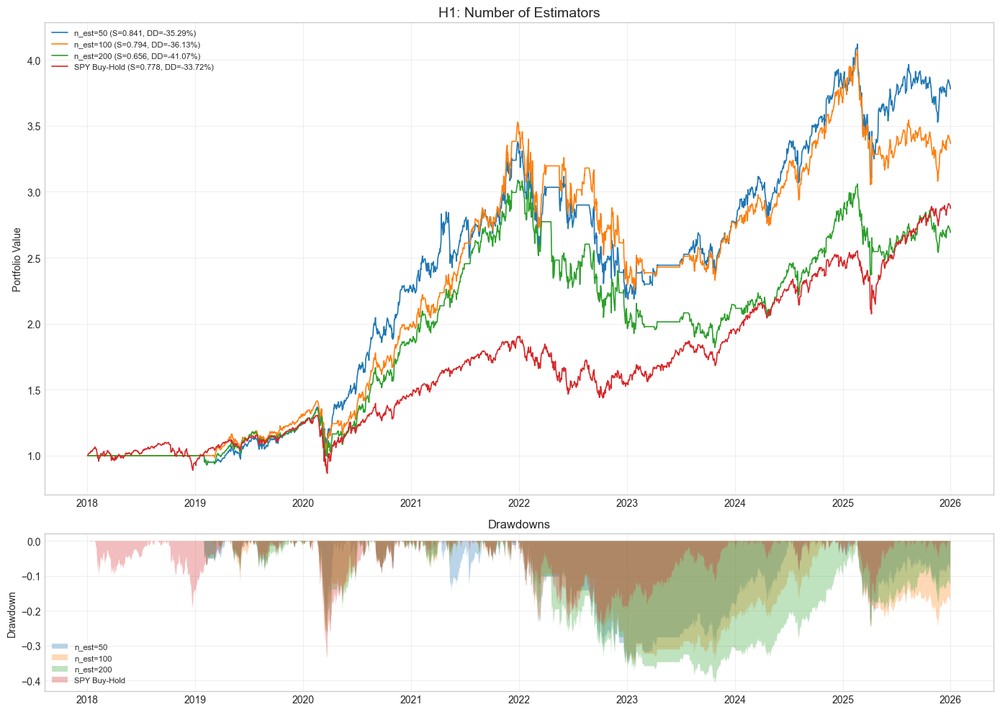
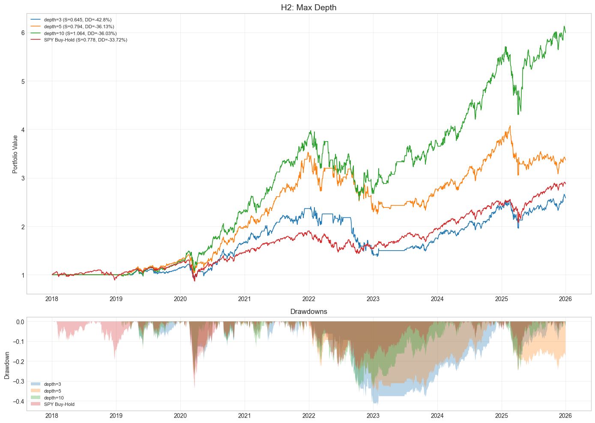
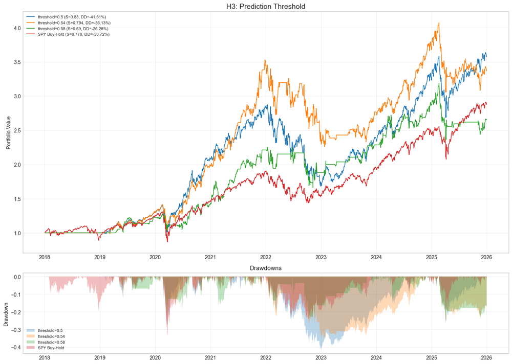
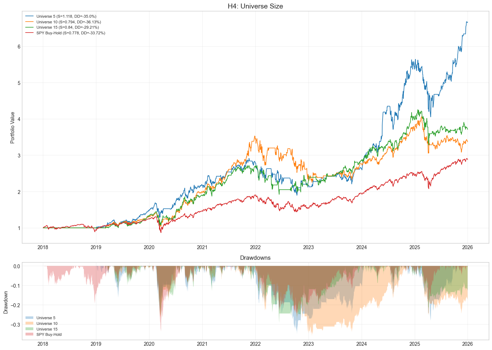
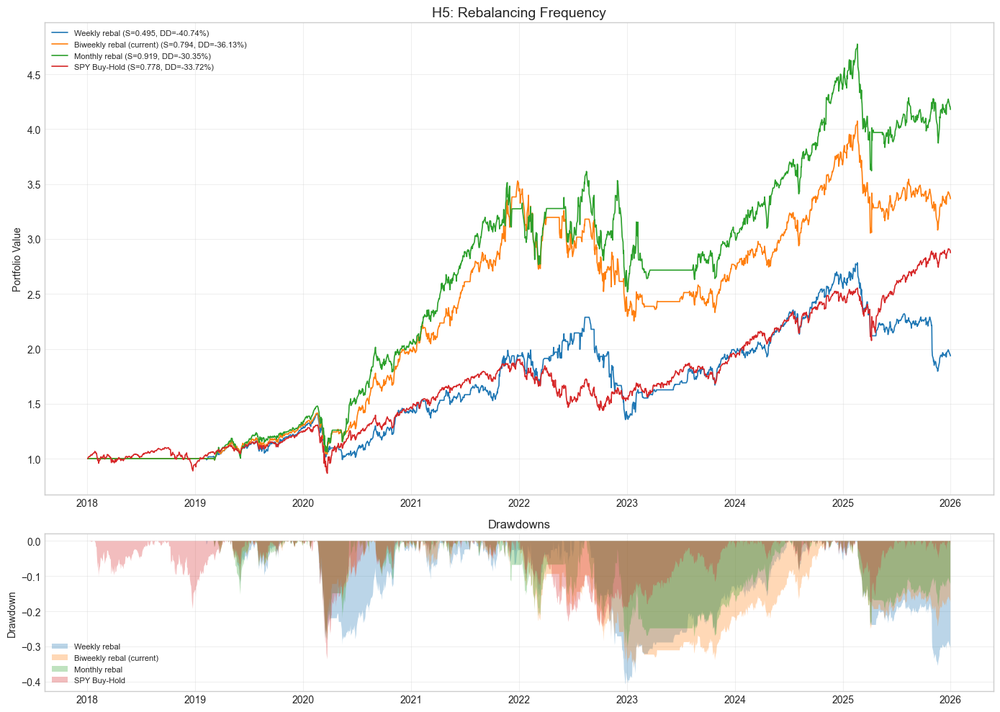

# ML-RandomForest — Random Forest sur grandes capitalisations US

**Classe d'actifs :** Actions US grandes capitalisations (10 titres)
**Cloud project ID :** 29434751
**Période backtestée :** 2015-01-01 → 2024-12-31

## Description

Stratégie de classification par **Random Forest** (sklearn `RandomForestClassifier`) sur 10 grandes capitalisations US. Utilise 12 features techniques (RSI, bandes de Bollinger, MACD, momentum, volatilité, volume, ratios de prix) pour prédire le signe du rendement du lendemain.

Entraînement mensuel du modèle, rebalancement bimensuel (un lundi sur deux). Seuil de prédiction 0.54, au plus 5 positions, qui se partagent 90 % du portefeuille à parts égales : 18 % chacune quand cinq titres passent le seuil, 90 % sur un seul titre quand il est seul à le passer.

**Version anglaise préservée** : [README.en.md](README.en.md).

## Configuration déployée (v3, `main.py` Cloud 29434751)

| Composant | Paramètre | Rôle |
|-----------|-----------|------|
| Univers | AAPL, MSFT, GOOGL, AMZN, NVDA, META, TSLA, JPM, V, WMT | 10 large-caps |
| Features | 12 (RSI, BB, MACD, mom 5/10/20, vol 20, volume, prix/SMA) | Signal technique |
| `n_estimators` | 100 | Taille de la forêt |
| `max_depth` | 5 | Profondeur ( conservative — *pas* le « 10 optimal » de H2) |
| `min_samples_split` | 10 | Régularisation |
| Lookback | 120 jours | Fenêtre d'entraînement |
| Seuil | 0.54 | Probabilité min pour ouvrir |
| Positions max | 5, à 90 % / n chacune | Concentration |
| Rebalance | Bimensuel | Tous les 2 lundis |
| Entraînement | Mensuel | recalibrage |
| Graine | `random_state=42` | **Single seed** (cf. lecture honnête) |

## Backtest réel (QC Cloud, frais IBKR inclus)

| Métrique | Valeur |
|----------|--------|
| Sharpe ratio | **0.819** |
| CAGR | **24.25 %** |
| Drawdown max | **40.50 %** |
| Rendement total net | 1141.6 % (+1 119 957 $ sur 100 k $) |
| PSR (Probabilistic Sharpe Ratio) | **14.52 %** |
| Ordres exécutés | 1250 |
| Jours tradés | 2914 |

*Backtest frais via QC Cloud project 29434751 (compile `BuildSuccess`, 2026-08-06). Métriques vérifiées firsthand.*

### Lecture honnête — Mag7-beta avec vernis ML, pas d'alpha statistique

Le CAGR de 24.25 % semble élevé, mais **trois caveats §C** l'attenent sévèrement :

1. **Biais Mag7/FAANG dans l'univers (§C point 5)** : 7 des 10 tickers (AAPL, MSFT, GOOGL, AMZN, **NVDA**, META, **TSLA**) sont des Mag7/FAANG. La règle `pr-review-discipline.md` §C interdit explicitement les FAANG/Mag7 en training set pour éviter ce biais. Sur 2015-2024, NVDA a fait ~100×, TSLA ~20× — l'essentiel du CAGR 24 % est **l'exposition beta au bull run Mag7**, pas la capacité prédictive du Random Forest. Les dix titres de l'univers détenus à poids égaux, rééquilibrés chaque mois, font mieux que la stratégie sur la même fenêtre : CAGR QC de 32,42 % contre 24,10 % (mesure ci-dessous, #21804).

2. **Single seed (`random_state=42`)** : aucune robustesse multi-seed. §C exige ≥4 seeds (0/1/7/42/99) avec edge ≥ 2σ cross-seed pour tout claim « BEATS ». **PSR 14.52 %** < 50 % : le Sharpe observé n'est **pas** statistiquement supérieur à zéro au seuil conventionnel. Le rendement observé est compatible avec du bruit de chance sur une seule réalisation.

3. **Signaux d'overfitting dans le sweep de recherche** : les figures H2 et H4 célèbrent « depth=10 S=1.064 BAT TOUTES LES STRATÉGIES » et « Universe=5 S=1.118 OPTIMAL MASSIF ». Ce sont des **signatures classiques d'overfitting in-sample** sur le Mag7 : arbres plus profonds = mémorisation de la tendance haussière ; univers plus petit = concentration sur NVDA (le top performer). Notamment, **la config déployée (v3) utilise `max_depth=5` et `universe=10` — le choix CONSERVATEUR, pas les « optimaux » du sweep**. L'auteur a reconnu (implicitement, via le choix de production) que depth=10 et universe=5 étaient du surajustement. Le README de recherche devrait présenter ces « optimaux » comme **warnings d'overfitting**, pas comme des victoires.

**Conclusion honnête** : ne PAS présenter le CAGR 24 % comme de l'alpha ML. C'est du **beta Mag7 filtré par un classifieur entraîné sur la même période** — la valeur pédagogique réside dans le **diagnostic d'overfitting** (sweep H1-H5) et la démonstration d'un pipeline ML complet (features → train → predict → rebalance), pas dans la performance. Le MaxDD 40.5 % (concentration Mag7, bear 2022) confirme le risque non diversifié.

## Mesure contre des références détenues (#21804)

`main.py` est mesuré contre deux références détenues : SPY détenu et le 60/40 (SPY 60 %, BND 40 %). Les paramètres qui le permettent sont décrits plus bas, dans « Paramètres de `main.py` ». Le protocole est écrit dans #21804 avant le premier backtest. Chaque backtest tourne sur les nœuds QC. Les tests viennent de `Paradox46Benchmarks/significance.py`, à taux sans risque nul : écart de Sharpe de Ledoit-Wolf, bootstrap stationnaire et écart de moyennes de Newey-West.

- **Verdict.** Il compare la stratégie à SPY détenu et au 60/40, avec une correction de Holm sur six p-valeurs. `BEATS` exige un écart de Sharpe positif et une p de Holm (Ledoit-Wolf) inférieure à 0,05 contre les deux références. `NO BEATS` signifie un Sharpe inférieur à celui de SPY détenu. Tous les autres cas sont `INCONCLUSIVE`.
- **Diagnostic.** `ew10`, les dix titres de l'univers à 10 % chacun, passe dans une exécution séparée, avec Holm sur trois p-valeurs. Il retire la forêt et garde l'univers : il demande si la sélection fait mieux que les dix titres détenus. Il ne change pas le verdict.

**Contrôle d'innocuité : tenu.** En mode `strategy`, sur la fenêtre codée, le code instrumenté reproduit le backtest du `main.py` d'origine : 1069 ordres sur 1069 identiques (date, symbole, quantité) et 27 statistiques QC sur 27. Tous les ordres sont remplis, aucun n'est refusé. Tous sont créés à 10:00, heure de New York, 30 minutes après l'ouverture.

**Fenêtres.**

- **Fenêtre codée.** Le premier ordre de la stratégie date du 2015-01-12. Ses six premières séances, passées en liquidités, sont comprises dans la mesure.
- **Après la fenêtre codée.** Les backtests partent du 2024-11-01, et le premier ordre de la stratégie tombe le 2024-11-04. Les traces des quatre modes sont coupées à la première séance de 2025, pour une mesure sur des portefeuilles déjà investis. La fenêtre s'arrête au 2026-07-23 : les nœuds QC ont coupé le backtest demandé jusqu'au 2026-10-21, et la fin a été lue sur la trace.

Sharpe annualisé de la trace `shadow`, taux sans risque nul. L'écart est celui de la stratégie moins la référence.

| Fenêtre | Séances | Stratégie | SPY détenu (écart, p LW, p Holm) | 60/40 (écart, p LW, p Holm) | Verdict |
|---|---|---|---|---|---|
| 2015-01-02 → 2024-12-31 | 2516 | 1,056 | 0,786 (+0,270 ; 0,277 ; 1,0) | 0,802 (+0,255 ; 0,327 ; 1,0) | `INCONCLUSIVE` |
| 2025-01-02 → 2026-07-23 | 389 | 1,256 | 1,047 (+0,210 ; 0,677 ; 1,0) | 1,157 (+0,099 ; 0,852 ; 1,0) | `INCONCLUSIVE` |

Sur la fenêtre codée, une p du verdict passe sous 0,05 après Holm : celle de l'écart de moyennes contre le 60/40 (p brute 0,0041, p de Holm 0,0245). La stratégie gagne en moyenne 0,063 % de plus par séance que le 60/40. Contre SPY détenu, le même test donne une p brute de 0,046 et une p de Holm de 0,232. Toutes les autres p de Holm du verdict valent 1,0, sur les deux fenêtres.

Diagnostic contre `ew10`, même convention.

| Fenêtre | Stratégie | `ew10` | Corrélation journalière | Écart | p LW | p Holm (3 tests) |
|---|---|---|---|---|---|---|
| 2015-01-02 → 2024-12-31 | 1,056 | 1,327 | 0,763 | −0,271 | 0,215 | 0,597 |
| 2025-01-02 → 2026-07-23 | 1,256 | 0,849 | 0,798 | +0,407 | 0,355 | 0,844 |

Les trois p brutes du diagnostic (Ledoit-Wolf, bootstrap, écart moyen) valent 0,215, 0,215 et 0,199 sur la fenêtre codée, puis 0,355, 0,338 et 0,281 après elle. Holm les range par ordre croissant, multiplie la plus petite par 3, la suivante par 2 et la dernière par 1, puis reporte à chaque rang le maximum déjà atteint. Sur les deux fenêtres, la plus petite est celle de l'écart moyen : 3 × 0,199 = 0,597, puis 3 × 0,281 = 0,844. Ce maximum s'impose aux deux autres p.

Volatilité annualisée, rendement annualisé et drawdown maximal des mêmes traces :

| Mode | Fenêtre | Volatilité | Rendement annualisé | Drawdown max |
|---|---|---|---|---|
| stratégie | 2015-2024 | 23,2 % | 24,4 % | 49,6 % |
| SPY détenu | 2015-2024 | 17,6 % | 13,0 % | 33,7 % |
| 60/40 | 2015-2024 | 10,9 % | 8,5 % | 21,7 % |
| `ew10` | 2015-2024 | 23,4 % | 32,7 % | 37,7 % |
| stratégie | 2025-01 → 2026-07-23 | 24,0 % | 31,3 % | 16,1 % |
| SPY détenu | 2025-01 → 2026-07-23 | 17,6 % | 18,4 % | 18,7 % |
| 60/40 | 2025-01 → 2026-07-23 | 10,8 % | 12,7 % | 11,2 % |
| `ew10` | 2025-01 → 2026-07-23 | 22,2 % | 17,8 % | 24,1 % |

Statistiques QC des mêmes backtests. Le Sharpe QC déduit un taux sans risque, celui de la trace non : les deux tableaux ne se comparent pas colonne à colonne. Pour la seconde fenêtre, les statistiques QC portent sur tout le backtest, du 2024-11-01 au 2026-07-23.

| Mode | Backtest | Sharpe QC | CAGR | Drawdown max | Ordres |
|---|---|---|---|---|---|
| stratégie | 2015-2024 | 0,834 | 24,10 % | 49,6 % | 1069 |
| SPY détenu | 2015-2024 | 0,533 | 12,97 % | 33,7 % | 1 |
| 60/40 | 2015-2024 | 0,442 | 8,41 % | 21,7 % | 201 |
| `ew10` | 2015-2024 | 1,109 | 32,42 % | 37,7 % | 844 |
| stratégie | 2024-11 → 2026-07-23 | 0,989 | 32,85 % | 16,1 % | 204 |
| SPY détenu | 2024-11 → 2026-07-23 | 0,606 | 17,41 % | 18,7 % | 1 |
| 60/40 | 2024-11 → 2026-07-23 | 0,479 | 11,79 % | 11,2 % | 31 |
| `ew10` | 2024-11 → 2026-07-23 | 0,659 | 21,44 % | 24,1 % | 171 |

**Lecture.** Sur la fenêtre codée, la stratégie rend 24,4 % par an contre 13,0 % pour SPY détenu, avec une volatilité plus forte (23,2 % contre 17,6 %) et un drawdown plus profond (49,6 % contre 33,7 %). Par unité de risque, à taux nul, elle dépasse en point SPY détenu et le 60/40, sans écart mesurable. Son rendement moyen dépasse significativement celui du 60/40, mais avec deux fois sa volatilité : un rendement plus haut n'est pas un Sharpe plus haut, et le verdict porte sur le Sharpe. Après la fenêtre codée, la stratégie reste au-dessus en point ; 389 séances ne suffisent pas à distinguer ses écarts de zéro. Ces écarts héritent aussi de l'univers choisi après coup, décrit plus bas.

**La forêt ne fait pas mieux que son univers sur la fenêtre codée.** Les dix titres détenus à poids égaux rendent 32,7 % par an contre 24,4 % pour la stratégie, à volatilité égale (23,4 % contre 23,2 %), avec un drawdown plus faible (37,7 % contre 49,6 %). Leur Sharpe est plus haut (1,327 contre 1,056), sans écart significatif (p de Holm 0,597). Après la fenêtre codée, l'ordre s'inverse : la stratégie passe devant `ew10` (1,256 contre 0,849), sans écart significatif non plus (0,844). Sur la fenêtre longue, rien ne dit que la sélection apporte quelque chose par rapport à l'univers dans lequel elle choisit ; sur la fenêtre courte, la question reste ouverte. Les prédictions écrites dans #21804 tiennent : contrôle tenu, verdict `INCONCLUSIVE` sur la fenêtre codée, `ew10` au-dessus de la stratégie avec une corrélation journalière de 0,763.

**La convention de Sharpe change un classement.** Sous la convention QC, SPY détenu passe devant le 60/40 (0,533 contre 0,442) ; à taux nul, c'est l'inverse (0,786 contre 0,802). Le 60/40 est moins volatil (10,9 % contre 17,6 % par an sur les traces) : la même déduction du taux sans risque pèse plus sur son Sharpe. La place de la stratégie ne change pas : elle est devant les deux références sous les deux conventions.

**Écart avec la baseline ci-dessus.** Le backtest de contrôle donne un Sharpe QC de 0,834, un CAGR de 24,10 %, un drawdown de 49,6 %, un PSR de 18,0 % et un rendement net de 767 %, avec 1069 ordres sur 2516 jours tradés. Sous l'en-tête 2015-2024, la baseline publie 0,819, 24,25 %, 40,5 %, 14,52 % et 1141,6 %, avec 1250 ordres sur 2914 jours. Seuls le Sharpe et le CAGR sont proches. 2914 jours tradés et 1141,6 % de rendement net correspondent à environ 11,6 ans à 24,25 % par an : un backtest qui courait jusque vers août 2026, et non jusqu'au 2024-12-31. Parti de la même date avec le même code et les mêmes données, un tel backtest aurait un drawdown au moins égal aux 49,6 % mesurés sur 2015-2024 : la longueur seule n'explique donc pas les 40,5 %. La baseline n'est pas reproduite.

**Propriétés du code, gardées telles quelles dans cette mesure.**

- **Univers choisi après coup.** Les dix titres sont des gagnants connus aujourd'hui. Le verdict contre SPY détenu et le 60/40 hérite de ce biais en faveur de la stratégie. `ew10` partage le même univers : le diagnostic ne voit pas ce biais, il isole la sélection.
- **Données d'entraînement.** `calculate_features` remplace les valeurs manquantes par zéro avant le `dropna()`. Les premières séances de chaque fenêtre de 120 entrent donc dans l'entraînement avec des indicateurs nuls. La dernière séance de chaque titre reçoit la cible 0, faute de lendemain.
- **Une seule graine.** `random_state=42` : la mesure porte sur cette graine.
- **Liquidités.** La stratégie garde au moins 10 % en liquidités, et tout en liquidités quand aucun titre ne passe le seuil. Sa trace ne bouge pas d'une séance à l'autre sur 343 des 2515 rendements de la fenêtre codée (13,6 %) et sur 42 des 388 de la seconde (10,8 %), signe qu'elle ne détient alors aucun titre. Cette part variable de liquidités entre dans son Sharpe.
- **Compte.** Il est déclaré sur marge ; les poids visés somment au plus à 90 %, sans emprunt voulu.

## Comment exécuter

**Lean CLI :** `lean backtest "MyIA.AI.Notebooks/QuantConnect/projects/ML-RandomForest"`
**QC Cloud :** Déployé comme project 29434751.

### Paramètres de `main.py` (#21804)

Sans paramètre, `main.py` exécute la stratégie sur sa fenêtre codée (2015-01-01 → 2024-12-31). Trois paramètres de backtest servent à la mesurer contre des références détenues, sans toucher à sa décision :

- `mode` : `strategy` (défaut), `spy` (SPY détenu), `6040` (SPY 60 %, BND 40 %) ou `ew10` (les dix titres de l'univers, 10 % chacun). Les trois références se rééquilibrent le premier jour de cotation de chaque mois, une minute après l'ouverture ; l'entraînement et le rééquilibrage de la stratégie n'y font rien. SPY n'est abonné qu'en modes `spy` et `6040`, BND qu'en mode `6040` : le mode `strategy` garde les seuls abonnements du code d'origine ;
- `start_date` et `end_date` (format `%Y%m%d`) : remplacent les bornes de la fenêtre.

Chaque mode trace aussi `shadow` : la valeur du portefeuille à l'ouverture de chaque séance de SPY, répartie sur les séries e0 à e4 (contrat #18923). Ni ordre ni trace pendant le préchauffage de 60 séances, qui donne un prix à chaque titre abonné.

## Fichiers

- `main.py` — Stratégie `MLRandomForestAlgorithm` v3.
- `research.ipynb` — Recherche (sweep H1-H5 sur les hyperparamètres).
- `quantbook.ipynb` - QuantBook de recherche : classification Random Forest de la direction du marché
- `assets/readme/*.png` — Figures du sweep (H1 n_estimators, H2 max_depth, H3 threshold, H4 universe, H5 train freq).

## Concepts enseignés

- **Pipeline ML complet** : features techniques → `RandomForestClassifier` → `predict_proba` → rebalancement seuillé.
- **Sweep d'hyperparamètres** : la méthodologie H1-H5 (varier un paramètre, tracer equity + drawdown) est pédagogiquement saine — **à condition de lire les optima comme des signaux d'overfitting in-sample, pas comme des recettes de production** (cf. la sagesse du choix v3 conservative).
- **Biais de look-ahead / entraînement** : entraîner et tester sur le même univers Mag7 en période de bull market gonfle artificiellement les métriques — la §C l'interdit pour les claims d'alpha.
- **Probabilistic Sharpe Ratio (PSR)** : un Sharpe de 0.819 sur single-seed n'est pas statistiquement significatif (PSR 14.5 %).
- **Single seed vs multi-seed** : `random_state=42` seul ne prouve pas la robustesse — la §C exige ≥4 seeds + edge 2σ.

## Figures du notebook de recherche

Le notebook [`research.ipynb`](research.ipynb) teste cinq hypothèses sur les hyperparamètres du Random Forest — nombre d'estimateurs, profondeur maximale, seuil de prédiction, taille de l'univers et fréquence d'entraînement — puis synthétise l'importance des features. Provenance détaillée : [`MANIFEST.md`](assets/readme/MANIFEST.md).

> **Lecture critique** : les « optimaux » identifiés par ce sweep (depth=10, Universe=5) sont des **artefacts d'overfitting sur le bull run Mag7**, comme l'atteste le choix de production v3 (depth=5, Universe=10). Les lire comme des victoires serait se tromper soi-même ; les lire comme des **warnings** (« ici le modèle mémorise le bruit ») est la bonne interprétation pédagogique.

**H1 — Nombre d'estimateurs.** Combien d'arbres (*n_estimators*) suffit-il d'agréger pour stabiliser la prédiction ? Trop peu d'arbres, la forêt reste bruitée ; au-delà d'un certain seuil, le gain marginal s'amenuise et l'on paie un coût de calcul croissant pour un plateau de performance.

   
  <em>H1 — performance et stabilité vs nombre d'estimateurs. Production utilise n_est=100 (sweet-spot rendement/stabilité).</em>

**H2 — Profondeur maximale.** Jusqu'où laisser chaque arbre croître (*max_depth*) : une profondeur faible sous-ajuste, une profondeur élevée sur-ajuste (mémorisation du bruit). Le bon régime sépare le signal du bruit.

   
  <em>H2 — depth=10 « bat B&H » = signature d'overfitting (mémorisation du trend Mag7). La production choisit depth=5 (conservatif), pas 10.</em>

**H3 — Seuil de prédiction.** Une position ne s'ouvre que si la probabilité prédite dépasse le seuil (0.54 en production). Un seuil bas multiplie les trades (bruit, coûts), un seuil haut restreint l'univers (concentration).

   
  <em>H3 — threshold=0.54 = sweet-spot sélectivité/couverture. Production l'utilise.</em>

**H4 — Taille de l'univers.** Élargir l'univers au-delà des 10 large-caps de référence : plus de candidats diversifie, mais peut diluer le signal. La courbe montre où s'arrête le bénéfice de la diversification.

   
  <em>H4 — « Universe=5 OPTIMAL MASSIF » = concentration sur NVDA/TSLA (overfitting). Production garde Universe=10, pas 5.</em>

**H5 — Fréquence d'entraînement.** Le modèle est ré-entraîné mensuellement par défaut. Une cadence plus courte capte un régime changeant mais sur des fenêtres plus bruitées ; plus longue, elle lisse le signal au risque de rater les ruptures de marché.

   
  <em>H5 — monthly sweet-spot. Production utilise biweekly (compromis).</em>

