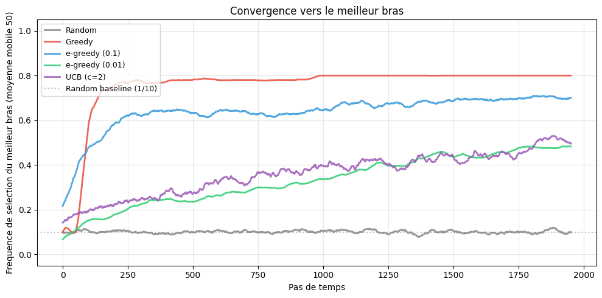
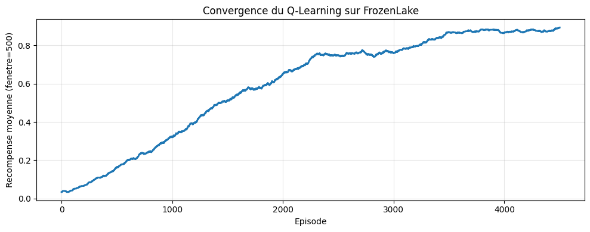
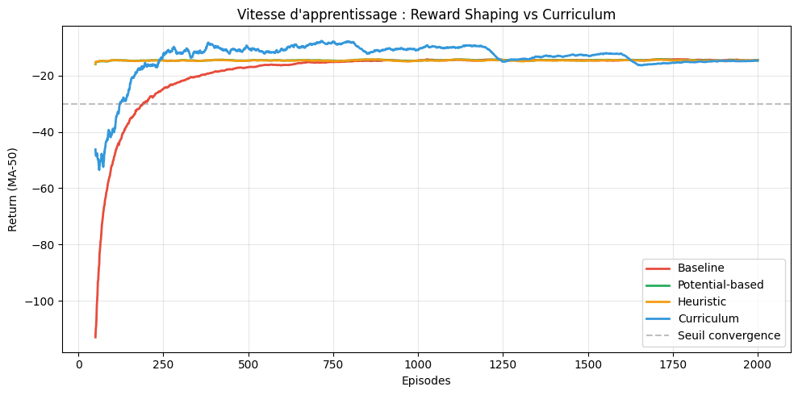
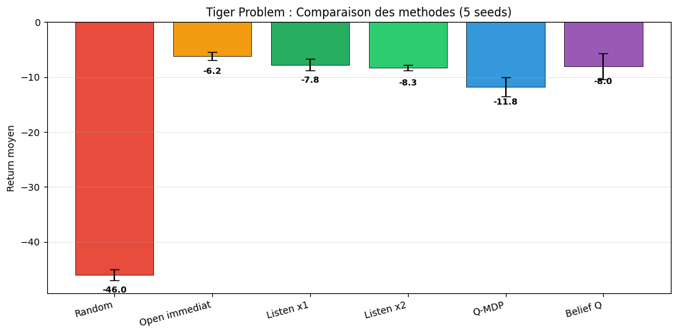
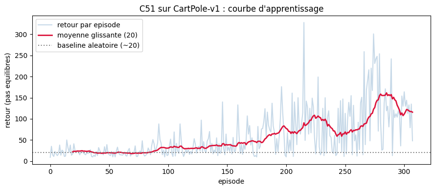
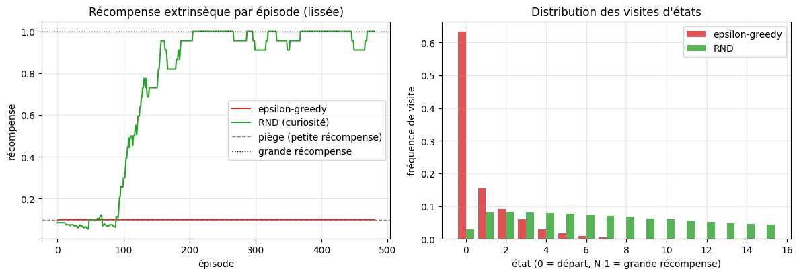

# RL - Reinforcement Learning

[← Notebooks](../README.md) | [↑ ..](../README.md) | [→ GameTheory](../GameTheory/README.md)

<!-- CATALOG-STATUS
series: RL
pedagogical_count: 38
breakdown: root=27, PostTraining=11
maturity: BETA=33, ALPHA=3, DRAFT=2
-->

Comment un agent apprend-il à décider quand personne ne lui donne la bonne réponse ? Le reinforcement learning (apprentissage par renforcement) répond par l'essai et l'erreur : l'agent agit, observe la conséquence de son action, et ajuste sa politique. C'est le paradigme derrière AlphaGo, le contrôle de robots, et l'alignement des modèles de langue par retour humain.

## Introduction

Le RL est la branche de l'IA qui apprend à un agent à prendre des décisions optimales par l'expérience, en recevant des récompenses ou des pénalités de son environnement. Là où l'apprentissage supervisé prédit à partir d'exemples étiquetés et l'apprentissage non supervisé découvre des structures, le RL **agit** : il choisit des actions, observe leurs conséquences, et s'améliore itérativement.

La série couvre les **fondements théoriques** (bandits, MDP, équation de Bellman, Q-Learning), les **algorithmes avec réseaux de neurones** (DQN, Policy Gradient, A2C, PPO, SAC, GRPO) et les **frameworks de production** (Stable Baselines3, `trl`). Elle commence par entraîner un agent en quelques lignes avec un framework industriel, puis implémente les mêmes algorithmes depuis zéro pour montrer ce qui se cache sous le capot — et confronte les deux sur les mêmes mondes, à budget égal.

**À qui s'adresse cette série** : étudiants en IA, développeurs souhaitant ajouter des capacités décisionnelles à leurs applications, et chercheurs en automatique ou en robotique. Prérequis : Python intermédiaire et bases en calcul différentiel. Aucune expérience préalable du RL n'est nécessaire pour ouvrir le premier carnet.

**Note de frontière — algorithmes online.** Deux carnets d'algorithmique online ont longtemps vécu dans cette série : ils relèvent de l'**analyse compétitive** (garanties de pire cas contre l'optimum offline, sans boucle d'apprentissage) plutôt que du RL stricto sensu. Ils sont désormais rangés dans la série [Complexity](../Complexity/README.md), comme lettres **04c** (k-server, work function) et **04d** (secrétaire matroïdal) de la marche 04, qui les présente dans son fil.

## Objectifs d'apprentissage

À l'issue de la série, vous saurez :

**Techniques** — formaliser un problème de décision séquentielle (bandit, MDP, POMDP) et le résoudre aussi bien exactement (value et policy iteration) qu'approximativement ; implémenter depuis zéro les algorithmes à réseaux de neurones (DQN, REINFORCE, A2C, PPO, SAC, GRPO) et les confronter à leur implémentation de référence sur le même monde ; composer la décision sous information incomplète (belief tracking, distributional C51, curiosité RND, options hiérarchiques) et mesurer empiriquement ce que chaque hypothèse coûte.

**Méthodologiques** — lire un résultat d'apprentissage pour ce qu'il est : comparer plusieurs graines plutôt qu'une courbe, distinguer un écart qui tient (test apparié, intervalle de confiance) d'une intuition, et documenter honnêtement un verdict négatif ou non concluant ; confronter un harnais du marché (Stable Baselines3, `trl`) à une boucle écrite à la main à budget égal, en nommant ce que le harnais apporte et ce qu'il coûte.

**Applicatifs** — choisir un algorithme selon l'espace d'actions, l'accès à l'interaction et l'observabilité du problème ; apprendre sans interagir quand l'exploration est impossible ou dangereuse (RL offline) ; aligner un petit modèle de langue sur des préférences (reward model Bradley-Terry, PPO-RLHF, GRPO, DPO) et reconnaître les formes de reward hacking.

## Notebooks

Les kernels sont relevés dans les carnets eux-mêmes (`metadata.kernelspec.name`) : `python3` pour l'immense majorité, `coursia-ml-training` pour les carnets qui entraînent un modèle de langue. Les durées sont des ordres de grandeur pour une lecture active, exercices compris.

> **Note de comptage.** Le bloc `CATALOG-STATUS` ci-dessus fait foi pour l'**agrégat** — il est régénéré par `catalog-cron.yml` et ne se corrige jamais à la main sur une branche de feature. La table ci-dessous fait foi pour l'**énumération**. Leurs totaux peuvent donc différer d'une unité, et cet écart ne se tranche ni ici ni par une retouche du marqueur : il se lit dans la prochaine régénération du catalogue.

| # | Notebook | Kernel | Contenu | Durée |
|---|----------|--------|---------|-------|
| 01 | [RL-01-Premiers-Pas-Stable-Baselines3-Python](RL-01-Premiers-Pas-Stable-Baselines3-Python.ipynb) | python3 | Premier agent PPO sur CartPole avec Stable Baselines3 : boucle reset/step, évaluation avant/après, sauvegarde du modèle. L'usage avant la théorie | 25-30 min |
| 01b | [RL-01b-Synthese-Logique-Bitwise-Python](RL-01b-Synthese-Logique-Bitwise-Python.ipynb) | python3 | Synthèse logique d'un contrôleur CartPole : lire le bit de signe IEEE-754 de l'observation, en tirer un contrôleur à quatre règles, le confronter au PPO appris (taux de désaccord), étude de rupture et ablation | 20-25 min |
| 01c | [RL-01c-Distillation-Politique-Prolog-Python](RL-01c-Distillation-Politique-Prolog-Python.ipynb) | python3 | Distiller une politique PPO en programme Prolog exécuté par le vrai moteur SWI-Prolog (image Docker officielle, version journalisée dans la sortie) : enseignant PPO à graine fixe, recensement exhaustif de T-bar, induction gloutonne type FOIL, liste de décision avec cuts, one-pass contre DAgger | 45-60 min |
| 02 | [RL-02-Wrappers-Sauvegarde-Callbacks-Python](RL-02-Wrappers-Sauvegarde-Callbacks-Python.ipynb) | python3 | Outils de production : wrappers Gym, sauvegarde et chargement de modèles, multiprocessing, callbacks de suivi, environnement personnalisé | 35-40 min |
| 03 | [RL-03-Experience-Replay-HER-Python](RL-03-Experience-Replay-HER-Python.ipynb) | python3 | Hindsight Experience Replay sur `parking-v0` : ré-étiqueter des échecs en succès par changement d'objectif, avec SAC et DDPG comme moteurs off-policy | 40-45 min |
| 04 | [RL-04-Bandits-Manchots-Python](RL-04-Bandits-Manchots-Python.ipynb) | python3 | Bandit à K bras Bernoulli : epsilon-greedy et ses décroissances, UCB, Thompson Sampling, regret cumulé comparé au tirage uniforme | 30-35 min |
| 05 | [RL-05-MDP-Programmation-Dynamique-Q-Learning-Python](RL-05-MDP-Programmation-Dynamique-Q-Learning-Python.ipynb) | python3 | Formalisation MDP, équation de Bellman, value et policy iteration exactes, puis Q-Learning tabulaire et ses variantes (SARSA, expected, n-step) sur FrozenLake et CliffWalking | 45-50 min |
| 06 | [RL-06-DQN-Policy-Gradient-Python](RL-06-DQN-Policy-Gradient-Python.ipynb) | python3 | DQN complet en PyTorch pur (replay buffer, target network) et REINFORCE, sur le même environnement : la comparaison off-policy / on-policy | 50-55 min |
| 06b | [RL-06b-Actor-Critic-Python](RL-06b-Actor-Critic-Python.ipynb) | python3 | A2C : critic, avantage, bonus d'entropie, réduction de variance par rapport à REINFORCE, et ouverture vers PPO | 45-50 min |
| 06c | [RL-06c-PPO-Depuis-Zero-Python](RL-06c-PPO-Depuis-Zero-Python.ipynb) | python3 | PPO depuis zéro : ratios d'échantillonnage d'importance, surrogate clippé, GAE, comparaison A2C contre PPO, et pont vers le RLHF | 45-50 min |
| 06d | [RL-06d-SAC-Depuis-Zero-Python](RL-06d-SAC-Depuis-Zero-Python.ipynb) | python3 | SAC depuis zéro : maximum entropy, twin Q-networks, auto-température, politique gaussienne pour les actions continues | 45-50 min |
| 06e | [RL-06e-GRPO-Depuis-Zero-Python](RL-06e-GRPO-Depuis-Zero-Python.ipynb) | python3 | GRPO depuis zéro : avantage relatif intra-groupe sans critic, clip PPO et pénalité KL contre la référence, portefeuille synthétique multi-graines | 45-50 min |
| 06f | [RL-06f-SAC-Reel-Comparaison-Python](RL-06f-SAC-Reel-Comparaison-Python.ipynb) | python3 | SAC réel avec Stable-Baselines3 : même environnement Pendulum-v1 que le jouet RL-06d, trois graines, évaluation déterministe, et comparaison chiffrée des deux étages (paramètres appris, budget de pas, temps mural, reward final) | 30-35 min |
| 07 | [RL-07-Apprentissage-Multi-Agent-Python](RL-07-Apprentissage-Multi-Agent-Python.ipynb) | python3 | Apprentissage multi-agent avec PettingZoo : API AEC, apprentissage indépendant (IQL) sur des jeux coopératifs, auto-jeu sur TicTacToe | 45-50 min |
| 07b | [RL-07b-Sur-Generalisation-Climbing-Game-Python](RL-07b-Sur-Generalisation-Climbing-Game-Python.ipynb) | python3 | Sur-généralisation relative dans le Climbing Game : même agent tabulaire, IQL contre Hysteretic Q-learning, protocole multi-graines, IQM et intervalle bootstrap, ablation du pessimisme | 40-45 min |
| 08 | [RL-08-Dyna-Q-Planification-Python](RL-08-Dyna-Q-Planification-Python.ipynb) | python3 | Model-based : apprendre un modèle du monde et planifier dessus (Dyna-Q, Dyna-Q+, rollouts), Blocking Maze, et porte ouverte vers MCTS puis AlphaZero | 45-50 min |
| 09 | [RL-09-RL-Offline-Behavior-Cloning-Python](RL-09-RL-Offline-Behavior-Cloning-Python.ipynb) | python3 | RL offline : behavior cloning, erreur d'extrapolation du Q-learning naïf, contrainte de support (BCQ-lite), pont vers RLHF et DPO | 50-55 min |
| 10 | [RL-10-Reward-Shaping-Curriculum-Python](RL-10-Reward-Shaping-Curriculum-Python.ipynb) | python3 | Récompense sparse : shaping potential-based (Ng et al. 1999) contre shaping naïf, curriculum par phases, et ce que le shaping enseigne du reward model appris | 45-50 min |
| 11 | [RL-11-POMDP-Croyances-Python](RL-11-POMDP-Croyances-Python.ipynb) | python3 | Observabilité partielle : Tiger Problem, suivi de croyance par filtre bayésien, approximation Q-MDP, et les limites du tabulaire sur un état caché | 45-50 min |
| 12 | [RL-12-Distributional-RL-C51-Python](RL-12-Distributional-RL-C51-Python.ipynb) | python3 | RL distributionnel : C51 depuis zéro, distribution du retour sur support à atomes fixes, projection catégorielle de la cible de Bellman, politique sensible au risque (CVaR) | 50-55 min |
| 13 | [RL-13-Curiosite-RND-Python](RL-13-Curiosite-RND-Python.ipynb) | python3 | Exploration profonde par curiosité : Random Network Distillation, cible figée contre prédicteur, bonus de nouveauté, et le piège d'exploitation qu'elle fait sortir | 35-40 min |
| 14 | [RL-14-RL-Hierarchique-Options-Python](RL-14-RL-Hierarchique-Options-Python.ipynb) | python3 | Abstraction temporelle : options `(I, π, β)` de Sutton, Precup et Singh, gridworld à quatre pièces, crédit sur longue horizon, formalisme semi-MDP enseigné sur place | 50 min |
| 15 | [RL-15-GRPO-Comparatif-Multi-Graines-Python](RL-15-GRPO-Comparatif-Multi-Graines-Python.ipynb) | python3 | GRPO contre PPO sur CartPole-v1 : avantage relatif intra-groupe contre GAE bootstrappé, six graines appariées, verdict tri-conditionnel (seuil à deux écarts-types, Wilcoxon apparié, intervalle bootstrap des différences). **Verdict du run committé : PPO devant GRPO** (six graines sur six, p = 0,0312) ; portée et limites documentées dans le carnet. Exige un GPU CUDA | 40-45 min |
| 16 | [RL-16-Dream-RSI-Python](RL-16-Dream-RSI-Python.ipynb) | python3 | Exploration explicite et programmable (la politique est du code), historique de découverte utilisé comme simulateur-replay, évaluation off-policy à coût nul, boucle d'auto-amélioration avec incumbent ; monde jouet circle-packing en bibliothèque standard, ablation replay brut contre guidance sémantique | 40-45 min |
| 19 | [RL-19-Reward-Tampering-Python](RL-19-Reward-Tampering-Python.ipynb) | python3 | Du specification gaming au reward tampering : *Rocks and Diamonds* à paramètre modifiable (Everitt et al. 2021), quatre agents résolus par induction arrière exacte, et la mesure qui compte — l'indifférence n'est pas la protection, le départage des égalités suffit à déclencher la manipulation | 35-40 min |
| 20 | [RL-20-Randomisation-Domaine-Sim-to-Real-Python](RL-20-Randomisation-Domaine-Sim-to-Real-Python.ipynb) | python3 | Du simulateur au réel : les paramètres physiques de `CartPole-v1` modifiés pour de vrai (`masscart`, `masspole`, `length`, `gravity`, `tau`), trois régimes de test — nominal, interpolation, extrapolation — et la question de transfert qu'ils posent | 40-45 min |
| 21 | [RL-21-Auto-Jeu-AlphaZero-Python](RL-21-Auto-Jeu-AlphaZero-Python.ipynb) | python3 | Auto-jeu à la AlphaZero sur CPU (Puissance 4 réduit) : MCTS guidé par réseau (PUCT, valeur du réseau au lieu de rollouts), cibles politiques prises sur les distributions de visites, deux têtes politique/valeur, tournoi round-robin à budget égal — la boucle fermée fonctionne, l'avantage du guidage demande des budgets plus élevés | 10 min |
| pt-00 | [RLPT-00-Reward-Model-Bradley-Terry-Python](PostTraining/RLPT-00-Reward-Model-Bradley-Terry-Python.ipynb) | python3 | Reward model from scratch : apprendre `r(x, y)` depuis des paires de préférences (Bradley-Terry), sans `trl` ; évaluation contre le plafond de Bayes, calibration (ECE), identification affine, multi-graines. C'est de ce monde que partent les carnets suivants | 35-40 min |
| pt-00b | [RLPT-00b-Biais-Dataset-Preferences-Python](PostTraining/RLPT-00b-Biais-Dataset-Preferences-Python.ipynb) | python3 | Biais d'un dataset de préférences : trois biais classiques (longueur, position, annotateur) injectés à paramètres connus, dégât mesuré contre le plafond d'un juge oracle non biaisé, puis les mitigations usuelles — verdict mesuré : aucune ne franchit deux écarts-types, le length-controlled est structurellement sans effet sur une métrique de classement, l'orthogonalisation de longueur aggrave le biais | 40-45 min |
| pt-00c | [RLPT-00c-Anatomie-Reward-Hacking-Python](PostTraining/RLPT-00c-Anatomie-Reward-Hacking-Python.ipynb) | coursia-ml-training | Anatomie d'un reward hacking qui **prend** : reward model biaisé en longueur, PPO from scratch sur ce proxy, puis bras de contrôle (récompense longueur-contrôlée, oracle) qui isole la cause. Diagnostic par canal et normalisation par canal : l'arbitrage, pas la chirurgie | 35-40 min |
| pt-00d | [RLPT-00d-Reward-Trainer-TRL-Python](PostTraining/RLPT-00d-Reward-Trainer-TRL-Python.ipynb) | python3 | Le même problème que RLPT-00 traité par `trl.RewardTrainer` : monde, juge, architecture et graines identiques, une seule variable — le harnais. Documente les exigences de contrat non devinables et la traduction des paires ; verdict mesuré : `trl` devance la boucle maison pour un coût en temps d'un ordre de grandeur, et n'évalue pas pour vous | 35-40 min |
| pt-00e | [RLPT-00e-DPO-TRL-Python](PostTraining/RLPT-00e-DPO-TRL-Python.ipynb) | python3 | `trl.DPOTrainer` contre DPO from scratch et reward model explicite, sur le même monde et les mêmes paires, à budget égal : multi-graines départagé au plafond de Bayes — DPO maison et `trl` indiscernables, la différence robuste est le coût fixe de la pile | 25-35 min |
| pt-00f | [RLPT-00f-GRPO-TRL-contre-PPO-Maison-Python](PostTraining/RLPT-00f-GRPO-TRL-contre-PPO-Maison-Python.ipynb) | python3 | `trl.GRPOTrainer` contre le PPO maison de RLPT-01 sur le même monde et le même juge, à budget apparié : verdict non concluant, et la différence robuste est le critic (réseau de valeur appris contre moyenne de groupe). Inclut le fait mesuré dans l'environnement : `PPOTrainer` a quitté la racine de `trl` pour `trl.experimental.ppo` | 30-45 min |
| pt-00g | [RLPT-00g-PPO-TRL-Experimental-Python](PostTraining/RLPT-00g-PPO-TRL-Experimental-Python.ipynb) | python3 | `trl.experimental.ppo.PPOTrainer` instancié comme surface réelle, signature introspectée, boucle PPO conforme (rollout, GAE, surrogate clippé, perte de valeur) : la mini-tâche ne se branche pas directement sur le trainer, la limite est documentée et l'algorithme reste celui que TRL enveloppe. Complément de RLPT-00f sur l'axe RLHF | 30-40 min |
| pt-01 | [RLPT-01-PPO-RLHF-Petit-Modele-Python](PostTraining/RLPT-01-PPO-RLHF-Petit-Modele-Python.ipynb) | python3 | PPO pour l'alignement d'un petit modèle de langue (RLHF jouet, from scratch, char-level) : reward model jouet, pénalité KL contre la politique SFT de référence, multi-graines — la signature RLHF, distincte de RL-06c et RL-06e | 40-45 min |
| pt-02 | [RLPT-02-GRPO-Minimal-Python](PostTraining/RLPT-02-GRPO-Minimal-Python.ipynb) | coursia-ml-training | GRPO sur Qwen3.5-0.8B local, récompense vérifiable par programme (arithmétique), rollouts groupés sans réseau de valeur : le cœur « à la DeepSeek » écrit à la main, sans la pile `trl` complète | 45-55 min |
| pt-03 | [RLPT-03-Reward-Hacking-Python](PostTraining/RLPT-03-Reward-Hacking-Python.ipynb) | coursia-ml-training | Reward hacking sur récompense vérifiable faillible : trois voies pour tenter de déclencher le hack, détection, inoculation comme variable expérimentale, verdict reproductible à graine fixée | 35-40 min |
| pt-04 | [RLPT-04-DPO-Offline-contre-GRPO-Online-Python](PostTraining/RLPT-04-DPO-Offline-contre-GRPO-Online-Python.ipynb) | coursia-ml-training | DPO offline contre GRPO online sur la même tâche conversationnelle, à budget égal, préférences auto-fabriquées : verdict multi-graines avec test de Diebold-Mariano et dispersion inter-graines documentée | 50-55 min |

Les carnets `RL-17` et `RL-18` n'existent plus dans cette série : ce sont désormais `Complexity-04c` et `Complexity-04d`, décrits plus haut.

## Contenu détaillé du parcours principal

Les carnets du socle (01 à 13) sont détaillés ci-dessous, section par section, avec les figures extraites de leurs sorties réelles — la provenance exacte de chaque figure (cellule source, poids, alt-text) est consignée dans [`assets/readme/MANIFEST.md`](assets/readme/MANIFEST.md). Les carnets 14 à 21 et la sous-série `PostTraining/` sont décrits dans la table ci-dessus.
### Notebook 1 - Introduction avec PPO et CartPole

| Section | Contenu |
|---------|---------|
| Stable Baselines3 | Installation, API de base |
| CartPole-v1 | Environnement classique, actions discrètes |
| PPO | Proximal Policy Optimization |
| Workflow | Training, Évaluation, Video recording |

### Notebook 2 - Fonctionnalités avancées

| Section | Contenu |
|---------|---------|
| Wrappers Gym | Modification d'environnements |
| Sauvegarde | Save/Load de modèles |
| Multiprocessing | DummyVecEnv, SubprocVecEnv |
| Callbacks | Monitoring, checkpoints automatiques |
| Environnements custom | Création et validation (check_env) |

### Notebook 3 - Experience Replay et HER

| Section | Contenu |
|---------|---------|
| HER | Hindsight Experience Replay |
| Goal-conditioned RL | Tâches avec objectifs |
| Parking-v0 | Environnement highway-env |
| SAC / DDPG | Algorithmes off-policy avec HER |
| Replay buffers | Sauvegarde et chargement |

### Notebook 4 - Bandits Manchots et Exploration

| Section | Contenu |
|---------|---------|
| Multi-armed bandit | Problème fondamental exploration vs exploitation |
| Stratégies naïves | Aléatoire, greedy, epsilon-greedy |
| Stratégies intelligentes | Decaying epsilon-greedy, Thompson Sampling |
| Analyse | Comparaison regret, visualisation des estimations |

<em>Sortie d'exécution du notebook 4 — convergence vers le meilleur bras : sur cet horizon de 2000 pas, Greedy monte vite vers ~80% de sélections correctes, epsilon-greedy(0.1) se stabilise vers ~70%, tandis qu'epsilon-greedy(0.01) et UCB(c=2) progressent encore (~50%) ; la politique aléatoire reste à la baseline 1/10.</em>

### Notebook 5 - MDP, Programmation Dynamique et Q-Learning

| Section | Contenu |
|---------|---------|
| MDP | Formalisation $(S, A, P, R, \gamma)$, transitions |
| Value Iteration | Équation de Bellman, convergence |
| Policy Iteration | Évaluation + amélioration de politique |
| Q-Learning tabulaire | Apprentissage model-free, $\varepsilon$-greedy |
| FrozenLake / CliffWalking | Environnements discrets |

<em>Sortie d'exécution du notebook 5 — le Q-Learning tabulaire converge sur FrozenLake : la récompense moyenne lissée passe de 0 à ~0.9, signe que la politique apprise atteint l'objectif dans la grande majorité des épisodes.</em>

### Notebook 6 - DQN et Policy Gradient

| Section | Contenu |
|---------|---------|
| Q-Network | Approximation par réseau de neurones |
| Replay Buffer | Experience replay, décorrélation |
| Target Network | Stabilisation de l'apprentissage |
| REINFORCE | Gradient de politique, baseline |
| Comparaison | Value-based vs policy-based |

### Notebook 6b - Actor-Critic (A2C)

| Section | Contenu |
|---------|---------|
| Actor-Critic | Paradigme combinant value-based et policy-based |
| CriticNetwork | Réseau de valeur V(s) |
| ActorNetwork | Politique paramétrée pi(a\|s) |
| A2C | Advantage Actor-Critic, calcul de l'avantage |
| Entropy bonus | Exploration via maximisation d'entropie |
| Comparaison | A2C vs REINFORCE (réduction de variance) |

### Notebook 6c - PPO depuis zéro

| Section | Contenu |
|---------|---------|
| Clipped surrogate | Ratio de probabilité, objectif clippé, visualisation |
| PPO Agent | Implémentation complète avec mini-lots et epochs |
| GAE | Generalized Advantage Estimation (lambda=0.95) |
| Comparaison | PPO vs A2C (stabilité, efficacité d'échantillonnage) |

### Notebook 6d - SAC depuis zéro

| Section | Contenu |
|---------|---------|
| Maximum Entropy RL | Objectif avec bonus d'entropie, exploration automatique |
| Gaussian Policy | Politique stochastique avec tanh squashing |
| Twin Q-Networks | Double critique pour réduire la surestimation |
| Auto-température | Température alpha apprise automatiquement |
| Reparameterization | Trick pour gradient dans l'action |
| Pendulum-v1 | Environnement continu de référence |

### Notebook 6e - GRPO depuis zéro

| Section | Contenu |
|---------|---------|
| Avantage relatif sans critic | Group Relative Policy Optimization (DeepSeek-R1), baseline de groupe au lieu d'un réseau critique |
| Portfolio synthétique | Environnement auto-contenu, signal de récompense reproductible multi-seed |
| Actor seul | Réseau de politique unique sans critic (contrairement à PPO/A2C/SAC) |
| Mise à jour GRPO | Avantage intra-groupe + clip PPO + pénalité KL vs politique de référence |
| Boucle multi-seed | Entraînement multi-seed, verdict de stabilité |
| GRPO vs PPO/SAC | Ce que change le paradigme sans critic |

### Notebook 6f - SAC réel (Stable-Baselines3)

| Section | Contenu |
|---------|---------|
| L'étage réel | SAC de Stable-Baselines3 sur `Pendulum-v1`, le même environnement que le jouet `RL-06d`, trois graines |
| Protocole déclaré | 12 000 pas d'environnement, évaluation tous les 4 000 pas, politique déterministe sur 10 épisodes — l'évaluation n'est pas celle du jouet, qui lit la moyenne des derniers épisodes d'entraînement en politique stochastique |
| Ce que la comparaison établit | 336 646 paramètres appris contre 13 636 pour le jouet, 230.1 s de temps mural au maximum par graine, 18.39 s / 1000 pas |
| Ce qu'elle n'établit pas | Le coût pour atteindre un niveau : les seuils sont franchis dès le premier point d'évaluation, la mesure est impossible et le carnet le dit. Le reward final ne sépare pas les deux étages |
| Exercices | Température fixe contre température apprise, environnements vectorisés, récompense parcimonieuse avec `HerReplayBuffer` |
| Ponts | `RL-02` (wrappers, callbacks), `RL-03` (HER), `RL-01` (premiers pas SB3), `RLPT-02`, `RL-15` |

### Notebook 7 - Apprentissage Multi-Agent

| Section | Contenu |
|---------|---------|
| Multi-Agent RL | Paradigmes (coopératif, compétitif, mixte) |
| PettingZoo | API AEC, environnements multi-agent |
| IQL | Independent Q-Learning |
| TicTacToe | Jeu à somme nulle, équilibre |
| Self-play | Entraînement agent contre agent |

### Notebook 8 - Model-Based RL : Dyna-Q et planification

| Section | Contenu |
|---------|---------|
| Model-free vs model-based | Compromis calcul vs expérience, sample efficiency |
| Modèle du monde | Apprentissage tabulaire des transitions (s,a) -> (r,s') |
| Dyna-Q | Q-Learning + planification sur expérience simulée (Sutton & Barto ch. 8) |
| Blocking Maze / Dyna-Q+ | Environnement changeant, bonus d'exploration kappa*sqrt(tau) |
| Decision-time planning | Rollouts, pont vers MCTS / AlphaZero / MuZero |
| Exercices | Shortcut Maze, prioritized sweeping, sensibilité de kappa |

### Notebook 9 - RL offline : apprendre sans interagir

| Section | Contenu |
|---------|---------|
| Online vs offline | Apprendre d'un dataset figé de transitions (logs), sans interaction |
| Datasets | Trois politiques de comportement (expert/medium/random), couverture vs qualité |
| Behavior Cloning | Imitation tabulaire par action majoritaire, plafond de la politique de comportement |
| Erreur d'extrapolation | Q-learning naïf sur dataset figé : bootstrap sur actions fantômes (Fujimoto 2019) |
| BCQ-lite | Contrainte de support du dataset, stitching de trajectoires médiocres |
| Pont RLHF/DPO | SFT = BC, contrainte KL = contrainte de support, DPO = preference learning offline |
| Exercices | Ablation taille dataset, pénalité CQL-lite, sensibilité au nombre de passes |

### Notebook 10 - Reward Shaping et Curriculum Learning

| Section | Contenu |
|---------|---------|
| Labyrinthe sparse | Maze 8x8, reward -1/pas et 0 au but, distance Manhattan = 14 |
| Potential-based shaping | Théorème Ng et al. 1999, $F(s,s') = \gamma\Phi(s') - \Phi(s)$, politique invariante |
| Heuristic shaping | Bonus naïf pour se rapprocher du but, sans garantie théorique |
| Curriculum learning | Phases de difficulté croissante, start de plus en plus éloigné |
| Comparaison | Vitesse de convergence (potential : ep 50, curriculum : ep 122, baseline : ep 190) |
| Pont RLHF | Reward model appris, contrainte KL, DPO, inverse RL |
| Exercices | Ablation potentiels, phases curriculum, biais du shaping naïf |

<em>Sortie d'exécution du notebook 10 — potential-based et heuristique atteignent le seuil MA-50 ≥ -30 dès l'épisode 50, le curriculum à l'épisode 122, la baseline à l'épisode 190 (cellule Comparaison du notebook) ; les quatre courbes rejoignent ensuite le même plateau (~-15).</em>

### Notebook 11 - POMDP : Partial Observability et Belief Tracking

| Section | Contenu |
|---------|---------|
| Tiger Problem | POMDP classique (Cassandra 1994), 2 états, 3 actions, observations bruitées à 85% |
| Politiques baselines | Random, open immediately, listen N fois puis ouvre, vote majoritaire |
| Belief tracking | Filtre bayésien sur P(tiger-left), mise à jour après observation |
| Q-MDP approximation | Q-learning sur états vrais, sélection via expected Q sous belief |
| Belief-state Q-learning | Discrétisation du belief en 20 bins, Q-learning dans l'espace des croyances |
| Comparaison | 5 seeds, impact de la précision d'observation, pont DRQN/PPO+LSTM |
| Exercices | Impact précision, nombre optimal d'écoutes, Tiger 3 portes |

<em>Sortie d'exécution du notebook 11 — récompense moyenne par méthode sur le Tiger Problem (5 seeds) : agir au hasard est catastrophique (-46.0), toutes les politiques informées — ouverture immédiate, écoutes fixes, Q-MDP, Q-Learning sur croyance discrétisée — se tiennent entre -6.2 et -11.8.</em>

### Notebook 12 - RL distributionnel : C51 (Categorical DQN)

| Section | Contenu |
|---------|---------|
| Du scalaire à la distribution | Pourquoi apprendre $Z(s,a)$ tout entière plutôt que sa seule espérance $Q = \mathbb{E}[Z]$ ; support catégoriel à 51 atomes fixes |
| Bellman distributionnel | Opérateur $TZ = R + \gamma Z(s',a^*)$, problème du déplacement hors-grille, projection catégorielle $\Phi$ |
| Réseau `CategoricalDQN` | Sorties softmax par action, reconstruction de $Q(s,a) = \sum_i z_i p_i$ |
| Perte | Entropie croisée entre cible projetée et distribution prédite |
| Entraînement CartPole-v1 | ~18 000 pas, courbe d'apprentissage, visualisation de la distribution de retour apprise par action |
| C51 vs DQN | Tableau comparatif, lignée QR-DQN / IQN / Rainbow |
| Exercices | QR-DQN (quantile regression), sensibilité du support, politique sensible au risque (CVaR) |

<em>Sortie d'exécution du notebook 12 — l'agent C51 (Categorical DQN, 51 atomes) dépasse nettement la baseline aléatoire sur CartPole-v1 : la moyenne glissante monte jusqu'à ~160 sur cet entraînement court (~300 épisodes), sans atteindre le plafond de 500 de l'environnement.</em>

### Notebook 13 - Exploration par curiosité : Random Network Distillation (RND)

| Section | Contenu |
|---------|---------|
| Exploration profonde | Pourquoi l'aléa (epsilon-greedy) échoue dès que la récompense est parcimonieuse |
| Motivation intrinsèque | Bonus de nouveauté $r = r^e + \beta\,r^i$, exploration dirigée vers l'inexploré |
| Mécanisme RND | Cible aléatoire figée + prédicteur entraîné ; erreur de prédiction = nouveauté (Burda et al. 2018) |
| Partie A - détecteur de nouveauté | Jouet 2D, carte de nouveauté, ratio inconnu/visité ~1969x |
| Partie B - piège d'exploitation | Chaîne MDP : epsilon-greedy plafonne sur le piège (~0.10), RND atteint la grande récompense (~0.96) |
| Comparaison | RND vs comptage tabulaire / pseudo-comptage / ICM, problème de la noisy-TV, réglage du taux du prédicteur |
| Exercices | Effet de beta, normalisation du bonus intrinsèque (Welford), limites de la curiosité (longueur de chaîne) |

<em>Sortie d'exécution du notebook 13 — exploration par curiosité sur le benchmark chaîne-piège (Burda et al. 2018) : RND atteint la grande récompense distale là où epsilon-greedy plafonne sur l'appât proximal. Le ratio inconnu/visité initial (~1969x) chute à mesure que le prédicteur RND est entraîné.</em>

## Parcours de progression

Les carnets à numéro nu forment le socle ; les lettres (`01b`, `06c`, `07b`…) sont des spécialisations d'une marche, et la sous-série `PostTraining/` prolonge la lignée vers les modèles de langue. La numérotation suit l'ordre d'accrétion historique : elle n'est pas toujours l'ordre de lecture, et les trois cas où elle le contredit sont signalés plus bas.

| Phase | Carnets | Ce que la phase installe |
|---|---|---|
| 1. Un framework d'abord | 01, 02 | Entraîner, évaluer, sauvegarder un agent sans écrire d'algorithme : la boucle d'interaction et l'outillage de production |
| 2. Une tâche à objectif | 03 | Ré-étiqueter les échecs en succès (HER) et découvrir qu'un moteur off-policy est nécessaire pour cela |
| 3. Le socle tabulaire | 04, 05 | Le compromis exploration/exploitation, puis le formalisme MDP et les algorithmes exacts avant l'approximation |
| 4. Le deep, depuis zéro | 06, 06b, 06c, 06d, 06e, 06f | La lignée continue : DQN et REINFORCE, A2C, PPO, SAC, GRPO, puis l'étage réel en bibliothèque (SB3) — chaque marche répare une limite nommée de la précédente |
| 5. Familles et hypothèses | 07, 07b, 08, 09, 10, 11, 12, 13, 14 | Autant de façons de relâcher une hypothèse du socle : plusieurs agents, un modèle du monde, un jeu de données figé, un signal rare, une observation partielle, une distribution de retour, une récompense intrinsèque, un horizon long |
| 6. Frontières et recherche | 15, 16, 19, 20, 21 | Comparer rigoureusement deux algorithmes, sortir du cadre MDP standard, et mesurer ce que valent les garanties théoriques |
| Sous-série PostTraining | RLPT-00 → 04 | Transposer le RL à l'alignement des modèles de langue : reward model, PPO-RLHF, GRPO, DPO, reward hacking |

Les accrétions de l'entrée (`01b` synthèse logique bitwise, `01c` distillation en Prolog) peuvent se lire juste après `01` : elles n'exigent rien de plus que le PPO de ce carnet, et montrent le pont entre RL et raisonnement symbolique.

**Trois dépendances qui remontent la numérotation**, à connaître avant de composer un parcours :

- `RL-03` instancie SAC et DDPG, qui sont enseignés en `RL-06d`. Pour un parcours strictement linéaire, lire `03` après `06d` ; sinon, `03` s'aborde comme une démonstration d'usage.
- `RLPT-00` reprend « le monde de `RLPT-01` » : ce n'est donc pas le point d'entrée de la sous-série, malgré son numéro. Commencer par `RLPT-01` si l'on veut construire le reward model sur un monde déjà connu, ou par `RLPT-00` si l'on veut précisément voir l'étage que `RLPT-01` code en dur.
- `RLPT-00c` s'appuie sur `RLPT-03` (un hack qui ne prend pas) et `RLPT-00e` sur `RLPT-04` (DPO from scratch) : les deux se lisent après ces carnets.

**Profils de progression**, selon le temps disponible et l'objectif :

| Profil | Carnets | Pour quoi faire |
|---|---|---|
| Découverte | 01 | Voir un agent apprendre, en une séance |
| Fondations par la pratique | 01, 02, 03, 04 | Savoir entraîner et instrumenter un agent sur des problèmes jouets |
| Théorie et algorithmes | 04, 05, 06, 06b, 06c | Comprendre Bellman, puis dériver PPO à la main |
| Couverture du socle | 01 à 14 | Le socle complet, lettres comprises ; les carnets 15 à 21 sont les phases de recherche, listées à la ligne suivante |
| Alignement par préférences | 06e, RLPT-01, RLPT-00, RLPT-04 | La chaîne complète du RLHF, du reward model au DPO |
| Recherche | 08, 12, 13, 14, 15, 16, 19, 20, 21 | Les carnets où chaque hypothèse est relâchée et mesurée |

## Prérequis & environnement

| Kernel | Carnets | Environnement | Packages | Clés |
|---|---|---|---|---|
| `python3` | Tous les autres | Python 3.11 à 3.13 selon le carnet (relevé dans les `language_info`), CPU suffisant | `stable-baselines3[extra]`, `gymnasium`, `torch`, `highway-env`, `pettingzoo[classic]`, `trl`, `transformers`, `datasets` | Aucune : tout s'exécute en local |
| `coursia-ml-training` | RLPT-00c, RLPT-02, RLPT-03, RLPT-04 | Kernel d'entraînement du dépôt, modèle de langue local | Les mêmes, plus la pile d'entraînement du kernel | Aucune |

Connaissances attendues : Python intermédiaire (classes, NumPy) ; notions de tenseurs et d'autograd pour les carnets `06` à `06f` et la sous-série ; probabilités élémentaires pour `04` et `11`.

Trois carnets ont une exigence propre, écrite dans leur en-tête : `RL-01c` demande **Docker** (le programme Prolog est exécuté par le vrai moteur SWI-Prolog, et la version du moteur est journalisée dans la sortie) ; `RL-15` demande un **GPU CUDA** ; `RLPT-02` et `RLPT-04` chargent un petit modèle de langue et demandent de la mémoire plutôt que du calcul.

L'installation détaillée, avec les versions épinglées, vit dans [`requirements.txt`](requirements.txt) et dans la première cellule de chaque carnet — elle n'est pas recopiée ici pour ne pas dériver de ce que les carnets exécutent réellement. Les sorties committées proviennent d'exécutions réelles : la cellule d'installation journalise le kernel et les versions de la pile dans sa propre sortie.

## Exercices

Chaque carnet se termine sur des exercices à compléter dans les cellules prévues : la correction n'est pas fournie, mais le carnet s'exécute de bout en bout même quand les exercices ne sont pas faits, et la sortie attendue de chaque cellule est visible dans la version committée. Les exercices demandent en général de modifier un hyperparamètre ou une fonction de récompense, puis de relire les courbes — l'objectif est de faire bouger une mesure, pas de recopier une réponse.

Le seul carnet qui n'en porte pas encore est `RL-15` (comparatif multi-graines) : il se lit comme une étude, avec ses verdicts et ses limites, et les exercices y sont en cours d'ajout.

## Ponts vers les autres séries

### Où atterrit le « pont RLHF »

Plusieurs carnets annoncent un pont vers le RLHF : `RL-09` pour le RL offline, `RL-10` pour le reward shaping, `RL-06c` pour le policy gradient. Ce pont atterrit concrètement dans deux séries GenAI, qui appliquent ces fondations à de vrais modèles de langue. Cette série fournit l'algorithmique ; GenAI fournit la réalisation à l'échelle.

| Concept RL (cette série) | Réalisation côté modèle de langue (GenAI) |
|---|---|
| Behavior cloning = imitation ([RL-09](RL-09-RL-Offline-Behavior-Cloning-Python.ipynb)) | SFT — [PostTraining PT-02](../GenAI/PostTraining/PT_02_sft_baseline.ipynb), [FineTuning FT-03](../GenAI/FineTuning/FT-03-Supervised-FineTuning-SFT-Python.ipynb) |
| Contrainte de support BCQ = pénalité KL ([RL-09](RL-09-RL-Offline-Behavior-Cloning-Python.ipynb)) | KL contre le modèle de référence dans PPO-RLHF et DPO — [PT-03](../GenAI/PostTraining/PT_03_dpo_direct_preference.ipynb) |
| Reward shaping = guider par le signal ([RL-10](RL-10-Reward-Shaping-Curriculum-Python.ipynb)) | Reward model appris sur des préférences — [FineTuning FT-04](../GenAI/FineTuning/FT-04-RLHF-DPO-Python.ipynb) |
| Biais du shaping naïf = reward hacking ([RL-10](RL-10-Reward-Shaping-Curriculum-Python.ipynb)) | Goodhart et sur-optimisation du reward model — [PT-07](../GenAI/PostTraining/PT_07_rewardspy_reward_hacking.ipynb) |
| Policy gradient et PPO ([RL-06c](RL-06c-PPO-Depuis-Zero-Python.ipynb)) | PPO-RLHF et son successeur GRPO — [PT-04](../GenAI/PostTraining/PT_04_grpo_deepseek_r1.ipynb) |
| MDP, valeur et Q ([RL-05](RL-05-MDP-Programmation-Dynamique-Q-Learning-Python.ipynb)) | Le socle policy/value que réutilise tout post-training — [GenAI/PostTraining](../GenAI/PostTraining/README.md) |

En résumé : le DPO est l'aboutissement direct de la ligne « RL offline + contrainte de support + apprentissage par préférences » tracée par les carnets 9 et 10. Pour le voir tourner sur de vrais modèles, suivre [GenAI/PostTraining](../GenAI/PostTraining/README.md) puis [GenAI/FineTuning](../GenAI/FineTuning/README.md).

### Frontière avec GenAI/PostTraining — où ouvrir `RLPT-*`, où ouvrir `PT_*`

La sous-série [`PostTraining/`](PostTraining/) et [GenAI/PostTraining](../GenAI/PostTraining/README.md) couvrent **le même terrain** (post-training d'un modèle de langue) à des niveaux de pile différents. La frontière est posée explicitement pour qu'un lecteur sache quel carnet ouvrir pour quelle question.

| Question pédagogique | Ouvrir | Pourquoi |
|---|---|---|
| D'où vient le reward model avant tout RLHF, et comment l'apprendre à partir de préférences ? | [RLPT-00](PostTraining/RLPT-00-Reward-Model-Bradley-Terry-Python.ipynb) | Bradley-Terry from scratch : l'étage que `RLPT-01` saute en codant son oracle en dur — plafond de Bayes, calibration, identification affine |
| Pourquoi un reward model apprend-il le biais de son annotateur plutôt que la qualité ? | [RLPT-00b](PostTraining/RLPT-00b-Biais-Dataset-Preferences-Python.ipynb) | Les trois biais d'un dataset de préférences injectés à paramètres connus : le reward model recopie le raccourci du juge quand le biais lui est représentable, et se contente de le sous-échelonner quand il ne l'est pas |
| Le harnais du marché fait-il mieux que ma boucle écrite à la main, et que me coûte-t-il ? | [RLPT-00d](PostTraining/RLPT-00d-Reward-Trainer-TRL-Python.ipynb) | `trl.RewardTrainer` sur le même monde, à architecture identique : le harnais gagne, impose des réglages de contrat, coûte un ordre de grandeur en temps, et n'évalue pas pour vous |
| Comment fonctionne PPO-RLHF en petit, sans framework ? | [RLPT-01](PostTraining/RLPT-01-PPO-RLHF-Petit-Modele-Python.ipynb) | RLHF from scratch sur un modèle char-level : on voit les gradients, le reward model jouet, la pénalité KL contre la politique SFT de référence |
| Comment GRPO est-il câblé intérieurement (rollouts groupés, avantage intra-groupe, pas de critic) ? | [RLPT-02](PostTraining/RLPT-02-GRPO-Minimal-Python.ipynb) | GRPO sur Qwen3.5-0.8B local sans la pile `trl` complète : la boucle d'entraînement est écrite à la main, on voit chaque rollout, chaque récompense |
| Le reward hacking est-il un attracteur spontané sur un petit modèle, et comment l'inoculer ? | [RLPT-03](PostTraining/RLPT-03-Reward-Hacking-Python.ipynb) | Cas clinique minimal : trois voies pour tenter de déclencher le hack, inoculation comme variable expérimentale, verdict reproductible |
| Pourquoi le reward hacking arrive-t-il — le reward model est-il vraiment la cause ? | [RLPT-00c](PostTraining/RLPT-00c-Anatomie-Reward-Hacking-Python.ipynb) | Isolation de cause : le biais de longueur est lu dans les poids du reward model appris, puis retiré — la qualité se rétablit, et le basculement est situé |
| DPO offline contre GRPO online à budget égal : qui gagne ? | [RLPT-04](PostTraining/RLPT-04-DPO-Offline-contre-GRPO-Online-Python.ipynb) | Comparaison à budget égal, préférences auto-fabriquées, verdict multi-graines avec test de Diebold-Mariano |
| GRPO et RLVR sur un vrai modèle, avec `trl` et un vérificateur ? | [PT_11a](../GenAI/PostTraining/PT_11a_grpo_qwen35_rlvr.ipynb), [PT_11b](../GenAI/PostTraining/PT_11b_grpo_qwen_rlvr_on_verifiers.ipynb) | La chaîne appliquée : `trl.GRPOTrainer`, Qwen3.5-0.8B en QLoRA 4 bits, vérificateur Z3/SymPy |
| Quels sont les détecteurs statistiques du reward hacking ? | [PT-07](../GenAI/PostTraining/PT_07_rewardspy_reward_hacking.ipynb) | Le catalogue `rewardspy.detectors` (dominance de composante, dérive de longueur…) — `RLPT-03` en est le cas d'usage |

**Une phrase à retenir** : `RLPT-*` = *la mécanique, en petit, sans framework* (from scratch, CPU ou petit modèle sans la pile complète : on voit chaque rollout et chaque gradient) ; `GenAI/PostTraining` = *la chaîne réelle, à l'échelle* (`trl`, vrai modèle, solveur vérifiable, multi-graines, détecteurs Goodhart en ligne). Si votre question porte sur **pourquoi** un algorithme fonctionne, ouvrez `RLPT-*`. Si elle porte sur **comment le déployer**, ouvrez `PT_*`.

### Recherche adversariale et jeux

Le pont avec [Search](../README.md) est direct : `RL-08` montre les rollouts et la planification depuis un modèle appris, et le carnet Search consacré à MCTS fait le lien vers AlphaGo (recherche arborescente guidée par un réseau de valeur) ; `RL-21` referme la boucle en entraînant le réseau *par* la recherche, sur un jeu réduit. Côté [GameTheory](../GameTheory/README.md), l'apprentissage multi-agent de `RL-07` et `RL-07b` rejoint la théorie des jeux : l'équilibre que des agents indépendants atteignent n'est pas forcément l'optimum conjoint, et le Climbing Game en donne la démonstration mesurée.

### Activité de vulgarisation

L'activité [Processus de décision de Markov de l'aspirateur autonome](../GenAI/activites/Activites-Vulgarisation.md#8-processus-de-décision-de-markov-de-laspirateur-autonome) fait lire des politiques optimales sur un grid world bruité, en jeu d'équipe : une entrée sans code dans les mêmes notions.

## Références

**Ouvrages et cours**

- Sutton & Barto, *Reinforcement Learning: An Introduction* (2nd ed.) — le manuel de référence de la série, cité par les carnets tabulaires
- [Spinning Up in Deep RL](https://spinningup.openai.com/) (OpenAI) — parcours d'implémentation des algorithmes deep
- Mnih et al. (2015), *Human-level control through deep reinforcement learning*, Nature — le DQN moderne, source de `RL-06`

**Travaux cités par les carnets** (l'attribution et la discussion vivent dans le carnet, pas ici)

| Carnet | Travail cité |
|---|---|
| `RL-06c` | Schulman et al., PPO (2017) |
| `RL-06d` | Haarnoja et al., SAC (2018) |
| `RL-06f` | Haarnoja et al., SAC (2018) — l'algorithme underlies, dans son implémentation Stable-Baselines3 |
| `RL-06e`, `RLPT-02` | GRPO, famille DeepSeekMath / DeepSeek-R1 |
| `RL-10` | Ng, Harada & Russell, potential-based reward shaping (1999) |
| `RL-11` | Cassandra, Littman & Kaelbling, Tiger Problem (1994) |
| `RL-12` | Bellemare, Dabney & Munos, C51 (2017) |
| `RL-13` | Burda et al., Random Network Distillation (2018) |
| `RL-14` | Sutton, Precup & Singh, options (1999) |
| `RL-19` | Everitt et al., reward tampering (2021) |
| `RL-21` | Silver et al., AlphaZero (2017) |
| `RLPT-01` | Christiano et al., RLHF (2017) |
| `RLPT-04` | Rafailov et al., DPO (2023) |

**Bibliothèques** : [Stable Baselines3](https://stable-baselines3.readthedocs.io/), [Gymnasium](https://gymnasium.farama.org/), [Highway-env](https://highway-env.readthedocs.io/), [PettingZoo](https://pettingzoo.farama.org/), [TRL](https://huggingface.co/docs/trl/).

## FAQ

### Quelle est la différence entre RL et apprentissage supervisé ?

L'apprentissage supervisé apprend à partir de données étiquetées : à chaque entrée correspond une sortie correcte. Le RL apprend par **interaction** : l'agent agit, reçoit une récompense ou une pénalité, et ajuste sa stratégie. Aucune bonne réponse n'est fournie — l'agent doit découvrir quelles actions maximisent la récompense cumulée. Le RL devient le bon outil dès que le problème est séquentiel, c'est-à-dire quand une action modifie les observations futures.

### Faut-il un GPU pour suivre la série ?

Non, à une exception près. Les réseaux des carnets deep sont volontairement compacts et s'exécutent sur CPU. Deux carnets font exception et le disent dans leur en-tête : `RL-15` exige un GPU CUDA pour son protocole multi-graines, et `RL-01c` exige Docker pour exécuter le vrai moteur Prolog.

### Qu'est-ce qu'un MDP, et pourquoi est-ce central ?

Un MDP (Markov Decision Process) est le modèle mathématique du RL : des états, des actions, des transitions, des récompenses et un facteur d'actualisation. Tout problème de RL s'y formalise, et l'équation de Bellman en définit récursivement la valeur optimale. C'est le socle commun : sans lui, pas de value iteration, pas de Q-learning, pas de DQN. Le bandit est le cas le plus simple — un seul pas de temps.

### Quelle est la différence entre on-policy et off-policy ?

**On-policy** (PPO, A2C, REINFORCE) : l'apprentissage n'utilise que les données collectées par la politique courante — plus stable, moins économe en interactions. **Off-policy** (DQN, SAC, DDPG) : l'apprentissage peut réutiliser des données passées stockées dans un buffer — plus économe, potentiellement moins stable. `RL-06` compare les deux familles sur le même environnement.

### Pourquoi commencer par un framework plutôt que par les algorithmes from scratch ?

Parce qu'un agent qui équilibre un bâton en quelques lignes donne une intuition concrète avant la théorie, et évite le double piège de la théorie abstraite et de la boîte noire. Les carnets suivants déconstruisent ensuite les mêmes algorithmes, et la comparaison avec le framework devient une mesure : `RL-06c` face au PPO de `RL-01`, `RLPT-00d` et `RLPT-00e` face à `trl`.

### Comment choisir entre DQN et PPO pour un nouveau problème ?

Par l'espace d'actions et la contrainte d'échantillonnage. Espace discret et petit : DQN est simple et efficace. Espace continu : PPO ou SAC. Si la stabilité primera sur l'efficacité en interactions, PPO est le choix par défaut de l'industrie ; si les interactions sont coûteuses, SAC apprend plus vite en nombre d'échantillons mais demande plus de réglage.

---

## Algorithmes couverts

| Algorithme | Type | Notebook | Utilisation |
|------------|------|----------|-------------|
| **PPO** | On-policy | 1, 2, 6c | Contrôle général, robuste |
| **A2C** | On-policy | 2, 6b | Actor-Critic depuis zéro et via SB3 |
| **GAE** | Advantage | 6c | Generalized Advantage Estimation |
| **SAC** | Off-policy | 3, 6d, 6f | Actions continues, maximum entropy |
| **GRPO** | On-policy (critic-free) | 6e | Avantage relatif au groupe — l'algorithme RL de DeepSeek-R1, pont vers le RLHF |
| **DDPG** | Off-policy | 3 | Actions continues |
| **HER** | Replay strategy | 3 | Goal-conditioned tasks |
| **Epsilon-greedy** | Exploration | 4 | Stratégie d'exploration basique |
| **Thompson Sampling** | Exploration | 4 | Exploration bayésienne |
| **Value Iteration** | Model-based | 5 | Résolution exacte de MDP |
| **Policy Iteration** | Model-based | 5 | Résolution exacte de MDP |
| **Q-Learning** | Model-free (tabulaire) | 5 | Espaces discrets |
| **Dyna-Q** | Model-based | 8 | Planification sur modèle appris, sample efficiency |
| **Dyna-Q+** | Model-based | 8 | Environnements non-stationnaires, bonus d'exploration |
| **Rollout planning** | Decision-time | 8 | Simulation vers l'avant, porte vers MCTS |
| **Behavior Cloning** | Offline (imitation) | 9 | Démonstrations expertes, baseline offline |
| **BCQ-lite** | Offline (value-based) | 9 | Q-learning contraint au support du dataset |
| **Potential-based shaping** | Reward shaping | 10 | Accélération convergence sans biais (Ng 1999) |
| **Curriculum learning** | Training strategy | 10 | Difficulté progressive, généralisation |
| **Q-MDP** | POMDP approximation | 11 | Q-learning sur états vrais, action via belief |
| **Belief-state Q-learning** | POMDP | 11 | Discrétisation du belief, Q-table dans l'espace des croyances |
| **C51 (Categorical DQN)** | Distributionnel (deep) | 12 | Distribution de retour sur support fixe, projection catégorielle |
| **DQN** | Off-policy (deep) | 6 | Espaces discrets (le continu relève de DDPG et SAC) |
| **REINFORCE** | Policy gradient | 6 | Politique directe |
| **IQL** | Multi-agent | 7 | Apprentissage indépendant |
| **RND** | Exploration intrinsèque (deep) | 13 | Récompense parcimonieuse, exploration profonde par nouveauté |

## Environnements

| Environnement | Type | Notebook |
|---------------|------|----------|
| CartPole-v1 | Contrôle classique, discret | 1, 6, 6b, 6c |
| Pendulum-v1 | Contrôle continu | 2, 6d, 6f |
| Parking-v0 | Goal-conditioned, continu | 3 |
| GaussianBandit | Bandit stochastique | 4 |
| FrozenLake-v1 | Grille discrète, stochastique | 5 |
| CliffWalking-v1 | Grille, compromis risque/récompense | 5 |
| TicTacToe-v3 | Jeu à somme nulle | 7 |
| Dyna Maze / Blocking Maze | Grilles déterministes et changeantes (numpy pur) | 8, 9 |
| Portefeuille synthétique | Allocation d'actifs, auto-contenu (PyTorch pur, aucune donnée externe) | 6e |

## Concepts clés

| Concept | Description | Notebook |
|---------|-------------|----------|
| **Agent** | Entité qui apprend et prend des décisions | 1 |
| **Environnement** | Monde avec lequel l'agent interagit | 1 |
| **Reward** | Signal de feedback pour l'apprentissage | 1 |
| **Policy** | Stratégie de l'agent (state vers action) | 1 |
| **Value function** | Estimation des rewards futurs | 5 |
| **MDP** | Formalisation mathématique du problème RL | 5 |
| **Bellman equation** | Relation de récurrence pour V et Q | 5 |
| **Exploration vs exploitation** | Compromis entre tester et exploiter | 4 |
| **Regret** | Mesure de performance cumulative en bandit | 4 |
| **Thompson Sampling** | Exploration bayésienne optimale | 4 |
| **Experience replay** | Réutilisation des expériences passées | 3, 6 |
| **Clipped surrogate** | Mécanisme central de PPO | 6c |
| **GAE** | Compromis biais-variance pour l'avantage | 6c |
| **HER** | Réinterprétation d'échecs comme succès | 3 |
| **DQN** | Q-Learning avec approximation neurale | 6 |
| **Actor-Critic** | Combinaison politique + valeur | 6b |
| **Advantage** | Réduction de variance A_t = R_t - V(s) | 6b |
| **Maximum entropy RL** | Maximisation récompense + entropie | 6d |
| **SAC** | Soft Actor-Critic, off-policy continu | 6d, 6f |
| **Twin Q-networks** | Double critique anti-surestimation | 6d |
| **GRPO** | Avantage relatif au groupe, sans critique — l'algorithme RLHF de DeepSeek-R1 | 6e |
| **Policy gradient** | Optimisation directe de la politique | 6 |
| **Multi-agent** | Plusieurs agents apprenant simultanément | 7 |
| **Model-based RL** | Apprendre un modèle du monde et planifier dessus | 8 |
| **Dyna** | Entrelacement apprentissage direct / planification | 8 |
| **Sample efficiency** | Échanger du calcul contre de l'expérience réelle | 8 |
| **Decision-time planning** | Rollouts et MCTS depuis l'état courant | 8 |
| **RL offline** | Apprendre d'un dataset figé, sans interaction | 9 |
| **Erreur d'extrapolation** | Bootstrap sur actions hors du support des données | 9 |
| **Stitching** | Recoudre un chemin optimal à partir de trajectoires médiocres | 9 |
| **Reward shaping** | Modifier le signal de récompense pour guider l'apprentissage | 10 |
| **Potential-based shaping** | Shaping garantissant l'invariance de la politique optimale (Ng 1999) | 10 |
| **Curriculum learning** | Présenter les tâches par difficulté croissante | 10 |
| **POMDP** | MDP avec observations partielles et bruitées | 11 |
| **Belief state** | Distribution de probabilité sur les états cachés | 11 |
| **Belief tracking** | Filtre bayésien pour mettre à jour le belief | 11 |
| **RL distributionnel** | Apprendre la distribution complète du retour $Z(s,a)$, pas seulement $\mathbb{E}[Z]$ | 12 |
| **Projection catégorielle** | Redistribuer la cible de Bellman sur un support à atomes fixes | 12 |
| **Politique sensible au risque (CVaR)** | Choisir selon la queue basse de la distribution, hors de portée d'un DQN scalaire | 12 |
| **Motivation intrinsèque** | Récompense de nouveauté pour guider l'exploration | 13 |
| **Random Network Distillation** | Erreur de prédiction d'une cible figée comme mesure de nouveauté | 13 |
| **Exploration profonde** | Atteindre une récompense cachée derrière une longue séquence d'actions | 13 |

---

## Licence

Voir la licence du dépôt principal.
