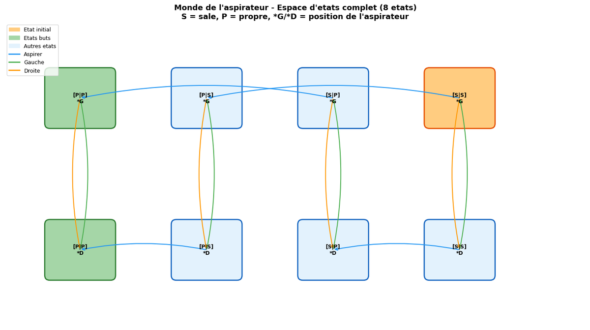
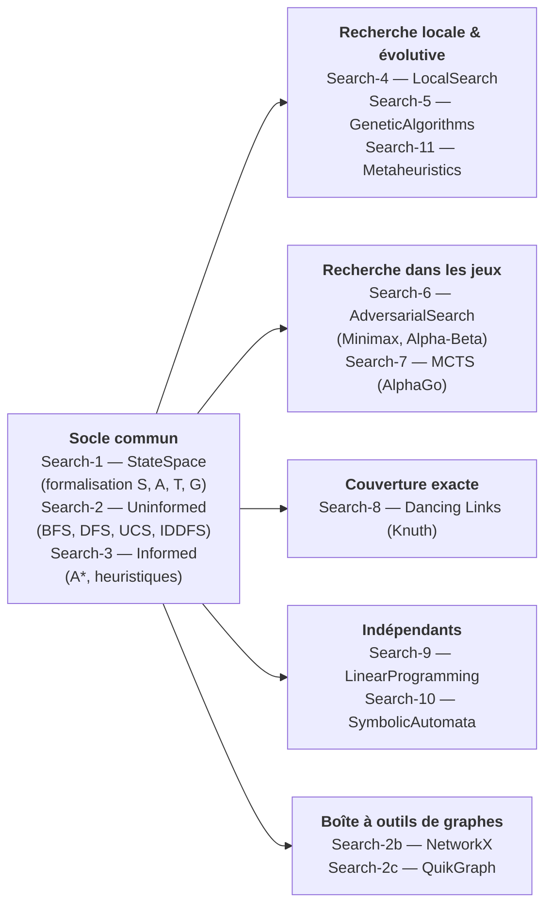
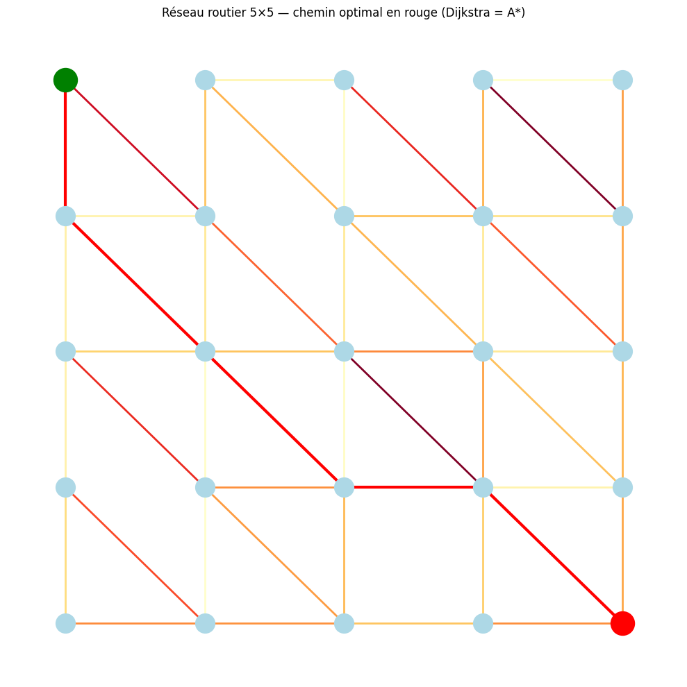
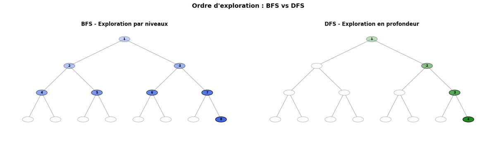
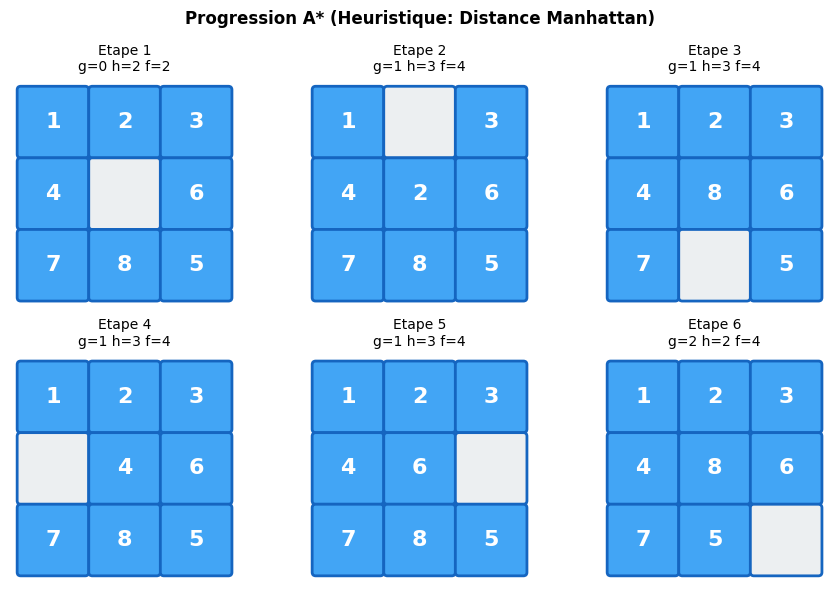
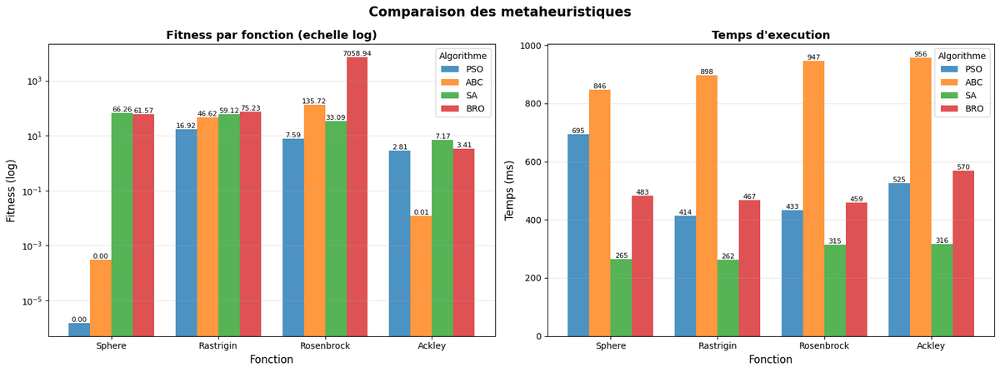
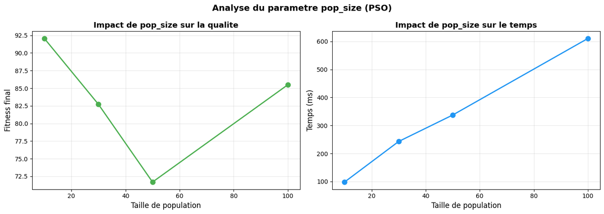

# Partie 1 : Search Fondamental

[↑ Série Search](../README.md) | [Partie 2 : CSP →](../Part2-CSP/README.md)

## Ouverture — ce que cette partie enseigne (Découverte)

Comment passer d'une énumération exhaustive à une exploration intelligemment guidée d'un espace d'états ? Cette première partie couvre les trois grands paradigmes de la recherche en IA : systématique (BFS, A*), locale (Hill Climbing, recuit simulé) et évolutive (algorithmes génétiques, PSO). Le fil rouge est la réduction progressive de l'espace de recherche, depuis la formalisation du problème jusqu'aux métaheuristiques comparées sur des benchmarks.

Le parcours s'ouvre sur une idée simple et étonnamment puissante : avant de résoudre un problème, il faut le poser. Search-1 montre qu'un taquin, un aspirateur-robot et une recherche d'itinéraire sont un seul et même objet mathématique — un espace d'états (S, A, T, G) — et que cette formalisation suffit à rendre le problème calculable. Search-2 lance alors l'exploration à l'aveugle : BFS garantit l'optimal mais explose en mémoire, DFS file droit mais peut se perdre, et leurs variantes (UCS, IDDFS) négocient chacune un compromis différent entre garantie et coût. Search-3 apporte la réponse classique à cette explosion : une heuristique — une estimation du chemin restant — et l'algorithme A*, dont l'optimalité tient à une propriété fine, l'admissibilité, que le notebook prend le temps d'éprouver plutôt que de la postuler.

Cette formalisation se voit : le **monde de l'aspirateur** (Search-1) se ramène à un espace d'états de huit nœuds — la position de l'aspirateur croisée à la propreté des deux pièces — reliés par des transitions colorées selon l'action exécutée (aspirer, aller à gauche, aller à droite). C'est ce graphe qu'explorent ensuite tous les algorithmes de la partie.

La suite change deux fois de point de vue. Quand seule la destination compte — pas le chemin —, la recherche locale (Search-4) abandonne l'arbre d'exploration pour naviguer de voisin en voisin dans un paysage de fitness, quitte à accepter temporairement de moins bonnes solutions pour s'échapper des optima locaux (recuit simulé, recherche tabou). Les algorithmes génétiques (Search-5) généralisent le procédé : une population entière explore en parallèle, sélection et croisement faisant émerger les bonnes solutions. Et quand l'environnement riposte — un adversaire joue contre vous —, la recherche devient un jeu : Minimax et l'élagage Alpha-Beta (Search-6), puis Monte Carlo Tree Search (Search-7), qui remplace l'évaluation experte par la simulation statistique et mène jusqu'à l'architecture d'AlphaGo.

Trois extensions complètent le panorama. La couverture exacte et les Dancing Links de Knuth (Search-8), structure de données spectaculaire qui résout Sudoku, N-Queens et Pentominoes par simple manipulation de pointeurs. La programmation linéaire (Search-9), qui troque le discret pour le continu et résout en quelques lignes de PuLP des problèmes de transport et de régime alimentaire. Les automates symboliques (Search-10), où les transitions deviennent des prédicats Z3 — premier pont vers l'IA symbolique. Search-11 referme la partie en confrontant les métaheuristiques (PSO, ABC, recuit) sur des benchmarks communs : l'occasion de constater qu'aucune ne domine partout, et d'apprendre à choisir.

**Pourquoi cette partie.** Elle est l'alphabet de toute la série : la formalisation en espace d'états, le backtracking et les heuristiques qu'on y construit sont réutilisés tels quels par la programmation par contraintes (Partie 2) et par les notebooks d'application. Mais son véritable enseignement est un réflexe d'ingénieur : chaque algorithme y est présenté comme un compromis — complétude contre mémoire, garantie contre temps de calcul, exploration contre exploitation — et jamais comme une recette. C'est ce réflexe, plus que tel ou tel algorithme, qui distingue celui qui applique une bibliothèque de celui qui choisit une stratégie.

## Comment lire ce README (Découverte)

Un README de série se lit à plusieurs vitesses : le parcours principal par les numéros nus, l'approfondissement par les lettres, la recherche en cours par les ponts inter-séries. Le principe est exposé à la racine du dépôt, dans [« Choisir sa vitesse de lecture »](https://github.com/jsboige/CoursIA#choisir-sa-vitesse-de-lecture).

- **Vous suivez le cœur de la partie** : la table du parcours principal, de haut en bas (les numéros 1 à 13).
- **Vous creusez un palier** : la section [Approfondissements](#approfondissements-découverte) — chaque palier lettré (2b-2d, 3b-3f, 5b, 9b-9f, 11b-11d, 12a) y a sa sous-section.
- **Vous cherchez votre route dans les branches** : la carte des branches indépendantes en [Progression](#progression), et les ponts vers les autres séries en [fin de README](#ponts-vers-les-autres-séries).

## Parcours principal (Découverte)

| # | Notebook | Ce qu'on y apprend | Public | Pour approfondir |
|---|----------|--------------------|--------|------------------|
| 1 | [Search-01-StateSpace](Search-01-StateSpace.ipynb) — jumeau [C#](Search-01-StateSpace-CSharp.ipynb) | Espaces d'états : la formalisation (S, A, T, G) — taquin, monde de l'aspirateur, recherche d'itinéraire comme un seul et même objet mathématique. Le jumeau C# porte `SearchProblem` abstrait, VacuumWorld (8 états, parcours complet), 8-Puzzle (181 440 états) et RouteFinding, avec `Dictionary` et tuples nommés | Découverte | — |
| 2 | [Search-02-Uninformed](Search-02-Uninformed.ipynb) — jumeau [C#](Search-02-Uninformed-CSharp.ipynb) | BFS, DFS, UCS, IDDFS : les compromis de l'exploration non informée — garantie contre coût, mémoire contre complétude. Le jumeau C# ajoute l'arbre profond 8×3 (ratio d'expansion BFS/DFS = 156,1×) et le BFS bidirectionnel avec reconstruction de coût | Découverte | [2b–2d](#autour-de-02) |
| 3 | [Search-03-Informed](Search-03-Informed.ipynb) — jumeau [C#](Search-03-Informed-CSharp.ipynb) | A\*, Greedy, IDA\*, heuristiques admissibles et consistantes : l'épreuve de l'admissibilité plutôt que son postulat. Le jumeau C# mesure A* coût 1055 (optimal) contre Greedy 1210 — surcoût 14,7 % pour 3 nœuds explorés — sur le graphe des villes françaises | Découverte | [3b–3f](#autour-de-03) |
| 4 | [Search-04-LocalSearch](Search-04-LocalSearch.ipynb) — jumeau [C#](Search-04-LocalSearch-CSharp.ipynb) | Hill Climbing, Simulated Annealing (critère de Metropolis, programmes de refroidissement), Tabu Search, paysages de fitness. Le jumeau C# valide sur paysage 1D multimodal puis N-Reines (benchmark de taux de succès) | Découverte | — |
| 5 | [Search-05-GeneticAlgorithms](Search-05-GeneticAlgorithms.ipynb) — jumeau [C#](Search-05-GeneticAlgorithms-CSharp.ipynb) | Sélection, crossover, mutation, DEAP/PyGAD, théorie unifiée. Le jumeau C# from-scratch `GeneticAlgorithm<T>` valide OneMax (convergence 20/20), le piège déceptif Goldberg k-trap (k=4, L=20 : hill-climber bloqué 17/20, l'AG atteint 20/20 par recombinaison) et Rastrigin | Découverte | [5b](#autour-de-05) |
| 6 | [Search-06-AdversarialSearch](Search-06-AdversarialSearch.ipynb) — jumeau [C#](Search-06-AdversarialSearch-CSharp.ipynb) | Minimax, élagage Alpha-Beta, Null-window search, tables de transposition, heuristic + profondeur limitée, iterative deepening sur Tic-Tac-Toe (valeur du jeu = 0) | Découverte | — |
| 7 | [Search-07-MCTS-And-Beyond](Search-07-MCTS-And-Beyond.ipynb) — jumeau [C#](Search-07-MCTS-And-Beyond-CSharp.ipynb) | Monte Carlo Tree Search, UCB1, OpenSpiel, architecture AlphaGo (DQN+MCTS). Le jumeau C# (convention UCT « moved-into ») mesure le paramètre c (c=√2 optimal → 100 %) et fait découvrir au MCTS l'action optimale au Nim | Découverte | — |
| 8 | [Search-08-DancingLinks](Search-08-DancingLinks.ipynb) — jumeau [C#](Search-08-DancingLinks-CSharp.ipynb) | Algorithme X de Knuth, Dancing Links (DLX), couverture exacte : Sudoku, N-Queens, Pentominoes. Le jumeau C# implémente `DlxNode` toroïdal (`Cover`/`Uncover` O(1), heuristique S) | Découverte | — |
| 9 | [Search-09-LinearProgramming](Search-09-LinearProgramming.ipynb) — jumeau [C#](Search-09-LinearProgramming-CSharp.ipynb) | Programmation linéaire avec PuLP : simplex, problème du transport, diet problem, PLNE. Le jumeau C# passe par Google OrTools (`LinearSolver`, GLOP/CBC) et ajoute analyse de sensibilité et dualité (shadow prices) | Découverte | [9b–9f](#autour-de-09) |
| 10 | [Search-10-SymbolicAutomata](Search-10-SymbolicAutomata.ipynb) — jumeau [C#](Search-10-SymbolicAutomata-CSharp.ipynb) | Automates finis (DFA/NFA) avec automata-lib, prédicats Z3, automates symboliques. Le jumeau C# construit `SymbolicAutomaton` sur `Microsoft.Z3` — union/intersection/complément via `MkAnd`/`MkOr`/`MkNot` vérifiées exactes | Découverte | — |
| 11 | [Search-11-Metaheuristics](Search-11-Metaheuristics.ipynb) — jumeau [C#](Search-11-Metaheuristics-CSharp.ipynb) | PSO, ABC, SA, BRO avec MEALPy, benchmark comparatif de métaheuristiques — le no-free-lunch constaté sur figures. Le jumeau C# from-scratch ajoute l'optimisation de profit (optimum analytique x≈17.14 retrouvé) et le TSP par recuit 2-opt | Découverte | [11b–11d](#autour-de-11) |
| 12 | [Search-12-BranchAndBound](Search-12-BranchAndBound-Borne-LP-Python.ipynb) | Pourquoi la recherche arborescente fonctionne, et quand sa borne s'effondre : sac à dos 0-1 arbitré entre DP pseudo-polynomiale et branch-and-bound, `scipy.optimize.milp` (HiGHS) en juge — les trois méthodes exactes concordent 9/9 ; capacité ×100 immobile pour le B&B (113 nœuds), mais instances fortement corrélées (`v = w + 10`) : nœuds ×6 (113 → 682) alors que l'écart de borne diminue (0,50 % → 0,16 %) | Découverte | [12a](#autour-de-12) |
| 13 | [Search-13a-Traverser-Murs-Certifies](Search-13a-Traverser-Murs-Certifies.ipynb) | Traverser un mur : chemin minimal **certifié** par quatre organes indépendants (Dijkstra, audit de potentiels, 0-1 BFS, flot max Edmonds-Karp par nœuds fendus) sur un pavage hexagonal de 61 salles à double chaîne de murs — distinction épaisseur (murs sur un chemin) vs largeur (murs à démolir, Menger), test négatif du percement Δ=−2 | Découverte | — |

Les jumeaux C# partagent la ligne de leur numéro : même arc, deux langages. Le numéro 13 ouvre une plage sans numéro de base — `Search-13a` en est l'entrée (cf. la note de numérotation en [Approfondissements](#approfondissements-découverte)).

## Objectifs d'apprentissage

À l'issue de cette partie, vous serez capable de :

1. **Formaliser** un problème sous forme d'espace d'états (S, A, T, G) et l'implémenter en Python
2. **Choisir** l'algorithme de recherche adapté au problème : systématique (BFS, A*), locale (SA, Tabu), ou évolutive (GA, PSO)
3. **Concevoir et évaluer** des heuristiques admissibles et consistantes pour guider la recherche
4. **Appliquer** la recherche adversariale (Minimax, Alpha-Beta, MCTS) aux jeux à deux joueurs
5. **Comparer** les métaheuristiques sur des benchmarks réels et justifier le choix d'un algorithme

## Approfondissements (Découverte)

Chaque palier lettré rattache une **accrétion** au numéro de base dont elle approfondit un aspect. Les entrées ci-dessous disent ce que chaque lettre **ajoute** et ce qu'elle suppose en plus de son numéro de base.

> **Note de numérotation.** La plage **1-11** porte les algorithmes fondamentaux, les numéros **03b à 03f** désignent les accrétions de Search-3 (heuristiques avancées : Pattern Databases, Limited Discrepancy Search, Weighted A*, compagnon formel de l'optimalité, repair incrémental LPA\*). Les suffixes **`b`/`c`** rattachent une **accrétion** au numéro de base : `Search-2b-NetworkX` et `Search-2c-QuikGraph` prolongent Search-2 (la boîte à outils de graphes vient se greffer sur la recherche non informée), `Search-11b-Metaheuristiques-Deep` (4 volets) approfondit Search-11. Un suffixe `b` peut désigner une déclinaison approfondie (11b) ou un compagnon de même niveau (2b) — le jumeau C# canonique porte toujours le numéro nu. Chaque numéro (suffixe compris) désigne un notebook unique. La plage **12** s'ouvre sur une accrétion sans numéro de base : `Search-12a-Composer-Regards` (op 12 du chantier ICT [#12204](https://github.com/jsboige/CoursIA/issues/12204)) — le suffixe `a` marque une ligne nouvelle dont les futurs notebooks partageront le sujet (composer des lectures d'un même problème). La plage **13** suit le même geste : `Search-13a-Traverser-Murs-Certifies` (op 13 du chantier ICT [#12204](https://github.com/jsboige/CoursIA/issues/12204)) — traverser une frontière coûteuse et certifier le chemin minimal.

### Autour de 02

La boîte à outils de graphes et la recherche continue, trois accrétions de Search-2 :

- **[2b NetworkX](Search-02b-NetworkX.ipynb)** (+ [jumeau C#](Search-02b-NetworkX-CSharp.ipynb)) — **Boîte à outils de graphes** : `Graph`/`DiGraph`, DFS/BFS, Dijkstra, Bellman-Ford, centralités de degré, composantes connexes, MST, Floyd-Warshall ; matière optionnelle, utile dès la fin de Search-2, en parité structurelle avec QuikGraph (2c). Le jumeau C# refait la théorie from-scratch (`Dictionary` / listes d'adjacence pondérées) et ajoute le flot maximum (Ford-Fulkerson) plus une tranche 2 QuikGraph (parité lib-vs-lib sur la même instance) — distinct de 2c, parité #4956.
- **[2c QuikGraph](Search-02c-QuikGraph.ipynb)** — Bibliothèque de graphes .NET **QuikGraph 2.5.0** (NuGet) : AdjacencyGraph / BidirectionalGraph / UndirectedGraph, DFS/BFS, Dijkstra, Bellman-Ford, centralités, composantes connexes, Edmonds-Karp (flot max), en parité avec NetworkX. Suppose .NET Interactive.
- **[2d RRT en Python](Search-02d-RRT-Recherche-Continue.ipynb)** et **[C#](Search-02d-RRT-Recherche-Continue-CSharp.ipynb)** — recherche continue, collisions exactes, RRT et reparentage RRT* ; comparaison à budget fini sur cinq graines, sans preuve expérimentale d’optimalité asymptotique.

### Autour de 03

Cette section absorbe le contenu durable de l'ancienne Partie 3, centrée sur la recherche heuristique avancée. Le **fil rouge** reste le **15-puzzle** — le banc d'essai historique de la recherche heuristique depuis Korf (1985). L'enjeu central est la **mémoire comme ressource algorithmique** : jusqu'où peut-on précalculer, et comment décomposer un problème pour que ce précalcul reste abordable ? Les notebooks forment un **triptyque** aux stratégies complémentaires : renforcer l'heuristique, borner les écarts à l'heuristique dont on dispose, et relâcher l'optimalité de façon contrôlée — sans jamais violer l'admissibilité.

- **[3b Pattern Databases](Search-03b-PatternDatabases.ipynb)** (+ [jumeau C#](Search-03b-PatternDatabases-CSharp.ipynb)) — PDB (Culberson & Schaeffer 1996) et additives (Korf & Felner 2002) sur 15-puzzle, IDA\*, heuristique précalculée admissible ; la section 12 « quotienter / fibrer » (op 3 du chantier ICT, [#12204](https://github.com/jsboige/CoursIA/issues/12204)) mesure le fondement informationnel des PDB sur un espace énuméré exhaustivement — règle de chaîne exacte, témoin I(X_A;X_B \| S_B) = 0 contre 2,071 bits marginaux, contre-témoin du quotient trop grossier. Le jumeau C# porte le BFS rétrograde, le 0-1 BFS deque et le rang de Lehmer from-scratch.
- **[3c Limited Discrepancy Search](Search-03c-LimitedDiscrepancySearch.ipynb)** (+ [jumeau C#](Search-03c-LimitedDiscrepancySearch-CSharp.ipynb)) — LDS (Harvey & Ginsberg 1995) sur sac à dos 0/1 : greedy vs LDS(k) vs exhaustif — toujours optimal.
- **[3d Weighted A\*](Search-03d-WeightedAstar.ipynb)** (+ [jumeau C#](Search-03d-WeightedAstar-CSharp.ipynb)) — Weighted A\* (Pohl 1970), f = g + W·h sur terrain pondéré : optimalité relâchée de façon contrôlée, coût borné à W fois l'optimal.
- **[3e AStar-Optimality](Search-03e-AStar-Optimality.ipynb)** — **Compagnon formel** : l'admissibilité comme condition exacte de l'optimalité d'A\* — preuves du lake [`search_lean`](../search_lean/) visitées depuis Python (subprocess → WSL `lean`), pont vers Lean-6. Suppose le kernel Python + WSL.
- **[3f Reparer-Localement-Sous-Garantie](Search-03f-Reparer-Localement-Sous-Garantie-Python.ipynb)** — **Réparer localement sous garantie** (op 6 du chantier ICT, [#12204](https://github.com/jsboige/CoursIA/issues/12204)) : recherche incrémentale **LPA\*** (Koenig & Likhachev 2002) — repair après blocage d'une cellule du plan optimal : optimalité **transportée** (34 = 34) au prix de 12 expansions contre 273 au A\* from scratch (23×) ; la section « recoller » (op 5) recolle des tables locales de fenêtres chevauchantes — compatibilité par paires vérifiée, composition sur le triple violée puis réparée ; le palier mémoire bornée mesure le pic de frontière d'A\* (28 / 39 / 170 états) contre le pic de pile d'IDA\* (21 / 15 / 19) à coût optimal égal.

### Autour de 05

- **[5b Natural Evolution Strategies](Search-05b-NaturalEvolutionStrategies.ipynb)** — Stratégies d'évolution naturelles (Wierstra *et al.*, JMLR 2014) : on fait évoluer une **distribution** et non une population. Gradient simple contre gradient naturel sur la figure 1 du papier (80/300 tirages en échec contre 0/300), invariance par transformation monotone à la précision machine, **xNES** et **SNES** réglés sur la table 1, banc décisif ellipsoïde séparable puis tourné, confrontation à CMA-ES (~2,3× plus rapide que xNES), équivalence au premier ordre avec le rang-μ de CMA-ES vérifiée en O(η²).
  - [Version C#](Search-05b-NaturalEvolutionStrategies-CSharp.ipynb) : gradients, xNES/SNES et CMA-ES avec MetaGeneticSharp natif, banc par rotation et figures SVG.

### Autour de 09

Le fil relaxation / arrondi / convexité, cinq accrétions de Search-9 :

- **[9b SpuriousMinima](Search-09b-SpuriousMinima.ipynb)** — Relaxation SDP de MaxCut (Goemans–Williamson, résolue exactement par cvxpy/CLARABEL) **et sa factorisation de Burer–Monteiro** : recensement borné des minima fallacieux par rang (40 départs × 3 instances C6/K8/G10, graines fixes, référence brute-force 2^(n-1)) — à r=1 le paysage dégénère (40/40 fallacieux), et **aucun piège à/au-dessus du seuil** r(r+1)/2 > m (Burer–Monteiro 2005, Barvinok–Pataki).
- **[9c CombinatorialDiscrepancy](Search-09c-CombinatorialDiscrepancy.ipynb)** — Discrépance combinatoire (Beck–Fiala 1981, frontière 2025 Bansal–Jiang arXiv:2508.03961) : colorier ±1 sans déséquilibrer, borne inf √k (Chernoff), arrondi flottant 2k−1 implémenté, CP-SAT en oracle exact.
- **[9d BeckFiala-Lean-Python](Search-09d-BeckFiala-Lean-Python.ipynb)** — **Pont Python vers le lake `discrepancy_lean`** : squelette de l'algorithme de Beck-Fiala, définitions Lean citées verbatim, écart mesuré à la borne 2k − 1 — sans Lean au runtime, caveat préprocesseur documenté.
- **[9e Komlos-Lean](Search-09e-Komlos-Lean.ipynb)** — **Compagnon formel de 9c** sur kernel `lean4-wsl` : `#check` des conjectures (Komlós ∃C universel, Beck–Fiala 2k−1, régimes Bansal–Jiang 2025), témoins coloriés ±1 énumérés exhaustivement sur instances jouet (Hadamard ½n en particulier). Suppose le miroir local du lake `discrepancy_lean`.
- **[9f ConvexOptimisation](Search-09f-ConvexOptimisation-Python.ipynb)** — **Du linéaire au convexe** : l'escalier LP → QP → SOCP nommé et démontré — le LP de Search-9 relu comme QP dégénérée, Markowitz en QP exacte sur l'instance App-10 (tangence Sharpe identique à son génétique), mesure échantillonnage vs QP, plafond de risque SOCP. Copie pédagogique déclarée d'App-10.

### Autour de 11

- **[11b Metaheuristiques-Deep](Search-11b-Metaheuristiques-Deep.ipynb)** (4 volets .NET : [T2 PSO](Search-11b-Metaheuristiques-Deep-Part2.ipynb), [T3 ABC](Search-11b-Metaheuristiques-Deep-Part3.ipynb), [T4 Benchmark](Search-11b-Metaheuristiques-Deep-Part4.ipynb)) — **Déclinaison deep-dive** : un algorithme from-scratch approfondi par tranche (recuit T1, PSO T2, ABC T3, benchmark capstone T4). Complète le jumeau 11 (.NET) par un traitement détaillé algorithme par algorithme.
- **[11c Empirical-Algorithm-Selection](Search-11c-Empirical-Algorithm-Selection.ipynb)** — Distillation du projet L4 EPITA SCIA 2026 (Th. Deguest, PR source #42) : **sélection empirique d'algorithmes** sous protocole commun (timeout 5 s, budget nœuds, métriques uniformes) sur Sudoku et Puissance 4 — front de Pareto qualité-coût, sweep de budget qui **inverse la sélection**, No Free Lunch mesuré (Rice 1976, Wolpert 1996). Aucun prérequis.
- **[11d Descente-Sous-Budget](Search-11d-Descente-Sous-Budget.ipynb)** — La loi derrière les descentes sous budget (op 11 du chantier ICT, [#12204](https://github.com/jsboige/CoursIA/issues/12204)) : les hypothèses de `mimo_lean/Descent.lean` exercées au runtime, l'hypothèse `hnostall` réfutée — à budget généreux, tous les blocages sont des optima locaux hors cible. Bibliothèque standard seule.

### Autour de 12

- **[12a Composer-Regards](Search-12a-Composer-Regards.ipynb)** — **Composer des regards** (op 12 du chantier ICT, [#12204](https://github.com/jsboige/CoursIA/issues/12204)) : play forward (`g`, Dijkstra depuis le départ) × coplay backward (`d`, Dijkstra depuis l'arrivée) sur un gridworld 10×14 — corridor optimal isolé par `f* = g + d` (19/140 nœuds), associativité de la composition à relais, **paire de lectures incompatibles exhibée** (divergence dès le pas 1, A* 24 vs 75 expansions). Suppose Search-3.

## Progression

Les trois premiers notebooks forment le socle commun — on y apprend à poser un problème, puis à l'explorer systématiquement — et tout le reste s'y greffe. Au-delà, le parcours n'est pas linéaire : cinq branches indépendantes s'ouvrent, à prendre dans l'ordre de vos curiosités :

- **Recherche locale et évolutive** : Search-4 (LocalSearch) puis Search-5 (GeneticAlgorithms) puis Search-11 (Metaheuristics), puis Search-11d (Descente-Sous-Budget) pour la loi de terminaison des descentes
- **Recherche dans les jeux** : Search-3 puis Search-6 (AdversarialSearch) puis Search-7 (MCTS)
- **Couverture exacte** : Search-2 puis Search-8 (DancingLinks)
- **Boîte à outils de graphes** : Search-2 puis Search-2b (NetworkX, ou son jumeau C#) puis Search-2c (QuikGraph)
- **Indépendants** : Search-9 (LinearProgramming, algèbre linéaire requise), Search-09b (SpuriousMinima, sa suite semidéfinie : Search-9 recommandé au préalable), Search-09c (CombinatorialDiscrepancy, relaxation/arrondi — écho du fil optimisation) suivi de ses compagnons **Search-09d** (pont Python, arrondi itératif sans Lean au runtime) et **Search-09e** (couche formelle Lean 4, kernel `lean4-wsl` : Search-09c recommandé au préalable), **Search-09f** (Du linéaire au convexe : LP relue comme QP dégénérée, Markowitz en QP exacte et plafond SOCP — Search-9 recommandé au préalable, écho de la mesure App-10), Search-11c (Empirical-Algorithm-Selection, distillation benchmark cross-paradigmes : aucun prérequis, écho App-14), Search-12a (Composer-Regards, lecture avant/arrière d'un même terrain : Search-3 recommandé au préalable, op 12 du chantier ICT #12204), Search-13a (Traverser-Murs-Certifies, chemin minimal certifié à travers une bande de cellules coûteuses : Search-2 recommandé au préalable, op 13 du chantier ICT #12204), Search-03f (Reparer-Localement-Sous-Garantie, repair incrémental LPA\* avec garantie d'optimalité transportée : Search-3 recommandé au préalable, op 6 du chantier ICT #12204) et Search-10 (SymbolicAutomata, liens avec SymbolicAI/SMT/Z3-Linq2Z3)

Les fondamentaux de cette partie (formalisation, backtracking, heuristiques) sont le prérequis de la [Partie 2 (CSP)](../Part2-CSP/README.md).

## Prérequis & environnement

| Besoin | Détail |
|--------|--------|
| Python | 3.10+, environnement virtuel recommandé |
| `ortools` | Search-9 (Linear Programming), Search-11c (CP-SAT) |
| `deap` | Search-5 (Genetic Algorithms) |
| `mealpy` | Search-11 (Métaheuristiques) |
| `z3-solver` | Search-10 (Symbolic Automata), Search-11c (SMT) |
| OpenSpiel | Search-7 (MCTS) : requiert WSL ou Linux |
| `cvxpy` | Search-09b (relaxation SDP, solveur CLARABEL embarqué), Search-09f (QP Markowitz et SOCP, même solveur CLARABEL) |
| Kernel `lean4-wsl` | Search-09e : kernel Jupyter Lean 4 + miroir local du lake [`discrepancy_lean`](../discrepancy_lean/README.md) (Mathlib 4 via les packages du dépôt) — cf. [`docs/reference/wsl-kernels-detail.md`](../../../docs/reference/wsl-kernels-detail.md) |
| `QuikGraph 2.5.0` (NuGet) | Search-2c (parité C#) : nécessite .NET Interactive, installable via `dotnet tool install --global Microsoft.dotnet-interactive --version 1.0.712001` |

Pour le setup complet, voir le [README de la série Search](../README.md).

## Bibliothèques : parité Python `networkx` ↔ .NET `QuikGraph`

Le notebook [Search-2c-QuikGraph](Search-02c-QuikGraph.ipynb) ferme la boucle côté **.NET Interactive** : il offre l'équivalent C# du notebook Python [Search-2b-NetworkX](Search-02b-NetworkX.ipynb), avec une table de parité structurelle entre les deux écosystèmes. Le notebook Python modélise par exemple un réseau routier 5×5 : les arêtes sont colorées par poids (du jaune au rouge) et le plus court chemin — identique pour Dijkstra et A\* — y est tracé en rouge entre la source (en vert) et la destination (en rouge).

La règle pratique : **QuikGraph 2.5.0** (fork KeRNeLith, NuGet) couvre les algorithmes classiques (DFS, BFS, Dijkstra, Bellman-Ford, A\*, Edmonds-Karp, Tarjan, MST, Floyd-Warshall) et **suffit pour tous les notebooks Search 1-11** si l'on travaille en C# — son **verdict honnête** est qu'il ne fournit pas les centralités élaborées (betweenness, closeness, PageRank) ni la détection de communautés (Louvain), qu'il faut alors implémenter à la main ou brancher une autre bibliothèque.

### Descente sous budget : deux langages

[Python](Search-11d-Descente-Sous-Budget.ipynb) et [C#](Search-11d-Descente-Sous-Budget-CSharp.ipynb) confrontent descente à un flip, borne LP et optimum exact ; les générateurs aléatoires diffèrent, mais les budgets sont identiques. Un arrêt sur budget ne certifie pas un blocage.

## Ponts vers les autres séries

Cette partie irrigue le reste du dépôt : les Dancing Links de Search-8 sont à l'œuvre dans la série [Sudoku](../../Sudoku/README.md), Minimax et MCTS (Search-6/7) se prolongent dans [GameTheory](../../GameTheory/README.md) avec OpenSpiel puis dans [RL](../../RL/README.md) côté politiques apprises, et les prédicats Z3 de Search-10 ouvrent sur [SymbolicAI](../../SymbolicAI/README.md).

## Références

Couverture par notebook des sources fondatrices mobilisées dans cette partie :

| Notebook(s) | Référence |
|-------------|-----------|
| Search-1 à 7, 9 | Russell, S., & Norvig, P. — *Artificial Intelligence: A Modern Approach* (4e éd., 2021). La référence pour la formalisation en espace d'états, les algorithmes informés/non informés et la recherche dans les jeux. |
| Search-3 (Informed) | Hart, P. E., Nilsson, N. J., & Raphael, B. (1968) — « A Formal Basis for the Heuristic Determination of Minimum Cost Paths », *IEEE Trans. on Systems Science and Cybernetics* 4(2). L'article fondateur d'A*. |
| Search-5 (GeneticAlgorithms) | Holland, J. H. (1975) — *Adaptation in Natural and Artificial Systems*. University of Michigan Press. Origine des algorithmes génétiques. |
| Search-7 (MCTS) | Browne, C. B., Powley, E., et al. (2012) — « A Survey of Monte Carlo Tree Search Methods », *IEEE Trans. on Computational Intelligence and AI in Games* 4(1). |
| Search-8 (DancingLinks) | Knuth, D. E. (2000) — « Dancing Links », dans *Millennial Perspectives in Computer Science* (Springer). |
| Search-09e (conjecture de Komlós) | Matoušek, J. (1999) — *Geometric Discrepancy: An Illustrated Guide*, Springer. Contexte classique de la conjecture de Komlós (disc ≤ C pour colonnes unitaires) ; les énoncés `KomlosConjecture` / `BansalJiangLargeDegree` / `KomlosBansalJiangWeak` formalisés dans [`discrepancy_lean/Komlos.lean`](../discrepancy_lean/Discrepancy/Komlos.lean) suivent les régimes de Bansal & Jiang (2025, arXiv:2508.03961 — cf. Search-09c). |
| Search-11 (Metaheuristics) | Kennedy, J., & Eberhart, R. (1995) — « Particle Swarm Optimization », *Proc. IEEE Int. Conf. on Neural Networks*. Origine du PSO. |

## FAQ

| Problème | Solution |
|----------|----------|
| A* trop lent sur les grands graphes | Vérifier que l'heuristique est admissible ET consistante ; essayer IDA* (Search-3), qui consomme moins de mémoire |
| GA stagne sans amélioration | Augmenter le taux de mutation ou la taille de la population ; comparer avec les métaheuristiques de Search-11 |

---

## Conclusion / Prochaines étapes

### Ce que vous avez appris

Cette première partie a posé **l'alphabet de la recherche en IA**. L'arc pédagogique part d'un seul objet mathématique — l'espace d'états `(S, A, T, G)` formalisé en Search-1 — et en fait le dénominateur commun d'une grande famille d'algorithmes :

- **La recherche systématique** (Search-2, Search-3) — de l'énumération à l'aveugle (BFS, DFS, UCS, IDDFS) jusqu'à l'exploration informée par une heuristique (A*, Greedy, IDA*). Le moment clé est l'épreuve de l'**admissibilité** : l'optimalité d'A* ne se postule pas, elle se démontre, et la frontière entre une heuristique qui guide et une heuristique qui ment est fine.
- **La recherche locale et évolutive** (Search-4, Search-5, Search-11) — abandonner l'arbre d'exploration pour naviguer de voisin en voisin dans un paysage de fitness, accepter temporairement de dégrader (recuit simulé, tabou), puis laisser une population entière explorer en parallèle (génétiques, PSO, ABC). Le benchmark comparatif de Search-11 enseigne le **no-free-lunch** : aucune métaheuristique ne domine partout.
- **La recherche dans les jeux** (Search-6, Search-7) — quand l'environnement riposte, la recherche devient adversariale : Minimax et l'élagage Alpha-Beta, puis Monte Carlo Tree Search, qui remplace l'évaluation experte par la simulation statistique et mène jusqu'à l'architecture d'AlphaGo.
- **Trois extensions** (Search-8, Search-9, Search-10) — les Dancing Links de Knuth pour la couverture exacte, la programmation linéaire (du discret au continu via PuLP), et les automates symboliques où les transitions deviennent des prédicats Z3 — premier pont vers l'IA symbolique.

Deux de ces familles se donnent à voir dans les figures extraites des notebooks. La **recherche systématique** oppose d'abord les stratégies à l'aveugle : sur un même arbre binaire, l'écart d'expansion entre BFS (par niveaux) et DFS (en profondeur) saute aux yeux dès qu'on numérote les nœuds par ordre d'exploration.

Dès qu'une heuristique est disponible, A* exploite ce savoir pour prioriser les états prometteurs : sur le 8-puzzle, chaque état développé est annoté de ses coûts `g` (déjà parcouru), `h` (estimé par distance de Manhattan) et `f = g + h`, et l'optimum est atteint en explorant peu de nœuds.

Côté **recherche locale et évolutive**, le benchmark comparatif de Search-11 confirme le *no-free-lunch* : aucune métaheuristique ne domine partout, que ce soit en fitness atteinte (échelle log) ou en temps de calcul.

L'étude du paramètre clé, la taille de population PSO, quantifie alors l'arbitrage entre qualité de la solution et coût de calcul.

Le véritable enseignement, au-delà du catalogue d'algorithmes, est un **réflexe d'ingénieur** : chaque méthode y est présentée comme un compromis — complétude contre mémoire, garantie contre temps de calcul, exploration contre exploitation — et jamais comme une recette universelle.

### Prochaines étapes

- **La programmation par contraintes** : la suite naturelle est la [Partie 2 (CSP)](../Part2-CSP/README.md), qui réutilise le backtracking et les heuristiques de cette partie pour propager des contraintes plutôt que d'énumérer — la réduction de l'espace de recherche y devient systématique plutôt qu'heuristique.
- **Les applications** : les [notebooks d'application](../Part3-Cas-pratiques/README.md) (détection de contours, TSP, VRP, optimisation de portefeuille, hyperparameter tuning) mobilisent directement les métaheuristiques et la recherche locale vues ici sur des problèmes réels.
- **Les ponts vers les autres séries** : les Dancing Links irriguent [Sudoku](../../Sudoku/README.md), Minimax et MCTS se prolongent dans [GameTheory](../../GameTheory/README.md) (OpenSpiel) puis [RL](../../RL/README.md) (politiques apprises), et les prédicats Z3 de Search-10 ouvrent sur [SymbolicAI](../../SymbolicAI/README.md). Reprendre un de ces ponts après avoir posé les fondations de la recherche donne aux primitives une nouvelle profondeur.
- **La série dans son ensemble** : le [sommaire Search](../README.md) cartographie les quatre parties et les applications — celle-ci est le socle commun.

### Le fil rouge

La recherche en IA propose un changement de regard sur la résolution de problèmes : ne plus voir chaque algorithme comme une recette à appliquer, mais comprendre qu'ils sont tous des **négociations d'un même compromis fondamental** — entre la garantie de trouver l'optimal et le coût pour l'atteindre, entre explorer l'inconnu et exploiter l'acquis, entre la complétude et la mémoire disponible. BFS garantit l'optimal mais explose en mémoire ; DFS file droit mais peut se perdre ; A* négocie les deux via une heuristique dont l'honnêteté (l'admissibilité) conditionne la justesse du résultat ; le recuit simulé accepte de remonter la pente pour s'échapper d'un optimum local ; MCTS remplace l'expertise par la statistique. Comprendre la recherche, c'est comprendre qu'il n'existe pas de « bon » algorithme dans l'absolu, mais une famille de stratégies dont le choix dépend du compromis qu'on est prêt à accepter — et que ce compromis, loin d'être une limitation, est précisément ce qui rend la recherche applicable à tout problème formalisable en espace d'états.
