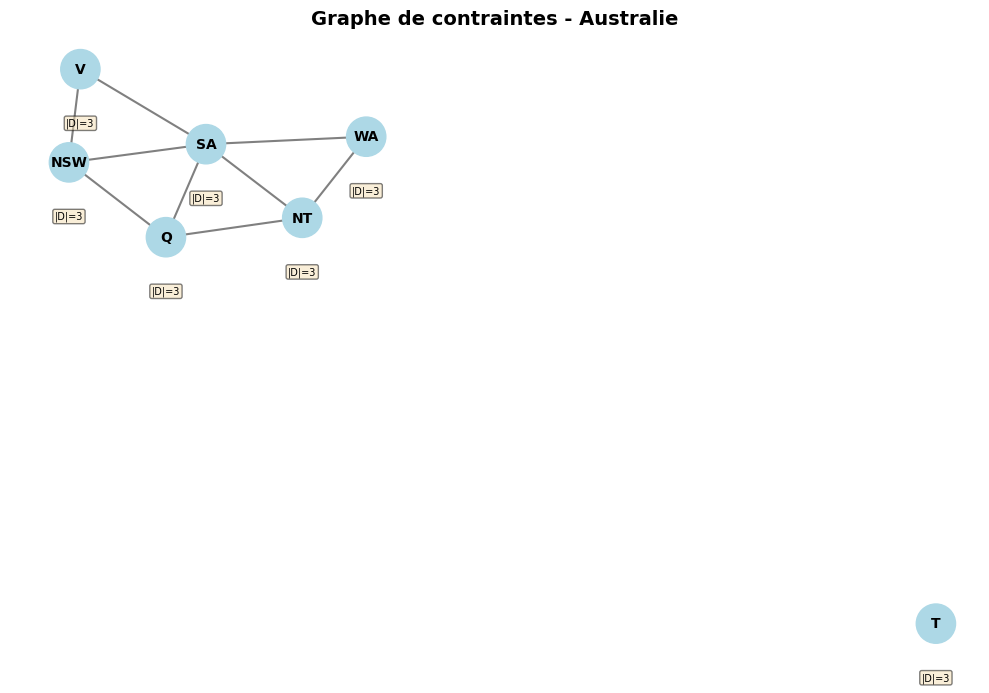
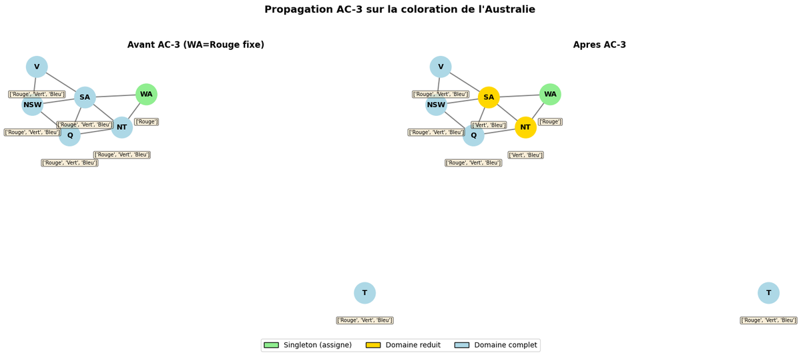
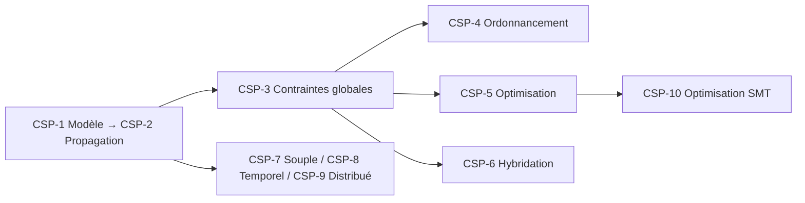
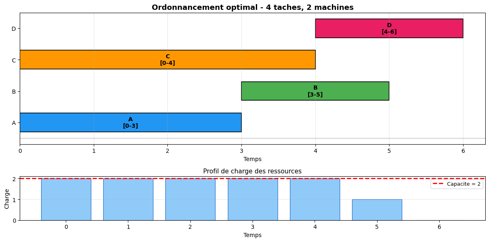
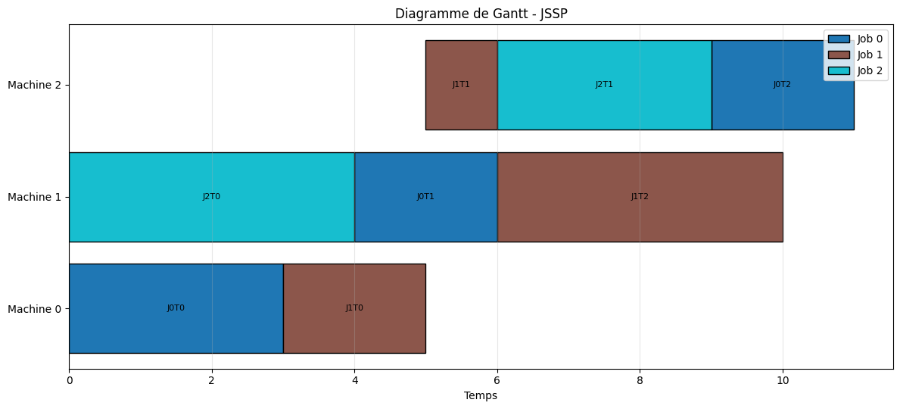
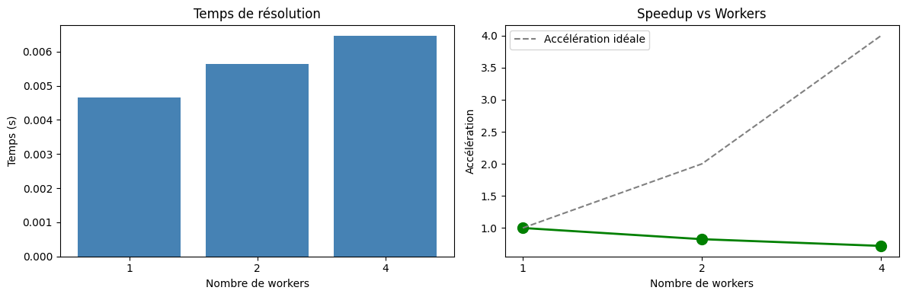
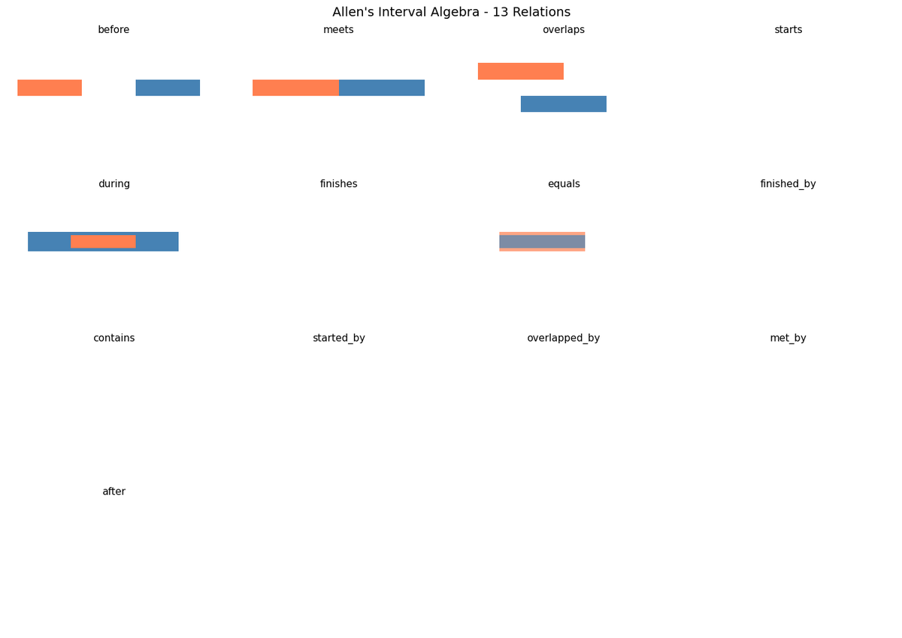

# Partie 2 : Programmation par Contraintes

[← Partie 1 : Search](../Part1-Foundations/README.md) | [↑ Série Search](../README.md) | [Partie 3 : Cas pratiques →](../Part3-Cas-pratiques/README.md)

Au lieu de concevoir un algorithme d'exploration, on peut déclarer ce qu'une solution doit respecter et laisser un solveur la trouver : c'est le changement de regard qu'apporte la programmation par contraintes. Un problème s'y écrit comme un triplet (X, D, C) — des variables, leurs domaines, les contraintes qui les lient — et sa résolution combine deux mécanismes : une recherche avec retour arrière, héritée de la [Partie 1](../Part1-Foundations/README.md), et une **propagation** qui retire des domaines les valeurs devenues impossibles avant même de les essayer.

Le fil rouge des deux premières étapes est la coloration de la carte d'Australie. L'étape 1 en pose le **graphe de contraintes** : sept régions, trois couleurs possibles pour chacune, une contrainte de différence par frontière ; la Tasmanie, sans voisine, reste à l'écart du graphe.

L'étape 2 montre la propagation sur ce même graphe : une fois l'Australie-Occidentale (WA) fixée à Rouge, l'algorithme AC-3 réduit à {Vert, Bleu} les domaines de ses deux voisines, sans essayer aucune valeur.

La suite monte en puissance : contraintes globales, ordonnancement, optimisation combinatoire, fonctionnement interne d'un solveur moderne, puis trois variantes du modèle — contraintes souples, temporelles, distribuées — et un passage au solveur SMT Z3. Chaque étape existe en deux versions jumelles, l'une en Python, l'autre en C# sous .NET Interactive : même sujet, mêmes problèmes, et de chaque côté, dès que le sujet s'y prête, un solveur reconnu plutôt qu'une réimplémentation simplifiée. L'étape 4 offre en outre un troisième jumeau en Rust (kernel evcxr), qui exécute le même moteur CP-SAT par la crate `cp_sat`. La partie s'adresse à des lecteurs qui connaissent le backtracking de la Partie 1 et lisent l'un des deux langages.

## Comment lire ce README — découverte

Le principe [« Choisir sa vitesse de lecture »](https://github.com/jsboige/CoursIA#choisir-sa-vitesse-de-lecture) distingue parcours principal, approfondissements et prolongements de recherche.

- **Vous découvrez** : lisez les étapes 1 et 2 dans l'ordre. Elles suffisent pour comprendre ce qu'est un problème de satisfaction de contraintes et pourquoi la propagation change l'échelle de ce qu'on sait résoudre ; l'étape 3 ouvre ensuite la porte des solveurs industriels.
- **Vous creusez une branche** : après l'étape 3, choisissez entre les applications (4 et 5), le fonctionnement des solveurs (6 et 10) et les variantes du modèle (7, 8 et 9). La section « Approfondissements » décrit, étape par étape, les expériences, les figures et ce que la version C# apporte.
- **Vous cherchez la recherche** : « Pour aller plus loin » situe la partie entre SAT, SMT et programmation par contraintes, et dit ce que les bancs des carnets ne permettent pas de conclure.

## Parcours principal — lecture guidée et prérequis

Les numéros donnent un ordre de lecture conseillé, pas une chaîne de dépendances : le schéma placé sous le tableau indique ce que chaque étape suppose réellement. Chaque ligne réunit les deux versions jumelles d'une même étape ; elles se lisent indépendamment, ou côte à côte pour comparer les bibliothèques. Comptez de trois quarts d'heure à deux heures par carnet. Les valeurs citées sont lues dans les sorties enregistrées des versions Python.

| # | Notebook | Ce qu'on y apprend | Public et prérequis | Pour approfondir |
|---|----------|--------------------|---------------------|------------------|
| 1 | Fondamentaux — [Python](CSP-01-Fundamentals-Python.ipynb) · [C#](CSP-01-Fundamentals-CSharp.ipynb) | Écrire un problème comme un triplet (X, D, C), le résoudre par backtracking, puis ordonner la recherche avec deux heuristiques : MRV (choisir la variable la plus contrainte) et LCV (essayer d'abord la valeur la moins contraignante). Sur les 8-Reines, MRV ramène la recherche de 876 à 572 affectations. | Découverte. Le backtracking de la Partie 1 ([Search-2](../Part1-Foundations/Search-02-Uninformed.ipynb)). | [Autour de 1](#autour-de-1) |
| 2 | Consistance et propagation — [Python](CSP-02-Consistency-Python.ipynb) · [C#](CSP-02-Consistency-CSharp.ipynb) | Réduire les domaines par déduction locale : consistance de nœud, AC-3, Forward Checking, maintien de l'arc-consistance (MAC). Sur les 8-Reines, la recherche sans propagation tente 876 affectations, Forward Checking 67, MAC 20. | Découverte. L'étape 1. | [Autour de 2](#autour-de-2) |
| 3 | Contraintes globales — [Python](CSP-03-Advanced-Python.ipynb) · [C#](CSP-03-Advanced-CSharp.ipynb) | Modéliser avec `AllDifferent`, `Cumulative`, `Circuit` et `Table`, que les solveurs propagent par des algorithmes dédiés ; énumérer toutes les solutions, casser les symétries (les 92 solutions des 8-Reines se réduisent à 35), améliorer une solution par recherche à grand voisinage (LNS). | Licence. Les étapes 1 et 2. | [Autour de 3](#autour-de-3) |
| 4 | Ordonnancement — [Python](CSP-04-Scheduling-Python.ipynb) · [C#](CSP-04-Scheduling-CSharp.ipynb) · [Rust](CSP-04-Scheduling-Rust.ipynb) | Poser un atelier (Job-Shop), un projet à ressources limitées (RCPSP) et un planning d'infirmiers avec des variables d'intervalle. Sur l'atelier de trois jobs et trois machines, CP-SAT prouve une durée totale de 11, quand la règle gloutonne « tâche la plus courte d'abord » s'arrête à 18. | Licence. L'étape 3. | [Autour de 4](#autour-de-4) |
| 5 | Optimisation combinatoire — [Python](CSP-05-Optimization-Python.ipynb) · [C#](CSP-05-Optimization-CSharp.ipynb) | Ajouter un objectif : rangement en boîtes (Bin Packing), sac à dos, découpe de barres, portefeuille à nombre d'actifs borné. Comparer une preuve d'optimalité à une heuristique gloutonne, et voir à quelle taille la preuve devient trop chère. | Licence. L'étape 3. | [Autour de 5](#autour-de-5) |
| 6 | Hybridation — [Python](CSP-06-Hybridization-Python.ipynb) · [C#](CSP-06-Hybridization-CSharp.ipynb) | Comprendre pourquoi CP-SAT porte ce nom : la génération paresseuse de clauses (*Lazy Clause Generation*) fait apprendre des clauses SAT à un solveur de contraintes. Puis trois couplages : apprentissage automatique, modèle de langage qui rédige le modèle, recherche parallèle. | Lecture avancée. Les étapes 3 à 5 ; notions de SAT. | [Autour de 6](#autour-de-6) |
| 7 | Contraintes souples — [Python](CSP-07-Soft-Python.ipynb) · [C#](CSP-07-Soft-CSharp.ipynb) | Remplacer « satisfaite ou non » par un degré ou un coût : cadre algébrique des semi-anneaux, CSP flous, pondérés et hiérarchiques ; planning d'infirmiers avec préférences, puis avec un critère d'équité. | Lecture avancée. Les étapes 1 et 2 ; CP-SAT (étape 3) pour les sections qui l'utilisent. | [Autour de 7](#autour-de-7) |
| 8 | Contraintes temporelles — [Python](CSP-08-Temporal-Python.ipynb) · [C#](CSP-08-Temporal-CSharp.ipynb) | Raisonner sur des intervalles de temps : les treize relations d'Allen et leur table de composition, les problèmes temporels simples (STP) résolus par plus courts chemins, leur extension à des créneaux disjoints (TCSP). | Lecture avancée. Les étapes 1 et 2 ; l'algorithme de Floyd-Warshall. | [Autour de 8](#autour-de-8) |
| 9 | Résolution distribuée — [Python](CSP-09-Distributed-Python.ipynb) · [C#](CSP-09-Distributed-CSharp.ipynb) | Résoudre quand aucun agent ne détient le problème entier : backtracking asynchrone (ABT), variante à engagement faible (AWC), protection des contraintes privées. | Lecture avancée. Les étapes 1 et 2 ; échange de messages entre agents. | [Autour de 9](#autour-de-9) |
| 10 | Optimisation SMT avec Z3 — [Python](CSP-10-Optimisation-Z3-Python.ipynb) · [C#](CSP-10-Optimisation-Z3-CSharp.ipynb) · [Rust](CSP-10-Optimisation-Z3-Rust.ipynb) | Formuler une couverture minimale — placer le moins de capteurs possible pour couvrir une grille — pour un solveur SMT, et obtenir une preuve de minimalité là où l'énumération exhaustive devient impraticable. | Licence. Les étapes 1, 2 et 5. | [Autour de 10](#autour-de-10) |

Les flèches indiquent des prérequis conseillés. Les étapes 7, 8 et 9 ne dépendent pas les unes des autres. Toutes supposent les bases de la Partie 1 : formalisation en espace d'états ([Search-1](../Part1-Foundations/Search-01-StateSpace.ipynb)) et backtracking ([Search-2](../Part1-Foundations/Search-02-Uninformed.ipynb)).

## Approfondissements — Licence et lectures avancées

Chaque carnet propose des exercices. Les paragraphes ci-dessous disent, étape par étape, ce que les expériences établissent, ce que montre la figure quand il y en a une, et ce qu'apporte la version C#. Les valeurs citées sont celles des sorties enregistrées dans les versions Python.

### Autour de 1

La carte d'Australie est trop facile pour départager les heuristiques : le backtracking naïf y tente 11 affectations, MRV 15. Le carnet le constate, puis construit un « cadran de difficulté » : une famille de colorations où chaque région tire au sort la liste des couleurs qui lui sont permises, sur soixante régions et cinq graines. Quand les listes sont complètes, les trois variantes se valent presque — 142,0 affectations en moyenne pour le backtracking naïf, 129,8 avec MRV, autant en ajoutant LCV. Quand elles sont réduites à deux couleurs, l'écart se creuse : 100,8, puis 91,2, puis 69,0. La leçon est de méthode : une heuristique se juge sur un terrain capable de la mettre à l'épreuve.

La fin du carnet passe aux bibliothèques. Avec `python-constraint`, une contrainte `AllDifferent` fait tomber un espace de 256 affectations à 24. Avec Choco, la bibliothèque qu'utilise le jumeau C#, le carnet énumère les 18 colorations de la carte. Les exercices vont des 4-Reines au cryptarithme SEND + MORE = MONEY et à un petit emploi du temps. La version C# suit le même plan, de bout en bout avec Choco.

### Autour de 2

L'étape oppose trois dosages de propagation. Sur les 8-Reines : 876 affectations et 105 retours arrière sans propagation, 67 et 59 avec Forward Checking, 20 et 12 avec MAC. L'écart grandit avec la taille : pour douze reines, 3 066 affectations sans propagation contre 51 avec MAC. Le carnet en donne la contrepartie — chaque nœud coûte plus cher quand on propage, et dans l'exécution enregistrée c'est Forward Checking qui va le plus vite à douze reines — puis prolonge vers la comparaison d'AC-3 et d'AC-4 et vers les consistances plus fortes (consistance de chemin, k-consistance). La version C# s'appuie sur la propagation native de Choco et trace ses courbes avec ScottPlot.

### Autour de 3

Une contrainte globale dit en une ligne ce que des dizaines de contraintes binaires diraient moins bien : sur le mini-Sudoku 4×4 du carnet, douze `AllDifferent` remplacent soixante-douze contraintes de différence. `Cumulative` ordonnance quatre tâches sous une capacité de deux, pour une durée totale de 6, sans jamais dépasser deux tâches simultanées :

`Circuit` résout une tournée de cinq villes, `Table` restreint les combinaisons permises. Le carnet énumère ensuite les solutions des N-Reines (92 pour huit reines, 724 pour dix), mesure ce qu'élimine le cassage de symétries (de 92 à 35) et termine par une recherche à grand voisinage qui ramène un ordonnancement de 20 à 19, sa borne inférieure. Une annexe reprend les mêmes contraintes avec Choco ; la version C# est entièrement construite sur cette bibliothèque.

### Autour de 4

Trois jobs s'entrelacent sur trois machines grâce à des variables d'intervalle et à une contrainte de non-chevauchement par machine ; CP-SAT prouve une durée totale de 11.

Le projet à ressources limitées, six tâches, se termine en 10 ; le planning d'infirmiers répartit 42 gardes sur une semaine. La comparaison avec la règle « tâche la plus courte d'abord » — 18 contre 11 — mesure ce que vaut une preuve d'optimalité, même sur un petit atelier.

La section sur le guidage de la recherche (solution suggérée, stratégie de décision) se conclut par un « cadran de régime ». Sur une grande instance, avec six secondes de calcul et trois exécutions par configuration, l'écart entre configurations est plus petit que la dispersion d'une même configuration : aucun classement ne se dégage, et le carnet le dit. La version C# utilise le même solveur par sa liaison .NET et compare les deux liaisons.

Le jumeau Rust suit le même fil sur le kernel evcxr et retrouve chaque valeur : atelier en 11, projet en 10, 42 gardes, écart de 63,6 % face à la règle gloutonne, et la même instance dure (graine 2026 : borne 776, heuristique 4307) grâce à un portage de MT19937 calé sur le générateur de CPython. L'API de la crate `cp_sat` n'expose ni `NoOverlap`, ni `AddCumulative`, ni les stratégies de décision : le carnet écrit les décompositions exactes équivalentes (disjonctions réifiées par paires, cumul temporel réifié) et documente chaque écart — la comparaison des trois langages porte alors autant sur l'expressivité des liaisons que sur le solveur, qui reste le même.

### Autour de 5

Sur une instance choisie pour piéger l'heuristique — objets de tailles 2, 2, 2, 3, 5 et 6, boîtes de capacité 10 — le rangement glouton *First Fit Decreasing* utilise trois boîtes quand CP-SAT prouve que deux suffisent. Le carnet ne s'arrête pas à ce cas favorable au solveur : sur des instances aléatoires, l'heuristique fait jeu égal à vingt objets, utilise quinze boîtes contre quatorze à cinquante, et à cent objets CP-SAT rend une solution de même valeur sans parvenir à prouver son optimalité dans le temps imparti.

Le sac à dos (valeur 26 pour une capacité de 20 entièrement utilisée), la découpe de barres (quatre barres, dont trois sans chute) et le portefeuille complètent le tour, avant une section sur les règles de dominance. La version C# utilise la contrainte globale `binPacking` de Choco et ajoute un pont exécutable vers CP-SAT.

### Autour de 6

Le carnet ouvre le capot de CP-SAT : génération paresseuse de clauses, effet des paramètres du solveur sur un atelier de dix jobs et dix machines, puis trois couplages.

- **Apprentissage automatique.** Un prédicteur à règles simples tente de deviner si une instance aléatoire est satisfaisable. Sa corrélation avec la réalité est de 0,206 : faible, et présentée comme telle.
- **Modèle de langage.** Un énoncé en langue naturelle devient un modèle CP-SAT : le modèle de langage remplit un schéma JSON par appel d'outil, le solveur résout. L'appel est réel quand un service est configuré (voir [Installation](#installation--pratique-tous-niveaux)) ; sinon un exemple de référence prend le relais. La version C# ajoute un garde-fou : vérifier que la solution respecte les faits de l'énoncé, car un JSON conforme au schéma peut décrire un autre problème que celui posé.
- **Recherche parallèle.** Sur un problème de douze reines résolu en quelques millisecondes, passer de un à quatre fils d'exécution n'accélère rien : le coût de coordination l'emporte.

Cette figure provient d'une exécution antérieure à la sortie actuellement enregistrée dans le carnet : les durées diffèrent, la conclusion — une accélération inférieure à 1 sur une instance aussi petite — est la même.

### Autour de 7

Le cadre des semi-anneaux permet d'écrire un seul code de résolution, paramétré par la façon de combiner et de comparer les préférences : booléen pour le CSP classique, minimum pour le flou, somme pour le pondéré. Trois sorties donnent la mesure du carnet. Le choix d'un créneau de réunion trouve un coût minimal de 1, à 9 h. Le planning d'infirmiers avec préférences est résolu à l'optimum, pour une pénalité totale de 140. Sur un scénario de conflit, ajouter un terme d'équité ne change pas la pénalité totale (70) mais ramène de 40 à 30 la pénalité supportée par l'infirmier le plus mal servi : l'équité déplace le coût sans l'augmenter.

La version C# aborde le sujet par les outils de Choco — CSP pondérés, coût porté par un automate (`CostRegular`), relâchement d'`AllDifferent` — puis réécrit le cadre des semi-anneaux sous forme générique et vérifie qu'il s'accorde avec le solveur.

### Autour de 8

L'algèbre d'Allen donne le vocabulaire du temps qualitatif : treize relations possibles entre deux intervalles. Le carnet les définit toutes ; la figure n'en trace que cinq (avant, rencontre, chevauche, pendant, égale).

La table de composition n'est pas recopiée : elle est engendrée par énumération de triplets d'intervalles, ce qui donne 169 entrées, dont 72 sont des disjonctions. Un contrôle croisé la confronte à cinq entrées écrites à la main ; deux divergent, et le carnet explique pourquoi l'entrée engendrée, appuyée sur des intervalles concrets, désigne l'entrée manuelle comme celle à corriger.

Viennent ensuite les problèmes temporels simples : une journée de cinq événements résolue par Floyd-Warshall, puis une réunion à trois participants dont l'unique créneau commun tombe de 15 h à 16 h. La même journée résolue par CP-SAT rend un autre horaire, lui aussi valide : un problème temporel consistant admet en général plusieurs solutions. La version C# suit ce plan avec la liaison .NET de CP-SAT et ScottPlot.

### Autour de 9

Ici, aucune bibliothèque : les deux versions écrivent les algorithmes dans le carnet. ABT colorie un cycle de quatre agents en 10 messages ; AWC lui ajoute des priorités dynamiques ; des agents à contraintes privées répartissent trois hôpitaux sur des créneaux distincts sans rien révéler de leurs raisons.

Trois bancs méritent d'être lus de près. Sur cinq instances aléatoires à huit agents, AWC échange moins de messages qu'ABT (314,4 en moyenne contre 738,8) mais, à budget d'itérations égal, n'en résout qu'une quand ABT en résout trois : le carnet en tire qu'un trafic plus faible n'est pas un meilleur résultat. Le deuxième banc fait varier la densité des contraintes à six agents et trois couleurs : le taux de succès passe de 100 % aux densités 0,2 et 0,4 à 80 % puis 10 % aux densités 0,6 et 0,8, et les messages s'envolent sur les instances insatisfaisables. Le troisième alloue des tâches selon des préférences privées et atteint une satisfaction de 54 pour un optimum centralisé de 58, sans qu'aucun score ne quitte l'agent qui le détient.

### Autour de 10

Chaque case d'une grille peut recevoir un capteur qui couvre son voisinage ; on cherche le plus petit ensemble de capteurs couvrant toutes les cases. Sur une grille de douze cases, l'énumération exhaustive parcourt les 4 096 sous-ensembles et trouve une couverture de 2 capteurs ; Z3 trouve la même taille et la **prouve** minimale, en montrant qu'aucune couverture strictement plus petite n'existe. Sur une grille de soixante cases, l'énumération n'est plus envisageable — deux puissance soixante sous-ensembles — alors que Z3 rend une couverture de 8 capteurs, avec la même preuve.

Les exercices reprennent le modèle sous une contrainte de budget, avec des capteurs de portées différentes, puis demandent de démontrer une borne inférieure par insatisfaisabilité. La version C# utilise la liaison .NET de Z3.

### Les versions C# : quelle bibliothèque pour quelle étape

| Étapes | Bibliothèque côté .NET | Rapport avec la version Python |
|--------|------------------------|--------------------------------|
| 1, 2, 3, 5 et 7 | Choco-solver, bibliothèque Java exécutée sous .NET par IKVM | Les versions Python de 1, 2, 3 et 5 contiennent une section Choco (`pychoco`) : le même moteur tourne des deux côtés. |
| 4, 6 et 8 | OR-Tools CP-SAT, liaison .NET | Même solveur qu'en Python, sur le terrain où il est le plus à l'aise : intervalles et ordonnancement. |
| 9 | Aucune : ABT et AWC sont écrits dans le carnet | Même choix qu'en Python. |
| 10 | Z3, liaison .NET | Même solveur qu'en Python. |

## Installation — pratique, tous niveaux

Les carnets s'ouvrent depuis un clone du dépôt, sans les déplacer : plusieurs importent un module ou chargent un fichier situé hors de ce dossier.

| Pour | Il faut | Remarques |
|------|---------|-----------|
| Toutes les versions Python | Python 3.10 ou ultérieur et les dépendances de [`requirements.txt`](../requirements.txt), à installer depuis le dossier `Search` par `pip install -r requirements.txt` | Le fichier apporte OR-Tools, `python-constraint`, `z3-solver`, NetworkX, Matplotlib et NumPy. |
| Sections Choco des étapes 1, 2, 3 et 5 (Python) | `pip install pychoco` | Le paquet n'est pas dans `requirements.txt`. Les étapes 1 et 5 l'installent à la volée s'il manque ; l'étape 3 affiche un message et passe la section ; l'étape 2 l'importe directement. |
| Étapes 1 à 3 (Python) | [`search_helpers.py`](../search_helpers.py) | Module de tracé de la série, importé depuis le dossier parent. |
| Toutes les versions C# | Le noyau .NET Interactive | Voir le [README de la série](../README.md) pour la mise en place. Les paquets NuGet sont restaurés à la première exécution : prévoir un accès réseau. |
| Étapes 1, 2, 3, 5 et 7 (C#) | Choco-solver | La bibliothèque, précompilée pour .NET, est fournie dans ce dossier (`org.chocosolver.solver.dll`) ; le runtime IKVM est restauré par NuGet. |
| Étapes 4, 6 et 8 (C#) | OR-Tools | Liaison .NET restaurée par NuGet. |
| Étape 10 (C#) | Z3 | Paquet `Microsoft.Z3`, et chargeur de bibliothèque native partagé [`Z3NativeLoader.cs`](../../SymbolicAI/SMT/Z3-API/Z3NativeLoader.cs). |
| Étape 6, appel réel au modèle de langage (facultatif) | Variables d'environnement `VLLM_BASE_URL` et `VLLM_API_KEY`, et au besoin `VLLM_MODEL` | Elles désignent un service de complétion de chat joignable en HTTP. Sans elles, la cellule l'indique et la suite s'appuie sur l'exemple de référence. |
| Étape 4, version Rust | Le kernel evcxr, la crate `cp_sat` et OR-Tools C++ installé (`ORTOOLS_PREFIX=/opt/ortools`, `RUSTFLAGS='-Clink-arg=-lprotobuf'`) | La crate lie le moteur natif : l'exécution se fait sous Linux/WSL, OR-Tools ne publiant pas de binaire C++ Windows. Voir la première cellule du carnet Rust. |

Aucun carnet ne demande de GPU ni de téléchargement de données : les instances sont construites dans les cellules. Les durées affichées dépendent de la machine.

Les figures de cette page sont des sorties d'exécution extraites des carnets et réduites pour l'affichage ; leur provenance est décrite dans [`assets/readme/MANIFEST.md`](assets/readme/MANIFEST.md).

## Pour aller plus loin — recherche

### Le pont CP ↔ SAT ↔ SMT

La programmation par contraintes n'est pas un paradigme isolé : elle partage ses fondations avec deux familles voisines, qui attaquent le même problème déclaratif sous un autre angle.

- **SAT** (satisfiabilité booléenne) : décider si une formule propositionnelle admet un modèle ; solveurs DPLL puis CDCL.
- **SMT** (SAT modulo théories) : SAT enrichi de théories — arithmétique, tableaux, vecteurs de bits, chaînes ; voir la série [Z3-Linq2Z3](../../SymbolicAI/SMT/Z3-Linq2Z3/README.md).
- **CP** (programmation par contraintes) : domaines finis, contraintes globales, propagation ; c'est cette partie.

Bardin, S., Bjørner, N. & Cadar, C. (2019), *Bringing CP, SAT and SMT together: Next Challenges in Constraint Solving* (Dagstuhl Seminar 19062), Dagstuhl Reports 9(2):27 — [doi:10.4230/DagRep.9.2.27](https://doi.org/10.4230/DagRep.9.2.27) — est la référence commune qui pose ce pont. C'est un rapport de séminaire, ni tutoriel ni article de recherche : il cartographie ce que les trois communautés partagent déjà et leurs angles morts.

La partie illustre ce pont dans le code, à deux endroits. L'étape 6 décrit la génération paresseuse de clauses, où un solveur de contraintes apprend des clauses SAT en cours de résolution : la frontière CP/SAT n'y est pas une analogie, elle y est franchie. L'étape 10 reformule un problème d'optimisation combinatoire pour un solveur SMT et en obtient une preuve de minimalité.

### Ce que les bancs des carnets ne disent pas

- Les instances sont petites par construction : elles tiennent dans une cellule et se résolvent en quelques secondes. Les décomptes (affectations, retours arrière, messages) se retrouvent d'une exécution à l'autre ; les durées, non.
- Les comparaisons d'heuristiques des étapes 1 et 4 montrent surtout qu'un classement dépend du terrain et du budget : listes complètes ou restreintes, calcul long ou court.
- Le banc de parallélisation de l'étape 6 porte sur une instance résolue en millisecondes ; il ne dit rien du gain à attendre sur un problème long.
- Le banc distribué de l'étape 9 compare ABT et AWC sur cinq instances et un budget d'itérations fixé : assez pour montrer que les deux mesures se lisent ensemble, pas pour classer les algorithmes.
- L'étape 10 confronte Z3 à une énumération exhaustive, pas à CP-SAT : la comparaison des deux familles de solveurs sur une même instance reste à mener.

### Liens avec les autres parcours

- [Partie 3 : Cas pratiques](../Part3-Cas-pratiques/README.md) met ces techniques au travail sur des problèmes complets.
- [Sudoku](../../Sudoku/README.md) est une application directe de la résolution par contraintes.
- [Z3-Linq2Z3](../../SymbolicAI/SMT/Z3-Linq2Z3/README.md) prolonge l'étape 10 du côté SMT, en C#.
- [Planners](../../SymbolicAI/Planners/README.md) et [Tweety](../../SymbolicAI/Tweety/README.md) poursuivent le raisonnement déclaratif vers la planification et la logique formelle.
- [Infer](../../Probas/Infer/README.md) aborde les modèles graphiques probabilistes, autre manière de raisonner à partir de dépendances locales.
- Relire [Search-2](../Part1-Foundations/Search-02-Uninformed.ipynb) après l'étape 2 donne la mesure du saut : la recherche en profondeur y apparaît comme une résolution de contraintes sans propagation.

## Ressources — tous niveaux

| Étapes | Référence |
|--------|-----------|
| 1 à 6 | Tsang, E. (1993) — *Foundations of Constraint Satisfaction*. Academic Press. La référence classique sur le modèle CSP et les algorithmes de résolution. |
| 1 et 2 | Russell, S., & Norvig, P. — *Artificial Intelligence: A Modern Approach* (4e éd., 2021), ch. « Constraint Satisfaction Problems ». Formalisation (X, D, C) et backtracking avec MRV et LCV. |
| 2 | Mackworth, A. K. (1977) — « Consistency in Networks of Relations », *Artificial Intelligence* 8(1). Origine de l'arc-consistance (AC-3). |
| 3 | Régin, J.-C. (1994) — « A filtering algorithm for constraints of difference in CSPs », *AAAI-94*. Le propagateur global d'`AllDifferent`. |
| 6 | Ohrimenko, O., Stuckey, P. J., & Codish, M. (2009) — « Propagation via Lazy Clause Generation », *Constraints* 14(3). Origine de la génération paresseuse de clauses. |
| 1, 2 et 8 | Dechter, R. (2003) — *Constraint Processing*. Morgan Kaufmann. Socle de la propagation de contraintes et des niveaux de consistance. |
| 3 à 8 | Krupke, D. et al. (2023) — *The CP-SAT Primer: Using and Understanding Google OR-Tools' CP-SAT Solver* (CC-BY). Le manuel du solveur CP-SAT. |
| 3 | Rossi, F., van Beek, P. & Walsh, T. (dir., 2006) — *Handbook of Constraint Programming* (Elsevier), ch. 7 *Global Constraints* (Willem-Jan van Hoeve, Irit Katriel, p. 205) : la présentation canonique d'`AllDifferent`, `Cumulative`, `Circuit` et `Table`. |
| 3 | id., ch. 4 *Backtracking Search Algorithms* (Peter van Beek, p. 83) : le socle de recherche utilisé dans la partie. |
| 5 | id., ch. 15 *Operations Research Methods in Constraint Programming* (J.N. Hooker, p. 525) : couplage entre programmation par contraintes et recherche opérationnelle. |
| 7 | id., ch. 9 *Soft Constraints* (Meseguer, Rossi, Schiex, p. 279) : CSP à semi-anneaux, classiques, flous et pondérés. |
| 8 | id., ch. 19 *Temporal CSPs* (Manolis Koubarakis, p. 663) : formalisation des CSP temporels. |
| 9 | Picard, G. (2018) — *Distributed Constraint Processing: An Introduction* (support de cours, MINES Saint-Étienne). Série homonyme en ligne : [lecture-DCSP-2025](https://www.gauthier-picard.info/files/lecture-DCSP-2025.pdf). Passage du CSP centralisé aux approches multi-agents : ABT et ses extensions, puis recherche locale distribuée. |
| Toute la partie | id., ch. 1 *Introduction* (Rossi, van Beek, Walsh, p. 3) : carte thématique de l'ouvrage, proche du découpage de la partie. |
| Toute la partie | Bardin, S., Bjørner, N. & Cadar, C. (2019) — *Bringing CP, SAT and SMT together: Next Challenges in Constraint Solving* (Dagstuhl Seminar 19062), Dagstuhl Reports 9(2):27. Le pont CP ↔ SAT ↔ SMT. |

Chaque carnet porte en outre ses propres références, en fin de document.

[← Partie 1 : Search](../Part1-Foundations/README.md) | [↑ Série Search](../README.md) | [Partie 3 : Cas pratiques →](../Part3-Cas-pratiques/README.md)
