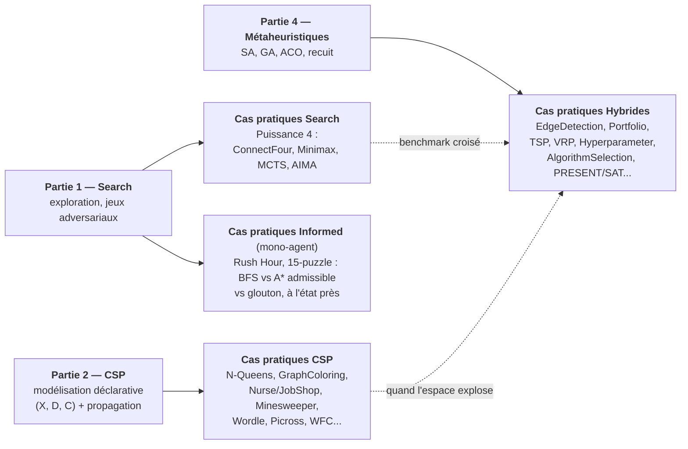
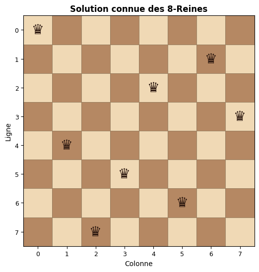
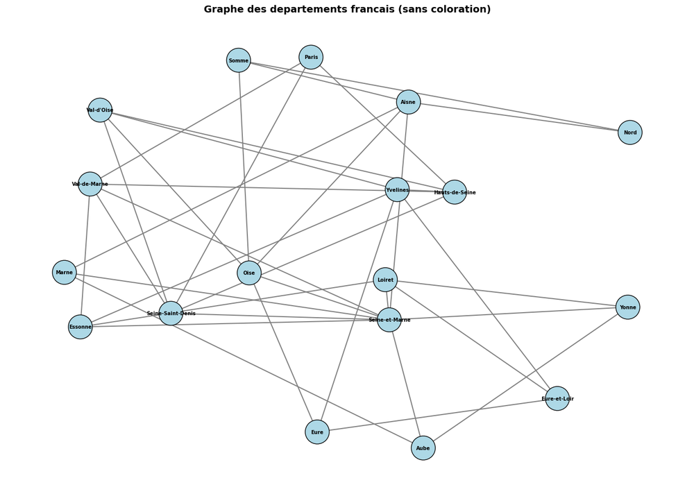
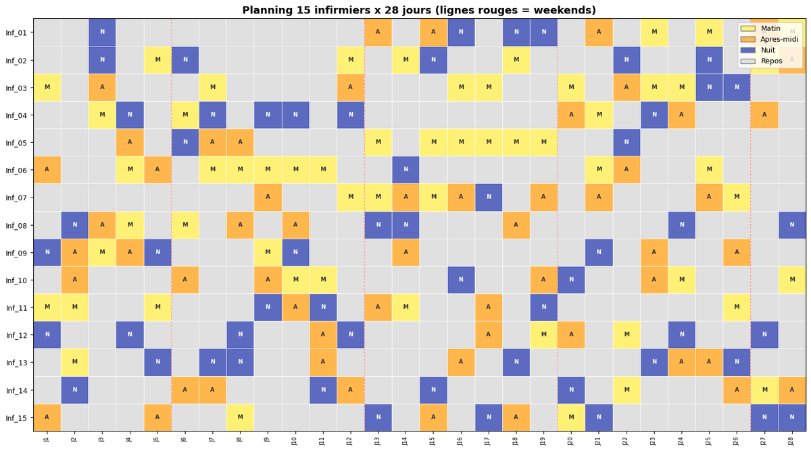
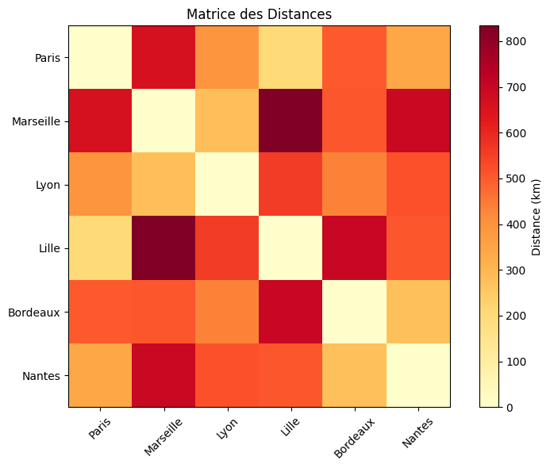
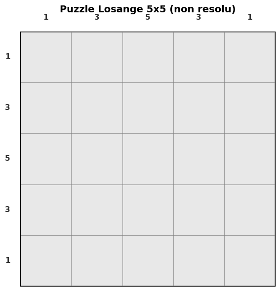
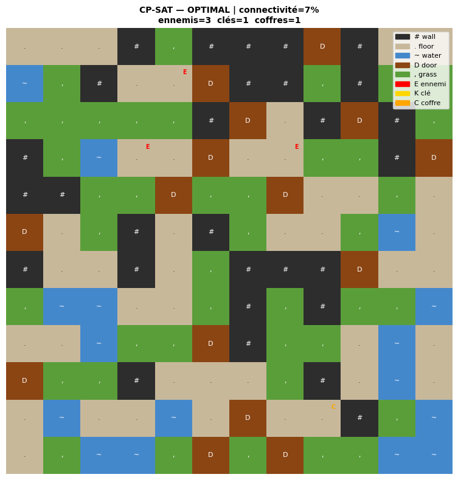

# Search — Partie 3 : Cas pratiques

[← Partie 2 : CSP](../Part2-CSP/README.md) | [↑ Série Search](../README.md) | [Partie 4 : Métaheuristiques →](../Part4-Metaheuristics/README.md)

C'est ici que la série Search se confronte au réel. Les notebooks d'application, pour la plupart adaptés de projets étudiants, prennent les algorithmes des Parties 1 et 2 et les mettent face à des problèmes qui ne se laissent pas faire : planifier les gardes d'un service hospitalier, ordonnancer un atelier, construire un calendrier sportif équitable, router une flotte de véhicules. Trois familles les organisent — **Search pur** (jeux combinatoires), **CSP** (satisfaction de contraintes) et **Hybride** (combinaisons de solveurs, modèles exacts et métaheuristiques) — et la plupart sont autonomes, avec des pointeurs vers les prérequis pertinents. À cela s'ajoutent les **jumeaux C#**, qui déroulent les mêmes algorithmes *from-scratch* en .NET en complément des versions Python invoquant des solveurs industriels : chaque jumeau partage la ligne de son numéro dans les tables de parcours ci-dessous.

Sous-série d'applications | Python 3.10+ (`ortools`, `python-sat`, `deap`, `mealpy`, `minizinc`, `optuna`, `rustuna`) ; .NET 9 (`dotnet-interactive`) pour les jumeaux C#. Les volumes (notebooks par famille, maturité) sont portés par le marqueur `CATALOG-STATUS` du [README de la série](../README.md) — aucun chiffre n'est maintenu ici en prose.

## Comment lire ce README

Un README de série se lit à plusieurs vitesses : le parcours par les numéros nus, l'approfondissement par les lettres, la recherche en cours par les carnets de niveau Recherche. Le principe est exposé à la racine du dépôt, dans [« Choisir sa vitesse de lecture »](https://github.com/jsboige/CoursIA#choisir-sa-vitesse-de-lecture).

- **Vous suivez le cœur de la partie** : les tables de parcours de haut en bas — [Puissance 4](#cas-pratiques-search--puissance-4), [CSP](#cas-pratiques-csp), [Hybrides](#cas-pratiques-hybrides--métaheuristiques), [Informed](#cas-pratiques-informed--puzzles-en-espace-détats) — chaque famille suppose les parties théoriques listées en [Prérequis par notebook](#prérequis-par-notebook).
- **Vous creusez un palier** : les jumeaux partagent la ligne de leur numéro (même arc, deux langages) ; les extensions lettrées vivent en [Approfondissements](#approfondissements).
- **Vous cherchez la recherche en cours** : les carnets de niveau Recherche (App-21, App-22, App-23, App-27) et la section [Références](#références).

## Pourquoi cette sous-série

Un algorithme compris sur un exemple jouet n'est pas encore un algorithme maîtrisé. Les applications servent trois apprentissages que les parties théoriques ne peuvent pas donner. D'abord la confrontation des méthodes : le même problème y est régulièrement résolu plusieurs fois — N-Queens en backtracking, en Min-Conflicts et en OR-Tools ; le TSP en recuit simulé, en génétique, en colonies de fourmis et en solveur de routage — et la comparaison chiffrée vaut tous les discours. Ensuite l'ordre de grandeur : voir un solveur de Picross gagner un facteur de plusieurs millions en passant au CP-SAT imprime durablement ce que « propagation » veut dire. Enfin la modélisation, qui est souvent toute la difficulté : le démineur devient un CSP doublé de probabilités, Wordle un problème de théorie de l'information, la génération procédurale de niveaux un Wave Function Collapse encodé en contraintes — autant de cas où trouver la bonne formulation est l'essentiel du travail.

## Objectifs d'apprentissage

À l'issue de cette sous-série, vous serez capable de :

1. **Transposer** les algorithmes de Search et CSP vers des problèmes réels (logistique, ordonnancement, jeux)
2. **Comparer** les approches (backtracking vs CP-SAT vs métaheuristiques) sur des instances concrètes
3. **Évaluer** les compromis performance/qualité entre méthodes exactes et approchées

## FAQ / Troubleshooting

| Problème | Solution |
|----------|----------|
| `ModuleNotFoundError: minizinc` | `pip install minizinc` — nécessaire pour App-5 (Timetabling) et App-8 (MiniZinc). Requiert aussi l'installation du solver MiniZinc |
| `ModuleNotFoundError: optuna` | `pip install optuna` — nécessaire pour App-18 (Hyperparameter Tuning) |
| `ModuleNotFoundError: rustuna` | `pip install rustuna` — nécessaire pour App-18c (Rustuna vs Optuna) ; statut expérimental, wheel `win_amd64`/`manylinux` cp311-abi3 |
| `ModuleNotFoundError: pygad` | `pip install pygad` — nécessaire pour App-9/10 (EdgeDetection, Portfolio) |
| App-9-CSharp/10-CSharp (.NET) : kernel non disponible | Installer .NET Interactive : `dotnet tool install --global Microsoft.dotnet-interactive --version 1.0.712001` |
| App-09-CSharp sous Linux : `DllNotFoundException` sur `cvextern`, ou `libgeotiff.so.5: cannot open shared object file` | Le runtime natif `Emgu.CV.runtime.mini.ubuntu-x64` est lié aux bibliothèques d'Ubuntu 24.04 x64 (FFmpeg 6, GTK 3, GStreamer) : `sudo apt install libgeotiff5 liblapack3 libopenjp2-7 libgstreamer-plugins-base1.0-0 libavcodec60 libavformat60 libswscale7 libgtk-3-0t64`. Sur une autre distribution, ces versions peuvent manquer |
| Certains solveurs sont lents (>30s) | Les instances sont intentionnellement petites pour le pédagogique. Pour des instances plus grandes, activer les timeouts dans CP-SAT (`model.parameters.max_time_in_seconds`) |

## Structure

```text
Part3-Cas-pratiques/          # dossier plat : carnets App-NN + jumeaux C#
├── data/                     # datasets cités par le code (appNN-* : identifiants inchangés)
└── assets/readme/            # figures du README (sorties d'exécution réelles)
```



---

## Cas pratiques Search — Puissance 4

Quatre notebooks autour du Puissance 4 — deux Python et deux C# — forment un banc d'essai de la recherche adversariale : assez simple pour être résolu, assez riche pour départager les approches. Un premier binôme construit les joueurs (aléatoire, Minimax α-β, MCTS, glouton, puis le framework AIMA de Russell & Norvig) ; le second compare systématiquement Minimax, Alpha-Beta et MCTS.

| # | Notebook | Ce qu'on y apprend | Public | Pour approfondir |
|---|----------|--------------------|--------|------------------|
| 1 | [App-12b-ConnectFour-Python](App-12b-ConnectFour-Python.ipynb) — jumeau [C#](App-12c-ConnectFour-CSharp.ipynb) | Puissance 4 : construire les joueurs — aléatoire, Minimax α-β, MCTS, glouton, framework AIMA (Russell & Norvig), tournoi round-robin. Le jumeau C# refait Minimax, Alpha-Beta, MCTS (UCB1), glouton et iterative deepening *from-scratch*, avec l'heuristique de fenêtres et le même tournoi (parité #4956) | Découverte | — |
| 2 | [App-14-ConnectFour-Adversarial-Python](App-14-ConnectFour-Adversarial-Python.ipynb) — jumeau [C#](App-14-ConnectFour-CSharp.ipynb) | Benchmark adversarial : Minimax, Alpha-Beta et MCTS comparés systématiquement. Le jumeau C# refait les trois *from-scratch*, mesure les nœuds explorés et rejoue le tournoi round-robin (parité #4956) | Licence | — |

---

## Cas pratiques CSP

Le gros de la sous-série, et un panorama de ce que la programmation par contraintes sait faire dès qu'on sort du manuel : des classiques fondateurs (N-Queens, coloration de graphes) aux problèmes d'ordonnancement réalistes (infirmiers, job-shop, emplois du temps, calendriers sportifs), en passant par des terrains plus inattendus — le démineur qui mêle contraintes et probabilités, Wordle lu comme un problème d'information, le Picross qui sert de leçon de vitesse, et la génération procédurale de niveaux par Wave Function Collapse.

Les classiques fondateurs d'abord : les N-Queens (App-1) — le banc d'essai canonique de la recherche avec contraintes, ici résolu sur 8 reines par la solution connue que toute la littérature partage :

[](App-01-NQueens-Python.ipynb)

La coloration de graphes (App-2) part, elle, du graphe d'adjacence des départements français métropolitains — encore sans couleur assignée ici, le tracé sert de support à l'illustration de la contrainte de différence par frontière :

[](App-02-GraphColoring-Python.ipynb)

Viennent ensuite les problèmes d'ordonnancement réalistes. Le planning infirmier (App-3) montre 15 infirmières réparties sur 28 jours, avec les créneaux Matin/Après-midi/Nuit, les jours de repos et les week-ends marqués en rouge :

[](App-03-NurseScheduling-Python.ipynb)

Le calendrier sportif (App-15) commence, lui, par ses données brutes : la matrice des distances entre les six villes de la ligue, à partir de laquelle le solveur équilibre les déplacements :

[](App-15-SportsScheduling-Python.ipynb)

Enfin, deux terrains où la modélisation est tout le travail. Le Picross (App-11) sert de leçon de vitesse : un puzzle 5×5 présenté avec ses indices de lignes et de colonnes — la grille encore vierge, à laisser au solveur CP-SAT le soin de noircir :

[](App-11-Picross-Python.ipynb)

La génération procédurale de niveaux (App-19) encode le Wave Function Collapse en CP-SAT — un niveau OPTIMAL produit par le solveur, avec un héros, trois ennemis, une clé et un coffre, sur un pavage de tuiles mur / sol / eau / porte / herbe :

[](App-19-ProceduralGeneration-WFC-Python.ipynb)

*Figures : sorties d'exécution réelles extraites des notebooks (non régénérées), downscalées ≤1200 px / ≤200 ko (EPIC #5654) — provenance détaillée dans [`assets/readme/MANIFEST.md`](assets/readme/MANIFEST.md).*

| # | Notebook | Ce qu'on y apprend | Public | Pour approfondir |
|---|----------|--------------------|--------|------------------|
| 1 | [App-01-NQueens-Python](App-01-NQueens-Python.ipynb) — jumeau [C#](App-01-NQueens-CSharp.ipynb) | Backtracking, Min-Conflicts et OR-Tools sur le banc d'essai canonique. Le jumeau C# décline le backtracking (simple, MRV, FC) et ajoute l'énumération complète avec symétrie D4 | Découverte | — |
| 2 | [App-02-GraphColoring-Python](App-02-GraphColoring-Python.ipynb) — jumeau [C#](App-02-GraphColoring-CSharp.ipynb) | Greedy, DSATUR et CP-SAT sur le graphe des départements français. Le jumeau C# ajoute Welsh-Powell, le backtracking χ exact et le graphe de Mycielski | Licence | [Validité statistique](App-02-GraphColoring-Statistical-Validity-Python.ipynb) |
| 3 | [App-03-NurseScheduling-Python](App-03-NurseScheduling-Python.ipynb) — jumeau [C#](App-03-NurseScheduling-CSharp.ipynb) | Contraintes dures et souples en CP-SAT : 15 infirmières, 28 jours, équité des charges. Le jumeau C# refait glouton, backtracking et min-conflicts *from-scratch* (modélisation 1 variable/slot, parité #4956) | Licence | — |
| 4 | [App-04-JobShopScheduling-Python](App-04-JobShopScheduling-Python.ipynb) — jumeau [C#](App-04-JobShopScheduling-CSharp.ipynb) | Intervalles, précédences et makespan en ordonnancement d'atelier. Le jumeau C# ajoute les dispatching heuristics (SPT/LPT/MOR/MWKR/FIFO) et un branch-and-bound optimal *from-scratch* avec Gantt ASCII (parité #4956) | Licence | — |
| 5 | [App-05-Timetabling-Python](App-05-Timetabling-Python.ipynb) — jumeau [C#](App-05-Timetabling-CSharp.ipynb) | Emplois du temps par MiniZinc et OR-Tools. Le jumeau C# refait glouton MRV et branch-and-bound optimal *from-scratch*, visualisation ASCII (parité #4956) | Licence | — |
| 6 | [App-06-Minesweeper-Python](App-06-Minesweeper-Python.ipynb) — jumeau [C#](App-06-Minesweeper-CSharp.ipynb) | Le démineur comme CSP doublé de probabilités (et de LLM). Le jumeau C# refait CSP backtracking et probabilités *from-scratch* (parité #4956) | Licence | — |
| 7 | [App-07-Wordle-Python](App-07-Wordle-Python.ipynb) — jumeau [C#](App-07-Wordle-CSharp.ipynb) | Wordle comme problème de théorie de l'information : filtrage CSP, entropie. Le jumeau C# refait filtrage, propagation de domaines et solveur par entropie de Shannon *from-scratch* (parité #4956) | Licence | — |
| 8 | [App-08-MiniZinc-Python](App-08-MiniZinc-Python.ipynb) — jumeau [C#](App-08-MiniZinc-CSharp.ipynb) | Syntaxe MiniZinc et contraintes globales. Le jumeau C# traduit les mêmes modèles en Google.OrTools CP-SAT — MiniZinc n'a pas de binding .NET (Prong A #3801, parité #4956) | Licence | — |
| 9 | [App-11-Picross-Python](App-11-Picross-Python.ipynb) — jumeau [C#](App-11-Picross-CSharp.ipynb) | Nonogrammes : le saut de paradigme mesuré — speedup 17.4x (10x10) à 4.64e+24x (15x15, extrapolé) en passant au CP-SAT. Le jumeau C# fait énumération de motifs et propagation par intersection (point fixe), naïf contre propagation | Licence | — |
| 10 | [App-15-SportsScheduling-Python](App-15-SportsScheduling-Python.ipynb) — jumeau [C#](App-15-SportsScheduling-CSharp.ipynb) | Calendrier sportif : contraintes TV, équité, déplacements. Le jumeau C# refait le problème en Google.OrTools CP-SAT natif .NET, round-robin et équilibre déplacements/domicile (parité #4956) | Licence | — |
| 11 | [App-16-Crossword-CSP-Python](App-16-Crossword-CSP-Python.ipynb) — jumeau [C#](App-16-Crossword-CSP-CSharp.ipynb) | Mots croisés : backtracking, OR-Tools, génération. Le jumeau C# refait backtracking et propagation de domaines *from-scratch*, là où le Python s'appuie sur OR-Tools CP-SAT (parité #4956) | Licence | — |
| 12 | [App-19-ProceduralGeneration-WFC-Python](App-19-ProceduralGeneration-WFC-Python.ipynb) — jumeau [C#](App-19-ProceduralGeneration-WFC-CSharp.ipynb) | Génération procédurale de niveaux : Wave Function Collapse encodé en CP-SAT. Le jumeau C# implémente l'algorithme de Gumin *from-scratch* — effondrement progressif et propagation de contraintes (parité #4956) | Licence | — |
| 13 | [App-20-SudokuBenchmark-Python](App-20-SudokuBenchmark-Python.ipynb) — jumeau [C#](App-20-SudokuBenchmark-CSharp.ipynb) | Benchmark comparatif de solveurs Sudoku — un problème NP-complet. Le jumeau C# ajoute backtracking naïf/MRV, AC-3 et Dancing Links (Knuth) *from-scratch*, benchmark sur trois difficultés (parité #4956) | Licence | — |
| 14 | [App-21-VoiceLeading-Python](App-21-VoiceLeading-Python.ipynb) | Hommage Munkres : voice leading chorale par affectation (Kuhn-Munkres via scipy) et audit/réparation du contrepoint de Fux en CP-SAT — encodage issu des projets étudiants EPITA PrCon (H1/H1_V2) | Recherche | — |

---

## Cas pratiques Hybrides / Métaheuristiques

Quand l'espace est trop vaste ou l'objectif trop irrégulier pour les méthodes exactes, place aux métaheuristiques : détection de contours et optimisation de portefeuille par algorithmes génétiques (avec leurs doublons C#/GeneticSharp en side-track .NET), TSP et VRP attaqués par quatre méthodes concurrentes, et le réglage d'hyperparamètres ML — où la boucle se referme : on optimise l'optimiseur.

| # | Notebook | Ce qu'on y apprend | Public | Pour approfondir |
|---|----------|--------------------|--------|------------------|
| 1 | [App-09-EdgeDetection-Python](App-09-EdgeDetection-Python.ipynb) — jumeau [C#](App-09-EdgeDetection-CSharp.ipynb) | Algorithmes génétiques pour découvrir des filtres de convolution. Le jumeau C# transpose le problème en GeneticSharp (.NET) | Licence | [Partie 4 — Métaheuristiques](../Part4-Metaheuristics/README.md) |
| 2 | [App-10-Portfolio-Python](App-10-Portfolio-Python.ipynb) — jumeau [C#](App-10-Portfolio-CSharp.ipynb) | Optimisation multi-objectif et frontière de Pareto par algorithme génétique. Le jumeau C# transpose le problème en GeneticSharp (.NET) | Licence | — |
| 3 | [App-13-TSP-Metaheuristics-Python](App-13-TSP-Metaheuristics-Python.ipynb) — jumeau [C#](App-13-TSP-Metaheuristics-CSharp.ipynb) | Le TSP attaqué par quatre méthodes concurrentes : recuit simulé, génétique, colonies de fourmis, OR-Tools routing. Le jumeau C# refait force brute, plus proche voisin, 2-opt et recuit simulé sur permutations *from-scratch* | Licence | — |
| 4 | [App-17-VRP-Logistics-Python](App-17-VRP-Logistics-Python.ipynb) — jumeaux [C#](App-17-VRP-Logistics-CSharp.ipynb) et [Python](App-17-VRP-Logistics-Metaheuristiques-Python.ipynb) | Tournées de véhicules : recuit, GA, ACO et CP-SAT confrontés. Les jumeaux refont Nearest-Neighbor, cheapest-insertion, 2-opt et recuit simulé *from-scratch* — le Python vérifie ses solutions contre OR-Tools | Licence | — |
| 5 | [App-18-HyperparameterTuning-Python](App-18-HyperparameterTuning-Python.ipynb) — jumeaux [C#](App-18-HyperparameterTuning-CSharp.ipynb) et [Python](App-18-HyperparameterTuning-Implementation-Manuelle-Python.ipynb) | Optimisation ML : bayésienne, GA, PSO, Optuna — la boucle qui se referme, on optimise l'optimiseur. Les jumeaux refont Grid/Random Search, GP-EI, GA et PSO *from-scratch* sur l'objectif k-NN CV 5-fold (parité #4956) | Licence | [Rustuna vs Optuna](App-18c-HyperparameterTuning-Rustuna-vs-Optuna-Python.ipynb) |
| 6 | [App-22-AlgorithmSelection-Python](App-22-AlgorithmSelection-Python.ipynb) | Sélection empirique d'algorithmes : 3 jeux (Sudoku, Puissance 4, Wordle), 13 familles conceptuelles / 14 étiquettes mesurées, non-commensurabilité des métriques + frontières de Pareto + choix sous préférences — hommage PR IS #42 (Théodore Deguest) | Recherche | — |
| 7 | [App-23-PRESENT-Differential-Cryptanalysis-SAT-Python](App-23-PRESENT-Differential-Cryptanalysis-SAT-Python.ipynb) | PRESENT : DDT, compression d'implicants, CNF pondérée, frontière SAT/UNSAT du meilleur trail et limites de certification — distillation PrCon F2 (Théodore Deguest) | Recherche | — |
| 8 | [App-27-Sparse-Index-Tracking-Walk-Forward-Python](App-27-Sparse-Index-Tracking-Walk-Forward-Python.ipynb) | Sparse index tracking : modèle CP-SAT vérifiable, walk-forward sans fuite et lecture pédagogique des résultats QuantConnect réels — une recherche, deux lectures — distillation PrCon M2 (Godric Bouteloup) | Recherche | [Sparse-Index-Tracking-QC](../../QuantConnect/projects/Sparse-Index-Tracking-QC/README.md) |

---

## Cas pratiques Informed — puzzles en espace d'états

Le terrain d'application le plus direct de la [Partie 1](../Part1-Foundations/README.md) : des puzzles en espace d'états où la recherche mono-agent s'applique sans solveur industriel en contrepoint — la stratégie non informée sert de baseline dans le même carnet. Le Rush Hour confronte les trois stratégies de base (BFS, A\* à heuristique admissible, recherche gloutonne) sur des instances générées par scramble, à l'état près, pour rendre mesurable le rendement de l'heuristique et le prix de l'abandon de l'optimalité. Le 15-puzzle prolonge le même geste sur l'exemple canonique de l'A\* : deux heuristiques admissibles mesurées l'une contre l'autre, la résolvabilité lue dans la parité des inversions, et un glouton sous-optimal en contrepoint.

| # | Notebook | Ce qu'on y apprend | Public | Pour approfondir |
|---|----------|--------------------|--------|------------------|
| 1 | [App-33-RushHour-Admissible-Astar-Python](App-33-RushHour-Admissible-Astar-Python.ipynb) | Rush Hour 6x6 : BFS, A\* (heuristique admissible par comptage des voitures bloquantes) et recherche gloutonne *from-scratch* (stdlib Python seule), instances générées par scramble, benchmark à l'état près | Découverte | — |
| 2 | [App-34-15Puzzle-Admissible-Astar-Python](App-34-15Puzzle-Admissible-Astar-Python.ipynb) — jumeau [C#](App-34-15Puzzle-Admissible-Astar-CSharp.ipynb) | 15-puzzle : A\* et heuristiques admissibles **mesurées** (Manhattan contre linear conflict), résolvabilité par parité des inversions, contraste avec un glouton sous-optimal. Le jumeau C# refait l'espace d'états en .NET avec l'état encodé dans un `ulong` (4 bits par case, parité #4956) | Licence | — |

## Approfondissements

Les extensions lettrées creusent un palier du parcours ; elles ne le font pas avancer.

### Autour de 2 — GraphColoring

L'[extension de validité statistique](App-02-GraphColoring-Statistical-Validity-Python.ipynb) confronte les classements observés sur une instance à ce que la statistique autorise à conclure cross-instance : bootstrap, Mann-Whitney, taille d'effet et densité. Prérequis en plus : statistiques, `scipy`.

### Autour de 5 — HyperparameterTuning

Le [pont SOTA Rustuna vs Optuna](App-18c-HyperparameterTuning-Rustuna-vs-Optuna-Python.ipynb) mesure ce qu'un binding Rust apporte à l'optimisation d'hyperparamètres : Random numpy / Optuna TPE / Rustuna TPE sur l'objectif k-NN CV d'App-18-Python, speedup mesuré sur deux régimes, audit d'une dépendance expérimentale (bug `best_trial` mesuré). Prérequis en plus : `rustuna` (statut expérimental).

---

## Prérequis par notebook

### Puissance 4 (Search)

| Notebook | Fondations requises |
|----------|--------------------|
| App-12b ConnectFour | Search-3 (A*), Search-4 (LocalSearch) |
| App-14 ConnectFour-Adversarial | Search-3 (Heuristiques), Search-6 (AdversarialSearch) |
| App-14-CSharp | Search-3 (Heuristiques), Search-6 (AdversarialSearch) |
| App-12c-CSharp | Search-6 (AdversarialSearch), Search-7 (MCTS) |

### Cas pratiques CSP

| Notebook | Fondations requises | Dépendances |
|----------|--------------------|-------------|
| App-1 NQueens | CSP-1 (Fundamentals) | - |
| App-01-CSharp NQueens | CSP-1 (Fundamentals) | dotnet-interactive |
| App-2 GraphColoring | CSP-1, CSP-2 | networkx |
| App-02-CSharp GraphColoring | CSP-1, CSP-2 | dotnet-interactive |
| App-2c GraphColoring Statistical Validity | CSP-1, CSP-2, statistiques | networkx, scipy, ortools |
| App-3 NurseScheduling | CSP-3, CSP-4 | ortools |
| App-03-CSharp NurseScheduling | CSP-3, CSP-4 | dotnet-interactive |
| App-4 JobShopScheduling | CSP-3, CSP-4 | ortools |
| App-04-CSharp JobShopScheduling | CSP-3, CSP-4 | dotnet-interactive |
| App-5 Timetabling | CSP-3 | minizinc |
| App-05-CSharp Timetabling | CSP-3 | dotnet-interactive |
| App-6 Minesweeper | CSP-2 (Consistency) | - |
| App-6 Minesweeper (C#) | CSP-2 (Consistency) | dotnet-interactive |
| App-7 Wordle | CSP-1, CSP-2 | - |
| App-07-CSharp Wordle | CSP-1, CSP-2 | dotnet-interactive |
| App-8 MiniZinc | CSP-3 | minizinc |
| App-8 MiniZinc (C#) | CSP-3 | dotnet-interactive, Google.OrTools |
| App-11 Picross | CSP-3, Search-8 (DLX) | ortools |
| App-11-CSharp Picross | CSP-1, CSP-3 (Propagation) | dotnet-interactive |
| App-15 SportsScheduling | CSP-3, CSP-4 | ortools |
| App-15-CSharp SportsScheduling | CSP-3, CSP-4 | dotnet-interactive, Google.OrTools |
| App-16 Crossword-CSP | CSP-1, CSP-2 | ortools |
| App-16 Crossword-CSP (C#) | CSP-1, CSP-2 | dotnet-interactive |
| App-19 ProceduralGeneration-WFC | CSP-1, CSP-3 | ortools, numpy, matplotlib |
| App-19 ProceduralGeneration-WFC (C#) | CSP-1, CSP-3 | dotnet-interactive |
| App-20 SudokuBenchmark | CSP-1, CSP-3, Search-8 (DLX) | ortools |
| App-20 SudokuBenchmark (C#) | CSP-1, CSP-3, Search-8 (DLX) | dotnet-interactive |
| App-21 VoiceLeading | affectation, CSP-3 | scipy, ortools |

### Cas pratiques Hybrides

| Notebook | Fondations requises | Dépendances |
|----------|--------------------|-------------|
| App-9 EdgeDetection | Search-5 (GA) | pygad, scikit-image |
| App-09-CSharp EdgeDetection | Search-5 (GA) | GeneticSharp (.NET) |
| App-10 Portfolio | Search-5 (GA), Search-9 (PL) | pygad |
| App-10-CSharp Portfolio | Search-5 (GA) | GeneticSharp (.NET) |
| App-13 TSP-Metaheuristics | Search-4, Search-5 | ortools |
| App-13-CSharp TSP-Metaheuristics | Search-4 (LocalSearch), Search-11 (SA) | dotnet-interactive |
| App-17 VRP-Logistics | Search-4, Search-5, CSP-3 | ortools |
| App-17-CSharp VRP-Logistics | Search-4 (LocalSearch), Search-5 (SA) | dotnet-interactive |
| App-17-Python VRP-Logistics | Search-4 (LocalSearch), Search-5 (SA) | numpy, ortools |
| App-18 HyperparameterTuning | Search-4, Search-5 | optuna, scikit-learn |
| App-18-Python HyperparameterTuning (C#) | Search-4, Search-5 | dotnet-interactive |
| App-18-Python HyperparameterTuning (Python) | Search-4, Search-5 | numpy, scipy, optuna |
| App-18c HyperparameterTuning Rustuna-vs-Optuna | App-18-Python (terrain k-NN CV), Search-5 | numpy, optuna, rustuna |
| App-22 AlgorithmSelection-Python | MGS-16 (Rice / No Free Lunch) | pandas, numpy, matplotlib |
| App-23 PRESENT Differential Cryptanalysis | SAT, CNF, bit-vectors | python-sat, numpy, matplotlib |
| App-27 Sparse Index Tracking Walk-Forward | CSP-3 (CP-SAT), CSP-5 (optimisation), App-10 (portefeuille) | ortools, pandas, numpy |

### Cas pratiques Informed

| Notebook | Fondations requises | Dépendances |
|----------|--------------------|-------------|
| App-33 RushHour | Search-1 (espace d'états), Search-2 (BFS), Search-3 (A*) | Python 3.10+ (stdlib seule) |
| App-34 15Puzzle | Search-1 (espace d'états), Search-2 (BFS), Search-3 (A*) | numpy, matplotlib |
| App-34-CSharp 15Puzzle | Search-1 (espace d'états), Search-2 (BFS), Search-3 (A*) | dotnet-interactive |

## Origine des projets

La plupart des notebooks d'application sont adaptés de projets étudiants réalisés dans le cadre de cours d'IA. Les références spécifiques sont indiquées dans chaque notebook.

Le [App-22-AlgorithmSelection-Python](App-22-AlgorithmSelection-Python.ipynb) est un cas particulier : il **distille** un projet étudiant — **Théodore Deguest**, *« Benchmark cross-paradigme de solveurs de jeux »*, PR [IS #42](https://github.com/jsboigeEpita/2026-Epita-Intelligence-Symbolique/pull/42) — sans en recopier le code. Les solveurs restent dans le dépôt source ; seules les données de résultats sont réutilisées (licence MIT, attribution conservée), et l'analyse est nouvelle et porte la marque CoursIA.

Le [App-23-PRESENT-Differential-Cryptanalysis-SAT-Python](App-23-PRESENT-Differential-Cryptanalysis-SAT-Python.ipynb) distille le projet PrCon F2 de **Théodore Deguest**, *« Cryptanalyse différentielle de PRESENT via SAT »*, PR [PrCon #49](https://github.com/jsboigeEpita/2026-Epita-Programmation-par-Contraintes/pull/49). Le notebook reconstruit l'expérience de façon autonome, reproduit la DDT et les frontières SAT/UNSAT, corrige le seuil documentaire à R=15/W=66 et distingue explicitement trail, cluster et niveau de preuve.

Le [App-27-Sparse-Index-Tracking-Walk-Forward-Python](App-27-Sparse-Index-Tracking-Walk-Forward-Python.ipynb) distille le projet PrCon M2 de **Godric Bouteloup**, *« Sparse Index Tracking »*, PR [PrCon #52](https://github.com/jsboigeEpita/2026-Epita-Programmation-par-Contraintes/pull/52). Le notebook conserve la modélisation CP-SAT en lots entiers, mais reconstruit l'expérience sur un marché synthétique seedé : cardinalité exacte, turnover entre rebalancements consécutifs, validation indépendante, choix de K avant le test et statut/borne/gap explicites. Il matérialise aussi un protocole contaminé pour montrer qu'un score obtenu après consultation du test est ininterprétable, qu'il paraisse meilleur ou moins bon. Cette lecture de méthode reprend ensuite, sans relancer de recherche de marché, les résultats autoritatifs du projet [Sparse-Index-Tracking-QC](../../QuantConnect/projects/Sparse-Index-Tracking-QC/README.md) intégré par la PR CoursIA [#14068](https://github.com/jsboige/CoursIA/pull/14068) : 703 contre 1 414 ordres, mais pas de domination sparse sur les performances ni sur le turnover. **Une recherche, deux lectures.** Provenance : [`data/app27-sparse-index-tracking/SOURCE.md`](data/app27-sparse-index-tracking/SOURCE.md).

---

## Ponts inter-séries

| Série | Lien | Relation |
| ------- | ------ | ---------- |
| [Partie 1 : Search](../Part1-Foundations/README.md) | Fondamentaux | Source des algorithmes utilisés |
| [Partie 2 : CSP](../Part2-CSP/README.md) | Programmation par contraintes | Solveurs CP-SAT, MiniZinc |
| [Search (parent)](../README.md) | Vue d'ensemble | Contexte et parcours global |
| [ML/ML.Net](../../ML/ML.Net/) | App-18 (HyperparameterTuning) | Optimisation bayésienne + GA |
| [QuantConnect](../../QuantConnect/) | App-27 (Sparse Index Tracking) | Épreuve réelle autoritaire déjà intégrée : backtests QC Cloud sparse/full, frais explicites et lecture conjointe cardinalité–ordres–turnover |
| [Sudoku](../../Sudoku/) | App-11 (Picross), App-1 (NQueens) | Problèmes combinatoires similaires |
| [GameTheory](../../GameTheory/) | App-12/App-14 (ConnectFour) | Jeux à deux joueurs, MCTS |

### Rush Hour en Python et C#

[Python](App-33-RushHour-Admissible-Astar-Python.ipynb) et [C#](App-33-RushHour-Admissible-Astar-CSharp.ipynb) comparent BFS, A* et glouton sur six variantes. Les générateurs aléatoires diffèrent, tandis que les règles de glissement et les budgets de sélection sont communs.

## Références

Couverture par application des sources fondatrices mobilisées dans cette sous-série. Les références transversales (formalisation en espace d'états, backtracking, A*, recherche locale, métaheuristiques) sont reprises dans les READMEs des [Parties 1](../Part1-Foundations/README.md), [2](../Part2-CSP/README.md) et [4](../Part4-Metaheuristics/README.md) : ce tableau ne couvre que les sources spécifiques aux applications.

| Application(s) | Référence |
|-------------|-----------|
| App-1 (NQueens), App-2 (GraphColoring), App-3 (NurseScheduling), App-4 (JobShop), App-5 (Timetabling), App-15 (SportsScheduling), App-16 (Crossword) | Russell, S., & Norvig, P. — *Artificial Intelligence: A Modern Approach* (4e éd., 2021), ch. « Constraint Satisfaction Problems ». Formalisation (X, D, C) et backtracking avec MRV/LCV. |
| App-1, App-2, App-3, App-4, App-11, App-15, App-16 (solveur) | Perron, L., & Furnon, V. — *OR-Tools CP-SAT* (Google). Propagation par clauses paresseuses (LCG), à l'origine du facteur « plusieurs millions » constaté sur le Picross (App-11). |
| App-5 (Timetabling), App-8 (MiniZinc) | Nethercote, N., Stuckey, P. J., Becket, R., Brand, S., Duck, G. J., & Tack, G. (2007) — « MiniZinc: Towards a Standard CP Modelling Language », *CP 2007*, LNCS 4741. |
| App-6 (Minesweeper), App-7 (Wordle) | AIMA, ch. « Probabilistic Reasoning » (CSP doublé de probabilités pour le démineur) ; Cover, T. M., & Thomas, J. A. — *Elements of Information Theory* (2e éd., 2006), Wiley. Entropie et théorie de l'information mobilisées pour le filtrage optimal des hypothèses dans Wordle. |
| App-11 (Picross) | Knuth, D. E. (2000) — « Dancing Links », dans *Millennial Perspectives in Computer Science* (Springer). Couverture exacte, formulation à l'origine du backtracking naïf sur les nonogrammes avant le saut vers CP-SAT. |
| App-12b, App-14 (ConnectFour) | Browne, C. B., Powley, E., et al. (2012) — « A Survey of Monte Carlo Tree Search Methods », *IEEE Trans. on Computational Intelligence and AI in Games* 4(1) ; et AIMA, ch. « Adversarial Search » (Minimax, élagage Alpha-Beta). |
| App-9 (EdgeDetection), App-10 (Portfolio) | Holland, J. H. (1975) — *Adaptation in Natural and Artificial Systems*, University of Michigan Press. Algorithmes génétiques à la base de la recherche de filtres de convolution (App-9) et de l'optimisation de portefeuille (App-10). |
| App-10 (Portfolio, multi-objectif) | Markowitz, H. (1952) — « Portfolio Selection », *The Journal of Finance* 7(1) — frontière efficiente ; et Deb, K. (2001) — *Multi-Objective Optimization using Evolutionary Algorithms*, Wiley — optimisation évolutionnaire multi-objectif (frontière de Pareto). |
| App-13 (TSP), App-17 (VRP) | Applegate, D. L., Bixby, R. E., Chvátal, V., & Cook, W. J. (2006) — *The Traveling Salesman Problem: A Computational Study*, Princeton University Press ; Toth, P., & Vigo, D. (2014) — *Vehicle Routing: Problems, Methods, and Applications*, SIAM (2e éd.) ; et Dorigo, M., & Gambardella, L. M. (1997) — « Ant colonies for the traveling salesman problem », *IEEE Trans. on Evolutionary Computation* 1(2) — colonies de fourmis. |
| App-18 (HyperparameterTuning) | Snoek, J., Larochelle, H., & Adams, R. P. (2012) — « Practical Bayesian Optimization of Machine Learning Hyperparameters », *NeurIPS* ; et Kennedy, J., & Eberhart, R. (1995) — « Particle Swarm Optimization », *Proc. IEEE Int. Conf. on Neural Networks*. |
| App-22 (AlgorithmSelection-Python) | Rice, J. R. (1976) — « The Algorithm Selection Problem », *Advances in Computers* 15, pp. 65-118 ; et Wolpert, D. H., & Macready, W. G. (1997) — « No Free Lunch Theorems for Optimization », *IEEE Trans. on Evolutionary Computation* 1(1), pp. 67-82. |
| App-23 (PRESENT Differential Cryptanalysis SAT) | Bogdanov, A., et al. (2007) — « PRESENT: An Ultra-Lightweight Block Cipher », *CHES 2007* ; Tseitin, G. S. (1968) — transformations CNF ; Eén, N., & Sörensson, N. (2006) — « Translating Pseudo-Boolean Constraints into SAT ». |
| App-19 (ProceduralGeneration-WFC) | Gumin, M. (2016) — *WaveFunctionCollapse*, github.com/mxgmn/WaveFunctionCollapse. Génération procédurale de niveaux par propagation de contraintes. |
| App-27 (Sparse Index Tracking Walk-Forward) | Beasley, J. E., Meade, N., & Chang, T.-J. (2003) — « An Evolutionary Heuristic for the Index Tracking Problem », *European Journal of Operational Research* 148(3) ; Bailey, D. H., Borwein, J. M., López de Prado, M., & Zhu, Q. J. (2014) — « Pseudo-Mathematics and Financial Charlatanism: The Effects of Backtest Overfitting on Out-of-Sample Performance », *Notices of the AMS* 61(5). |

## Conclusion / Prochaines étapes

### Ce que vous avez appris

Cette sous-série est le lieu de la **confrontation**. Les algorithmes des Parties 1 et 2, compris sur des exemples jouets, y sont mis à l'épreuve de problèmes qui ne se laissent pas réduire — et l'enseignement principal n'est pas « tel algorithme résout tel problème », mais trois leçons transversales que seule la pratique donne :

- **La confrontation des méthodes** — un même problème, résolu plusieurs fois, pour que la comparaison chiffrée parle d'elle-même. Les N-Queens (App-1) le sont en backtracking, en Min-Conflicts puis en OR-Tools ; le TSP (App-13) en recuit simulé, en génétique, en colonies de fourmis et en solveur de routage ; le Puissance 4 (App-12b, App-14) en Minimax, Alpha-Beta et MCTS. Le verdict change avec le problème : là où l'exact domine sur les petites instances, l'approché prend le relais dès que l'espace explose — c'est ce basculement, observé et non raconté, qui est l'enseignement.
- **L'ordre de grandeur** — voir un solveur de Picross (App-11) gagner un facteur de plusieurs millions en passant au CP-SAT imprime durablement ce que « propagation » veut dire. Ce n'est pas un détail d'implémentation : c'est le saut de paradigme de la Partie 2 qui devient tangible, mesuré sur un cas où le backtracking naïf s'effondre.
- **La modélisation comme vrai travail** — le démineur (App-6) devient un CSP doublé de probabilités, Wordle (App-7) un problème de théorie de l'information, la génération procédurale (App-19) un Wave Function Collapse encodé en contraintes. Trouver la bonne formulation y est souvent toute la difficulté — et toute la clé.

Le pont entre les deux cultures de la recherche s'exprime dans les notebooks Hybrides : dès que l'espace devient trop vaste (VRP, App-17) ou l'objectif trop irrégulier (portefeuille multi-objectif, App-10), les méthodes exactes cèdent la place aux métaheuristiques — et App-18 (HyperparameterTuning) referme la boucle en optimisant l'optimiseur lui-même.

### Prochaines étapes

- **Retour aux fondements** : les applications supposent les Parties 1 et 2 maîtrisées. Face à une difficulté de modélisation, revenir à la [Partie 1 (Search)](../Part1-Foundations/README.md) pour les algorithmes d'exploration et à la [Partie 2 (CSP)](../Part2-CSP/README.md) pour la modélisation déclarative — c'est là que se joue la compétence de formulation que ces applications exercent.
- **Approfondir les métaheuristiques** : les notebooks Hybrides (App-9, App-13, App-17) sont l'amorce de la [Partie 4](../Part4-Metaheuristics/README.md), qui reconstruit les métaheuristiques depuis leurs primitives au-dessus de MetaGeneticSharp — y compris les doublons C# (App-09-CSharp, App-10-CSharp) qui s'y rattachent directement.
- **Vers les séries voisines** : selon le problème qui vous a intéressé, les prolongements naturels vont vers [ML/ML.Net](../../ML/ML.Net/README.md) (App-18, optimisation bayésienne), [Sudoku](../../Sudoku/README.md) (problèmes combinatoires similaires) et [GameTheory](../../GameTheory/README.md) (jeux à deux joueurs, MCTS).
- **La série dans son ensemble** : le [sommaire Search](../README.md) replace cette sous-série dans le parcours global — elle en est le terrain d'application, où la théorie rencontre le réel.

## Navigation

[← Partie 2 : CSP](../Part2-CSP/README.md) | [↑ Série Search](../README.md) | [Partie 4 : Métaheuristiques →](../Part4-Metaheuristics/README.md)
