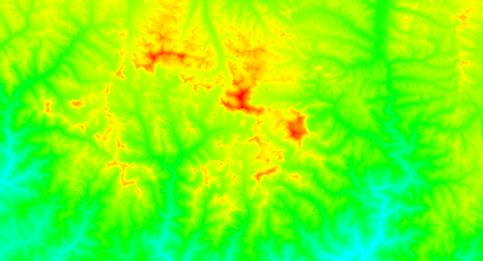

# Partie 4 : Metaheuristiques Composables (MetaGeneticSharp)

[↑ Série Search](../README.md) | [← Partie 3 : Cas pratiques](../Part3-Cas-pratiques/README.md) | [Notebooks MGS →](MGS-01-Introduction.ipynb)

## Ouverture — ce que cette partie enseigne (Découverte)

Comment passer de l'application *d'une* métaheuristique à la **composition** de plusieurs ? Cette partie est le versant .NET de la série : elle reconstruit les métaheuristiques publiées (Whale Optimization, Equilibrium Optimizer, Differential Evolution, Bare-Bones PSO, modèle insulaire) à partir de **primitives réutilisables** plutôt que comme des monolithes opaques. La bibliothèque en jeu est [MetaGeneticSharp](https://github.com/jsboige/MetaGeneticSharp) ; les carnets .NET Interactive (C#) de la partie en sont le fil conducteur : un algorithme doit pouvoir s'énoncer en quelques lignes déclaratives, et chaque brique (sélection, croisement, mutation, réinsertion) doit pouvoir être interceptée et recomposée.

L'arc part de la grammaire fluente et de la reconstruction des composés publiés (MGS-1 à 5), passe par la confrontation honnête sur bancs (MGS-6, 7), caractérise les biais de l'optimiseur — centrage (MGS-10), rotation (MGS-12), synergie d'îles (MGS-11 et 14) — et culmine sur le **No-Free-Lunch** : quatre capstones réunissent ses réponses classiques — mesurer le paysage (MGS-15), sélectionner l'algorithme (MGS-16), contrôler le paramètre pendant la course (MGS-17), éprouver le tout sur le banc CEC shift+rotate combiné (MGS-18). Viennent ensuite le **démontage** (MGS-19 : l'opérateur de Metropolis débranché du compound SA et éprouvé seul), l'**inversion de la question** (MGS-21 : sur le Sudoku, le choix de l'espace de recherche pèse plus que le choix du moteur) et la **confrontation externe systématique** (les carnets MGS-22 à MGS-31 de la [sous-série MGS vs mealpy](#sous-séries-découverte)).

Et cette composition se *voit* : avant de choisir un algorithme, MGS-8 rend le paysage de fitness en vraie heatmap graphique — chaque pixel coloré selon sa valeur de fitness, l'optimum global marqué en clair.

[](MGS-08-LandscapeExplorer.ipynb)

Le paysage se laisse aussi regarder dans le temps, dans le relief et après une rotation :

[](MGS-08-LandscapeExplorer.ipynb)

[](MGS-09-EverestRelief.ipynb)

[](MGS-13-LandscapeDebias.ipynb)

Les descriptions visuelles vérifiées de ces figures sont cataloguées dans [`assets/readme/MANIFEST.md`](assets/readme/MANIFEST.md).

Contrairement aux Parties 1 et 2 (notebooks Python avec OR-Tools, DEAP, mealpy), cette partie est un **side track C# .NET 9** : elle consomme GeneticSharp et la couche métaheuristique comme sous-modules, et s'exécute via le kernel `dotnet-interactive`. C'est le pont entre la série pédagogique Python et une vraie bibliothèque de code industrialisable — la démonstration que les concepts vus en Python ([Search-5 génétique](../Part1-Foundations/Search-05-GeneticAlgorithms.ipynb), [Search-11 métaheuristiques](../Part1-Foundations/Search-11-Metaheuristics.ipynb)) se retrouvent, solidement typés et composables, dans un runtime .NET.

**À qui elle s'adresse.** Un lecteur qui a suivi les Parties 1 et 2 — notion de population, opérateurs génétiques, métaheuristiques — et qui veut les *construire* plutôt que les invoquer. Les prérequis d'exécution (SDK .NET, `dotnet-interactive`, sous-module `MetaGeneticSharp` construit) sont en [Installation](#installation).

**Positionnement : MetaGeneticSharp dans le paysage.** La bibliothèque occupe un point que les autres n'occupent pas : l'expressivité déclarative de mealpy (un algorithme en quelques lignes) sur la représentation agnostique de GeneticSharp (chaînes de bits, permutations, arbres).

| Bibliothèque | Langage | Représentation | Philosophie |
|--------------|---------|----------------|------------|
| **MetaGeneticSharp** | C# .NET 9 | Agnostique (gènes = interfaces GeneticSharp) | **Composants > métaphores** : algorithmes reconstruits depuis des primitives composables |
| GeneticSharp | C# .NET | Agnostique (bit, permutation, arbre, float) | Bibliothèque GA classique, opérateurs en interfaces |
| mealpy | Python | Vecteurs (continus surtout) | Catalogue large, tronc commun vectoriel, très compact |
| HeuristicLab | C# .NET | Plugin-based, GUI lourde | Plateforme d'expérimentation, optimisation interactive |

C'est le « child project » que [GeneticSharp PR #87](https://github.com/giacomelli/GeneticSharp/pull/87) suggérait de devenir : la couche métaheuristiques du PR, absorbée dans un moteur autonome au-dessus d'un GeneticSharp vanilla.

## Comment lire ce README (Découverte)

Un README de série se lit à plusieurs vitesses : le parcours principal par les numéros nus, l'approfondissement par les lettres, la recherche en cours par la sous-série et « Pour aller plus loin ». Le principe est exposé à la racine du dépôt, dans [« Choisir sa vitesse de lecture »](../../../README.md#choisir-sa-vitesse-de-lecture).

- **Vous découvrez** : la table du [parcours principal](#parcours-principal-découverte), de haut en bas (les numéros 1 à 21) — les numéros nus suffisent à suivre l'arc complet, de la composition d'une métaheuristique jusqu'à la représentation du problème.
- **Vous creusez un palier** : la section [Approfondissements](#approfondissements-découverte) — un carnet à lettre ajoute un angle à son numéro d'ancrage et n'est pas nécessaire au fil.
- **Vous cherchez la recherche en cours** : la [sous-série MGS vs mealpy](#sous-séries-découverte), puis [« Pour aller plus loin »](#pour-aller-plus-loin--niveau-recherche).

Cette partie se compose de carnets .NET Interactive (C#), hébergés dans ce répertoire et consommant le sous-module voisin [`MetaGeneticSharp/`](../MetaGeneticSharp/). Deux exceptions : le carnet MGS-17b tourne sous un noyau Python, et MGS-20 existe en deux jumeaux — le Python d'origine et son portage C#, liés depuis la même ligne. Les comptes sont délégués au [catalogue vivant](../../../COURSE_CATALOG.generated.md).

## Parcours principal (Découverte)

| # | Notebook | Ce qu'on y apprend | Public | Pour approfondir |
|---|----------|--------------------|--------|------------------|
| 1 | [MGS-01-Introduction](MGS-01-Introduction.ipynb) | Le moteur autonome `MetaGeneticAlgorithm` : il pilote l'évolution sans dépendre de la classe `GeneticAlgorithm` amont, et chaque étape est interceptable via `IMetaHeuristic`. `DefaultMetaHeuristic` (comportement GA classique) est comparé à `NoOp` (observateur passif) sur un fitness quadratique | Découverte | — |
| 2 | [MGS-02-Composition](MGS-02-Composition.ipynb) | La grammaire fluente : `Match` (dispatch déclaratif sur le contexte d'évolution), `Container`, `Scoped` et les primitives de contrôle-flux assemblent une métaheuristique en quelques lignes lisibles — le socle que WOA et EO réutiliseront comme briques plutôt que comme monolithes | Découverte | — |
| 3 | [MGS-03-Eukaryote](MGS-03-Eukaryote.ipynb) | Le modèle eucaryote : le génome est partitionné en chromosomes composites (analogie caryotype — chaque sous-chromosome porte sa métaheuristique), les N individus restant présents dans chaque compartiment via leur tranche de gène. Une configuration qu'aucune bibliothèque monolithique grand public n'offre directement | Découverte | — |
| 4 | [MGS-04-Islands](MGS-04-Islands.ipynb) | Le modèle insulaire : des îles qui évoluent indépendamment, puis des migrations périodiques. La leçon est la diversité structurée — face à une population panmictique, elle change la dynamique de convergence | Découverte | — |
| 5 | [MGS-05-CompoundMetaheuristics](MGS-05-CompoundMetaheuristics.ipynb) | Reconstruire les composés publiés (WOA, EO, FBI) en trois temps : la description de la métaphore et de sa mécanique, la reconstruction depuis les primitives (`BuildMainHeuristic()`, lue à transparent), et le raccourci factory `CreateMetaHeuristicByName` — dont la preuve d'équivalence est le type racine renvoyé. C'est l'argument « composants > métaphores » poussé jusqu'à la démonstration : reconstruire un algorithme bio-inspiré *montre* son mécanisme au lieu de le cacher derrière une métaphore animale | Découverte | — |
| 6 | [MGS-06-Benchmarks](MGS-06-Benchmarks.ipynb) | La confrontation honnête sur dix fonctions canoniques (Sphere, Rastrigin, Rosenbrock, Ackley, Griewank, Schwefel, Michalewicz, Zakharov, Booth, Dixon-Price) : trois configurations s'y affrontent — Uniform, WOA reconstruit depuis les primitives, et Islands — et WOA gagne ou égalise sur 7/10 mais **diverge sur Schwefel**, où le contrôle-flux géométrique sans clamp de bornes explose sur [-500, 500]. Cette divergence n'est pas un bug caché : l'inspectabilité du composé en fait une démonstration de No-Free-Lunch, là où une bibliothèque opaque l'aurait masquée | Licence | — |
| 7 | [MGS-07-TSP](MGS-07-TSP.ipynb) | La grammaire est-elle agnostique à la représentation ? La même `IslandMetaHeuristic` est appliquée à un TSP de 20 villes (gènes = index entiers ; `TspFitness`, `OrderedCrossover` OX1, `ReverseSequenceMutation`) **sans aucune adaptation** — la baseline panmictique bat les îles sur cette instance, mais le transfert continu → combinatoire se fait sans réécriture. Le carnet éprouve ensuite la théorie des croisements géométriques (Moraglio 2007) : la distance de swap (Cayley) et la distance d'insertion (Ulam) définissent **deux géodésiques distinctes** entre les mêmes parents — c'est l'embedding, le choix de la métrique, qui porte la géométrie, pas le moteur | Licence | [7b–7f](#autour-de-7) |
| 8 | [MGS-08-LandscapeExplorer](MGS-08-LandscapeExplorer.ipynb) | Voir la surface de recherche : `RenderHeatmap` peint chaque pixel selon sa valeur de fitness (minimum global blanc, maximum global noir) et `Plot` superpose les individus et le meilleur. Trois modes sont couverts — fonction analytique, carte d'altitude, image custom — plus la trajectoire de convergence ; un `ShiftedFitness` translate l'optimum hors du centre pour rendre le centre-bias visible | Découverte | — |
| 9 | [MGS-09-EverestRelief](MGS-09-EverestRelief.ipynb) | Le relief terrestre réel comme paysage : quatre cartes d'altitude de la bibliothèque (`KnownHeightMap` : Monde, Plateau tibétain, Népal-Bhoutan, Everest) lues comme champ de fitness par `ImageHeightMapFunction` (niveaux de gris = altitude, interpolation inverse-distance), **maximisées** par GA, WOA et EO face à une baseline PSO à budget d'évaluations égal. Ici c'est le sommet qui porte le marqueur noir — la cible inversée par rapport au carnet 8 | Licence | — |
| 10 | [MGS-10-CenterBias](MGS-10-CenterBias.ipynb) | Le protocole centré-vs-déplacé (Kudela 2022) sur huit optimiseurs : la signature Δ = f\*déplacé − f\*centré distingue l'optimiseur qui résout *où que soit* l'optimum (Δ ≈ 0) de celui qui n'exploite que le placement central (Δ ≫ 0). Sur **Ackley**, seul **WOA** est biaisé (Δ = +4,36) ; GA, EO, FBI, DE, BBPSO et le recuit simulé résolvent les deux cas. La leçon affûtée : c'est la **structure de l'opérateur** (l'encerclement de la meilleure position) qui ancre vers le centre, pas l'étiquette métaphorique — EO, FBI et BBPSO sont eux aussi « métaphoriques » et restent robustes | Licence | — |
| 11 | [MGS-11-IslandSynergy](MGS-11-IslandSynergy.ipynb) | La synergie d'îles est-elle automatique ? Trois archipels de même structure (4 îles, DE homogènes, BBPSO homogènes, 2+2 hétérogène) sont lancés à budget d'évaluations égal sur Rastrigin et Ackley dé-biaisées en dimension 5. **Verdict négatif** : l'archipel hétérogène est battu par son meilleur constituant (0/2) — la migration entre opérateurs dissemblables peut propager les solutions piégées et produire un compromis *inférieur* au meilleur constituant | Licence avancée | — |
| 12 | [MGS-12-AxisAlignment](MGS-12-AxisAlignment.ipynb) | Le biais complémentaire des bancs CEC, l'alignement d'axes : le décorateur `RotatedFitness` (rotation de Givens, orthogonale par construction, reproductible par (n, graine)) mesure la séparabilité et déplace l'optimum. La signature Δ = f\*roté − f\*non roté vaut ≈ 0 pour **tous** en dimension 2 : un banc honnête ne prouve un biais opérateur que si le problème est assez dur pour lui laisser de la place | Licence avancée | — |
| 13 | [MGS-13-LandscapeDebias](MGS-13-LandscapeDebias.ipynb) | Le paysage dé-biaisé, en heatmaps : la rotation fait pivoter la vallée de Rosenbrock (l'optimum déménage de (1,1) à (√2, 0) et un terme croisé apparaît) et fait basculer hors de la grille d'échantillonnage les crêtes de Rastrigin. Sphere sert de témoin de contrôle (écart numérique ≈ 10⁻¹⁵) et la composition shift+rotate place l'optimum en Mᵀo | Licence | — |
| 14 | [MGS-14-IslandSynergyFound](MGS-14-IslandSynergyFound.ipynb) | Retour critique sur le verdict négatif du carnet 11 : en réduisant le brassage (période 20) **et** en déséquilibrant le ratio (3 îles DE exploratrices + 1 île BBPSO raffineuse), la combo `DE+BB-3:1` bat **simultanément** ses deux constituants sur Ackley, **5 graines sur 5** (contrôle propre : constituants et combo partagent la même migration, seul le ratio varie) — mais la même manipulation *dégrade* Rastrigin. **La synergie est conditionnelle au paysage** ; un verdict négatif n'est pas absolu, la bonne question est « à quelles conditions ? » | Licence avancée | — |
| 15 | [MGS-15-LandscapeAnalysis](MGS-15-LandscapeAnalysis.ipynb) | De l'image au nombre : la FDC (Jones & Forrest 1995) mesure la corrélation de Pearson entre fitness brute et distance à l'optimum (Sphere ≈ 0,976 — paysage facile ; Rastrigin ≈ 0,713 ; Ackley ≈ 0,766), et la marche aléatoire donne la rugosité locale (autocorrélation lag 1, longueur de corrélation : Sphere lisse, L ≈ 30 pas ; Rastrigin s'effondre, ρ₁ ≈ 0,37, L ≈ 1 pas). **Chaque métrique a son terrain** : la neutralité quasi nulle (≈ 0-2 %) signale des paysages continus sans plateau | Licence avancée | — |
| 16 | [MGS-16-AlgorithmSelection](MGS-16-AlgorithmSelection.ipynb) | Le capstone : face au No-Free-Lunch (Wolpert & Macready 1997), le cadre de Rice (1976) enchaîne *features → portfolio → performance*, en réutilisant les huit optimiseurs du carnet 10 et les features du carnet 15. Le sélecteur heuristique est **aligné** sur les trois paysages connus et évite correctement WOA sur Ackley ; il est ensuite éprouvé sur un quatrième paysage jamais vu (Rosenbrock) où la recommandation atterrit dans le top-3 réel — mais où le FDC se révèle **trompeur** : un FDC bas signifie tantôt « multimodal », tantôt « courbé » | Recherche | — |
| 17 | [MGS-17-ParameterControl](MGS-17-ParameterControl.ipynb) | La seconde réponse au No-Free-Lunch, au niveau du paramètre : la taxonomie d'Eiben (1999) distingue le tuning (réglage fixe) du control (déterministe, adaptatif, self-adaptatif), branchée sur le vrai moteur du fork (`ProbabilityConfig.DynamicProbability`, qui écrase la probabilité de mutation à chaque évaluation). Sur Rastrigin le self-adaptatif gagne nettement (9,944) ; sur Sphere **l'ordre s'inverse** (0,750 et 0,711 contre 1,066) : la mutation qui échappe aux minima locaux ne fait que bruiter la convergence facile. Aucune stratégie n'est universelle | Recherche | [17b](#autour-de-17) |
| 18 | [MGS-18-CecBanc](MGS-18-CecBanc.ipynb) | Le banc CEC consolidé : `RotatedFitness(ShiftedFitness(inner, offset), M)` compose les deux dé-biais étudiés isolément, et les huit optimiseurs du portfolio sont confrontés aux quatre variantes (plain, shifted, rotated, combined) sur Ackley et Rosenbrock. La thèse est structurelle — les biais isolés **se composent** — mais l'effet est paysage-dépendant : sub-additif sur Ackley (WOA combined 2,73 < shifted 2,97, la rotation masque le décalage), super-additif sur Rosenbrock (6,91 > 5,19 et 3,13, les deux biais se renforcent) | Recherche | — |
| 19 | [MGS-19-MetropolisReinsertion](MGS-19-MetropolisReinsertion.ipynb) | Le démontage du recuit : `MetropolisReinsertion` est débranchée du compound `SimulatedAnnealing` et greffée seule sur un GA (`ga.Reinsertion = reins`), à appariement constant (cinq configurations, seul le critère de survie varie). **Verdict négatif** : sur Rastrigin et Ackley, aucun réglage Metropolis n'améliore le contrôle greedy pairwise, le plus chaud étant le pire — l'enfant recombinant n'est pas un « voisin » du parent, donc accepter un moins bon enfant n'est quasiment que du bruit. **Le bénéfice du recuit réside dans le couplage perturbation + acceptation, pas dans l'acceptation seule** | Recherche | — |
| 20 | [MGS-20-Langage-de-Composition](MGS-20-Langage-de-Composition.ipynb) · [jumeau C#](MGS-20-Langage-de-Composition-CSharp.ipynb) | Le langage de composition : décrire le comportement voulu, puis rechercher la composition d'opérateurs qui le réalise — un mini-DSL (primitives et combinateurs) et une boucle évolutionnaire paramétrique sur les compositions. Le jumeau C# rejoue le même langage puis branche la composition trouvée sur le vrai moteur `MetaGeneticSharp`, ce qui donne la mesure du coût d'une course | Recherche | — |
| 21 | [MGS-21-Representation-vs-Algorithme](MGS-21-Representation-vs-Algorithme.ipynb) | La question posée *au-dessus* du No-Free-Lunch : et si le facteur dominant n'était ni l'algorithme ni ses paramètres, mais la représentation ? Deux représentations (R1 vecteur continu décodé par arrondi, R2 grille de permutations de lignes par l'algèbre de swaps) croisées avec deux moteurs (PSO composé, GA permutation), budget ≈ 8 000 évaluations, 4 graines {0, 1, 7, 42}, critère de verdict pré-enregistré. Sur la colonne PSO la **représentation domine** (−39 conflits contre −34,5 pour le meilleur effet algorithme) ; seule la combinaison R2×GA résout (4/4 graines à 0 conflit, aucune cellule continue n'approchant la solution) — cause mesurée : 100 % des candidats R1 décodés tombent hors de l'espace admissible | Recherche | — |

Les jumeaux partagent la ligne de leur numéro : MGS-20 existe en Python (le carnet d'origine) et en C# (son portage). **Numérotation :** MGS-21 a été livré avant MGS-20, car le plan croisé ne dépend pas du langage de composition.

**Ce que vous saurez faire à l'issue de cette partie :**

1. **Reconstruire** une métaheuristique publiée (WOA, EO) à partir de primitives composables plutôt que d'en importer une boîte noire ;
2. **Composer** des métaheuristiques via la grammaire fluente (`Match`, `Container`, `Scoped`) pour assembler des configurations hybrides ;
3. **Structurer** une recherche par partition du génome en chromosomes composites (Eukaryote) ou par partition de la population en îles migratoires (Islands) ;
4. **Évaluer** quand une composition custom bat une métaheuristique monolithique sur un paysage de fitness donné ;
5. **Raisonner sur le problème avant l'algorithme** — puis sur le paramètre, puis sur la représentation : les trois réponses au No-Free-Lunch, et leurs limites mesurées.

## Objectifs d'apprentissage

À l'issue de cette partie, vous serez capable de :

1. **Reconstruire** une métaheuristique publiée (WOA, EO) à partir de primitives composables plutôt que d'en importer une boîte noire
2. **Composer** des métaheuristiques via la grammaire fluente (`Match`, `Container`, `Scoped`) pour assembler des configurations hybrides
3. **Structurer** une recherche par partition du génome en chromosomes composites (Eukaryote — chaque sous-chromosome porte sa métaheuristique) ou par partition de la population en îles migratoires (Islands)
4. **Évaluer** quand une composition custom bat une métaheuristique monolithique sur un paysage de fitness donné

## Approfondissements (Découverte)

Un palier est un numéro qui a reçu des lettres : on lit le numéro, on ouvre une lettre quand on veut creuser ce palier-là. Aucune lettre n'est nécessaire pour suivre le parcours principal, et aucune n'est perdue de vue — chacune figure ci-dessous sous son numéro d'ancrage.

### Autour de 7

MGS-07 a établi l'agnosticisme de la grammaire à la représentation ; ses lettres montrent ce que la **dimension** fait à un paysage qu'on croyait connaître — puis ce que la **population** fait à la recherche qui s'y déplace.

- **[7b Projection N-D des paysages](MGS-07b-LandscapeMultidim.ipynb)** — la surcharge `RenderHeatmap` N-D de `KnownFunctionLandscape` : pour chaque pixel 2-D, `nbSamples` tirages uniformes des coordonnées cachées et conservation du **MAX** (l'opérateur verbatim du contrôleur Gtk# d'origine). Sphere 2-D vs 5-D, Rastrigin n=2/5/10/30 (la densité de minima locaux croît avec la dimension), Schwefel n=5/30 (le vrai optimum global émerge, loin du centre). *Prérequis en plus* : MGS-06 (les dix fonctions), MGS-07 (représentation agnostique).
- **[7c Rosenbrock + Griewank](MGS-07c-RosenbrockGriewank.ipynb)** — deux fonctions au comportement structurellement différent : la vallée-courbe-étroite de Rosenbrock (largeur ≈ 10⁻²), qui devient quasi invisible en projection MAX 30-D, et le produit-cosinus de Griewank ∏ cos(xᵢ/√i), dont le produit de nombreux termes inférieurs à 1 s'effondre vers une surface lisse. *Prérequis en plus* : 7b (la surcharge N-D).
- **[7d Michalewicz + Dixon-Price](MGS-07d-MichalewiczDixonPrice.ipynb)** — les deux dernières fonctions canoniques discriminantes : Michalewicz, dont le paramètre m=10 sature l'amplitude et produit des crêtes quasi-binaires dont l'optimum dépend de la dimension, et Dixon-Price, dont le couplage 2(2x₂² − x₁)² impose une vallée parabolique-croisée non rectiligne. *Prérequis en plus* : 7b (la même surcharge N-D).
- **[7e CMA-ES natif](MGS-07e-CovarianceMatrixAdaptation.ipynb)** — ce que le rang-un ajoute au rang-μ : `CovarianceMatrixAdaptationEvolutionStrategy` (rang un + adaptation de covariance + redémarrage sur stagnation) sur le même canevas GA que xNES, SNES et DE ; ellipsoïde tourné d=5, covariance 2-D qui apprend l'orientation de la vallée, trajectoire de la CSA sur Rastrigin, plafond IPOP déclaré. *Prérequis en plus* : Search-05b (xNES et la référence pycma), 7d (anisotropie V/H).
- **[7f Restarts croissants](MGS-07f-RestartsCroissants.ipynb)** — l'IPOP d'Auger & Hansen sur le vrai `IpopRestartController` de la bibliothèque (doublement `checked`, meilleur cumulé côté contrôleur, budget global laissé à l'appelant) : banc à budget égal opposant IPOP à un redémarrage à population fixe sur Rastrigin, Ackley et Sphere, 3 graines, les restarts étant détectés depuis la trace (le delta d'évaluations double quand λ double). *Prérequis en plus* : 7e (le composé CMA-ES à population fixe).

La trilogie 7b-7d couvre ainsi les huit fonctions canoniques du banc en projection N-D — le terrain complet où la dimension révèle ce que la 2-D dissimule. Les figures MGS-7b (heatmaps de la projection N-D des paysages Sphere, Rastrigin et Schwefel) sont cataloguées dans [`assets/readme/MANIFEST.md`](assets/readme/MANIFEST.md) avec leurs **descriptions visuelles** verbatim.

### Autour de 17

MGS-17 contrôle les paramètres d'un algorithme fixé ; sa lettre aborde la question en amont, par la **sélection** de l'algorithme à partir de mesures.

- **[17b Empirical Algorithm Selection](MGS-17b-Empirical-Algorithm-Selection.ipynb)** — la sélection empirique d'algorithmes : cadre théorique (Rice 1976, Wolpert 1996, Smith-Miles 2009), protocole sur trois terrains, front de Pareto qualité-coût et discriminant, ponts entre séries. Le carnet est une **distillation d'un travail étudiant** (Theodore Deguest, L4 EPITA SCIA 2026) : le squelette livré — cadre théorique, plan en quatre tranches et environnement exécuté — est repris ici dans le parcours de la partie. Le noyau s'exécute via le kernel `coursia-ml-training` ; ce carnet est le seul de la partie en Python. *Prérequis en plus* : MGS-16 (sélection d'algorithme).

## Sous-séries (Découverte)

La campagne **MGS vs mealpy** (carnets MGS-22 à MGS-31) oppose la bibliothèque à **mealpy** (Python/NumPy) sur un protocole apparié, tenu dans une seule exécution kernel .NET : le noyau .NET charge MGS directement et pilote mealpy par un pont vers Python. Chaque carnet de paire (MGS-22 à MGS-30) met aux prises un même algorithme des deux côtés ; plusieurs y isolent un mécanisme — une réinsertion gloutonne, un facteur de différence par défaut, un bruit gaussien ou uniforme, un ancrage de formule, une couche du jeu de référence —, puis un carnet de synthèse (MGS-31) relit tous les résultats ensemble.

- **Dossier** : [`MGS-vs-mealpy/`](MGS-vs-mealpy/README.md) — le [README de la sous-série](MGS-vs-mealpy/README.md) porte la [table des paires](MGS-vs-mealpy/README.md#table-des-paires), le [protocole commun](MGS-vs-mealpy/README.md#le-protocole-commun) et la lecture avancée de chaque paire.
- **Protocole** : une grille de Sudoku facile, une représentation continue des cases vides, environ 8 000 évaluations par course, quatre graines, une qualité mesurée en nombre de conflits restants (zéro = grille résolue) ; les valeurs du tableau de la sous-série sont des médianes sur les quatre graines, suivies de l'étendue entre crochets.
- **Carnet de synthèse** : **MGS-31** relit les paires ensemble sans rien ré-exécuter — tableau croisé, contrôle d'intégrité, forme des écarts — et rend le verdict en deux axes que chaque paire mêlait : le **coût systématique** (le coût par évaluation penche presque toujours du même côté, affaire de langage et de moteur) et la **qualité spécifique** (qui l'emporte change de camp d'une paire à l'autre).
- **Lecture** : la sous-série se lit après le parcours principal ; son protocole de représentation continue est celui du carnet 21, et ses limites (un seul paysage, un seul budget, quatre graines) sont exposées dans son propre « Pour aller plus loin ».

<a id="configuration-requise"></a>

## Installation

| Besoin | Détail |
|--------|--------|
| SDK .NET | 9.0 (cible du fork) et 10 (hôte de `dotnet-interactive`) |
| `dotnet-interactive` | version épinglée du dépôt : `dotnet tool install --global Microsoft.dotnet-interactive --version 1.0.712001` puis `dotnet interactive jupyter install` |
| Sous-module | `MetaGeneticSharp/` (avec GeneticSharp), puis `dotnet build` — les DLL `net9.0` Debug sont celles que chargent les `#r` des carnets |
| `dotnet build -c Release` | requis par [Search-05 (Partie 1)](../Part1-Foundations/Search-05-GeneticAlgorithms-CSharp.ipynb), seul carnet hors de cette partie à charger les DLL Release |
| Python | requis pour le carnet MGS-17b (noyau `coursia-ml-training`) et pour le service TSP du carnet 7 ; dépendances du service dans [`requirements-mgs-tsp.txt`](requirements-mgs-tsp.txt) |

```bash
# depuis la racine du dépôt
git submodule update --init --recursive MyIA.AI.Notebooks/Search/MetaGeneticSharp
cd MyIA.AI.Notebooks/Search/MetaGeneticSharp
dotnet build                      # bin/Debug/net9.0 : carnets MGS
dotnet build -c Release           # bin/Release/net9.0 : Search-05 (Partie 1)
```

Les notebooks sont committés **avec leurs sorties** (exécution réelle, kernel .NET). Le chemin des versions de kernel et des environnements est tenu dans [kernels-runtime.md](../../../docs/reference/kernels-runtime.md).

## Pour aller plus loin — niveau Recherche

**Statut de maturité.** La partie établit des résultats mesurés, pas des propriétés : chaque carnet porte son verdict, y compris négatif (pas de synergie d'îles automatique, pas de gain du Metropolis isolé), et chaque verdict est daté de ses conditions de banc (dimension, budget, graines). Trois séries de questions restent ouvertes et sont portées par les exercices des carnets : comment rendre la sélection d'algorithme *apprise* plutôt qu'heuristique (16), comment alterner IPOP et BIPOP dans un redémarrage (7f), et quel embedding de permutation apprenne une métrique équivariante par permutation (7).

**Ce que la partie n'établit pas.** Les bancs ne sont pas tous multi-graines : le carnet 11 tourne à graine unique, le carnet 12 reste en dimension 2 à budget large (Δ ≈ 0 pour tous). Le FDC est une métrique *radiale* : sur Rosenbrock elle se révèle trompeuse, et le carnet 16 le dit. Enfin, la campagne MGS vs mealpy (sous-série) tient sur un seul paysage, un seul budget et quatre graines : elle départage les implémentations mesurées — MGS en C#, mealpy piloté depuis le noyau .NET par un pont vers Python —, pas les algorithmes eux-mêmes.

**Formalisations Lean.** Cette partie ne porte **aucune** formalisation : aucun de ses carnets ne consomme un lake. Les lakes de la série (`search_lean`, `discrepancy_lean`) sont consommés par la Partie 1 — carnets 3e, 9d et 9e — et leur inventaire vit dans [`LEAN_INVENTORY.md`](../LEAN_INVENTORY.md), qui n'est pas recopié ici.

**Notes techniques — rendu graphique sous Linux et macOS.** Les paysages tirés d'une image ne passent plus par GDI+, que .NET réserve à Windows depuis la version 7. `LandscapeMaps.CreateFunction(KnownHeightMap)` et `CreateFunctionFromFile` décodent le PNG avec SkiaSharp et le convertissent en niveaux de gris en code managé ; `CreateFunctionFromBitmap` et `CreateBilinearFunctionFromBitmap` prennent un `DirectBitmap`. MGS-08 et MGS-09 n'utilisent que ces entrées et tournent sous Linux. Les surcharges qui prennent un `System.Drawing.Image` (`LandscapeMaps.Load`, `CreateFunctionFromImage`) restent réservées à Windows. Les carnets graphiques (MGS-04, MGS-07b à MGS-07d, MGS-08, MGS-09, MGS-11 et MGS-13 à MGS-15) chargent SkiaSharp depuis NuGet (`SkiaSharp` et `SkiaSharp.NativeAssets.Linux.NoDependencies`) : le kernel câble alors le binaire natif de la plateforme, ce que ne fait pas un `#r` par chemin vers le `SkiaSharp.dll` du build. MGS-07b à MGS-07d encodent leurs PNG avec `LandscapeHeatmap.ToPng()` (SkiaSharp) plutôt qu'avec `ToPngGdi()`, que la bibliothèque garde pour la parité avec GDI+ ; MGS-07c et MGS-07d les relisent avec `LandscapeMaps.DecodeBitmap`. Sous Windows, les quatre cartes fournies et les images en niveaux de gris donnent le même champ qu'avant ; un fichier **en couleur** passé à `CreateFunctionFromFile` peut s'écarter d'un niveau de gris de l'ancien résultat GDI+ sur environ 1 % des couleurs (celles dont la luminance tombe exactement sur un demi-niveau, mesuré sur les 2²⁴ couleurs opaques).

**Notes techniques — reproductibilité.** Le corpus est **seedé** : `MGS-01` à `MGS-09` initialisent explicitement le RNG avant la création de la population initiale (`FastRandomRandomization.ResetSeed` ; `SeededRandomization` pour `MGS-09`) — contrôles deux-exécutions à l'appui — et les bancs à partir de `MGS-10` sont seedés pour devenir **reproduisibles** :

| Notebook | Strategy | Verdict |
|----------|----------|---------|
| MGS-10 | `ResetSeed(masterSeed)` une fois avant la suite | reproduisible (biais central) |
| MGS-11 | `ResetSeed(42)` avant chaque banc | reproductible (caveat : graine unique, pas multi-graines) |
| MGS-12 | reseed avant chaque paire optimiseur | reproductible (caveat : dim 2, budget large → Δ ≈ 0 pour tous) |
| MGS-13 | rotations/décalages par `RotationMatrices.Seeded(n, seed)` / `ShiftedFitness.Seeded(...)` | reproductible (seul écart résiduel = blob bootstrap du kernel) |
| MGS-14 | multi-seed (5 graines) avant chaque archipel | reproductible (synergie robuste sur Ackley, absente sur Rastrigin) |
| MGS-15 | `SampleLandscape(..., seed = 42)` / `RandomWalk(..., seed = 7)` | reproductible (seul écart résiduel = blob bootstrap du kernel) |
| MGS-17 | multi-seed (5 graines {7, 42, 99, 123, 777}) | reproductible (`DynamicProbability` déterministe, pas de RNG interne) |
| MGS-19 | multi-seed (3 graines {7, 42, 99}) avant chaque course | reproductible (banc Metropolis-vs-Pairwise + limite frozen) |
| MGS-07f | multi-seed (3 graines {4242, 1717, 2718}) avant chaque stratégie, budget 50 000 | reproductible (Rastrigin 3/3 vs 1/3, Sphere identique au bit près entre régimes) |
| MGS-21 | multi-seed (4 graines {0, 1, 7, 42}) par cellule du plan croisé, `FastRandomRandomization.ResetSeed(seed)` avant création de population | reproductible (croisement 2×2, 4/4 résolutions en R2/GA, déterminisme vérifié sur 3 exécutions) |

Le contrôle « deux exécutions → sorties identiques » vaut hors le seul blob de bootstrap du kernel (adresse et PID éphémères), et à condition de bâtir les DLL `#r` depuis le gitlink courant de la bibliothèque : un `bin/` antérieur au correctif de seed par pixel rend les rendus N-D non déterministes.

**Notes techniques — conventions de la bibliothèque.** *Représentation agnostique :* les composés géométriques (WOA, EO) requièrent un chromosome qui stocke les gènes en `double` de façon transparente ; les carnets définissent un `DoubleArrayChromosome` (assistant de test, non livré dans la bibliothèque) dont `CreateNew()` randomise dans les bornes — indispensable pour la diversité initiale d'un benchmark. *Fitness = négation :* GeneticSharp *maximise* le fitness ; chaque `Evaluate()` des fonctions benchmark renvoie donc l'objectif nié. La bibliothèque pinne cette convention par tests unitaires (optimum à x\* plus négation).

**Notes techniques — le service web TSP.** Le carnet MGS-07 expose son optimisation comme un **service web** `POST /search/tsp`. Le cœur d'exécution est un port Python ([`mgs_tsp_core.py`](mgs_tsp_core.py)) du **même** algorithme (GA panmictique et modèle insulaire sur permutations, fitness = distance euclidienne du tour cyclique, opérateurs OX1, RSM et élite), de parité **seedée interne** : deux exécutions avec les mêmes entrées produisent le même tour et la même distance. Le serveur retenu est FastAPI ([`mgs_tsp_service.py`](mgs_tsp_service.py)) — codes HTTP 200 / 422 / 502 :

```bash
pip install -r requirements-mgs-tsp.txt
uvicorn mgs_tsp_service:app --host 127.0.0.1 --port 8000
# POST http://127.0.0.1:8000/search/tsp
```

FastAPI s'impose parce que ce carnet tourne sous kernel **C#** : Kernel Gateway notebook-http ne peut pas le servir (`# POST` est une directive préprocesseur invalide en C#, et la requête y est injectée en syntaxe Python). La **cellule d'endpoint du carnet** invoque le même cœur Python via [`mgs_tsp_gateway_driver.py`](mgs_tsp_gateway_driver.py) (sous-processus stdin/stdout) : un seul carnet porte cours, TP et service. Le contrat : entrée `{"cities": [{"name", "x", "y"}, …], "algorithm": "ga"|"islands", "params": {"population", "generations", "seed", …}}`, sortie `{"status": "ok", "data": {"best_tour": […], "distance": …, "history": […]}}` (`best_tour` = noms de villes dans l'ordre de visite, `history` = longueur du meilleur tour par génération), avec `{"status": "invalid", …}` (moins de 4 villes, paramètres hors bornes, algorithme inconnu, noms dupliqués) ou `{"status": "error", …}` (échec inattendu) ; aucune exception ne fuit. Les tests sont dans [`test_mgs_tsp_core.py`](test_mgs_tsp_core.py) (22 tests : validation, cas dégénérés, parité seedée, optimum connu du carré unité, transport loopback), câblés dans la CI via `search-mgs-tsp-tests.yml`.

**La boucle CoursIA ↔ fork.** Le code de la bibliothèque vit dans le **fork** [jsboige/MetaGeneticSharp](https://github.com/jsboige/MetaGeneticSharp), monté ici comme sous-module. Les carnets pédagogiques (ce répertoire) sont propriété du dépôt CoursIA et consomment la bibliothèque via ses DLL construites ; le fork porte le code source complet, les tests et la [feuille de route](https://github.com/jsboige/MetaGeneticSharp/blob/main/ROADMAP.md).

## Ressources

**Références** — les articles fondateurs mobilisés par les carnets :

| Notebook(s) | Sujet | Référence |
|-------------|-------|-----------|
| MGS-1 (Introduction) | Algorithme génétique | Holland, J. H. (1975) — *Adaptation in Natural and Artificial Systems*. University of Michigan Press. |
| MGS-5 (Compound), MGS-6 (Benchmarks) | Whale Optimization Algorithm | Mirjalili, S., & Lewis, A. (2016) — « The Whale Optimization Algorithm », *Advances in Engineering Software* 95. |
| MGS-5 (Compound), MGS-9 (EverestRelief) | Equilibrium Optimizer | Faramarzi, A., Heidarinejad, M., Stephens, B., & Mirjalili, S. (2020) — « Equilibrium optimizer: A novel optimization algorithm », *Knowledge-Based Systems* 197. |
| MGS-10 (CenterBias) | Differential Evolution | Storn, R., & Price, K. (1997) — « Differential Evolution – A Simple and Efficient Heuristic for Global Optimization over Continuous Spaces », *Journal of Global Optimization* 11. |
| MGS-10 (CenterBias), MGS-28 ([BareBonesPSO-vs-Mealpy](MGS-vs-mealpy/MGS-28-BareBonesPSO-vs-Mealpy.ipynb)) | Bare-Bones Particle Swarm | Kennedy, J. (2003) — « Bare Bones Particle Swarms », *Proc. IEEE Swarm Intelligence Symposium*. |
| MGS-10 (CenterBias), MGS-19 (MetropolisReinsertion) | Recuit simulé (Simulated Annealing) | Metropolis, N., Rosenbluth, A. W., Rosenbluth, M. N., Teller, A. H., & Teller, E. (1953) — « Equation of State Calculations by Fast Computing Machines », *Journal of Chemical Physics* 21(6) ; Kirkpatrick, S., Gelatt, C. D., & Vecchi, M. P. (1983) — « Optimization by Simulated Annealing », *Science* 220(4598). |
| MGS-10 (CenterBias) | Test du biais central (centré-vs-déplacé) | Kudela, H. (2022) — protocole centré-vs-déplacé (centered-vs-shifted). |
| MGS-11 (IslandSynergy), MGS-19 (MetropolisReinsertion) | Modèle insulaire, synergie d'îles hétérogènes ; démontage d'un composé (composants > métaphores) | Sørensen, K. (2015) — « Metaheuristics—the metaphor exposed », *Intl. Trans. in Operational Research* 22(1). doi:10.1111/itor.12001 |
| MGS-9 (EverestRelief) | Particle Swarm Optimization (baseline) | Kennedy, J., & Eberhart, R. (1995) — « Particle Swarm Optimization », *Proc. IEEE Int. Conf. on Neural Networks*. |
| MGS-6, MGS-7, MGS-16 | No-Free-Lunch | Wolpert, D. H., & Macready, W. G. (1997) — « No free lunch theorems for optimization », *IEEE Trans. on Evolutionary Computation* 1(1). |
| MGS-16 (AlgorithmSelection) | Cadre de sélection d'algorithme | Rice, J. R. (1976) — « The Algorithm Selection Problem », *Advances in Computers* 15. doi:10.1016/S0065-2458(08)60520-3 |
| MGS-17 (ParameterControl) | Taxonomie tuning vs parameter control | Eiben, A. E., Hinterding, R., & Michalewicz, Z. (1999) — « Parameter Control in Evolutionary Algorithms », *IEEE Trans. on Evolutionary Computation* 3(2). doi:10.1109/4235.771166 |
| MGS-17 (ParameterControl) | État de l'art du parameter control | Karafotias, G., Hoogendoorn, M., & Eiben, A. E. (2015) — « Parameter Control in Evolutionary Algorithms: Trends and Challenges », *IEEE Transactions on Evolutionary Computation* 19(2). doi:10.1109/TEVC.2014.2308294 |
| MGS-17 (Exercice 2) | Règle 1/5 (control adaptatif par succès) | Rechenberg, I. (1973) — *Evolutionsstrategie: Optimierung technischer Systeme nach Prinzipien der biologischen Evolution*. Frommann-Holzboog. (cf. Schwefel, H.-P. (1995), *Evolution and Optimum Seeking*, Wiley.) |
| MGS-18 (CecBanc) | Protocole CEC (shift+rotate composés) | Awad, N. H., Ali, M. Z., Suganthan, P. N., & Reynolds, R. G. (2016) — « Problem Definitions and Evaluation Criteria for the CEC2017 Special Session and Competition on Single Objective Real-Parameter Optimization », *Technical Report*, Royal Melbourne Institute of Technology. (suite de CEC2005 : Suganthan, P. N. et al. (2005).) |
| MGS-7 (Configs 3-4) | Croisement géométrique (Moraglio) | Moraglio, A. (2007) — *Towards a Geometric Unification of Evolutionary Algorithms*, PhD thesis, University of Essex. |
| MGS-21 (Representation) | Algèbre de swaps pour PSO discret (vitesse = liste de swaps) | Hernandez, A., & Gonzalez, Y. (2012) — *Metaheuristics in C#*. MIT, Universidad de La Habana (Common/DiscretePSO.cs). |

**Liens et ponts** :

- [Fork jsboige/MetaGeneticSharp](https://github.com/jsboige/MetaGeneticSharp) — code source, tests, feuille de route.
- [GeneticSharp PR #87](https://github.com/giacomelli/GeneticSharp/pull/87) — origine du projet (couche métaheuristiques).
- [Search-11-Metaheuristics](../Part1-Foundations/Search-11-Metaheuristics.ipynb) — introduction Python (PSO, ABC, SA, BRO) et benchmarks comparatifs.
- [Partie 3 — Cas pratiques](../Part3-Cas-pratiques/README.md) — les carnets d'application GA (détection de bords, optimisation de portefeuille) appartiennent à la Partie 3 ; la série MGS numérotée constitue le cœur propre à la Partie 4.
- [Série Search](../README.md) — vue d'ensemble des quatre parties.
- [Catalogue vivant](../../../COURSE_CATALOG.generated.md) — inventaire et statuts.

---

## Conclusion / Prochaines étapes

### Ce que vous avez appris

La quatrième partie a changé la question : non plus *« quelle métaheuristique choisir »* (Parties 1 et 2), mais *« comment construire et combiner des métaheuristiques à partir de primitives »*. Trois résultats s'y affirment, tous mesurés :

- **La structure de l'opérateur, pas sa métaphore, décide du comportement.** Sur Ackley, seul WOA présente un biais central ; EO, FBI et BBPSO, eux aussi métaphoriques, sont robustes. Ce qui ancre WOA vers le centre est l'encerclement de la meilleure position, non l'image de la baleine.
- **La composition ne se décrète pas, elle se mesure.** Un archipel hétérogène battu par son meilleur constituant (0/2), puis retrouvé — 5 graines sur 5 — sous un ratio d'îles et une migration calibrés, mais **conditionnel** au paysage. De même, l'acceptation de Metropolis, détachée de la perturbation, ne porte aucun bénéfice : le bénéfice du recuit est dans le couplage.
- **Le No-Free-Lunch a trois réponses, et la plus haute est la représentation.** Choisir l'algorithme (16), puis le paramètre (17), puis l'espace de recherche (21) : sur le Sudoku, le choix de la représentation l'emporte sur le choix du moteur — la représentation continue y échoue, et la cause est mesurée : l'arrondi est une projection discontinue qui expulse 100 % des candidats hors de l'espace admissible.

### Prochaines étapes

- **Le code source de la bibliothèque** : le [fork jsboige/MetaGeneticSharp](https://github.com/jsboige/MetaGeneticSharp) — code source, tests unitaires et feuille de route — prolonge cette partie vers une vraie bibliothèque industrialisable ; les carnets n'en sont que la vitrine pédagogique.
- **Retour aux fondamentaux Python** : après avoir reconstruit WOA et EO à la main, reprendre [Search-11-Metaheuristics](../Part1-Foundations/Search-11-Metaheuristics.ipynb) (PSO, ABC, SA, BRO via `mealpy`) — l'appel de fonction y apparaît alors comme un *raccourci* au-dessus des mécanismes que l'on vient de reconstruire.
- **Le pont vers l'ingénierie** : les patterns de composition (sous-populations spécialisées, migration, hybrides assemblés par grammaire fluente) existent dans la littérature mais sont rares dans les bibliothèques grand public ; cette partie en est le socle, transposable à un runtime .NET typé.
- **La série dans son ensemble** : le [sommaire Search](../README.md) cartographie les quatre parties — celle-ci est le side track C# .NET, qui démontre que les concepts Python se retrouvent, solidement typés et composables, dans un vrai moteur.

### Le fil rouge

Les métaheuristiques composables proposent un changement de regard sur l'optimisation : ne plus voir un algorithme bio-inspiré comme une **boîte noire** qu'on invoque, mais comme une **composition de primitives** qu'on peut intercepter, lire et recomposer. Reconstruire WOA ou l'Equilibrium Optimizer à partir de `Match`, `IfElse` et de croisements géométriques, c'est *démontrer* leur mécanisme plutôt que le postuler ; les confronter sur des benchmarks sans trier les victoires, c'est éprouver le No-Free-Lunch au lieu de le réciter ; appliquer la même grammaire à un TSP combinatoire puis à un relief terrestre réel, c'est prouver l'agnosticisme de la représentation. La leçon transversale : la puissance d'une métaheuristique ne réside pas dans sa métaphore mais dans les **briques réutilisables** qu'elle assemble — et les composer soi-même transforme un utilisateur de bibliothèque en praticien capable d'inventer la configuration adaptée à un paysage de fitness donné.
