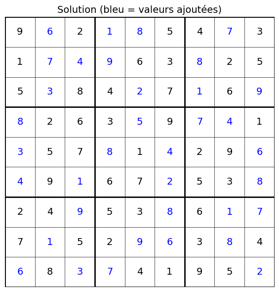
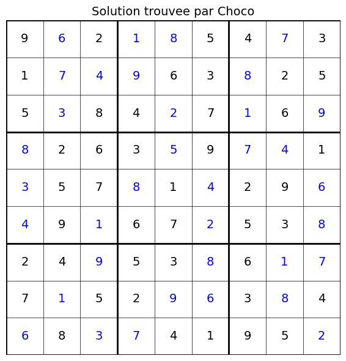
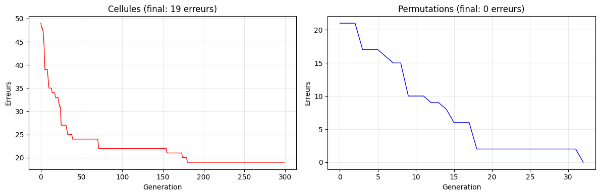
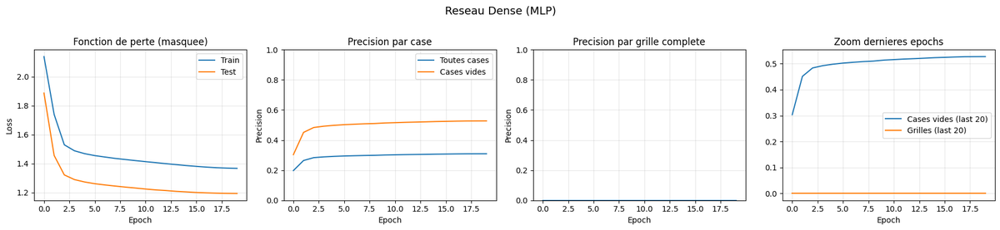
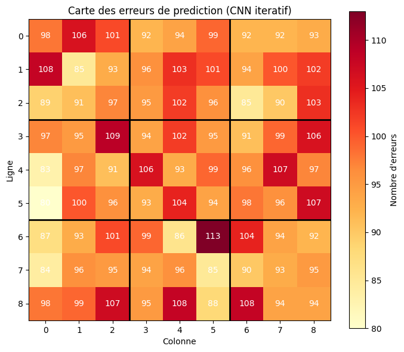

# Sudoku — comparer les méthodes de résolution

<!-- CATALOG-STATUS
series: Sudoku
pedagogical_count: 39
breakdown: root=39
maturity: BETA=39
-->

[↑ Parcours de notebooks](../README.md) · [Search : recherche et contraintes](../Search/README.md)

Comment résoudre la même grille par des méthodes aussi différentes que le retour arrière, la programmation par contraintes et un réseau de neurones ? Le Sudoku offre un problème commun pour étudier ce que chaque représentation rend possible : explorer des candidats, propager une déduction, déclarer les règles à un solveur ou apprendre à prédire les cases.

Cette série s'adresse aux étudiants en informatique et aux enseignants cherchant un fil conducteur pour comparer les paradigmes de l'IA. Les bases de Python ou de C# suffisent pour commencer ; les notions de recherche et de contraintes sont introduites dans les premiers paliers. Les approches probabilistes, neuronales et formelles demandent ensuite les prérequis indiqués ci-dessous. Les variantes C# et Python permettent de choisir son langage ; elles présentent le même problème pédagogique avec des bibliothèques et parfois des expériences différentes.

Vous apprendrez à implémenter un solveur, à modéliser ses contraintes, à distinguer une solution valide d'une prédiction plausible et à concevoir une comparaison expérimentale. Le Sudoku généralisé est NP-complet ; les grilles de taille fixée du cours permettent d'en examiner concrètement les stratégies, sans déduire leur difficulté de leur seul nombre d'indices.

**Une série plate.** Tous les carnets vivent à la racine, sans dossier intermédiaire : le sujet commun — la même grille soumise à des représentations différentes — fait le fil, la numérotation continue ordonne la progression, et aucun sous-arc ne se dessine qui grouperait naturellement des carnets. C'est un choix de niveau déclaré (règle 2 de [niveau-serie.md](../../docs/reference/niveau-serie.md)), pas un oubli.

Une même case vide change de rôle selon la méthode. Pour le retour arrière, elle ouvre des branches à essayer. Pour la programmation par contraintes, elle possède un domaine de valeurs que les règles réduisent. Pour une métaheuristique, elle participe au score de conflits d'une grille candidate. Pour un réseau, elle reçoit des probabilités apprises. Cette différence de représentation détermine les opérations possibles, les erreurs à observer et les garanties que l'on peut demander au résultat.

| Représentation | Ce que fait la méthode | Ce qu'il faut contrôler |
|---|---|---|
| Affectations partielles | Explorer les candidats, abandonner une branche incompatible, revenir sur une décision. | Respect des indices et des règles ; exhaustivité de la recherche si l'on conclut à l'absence de solution. |
| Variables et contraintes | Réduire les domaines puis brancher lorsque la propagation ne suffit plus. | Fidélité du modèle aux règles du Sudoku et statut retourné par le solveur. |
| Grille candidate et conflits | Modifier une configuration pour améliorer son score. | Zéro conflit, conservation des indices et taux de réussite sur plusieurs essais. |
| Distributions ou prédictions | Proposer des valeurs à partir d'un modèle probabiliste ou de données. | Validité de la grille entière, au-delà de la confiance ou de la précision par case. |

## Comment lire ce README — Découverte

Le principe [« Choisir sa vitesse de lecture »](https://github.com/jsboige/CoursIA#choisir-sa-vitesse-de-lecture) distingue parcours, approfondissements et recherche.

- **Vous découvrez** : commencez par 01, ou par 00 pour le socle C#. La table principale suit les numéros nus ; chaque paire de langages partage une ligne.
- **Vous creusez un palier** : 12b étudie l'interface LINQ de Z3 ; 18b développe la méthode statistique du benchmark.
- **Vous cherchez des prolongements** : les résultats neuronaux, l'audit des corpus et les preuves de propagation se trouvent dans « Pour aller plus loin ».

Les premiers paliers conduisent de l'exploration exacte aux recherches approchées. Les contraintes ramènent ensuite la question à la représentation des règles ; les modèles appris posent celle de la généralisation. La comparaison expérimentale et la formalisation donnent enfin des moyens différents de justifier une conclusion.


## Parcours principal — Découverte, Licence et lectures avancées

Le public indiqué reprend la profondeur des contenus : les preuves du palier 19 et la méthodologie du 20 demandent une lecture avancée. Les bases de récursion de 01 préparent 02 et 06 ; les contraintes de 06–07 préparent les solveurs et la preuve de propagation. Les paliers 15–16 supposent probabilités et apprentissage, 19 une initiation à Lean.

| # | Notebook | Ce qu'on y apprend | Public | Pour approfondir |
|---|---|---|---|---|
| 00 | Environment — [C#](Sudoku-00-Environment-CSharp.ipynb) | Préparer les grilles, interfaces de solveur et outils de mesure utilisés dans les carnets C#. | Découverte | — |
| 01 | Backtracking — [C#](Sudoku-01-Backtracking-CSharp.ipynb) · [Python](Sudoku-01-Backtracking-Python.ipynb) | Explorer une grille par retour arrière ; relier ordre des choix, validité et coût de recherche. | Découverte | — |
| 02 | Dancing Links — [C#](Sudoku-02-DancingLinks-CSharp.ipynb) · [Python](Sudoku-02-DancingLinks-Python.ipynb) | Traduire le Sudoku en couverture exacte et organiser la recherche avec les Dancing Links de Knuth. | Découverte | — |
| 03 | Genetic — [C#](Sudoku-03-Genetic-CSharp.ipynb) · [Python](Sudoku-03-Genetic-Python.ipynb) | Faire évoluer une population de grilles ; comparer les effets du codage, du croisement et de la mutation. | Découverte | — |
| 04 | Simulated Annealing — [C#](Sudoku-04-SimulatedAnnealing-CSharp.ipynb) · [Python](Sudoku-04-SimulatedAnnealing-Python.ipynb) | Explorer un paysage de conflits par recuit simulé : voisinage, température et acceptation de dégradations. | Découverte | — |
| 05 | PSO — [C#](Sudoku-05-PSO-CSharp.ipynb) · [Python](Sudoku-05-PSO-Python.ipynb) | Adapter l'essaim de particules à un problème discret et étudier ses paramètres. | Découverte | — |
| 06 | AIMA CSP — [C#](Sudoku-06-AIMA-CSP-CSharp.ipynb) · [Python](Sudoku-06-AIMA-CSP-Python.ipynb) | Définir variables, domaines et contraintes ; combiner choix de variable, propagation et retour arrière. | Licence | — |
| 07 | Norvig — [C#](Sudoku-07-Norvig-CSharp.ipynb) · [Python](Sudoku-07-Norvig-Python.ipynb) | Construire la propagation de Norvig par élimination des candidats, puis rechercher lorsque les déductions ne suffisent plus. | Licence | — |
| 08 | Human Stratégies — [C#](Sudoku-08-HumanStrategies-CSharp.ipynb) · [Python](Sudoku-08-HumanStrategies-Python.ipynb) | Exprimer des stratégies humaines sur les candidats : singles, paires et interactions entre lignes, colonnes et blocs. | Licence | — |
| 09 | Graph Coloring — [C#](Sudoku-09-GraphColoring-CSharp.ipynb) · [Python](Sudoku-09-GraphColoring-Python.ipynb) | Représenter les conflits entre cases par un graphe et résoudre une coloration sous contraintes. | Licence | — |
| 10 | OR-Tools — [C#](Sudoku-10-ORTools-CSharp.ipynb) · [Python](Sudoku-10-ORTools-Python.ipynb) | Modéliser avec OR-Tools ; passer de la satisfaction des règles à l'optimisation d'un carré latin pondéré. | Licence | — |
| 11 | Choco — [C#](Sudoku-11-Choco-CSharp.ipynb) · [Python](Sudoku-11-Choco-Python.ipynb) | Utiliser les contraintes et propagateurs de Choco depuis C# avec IKVM ou depuis Python avec JPype. | Licence | — |
| 12 | Z3 SMT — [C#](Sudoku-12-Z3-CSharp.ipynb) · [Python](Sudoku-12-Z3-Python.ipynb) | Exprimer les contraintes avec Z3, combiner arithmétique et logique, puis utiliser une fonction objectif. | Licence | [12b](#autour-de-12--une-interface-linq-licence). |
| 13 | Symbolic Automata — [C#](Sudoku-13-SymbolicAutomata-CSharp.ipynb) · [Python](Sudoku-13-SymbolicAutomata-Python.ipynb) | Distinguer reconnaissance d'une grille remplie et recherche d'une solution avec expressions régulières, automates et Z3. | Licence | — |
| 14 | BDD/MDD — [C#](Sudoku-14-BDD-CSharp.ipynb) · [Python](Sudoku-14-BDD-Python.ipynb) | Construire des diagrammes de décision binaires et multi-valués pour représenter des contraintes symboliquement. | Licence | — |
| 15 | Infer ↔ NumPyro — [C#](Sudoku-15-Infer-CSharp.ipynb) · [Python](Sudoku-15-Infer-Python.ipynb) | Modéliser une distribution sur les cases avec Infer.NET en C# ou NumPyro/JAX en Python ; examiner sa relation à la validité. | Licence | — |
| 16 | Neural Network — [Python](Sudoku-16-NeuralNetwork-Python.ipynb) | Comparer réseaux directs et itératifs ; distinguer précision par case et résolution complète d'une grille. | Licence | — |
| 17 | LLM — [Python](Sudoku-17-LLM-Python.ipynb) | Comparer résolution par prompt et utilisation de code ; vérifier les grilles produites par un modèle de langage. | Licence | — |
| 18 | Comparison — [C#](Sudoku-18-Comparison-CSharp.ipynb) · [Python](Sudoku-18-Comparison-Python.ipynb) | Construire un protocole comparatif de solveurs et interpréter temps, succès et coût de recherche. | Licence | [18b](#autour-de-18--comparer-statistiquement-recherche). |
| 19 | Lean Propagation — [Lean](Sudoku-19-Lean-Propagation-Lean.ipynb) | Lire des preuves Lean de correction de la propagation : une élimination justifiée conserve les solutions possibles. | Recherche | — |
| 20 | Corpus Audit — [Python](Sudoku-20-CorpusAudit-Python.ipynb) | Auditer un corpus de puzzles : validité, unicité, propagation seule, effort de recherche et indices redondants. | Recherche | — |

## Approfondissements — Licence et Recherche

### Autour de 12 — une interface LINQ (Licence)

[12b — Z3.Linq](Sudoku-12b-Z3-Linq2Z3-CSharp.ipynb) reprend la modélisation de 12 côté C# avec une interface déclarative : propriétés, collections et tableaux. Il permet de comparer l'expressivité du langage d'accès à Z3 avec l'API native, sur les exemples du carnet. Prérequis supplémentaires : C#, LINQ et lecture des contraintes de 12.

### Autour de 18 — comparer statistiquement (Recherche)

[18b — Comparaison statistique](Sudoku-18b-Statistical-Comparison-Python.ipynb) distingue bruit de chronométrage et variation entre puzzles. Il utilise médianes par puzzle, intervalles bootstrap, test apparié de Wilcoxon, taille d'effet et correction de comparaisons multiples. Prérequis : protocole de 18 et statistiques inférentielles élémentaires. Dans le banc facile affiché, le retour arrière naïf est plus rapide que MRV : le coût d'une heuristique peut dépasser son bénéfice sur les instances choisies.

## Ce que les représentations permettent — Licence

### Explorer ou propager

Le retour arrière de [01](Sudoku-01-Backtracking-Python.ipynb) choisit une case vide, essaie un candidat légal et poursuit sur la grille ainsi complétée. Si aucun candidat ne permet de continuer, il annule la dernière décision. Le résultat final ne montre pas les branches abandonnées : compter les appels récursifs rend ce travail visible et permet de comparer les ordres de choix sur une même grille.

[](Sudoku-01-Backtracking-Python.ipynb)

La couverture exacte de [02](Sudoku-02-DancingLinks-Python.ipynb) change l'objet exploré. Avant de tenir compte des indices, les **729 affectations** possibles « chiffre dans une case » forment les lignes d'une matrice. Ses **324 colonnes** expriment quatre familles d'exigences : un chiffre par case, une occurrence de chaque chiffre par ligne, par colonne et par bloc. Choisir une affectation couvre quatre exigences ; une solution couvre chaque colonne exactement une fois. Algorithm X organise ces choix et Dancing Links permet de retirer puis de restaurer les éléments de la matrice lors du retour arrière.

Les paliers [06](Sudoku-06-AIMA-CSP-Python.ipynb) et [07](Sudoku-07-Norvig-Python.ipynb) ajoutent des déductions avant de poursuivre la recherche. **MRV**, pour *minimum remaining values*, choisit une variable dont le domaine restant est le plus petit. Le *forward checking* retire immédiatement chez ses voisins les valeurs devenues incompatibles avec une affectation. La propagation de Norvig enchaîne notamment l'élimination d'un chiffre chez les pairs et l'affectation forcée lorsqu'une unité n'offre plus qu'une place pour ce chiffre. Une case appartient à trois unités et possède vingt pairs : ces relations donnent une structure précise aux déductions.

Les stratégies humaines de [08](Sudoku-08-HumanStrategies-Python.ipynb) rendent ces conséquences lisibles sous forme de singles, de paires et d'interactions entre unités. La coloration de [09](Sudoku-09-GraphColoring-Python.ipynb) les regarde autrement : les cases deviennent des sommets, les conflits des arêtes et les chiffres des couleurs. Ces formulations permettent de comparer des mécanismes de raisonnement sur un même problème.

**À expérimenter :** partir d'une grille de 01, mesurer les appels du retour arrière simple, ajouter MRV, puis observer ce que la propagation résout avant tout branchement. Vérifier chaque grille obtenue et conserver le même puzzle pour cette comparaison. Les exercices de 01, 06 et 07 préparent cette démarche ; le benchmark 18b montrera pourquoi son résultat ne se généralise pas à tout corpus.

### Déclarer les règles à un solveur

Dans le modèle Choco de [11](Sudoku-11-Choco-Python.ipynb), le Sudoku devient **81 variables de domaine 1 à 9**, des contraintes `allDifferent` pour chaque ligne, colonne et bloc, et des égalités pour les indices. La propagation réduit les domaines ; un branchement introduit un choix lorsque les règles ne suffisent plus. OR-Tools et Z3 proposent d'autres moteurs et interfaces pour exprimer ces conditions.

[](Sudoku-11-Choco-Python.ipynb)

La figure montre une solution du modèle, pas les étapes internes communes à tous les moteurs. Un modèle incomplet peut accepter une grille qui viole une règle oubliée ; un modèle trop contraint peut exclure une solution légitime. Les exercices de 10 et 11 invitent à examiner les contraintes et les stratégies de recherche : la vérification du résultat reste utile même lorsque l'exploration est confiée à une bibliothèque.

### Changer l'encodage d'une recherche approchée

Les métaheuristiques de 03–05 cherchent à réduire les conflits sans garantie de trouver une solution. Une grille peut être presque correcte tout en restant inutilisable. Le choix du génome, du voisinage et de la fonction de score détermine les configurations accessibles et les améliorations que l'algorithme peut détecter.

[](Sudoku-03-Genetic-Python.ipynb)

Dans cette figure de [03](Sudoku-03-Genetic-Python.ipynb), le codage par cases conserve 19 erreurs après 300 générations, tandis que celui par permutations atteint zéro erreur autour de la trentième génération. Le codage par permutations de lignes respecte d'emblée les contraintes de ligne ; les conflits de colonnes et de blocs restent à réparer. Ce résultat concerne cet essai : il ne compare pas le coût d'une génération et n'établit pas une supériorité générale. Un autre essai conservé dans le carnet termine encore avec des conflits.

Le recuit de [04](Sudoku-04-SimulatedAnnealing-Python.ipynb) autorise parfois une dégradation du score suivant une probabilité liée à la température : cette possibilité aide à quitter un minimum local, puis diminue avec le refroidissement. Le PSO de [05](Sudoku-05-PSO-Python.ipynb) adapte des notions de position, de déplacement et de mémoire collective à des grilles discrètes ; sa représentation demande autant d'attention que ses paramètres.

**À expérimenter :** garder la grille et le budget fixés, puis changer une seule dimension — encodage, voisinage, température ou population. Rapporter les conflits restants et la proportion de grilles valides sur plusieurs essais. La meilleure courbe isolée ne décrit pas la fiabilité d'un solveur.

### Vérifier, résoudre et optimiser

En [13](Sudoku-13-SymbolicAutomata-Python.ipynb), un motif peut vérifier une ligne entièrement remplie ; des expressions régulières et des automates permettent ensuite de reconnaître des grilles satisfaisant les conditions encodées. Lorsqu'il reste des cases vides, chercher leurs valeurs exige une procédure supplémentaire. Le carnet utilise Z3 pour cette résolution. Demander ce que peut répondre chaque vérificateur à une grille partielle rend concrète la différence entre reconnaître et résoudre.

Les diagrammes de décision de [14](Sudoku-14-BDD-Python.ipynb) partagent les sous-problèmes identiques : un BDD représente des décisions binaires, un MDD permet plusieurs valeurs par variable. Une formule contradictoire comme `x ∧ ¬x` se réduit à faux ; des sous-graphes communs évitent de répéter certaines décisions. Cette compression dépend de la formule et de l'ordre des variables. Les exercices proposent notamment de construire une contrainte « exactement une valeur parmi N » et de comparer les représentations obtenues.

Les paliers [10](Sudoku-10-ORTools-Python.ipynb) et [12](Sudoku-12-Z3-Python.ipynb) ajoutent un objectif aux contraintes. Une solution faisable satisfait les règles ; une fonction pondérée permet ensuite de préférer certaines solutions. CP-SAT exprime cette préférence avec `Maximize` ou `Minimize`, Z3 avec son interface `Optimize`. Un statut `OPTIMAL` de CP-SAT certifie qu'aucune solution admissible n'améliore l'objectif du modèle ; une simple solution faisable ne fournit pas ce certificat.

Sur leur même instance Python de carré latin pondéré, CP-SAT et Z3 obtiennent une récompense maximale de **178**. Le carnet 10 trouve aussi **73** en minimisation. La variante C# de 12 obtient **192** sur une autre instance : les valeurs ne se comparent donc pas comme des réponses au même problème. Pour prolonger l'expérience, modifier un poids, prédire si la grille optimale ou seulement sa valeur changera, puis vérifier avec le solveur.

### Prédire une case ou résoudre une grille

L'inférence probabiliste de 15 attribue des distributions aux cases, avec Infer.NET en C# et NumPyro/JAX en Python. Une distribution peut guider l'ordre des candidats ; sa combinaison avec une validation déterministe donne un principe de solveur hybride. Une confiance élevée pour chaque case ne garantit pas que les valeurs retenues ensemble respectent toutes les contraintes.

Le réseau de [16](Sudoku-16-NeuralNetwork-Python.ipynb) apprend ses prédictions à partir de données. Un MLP traite une représentation vectorielle de la grille ; les convolutions du CNN exploitent une structure spatiale ; les variantes itératives réinjectent des informations au fil des prédictions. Dans la figure du MLP, les pertes diminuent et la précision des cases vides progresse vers 0,53, mais la précision par grille reste à zéro. Réussir toutes les cases simultanément impose une exigence bien plus forte que réussir une case moyenne.

[](Sudoku-16-NeuralNetwork-Python.ipynb)

| Expérience CPU conservée dans 16 | Grilles entièrement résolues | Lecture du résultat |
|---|---|---|
| MLP, CNN et ResCNN en prédiction directe | 0 sur 10 000 pour chaque modèle. | Une précision partielle ne suffit pas à résoudre la grille. |
| ResCNN itératif | 31 sur 200. | L'itération réussit certaines grilles ; l'échantillon diffère de celui de l'évaluation directe. |

Ces sorties décrivent les modèles et protocoles du carnet, sans donner un plafond général à l'apprentissage du Sudoku. L'exercice « réseau + contraintes explicites » invite à construire une validation ou une recherche autour des prédictions.

La carte des erreurs du CNN itératif montre où les erreurs se répartissent sur le jeu évalué. Elle compte des erreurs par position ; sans rapporter ces comptes au nombre de cases à prédire, elle ne mesure pas à elle seule une difficulté intrinsèque de chaque position.

[](Sudoku-16-NeuralNetwork-Python.ipynb)

En [17](Sudoku-17-LLM-Python.ipynb), la comparaison porte sur le rôle du modèle de langage : proposer directement des chiffres ou produire du code qui les recherche. La vérification doit contrôler le format de la grille, la conservation des indices et l'unicité des chiffres dans chaque unité. La sortie conservée porte sur **deux puzzles** : zéro réussite pour les prompts directs et avec exemples, deux réussites avec l'approche utilisant du code. Ce petit banc illustre un protocole et ne donne pas un taux général de réussite des LLM. L'exercice de prompt gagne à formuler une hypothèse d'amélioration puis à l'éprouver sur plusieurs puzzles avec le même validateur.

### Choisir une méthode et définir son critère de réussite

| Objectif | Point de départ | Expérience à mener |
|---|---|---|
| Obtenir une solution respectant toutes les règles | Retour arrière, couverture exacte ou solveur de contraintes. | Valider la grille, vérifier le statut du solveur et observer l'effort de recherche. |
| Comprendre le rôle de la représentation | Comparer les encodages de 02, 03, 06 ou 14. | Garder le problème fixé et mesurer ce que l'encodage élimine ou partage. |
| Comparer des méthodes sur un ensemble de grilles | Protocole de 18, puis analyse de 18b. | Séparer taux de succès, coût par puzzle et bruit de mesure. |
| Apprendre à proposer des valeurs ou guider la recherche | Modèles de 15–17. | Mesurer la validité complète et tester l'apport d'un contrôle sous contraintes. |

Ces choix se retrouvent dans l'ordonnancement et l'allocation sous contraintes, la vérification de règles avec SMT ou la recherche d'une bonne configuration en optimisation. Le Sudoku permet d'en observer les mécanismes sur un problème dont le résultat se vérifie facilement.

## Installation — pratique, tous niveaux

Commencer par le carnet de la méthode choisie dans un clone du dépôt, qui fournit les puzzles, les bibliothèques locales et les ressources voisines.

| Parcours | Préparation |
|---|---|
| Python | Python 3.10 ou ultérieur ; environnement dédié et dépendances de [requirements.txt](requirements.txt). Les expériences classiques utilisent le CPU. |
| C# | SDK .NET 9 et noyau .NET Interactive. Le carnet [00](Sudoku-00-Environment-CSharp.ipynb) définit le socle importé par les suivants ; les directives NuGet installent leurs bibliothèques. |
| Choco en Python | JVM accessible et `jpype1` ; le carnet 11 télécharge le JAR Choco. |
| Choco en C# | Runtime IKVM et DLL Choco partagée sous [Search/Part2-CSP](../Search/Part2-CSP/). Suivre la cellule de préparation de 11. |
| Inférence probabiliste | Infer.NET pour 15 C# ; JAX et NumPyro pour 15 Python. |
| Réseaux | PyTorch pour 16 ; le GPU accélère les entraînements, tandis que les démonstrations CPU et la lecture des résultats restent accessibles. |
| Modèle de langage | Pour rejouer 17, service compatible avec l'API utilisée, endpoint et identifiants configurés dans l'environnement. |
| Lean | Pour 19, noyau Lean et projet [sudoku_lean](sudoku_lean/) construit avec sa toolchain. |

Le paquet Python de Z3 est `z3-solver`. Les approches symboliques utilisent aussi `regex` et `dd` ; 17 utilise `python-dotenv` pour la configuration ; ce paquet doit être ajouté à l’environnement car il est absent du manifeste commun. En cas d'import manquant, vérifier que Jupyter emploie bien l'environnement où les paquets ont été installés. Côté C#, contrôler la présence du noyau avec `jupyter kernelspec list` et les imports du carnet 00.

Pour installer le noyau C# après le SDK .NET et Jupyter :

```bash
dotnet tool install -g Microsoft.dotnet-interactive --version 1.0.712001
dotnet interactive jupyter install
jupyter kernelspec list
```

Si l'outil est déjà installé, le mettre à jour avec `dotnet tool update -g Microsoft.dotnet-interactive --version 1.0.712001`. Choisir `.net-csharp` et exécuter [00](Sudoku-00-Environment-CSharp.ipynb) en premier : les carnets C# suivants importent son socle. Voir les [instructions des noyaux](../../docs/reference/kernels-runtime.md) en cas de difficulté.

Depuis la racine du dépôt, une préparation Python possible est :

```bash
python -m venv .venv-sudoku
source .venv-sudoku/bin/activate
python -m pip install -r MyIA.AI.Notebooks/Sudoku/requirements.txt jupyterlab ipykernel
python -m ipykernel install --user --name coursia-sudoku --display-name "Python — Sudoku"
jupyter lab MyIA.AI.Notebooks/Sudoku/Sudoku-01-Backtracking-Python.ipynb
```

Sous Windows, activer l'environnement avec `.\.venv-sudoku\Scripts\Activate.ps1`. Choisir ensuite le noyau « Python — Sudoku ». Pour le carnet 17, ajouter `python -m pip install python-dotenv` et renseigner la configuration du service avant les appels. Pour une première séance C#, ouvrir 00 puis 01 et conserver les chemins relatifs du dépôt.

### Repères dans les dossiers

- [Puzzles](Puzzles/) : grilles utilisées pour les expériences — corpus hérités (`Easy51`, `hardest`, `top95`) et corpus généré certifié (`Sudoku_gen_facile.txt`, `Sudoku_gen_moyen.txt`, `Sudoku_gen_difficile.txt`).
- [CompiledModels](CompiledModels/) : artefacts compilés pour Infer.NET ; [sudoku_models](sudoku_models/) : checkpoints d'entraînement.
- [scripts](scripts/) : scripts d'entraînement ; [tests](tests/) : tests associés.
- [sudoku_lean](sudoku_lean/) : projet de formalisation Lean.

## Pour aller plus loin — Recherche

### Comparer des solveurs et auditer les puzzles

Les temps dépendent du solveur, de ses paramètres, de la machine et surtout des instances. [18](Sudoku-18-Comparison-Python.ipynb) construit la comparaison ; [18b](Sudoku-18b-Statistical-Comparison-Python.ipynb) en examine la variabilité. Pour ajouter une méthode, conserver les puzzles et le protocole, puis vérifier les solutions produites avant de comparer les temps.

Dans 18b, les répétitions de chronométrage sont regroupées par puzzle : répéter quinze fois une grille ne crée pas quinze problèmes indépendants. Le banc affiché porte sur huit puzzles faciles ; les médianes agrégées sont d'environ 1,21 ms pour le retour arrière naïf et 6,82 ms pour MRV, avec un test apparié de Wilcoxon à `p = 0,00781`. Ce résultat local montre que le coût de sélection d'une variable peut dépasser le travail économisé. L'exercice sur les comparaisons multiples et la correction de Bonferroni aide à interpréter plusieurs comparaisons dans un même banc.

[20 — Audit des corpus](Sudoku-20-CorpusAudit-Python.ipynb) examine les fichiers de [Puzzles](Puzzles/). Les sorties distinguent propagation seule et recherche, testent l'unicité par dénombrement plafonné à deux solutions et repèrent les indices redondants.

| Corpus évalué dans 20 | Résolution par propagation seule | Plus grand effort de recherche observé |
|---|---|---|
| `Easy51` | 41 grilles sur 51. | 7 décisions. |
| `hardest` | 1 grille sur 11. | 21 décisions. |
| `top95` | Aucune grille sur 95. | 446 décisions. |

L'audit ne trouve pas de grille invalide ou non unique dans ces corpus. Leur difficulté dépend ici du solveur et de la mesure retenue : le nom « hardest » ne prédit pas le classement observé. Une expérience utile consiste à supprimer un indice d'une grille, puis à mesurer séparément l'unicité et l'effort de résolution. Une grille encore soluble peut avoir plusieurs solutions ; son nombre d'indices ne constitue pas à lui seul une échelle de difficulté.

Les corpus hérités sont des ensembles reçus, non construits. Le script [`scripts/generate_certified_corpus.py`](scripts/generate_certified_corpus.py) génère à l'inverse un corpus **équilibré par construction** : chaque grille est creusée depuis une solution complète aléatoire, son unicité est **prouvée par dénombrement certifié** (le moteur DLX de la série, arrêt « exhausted » avec exactement une solution — jamais un plafond atteint), et son palier est fixé par la difficulté **mesurée** (décisions de retour arrière, propagation seule), pas par un compte de cases vides. La bande `facile` exige zéro décision, `moyen` se tient entre 1 et 9, `difficile` au-delà — bornes calibrées sur les corpus hérités : le palier `difficile` généré égale la bande de `hardest` (pire observé autour d'une vingtaine de décisions), il ne prétend pas aux sommets de `top95`, corpus trié à la main. La notation est homogène : 81 caractères par ligne, chiffre `0` pour une case vide. Le **cardinal d'irréductibilité** de chaque grille est documenté par le même organe que Sudoku-20 (`minimal_clue_set`, retrait glouton sous unicité) : sur la génération livrée, la médiane est de 25 indices conservés pour `facile` et `moyen`, 26 pour `difficile` — une grille sur trois environ est déjà irrédundante, le reste porte un à cinq indices redondants (le creusage s'arrête à sa cible de difficulté, pas à l'irréductibilité). La génération est déterministe sous sa graine (`--seed`), et rejouer `Sudoku-20` sur ces fichiers en vérifie chaque grille avec les mêmes instruments que le tableau ci-dessus.

### Réseaux relationnels récurrents

Le réseau relationnel récurrent (RRN) de Palm et ses coauteurs propage des messages sur le graphe de contraintes : les cases échangent des informations avec leurs voisines au cours d'itérations internes. Le carnet [16](Sudoku-16-NeuralNetwork-Python.ipynb) compare cette approche aux réseaux directs et à des procédures qui réemploient leurs prédictions. Une passe du RRN peut donc déjà contenir plusieurs étapes de propagation apprise.

La sortie de synthèse conservée dans le carnet permet de comparer largeur cachée, nombre d'étapes et phase d'entraînement. La précision par case mesure les prédictions individuelles ; la précision par grille exige que la grille entière soit correcte.

| Phase archivée | Largeur cachée | Étapes internes | Précision par case | Précision par grille |
|---|---|---|---|---|
| Banc initial | 128 | 16 | 62,49 % | 33,50 % |
| Banc initial | 192 | 16 | 62,47 % | 33,50 % |
| Banc initial | 256 | 16 | 62,55 % | 33,52 % |
| Banc initial | 128 | 24 | 62,50 % | 33,50 % |
| Entraînement complémentaire v2 | 192 | 16 | 89,74 % | 83,48 % |
| Entraînement complémentaire v2 | 256 | 16 | 89,81 % | 83,47 % |
| Entraînement complémentaire v2 | 192 | 24 | 89,62 % | 83,51 % |

Les largeurs donnent des résultats proches au sein de chaque phase, tandis que l'écart entre phases est marqué. Comme les expériences changent plusieurs conditions, elles n'isolent pas l'effet causal du volume de données, du curriculum ou de l'architecture. Les fichiers JSON d'entraînement lus pour produire cette synthèse sont absents du dépôt : la sortie conservée documente ces expériences, mais ne suffit pas à les régénérer. Une reproduction devrait conserver les jeux de données, les poids, les paramètres et les définitions des métriques avec chaque résultat.

Un taux élevé reste une mesure sur un jeu d'évaluation. Pour une application exigeant une grille valide, contrôler les contraintes demeure nécessaire après une prédiction neuronale.

### Formalisations Lean

[19 — Propagation en Lean](Sudoku-19-Lean-Propagation-Lean.ipynb) étudie la correction des déductions de type *naked single* et *hidden single*, notamment via `peer_excludes_value`. Le projet [sudoku_lean](sudoku_lean/) fournit les définitions et preuves : on examine ce que les hypothèses permettent de conclure, ainsi que les dépendances affichées par `#print axioms`. La correction d'une règle de propagation ne constitue pas une preuve de complétude d'un solveur entier.

L'inventaire des modules et des toolchains figure dans [LEAN_INVENTORY.md](LEAN_INVENTORY.md).

### Prolonger le problème commun

- La propagation de 06–07 ouvre sur [Search/Part2-CSP](../Search/Part2-CSP/README.md), où variables, domaines et contraintes s'appliquent à d'autres problèmes.
- L'encodage Z3 de 12 prépare la [série SMT](../SymbolicAI/SMT/README.md), qui utilise la satisfiabilité pour explorer et vérifier d'autres modèles.
- Le palier 15 donne un point de départ vers [Probas/Infer](../Probas/Infer/README.md) pour approfondir la modélisation et l'inférence probabilistes.

Une application possible est de reprendre le benchmark 18 avec un solveur hybride : utiliser un réseau pour proposer un ordre de variables, puis une recherche sous contraintes pour contrôler les solutions.

## Ressources — tous niveaux

### Livres, articles et figures

- [Peter Norvig — Solving Every Sudoku Puzzle](http://norvig.com/sudoku.html).
- [Donald Knuth — Dancing Links](https://arxiv.org/abs/cs/0011047).
- [Russell et Norvig — Artificial Intelligence: A Modern Approach](https://aima.cs.berkeley.edu/), chapitres de recherche et de contraintes.
- Les figures ci-dessus sont liées à leur carnet source ; le [manifeste des figures](assets/readme/MANIFEST.md) en consigne la provenance.

### Bibliothèques

[OR-Tools](https://developers.google.com/optimization) · [Z3](https://z3prover.github.io/api/html/namespacez3py.html) · [NetworkX](https://networkx.org/) · [GeneticSharp](https://github.com/giacomelli/GeneticSharp) · [Choco](https://choco-solver.org/) · [Infer.NET](https://dotnet.github.io/infer/) · [PyTorch](https://pytorch.org/) · [client Python OpenAI](https://github.com/openai/openai-python).

### Provenance pédagogique

Les carnets reprennent notamment des projets étudiants consacrés à Norvig et sa variante BitArray (`Sudoku.Norvig`, `Sudoku.NorvigBitArray`), au recuit (`Sudoku.SimulatedAnnealing`), aux stratégies humaines (`Sudoku.Human`), aux réseaux (`Sudoku.NeuralNetwork`), au PSO (`Sudoku.PSO`), aux CSP (`Sudoku.CspAima`), à la coloration (`Sudoku.GraphColoring`), à Choco (`Sudoku.ChocoSolvers`) et aux LLM (`Sudoku.LLM-ChatGPTenzin`). Les carnets explicitent les adaptations et les outils utilisés.

[Retour aux notebooks](../README.md) · [Catalogue du dépôt](../../COURSE_CATALOG.generated.md) · [Licence](../../LICENSE)

### Audit des corpus en C#

[Sudoku-20 — Audit des corpus en C#](Sudoku-20-CorpusAudit-CSharp.ipynb) accompagne la [version Python](Sudoku-20-CorpusAudit-Python.ipynb) : il porte en BCL la propagation de Norvig et le comptage plafonné, sur les mêmes trois corpus.
