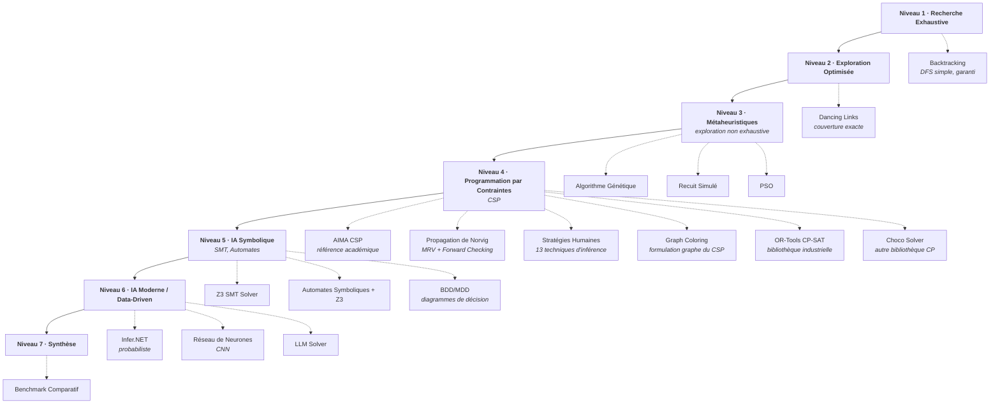
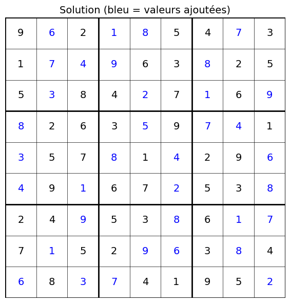
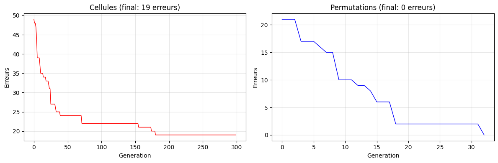
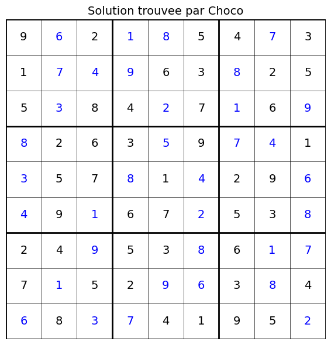
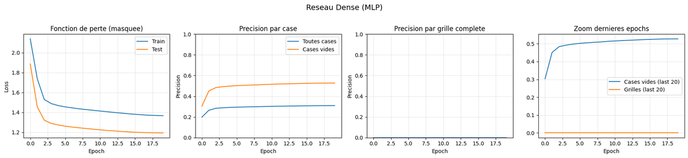
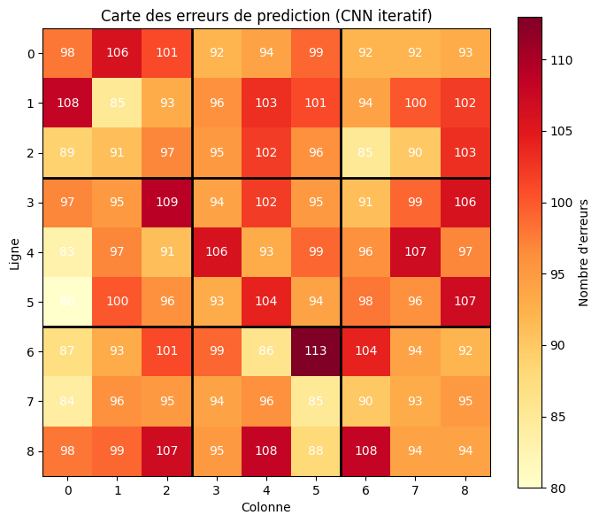

# Sudoku - Résolution par Différentes Approches Algorithmiques

<!-- CATALOG-STATUS
series: Sudoku
pedagogical_count: 38
breakdown: root=38
maturity: BETA=38
-->

> **Note éditoriale (counts)** : les comptes de notebooks (agrégé, par langage ou par kernel) ne sont pas tenus à la main dans ce README : ils dérivent et relèvent de la régénération du catalogue. Le marqueur `CATALOG-STATUS` ci-dessus et le catalogue généré (`COURSE_CATALOG.generated.md`) sont autoritatifs.
>
> Sudoku est un cas de **mixité JUMEAUX C#/Python dominante** (14 paires strictes 1-14 + 1 paradigme-comparable 15 Infer.NET/NumPyro + 1 benchmark 18, soit 16 entrées à 2 langages) avec **1 companion Lean natif intra-hub** (`Sudoku-19-Lean-Propagation-Lean.ipynb`, lake `sudoku_lean` 0-sorry). C'est une **variante L392 #4** : contrairement à QC (#5917) où Lean est isolé dans une sous-série dédiée `kelly_lean/`, et contrairement à ML (#5915) / Probas (#5916) où la mixité kernel est intra-série, ici la mixité jumeaux domine largement et le notebook tiers (Lean) est intra-hub sans sous-série dédiée.
>
> **Régénération du marqueur** : `catalog-cron.yml` (cron quotidien 03:37 UTC sur `main`, commit `[skip ci]` par `github-actions[bot]`) — le bloc ci-dessus est régénéré automatiquement, ne pas le modifier manuellement sur une branche feature (catalog-pr-hygiene R1).

[← Notebooks](../README.md) | [→ Search](../Search/README.md)

## Découverte — ce qu'enseigne cette série

Comment résoudre un Sudoku ? Cette série explore les techniques de résolution, des algorithmes classiques (backtracking, contraintes) aux approches symboliques, probabilistes et neuronales. Elle repose sur des **paires miroir C#/Python** — mêmes algorithmes dans les deux langages, de la mise en place jusqu'au benchmark comparatif — plus des notebooks Python uniquement (réseau de neurones, LLM, méthodologie statistique) et un companion Lean natif ([Sudoku-19](Sudoku-19-Lean-Propagation-Lean.ipynb), preuve formelle de la propagation de contraintes). Cette structure laisse à chaque étudiant le choix de son langage sur la quasi-totalité des algorithmes.

**À qui s'adresse cette série** : étudiants en informatique (L2-M2) découvrant les paradigmes algorithmiques, candidats à des entretiens techniques, et enseignants cherchant un fil rouge pédagogique. Les notebooks Python ne nécessitent que Python 3.10+. Les notebooks C# requièrent .NET 9.0 + dotnet-interactive. Aucun prérequis en IA : les concepts sont introduits depuis le backtracking.

**Objectifs d'apprentissage** — à l'issue de cette série, vous serez capable de :

1. **Implémenter** un solveur de backtracking avec heuristiques (MRV, Forward Checking) et comprendre sa complexité
2. **Comparer** les paradigmes algorithmiques (exhaustif, métaheuristique, CP, SMT, probabiliste, neuronal, LLM) sur un même problème NP-complet
3. **Modéliser** le Sudoku comme un CSP (variables, domaines, contraintes) et utiliser des solveurs industriels (OR-Tools, Choco)
4. **Evaluer** les compromis garantie vs performance vs généralisation pour choisir une stratégie de résolution
5. **Mesurer** empiriquement les performances de chaque approche (temps, taux de succès, échelle de difficulté)

**Pourquoi le Sudoku ?** Le Sudoku généralisé (n × n) est un problème **NP-complet** : aucune méthode polynomiale connue ne le résout dans tous les cas. C'est ce qui en fait un banc d'essai unique — des approches radicalement différentes (énumération, métaheuristiques, contraintes, apprentissage) s'y comparent sur le même terrain, et chaque approche reflète une époque de l'IA : recherche symbolique classique, métaheuristiques inspirées de la nature, solveurs SMT/CP industriels, puis IA connexionniste (réseaux de neurones, LLM).

| Concept enseigné | Illustration dans le Sudoku | Application réelle |
|---------|----------------------------|-------------------|
| **Recherche dans un espace d'états** | Chaque grille est un état, les mouvements légaux définissent les transitions | Planification robotique, jeux |
| **Propagation de contraintes** | Éliminer les candidats impossibles réduit l'espace de recherche | Calibration de capteurs, ordonnancement |
| **Heuristiques de choix** | MRV (Minimum Remaining Values) guide vers les décisions les plus contraignantes | Diagnostic médical, détection de fraudes |
| **Métaheuristiques d'optimisation** | Recuit simulé, algorithmes génétiques pour explorer intelligemment | Logistique, conception de circuits |
| **Programmation par contraintes** | Déclarer les règles plutôt que l'algorithme de résolution | Emploi du temps, configuration produit |
| **Satisfiabilité modulaire (SMT)** | Combinaison de théorie des ensembles et d'arithmétique | Vérification de programmes, preuve de théorèmes |
| **Apprentissage automatique** | Entraînement sur des millions de grilles pour apprendre des patterns | Vision par ordinateur, traduction |

## Comment lire ce README

Ce README suit le principe des parcours à plusieurs vitesses du dépôt ([choisir sa vitesse de lecture](../../README.md#choisir-sa-vitesse-de-lecture)).

- **Vous découvrez le sujet** : lisez le [Parcours principal](#parcours-principal) — les notebooks à numéro nu, de 00 à 19, dans l'ordre. Il se suffit à lui-même. Les niveaux 1 et 2 (recherche exhaustive) posent le socle ; le niveau 4 (contraintes) est le cœur pédagogique.
- **Vous voulez creuser un palier** : ouvrez la section de ce palier dans [Approfondissements](#approfondissements). Une lettre (`12b`, `18b`…) creuse le palier dont elle porte le numéro — un binding alternatif, une méthodologie plus formelle. Elle ne fait pas avancer dans la série.
- **Vous cherchez la matière de recherche** : [Pour aller plus loin](#pour-aller-plus-loin) regroupe les résultats d'entraînement RRN, les performances mesurées, la formalisation Lean et les notes techniques.

Chaque ligne de la table du parcours annonce son **public** : **Découverte** (aucun bagage supposé au-delà des prérequis d'entrée), **Licence** (concept théorique enseigné dans le notebook), ou **Recherche** (formalisation, méthodologie expérimentale). Pour exécuter les notebooks, voir [Installation](#installation).

### L'arc en sept niveaux

La série suit une progression de complexité des approches IA, du garanti au généralisé :



Qui lit la table du parcours de haut en bas suit exactement cet arc.

## Parcours principal

Les jumeaux C#/Python partagent une ligne : même algorithme, deux écosystèmes, à choisir selon votre bagage. Les numéros nus se suivent ; les lettres d'approfondissement (`12b`, `18b`) ne figurent qu'en lien court et se lisent dans [Approfondissements](#approfondissements). Le lake Lean de la série n'est pas une étape du parcours : il vit dans [Formalisations Lean](#formalisations-lean).

| # | Notebook | Ce qu'on y apprend | Public | Pour approfondir |
|---|----------|--------------------|--------|------------------|
| 00 | Environment — [C#](Sudoku-00-Environment-CSharp.ipynb) | Structures de données Sudoku : grille, candidats, propagation de base ; socle des notebooks C# suivants | Découverte | — |
| 01 | Backtracking — [C#](Sudoku-01-Backtracking-CSharp.ipynb) · [Python](Sudoku-01-Backtracking-Python.ipynb) | DFS avec retour arrière : l'algorithme fondamental, garantie de solution,heuristique de choix | Découverte | — |
| 02 | Dancing Links — [C#](Sudoku-02-DancingLinks-CSharp.ipynb) · [Python](Sudoku-02-DancingLinks-Python.ipynb) | Couverture exacte de Knuth (Algorithm X) : une structure de données qui transforme le backtracking | Découverte | — |
| 03 | Genetic — [C#](Sudoku-03-Genetic-CSharp.ipynb) · [Python](Sudoku-03-Genetic-Python.ipynb) | Algorithmes génétiques : population, croisement, mutation, fitness (GeneticSharp ↔ PyGAD) | Découverte | — |
| 04 | Simulated Annealing — [C#](Sudoku-04-SimulatedAnnealing-CSharp.ipynb) · [Python](Sudoku-04-SimulatedAnnealing-Python.ipynb) | Recuit simulé : température, refroidissement, probabilité d'acceptation | Découverte | — |
| 05 | PSO — [C#](Sudoku-05-PSO-CSharp.ipynb) · [Python](Sudoku-05-PSO-Python.ipynb) | Essaim de particules : convergence collective, vitesse, position | Découverte | — |
| 06 | AIMA CSP — [C#](Sudoku-06-AIMA-CSP-CSharp.ipynb) · [Python](Sudoku-06-AIMA-CSP-Python.ipynb) | CSP académique (Russell & Norvig) : variables, domaines, contraintes, MRV, AC-3 | Licence | — |
| 07 | Norvig — [C#](Sudoku-07-Norvig-CSharp.ipynb) · [Python](Sudoku-07-Norvig-Python.ipynb) | Propagation de Norvig : élimination des candidats + recherche — des gains de l'ordre de 100x sur le backtracking naïf | Licence | — |
| 08 | Human Stratégies — [C#](Sudoku-08-HumanStrategies-CSharp.ipynb) · [Python](Sudoku-08-HumanStrategies-Python.ipynb) | 13 techniques de déduction humaine : naked/hidden singles, pairs, pointing, box/line | Licence | — |
| 09 | Graph Coloring — [C#](Sudoku-09-GraphColoring-CSharp.ipynb) · [Python](Sudoku-09-GraphColoring-Python.ipynb) | Formulation graphe : `nx.sudoku_graph()`, coloration DSATUR | Licence | — |
| 10 | OR-Tools — [C#](Sudoku-10-ORTools-CSharp.ipynb) · [Python](Sudoku-10-ORTools-Python.ipynb) | CP-SAT industriel : modèle déclaratif, contraintes globales, parallélisme — et optimisation `Maximize`/`Minimize` [#7588](https://github.com/jsboige/CoursIA/issues/7588) (carrés latins pondérés, statut `OPTIMAL`) | Licence | — |
| 11 | Choco — [C#](Sudoku-11-Choco-CSharp.ipynb) · [Python](Sudoku-11-Choco-Python.ipynb) | Solveur CP Java vu des deux écosystèmes : IKVM côté C#, JPype côté Python, propagateurs | Licence | — |
| 12 | Z3 SMT — [C#](Sudoku-12-Z3-CSharp.ipynb) · [Python](Sudoku-12-Z3-Python.ipynb) | Satisfiabilité modulaire : assertions logiques, théories combinées, garantie formelle — et optimisation `Optimize`/`maximize` (MaxSMT) [#7589](https://github.com/jsboige/CoursIA/issues/7589), port C# [#7622](https://github.com/jsboige/CoursIA/pull/7622) | Licence | [12b](#autour-de-12--le-binding-z3linq-12b) |
| 13 | Symbolic Automata — [C#](Sudoku-13-SymbolicAutomata-CSharp.ipynb) · [Python](Sudoku-13-SymbolicAutomata-Python.ipynb) | Automates finis + Z3 : alphabets symboliques, transitions prédiquées, regex récursive `(?&rec)` côté Python | Licence | — |
| 14 | BDD/MDD — [C#](Sudoku-14-BDD-CSharp.ipynb) · [Python](Sudoku-14-BDD-Python.ipynb) | Diagrammes de décision binaires : représentation compacte d'espaces de solutions, implémentation jumelle | Licence | — |
| 15 | Infer ↔ NumPyro — [C#](Sudoku-15-Infer-CSharp.ipynb) · [Python](Sudoku-15-Infer-Python.ipynb) | Inférence probabiliste : distribution a posteriori sur les cases (Infer.NET côté C#, NumPyro + JAX côté Python) | Licence | — |
| 16 | Neural Network — [Python](Sudoku-16-NeuralNetwork-Python.ipynb) | CNN PyTorch : apprentissage de patterns visuels sur grilles — et ses limites case-par-case | Licence | — |
| 17 | LLM — [Python](Sudoku-17-LLM-Python.ipynb) | LLM Solver : prompt engineering pour la résolution logique, taux de succès 10-30 %, limites du raisonnement pur | Licence | — |
| 18 | Comparison — [C#](Sudoku-18-Comparison-CSharp.ipynb) · [Python](Sudoku-18-Comparison-Python.ipynb) | Benchmark comparatif : toutes les approches sur Easy/Medium/Hard/Expert ; le notebook Python synthétise les solveurs C# **et** Python dans un même cadre | Licence | [18b](#autour-de-18--la-méthodologie-statistique-du-benchmark-18b) |
| 19 | Lean Propagation — [Lean](Sudoku-19-Lean-Propagation-Lean.ipynb) | Preuve formelle de la soundness de la propagation (naked/hidden single, clé de voûte `peer_excludes_value`) — voir [#4055](https://github.com/jsboige/CoursIA/issues/4055) et [Formalisations Lean](#formalisations-lean) | Recherche | — |

Les figures du dépôt illustrent les paliers : chaque figure est extraite du notebook correspondant, et la provenance détaillée (cellule source, poids, alt-text) figure dans [`assets/readme/MANIFEST.md`](assets/readme/MANIFEST.md).

## Approfondissements

Une lettre creuse le palier dont elle porte le numéro. Elle suppose le palier lu, et ne fait pas avancer dans la série.

### Autour de 12 — le binding Z3.Linq (12b)

**[Sudoku-12b-Z3-Linq2Z3-CSharp.ipynb](Sudoku-12b-Z3-Linq2Z3-CSharp.ipynb)** (C# uniquement, sans jumeau Python) : le même SMT que le palier 12, exprimé par le binding `Z3.Linq` — la contrainte Sudoku en quatre barreaux (propriétés → collections → `int[][]` → rung `int[,]` attesté). Ce que ça ajoute par rapport au palier : une API déclarative LINQ au-dessus de Z3, et la question de ce qu'un binding gagne et perd face à l'API native. Prérequis : le notebook 12 côté C#.

### Autour de 18 — la méthodologie statistique du benchmark (18b)

**[Sudoku-18b-Statistical-Comparison-Python.ipynb](Sudoku-18b-Statistical-Comparison-Python.ipynb)** (Python uniquement) : le companion statistique du benchmark. Le palier 18 compare des solveurs ; ce notebook formalise **comment** comparer — variance inter-puzzles, intervalles de confiance bootstrap 95 %, test de Wilcoxon apparié, taille d'effet (rank-biserial), correction de Bonferroni. Ajouté par [#9805](https://github.com/jsboige/CoursIA/pull/9805) pour combler l'écart méthodologique du palier 18 (qui dit « significatif » au sens courant, pas statistique). Prérequis : le notebook 18 et des notions de statistiques inférentielles.

## Ce que chaque palier enseigne

*Niveau de lecture : **Licence** — chaque bloc présuppose les paliers précédents du parcours.*

### Niveau 1-2 : Recherche Exhaustive

**À retenir** :
- Le backtracking est l'algorithme de base, comprendre sa récursion est fondamental
- L'ordre d'exploration (heuristique de choix) impacte drastiquement les performances
- Dancing Links montre que les structures de données peuvent transformer un algorithme

Le solveur exhaustif remplit la grille case par case en revenant sur ses pas à chaque impasse. La figure ci-dessous montre une grille **9×9** où un code couleur distingue les valeurs initiales (données du puzzle) des valeurs trouvées par le solveur — le backtracking parvient à compléter toute la grille.

[](Sudoku-01-Backtracking-Python.ipynb)

**Pièges courants** :
- Confondre complexité moyenne et pire cas
- Négliger l'importance de l'heuristique de choix (MRV)
- Sous-estimer l'impact de la propagation de contraintes

### Niveau 3 : Métaheuristiques

**À retenir** :
- Ces algorithmes s'inspirent de processus naturels
- Ils ne garantissent pas la solution mais sont souvent très efficaces
- Le paramétrage (taux de mutation, température, etc.) est crucial et délicat

L'algorithme génétique fait évoluer une population de grilles par croisement et mutation, mesurant la qualité par le **nombre d'erreurs** (conflits de ligne/colonne/bloc). Les deux courbes ci-dessous comparent cette fitness au fil des générations pour deux représentations du génome : **Cellules** (chaque gène encode une case) et **Permutations** (les gènes sont des permutations valides par bloc). La courbe Cellules stagne vers 19 erreurs après 300 générations ; la courbe Permutations converge vers zéro en une trentaine de générations — l'encodage par permutations garantit une structure légale qui accélère dramatiquement la recherche.

[](Sudoku-03-Genetic-Python.ipynb)

**Pièges courants** :
- Attendre une garantie de solution
- Mal régler les hyperparamètres
- Utiliser une métaheuristique quand un algorithme exact suffirait

### Niveau 4 : Programmation par Contraintes

**À retenir** :
- On déclare les contraintes, le solveur fait le reste
- OR-Tools et Choco sont des outils industriels très optimisés
- La propagation de contraintes est la clé de l'efficacité

Avec Choco, on modélise le Sudoku comme 81 variables d'un problème CSP (une par case, domaine 1-9) reliées par les contraintes « tous différents » sur chaque ligne, colonne et bloc. Le solveur propage ces contraintes puis branche jusqu'à la grille résolue ci-dessous — même résultat final que le backtracking, mais obtenu par déclaration plutôt que par énumération explicite.

[](Sudoku-11-Choco-Python.ipynb)

**Pièges courants** :
- Sur-contraindre (pas de solution) ou sous-contraindre (trop de solutions)
- Ignorer les heuristiques de branchement du solveur
- Ne pas profiter des capacités de parallélisation

### Au-delà de la satisfaction : optimisation CP-SAT et SMT-MaxSMT

*Niveau de lecture : **Recherche**.*

Les solveurs CP et SMT modernes ne se limitent pas à **trouver une solution faisable** : ils savent aussi **optimiser** un critère sous contraintes. La série l'illustre sur les deux moteurs phares des niveaux 4 et 5.

- **[#7588](https://github.com/jsboige/CoursIA/issues/7588) — `Sudoku-10-ORTools-Python.ipynb`** : section « Optimisation CP-SAT » qui exerce `model.Maximize(...)` et `model.Minimize(...)` sur des carrés latins pondérés à 5×5 (récompense totale optimale 178, coût diagonal minimal 5). Le solveur passe du statut `FEASIBLE` au statut `OPTIMAL`, ce que la simple satisfaction ne montre jamais.
- **[#7589](https://github.com/jsboige/CoursIA/issues/7589) — `Sudoku-12-Z3-Python.ipynb`** : contrepartie SMT avec `Optimize()` + `maximize(...)` (MaxSMT). Cohérence cross-moteur vérifiée : la même instance de carré latin 5×5 pondéré donne une récompense optimale identique (178) entre CP-SAT et Z3, ce qui valide la transcription entre paradigmes.
- **[#7622](https://github.com/jsboige/CoursIA/pull/7622) — `Sudoku-12-Z3-CSharp.ipynb`** : port C# du même exemple côté `Microsoft.Z3` (`Context.MkOptimize()` + `MkMaximize(rewardTotal)`), `SATISFIABLE (optimum)` avec récompense 192 (variante du problème, source identique au twin Python modulo API binding).

**Pourquoi cette section existait peu avant** : l'EPIC [#3801](https://github.com/jsboige/CoursIA/issues/3801) Prong-B (« problème non-trivial qui met le moteur en valeur ») avait diagnostiqué que les solveurs CP/SMT n'étaient présentés qu'en mode satisfaction, sans jamais exercer leur capacité d'optimisation — alors que c'est précisément ce qui distingue OR-Tools et Z3 d'un simple solveur SAT dans la pratique industrielle (MaxSMT, configuration sous contraintes, allocation).

**À retenir** :
- Un solveur qui répond `FEASIBLE` / `SAT` ne donne qu'un point dans l'espace des solutions ; `OPTIMAL` / `SATISFIABLE (optimum)` prouve qu'aucune meilleure solution n'existe pour le critère.
- L'API diffère entre moteurs : `model.Maximize(expr)` (CP-SAT) vs `Optimize() + maximize(handle)` (Z3 SMT) — le concept de MaxSMT est commun, l'idiome de chaque écosystème doit être respecté.
- Sur le même problème, deux moteurs convergent vers la même valeur optimale — un bon test de cohérence inter-paradigmes (cross-twin validation).

### Niveau 5 : IA Symbolique

**À retenir** :
- Z3 combine théorie des ensembles, arithmétique et logique
- Les BDD représentent compactement des ensembles de solutions
- Ces outils sont utilisés en vérification de logiciels critiques

**Pièges courants** :
- Écrire des contraintes inefficaces pour le solveur
- Ignorer les théories intégrées (arithmétique linéaire vs non-linéaire)
- Sous-estimer la puissance de la résolution SAT/SMT moderne

### Niveau 6 : IA Data-Driven

**À retenir** :
- Les réseaux de neurones apprennent des patterns mais sans garantie
- Les LLM utilisent des connaissances implicites du web
- Ces approches sont complémentaires, non concurrentes, des méthodes symboliques

Un MLP dense entraîné à prédire les chiffres des cases vides converge en quelques epochs mais plafonne : sur le graphe d'entraînement ci-dessous, la perte baisse mais la précision par grille (toutes les cases justes simultanément) reste quasi nulle — l'écart entre « deviner une case » et « résoudre toute la grille » capture la limite d'une approche case-par-case sans propagation de contraintes.

[](Sudoku-16-NeuralNetwork-Python.ipynb)

En projetant les erreurs sur une grille 9×9 (ci-dessous), on voit que le modèle ne se trompe pas uniformément : certaines positions sont systématiquement plus difficiles. La carte de chaleur agrège les erreurs de prédiction par case sur tout le jeu de test.

[](Sudoku-16-NeuralNetwork-Python.ipynb)

**Pièges courants** :
- Attendre 100% de succès des modèles appris
- Ignorer le besoin de données d'entraînement massives
- Confondre performance sur données connues vs inconnues

### Comparer les approches

| Critère | Approches Exhaustives | Approches Heuristiques |
|---------|----------------------|------------------------|
| **Garantie de solution** | Oui (si solution existe) | Non (peut échouer) |
| **Complexité pire cas** | Exponentielle | Souvent polynomiale |
| **Performance pratique** | Variable selon instance | Plus prévisible |
| **Problèmes adressables** | Tous | Grands espaces, approximations acceptables |

**Arbitrages fondamentaux** : garantie vs vitesse (les solveurs exacts garantissent, les métaheuristiques parient), déclaratif vs impératif (CP déclare, backtracking énumère), symbolique vs appris (Z3 prouve, le réseau généralise sans garantie). Les applications réelles par technique : ordonnancement (CP), configuration produit (SAT), vérification de programmes (SMT), logistique (métaheuristiques), vision (CNN).

**Comment choisir** : exigez une garantie (planning critique) → solveurs exacts (DLX, Norvig, CP-SAT, Z3) ; espace énorme et solution acceptable → métaheuristiques ; données abondantes et généralisation utile → approches data-driven. Le notebook 18 mesure ces compromis sur quatre difficultés.

## Installation

### C# (.NET Interactive)

```bash
# .NET 9.0 requis
dotnet --version

# Les packages NuGet sont installés dans les notebooks :
# - GeneticSharp          (Sudoku-03 Genetic)
# - Google.OrTools        (Sudoku-10 OR-Tools CP-SAT)
# - Microsoft.Z3          (Sudoku-12 Z3 SMT, Sudoku-13 Symbolic Automata)
# - DlxLib                (Sudoku-02 Dancing Links)
# - Microsoft.ML.Probabilistic  (Sudoku-15 Infer.NET)
# - IKVM 8.15.0           (Sudoku-11 Choco — runtime Java-sur-.NET + DLL précompilée)
# - Plotly.NET            (visualisations, notebooks 0-15)
```

**Note sur les outputs** : les notebooks C# contiennent des outputs de cellule exécutées. Les notebooks avec dépendances `#!import` doivent être exécutés dans l'ordre (0 → 1 → 2…).

### Python

```bash
# Creer un environnement
python -m venv venv

# Installer les dépendances
pip install numpy pandas scipy matplotlib ortools z3-solver pygad simanneal mealpy networkx torch jax numpyro jpype1 openai
```

La liste précise vit dans [`requirements.txt`](requirements.txt).

### Dépannage

**Les notebooks C# ne s'exécutent pas** — vérifiez `dotnet --version` (SDK 9.0+), installez le kernel (`dotnet tool install -g Microsoft.dotnet-interactive && dotnet interactive jupyter install`), et `jupyter kernelspec list` doit afficher `.net-csharp`. Le notebook 00 définit les classes de base utilisées par les notebooks C# suivants : exécutez-le en premier.

**OR-Tools ou Z3 ne s'installent pas** — OR-Tools : `pip install ortools` (wheels précompilés ; sinon `conda install -c conda-forge ortools-python`). Z3 : le package s'appelle `z3-solver`, pas `z3`.

**PyGAD ou MEALPy causent des erreurs** — requièrent numpy compatible ; en cas de conflit : `pip install --upgrade numpy pygad mealpy`. MEALPy (notebook 05) a de nombreuses dépendances, préférez un env dédié.

**Configuration du solveur Choco (notebook 11)** — côté Python ([`Sudoku-11-Choco-Python`](Sudoku-11-Choco-Python.ipynb)), via JPype : `java -version` puis `pip install jpype1` ; le JAR Choco est téléchargé automatiquement par le notebook. Côté C# ([`Sudoku-11-Choco-CSharp`](Sudoku-11-Choco-CSharp.ipynb)), via **IKVM 8.15.0** et une DLL Choco précompilée (`org.chocosolver.solver.dll`, copie partagée dédupliquée dans `Search/Part2-CSP/`, See #13742) : la première exécution est lente (restauration NuGet + assemblage du home IKVM, 1 à 2 minutes), puis le notebook affiche `IKVM 8.15.0 prêt (tzdb=True) - Choco-solver chargé`. Alternative plus légère : le notebook Python (JPype) ou les solveurs C# natifs [10-ORTools](Sudoku-10-ORTools-CSharp.ipynb) / [12-Z3](Sudoku-12-Z3-CSharp.ipynb), sans runtime Java.

**L'entraînement du réseau de neurones (notebook 16) est lent** — sans GPU, réduisez `num_epochs` et `hidden_size` dans les cellules de configuration ; avec CUDA, vérifiez `torch.cuda.is_available()`. Le modèle pré-entraîné `sudoku_solver_final.h5` est inclus pour l'inférence sans entraînement.

**Le LLM Solver (notebook 17) échoue souvent** — comportement attendu : les LLM atteignent généralement 10-30 % de succès sur les Sudokus. Le notebook illustre les **limites** des modèles de langage sur le raisonnement logique pur ; augmentez le nombre de tentatives pour observer la variabilité.

**Quelle difficulté de puzzle utiliser ?** — **Easy** : 36-45 indices, tous les solveurs réussissent · **Medium** : 30-35, les métaheuristiques peinent · **Hard** : 25-29, seuls les solveurs exacts garantissent · **Expert** : 17-24, benchmark extrême, certaines instances NP-difficiles.

## Pour aller plus loin

*Niveau de lecture : **Recherche** — mesures, formalisation et notes techniques.*

### Performances attendues

Ordres de grandeur indicatifs (machine-dépendants ; les notebooks de mesure font foi, en particulier le benchmark 18 et son companion 18b) :

| Solveur | Easy | Medium | Hard | Expert |
|---------|------|--------|------|--------|
| Backtracking | <10ms | ~100ms | ~1s | Variable |
| Dancing Links | <2ms | <5ms | <15ms | <50ms |
| Norvig | <2ms | <5ms | <10ms | <30ms |
| OR-Tools | <1ms | <5ms | <10ms | <50ms |
| Z3 | <5ms | ~10ms | ~20ms | ~100ms |
| Genetic | ~1s | ~10s | Non garanti | Non garanti |
| Simulated Annealing | ~2s | ~5s | Variable | Variable |
| PSO | ~1s | ~5s | Variable | Variable |
| Human Stratégies | <10ms | ~100ms | Variable | Variable |
| Choco | <5ms | ~10ms | ~20ms | ~100ms |
| Graph Coloring | ~10ms | ~50ms | ~100ms | Variable |
| Neural Network | ~10ms | ~50ms | ~100ms | Approx. |
| LLM | Variable | Variable | ~10-30% succès | ~10-30% succès |
| Infer.NET | ~1s | ~5s | Variable | Variable |

### Résultats d'entraînement RRN (Recurrent Relational Network)

Expériences conduites sur GPU (RTX 3070 Laptop 8GB et RTX 4090 24GB) pour tester des architectures RRN sur la résolution de Sudoku. Le modèle RRN (Palm et al., 2018) utilise un graphe de contraintes avec passage de messages itératifs entre les cellules de la grille.

**Architecture sweep** (diverse_200k, 106K puzzles, RTX 3070) :

| Architecture | Hidden | Steps | Paramètres | Cell Acc | Grid Acc | Test Grids | Temps |
| ------------- | ------ | ----- | ---------- | -------- | -------- | ---------- | ----- |
| h128_s16 | 128 | 16 | 162K | 62.5% | 33.5% | 5,351/15,974 | 2.3h |
| h192_s16 | 192 | 16 | 353K | 62.5% | 33.5% | 5,352/15,974 | 3.2h |
| h256_s16 | 256 | 16 | 619K | 62.6% | 33.5% | 5,354/15,974 | 5.4h |
| h128_s24 | 128 | 24 | 162K | 62.5% | 33.5% | 5,352/15,974 | 6.4h |
| h192_s24 | 192 | 24 | 353K | - | OOM | - | - |

Constat : avec 106K puzzles d'entraînement, toutes les architectures plafonnent à ~33.5% de grilles complètes. Augmenter la taille du modèle n'apporte pas de gain — le goulot d'étranglement est le volume de données.

**Fine-tuning avec dataset augmenté** (400K puzzles, RTX 3070), à partir des modèles pré-entraînés sur diverse_200k, stratégie curriculum progressive sur les niveaux de difficulté :

| Architecture | Source | Epochs | Cell Acc | Grid Acc | Test Grids |
|-------------|--------|--------|----------|----------|------------|
| **h192_s16** | sweep_h192_s16 | 19 (ES) | **89.7%** | **83.5%** | 50,087/60,000 |
| h256_s16 | sweep_h256_s16 | 17 (ES) | 89.8% | 83.5% | 50,084/60,000 |
| h192_s24 | - | OOM | - | - | - |

Meilleur modèle : h192_s16 fine-tune atteint **83.5% de grilles complètes** (50,087/60,000) sur le jeu de test. Le h256_s16 obtient des résultats quasi-identiques pour 75% de paramètres en plus — h192_s16 est le meilleur compromis taille/performance.

**Entraînement complet RTX 4090** (24GB VRAM) :

| Modèle | Dataset | Epochs | Grid Acc | Remarque |
|--------|---------|--------|----------|----------|
| track_a_h256_s24 | diversifié, 1M+ | 2/60 | **99.7%** | Convergence quasi-totale en 2 epochs |
| curriculum_h256_s24 | curriculum 400K | 14/80 | 53.8% | Stagne, oscillations de loss |

**Enseignements pédagogiques** :
1. **Volume de données > taille du modèle** : passer de 106K à 400K puzzles fait sauter la précision de 33.5% à 83.5%, alors qu'augmenter les paramètres de 162K à 619K n'apporte rien sur petit dataset
2. **Curriculum learning** : pas de bénéfice démontré ici. La stratégie progressive ralentit l'apprentissage et provoque des oscillations
3. **RRN vs solveurs classiques** : même à 99.7% de succès, le RRN reste un approximateur — les solveurs exacts (OR-Tools, Norvig) garantissent 100% et sont plus rapides en inférence

### Formalisations Lean

Le notebook [Sudoku-19](Sudoku-19-Lean-Propagation-Lean.ipynb) (parcours principal, public Recherche) prouve la **soundness de la propagation des contraintes** — naked/hidden single, avec la clé de voûte `peer_excludes_value` — dans le lake Lean 4 [`sudoku_lean/`](sudoku_lean/) : preuve **0-sorry**, vérifiée in-kernel par `#check` + `#print axioms`, modules FR canoniques + siblings `_en` (convention i18n [#4980](https://github.com/jsboige/CoursIA/issues/4980)).

Un lake est l'outillage formel du notebook, pas une étape du parcours. L'inventaire complet des modules,targets et statuts de build vit dans [`LEAN_INVENTORY.md`](LEAN_INVENTORY.md) — ce README ne le recopie pas.

### Sources des projets étudiants

Les notebooks sont adaptés de projets étudiants :

| Technique | Contenu | Répertoire |
|-----------|---------|------------|
| **Norvig** | Solveur Norvig + variante BitArray | `Sudoku.Norvig` + `Sudoku.NorvigBitArray` |
| **Simulated Annealing** | Recuit simulé | `Sudoku.SimulatedAnnealing` |
| **Human Stratégies** | Stratégies humaines | `Sudoku.Human` (23 fichiers, 13 techniques) |
| **Neural Network** | 4 architectures de réseaux de neurones | `Sudoku.NeuralNetwork` |
| **PSO** | Optimisation par essaim de particules | `Sudoku.PSO` (7 fichiers) |
| **AIMA CSP** | CSP inspiré de AIMA | `Sudoku.CspAima` |
| **Graph Coloring** | Coloration de graphe | `Sudoku.GraphColoring` (11 fichiers) |
| **Choco** | 5 implémentations Choco | `Sudoku.ChocoSolvers` |
| **LLM** | Résolution par LLM | `Sudoku.LLM-ChatGPTenzin` |

### Structure des fichiers

```
Sudoku/
├── README.md                              # Ce fichier
├── LEAN_INVENTORY.md                      # Inventaire transverse des lakes Lean de la série
├── index.qmd                              # Listing Quarto (sous-ensembles C# / Python)
├── requirements.txt                       # Dépendances Python
├── Sudoku-00 … Sudoku-19                  # Carnets numérotés (voir Parcours principal ;
│                                          #   inventaire exhaustif dans le catalogue généré)
├── Puzzles/                               # Fichiers de puzzles (Easy51, hardest, top95)
├── assets/                                # Ressources statiques (regex de validation, figures readme/)
├── sudoku_models/                         # Checkpoints d'entraînement comparatif
├── sudoku_lean/                           # Lake Lean 4 (preuve de propagation, 0 sorry)
├── scripts/                               # Scripts Python (entraînement thermal-safe)
├── tests/                                 # Tests du script d'entraînement thermal-safe
├── CompiledModels/                        # Artefacts C# compilés (Infer.NET)
└── (JAR Choco non commité, téléchargé à l'exécution du nb-11 Python via JPype ;
     DLL Choco précompilée partagée : ../Search/Part2-CSP/org.chocosolver.solver.dll, See #13742)
```

## Ressources

### Livres et articles

- [Peter Norvig - Solving Every Sudoku Puzzle (2006)](http://norvig.com/sudoku.html)
- [Donald Knuth - Dancing Links (2000)](https://arxiv.org/abs/cs/0011047)
- [Russell & Norvig - Artificial Intelligence: A Modern Approach (CSP Chapter)](https://aima.cs.berkeley.edu/)

### Bibliothèques

- [OR-Tools Documentation](https://developers.google.com/optimization)
- [Z3 Python API](https://z3prover.github.io/api/html/namespacez3py.html)
- [NetworkX](https://networkx.org/) - Graphes et algorithmes de coloration
- [GeneticSharp](https://github.com/giacomelli/GeneticSharp)
- [Choco Solver](https://choco-solver.org/)
- [Infer.NET Documentation](https://dotnet.github.io/infer/)
- [OpenAI Python SDK](https://github.com/openai/openai-python) (utilisé par Sudoku-17 LLM Solver)
- [PyTorch](https://pytorch.org/)

### Aller plus loin dans le dépôt

La résolution du Sudoku illustre une leçon centrale : face à un problème NP-complet, **la question n'est pas de trouver le bon algorithme mais de comprendre quels compromis on est prêt à accepter** — garantie, performance, généralisation. Trois suites naturelles :

- **Programmation par contraintes généralisée** : la série [Search](../Search/README.md) étend propagation, CSP et MRV à une famille large de problèmes d'optimisation et de satisfaction.
- **Résolution symbolique formelle** : Z3, introduit ici comme un solveur, devient un outil de **vérification formelle** dans [SymbolicAI](../SymbolicAI/README.md) — preuve de théorèmes, vérification de programmes, contrats intelligents.
- **Inférence probabiliste** : les solveurs NumPyro et Infer.NET du palier 15 annoncent [Probas](../Probas/README.md), où la modélisation probabiliste devient un langage à part entière.

Pour la pratique : reprenez le notebook 18 (Comparison) et ajoutez votre propre solveur hybride — par exemple une approche CP-guided qui utilise un réseau de neurones pour ordonner les variables.

## Licence

Voir la licence du repository principal.
