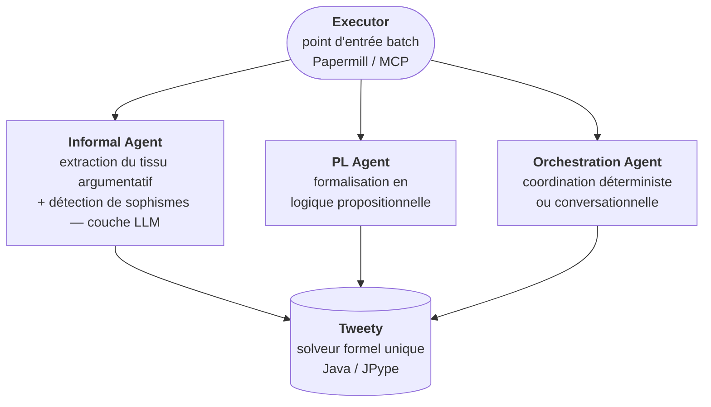
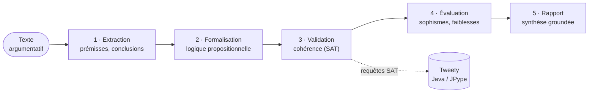

# ArgumentAnalysis - Analyse Argumentative avec Agents IA

<!-- CATALOG-STATUS
series: SymbolicAI-ArgumentAnalysis
pedagogical_count: 38
breakdown: ArgumentAnalysis=38
maturity: BETA=36, ALPHA=1, DRAFT=1
-->

[← SmartContracts](../SmartContracts/README.md) | [↑ SymbolicAI](../README.md) | [SymbolicLearning →](../SymbolicLearning/README.md)

Pipeline complet d'analyse argumentative combinant Semantic Kernel, TweetyProject et programmation logique pour l'identification et l'évaluation d'arguments dans des textes.

## Pourquoi cette série

Distinguer un argument valide d'un sophisme est un acte essentiel dans une société saturée de discours générés à la chaîne. Lorsque les LLMs produisent des textes plausibles à la demande, la frontière entre persuasion légitime et manipulation rhétorique se brouille : raisonnements circulaires, faux dilemmes, appels à l'autorité mal calibrés deviennent indétectables par simple lecture rapide. La vérification formelle, autrefois réservée aux logiciens, devient un service de masse : modération de plateformes, journalisme assisté, éducation critique, audit de contenus pédagogiques générés par IA.

Cette série pose une question concrète : peut-on construire un pipeline qui prend un texte argumentatif en entrée et qui en restitue une carte logique formelle, validée par un solveur SAT, avec détection systématique des sophismes connus ? La réponse passe par un assemblage soigné de trois compétences distinctes : un LLM pour extraire le tissu argumentatif informel (prémisses, conclusions, transitions), un solveur logique (TweetyProject, Java via JPype) pour vérifier la cohérence des formalisations propositionnelles obtenues, et une couche d'orchestration agentique (Semantic Kernel) qui transforme cette chaîne en pipeline reproductible. Le travail pédagogique consiste à maîtriser chacune de ces briques *et* leur composition : où s'arrête le LLM, où commence le vérificateur formel, comment une boucle informel/formel converge vers un verdict.

Le contexte de recherche actuel rend cette compétence particulièrement pertinente. Les frameworks de raisonnement structuré (ASPIC+, ABA, DeLP) sont implémentés en JVM et accessibles via les mêmes ponts JPype que ceux utilisés ici. Les LLMs de 2025-2026 sont assez fiables pour la phase d'extraction informelle mais restent faibles sur la vérification formelle, ce qui motive précisément le pattern hybride documenté dans la série. Les ponts vers [Tweety](../Tweety/) (sémantiques de Dung, révision de croyances AGM, préférences de Tweety-9) et [Lean](../Lean/) (preuves formelles, tactiques) permettent d'aller plus loin pour qui veut dépasser la simple vérification SAT.

**À qui s'adresse cette série** : enseignants en pensée critique, équipes éditoriales construisant des outils de fact-checking, étudiants en philosophie computationnelle ou en linguistique formelle, et ingénieurs explorant les architectures hybrides LLM + solveur. La maîtrise préalable supposée est modérée : Python intermédiaire, intuition logique propositionnelle, familiarité minimale avec les LLMs et l'API OpenAI. Le [parcours principal](#parcours-principal) s'enchaîne dans l'ordre des numéros, avec l'`Executor` (`08b`) comme point d'entrée pour une exécution batch reproductible (Papermill / MCP).

## Domaines d'application

L'analyse argumentative outillée s'inscrit dans plusieurs cas concrets où la distinction "argument valide / sophisme" doit être rendue automatique ou semi-automatique :

- **Modération de discussions en ligne** : détection des sophismes récurrents (homme de paille, faux dilemmes, glissement, ad hominem) dans des fils de commentaires longs, avec un rapport agrégé par utilisateur ou par fil. Le pattern LLM-extracteur + vérificateur formel est calibré précisément pour cet usage.
- **Fact-checking et journalisme assisté** : décomposition d'un éditorial ou d'un discours politique en chaîne de prémisses et conclusions, marquage des transitions logiquement faibles, identification des affirmations factuelles à vérifier externellement. La phase "formalisation" crée un livrable inspectable, contrairement aux jugements opaques d'un LLM seul.
- **Éducation à la pensée critique** : production d'exercices d'analyse à partir de textes réels (discours, essais, posts), avec correction automatisée partielle. L'enseignant valide la décomposition, l'élève apprend à justifier chaque étape.
- **Audit de contenus IA** : vérification de la cohérence interne des réponses LLM longues sur sujets sensibles (médical, juridique, financier). Un LLM peut produire un raisonnement plausible mais incohérent ; le solveur formel détecte les contradictions internes.
- **Recherche en argumentation structurée** : terrain expérimental pour les frameworks Dung, ASPIC+, ABA, accessibles via les ponts Tweety. La série sert de support à des explorations académiques (mémoires, thèses) sur les sémantiques d'acceptabilité, la révision de croyances AGM, ou les préférences entre arguments.

## Objectifs d'apprentissage

À l'issue de cette série, vous serez capable de :

1. **Extraire le tissu argumentatif** d'un texte en identifiant prémisses, conclusions et transitions à l'aide d'un agent LLM (Semantic Kernel)
2. **Formaliser des arguments** en logique propositionnelle et vérifier leur cohérence avec un solveur SAT (TweetyProject)
3. **Détecter les sophismes** courants (homme de paille, faux dilemme, ad hominem, appel à l'autorité) de manière systématique
4. **Orchestrer un pipeline multi-agents** combinant extraction informelle, formalisation logique et validation formelle
5. **Comparer les approches** LLM-only vs hybride (LLM + solveur formel) et comprendre les limites de chaque couche

## Comment lire ce README

Un README de série se lit à plusieurs vitesses : le parcours par les numéros nus, l'approfondissement par les lettres, puis les carnets spécialisés et les ressources de recherche. Le principe est exposé à la racine du dépôt, dans [« Choisir sa vitesse de lecture »](https://github.com/jsboige/CoursIA#choisir-sa-vitesse-de-lecture).

- **Vous suivez le cœur de la série** : le [parcours principal](#parcours-principal) ci-dessous, de la configuration de l'environnement à la synthèse évaluée.
- **Vous creusez un palier** : les extensions lettrées vivent en [Approfondissements](#approfondissements), sous le numéro qu'elles prolongent ; elles ne sont pas des jumeaux ni une autre version du carnet principal.
- **Vous cherchez un point précis** : [Concepts clés](#concepts-clés), [Prérequis](#prérequis), [Ordre partiel et prérequis](#ordre-partiel-et-prérequis), puis [Ressources](#ressources).

## Parcours principal

Durée totale estimée : **~4-5 h** pour l'ensemble du parcours. Kernel Python 3 ; les carnets agentiques demandent une clé `OPENAI_API_KEY` (voir [Prérequis](#prérequis)).

| # | Notebook | Ce qu'on y apprend | Public | Pour approfondir |
|---|----------|--------------------|--------|------------------|
| 00 | [Setup Tweety](Argumentation-00-Setup-Tweety-Python.ipynb) | Configurer Python, JPype, un JDK portable et les JAR Tweety ; démarrer la JVM et vérifier la connexion sans simuler le solveur | Découverte | — |
| 01 | [Modèle de Toulmin](Argumentation-01-Toulmin-Model-Python.ipynb) | Déployer un argument en claim, données, garantie, appui, modalisateur et réfutation ; auditer sa complétude puis traduire les réfutations en attaques de Dung | Découverte | [Schémas de Walton](#autour-de-01--argumentation-informelle) |
| 02 | [Détection des sophismes](Argumentation-02-Fallacies-Detection-Python.ipynb) | Charger la taxonomie Argumentum, extraire le tissu argumentatif et repérer les passages fallacieux avec un détecteur inspectable | Découverte | [Cartes Argumentum](#autour-de-02--sophismes-et-taxonomie) |
| 03 | [Sémantiques de Dung](Argumentation-03-Dung-AF-Semantics-Python.ipynb) | Reconstruire les sémantiques grounded, preferred et stable en Python, sur des cas où elles ne donnent pas le même verdict | Découverte | [Valeurs, classement et ADF](#autour-de-03--argumentation-abstraite) |
| 04 | [Dialogues protocolisés](Argumentation-04-Dialogues-Protocolises-Python.ipynb) | Lire les protocoles inquiry et persuasion de Walton–Krabbe comme des machines à états sur des actes de parole, avec des conditions de terminaison testables | Licence | [Mémoire de débat](#autour-de-04--dialogues-et-mémoire) |
| 05 | [Vérification formelle](Argumentation-05-Formal-Verification-Python.ipynb) | Formaliser des arguments en logique propositionnelle, du premier ordre et modale ; interroger Tweety en mode fail-loud | Licence | [Routage et richesse des solveurs](#autour-de-05--vérification-formelle) |
| 06 | [JTMS](Argumentation-06-JTMS-Python.ipynb) | Construire un moteur de croyances non monotones : étiquettes IN/OUT, rétractation en cascade et détection des boucles impaires | Licence | [ATMS et révision AGM](#autour-de-06--raisonnement-non-monotone) |
| 07 | [Orchestration](Argumentation-07-Orchestration-Python.ipynb) | Composer les agents précédents en pipeline coordonné, avec orchestration déterministe par état et comparaison au mode conversationnel | Licence | [Canaux et modes d'orchestration](#autour-de-07--orchestration) |
| 08 | [Capstone](Argumentation-08-Capstone-Python.ipynb) | Comparer une baseline LLM seule au pipeline complet, puis vérifier que la synthèse cite les artefacts sur lesquels elle s'appuie | Licence | [Exécution, interface et synthèse](#autour-de-08--intégration-et-restitution) |
| 09 | [Garde-fous AI Shield](Argumentation-09-Guardrails-AI-Shield-Python.ipynb) | Distinguer heuristique, filtre de sortie et validation par LLM ; choisir explicitement entre fail-open et fail-closed lorsqu'un garde-fou tombe en panne | Licence | — |
| 10 | [Export privé](Argumentation-10-Privacy-Export-Python.ipynb) | Opacifier les identifiants, filtrer un état avant export et ne conserver que des motifs agrégés ; mesurer les limites de cette protection | Recherche | — |

Le parcours numérique n'est pas une chaîne d'exécution rigide : les fondations de Toulmin, Dung et des dialogues éclairent le pipeline, tandis que le JTMS, les garde-fous et l'export privé peuvent être étudiés avec leurs propres prérequis. L'[ordre partiel détaillé](#ordre-partiel-et-prérequis) distingue ces dépendances.

## Approfondissements

Les extensions lettrées creusent un palier du parcours ; elles ne le font pas avancer.

### Autour de 01 — Argumentation informelle

- [01b — Schémas de Walton](Argumentation-01b-Schemes-Walton-Python.ipynb) : reconnaître des formes stéréotypées d'argument par un classifieur lexical déterministe, les départager dans un ordre canonique et utiliser leurs questions critiques ; une absence de correspondance reste un résultat honnête, jamais une étiquette fabriquée.

### Autour de 02 — Sophismes et taxonomie

- [02b — Cartes Argumentum](Argumentation-02b-Argumentum-Cards-Python.ipynb) : produire un deck imprimable à partir de la taxonomie. Ce carnet de production consomme le socle ontologique plutôt que d'ajouter une méthode de détection.

### Autour de 03 — Argumentation abstraite

- [03b — Argumentation fondée sur les valeurs](Argumentation-03b-Value-Based-AF-Python.ipynb) : enrichir Dung avec les valeurs de Bench-Capon et des audiences qui les ordonnent ; un même graphe peut conduire à des conclusions différentes selon l'audience.
- [03c — Sémantiques de classement](Argumentation-03c-Ranking-Semantics-Python.ipynb) : calculer une force numérique par h-Categoriser ou par fardeau pour départager des arguments que Dung laisse au même statut.
- [03d — ADF](Argumentation-03d-ADF-Semantiques-Python.ipynb) : remplacer l'attaque binaire par une condition d'acceptation booléenne et obtenir des interprétations à trois valeurs, en interrogeant le solveur SAT de Tweety via `argumentation_lib._adf_handler`.

### Autour de 04 — Dialogues et mémoire

- [04b — Base de connaissances](Argumentation-04b-Knowledge-Base-Python.ipynb) : conserver la mémoire d'un débat, peupler transitivement les propositions et requêter support et attaque par négation lexicale. Le carnet mesure aussi ce que cette mémoire ne fait pas : elle ne transforme pas une contradiction en inférence arbitraire.

### Autour de 05 — Vérification formelle

- [05b — Routage multi-backend](Argumentation-05b-Multi-Backend-Routing-Python.ipynb) : router PL, logique modale, Dung et FOL vers les bons solveurs, avec une sentinelle « décider ou échouer bruyamment » pour les prouveurs externes EProver et Mace4.
- [05c — Matrice de richesse formelle](Argumentation-05c-Formal-Richness-Matrix-Python.ipynb) : distinguer ce qu'un solveur décide réellement de ce que son simple branchement suggère ; classer les résultats substantiels, indisponibles, honnêtement absents ou théâtraux.

### Autour de 06 — Raisonnement non monotone

- [06b — ATMS et conflits](Argumentation-06b-ATMS-Conflits-Python.ipynb) : représenter une croyance par les environnements minimaux qui la dérivent, observer une invalidation qui retranche sans recalcul, puis comparer les stratégies de résolution de conflits entre agents.
- [06c — Révision de croyances AGM](Argumentation-06c-Revision-Croyances-Python.ipynb) : appliquer contraction de noyau et révision de Levi sur l'organe Tweety, et examiner les écarts réels du portage — comportements convergents et limites du parseur propositionnel inclus.

### Autour de 07 — Orchestration

- [07b — Canaux de communication](Argumentation-07b-Communication-Channels-Python.ipynb) : construire un bus multi-agents avec priorité explicite, routage sans route morte et corrélation requête-réponse.
- [07c — Modes d'orchestration](Argumentation-07c-Orchestration-Modes-Python.ipynb) : comparer plusieurs architectures par leur budget et distinguer l'arrêt déclaré par le mode de la réalité des phases exécutées.

### Autour de 08 — Intégration et restitution

- [08b — Executor](Argumentation-08b-Executor-Python.ipynb) : lancer le pipeline complet en batch avec Papermill ou MCP, configuré par `.env`, et produire un rapport structuré.
- [08c — Interface de configuration](Argumentation-08c-UI-Configuration-Python.ipynb) : piloter le pipeline avec ipywidgets sans rendre l'interface obligatoire à son exécution.
- [08d — Restitution en trois actes](Argumentation-08d-Restitution-3-Actes-Python.ipynb) : séparer la lisibilité, confiée à une narration LLM conditionnée par les preuves, de l'honnêteté du résultat, garantie par un scaffold déterministe.
- [08e — Profil d'argument](Argumentation-08e-Argument-Profile-Python.ipynb) : réunir sophismes, qualité, contre-arguments, JTMS et formel dans une fiche multidimensionnelle, sans confondre validité formelle et absence de sophisme.
- [08f — Synthèse multidimensionnelle](Argumentation-08f-Synthese-Multidimensionnelle-Python.ipynb) : choisir un niveau d'analyse, exécuter les dimensions disponibles et documenter celles qui le sont réellement, plutôt que de présenter une couverture fictive.

## Sous-séries et carnets spécialisés

### Observatoire de l'argumentation

| Notebook | Ce qu'il apporte |
|----------|------------------|
| [Obs-01 — Graphes datés](Argumentation-Obs-01-Graphes-Dates-Python.ipynb) | Transformer un corpus daté en graphe AIF puis en cadre de Dung ; comparer structure et extensions avec un plancher de bruit et un contrôle positif |
| [Obs-02 — Initiation](Argumentation-Obs-02-Initiation-Python.ipynb) | Réutiliser l'instrument Obs-01 dans une étude empirique pré-inscrite, avec corpus stratifié, extraction épinglée et plafond de preuve explicite |
| [Obs-03 — Récollement des lectures](Argumentation-Obs-03-Recollement-Lectures-Python.ipynb) | Consolider les lectures croisées de la série |
| [Obs-04 — Récollement, strate 6](Argumentation-Obs-04-Recollement-Strate6-Python.ipynb) | Poursuivre la consolidation à la strate suivante |

### Socle ontologique Argumentum

| Notebook | Ce qu'il apporte |
|----------|------------------|
| [Onto-01 — AIF et OWL2](Argumentation-Onto-01-AIF-OWL2-Python.ipynb) | Lire l'ontologie Argumentum et ses nœuds AIF avec le parseur adapté à son export OWL/XML |
| [Onto-02 — CrossLinks et CSV](Argumentation-Onto-02-CrossLinks-CSV-Python.ipynb) | Comparer le CSV canonique à l'OWL : relations transverses, mappings AIF/Walton et complémentarité des deux sources |
| [Onto-03 — Vertus et SKOS](Argumentation-Onto-03-Vertus-SKOS-Python.ipynb) | Explorer le thésaurus SKOS des vertus argumentatives, pendant positif de la taxonomie des sophismes |

### Autres prolongements

- [Gouvernance multi-agents](Argument_Analysis_Gouvernance_Multi_Agents.ipynb) : scrutins, consensus, choix social formel, mesures de justice et paradoxes de vote — un prolongement naturel de l'orchestration lorsque plusieurs agents doivent décider collectivement.
- [Règles symboliques de sophismes](Argument_Analysis_Fallacy_Rules_Symboliques.ipynb) : mesurer et réparer les motifs spaCy du moteur de détection, avec un diagnostic token par token plutôt qu'un score sans explication.
- [Contre-arguments ASPIC — travail de groupe I2](groupe-I2-contre-arguments-aspic/I2_Contre_arguments_ASPIC.ipynb) : une production autonome dans son sous-répertoire, hors du parcours principal.

Les anciens compagnons `Agentic-*_agent` sont conservés dans [`_archive/`](_archive/README.md) pour consultation historique ; ils ne font plus partie du parcours actif.

## Architecture



L'`Executor` est le seul point d'entrée (exécution batch via Papermill/MCP) : il déclenche la chaîne et agrège le rapport final. Le travail se *fan-out* vers trois agents spécialisés — **Informal** (extraction du tissu argumentatif et détection de sophismes, couche LLM), **PL** (formalisation en logique propositionnelle) et **Orchestration** (coordination déterministe ou conversationnelle) — puis *converge* vers **Tweety**, le solveur formel unique (Java via JPype).

Cette topologie en entonnoir n'est pas accidentelle : la cohérence logique est la seule propriété qu'aucun agent ne peut auto-certifier, elle doit donc être déléguée à un vérificateur externe et partagé. Le LLM se charge de tout ce qui est flou et contextuel (lire un texte, repérer un sophisme) ; le solveur se charge de tout ce qui est tranchant et décisif (une formule est-elle satisfaisable ? un argument est-il défendable ?). La frontière informel/formel passe exactement au point de convergence.

## Pipeline d'analyse

1. **Extraction** - Identification des arguments dans le texte
2. **Formalisation** - Conversion en logique propositionnelle
3. **Validation** - Vérification cohérence via Tweety
4. **Évaluation** - Détection de sophismes et faiblesses
5. **Rapport** - Génération conclusion structurée



## Exemple de trace du pipeline

Pour rendre ce déroulement concret, voici ce que produit le pipeline sur le **terrain commun** du capstone ([Argumentation-08-Capstone-Python](Argumentation-08-Capstone-Python.ipynb)) : un texte argumentatif neutre — un comité abstrait, sans entité réelle — délibérément chargé de cinq sophismes détectables (appel à l'autorité, attaque *ad hominem*, généralisation hâtive, appel à la peur, appel à la conformité). Il sert de terrain commun à la baseline et au pipeline complet.

1. **Extraction informelle** — l'agent parcourt le texte et isole le tissu argumentatif : prémisses, conclusions, transitions rhétoriques. Chaque passage suspect est confronté à la taxonomie des sophismes (7 familles).
2. **Détection** — les sophismes présents sont étiquetés et rattachés à leur famille (Obstruction pour *ad hominem*, Erreur de raisonnement pour le faux dilemme, etc.), avec le déclencheur textuel qui les a signalés.
3. **Formalisation** — les arguments retenus sont traduits en formules de logique propositionnelle et ajoutés au *belief set*.
4. **Validation formelle** — Tweety, via le pont JPype, interroge ce belief set (une dizaine de requêtes SAT) pour confirmer la cohérence interne : pas de contradiction masquée, pas de conclusion tirée sans prémisse. Mode *fail-loud* : si la JVM manque, le pipeline échoue bruyamment plutôt que de simuler un verdict.
5. **Synthèse groundée** — le rapport final cite explicitement chaque artefact qu'il invoque (`[artifact:champ:id]`), ce que les *value-gates* vérifient déterministiquement : VG-1 (densité de citations), VG-2 (état substantiel peuplé), VG-3 (non-boilerplate), VG-4 (vrai paragraphe de synthèse citant ≥ 2 champs distincts).

Le verdict attendu sur l'`Executor` (mode batch) est `COMPLETE_VALIDATED` : 1 argument identifié, 4 sophismes étiquetés, 1 belief set formel, ~10 requêtes au solveur, et les quatre value-gates au vert. La même exécution en mode baseline (LLM seul, 0-shot) sert de contre-point : sans la couche formelle, la cohérence interne n'est garantie par rien, et c'est précisément cet écart que la série cherche à mesurer.

## Concepts clés

Le pipeline mobilise un vocabulaire issu de trois traditions — la rhétorique classique, la logique formelle et l'argumentation computationnelle. Le tableau ci-dessous reprend les notions effectivement manipulées dans les notebooks, avec un pointeur vers celui qui les met en œuvre.

| Concept | Description | Notebook |
|---------|-------------|----------|
| **Argument** | Suite de *prémisses* soutenant une *conclusion* ; c'est le tissu que le pipeline extrait d'un texte naturel. | 02 |
| **Prémisse / Conclusion** | Brique atomique de l'argument : la prémisse est l'énoncé admis, la conclusion celle que l'on dérive. Leur identification est la sortie de l'agent informel. | 02 |
| **Sophisme** | Raisonnement fallacieux mais plausible. La série s'appuie sur une taxonomie en 7 familles (Obstruction, Erreur de raisonnement, …) organisée en arbre jusqu'à 10 niveaux. | 02 |
| **Formalisation** | Traduction d'un argument naturel en formule logique inspectable. C'est le point de bascule où le texte cesse d'être du langage naturel pour devenir un objet qu'un solveur peut interroger. | 05 |
| **Logique propositionnelle (PL)** | Logique des connecteurs (∧, ∨, →, ¬) sans quantificateurs ; vérifiée via un modus ponens dans Tweety. | 05 §3 |
| **Logique du premier ordre (FOL)** | PL étendue des quantificateurs (∀, ∃) et prédicats. Exige une *signature* déclarée (constantes, prédicats) avant toute requête. | 05 §4 |
| **Logique modale** | Logique du *possible* (◇) et du *nécessaire* (□), utile pour les arguments portant sur la contingence ou l'obligation. | 05 §5 |
| **Argumentation de Dung** | Cadre abstrait où les arguments s'attaquent mutuellement ; la sémantique *grounded* calcule l'ensemble des arguments défendables. Les sémantiques *preferred* et *stable* étendent ce verdict sous différentes attitudes (crédule, auto-suffisante). | 03, 05 §6 |
| **Sémantique de classement** | Approche *graduée* : au lieu d'un verdict tout-ou-rien, chaque argument reçoit une *force* numérique (h-Categoriser, fardeau) qui induit un ordre — départageant des arguments de même statut Dung. | 03c |
| **Argumentation dialectique (ADF)** | Extension de Dung où chaque argument porte une *condition d'acceptation* booléenne sur ses parents (négation, contradiction, tautologie, disjunction) au lieu d'une attaque binaire : le résultat d'une sémantique devient une *interprétation* à trois valeurs (`t` accepté / `f` refusé / `u` indécis). | 03d |
| **Belief set** | Ensemble de formules formalisant l'état de croyance déduit du texte ; c'est ce que le solveur manipule et interroge. | 05 |
| **SAT** | Problème de satisfaisabilité : existe-t-il une valuation rendant un ensemble de formules cohérent ? Cœur de la validation Tweety. | 05 |
| **Fail-loud** | Principe de conception : le pipeline échoue bruyamment plutôt que de *simuler* un verdict (jamais de sortie fictive si la JVM ou le solveur manque). | 05 |
| **Value-gates (VG-1..VG-4)** | Quatre gardes déterministes qui notent si la synthèse finale est *groundée* (elle cite ses artefacts via `[artifact:champ:id]`) ou *boilerplate* (template vide). | 08 |
| **Pipeline hybride LLM + solveur** | Architecture où le LLM gère l'extraction informelle (floue, contextuelle) et le solveur formel garantit la cohérence ; aucune des deux couches ne suffit seule. | 07 |
| **Ontologie OWL2 (Argumentum)** | Représentation formelle de la taxonomie Argumentum (un `owl:Class` par sophisme, plus les nœuds AIF ; relations et labels en `AnnotationAssertion`). L'export upstream est en OWL/XML fonctionnel : le parseur regex tolérant est obligatoire — `rdflib` échoue au parse, `owlready2` charge en silence mais n'expose pas les concepts via API. | Onto-01-AIF-OWL2 |
| **SKOS (Simple Knowledge Organization System)** | Famille de propriétés W3C (`skos:broader`, `skos:narrower`, `skos:inScheme`, `skos:Concept`) qui dominent l'ontologie Argumentum (une relation de chacun de ces types par sophisme, à quelques unités près). La navigation dans la taxonomie s'appuie sur ces relations plutôt que sur AIF. | Onto-01-AIF-OWL2 |
| **Schemes d'argumentation (Walton)** | Patterns d'inférence (Position to Know, Sign, Rule, Cause to Effect) servant de taxonomie pour présomption : la reconnaissance d'un scheme active les *critiques* associées. Argumentum expose `Sign` (11 labels) et `Analogy` (4 labels) ; `Position to Know`, `Cause to Effect`, `Expert Opinion` et `Popular Opinion` sont absents du label parsing (0 occurrence). | Onto-01-AIF-OWL2, 02 |
| **CrossLinks `crossLink_*` (Argumentum CSV)** | Huit relations transverses (PredatesOn, Denounces, Leverages, Allows, Opposes, Inverts, Mirrors, IsRelatedTo) qui créeraient un **graphe** au-dessus de l'arbre taxonomique. Les relations sont renseignées sur une minorité de sophismes, avec une dominance de `Leverages` et de `IsRelatedTo` — `Denounces` et `Mirrors` restent rares. La couche `crossLink` n'est pas lue de la même façon selon l'OWL : le CSV la porte (carnet Onto-02 §7) ; l'OWL local `ontologies/argumentum_fallacies.owl` en émet aussi (carnet Onto-01 §5), alors que l'OWL du submodule épinglé n'en émet aucune (carnet Onto-02 §8). Les deux carnets lisent donc deux OWL différents et n'aboutissent pas au même constat : écart à réconcilier côté upstream. **Finding méthodologique** : la couche transverse a été curée puis dé-curée délibérément (carnet Onto-02 §1 et §7). | Onto-02-CrossLinks-CSV |
| **Mappings AIF/Walton (Argumentum CSV)** | Trois colonnes `AIF_skosDirectRef` / `AIF_skosExceptionRef` / `AIF_skosMappingType` (colonnes 70-72 du CSV) relient chaque sophisme aux schemes Walton via les types SKOS `broadMatch` (64), `closeMatch` (33) et `narrowMatch` (19). 116 mappings (8,2% des sophismes) ; 60 schemes Walton uniques sont référencés, top : `VagueVerbalClassification_Inference` (14 occurrences). Ces mappings CSV **concordent avec les `*Match` AA de l'OWL** à l'épingle (116/116) ; le CSV reste la source canonique pour l'alignement sophisme→scheme. | Onto-02-CrossLinks-CSV, 02 |
| **Gap OWL ↔ CSV (Argumentum upstream)** | L'OWL `argumentum_fallacies.owl` porte un `owl:Class` par sophisme (plus les nœuds AIF) et des labels `skos:prefLabel` fr/en ; le CSV canonique porte les sophismes en 8 langues. L'écart historique entre les deux (un `NamedIndividual` par label, dans l'ancien générateur) est résorbé (carnet Onto-02 §8). Il reste un écart entre le nombre de `owl:Class` et celui des sophismes du CSV, que les carnets ne ventilent pas. La différence de nature est **structurelle** : l'OWL porte les classes, les propriétés et la couche AIF ; le CSV porte la version canonique 8-langues, les relations `crossLink_*` et les mappings AIF. Les deux sources sont **complémentaires, pas redondantes** : OWL = squelette structurel ; CSV = graphe opérationnel. | Onto-02-CrossLinks-CSV, Onto-01-AIF-OWL2 |

## Prérequis

### Python

```bash
pip install semantic-kernel openai python-dotenv jpype1
```

### Java

JDK 17+ requis (auto-télécharge via `install_jdk_portable.py`).

### Configuration

```bash
# Dans .env
OPENAI_API_KEY=sk-...
GLOBAL_LLM_SERVICE=openai
BATCH_MODE=false
```

## Mode batch

Pour exécution automatisée (Papermill/MCP) :

```bash
# Dans .env
BATCH_MODE="true"
# Optionnel : texte personnalisé
# BATCH_TEXT="Votre texte à analyser..."
```

## Technologies

| Technologie | Usage |
|-------------|-------|
| **Semantic Kernel** | Orchestration agents |
| **OpenAI GPT** | Analyse textuelle |
| **TweetyProject** | Logique formelle (Java) |
| **JPype** | Pont Python-Java |

## Quick Start

```bash
# 1. Installer les dépendances Python
pip install semantic-kernel openai python-dotenv jpype1

# 2. Configurer les API keys
cp .env.example .env
# Éditer .env : OPENAI_API_KEY, BATCH_MODE=true

# 3. Lancer le premier notebook
jupyter notebook Argumentation-00-Setup-Tweety-Python.ipynb
```

> **Note** : JDK 17+ est requis mais auto-télécharge via `install_jdk_portable.py` (pas d'installation système).

---

## FAQ / Troubleshooting

| Problème | Solution |
|----------|----------|
| **`ModuleNotFoundError: semantic_kernel`** | `pip install semantic-kernel`. Vérifier le kernel Jupyter actif (`jupyter kernelspec list`). |
| **`OPENAI_API_KEY not set`** | Copier `.env.example` en `.env` et renseigner la clé. Vérifier que le notebook 0 charge bien le `.env`. |
| **`JVM not found`** au démarrage | JDK 17+ requis. Exécuter `python install_jdk_portable.py` dans le répertoire. |
| **`FileNotFoundException` sur un JAR Tweety** | Les JARs doivent être dans `libs/`. Re-exécuter le notebook 0 qui les télécharge. |
| **`BATCH_MODE` ignoré** | Vérifier que `.env` contient `BATCH_MODE="true"` (avec guillemets) et que le fichier est au même niveau que les notebooks. |
| **Erreur `dotnet` ou `.NET`** | Cette série est 100% Python. Seul Semantic Kernel (package Python) est utilisé, pas le SDK .NET. |
| **Sortie `PARTIAL_VALIDATED`** | Le pipeline n'a pas convergé. Vérifier les logs de l'agent PL (formalisation incomplète). Relancer avec un texte plus court. |
| **`OutOfMemoryError` JVM** | Augmenter le heap dans la cellule de démarrage : ajouter `-Xmx2g` aux arguments JPype. |

## Structure des fichiers

```text
ArgumentAnalysis/
├── *.ipynb                    # notebooks pédagogiques (pipeline agentique + Dung)
├── .env / .env.example        # Configuration
├── install_jdk_portable.py    # Installation JDK
├── data/                      # Données (taxonomie sophismes)
├── ext_tools/                 # Outils externes locaux (SPASS) — EProver est partagé : ../ext_tools/
├── jdk-17-portable/           # JDK (ignoré git)
├── libs/                      # JARs Tweety
├── ontologies/                # Ontologies OWL
├── output/                    # Résultats analyses
└── resources/                 # Ressources Tweety
```

## Sortie

Le pipeline génère un rapport JSON dans `output/analysis_report.json` :

```json
{
  "validation_status": "COMPLETE_VALIDATED",
  "confidence_score": 85,
  "checks": {
    "ARGUMENTS_IDENTIFIED": true,
    "FALLACIES_ANALYZED": true,
    "BELIEF_SET_CREATED": true,
    "QUERIES_EXECUTED": true,
    "CONCLUSION_GENERATED": true
  }
}
```

## Ponts avec les autres séries

| Série | Connexion | Détails |
| ----- | ---------- | ------- |
| **[Tweety](../Tweety/)** | Backend argumentatif | Utilise directement TweetyProject (JPype) pour le raisonnement formel. Les sémantiques de Dung (Tweety-5) et la révision de croyances (Tweety-4) sont au cœur du pipeline. |
| **[Lean](../Lean/)** | Preuves formelles | La formalisation logique des arguments (Agentic-2) suit le même paradigme que les tactiques Lean. La vérification de cohérence via SAT est analogue aux proof checkers. |
| **[Tweety-9](../Tweety/Tweety-09-Preferences-Python.ipynb)** | Préférences et vote | L'analyse d'arguments de valeur croise les modèles de préférence et la théorie du choix social (GameTheory/game_theory_lean/SocialChoice/). |
| **[SemanticWeb](../SemanticWeb/)** | Raisonneur OWL/SHACL | Pattern analogue pour la détection d'incohérence ; l'ontologie Argumentum partage les mêmes contraintes de parsing (`rdflib` et `owlready2` échouent sur l'OWL/XML fonctionnel ; `ObjectExactCardinality` bien formées) — le notebook `Onto-01-AIF-OWL2` charge `argumentum_fallacies.owl` via parseur regex dédié. |
| **[Argumentum](../../../../Argumentum)** *(submodule, hors-repo)* | Ontologie source | L'ontologie `argumentum_fallacies.owl` (OWL2/XML) est l'export formel de la taxonomie utilisée par le détecteur de sophismes (`02`). Les 8 colonnes `crossLink_*` du CSV upstream complètent les relations OWL natives par des liens inter-noeuds (PredatesOn, Denounces, Leverages, Allows, Opposes, Inverts, Mirrors, IsRelatedTo). |

[La mer qui monte](../../../docs/cadrage/grothendieckian-lens.md) : une grille de lecture grothendieckienne du dépôt — l'analyse d'argumentation comme changement de représentation vers le vérifiable : du langage naturel aux sémantiques formelles qu'on peut interroger.

> **Note** : Le pipeline s'exécute de bout en bout. L'`Executor` (point d'entrée Papermill/MCP) produit une validation `COMPLETE_VALIDATED` à 100 % (1 argument identifié, 4 sophismes, 1 belief set formel, 10 requêtes au solveur).

## Écosystème MCP et parenté cross-lane

**3 outils d'infrastructure MCP** (cohérent avec cycles 19-30 hubs) :

1. **MCP Jupyter (`mcp__jupyter-papermill__*`)** — note bug #5211 (mode async ignore `kernel_name`, re-exec = `nbconvert --execute --ExecutePreprocessor.kernel_name=python3 --timeout=600`). ArgumentAnalysis utilise **kernel Python 3 uniquement** (Semantic Kernel = package Python, pas de kernel .NET natif requis ; JDK 17 portable est un exécutable subprocess, pas un kernel Jupyter).
2. **Validation pre-commit** (`.pre-commit-config.yaml`) — `gitleaks` détecte les secrets inline (clé OpenAI, mnemonic wallet, paths absolus) ; le validateur notebook `validate_pr_notebooks.py` enforce C.1 (stubs sans `NotImplementedError`) et C.2 (notebooks commités AVEC outputs, `execution_count != null`). **Note spécifique ArgumentAnalysis** : le fichier `.env` (`OPENAI_API_KEY`, `GLOBAL_LLM_SERVICE`, `BATCH_MODE`) doit vivre dans `.gitignore`, jamais en clair dans un notebook ou une cellule — la clé OpenAI est particulièrement sensible (compte facturé).
3. **MCP QC Cloud (`mcp__qc-mcp-lite__*`)** — backtest QuantConnect partagé. ArgumentAnalysis n'utilise pas QC Cloud directement, mais partage avec QC la même doctrine **anti-théâtre** : la matrice `Formal_Richness_Matrix` classifie les solveurs en 4 verdicts (substantive / honest-absent / unavailable / théâtre), doctrine symétrique au principe QuantConnect « pas de backtest sans Sharpe/CAGR/MaxDD reportés ». Les deux convergent : **un résultat non vérifié n'est pas un résultat**.

**Table parenté cross-lane 6 colonnes** (ArgumentAnalysis se situe au croisement de plusieurs séries du dépôt) :

| Notebook ArgumentAnalysis | Série parente | Pont conceptuel |
|---------------------------|---------------|-----------------|
| `02` (taxonomie, 7 familles de sophismes) + `05` (Tweety) | [Tweety](../Tweety/) (JPype, sémantiques Dung, FOL, Modal) | TweetyProject = solveur formel unique, JPype = pont Python/Java ; ArgumentAnalysis consomme les API Tweety comme backend de validation |
| `05` (PL/FOL/Modal/Dung) | [Lean](../Lean/) (preuves formelles, tactiques) | Formalisation logique = même paradigme que tactiques Lean ; frontière informel/formel analogue à proof/script |
| `03`, `03c` | [Tweety](../Tweety/) (Tweety-5 argumentation abstraite) + [GameTheory](../../GameTheory/) (`game_theory_lean/SocialChoice/` Voting.lean) | Sémantiques de Dung (grounded/preferred/stable) = même fondement mathématique que Voting (Banks sets, monotonie STV) |
| `Value_Based_AF` | [GameTheory](../../GameTheory/) (`game_theory_lean/SocialChoice/`) + [Tweety-9](../Tweety/Tweety-09-Preferences-Python.ipynb) (préférences) | Audiences VAF = ordres de préférence sur les valeurs : agréger plusieurs audiences = problème de choix social (Condorcet, Arrow), pont direct vers la théorie du vote |
| `07` (orchestration, Semantic Kernel) | [Argumentum](Argumentum/) + [CoursIA-OwlAdapter](CoursIA-OwlAdapter/) (EPITA-IS verbatim ports, sous-dossiers locaux) | Orchestration agentique = même architecture que Semantic Kernel orchestrant prompts ; Argumentum = ports upstream byte-equal |
| `08d` (Restitution 3 actes, narration LLM *gated*) | [GenAI](../../GenAI/) (Text/Image/Audio/Video, self-hosted + Cloud) | Restitution LLM = même besoin de **séparation lisibilité/honnêteté** que GenAI Text : le LLM génère, le scaffold déterministe garantit la grounding |
| `05b`, `05c` (sentinelle anti-théâtre) | [Search](../../Search/) (CSP/SMT/Z3) + [SemanticWeb](../SemanticWeb/) (OWL/SHACL raisonneurs) | Routage multi-solveur avec sentinelle « décider ou échouer bruyamment » analogue à CSP marathon EPIC #4956 ; classification 4-verdicts symétrique aux solveurs OWL (consistent / inconsistent / unknown / timeout) |
| `06` (JTMS — Truth Maintenance System) | [Lean](../Lean/) (logique constructive) + [SemanticWeb](../SemanticWeb/) (incohérence OWL détection) | JTMS = raisonnement non-monotone étiquetage IN/OUT, analogue à propagation de contraintes Lean + détection d'incohérence SHACL |

**Paragraphe « effet de composition — ArgumentAnalysis = carrefour informel/formel anti-théâtre »** :

Là où Planners (cycle 29) est le carrefour **simulation/proof intra-série** (Python ⇄ Lean 4 sur l'admissibilité d'heuristique, cycle 29) et SmartContracts (cycle 30) est le carrefour **trust/privacy inter-séries** (confiance + confidentialité + décision collective), ArgumentAnalysis est le carrefour **informel/formel anti-théâtre inter-couches** : la **lecture de texte** (couche LLM, floue/contextuelle), la **formalisation logique** (couche PL/FOL/Modal, médium), et la **vérification formelle** (couche Tweety/Lean, tranchante/certaine) doivent collaborer SANS que l'une simule ce que l'autre fait réellement. Cette doctrine — incarnée par `Restitution_3_Actes` (scaffold déterministe + LLM *gated*), `Multi_Backend_Routing` (sentinelle « décider ou échouer bruyamment »), `Formal_Richness_Matrix` (4 classes de verdict anti-théâtre), et le mode fail-loud de `05` — est **la doctrine anti-théâtre du dépôt** : aucun notebook ne fait passer une simulation pour un résultat, aucune sortie n'est maquée pour embellir un échec.

La série — tout notebook du répertoire, dont une part encore non cataloguée (rattrapage par le cron `catalog-cron.yml`) — aligne l'évolution paradigmatique de l'argumentation computationnelle (1995 Dung AF → 2019 framework hybrides LLM + solveur) sur la **frontière de vérifiabilité** (extraction brute → taxonomie → formalisation → validation SAT → restitution grounded). Chaque notebook est un maillon de la chaîne *lire → formaliser → vérifier → restituer honnêtement*.

## Conclusion / Prochaines étapes

### Ce que vous avez appris

ArgumentAnalysis est la série-pivot du dépôt : celle où le langage naturel rencontre le formel, médié par un LLM. En suivant le pipeline, vous avez appris à découper un texte argumentatif en couches de rigueur croissante :

- **L'extraction informelle** : un LLM isole prémisses, conclusions, transitions, et confronte chaque passage suspect à la taxonomie des sophismes (7 familles). C'est le versant *vrai mais approximatif* — rapide, contextuel, mais sans garantie.
- **La formalisation** : les arguments informels deviennent un belief set propositionnel. Le texte fluide cède la place à des énoncés booléens que l'on peut *interroger*.
- **La validation formelle** : Tweety (via le pont JPype) interroge ce belief set — une dizaine de requêtes SAT — pour confirmer la cohérence interne : pas de contradiction masquée, pas de conclusion tirée sans prémisse. C'est le versant *sûr mais borné* — lent, rigide, mais fiable.
- **L'orchestration agentique** : Semantic Kernel assemble les briques en un pipeline reproductible, avec un mode *fail-loud* — si la JVM manque, le pipeline échoue bruyamment plutôt que de simuler un verdict.

### Prochaines étapes

- **Approfondissez le backend formel** : chaque requête SAT du pipeline s'appuie sur la théorie de l'argumentation. La série **[Tweety](../Tweety/)** (notebook 5 Dung, notebook 9 préférences/vote) est le socle logique que ce pipeline consomme.
- **Maîtrisez le vérificateur** : la frontière « où s'arrête le LLM, où commence le formel » est aussi celle que trace la vérification formelle. La série **[Lean](../Lean/)** pousse la validation jusqu'à la preuve mathématique.
- **Branchez les ontologies** : un belief set propositionnel est un graphe de connaissances minimal. La série **[SemanticWeb](../SemanticWeb/)** (OWL, SHACL) généralise cette idée à des raisonnements plus riches.
- **Reliez au choix social** : les arguments de valeur et les préférences (Tweety-9) rejoignent la théorie du vote formalisée dans la série **[GameTheory](../../GameTheory/)**.
- La [Lecture transversale](../../../docs/cadrage/grothendieckian-lens.md) replace ce pipeline — *du langage naturel aux sémantiques formelles qu'on peut interroger* — dans le fil rouge du dépôt.

### Le fil rouge

Le titre annonce l'analyse d'arguments. Mais le geste que cette série enseigne est ailleurs : **tracer une frontière nette entre l'approximatif et le sûr**. Le LLM extrait vite mais sans garantie ; le solveur SAT valide lentement mais avec certitude. Le pipeline n'essaie pas de faire faire au LLM ce qu'il fait mal (garantir la cohérence), ni au solveur ce qu'il ne sait pas faire (lire un texte). Cette discipline du *bon outil pour la bonne tâche*, orchestrée en boucle convergente, est ce que vous emportez au-delà de cette série — et c'est le modèle le plus pragmatique, dans ce dépôt, d'une IA générative ancrée sur du vérifiable.

---

## Ressources

### Références académiques

| Référence | Couverture |
|-----------|------------|
| Dung, "On the Acceptability of Arguments and its Fundamental Role in Nonmonotonic Reasoning" (1995) | Argumentation abstraite, sémantiques |
| Baroni, Caminada & Giacomin, "An Introduction to Argumentation Semantics" (2011) | Sémantiques preferred/stable/complete, étiquetages |
| Modgil & Prakken, "The ASPIC+ Framework for Structured Argumentation" (2014) | Argumentation structurée |
| Alchourron, Gardenfors & Makinson, "On the Logic of Theory Change" (1985) | Révision de croyances AGM |
| Besnard & Hunter, *Elements of Argumentation* (2008) | Cadre général argumentation |
| Besnard & Hunter, "A logic-based theory of deductive arguments" (2001) | Fonction h-Categoriser (classement) |
| Amgoud & Ben-Naim, "Ranking-based semantics for argumentation frameworks" (2013) | Sémantique du fardeau, principes de classement |
| Walton, *Argumentation Schemes for Presumptive Reasoning* (1996) | Taxonomie des sophismes |

### Ressources en ligne

- [Semantic Kernel Docs](https://learn.microsoft.com/en-us/semantic-kernel/)
- [TweetyProject](https://tweetyproject.org/)

## Ordre partiel et prérequis

Cet ordre est dérivé des déclarations de prérequis et des liens de navigation présents dans les carnets. Il complète le tableau du [parcours principal](#parcours-principal) sans le remplacer : la progression en numéros nus donne une entrée lisible, les dépendances ci-dessous permettent de choisir un autre point d'entrée.

### Dépendances du pipeline et de ses approfondissements

| Carnet | Prérequis de contenu | Prérequis d'exécution |
|--------|----------------------|-----------------------|
| `00` | Point d'entrée | Python 3.10+, JPype, JDK 17 portable |
| `02` | `00` pour la configuration | `pandas` ; `semantic_kernel`, `python-dotenv` et une clé API pour l'entonnoir agentique |
| `05` | `00`, bases de logique formelle | JPype et JVM Tweety |
| `07` | `02` pour l'orchestration par état | Bibliothèque standard Python |
| `08` | `02`, `07` | Python intermédiaire |
| `06` | `05` pour la logique propositionnelle, `08` pour le pipeline | Bibliothèque standard Python |
| `06b` | `06` : justifications, étiquettes et cascade de rétractation | Bibliothèque standard Python, ni LLM ni JVM |
| `06c` | `05` pour Tweety, `06` pour le raisonnement non monotone | JVM Tweety et JPype, ni clé ni LLM |
| `09` | Aucun | Bibliothèque standard Python, aucun appel réseau ni clé d'API |
| `10` | Aucun ; la navigation le présente après `08f` | Bibliothèque standard Python, aucun réseau, clé ou JVM |

### Fondations théoriques et études associées

| Carnet | Rôle et prérequis |
|--------|-------------------|
| `03` | Fondation de l'argumentation abstraite : sémantiques grounded, preferred et stable ; point d'entrée indépendant |
| `03b`, `03c`, `03d` | Valeurs de Bench-Capon, classement et ADF : lire `03` d'abord |
| `Obs-01` | Graphes datés et comparaison d'extensions : après `03` |
| `Obs-02` | Étude empirique consommant l'instrument d'`Obs-01` |
| `01`, `01b`, `04`, `04b` | Argumentation informelle, schémas, dialogues et mémoire : autonomes, à lire en complément du pipeline |
| `Fallacy_Rules_Symboliques` | Détection symbolique autonome ; requiert spaCy et `fr_core_news_sm` |
| `Gouvernance_Multi_Agents` | Choix social et consensus : indépendant du pipeline, naturel après `07` |

```text
03 ──→ 03b / 03c / 03d
 │
 └──→ Obs-01 ──→ Obs-02

01, 04 : racines propres, complétées par leurs extensions lettrées
```

### Carnets transverses

Les extensions `02b`, `05b`, `05c`, `07b`, `07c` et `08b`–`08f` sont regroupées dans les [Approfondissements](#approfondissements). Elles outillent la production, le routage, l'évaluation, la communication, l'exécution ou la restitution sans imposer un nouvel ordre global. `Obs-03` et `Obs-04` consolident les lectures ; `Onto-01` à `Onto-03` documentent le socle ontologique ; le travail ASPIC du groupe I2 reste autonome.

Les anciens compagnons `*_agent` ne constituent plus un arc du parcours : ils sont conservés dans [`_archive/`](_archive/README.md). Leur proposition historique de renommage et la collision du slot 2 sont documentées dans le [verdict de renumérotation](#renumérotation--verdict-epic-5081-issue-14950) ci-dessous, dont l'état mesuré signale précisément les points devenus caducs.

### Limites de ce mapping

- Il porte un **ordre de lecture**, pas une convention de nommage ni une nouvelle décision de renumérotation.
- La classification par rôle doit être révisée si un carnet change de fonction ; un nouvel arrivant doit recevoir sa place dans le parcours et ses prérequis.
- Il ne modifie aucun notebook. Les blocs `CATALOG-STATUS` restent inchangés : le catalogue appartient à l'automatisation.

## Licence

Voir la licence du repository principal.

---

## Renumérotation — verdict (EPIC #5081, issue #14950)

Cette section consigne la proposition d'analyse reçue du workspace partenaire `myia-ai-01:2025-Epita-Intelligence-Symbolique` au titre de la mission de distillation (issue [#14950](https://github.com/jsboige/CoursIA/issues/14950)). La proposition est **owner-decision** : aucun `git mv`, aucune PR de renommage exécutée à ce stade. La consignation ci-dessous sert de **mémo pour arbitrage ultérieur**, conformément à la doctrine `.claude/rules/notebook-accretion-numbering.md` §3 (« le verdict par défaut est aucune renum »).

> **État mesuré au 2026-09-25 — ce qui a changé depuis la rédaction de cette section.**
> La section ci-dessous est conservée intacte : elle est datée de sa rédaction, pas de sa lecture. Deux de ses lignes de verdict sont aujourd'hui **caduques par les faits**, sans qu'aucune renumérotation `*` → `b` n'ait été exécutée :
>
> | Ce que la section dit | Ce qui est mesuré au 2026-09-25 |
> |---|---|
> | `Argument_Analysis_Agentic-<N>` : aucune renumérotation | l'arc principal a été renommé `Argumentation-NN` sous l'issue [#17547](https://github.com/jsboige/CoursIA/issues/17547) (décision coordinateur 2026-09-24, PRs 1/3 et 2/3 livrées) |
> | 4 compagnons `*_agent` : normaliser `*` → `b` | **caduc** — les 4 carnets sont **archivés** dans [`_archive/`](_archive/README.md) (PR 3/3 de #17547), avec l'inventaire capacité par capacité de ce qu'ils portaient. Aucun renommage à appliquer : ils sortent de l'arc actif |
> | notebooks à mnémonique : aucune renum | inchangé |
> | « Collision slot 2 — décision owner requise » (plus bas) | **résolue par l'archivage** : `Argument_Analysis_Agentic-2-pl_agent` quitte la racine de la série ; le slot 2 n'est plus porté que par `Argumentation-05-Formal-Verification-Python.ipynb` |
>
> La proposition `*` → `b` n'est **pas** rejetée sur le fond : elle est devenue sans objet pour ces quatre carnets. Le paragraphe « Indépendant de la renumérotation » (headings) et la mesure repo-wide hors ArgumentAnalysis restent valides tels quels.

### Verdict par branche

| Branche | Verdict proposé | Tell §3 nommé |
| ------- | --------------- | ------------- |
| `Argument_Analysis_Agentic-<N>` (numéros nus 0 à 5) | **aucune renumérotation** — c'est un arc | — |
| 4 compagnons `*_agent` (`-0-init_agent`, `-1-informal_agent`, `-2-pl_agent`, `-3-orchestration_agent`) | **normalisation `*` → `b`** (convention §2 : base = `a`, première accrétion = `b`) | traduction d'une intention auteur déjà notée `*(legacy)*` dans la table curée |
| Notebooks à mnémonique (théorie / formalismes) | **aucune renum, question de partition** — orthogonaux à l'arc Agentic | aucun tell ne se lit ; le mécanisme des lettres ne s'applique pas |

### Collision slot 2 — décision owner requise

Le slot 2 porte **deux notebooks au contenu distinct** sous le même identifiant nu :

- `Argumentation-05-Formal-Verification-Python.ipynb` (« Vérification Logique Formelle avec Tweety »)
- `Argument_Analysis_Agentic-2-pl_agent.ipynb` (« Agent : PropositionalLogicAgent (Definitions) »)

Deux tells §3 se lisent dans le contenu :

- **Collision d'identifiant (tell 1)** — deux contenus pour un même `<préfixe>-<num>`.
- **Faux prérequis séquentiel (tell 2)** — la navigation de `-2-pl_agent` déclare *Init → ce notebook → Orchestration*, sautant `-1-informal`.

Décision owner attendue : renommer `-2-pl_agent` (et son compagnon `-2-formal_agent` s'il existe) pour lever la collision. La proposition de mapping n'est pas émise dans cette section — un mapping dérivé de titres et de volumes est une hypothèse, conformément à §5.1.

### Indépendant de la renumération

Indépendamment de toute décision de renum, **trois classes de défauts** se corrigent dans les *headings* des notebooks sans toucher au catalogue (`catalog-pr-hygiene.md` : le catalogue appartient à l'automatisation, le cron rattrape sous 24 h) :

- 11 titres publiés commencent par le nom de fichier (régresse la lisibilité du catalogue)
- 3 titres portent le littéral `.ipynb`
- 1 titre cite un numéro de PR interne (`PR-B #4960`)
- 1 titre commence par un numéro de heading d'un autre système (`6.`)
- 3 titres commencent par « Introduction : »

Ce lot est **distinct** de la renumérotation et peut partir seul, sans attendre l'arbitrage owner du slot 2.

### Mesure repo-wide (hors ArgumentAnalysis)

Le garde de collision du merge-gate (`check_duplicate_notebook_index.py:_INDEX_RE`) exclut la convention dominante du cours (`ID_IN_NAME_RE` accepte `<Préfixe>-<num><lettre?>-`, `_INDEX_RE` exige l'index en tête). Mesure au 2026-09-06 sur l'ensemble des notebooks du dépôt (hors `_archive`/checkpoints/`.lake`) :

- identifiés par la règle §1 : 822
- vus par `_INDEX_RE` : 224
- écart : des notebooks entiers identifiés comme invisibles pour le garde de collision (l'écart mesuré ci-dessus)

L'écart n'est pas propre à ArgumentAnalysis — contrôle positif sur les voisines : `Sudoku` 0/37, `Tweety` 0/34, `GameTheory` 8/94. Ce périmètre mériterait sa propre issue, mais elle appartient à l'owner de l'organe. **Elle n'est pas déposée depuis cette section** — la présente consignation se limite à la série ArgumentAnalysis.

## Provenance

Les versions successives de ce README (1.2.1 → 1.2.5, 2026-09-09 → 2026-09-25) sont conservées dans l'historique Git :

```
git log --oneline MyIA.AI.Notebooks/SymbolicAI/ArgumentAnalysis/README.md
```

Chaque PR listée par `git log` (intégrations `Gouvernance_Multi_Agents`, audits fichier-entier, décisions owner `EPIC #5081`) reste traçable et auditable par le diff, sans raconter la livraison dans le README courant.
