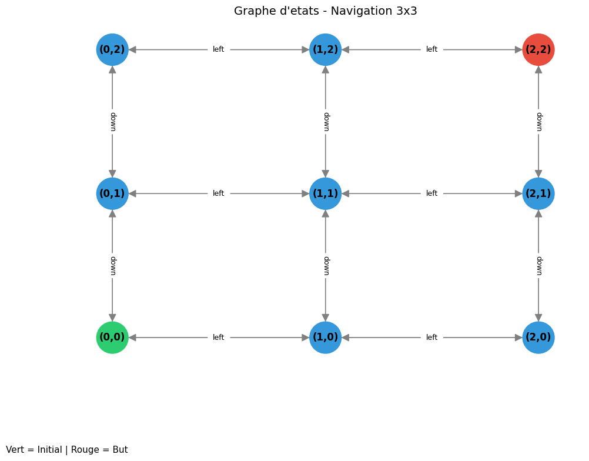
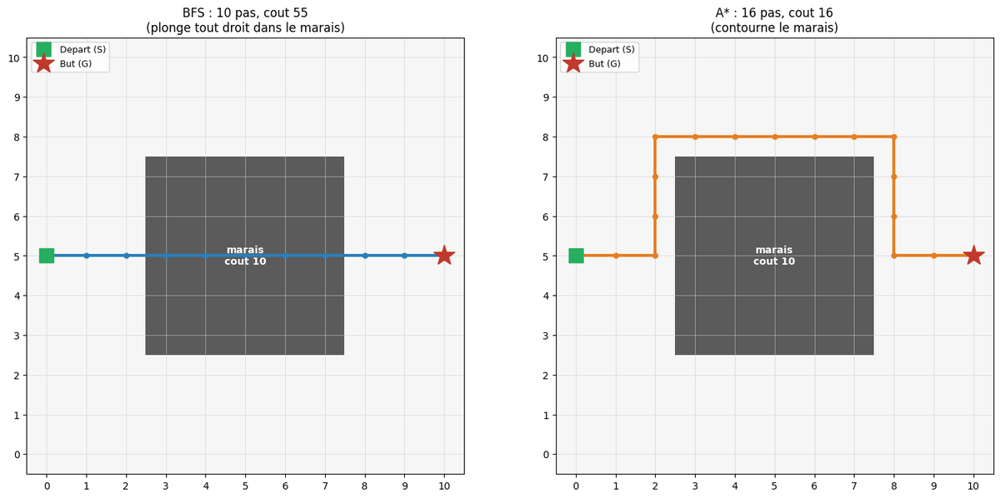
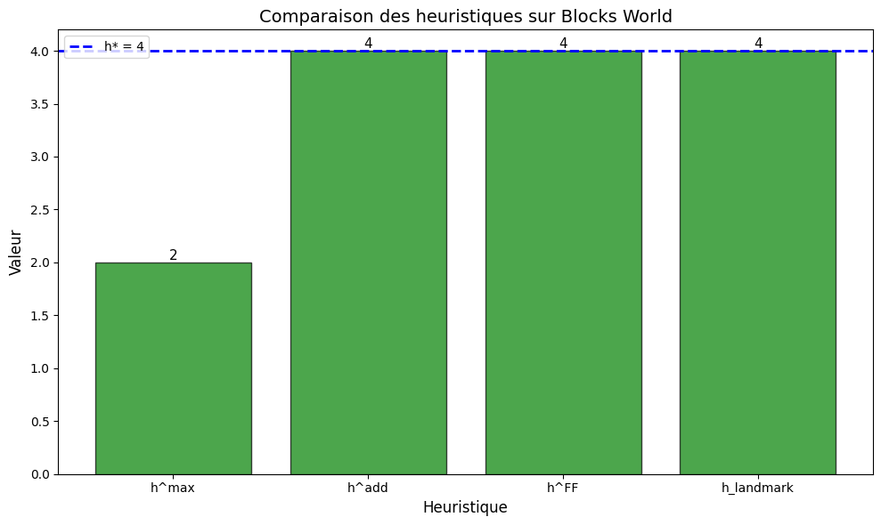
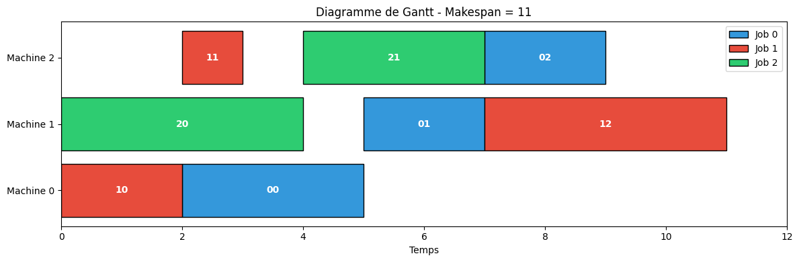
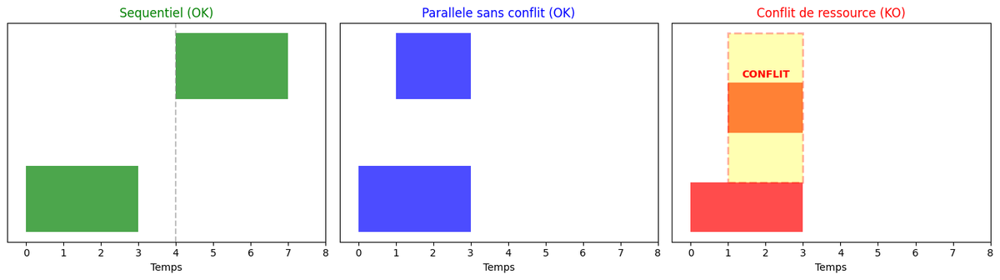

# Planification automatique — décider quoi faire

[← Lean](../Lean/README.md) | [↑ SymbolicAI](../README.md) | [SmartContracts →](../SmartContracts/README.md)

<!-- CATALOG-STATUS
series: SymbolicAI-Planners
pedagogical_count: 26
breakdown: Planners=26
maturity: BETA=26
-->

La planification automatique répond à une question différente de celle de l'apprentissage : non pas « que prédire ? » mais « **que faire ?** ». À partir d'un modèle du monde — un état initial, des actions avec leurs préconditions et leurs effets, un but — un planificateur cherche une suite d'actions qui mène au but. C'est une technologie éprouvée : elle pilote des robots, ordonnance la logistique et a dirigé des engins spatiaux autonomes.

La série part du modèle STRIPS et du langage PDDL, puis descend l'arc des paradigmes : recherche heuristique avec Fast Downward, contraintes avec CP-SAT, temps avec PDDL 2.1, hiérarchie avec les réseaux de tâches, et enfin la frontière neuro-symbolique, où un modèle de langage ou une politique apprise remplacent la règle écrite à la main.

**À qui elle s'adresse.** Un lecteur qui sait programmer — Python, ou C# pour les jumeaux — et qui n'a jamais fait de planification. Les carnets introduisent le vocabulaire depuis zéro ; le carnet de mise en route installe l'environnement avant le premier concept.

## Objectifs d'apprentissage

1. **Techniques** : modéliser un domaine et un problème en PDDL ; employer Fast Downward, OR-Tools et `unified-planning` pour calculer et vérifier un plan.
2. **Méthodologiques** : comparer les heuristiques h_add, h_max, h_FF et LM-cut en distinguant admissibilité, coût du plan et effort de recherche.
3. **Applicatifs** : étendre un modèle classique à l'ordonnancement temporel, à la décomposition hiérarchique et aux approches neuro-symboliques, puis en examiner les limites.

## Aperçu en images — découverte

Les figures ci-dessous sont extraites des sorties réelles des carnets, une par concept. Leur provenance exacte — cellule, sortie, poids, texte alternatif — est tenue dans [`assets/readme/MANIFEST.md`](assets/readme/MANIFEST.md).

## Comment lire ce README — découverte

Le parcours suit le principe [« Choisir sa vitesse de lecture »](https://github.com/jsboige/CoursIA#choisir-sa-vitesse-de-lecture) : les numéros nus donnent la progression, les lettres approfondissent un palier.

- **Vous découvrez** : suivez la table du parcours principal, de haut en bas. Les jumeaux Python et C# d'un même numéro partagent une ligne.
- **Vous creusez un palier** : ouvrez l'approfondissement correspondant — 5b et 5c autour de 05, 10b autour de 10. Chacun dit ce qu'il ajoute et le prérequis qu'il suppose en plus.
- **Vous cherchez la recherche en cours** : « Pour aller plus loin » porte les formalisations Lean, les mesures qui restent ouvertes et les ponts avec les autres séries.

## Parcours principal — lecture guidée et prérequis

Chaque numéro introduit un concept et ne suppose que ce qui le précède ; lu de haut en bas, il donne le parcours complet de la série. Un jumeau C# se lit seul : sa première tranche est écrite en C# pur, sans service ni Python.

Les durées ci-dessous sont les estimations pédagogiques de l'ancien parcours, par carnet et par langage : elles ne mesurent ni l'installation ni un temps d'exécution. Choisir un jumeau n'impose pas de lire les deux.

| # | Kernel et durée indicative | Notebook | Contenu | Public et prérequis | Pour approfondir |
|---|---|---|---|---|---|
| 00 | Python — 20 min | [Planners-00-Setup](00-Environment/Planners-00-Setup-Python.ipynb) | Vérifier l'environnement avant tout : `unified-planning`, OR-Tools, disponibilité de Fast Downward par le service ou par le plugin local, puis un premier domaine PDDL exécuté | Aucun prérequis de planification ; Python 3.9+ | À exécuter une fois, puis ouvrir 01 |
| 01 | Python / .NET (C#) — 30 min | [Planners-01-Introduction-Python](01-Foundation/Planners-01-Introduction-Python.ipynb) · [C#](01-Foundation/Planners-01-Introduction-Csharp.ipynb) | Le triptyque État-Action-But, les hypothèses de STRIPS — statique, déterministe, observable, discret, instantané — et la taxonomie des paradigmes. Le jumeau C# refait l'introduction en C# pur, puis branche un moteur de production | Aucun | 02 |
| 02 | Python / .NET (C#) — 40 min | [Planners-02-PDDL-Basics-Python](01-Foundation/Planners-02-PDDL-Basics-Python.ipynb) · [C#](01-Foundation/Planners-02-PDDL-Basics-Csharp.ipynb) | Syntaxe PDDL : domaines, problèmes, types, prédicats, actions, préconditions, effets. Le jumeau C# implémente un STRIPS complet — modèle typé, grounding, BFS forward — sur Logistics et Gripper | Après 01 ; logique propositionnelle | 03 |
| 03 | Python / .NET (C#) — 35 min | [Planners-03-State-Space-Python](01-Foundation/Planners-03-State-Space-Python.ipynb) · [C#](01-Foundation/Planners-03-State-Space-Csharp.ipynb) | Représenter l'espace d'états et mesurer son explosion combinatoire en $O(2^n)$ : pourquoi la recherche aveugle ne suffit pas. Le jumeau C# oppose BFS, DFS, Greedy et A* sur un terrain uniforme puis pondéré, avec QuikGraph puis Fast Downward | Après 02 ; graphes et parcours | [Partie 2](02-Classical/README.md) : les heuristiques |
| 04 | Python / .NET (C#) — 45 min | [Planners-04-Fast-Downward-Python](02-Classical/Planners-04-Fast-Downward-Python.ipynb) · [C#](02-Classical/Planners-04-Fast-Downward-Csharp.ipynb) | L'architecture en trois étages de Fast Downward — traduction PDDL vers SAS+, prétraitement, recherche — et A*, GBFS, EHC sur Blocks World et Logistics. Le jumeau C# écrit un planificateur SAS+ complet (prevail/pre/eff, h^max et h^FF par RPG) sur Ferry et Logistics | Après 03 ; A* | 05 |
| 05 | Python / .NET (C#) — 40 min | [Planners-05-Heuristics-Python](02-Classical/Planners-05-Heuristics-Python.ipynb) · [C#](02-Classical/Planners-05-Heuristics-Csharp.ipynb) | Classification admissible ou non — h^add, h^max, h^FF, LM-cut — et comparaison expérimentale du nombre de nœuds expansés. Le jumeau C# dérive ces heuristiques et les landmarks, démontre la non-admissibilité de h^add et valide h\* = 4 sur Blocks World | Après 04 ; notion d'optimalité | [Paliers 5b et 5c](#autour-de-05--prouver-ladmissibilité-mesurer-une-primitive) |
| 06 | Python — 50 min / .NET (C#) — 45 min | [Planners-06-Domains-Python](02-Classical/Planners-06-Domains-Python.ipynb) · [C#](02-Classical/Planners-06-Domains-Csharp.ipynb) | Les domaines standards de l'IPC — Blocks World, Logistics, Gripper, Ferry, Hanoï — par complexité croissante. Le jumeau C# modélise atomes, actions et états, avec un BFS forward et anti-cycle | Après 05 | [Partie 3](03-Advanced/README.md) : changer de paradigme |
| 07 | Python / .NET (C#) — 45 min | [Planners-07-OR-Tools-Python](03-Advanced/Planners-07-OR-Tools-Python.ipynb) · [C#](03-Advanced/Planners-07-OR-Tools-Csharp.ipynb) | Programmation par contraintes avec CP-SAT : all-different, cumulative, table, ordonnancement, optimisation multi-objectif. Le jumeau C# écrit d'abord un solveur CP à propagation et backtracking sur un job-shop 3×3, puis le résout par OR-Tools | Après 03 ; goût pour les contraintes | 08 |
| 08 | Python / .NET (C#) — 40 min | [Planners-08-Temporal-Python](03-Advanced/Planners-08-Temporal-Python.ipynb) · [C#](03-Advanced/Planners-08-Temporal-Csharp.ipynb) | PDDL 2.1 : actions duratives, parallélisme, contraintes temporelles simples et denses, ordonnancement. Le jumeau C# construit l'algèbre d'Allen, un réseau temporel simple et un RCPSP allégé, puis résout le RCPSP par CP-SAT | Après 07, ou 06 avec PDDL | 09 |
| 09 | Python — 45 min / .NET (C#) — 40 min | [Planners-09-HTN-Python](03-Advanced/Planners-09-HTN-Python.ipynb) · [C#](03-Advanced/Planners-09-HTN-Csharp.ipynb) | Planification hiérarchique : tâches primitives et abstraites, méthodes de décomposition, HDDL, solveur inspiré de SHOP2. Le jumeau C# réécrit SHOP2, puis attaque le même problème par `unified-planning` et `aries` par pont .NET vers CPython | Après 06 ; récursivité | [Partie 4](04-NeuroSymbolic/README.md) |
| 10 | Python — 50 min | [Planners-10-LLM-Planning](04-NeuroSymbolic/Planners-10-LLM-Planning-Python.ipynb) | Le LLM comme planificateur direct : état, actions et prompt ; chaîne de raisonnement ; arbre de pensée, qui retient un plan sur les branches explorées ; traduction du langage naturel vers PDDL et validation du domaine généré ; réparation de plan ; le LLM employé comme heuristique plutôt que comme solveur | Une clé d'API de modèle de langage | [Palier 10b](#autour-de-10--le-llm-réducteur-despace) |
| 11 | Python — 40 min | [Planners-11-Unified-Planning](04-NeuroSymbolic/Planners-11-Unified-Planning-Python.ipynb) | Un problème décrit une fois, résolu par plusieurs moteurs : sur le même modèle, `pyperplan` et `fast-downward` rendent le même plan à des vitesses différentes. Actions duratives, fluents numériques et coûts — version optimisante contre version satisfaisante —, export et import PDDL | Après 04 ; `unified-planning` avec au moins deux moteurs | [Partie 3](03-Advanced/README.md) : les paradigmes que ces moteurs implémentent |
| 12 | Python — 45 min | [Planners-12-LOOP](04-NeuroSymbolic/Planners-12-LOOP-Python.ipynb) | *Learning to Plan* : encoder un état PDDL, réseaux de politique et de valeur, boucle d'entraînement, puis un banc jouet mesuré à l'exécution — l'imitation apprise couvre 60,0 % de 15 instances inédites, contre 33,3 % pour une politique aléatoire et 100 % pour le BFS exact. Encodage par graphe (GNN) et fonctions de noyau (KRCL) en complément | Après 05 ; PyTorch et notions de réseau de neurones | [Partie 2](02-Classical/README.md) : les heuristiques que l'on cherche ici à apprendre |
| 13 | Python — 40 min | [Planners-13-Mesure-Qualite-Plans](03-Advanced/Planners-13-Mesure-Qualite-Plans-Python.ipynb) | Mesurer ce que la qualité d'un plan doit à son heuristique : sur une tour de quatre blocs, cinq configurations de Fast Downward trouvent le plan optimal de six actions en évaluant de 22 à 121 états selon l'heuristique, une recherche gloutonne s'en écarte, et un BFS naïf en Python sert de contrepoint | Après 04 et 05 | [Partie 2](02-Classical/README.md) : la théorie des heuristiques |

### Repères PDDL et planification hiérarchique

PDDL sépare le **domaine** (`domain.pddl`), qui décrit les types, prédicats et actions avec leurs préconditions et effets, du **problème** (`problem.pddl`), qui instancie les objets, l'état initial et le but. Pour Blocks World, le domaine définit par exemple prendre et empiler un bloc ; le problème nomme les blocs et demande une tour donnée. Les exemples complets et leur résolution se trouvent dans [Planners-02 — PDDL](01-Foundation/Planners-02-PDDL-Basics-Python.ipynb), avec un [jumeau C#](01-Foundation/Planners-02-PDDL-Basics-Csharp.ipynb).

En **HTN**, une tâche primitive est une action exécutable ; une tâche abstraite se décompose au moyen d'une méthode, avec ses préconditions et ses sous-tâches. HDDL permet de décrire cette hiérarchie. Le schéma de SHOP2 traite la première tâche : appliquer une primitive si ses préconditions sont satisfaites, ou remplacer une tâche abstraite par les sous-tâches d'une méthode applicable ; en cas d'échec, revenir en arrière et essayer une autre méthode. [Planners-09 — HTN](03-Advanced/Planners-09-HTN-Python.ipynb) et son [jumeau C#](03-Advanced/Planners-09-HTN-Csharp.ipynb) développent ces exemples et distinguent le solveur pédagogique du moteur `aries`.

## Approfondissements — Recherche

Chaque palier lettré ajoute une dimension à son numéro porteur et suppose un prérequis de plus que le parcours principal. Les jumeaux C# ne sont pas des approfondissements : ce sont les mêmes numéros dans un autre langage, et ils figurent sur la ligne de leur numéro.

### Autour de 05 — prouver l'admissibilité, mesurer une primitive

| Lettre | Notebook | Ce qu'elle ajoute | Prérequis en plus |
|---|---|---|---|
| 5b | [Planners-05b-Lean-Relaxation-Lean](02-Classical/Planners-05b-Lean-Relaxation-Lean.ipynb) | Companion natif à noyau Lean 4 : la preuve sans `sorry` de $h^{+} \leq h^{*}$ dans le lake `planning_lean`, vérifiée par `#check` et `#print axioms` dans le noyau, avec les lemmes de monotonie sur un domaine jouet exécutable | Noyau Lean 4 sous WSL, et le lake construit |
| 5c | [Planners-05c-Differentiel-Atteignabilite-Python](02-Classical/Planners-05c-Differentiel-Atteignabilite-Python.ipynb) | Différentiel d'atteignabilité : un protocole en quatre pas — inatteignabilité prouvée par énumération exhaustive, contrôle d'effort, primitive nommée et payante, delta mesuré — qui consomme les théorèmes du lake, dont la chaîne $h_{max} \leq h^{+} \leq h^{*}$ | Python standard, sans Docker |

### Autour de 10 — le LLM réducteur d'espace

[Planners-10b-LLM-Space-Reducer](04-NeuroSymbolic/Planners-10b-LLM-Space-Reducer-Python.ipynb) prend le contrepied du numéro 10 : le modèle de langage n'y résout rien, il **réduit** l'espace que le solveur déterministe explorera. Sur un mini-langage de huit primitives typées agissant sur des grilles, l'espace des programmes de profondeur au plus quatre se compte en centaines de millions ; trois bras sont mesurés sur les mêmes tâches — recherche exhaustive bornée, LLM direct, LLM réducteur. Le réducteur désigne les primitives à essayer et ramène l'espace de plusieurs ordres de grandeur, avant que le même moteur déterministe n'y trouve les solutions. La correction reste au solveur : c'est la division du travail que la mesure rend visible.

## Sous-séries — découverte

La série est découpée en quatre parties, chacune dans son dossier et chacune avec son propre README au même format que celui-ci. Le parcours principal ci-dessus les traverse dans l'ordre : 01 ouvre la partie 1, 04 la partie 2, 07 la partie 3, 10 la partie 4.

| Dossier | Ce qu'on y apprend | Entrée | README |
|---|---|---|---|
| [00-Environment](00-Environment/) | L'installation et la vérification de l'environnement | [Planners-00-Setup](00-Environment/Planners-00-Setup-Python.ipynb) | — (un seul carnet) |
| [01-Foundation](01-Foundation/) | Le vocabulaire formel : État-Action-But, STRIPS, PDDL, espace d'états | [Planners-01-Introduction](01-Foundation/Planners-01-Introduction-Python.ipynb) | [README](01-Foundation/README.md) |
| [02-Classical](02-Classical/) | Résoudre : Fast Downward et la théorie des heuristiques | [Planners-04-Fast-Downward](02-Classical/Planners-04-Fast-Downward-Python.ipynb) | [README](02-Classical/README.md) |
| [03-Advanced](03-Advanced/) | Contourner l'explosion : contraintes, temps, hiérarchie | [Planners-07-OR-Tools](03-Advanced/Planners-07-OR-Tools-Python.ipynb) | [README](03-Advanced/README.md) |
| [04-NeuroSymbolic](04-NeuroSymbolic/) | Apprendre à chercher : modèle de langage, interface unifiée, *Learning to Plan* | [Planners-10-LLM-Planning](04-NeuroSymbolic/Planners-10-LLM-Planning-Python.ipynb) | [README](04-NeuroSymbolic/README.md) |

## Installation — pratique, tous niveaux

Ouvrir les carnets depuis un clone du dépôt : ils lisent `fast_downward_backend.py` et `requirements.txt` du dossier de la série.

- **Python 3.9+** : `pip install -r requirements.txt` installe `unified-planning`, `up-fast-downward`, `up-pyperplan`, `up-aries`, OR-Tools, NetworkX, Matplotlib, NumPy et PyTorch.
- **Fast Downward** : le paquet `up-fast-downward` embarque un moteur compilé, sans Docker. Le conteneur `jsboige/coursia-fast-downward` sur le port 8200 reste une option, et les carnets le préfèrent quand il répond. Le module `fast_downward_backend.py` choisit entre service et plugin, et sa première ligne de sortie nomme le moteur retenu.
- **Vérification** : `python -c "import unified_planning, up_fast_downward; from ortools.sat.python import cp_model; print('OK')"`.
- **Modèle de langage** : les carnets 10 et 10b interrogent un service externe et demandent une clé d'API dans l'environnement. Sans clé, les cellules d'appel échouent proprement : la lecture du raisonnement reste possible, l'exécution des appels non.
- **Lean** : le palier 5b demande un noyau Lean 4 sous WSL et le lake [`planning_lean`](planning_lean/README.md) construit avec sa toolchain.
- **.NET 9 Interactive** (jumeaux C#) : les tranches from-scratch s'exécutent seules ; les tranches moteur tirent des paquets NuGet — `QuikGraph` pour le jumeau 3, `Google.OrTools` pour 7 et 8, `pythonnet` pour 9, qui demande en plus un Python avec `unified-planning` et `up-aries`.

## FAQ — installation et diagnostic

### Fast Downward ne répond pas sur le port 8200 : Docker est-il obligatoire ?

Non : `pip install -r requirements.txt` installe aussi `up-fast-downward`. La première ligne du backend indique le moteur retenu. Si vous souhaitez utiliser le conteneur, vérifiez sa présence avec `docker ps` et son état avec `curl http://localhost:8200/health`. En cas de changement de port, adaptez également l'URL du backend Python ou C#.

### Pourquoi `unified-planning` ne parvient-il pas à lancer Fast Downward ?

Vérifiez l'installation de `up-fast-downward` dans l'environnement du noyau. Un statut `INTERNAL_ERROR` peut aussi provenir du modèle : chaque fluent utilisé doit être déclaré avec `problem.add_fluent(...)`. Consultez les messages de `result.log_messages` pour distinguer une erreur de traduction PDDL d'un moteur absent ; le [carnet 04](02-Classical/Planners-04-Fast-Downward-Python.ipynb) détaille cette interface.

### Comment diagnostiquer une erreur de syntaxe ou de type PDDL ?

Contrôlez les paramètres de l'action, les déclarations de types et les noms de prédicats dans le domaine et le problème. Pour `unsupported requirement`, choisissez un moteur prenant en charge les constructions utilisées plutôt que de supprimer une exigence dont le modèle dépend. Les exemples du [carnet 02](01-Foundation/Planners-02-PDDL-Basics-Python.ipynb) séparent ces éléments.

### Pourquoi CP-SAT annonce-t-il `INFEASIBLE` ?

Recherchez des contraintes contradictoires, un domaine de variable vide ou une capacité cumulée inférieure aux demandes. Vérifiez d'abord la validité du modèle et activez le journal de recherche avec `solver.parameters.log_search_progress = True`. Réduisez ensuite l'instance pour isoler les contraintes en cause, sans confondre l'absence de solution avec une limite de temps.

### Que faire si la recherche devient trop longue ?

Fixez un budget au moteur utilisé, réduisez le nombre d'objets pour tester la modélisation, puis comparez les heuristiques. Une recherche gloutonne telle que `eager_greedy([ff()])` peut privilégier la rapidité, mais ne garantit pas le coût minimal ; le [carnet 13](03-Advanced/Planners-13-Mesure-Qualite-Plans-Python.ipynb) mesure ce compromis.

### Que vérifier si Docker ne démarre pas sous Windows ?

Vérifiez que Docker Desktop est lancé et que le terminal atteint son daemon. Une erreur de permission demande un diagnostic de configuration, pas une élévation systématique du terminal. Le plugin local `up-fast-downward` permet aussi d'utiliser le vrai moteur sans Docker ; le [carnet de mise en route](00-Environment/Planners-00-Setup-Python.ipynb) vérifie l'environnement.

## Pour aller plus loin — recherche

### Formalisations Lean

Le lake [`planning_lean`](planning_lean/README.md) formalise l'admissibilité de la relaxation sans-delete : le coût du plan relaxé optimal ne dépasse jamais celui du plan réel optimal (`relaxed_plan_admissible`), avec un témoin associé (`relaxed_plan_witness`). Les paliers 5b et 5c le consomment en partie 2. Modules, pins et mesure des `sorry` vivent dans [`LEAN_INVENTORY.md`](LEAN_INVENTORY.md), qui n'est pas recopié ici.

### Ce que la mesure déplace

Le carnet 13 mesure ce qu'une heuristique achète à plan égal ; le palier 10b mesure ce qu'une réduction apprise apporte à un moteur déterministe, et à quel prix d'espace ; le carnet 12 mesure une couverture apprise contre un BFS exact sur des instances inédites. Ces trois-là laissent ouvertes les questions que la série rend manipulables : à quelle condition un modèle de langage est-il un planificateur plutôt qu'un générateur de texte plausible, que mesure exactement une couverture apprise face à un solveur complet, et où placer la frontière entre ce que l'on apprend et ce que l'on vérifie.

Une version antérieure du carnet 4 est conservée dans [`_archive/`](_archive/Fast-Downward-Legacy.ipynb), hors parcours.

### Ponts avec les autres séries

| Série | Ce que le pont apporte |
|---|---|
| [Search](../../Search/README.md) | BFS, DFS et A* de Search sont les briques des planificateurs classiques ; le CSP de Search est le même moteur que le CP-SAT du carnet 7 |
| [Lean](../Lean/README.md) | La vérification formelle certifie ce que la planification calcule ; le lake `planning_lean` en est l'application intra-série |
| [SmartContracts](../SmartContracts/README.md) | Les liquidations et l'arbitrage sont des problèmes de planification sous contraintes temporelles et de coût |
| [GameTheory](../../GameTheory/README.md) | A* en planification et minimax en jeux partagent la même structure de graphe d'états ; la recherche adverse s'ajoute à la recherche mono-agent |
| [Tweety](../Tweety/README.md) | Les solveurs SAT et CSP de Tweety résolvent des sous-problèmes que la planification pose |

## Ressources — tous niveaux

### Documentation

- [unified-planning](https://github.com/aiplan4eu/unified-planning) — bibliothèque Python multi-moteurs
- [Fast Downward](https://www.fast-downward.org/) — planificateur de référence
- [PDDL Reference](https://planning.wiki/) — documentation du langage
- [OR-Tools CP-SAT](https://developers.google.com/optimization/cp/cp_sat) — solveur de contraintes
- [IPC Benchmarks](https://github.com/aibasel/downward-benchmarks) — problèmes standards

### Cours et tutoriels

- [AI Planning — University of Edinburgh](https://www.coursera.org/learn/ai-planning)
- [Classical Planning — Stanford](https://www.youtube.com/watch?v=WEDagb6TsK8)

### Publications

| Référence | Couverture |
|---|---|
| Ghallab, Nau et Traverso, *Automated Planning: Theory and Practice* (2004) | Ouvrage de référence de la série |
| Russell et Norvig, *AIMA*, 4e édition, chapitres 10 et 11 | Cadre général de la planification |
| Helmert, « The Fast Downward Planning System » (2006) | Carnets 4 à 6 |
| Hoffmann et Nebel, « The FF Planning System » (2001) | Heuristique h-FF, carnet 5 |
| Richter et Westphal, « LAMA: Planner » (2010) | Landmarks, carnet 5 |
| Fox et Long, « PDDL2.1 » (2003) | Carnet 8 |
| Erol, Hendler et Nau, « HTN Planning: Complexity and Expressivity » (1994) | Carnet 9 |
| Valmeekam et al., « On the Planning Abilities of Large Language Models » (2024) | Carnet 10 |

### Dans le dépôt

- [README de la série](../README.md) — l'arc au-dessus de Planners
- [Inventaire Lean de la série](LEAN_INVENTORY.md) — modules, pins et mesure des `sorry`
- [Principe des vitesses de lecture](https://github.com/jsboige/CoursIA#choisir-sa-vitesse-de-lecture) — à la racine du dépôt

---

Voir la licence du dépôt principal. [↑ SymbolicAI](../README.md) · [Catalogue du dépôt](../../../COURSE_CATALOG.generated.md)
