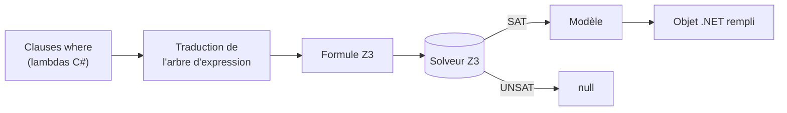

<!-- CATALOG-STATUS
series: SymbolicAI-SMT-Z3Linq2Z3
pedagogical_count: 0
breakdown: 
maturity: 
-->

# Série Z3 - Programmation Déclarative avec Z3.Linq

[← SMT](../README.md) | [Z3-API (série sœur) →](../Z3-API/README.md)

Un solveur SMT répond à une question qui tient en une ligne : existe-t-il des valeurs qui satisfont toutes ces contraintes à la fois ? S'il en existe, il en donne ; sinon, il établit qu'il n'y en a aucune. Z3 est l'un de ces solveurs. Z3.Linq est une bibliothèque C# qui permet de l'interroger dans la syntaxe de LINQ : les inconnues sont les propriétés d'un type .NET, les contraintes s'écrivent dans des clauses `where`, et la réponse revient sous la forme d'un objet rempli. Voici le premier théorème du carnet 01, avec en commentaire la sortie enregistrée :

```csharp
using (var ctx = new Z3Context())
{
    var theorem = from t in ctx.NewTheorem<Symbols<int, int, int, int, int>>()
                  where t.X1 - t.X2 >= 1
                  where t.X1 - t.X2 <= 3
                  where t.X1 == (2 * t.X3) + t.X5
                  where t.X3 == t.X5
                  where t.X2 == 6 * t.X4
                  select t;
    var solution = theorem.Solve();   // X1 = 3, X2 = 0, X3 = 1, X4 = 0, X5 = 1
}
```

Aucun algorithme de recherche n'est écrit : on décrit ce qu'une solution doit vérifier, pas la manière de la trouver. La bibliothèque parcourt l'arbre d'expression de chaque clause, le traduit en formule Z3, puis reconstruit un objet .NET à partir du modèle rendu par le solveur — ou rend `null` quand les contraintes se contredisent.



À partir de ce geste, la série avance dans quatre directions. Les **tableaux** d'abord, qui permettent de poser des grilles et mènent à un planificateur de repas conduit d'une base jouet de dix aliments à plusieurs milliers de recettes réelles. L'**optimisation** ensuite : ordonnancement, coloration de graphe, cryptarithmes, sac à dos, préférences pondérées. Puis d'**autres théories** que les entiers — entiers machine sur 32 bits, réels exacts — et ce qu'un verdict d'insatisfiabilité permet de prouver ou d'expliquer. Enfin le **réglage du solveur** et l'**extension de la bibliothèque**. Chemin faisant, plusieurs carnets posent côte à côte les deux écritures d'un même problème : celle de Z3.Linq et celle de l'API .NET de Z3.

Tous les carnets sont écrits en C# et s'exécutent sous .NET Interactive. Ils s'adressent à des lecteurs qui lisent le C# et LINQ ; aucune formation en logique n'est supposée. Les mêmes sujets sont traités en Python, avec `z3-py`, dans la série sœur [Z3-API](../Z3-API/README.md) : le tableau du parcours donne, pour chaque carnet, son pendant Python quand il existe.

## Comment lire ce README — découverte

Le principe [« Choisir sa vitesse de lecture »](https://github.com/jsboige/CoursIA#choisir-sa-vitesse-de-lecture) distingue parcours principal, approfondissements et prolongements de recherche.

- **Vous découvrez** : lisez les carnets 01, 02 et 03 dans l'ordre. Ils suffisent pour écrire un théorème, lire un verdict SAT ou UNSAT, et voir qu'un même problème admet plusieurs modélisations.
- **Vous creusez une branche** : quatre branches partent de ce socle — les tableaux et le planificateur de repas (04 à 09), l'optimisation combinatoire (11 à 14), les théories et les preuves par insatisfiabilité (15 à 18), le réglage et l'extension du solveur (19 et 20). Le carnet 10, sur les expressions régulières, se lit à part. La section « Approfondissements » décrit chaque branche, et [« Les deux stacks »](#les-deux-stacks) compare, construction par construction, Z3.Linq et l'API brute de Z3.
- **Vous cherchez la recherche** : « Pour aller plus loin » distingue reconnaître, produire et résoudre, puis dit ce que les mesures des carnets permettent de conclure, et ce qu'elles ne disent pas.

## Parcours principal — lecture guidée et prérequis

Les numéros donnent l'ordre de lecture conseillé. La colonne « Public et prérequis » reprend la rubrique de prérequis du carnet quand il en porte une. La dernière colonne renvoie à la section d'approfondissement et, quand il existe, au carnet de la série Z3-API qui traite le même sujet en Python. Les valeurs citées sont lues dans les sorties enregistrées.

| # | Notebook | Ce qu'on y apprend | Public et prérequis | Pour approfondir |
|---|----------|--------------------|---------------------|------------------|
| 01 | [Premiers théorèmes](01_Linq2Z3_Intro.ipynb) | Écrire un système de contraintes comme un `Theorem<T>`, le résoudre avec `Solve()`, reconnaître un système insatisfiable. Sur l'énigme des missionnaires et des cannibales, `Solve()` rend un trajet valide mais long ; `Optimize` rend le plus court, de longueur 12. | Découverte. Bases de LINQ en C#. | [Autour de 01 à 05](#autour-de-01-à-05) · en Python : [Z3-API 01b](../Z3-API/Z3-01b-Style-Declaratif-Linq.ipynb) |
| 02 | [Sudoku : deux écritures](02_Sudoku_Theorem_vs_Array.ipynb) | Poser une grille de Sudoku 9×9 de deux façons : 81 propriétés nommées, ou une liste et des contraintes engendrées par des boucles et des fermetures. Les quantificateurs `Z3Methods.ForAll` et `Z3Methods.Exists` sur un domaine fini. | Découverte. Le carnet 01 ; expressions lambda et fermetures. | [Autour de 01 à 05](#autour-de-01-à-05) · en Python : [Z3-API 02](../Z3-API/Z3-02-Sudoku-Python.ipynb) |
| 03 | [Deux traductions d'une collection](03_Sudoku_Modes_Comparison.ipynb) | Choisir comment une collection est transmise au solveur : `CollectionHandling.Array` en fait un tableau Z3, `CollectionHandling.Constants` une constante par élément. Sur un même Sudoku 4×4, les deux modes rendent la même grille valide. | Découverte. Le carnet 02. | [Autour de 01 à 05](#autour-de-01-à-05) · en Python : [Z3-API 18](../Z3-API/Z3-18-Sudoku-Modes-Python.ipynb) |
| 04 | [Théorie des tableaux](04_Array_Theory.ipynb) | Lire avec `Select`, écrire avec `Store`. Les axiomes de McCarthy vérifiés par le solveur, l'échange de deux cases par un double `Store`, puis les missionnaires et les cannibales repris avec des tableaux. | Licence. Le carnet 01 ; tableaux et expressions lambda. | [Autour de 01 à 05](#autour-de-01-à-05) · en Python : [Z3-API 17](../Z3-API/Z3-17-Array-Theory-Python.ipynb) |
| 05 | [Tableaux imbriqués](05_Nested_Arrays_2D.ipynb) | Poser des grilles avec des tableaux de tableaux (`int[][]`) : carré latin 3×3, Sudoku 4×4, carré magique d'ordre 3, de somme 15. | Licence. Les carnets 02 et 04. | [Autour de 01 à 05](#autour-de-01-à-05) · en Python : [Z3-API 15](../Z3-API/Z3-15-Nested-Arrays-2D-Python.ipynb) |
| 06 | [Planificateur de repas : modélisation](06_Meal_Planner_Modelisation.ipynb) | Quatre écritures d'un même choix de menu sur dix aliments, puis un plan de cinq jours parmi 18 plats : un glouton sans retour arrière échoue au quatrième jour, le solveur remplit la semaine. Rendu HTML du plan et front de Pareto calories-coût. | Licence. Les carnets 03 et 05 sont conseillés. | [Autour de 06 à 09](#autour-de-06-à-09) · en Python : [Z3-API 16](../Z3-API/Z3-16-Meal-Planner-Python.ipynb) |
| 07 | [Planificateur de repas : données réelles](../Z3-API/Z3-16b-Meal-Planner-Data-External-CSharp.ipynb) | Préparer des données réelles, sans solveur : croiser la table de composition Ciqual et un corpus de recettes RecipeML, apparier les noms d'ingrédients, convertir les quantités en grammes, agréger par recette, écrire le cache que lisent les carnets 08 et 09. | Licence. LINQ to Objects et LINQ to XML ; indépendant du solveur. | [Autour de 06 à 09](#autour-de-06-à-09) · en Python : [Z3-API 16b](../Z3-API/Z3-16b-Meal-Planner-Data-External-Python.ipynb) |
| 08 | [Planificateur de repas : théorème patient](08_Meal_Planner_Patient_Capstone.ipynb) | Un théorème hiérarchique à l'échelle réelle : patient, menus, plats, denrées. La composition nutritionnelle est liée au plat choisi, et le patient impose un minimum ou un maximum par constituant. | Lecture avancée. Les carnets 06 et 07. | [Autour de 06 à 09](#autour-de-06-à-09) · en Python : [Z3-API 16c](../Z3-API/Z3-16c-Meal-Planner-Patient-Capstone-Python.ipynb) |
| 09 | [Planificateur de repas : passage à l'échelle](09_Meal_Planner_Convergence_Scale.ipynb) | Trois encodages d'un même problème — sept menus de cinq plats — sur tout le cache. Les disjonctions naïves sont déjà 105 000 pour mille recettes, avant toute résolution ; la théorie des tableaux rend `UNKNOWN` au bout de quinze secondes ; l'encodage pseudo-booléen « un seul vrai parmi n » est satisfiable. | Lecture avancée. Les carnets 04, 06, 07 et 14. | [Autour de 06 à 09](#autour-de-06-à-09) · en Python : [Z3-API 16d](../Z3-API/Z3-16d-Meal-Planner-Convergence-Scale-Python.ipynb) |
| 10 | [Générer un témoin depuis une expression régulière](10_Witness_Generation_Automata.ipynb) | Passer de « ce mot appartient-il au langage ? » à « donne-moi un mot du langage » : intersection `&` et complément `~` d'expressions régulières, génération d'un mot témoin, émission d'une contrainte SMT-LIB que Z3 résout. | Lecture avancée. Expressions régulières ; indépendant des autres carnets. | [Autour de 10](#autour-de-10) · en Python : [Z3-API 04](../Z3-API/Z3-04-Strings-Regex-Python.ipynb) |
| 11 | [Ordonnancement d'atelier](11_Job_Shop_Scheduling.ipynb) | Les contraintes disjonctives — deux tâches ne partagent pas une machine — et la minimisation de la durée totale. Sur trois jobs et deux machines, la règle « premier arrivé, premier servi » donne 16 h ; le solveur atteint 9 h, qui est aussi la borne inférieure. | Licence. Le carnet 01. | [Autour de 11 à 14](#autour-de-11-à-14) · en Python : [Z3-API 08](../Z3-API/Z3-08-Ordonnancement-Python.ipynb) |
| 12 | [Coloration de graphe](12_Graph_Coloring_Petersen.ipynb) | Trouver un nombre chromatique par questions successives : le graphe de Petersen n'est pas colorable avec deux couleurs (UNSAT), il l'est avec trois. Un glouton en utilise trois ou quatre selon l'ordre des sommets. | Licence. Les carnets 01 et 11 ; notions de graphes. | [Autour de 11 à 14](#autour-de-11-à-14) · en Python : [Z3-API 11](../Z3-API/Z3-11-Graph-Coloring-Python.ipynb) |
| 13 | [Cryptarithmes](13_Cryptarithmetic_SMT.ipynb) | Résoudre SEND + MORE = MONEY avec la contrainte `Distinct` : 9567 + 1085 = 10652, comparé à l'énumération des 1 814 400 affectations candidates. | Licence. Les carnets 01 et 04. | [Autour de 11 à 14](#autour-de-11-à-14) · en Python : [Z3-API 10](../Z3-API/Z3-10-Cryptarithmetic-Python.ipynb) |
| 14 | [De satisfaire à optimiser](14_Optimize_MaxSAT.ipynb) | Un sac à dos (valeur 27, capacité de 10 entièrement utilisée), puis des contraintes dures et des préférences souples : au plus deux préférences sur trois peuvent être satisfaites, et des poids décident laquelle est sacrifiée. | Licence. Les carnets 01 et 13. | [Autour de 11 à 14](#autour-de-11-à-14) · en Python : [Z3-API 06](../Z3-API/Z3-06-Advanced-Optimization-Python.ipynb) |
| 15 | [Entiers machine et débordement](15_BitVectors_Overflow.ipynb) | Raisonner sur des entiers de 32 bits : 3 000 000 000 + 1 500 000 000 y vaut 205 032 704. Le solveur prouve qu'un débordement est inévitable sur une plage de valeurs et impossible sur une autre. | Licence. Le carnet 01 ; représentation binaire des entiers. | [Autour de 15 à 18](#autour-de-15-à-18) · en Python : [Z3-API 14](../Z3-API/Z3-14-BitVectors-Overflow-Python.ipynb) |
| 16 | [Réels exacts](16_RealArithmetic.ipynb) | La racine de x² = 2 rendue comme un nombre algébrique, non comme une approximation ; x² + 1 = 0 sans racine réelle ; un tiers exact qui satisfait une contrainte que son écriture décimale tronquée rend insatisfiable. | Licence. Le carnet 15 est conseillé. | [Autour de 15 à 18](#autour-de-15-à-18) · en Python : [Z3-API 12](../Z3-API/Z3-12-Real-Arithmetic-Python.ipynb) |
| 17 | [Expliquer une contradiction](17_UnsatCores.ipynb) | Demander au solveur quelles contraintes se contredisent : sur cinq contraintes, le cœur d'insatisfiabilité en désigne deux. | Licence. Les carnets 15 et 16 sont conseillés. | [Autour de 15 à 18](#autour-de-15-à-18) · en Python : [Z3-API 13](../Z3-API/Z3-13-UnsatCores-Python.ipynb) |
| 18 | [L'énigme d'Einstein](18_Einsteins_Riddle.ipynb) | Poser une énigme logique — cinq maisons, cinq attributs, quinze indices — en 25 variables entières, puis prouver que la solution est unique en demandant une solution différente. | Licence. Les carnets 01 et 13. | [Autour de 15 à 18](#autour-de-15-à-18) · en Python : [Z3-API 09](../Z3-API/Z3-09-Enigme-Einstein-Python.ipynb) |
| 19 | [Choisir le solveur et les tactiques](19_Solver_Choice_And_Tactics.ipynb) | Configurer le solveur : général, simple, spécialisé par une logique, ou piloté par une chaîne de tactiques. Les quatre configurations rendent la même grille ; les configurations mal formées sont refusées. | Lecture avancée. Les carnets 01 à 03. | [Autour de 19 et 20](#autour-de-19-et-20) · en Python : [Z3-API 03](../Z3-API/Z3-03-Tactics-Python.ipynb) |
| 20 | [Étendre la bibliothèque](20_Theorem_Rewriters.ipynb) | Écrire des *rewriters* : l'un traduit un prédicat métier que la bibliothèque refuse sinon, l'autre retire une contrainte et fait passer un système d'insatisfiable à satisfiable. | Lecture avancée. Les carnets 17 et 19 sont conseillés ; arbres d'expression C#. | [Autour de 19 et 20](#autour-de-19-et-20) |

## Approfondissements — Licence et lectures avancées

Chaque carnet propose des exercices à compléter, dont les cellules s'exécutent telles quelles. Les valeurs citées ci-dessous sont celles des sorties enregistrées.

### Autour de 01 à 05

Le socle : écrire un théorème, le résoudre, puis modéliser avec des tableaux.

- **01 — Premiers théorèmes.** Un théorème satisfiable rend un témoin, un théorème insatisfiable rend `null` : ce second verdict est une information, pas un échec, puisqu'il établit qu'aucune valeur ne convient. Le carnet reprend ensuite l'énigme des missionnaires et des cannibales. `Solve()` s'arrête au premier trajet valide, de longueur 24 dans l'exécution enregistrée ; `Optimize(Optimization.Minimize, …)` rend le plus court, de longueur 12. Un théorème peut aussi porter sur un *record* positionnel, que la bibliothèque reconstruit (`PointRecord { X = 8, Y = 4 }`).
- **02 — Sudoku : deux écritures.** D'un côté 81 propriétés nommées, de l'autre une liste et des boucles : la seconde écriture engendre les contraintes par des fermetures, et c'est elle qui se généralise. Le carnet introduit `Z3Methods.ForAll` et `Z3Methods.Exists` sur une rangée de quatre cases : « toutes les cases sont dans [1, 4] et l'une vaut 4 » est satisfiable, et devient insatisfiable quand la borne passe à 3.
- **03 — Deux traductions d'une collection.** `CollectionHandling` décide de ce que le solveur reçoit : un tableau Z3 (`Array`) ou une constante par élément (`Constants`). Le résultat est le même ; c'est la formule transmise qui change, et avec elle le travail demandé au solveur.
- **04 — Théorie des tableaux.** `Select` lit une case, `Store` rend un nouveau tableau modifié en une case. Le solveur vérifie les axiomes de McCarthy qui lient ces deux opérations, puis un échange de deux cases par deux `Store` successifs transforme `[10, 20, 30, 40, 50]` en `[10, 40, 30, 20, 50]` : c'est la brique élémentaire d'un tri.
- **05 — Tableaux imbriqués.** Un `int[][]` est traduit en tableau de tableaux. Trois grilles servent d'exemples — carré latin, Sudoku 4×4, carré magique — et le carnet met en regard l'écriture LINQ et les `Store` et `Select` imbriqués qu'il faudrait écrire avec l'API brute.

### Autour de 06 à 09

Un même sujet, composer des menus sous contraintes nutritionnelles, conduit de la base jouet au corpus réel.

- **06 — Modélisation.** Sur dix aliments, le même choix de menu est écrit de quatre façons : par index, par énumération, par booléens, puis par un théorème hiérarchique sur un `int[][]`. L'énumération trouve 8 menus valides sur 36 (entre 600 et 900 kcal, au moins 25 g de protéines, au plus 12 EUR) ; le modèle booléen rend un menu de 720 kcal, 38 g de protéines et 11,00 EUR ; une recherche par dichotomie sur le coût descend à 7,50 EUR. La deuxième partie planifie cinq jours parmi 18 plats répartis en trois catégories, entre 1500 et 1700 kcal par jour, sans servir deux fois le même plat : un algorithme glouton sans retour arrière s'arrête au quatrième jour, le solveur trouve un plan complet. La troisième partie rend le plan en HTML et trace un front de Pareto calories-coût de sept points.
- **07 — Données réelles.** Aucun solveur ici : le carnet prépare le terrain des deux suivants. Il croise la table de composition nutritionnelle Ciqual (ANSES, millésime 2025 : 74 constituants pour 3484 aliments) avec un corpus de 10 850 recettes au format RecipeML, lu en LINQ to XML. Les noms d'ingrédients sont appariés aux aliments par similarité lexicale (indice de Jaccard au seuil 0,5, garde sur le nom de tête, départage par le nom le plus court, petites tables de synonymes) — `White sugar` est ainsi rattaché à *Sugar, white* —, les quantités sont converties en grammes, puis les teneurs sont agrégées par recette, pondérées par la masse. La couverture moyenne est de 73,5 % ; seules les recettes couvertes à 80 % au moins entrent dans le cache, soit près de cinq mille sur un peu moins de onze mille.
- **08 — Théorème patient.** Le carnet relit le cache et commence par faire passer au corpus réel les deux théorèmes structurels du carnet 06 : une « montée en gamme », où l'index du plat croît strictement d'un jour au suivant dans chaque créneau, et une permutation totale des plats avec `Distinct`. Il construit ensuite le théorème complet sur quinze plats, trois créneaux de cinq candidats. La composition d'un plat est portée par une variable auxiliaire, liée au choix par une disjonction de la forme `PlatId != candidat || Comp == teneur`. Le patient impose, par menu, une énergie dans une fenêtre, des protéines au-dessus d'un plancher et des lipides sous un plafond. La solution est recalculée hors solveur, à partir des données, pour vérification.
- **09 — Passage à l'échelle.** Un même problème pour trois encodages : composer sept menus de cinq plats, avec une fenêtre d'énergie, un plancher de protéines et un plafond de sel, en piochant dans tout le cache. Les disjonctions naïves sont déjà 105 000 pour mille recettes, avant toute résolution. La théorie des tableaux rend `UNKNOWN` au bout de quinze secondes. L'encodage « un seul vrai parmi n », avec les contraintes pseudo-booléennes natives de Z3, pose 172 690 booléens et reste satisfiable ; une partition des recettes par créneau (entrée, plat principal, accompagnement, pain, dessert) ramène ce nombre à 34 538. Un régime végétarien, qui interdit 472 recettes, laisse le problème satisfiable. Le carnet compare enfin les contraintes pseudo-booléennes natives (`MkPBEq`) à leur expansion arithmétique (`MkITE` et `MkAdd`) : même verdict, résolution nettement plus lente pour l'expansion. La leçon tient en une phrase : à solveur et données identiques, c'est l'encodage qui décide.

### Autour de 10

- **10 — Générer un témoin depuis une expression régulière.** Le carnet s'appuie sur la bibliothèque Automata, qui manipule des automates symboliques, et pose trois questions à une même expression : *reconnaître* un mot donné (`Regex.IsMatch`), *produire* un mot du langage (`RexEngine`), *résoudre* une contrainte posée sur une chaîne inconnue (Z3). L'expression `^[a-z]$ & ~[aeiou]` — une minuscule qui n'est pas une voyelle — rend une consonne. Une politique de mots de passe (huit caractères, sans le mot `password`, sans chiffre initial) s'écrit comme une combinaison de langages, et chaque témoin produit est revérifié indépendamment. Le carnet montre aussi un piège : un automate construit avec un autre `CharSetSolver` que celui du moteur est refusé (`ArgumentException`) ; passer par `CreateFromRegexes` règle la question. Enfin l'expression est émise en SMT-LIB — `(re.inter (re.range "a" "b") (re.comp (re.range "b" "c")))` — et Z3 en donne le seul témoin possible, `"a"`. Deux carnets voisins prolongent le sujet : [Search-10](../../../Search/Part1-Foundations/Search-10-SymbolicAutomata.ipynb) construit un automate symbolique depuis zéro, et [Sudoku-13](../../../Sudoku/Sudoku-13-SymbolicAutomata-CSharp.ipynb) écrit une ligne de Sudoku comme une expression régulière.

### Autour de 11 à 14

Quatre problèmes classiques d'optimisation combinatoire, chacun confronté à une méthode naïve.

- **11 — Ordonnancement d'atelier.** L'instance compte trois jobs et deux machines : J0 passe 3 h sur A puis 2 h sur B, J1 2 h sur B puis 4 h sur A, J2 2 h sur A puis 3 h sur B. La machine A porte 9 h de travail, ce qui borne la durée totale par en dessous ; la règle « premier arrivé, premier servi » donne 16 h. La durée minimale est ensuite cherchée de trois façons : en interrogeant le solveur sur l'intervalle [9, 16], avec `MkMinimize` en un seul appel, puis avec `Optimize(Optimization.Minimize, …)` côté Z3.Linq. Les trois atteignent 9 h. `Solve(inspect)` donne accès au modèle pour évaluer des grandeurs dérivées ; la fonction passée n'est pas appelée quand le théorème est insatisfiable.
- **12 — Coloration de graphe.** Le graphe de Petersen (10 sommets, 15 arêtes) est interrogé pour une, deux puis trois couleurs : UNSAT, UNSAT, SAT. Son nombre chromatique est 3, et les deux réponses négatives sont des preuves. Un glouton *first-fit* utilise trois ou quatre couleurs selon l'ordre de parcours des sommets. Le carnet montre aussi que l'opérateur ternaire `? :` de C# est traduit en `MkITE` : sur un triangle à deux couleurs, « au plus un conflit » est satisfiable, « aucun conflit » ne l'est pas.
- **13 — Cryptarithmes.** SEND + MORE = MONEY a pour solution 9567 + 1085 = 10652. L'énumération des 1 814 400 affectations la trouve aussi : sur une instance de cette taille, l'écart de vitesse est modeste, et le carnet le dit. L'intérêt est ailleurs — le modèle tient en quelques contraintes et se réécrit aussitôt pour CROSS + ROADS = DANGER (96233 + 62513 = 158746).
- **14 — De satisfaire à optimiser.** Un sac à dos de capacité 10 : la sélection `0, 1, 0, 1, 1` remplit exactement la capacité, pour une valeur de 27. Puis un planning d'infirmières où trois préférences ne peuvent pas être satisfaites ensemble : MaxSAT en satisfait deux. Avec des poids, `SoftWhere` — l'équivalent d'`AssertSoft` dans l'API brute — décide laquelle est sacrifiée : la préférence de poids 3 est servie, celle de poids 1 abandonnée. Le carnet met aussi en regard `Z3Methods.Sum` et `MkAdd`.

### Autour de 15 à 18

Ces quatre carnets partagent une idée : un verdict UNSAT n'est pas une absence de réponse, c'est une preuve.

- **15 — Entiers machine et débordement.** Sur 32 bits, l'addition est modulaire : 3 000 000 000 + 1 500 000 000 vaut 205 032 704. Deux preuves par insatisfiabilité suivent. Demander deux valeurs supérieures ou égales à 2^31 dont la somme ne déborde pas est UNSAT : le débordement est inévitable sur cette plage. Demander deux valeurs inférieures à 1000 dont la somme déborde est UNSAT : il y est impossible. Côté Z3.Linq, l'attribut `[BitVecWidth(4)]` suffit à changer de théorie : sur quatre bits, le solveur trouve un débordement (A = 15, B = 3, somme 2), quand le même prédicat est insatisfiable sur des entiers non bornés. L'extraction de bits (`MkExtract`) n'est montrée qu'avec l'API brute.
- **16 — Réels exacts.** Le système x + y = 1, x − y = 3 rend x = 2 et y = −1. La racine de x² = 2 est rendue comme un nombre algébrique exact (un `root-obj`, racine d'un polynôme), et x² + 1 = 0 est UNSAT : il n'existe pas de racine réelle, et c'est une preuve. L'inégalité triangulaire accepte (3, 4, 5) et refuse (1, 2, 5). Enfin `MkReal(1, 3)` satisfait une contrainte que `MkReal("0.3333333333333333")` rend insatisfiable ; côté Z3.Linq, `Rational.Of(1, 3)` joue ce rôle face à un `double`.
- **17 — Expliquer une contradiction.** Savoir qu'un système est insatisfiable ne dit pas pourquoi. En passant les contraintes comme hypothèses nommées (`Check(assumptions)`), `UnsatCore` rend un sous-ensemble contradictoire : sur cinq contraintes, il en désigne deux (h = 12 et h ≠ 12). Côté Z3.Linq, `Explain()` rend ce cœur directement.
- **18 — L'énigme d'Einstein.** Chaque attribut — nationalité, couleur, boisson, et ainsi de suite — est une variable entière qui donne la position de sa maison : cinq maisons, cinq familles d'attributs, 25 variables, quinze indices. Le solveur répond que l'Allemand possède le poisson. L'espace des affectations compte (5!)^5 = 24 883 200 000 possibilités. L'unicité se prouve par un second appel : exiger une solution différente de la première est UNSAT.

### Autour de 19 et 20

- **19 — Choisir le solveur et les tactiques.** Un Sudoku 9×9 à 30 indices est résolu par quatre configurations — solveur général, solveur simple, solveur spécialisé par une logique, chaîne de tactiques — qui rendent la même grille. Le carnet étudie la configuration par ses refus plutôt que par le chronomètre : `SolverKind.Logic` sans nom de logique lève `InvalidOperationException`, une tactique inexistante lève `Z3Exception: unknown tactic`, et une chaîne de tactiques, quand elle est fournie, prime sur le choix du solveur. Il établit enfin qu'une logique désigne une stratégie de décision, pas une vérification de type : avec l'API brute, un solveur créé pour `QF_BV` accepte une formule sur les entiers et la déclare satisfiable, alors que la même combinaison lève `InvalidCastException` côté Z3.Linq.
- **20 — Étendre la bibliothèque.** Deux points d'extension. Un *rewriter* de prédicat (`[TheoremPredicateRewriter]`) apprend à la bibliothèque un prédicat métier : sans lui, `TousDifferents(A, B, C)` est refusé (`NotSupportedException`) ; avec lui, le théorème « A, B, C distincts, positifs, de somme 6 » rend (3, 1, 2). Un *rewriter* global (`[TheoremGlobalRewriter]`) reçoit toutes les contraintes d'un théorème et peut en retirer ou en ajouter : en retirer une fait passer « X > 5 et X < 3 » d'UNSAT à SAT (X = 6) ; en injecter une se retrouve dans le cœur rendu par `Explain()`, qui cite la contrainte ajoutée. Les garde-fous sont montrés aussi : un rewriter qui ne réécrit rien est rejeté, pour éviter une boucle sans fin.

### Les deux stacks

Plusieurs carnets écrivent le même problème deux fois : avec Z3.Linq (`Theorem<T>` et clauses `where`) et avec l'API .NET de Z3 (`Microsoft.Z3`), dite ici API brute. La première écriture est plus courte et vérifiée par le compilateur C# ; la seconde donne accès à tout le solveur. Le tableau situe, carnet par carnet, la construction comparée.

| Carnet | Avec l'API brute | Avec Z3.Linq |
|--------|------------------|--------------|
| 01 | `MkSolver`, puis lecture du modèle valeur par valeur | Un *record* positionnel rempli par `Solve()` |
| 02 | `MkAnd` et `MkOr` sur les cases | `Z3Methods.ForAll` et `Z3Methods.Exists` |
| 09 | `MkPBEq`, `MkPBLe`, `MkPBGe` | `ExactlyOne`, `WeightedAtLeast`, `WeightedAtMost`, `WeightedExactly` |
| 11 | `MkMinimize` et `Model.Eval` | `Optimize(Optimization.Minimize, …)` et `Solve(inspect)` |
| 12 | `MkITE` | L'opérateur ternaire `? :` |
| 14 | `AssertSoft` et `MkAdd` | `SoftWhere` et `Z3Methods.Sum` |
| 15 | `MkBVAdd`, `MkBVULT` | L'attribut `[BitVecWidth(n)]` |
| 16 | `MkReal(1, 3)` | `Rational.Of(1, 3)` |
| 17 | `Check(assumptions)` puis `UnsatCore` | `Explain()` |
| 19 | `MkSolver` avec un nom de logique | `SolverKind`, `Logic` et `Tactics` |

Les carnets 09 et 15 à 17 posent d'abord le problème avec l'API brute, puis montrent l'écriture Z3.Linq équivalente.

## Installation — pratique, tous niveaux

La [mise en route](../../../../README.md#mise-en-route) du dépôt décrit l'installation commune : le SDK .NET et le noyau .NET Interactive pour Jupyter, avec la version à installer. Cette série demande en plus deux bibliothèques, fournies par des sous-modules Git :

```bash
git submodule update --init --recursive MyIA.AI.Notebooks/SymbolicAI/SMT/Z3.Linq MyIA.AI.Notebooks/SymbolicAI/SMT/Automata
```

| Pour | Il faut | Précisions |
|------|---------|------------|
| Tous les carnets sauf 07 | Le sous-module [Z3.Linq](https://github.com/MyIntelligenceAgency/Z3.Linq) | Son dossier `.deploy/` contient la bibliothèque, ses dépendances et, pour Windows, le solveur natif (`libz3.dll`). Les carnets les chargent par `#r "../Z3.Linq/.deploy/…"`. Sous Linux ou macOS, lancer ensuite [`z3-build-deploy.sh`](../../../../scripts/environment/z3-build-deploy.sh), qui y ajoute la bibliothèque native de la plateforme. |
| Carnet 10 | En plus, le sous-module [Automata](https://github.com/MyIntelligenceAgency/Automata) | Son dossier `.deploy/` contient `Microsoft.Automata.dll` et `System.CodeDom.dll`. |
| Carnets 08 et 09 | Le cache de recettes | `data/meals/mealplan_cache.json`, fourni dans ce dossier. |
| Carnet 07 | Les données brutes Ciqual et RecipeML, Python et un accès réseau | Trop volumineuses pour le dépôt, elles sont téléchargées par `python download_meal_data.py --areas Ciqual RecipeML`, que le carnet lance au besoin. |

Les scripts [`z3-build-deploy`](../../../../scripts/environment/z3-build-deploy.ps1) et [`automata-build-deploy`](../../../../scripts/environment/automata-build-deploy.ps1) (variantes [`.sh`](../../../../scripts/environment/automata-build-deploy.sh) pour Linux et macOS) recompilent la bibliothèque et reconstituent le dossier `.deploy/` quand il manque ou qu'il est incomplet.

| Symptôme | Cause probable | Remède |
|----------|----------------|--------|
| `Could not load file or assembly` à la première cellule | Sous-module non initialisé, ou dossier `.deploy/` absent | La commande `git submodule` ci-dessus ; à défaut, le script de déploiement |
| `DllNotFoundException` sur `libz3` sous Linux ou macOS | La bibliothèque native du solveur manque pour la plateforme | `bash scripts/environment/z3-build-deploy.sh`, depuis la racine du dépôt |
| `Microsoft.Automata.dll` introuvable au carnet 10 | Sous-module Automata non initialisé | La commande `git submodule` ci-dessus |
| `warning CS1701` au chargement des bibliothèques | Z3.Linq référence `System.Linq.Expressions` en version 8, le noyau en charge une plus récente | Aucun : l'avertissement est sans effet sur l'exécution |
| Cache absent aux carnets 08 ou 09 | Le fichier `data/meals/mealplan_cache.json` a été supprimé | Le restaurer depuis le dépôt, ou exécuter le carnet 07 de bout en bout |

Aucun carnet ne demande de GPU. Les durées affichées dans les sorties dépendent de la machine.

## Pour aller plus loin — recherche

### Reconnaître, produire, résoudre

Trois questions que l'on confond volontiers se séparent nettement dès qu'on les pose à une expression régulière, comme le fait le carnet 10.

| Question | Ce qu'on donne | Ce qu'on obtient | Outil dans le carnet 10 |
|----------|----------------|------------------|-------------------------|
| Reconnaître | Une expression et un mot | Oui ou non | `Regex.IsMatch` |
| Produire | Une expression | Un mot du langage | `RexEngine`, de la bibliothèque Automata |
| Résoudre | Des contraintes sur une chaîne inconnue | Une chaîne qui les satisfait, ou la preuve qu'il n'y en a pas | Z3, à partir du SMT-LIB émis |

La même distinction traverse toute la série : vérifier une grille remplie n'est pas la remplir. [Sudoku-13](../../../Sudoku/Sudoku-13-SymbolicAutomata-CSharp.ipynb) la met en scène sur une ligne de Sudoku écrite comme une expression régulière — un moteur de reconnaissance valide une ligne remplie, Z3 produit la grille. [Z3-API 04](../Z3-API/Z3-04-Strings-Regex-Python.ipynb) aborde en Python la théorie des chaînes de Z3.

### Ce que les mesures des carnets permettent de conclure

- **L'encodage décide.** Le carnet 09 pose le même problème au même solveur sous trois formes : la première est déjà lourde à construire sur un millier de recettes, la deuxième reste sans réponse dans le temps imparti, la troisième aboutit sur tout le cache. La conclusion vaut pour ce problème et ce solveur ; elle n'établit pas un classement général des encodages.
- **Sur une petite instance, un solveur n'est pas plus rapide qu'une énumération.** Le carnet 13 le mesure et le dit. Ce que le solveur apporte à cette taille, c'est un modèle court et des verdicts qui valent preuve — l'unicité de l'énigme du carnet 18, la non-colorabilité du carnet 12.
- **Le choix du solveur ne se lit pas au chronomètre sur ces instances.** Les quatre configurations du carnet 19 rendent la même grille en des temps voisins ; c'est le refus des configurations mal formées qui les distingue. Rien n'y est dit des instances où une tactique change l'ordre de grandeur.
- **Ce qui se retrouve d'une exécution à l'autre.** Les verdicts SAT et UNSAT et les valeurs optimales, oui. Les durées, non. Un verdict `UNKNOWN` dépend du délai accordé et de la machine ; un modèle rendu par `Solve()` est un témoin parmi d'autres, qu'une autre version du solveur peut remplacer par un autre ; les témoins du carnet 10 sont tirés au hasard.

### Liens avec les autres parcours

- [Z3-API](../Z3-API/README.md), la série sœur en Python, reprend ces sujets et prolonge les cœurs d'insatisfiabilité vers les sous-ensembles minimaux, et l'optimisation vers plusieurs objectifs ordonnés.
- [Search — Programmation par contraintes](../../../Search/Part2-CSP/README.md) traite l'ordonnancement, le sac à dos et les contraintes globales avec des solveurs de programmation par contraintes, et reformule une optimisation pour Z3 dans sa dernière étape.
- [Sudoku](../../../Sudoku/README.md) confronte plusieurs paradigmes de résolution sur un même problème.
- [SMT](../README.md) donne la vue d'ensemble de la famille.

## Ressources — tous niveaux

### L'ouvrage de référence

**Yurichev, Dennis — *SAT/SMT by Example* (édition publique du 12 février 2023, 666 pages)** — l'ouvrage-ancrage de la série. Compendium pratique de résolution SAT/SMT par l'exemple, centré Z3, organisé en chapitres thématiques (théories, tactiques, optimisation, puzzles, cœurs d'insatisfiabilité, entiers machine, arithmétique réelle) qui correspondent chapitre par chapitre aux carnets de cette série. Gisement : `G:\Mon Drive\MyIA\IA\Bibliographie IA\Symbolic\Satisfiability and SMT Solvers\2023 - SAT_SMT_by_example.pdf` (16,45 Mo, magic bytes `%PDF`). La série sœur [Z3-API](../Z3-API/README.md#ouvrage-de-référence) en porte le même index.

#### Index chapitré (série Z3-Linq2Z3 ↔ Yurichev)

| Carnet | Section Yurichev | Thème |
|--------|-----------------|-------|
| 01 | Ch. 1 *Introduction* (p. 11), ch. 2 *Basics* (p. 14) | API du solveur, théories de base, modèles |
| 02 | §8.1 *Sudoku* (p. 205), §8.1.2 *Simple sudoku in SMT using functions and array* (p. 212) | Sudoku en deux écritures, quantificateurs sur domaine fini |
| 03 | §8.1 *Sudoku* (p. 205) | Transmission d'une collection : tableau Z3 ou constantes |
| 04 | §5.2 *SMT arrays* (p. 148-149), §8.1.2 (p. 212) | Théorie des tableaux : `Select` / `Store`, axiomes de McCarthy |
| 05 | Ch. 12 *Latin squares* (p. 346), §12.4 *Magic/Latin square of Knut Vik design* (p. 361) | Tableaux imbriqués, carré latin, carré magique |
| 06 à 09 | Ch. 14 *MaxSAT/MaxSMT* (p. 383), §14.5 *Assignment problem* (p. 397) | Planificateur de repas : allocation de menus — **voisinage de thème**, ces carnets n'implémentent pas §14.5, ils en traitent la famille de problèmes d'allocation |
| 10 | Ch. 6 *Regular expressions* (p. 166) | Automates, expressions régulières, génération de témoin |
| 11 | Ch. 22, §22.8 *Job Shop Scheduling/Problem* (p. 633) | Ordonnancement d'atelier, contraintes disjonctives |
| 12 | Ch. 9 *Graph coloring* (p. 317) | Coloration de graphe, nombre chromatique |
| 13 | §8.10 *Alphametics* (p. 276) | Cryptarithmes : SEND + MORE = MONEY |
| 14 | Ch. 14 *MaxSAT/MaxSMT* (p. 383), ch. 10 *Knapsack problems* (p. 332) | `Optimize`, sac à dos, préférences pondérées |
| 15 | §5.1 *Integer overflow* (p. 132) | Entiers machine 32 bits, débordement |
| 16 | Ch. 4 *Proofs* (p. 106), §2.2.1 *School-level system of equations* (p. 14-15) | Réels exacts, irrationnels algébriques |
| 17 | §3.13.2 *Unsat core* (p. 90), §3.13.3 *Stress test* (p. 92) | Cœur d'insatisfiabilité minimal |
| 18 | §8.2 *Zebra puzzle* (p. 232), §8.1 *Sudoku* (p. 205) | Énigme d'Einstein, unicité de la solution |
| 19 | Ch. 1 *Introduction* (p. 11), ch. 2 *Basics* (p. 14) | Choix du solveur, tactiques |
| 20 | §4.5 *Simplifying long and messy expressions using Z3* (p. 113), §4.6 (p. 114) | Écriture de *rewriters*, extension du DSL |

Toute la série relève de ch. 1 *Introduction* (p. 11) et ch. 2 *Basics* (p. 14) ; l'index ci-dessus précise, carnet par carnet, le chapitre ou la section qui porte le sujet.

**Folio : mesure et convention.** Les folios de cet index ont été relevés **firsthand** sur la copie archivée (666 pages, PyMuPDF 1.27.2.3) : le folio est **l'index PDF moins un**, et il se lit **sur la page elle-même** — jamais dans le sommaire imprimé, dont la pagination diverge de la pagination physique (par exemple §8.1.2 : sommaire p. 206, page physique p. 212). La page d'**ouverture** d'un chapitre ne porte pas de folio imprimé : le folio citable du chapitre est celui de sa page, soit `index − 1` (ch. 8 → p. 205, ch. 9 → p. 317, ch. 14 → p. 383). Les **quatorze** folios déjà cités par les carnets de la série ont été recontrôlés sur cette copie : **quatorze sur quatorze exacts**.

**Crédit explicite ou rattachement thématique.** Le crédit explicite à l'ouvrage est porté par une cellule `## Source` d'introduction : dans cette série, **dix** carnets en portent une — `02_Sudoku_Theorem_vs_Array`, `04_Array_Theory`, `05_Nested_Arrays_2D`, `13_Cryptarithmetic_SMT`, `14_Optimize_MaxSAT`, `15_BitVectors_Overflow`, `16_RealArithmetic`, `17_UnsatCores`, `18_Einsteins_Riddle`, `20_Theorem_Rewriters` — et ce sont exactement les dix qui citent l'ouvrage. Les autres carnets (`01`, `03`, `06` à `12`, `19`) ne le citent pas : leur rattachement à l'index est **thématique**, non un crédit d'instance. À noter : « Z3: An Efficient SMT Solver » (de Moura & Bjørner, TACAS 2008) est le **papier de référence** du solveur, distinct du livre pratique de Yurichev.

**Portée de l'index.** Il relie chaque carnet à la section de l'ouvrage qui traite le même sujet — il n'affirme pas que le carnet reprend l'**instance** de l'ouvrage. Le carnet 13 reprend l'alphamétique de l'ouvrage, SEND + MORE = MONEY ; les carnets 02 et 18 en reprennent le cadre d'encodage sur des instances qui leur sont propres — la grille du livre (§8.1, p. 205) est le « world's hardest sudoku » à 23 indices, et le puzzle du livre a pour réponse que le Japonais possède le zèbre.

### Articles et textes fondateurs

| Référence | Lien avec la série |
|-----------|--------------------|
| de Moura & Bjørner, « Z3: An Efficient SMT Solver » (TACAS 2008) | Le solveur utilisé dans toute la série |
| Nieuwenhuis, Oliveras & Tinelli, « Solving SAT and SAT Modulo Theories: From an Abstract DPLL Procedure to DPLL(T) » (JACM 2006) | Les fondements de la résolution SMT |
| Barrett, Fontaine & Tinelli, « The SMT-LIB Standard: Version 2.6 » (2017) | Le standard dont le carnet 04 emprunte la notation `select` et `store`, et que le carnet 10 émet puis fait résoudre par Z3 |
| McCarthy, « Towards a Mathematical Science of Computation » (IFIP 1962) | Les axiomes de la théorie des tableaux (carnet 04) |
| Tarski, « A Decision Method for Elementary Algebra and Geometry » (1948) | La décidabilité de la théorie des réels, sur laquelle repose la preuve d'absence de racine réelle (carnet 16) |

### La bibliothèque

Z3.Linq est une bibliothèque libre. La série charge la version du sous-module, et non le paquet NuGet public du même nom : c'est elle qui porte, entre autres, les tableaux imbriqués du carnet 05.

| Période | Contributeur | Apport |
|---------|--------------|--------|
| 2015 | Ricardo Niepel | Base Z3.LinqBinding : la liaison de LINQ vers Z3 |
| 2018-2023 | jsboige | Tableaux, objets hiérarchiques, tableaux imbriqués, planificateur de repas |
| 2022-2023 | endjin | Modernisation .NET, intégration continue, structure du projet |
| 2026 | MyIntelligenceAgency | Réintégration de ces apports et série pédagogique |

Dépôts : [endjin/Z3.Linq](https://github.com/endjin/Z3.Linq) (amont), [MyIntelligenceAgency/Z3.Linq](https://github.com/MyIntelligenceAgency/Z3.Linq) (version utilisée ici), [MyIntelligenceAgency/Automata](https://github.com/MyIntelligenceAgency/Automata) (automates symboliques du carnet 10).

[← SMT](../README.md) | [Z3-API (série sœur) →](../Z3-API/README.md)
