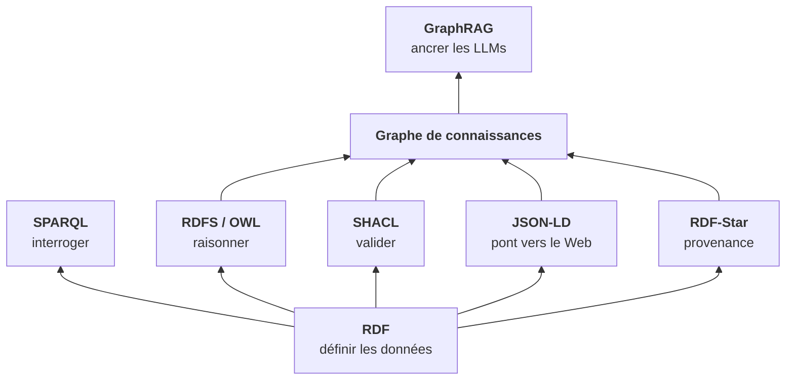
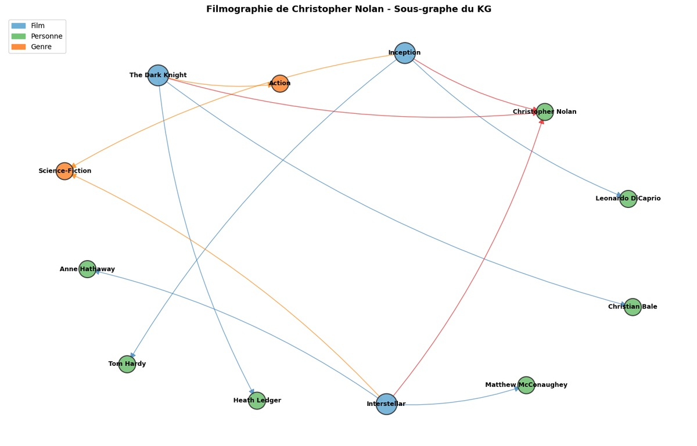
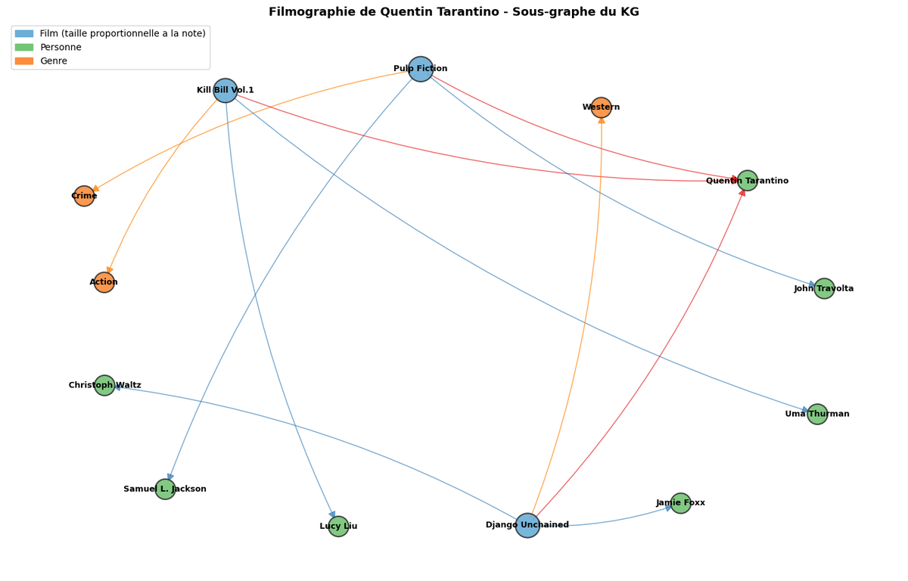
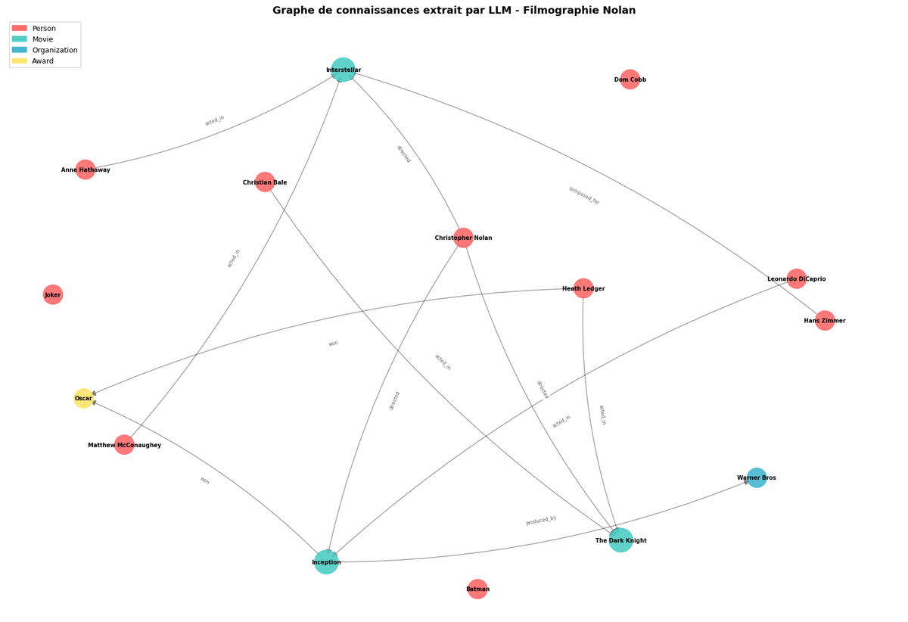
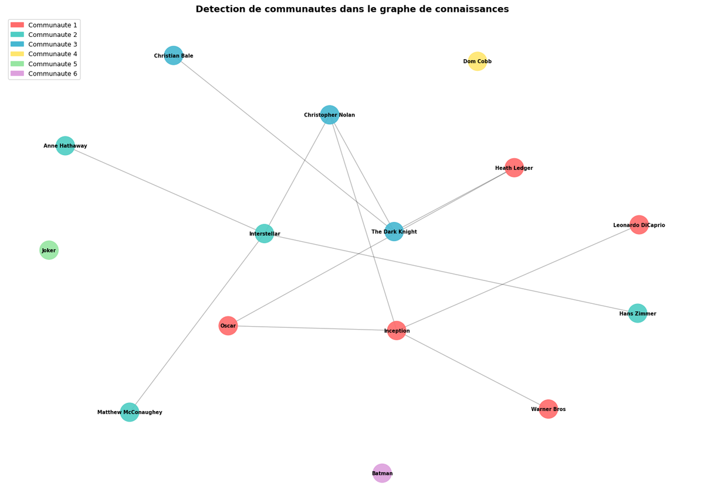
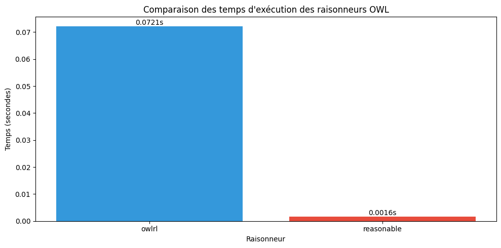
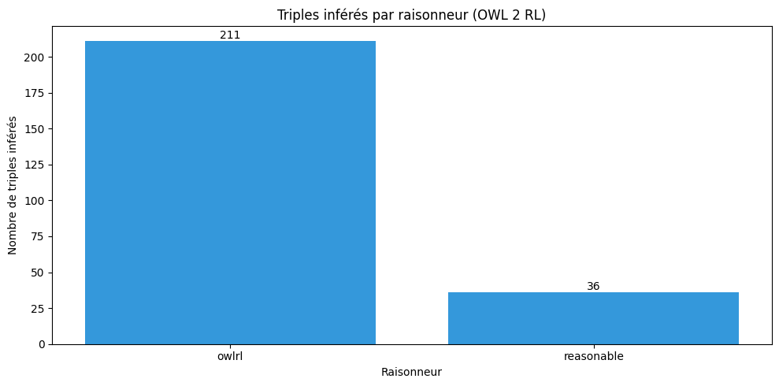

# Web Sémantique - Semantic Web

[← Tweety](../Tweety/README.md) | [↑ SymbolicAI](../README.md) | [Lean →](../Lean/README.md)

<!-- CATALOG-STATUS
series: SymbolicAI-SemanticWeb
pedagogical_count: 32
breakdown: SemanticWeb=32
maturity: BETA=30, ALPHA=2
-->

Le Web Sémantique est la promesse d'un Web où les machines comprennent la signification des données, pas seulement leur syntaxe. RDF, SPARQL, OWL, SHACL : ces standards du W3C définissent un langage commun pour décrire, interroger, valider et raisonner sur des graphes de connaissances. Cette série vous mène des fondations (.NET C# avec dotNetRDF) aux applications modernes (Python avec rdflib, pySHACL, GraphRAG), en passant par les ontologies, les données liées et les standards émergents (RDF 1.2, JSON-LD 1.1).

Le Web Sémantique a traversé des cycles de hype et de désillusion. En 2001, Tim Berners-Lee en faisait la couverture de *Scientific American*. En 2010, les données liées semblaient une niche académique. En 2024, GraphRAG a montré que les graphes de connaissances RDF pouvaient ancrer les LLMs sur des faits vérifiables : le Web Sémantique devenait un garde-fou pour l'IA générative. La série couvre le spectre complet parce que les briques s'articulent — RDF définit les données, SPARQL les interroge, RDFS/OWL structurent le raisonnement, SHACL valide la qualité, JSON-LD ponte vers le Web, RDF-Star ajoute la provenance, et les KG+LLMs ferment la boucle :



**À qui s'adresse cette série** : développeurs web curieux du sens caché dans leurs données, data scientists voulant structurer leurs pipelines, et étudiants en IA souhaitant comprendre comment les graphes de connaissances ancrent les LLMs. Aucun prérequis en logique formelle. Le décompte exact des notebooks et leur maturité figurent dans le bandeau `CATALOG-STATUS` en tête de fichier.

## Comment lire ce README

- La table **Notebooks** ci-dessous est l'inventaire complet de la série : chaque carnet du dossier y figure, avec ce qu'on y apprend en une phrase, sa durée et son statut.
- Le **Parcours d'apprentissage** raconte la série dans l'ordre des numéros : SW-1 à SW-16 se suivent, chaque couche W3C s'appuie sur la précédente. C'est la lecture recommandée pour une découverte complète.
- La série maintient **deux piles en parité** (.NET C# ⇄ Python) : un même standard est souvent couvert deux fois, une fois par écosystème. Chaque nom de carnet porte son langage (`CSharp` ou `Python`).
- Le statut distingue les rôles : **FONDATION** (les fondations .NET, SW-1 à SW-7), **MIROIR** (l'équivalent Python d'une fondation .NET, même numéro), **STANDARD** (les standards modernes, pile principale Python), **JUMEAU** (l'équivalent C# d'un carnet Python, même numéro), **EXTENSION** (la trilogie finale qui compose les standards) et **ARCHIVE** (démonstration historique, non maintenue).
- **Approfondissements** propose des parcours ciblés si vous n'avez pas besoin de tout ; **Pour aller plus loin** pointe vers les séries voisines du dépôt. Les prérequis d'installation sont regroupés plus bas ; le dépannage courant est dans la FAQ.
- Les figures du README sont des sorties de carnets, chacune porte un texte alternatif en français.

## Notebooks

| # | Notebook | Ce qu'on y apprend | Durée | Statut |
|---|----------|--------------------|-------|--------|
| SW-01 | [SW-01-Setup-CSharp](SW-01-Setup-CSharp.ipynb) | Installer dotNetRDF, créer un premier graphe RDF, comprendre l'architecture en couches du W3C | 20 min | FONDATION |
| SW-02 | [SW-02-RDFBasics-CSharp](SW-02-RDFBasics-CSharp.ipynb) | Le triplet RDF (sujet-prédicat-objet), les types de nœuds, les littéraux typés, les sérialisations Turtle / N-Triples / RDF-XML | 45 min | FONDATION |
| SW-02 (Py) | [SW-02-RDFBasics-Python](SW-02-RDFBasics-Python.ipynb) | Le même socle RDF avec rdflib | 45 min | MIROIR |
| SW-03 | [SW-03-GraphOperations-CSharp](SW-03-GraphOperations-CSharp.ipynb) | Lire/écrire des graphes, fusionner, sélectionner par pattern, requêter les triplets avec LINQ, manipuler les listes RDF | 50 min | FONDATION |
| SW-03 (Py) | [SW-03-GraphOperations-Python](SW-03-GraphOperations-Python.ipynb) | Les mêmes opérations de graphes avec rdflib | 50 min | MIROIR |
| SW-03 (Rust) | [SW-03-GraphOperations-Rust](SW-03-GraphOperations-Rust.ipynb) | Les mêmes opérations de graphes avec les crates oxigraph (oxrdf, oxttl, oxrdfxml) — streaming natif et listes RDF à la main | 50 min | MIROIR |
| SW-04 | [SW-04-SPARQL-CSharp](SW-04-SPARQL-CSharp.ipynb) | SPARQL : SELECT, FILTER, jointures implicites, OPTIONAL, UNION, ORDER BY / LIMIT | 45 min | FONDATION |
| SW-04 (Py) | [SW-04-SPARQL-Python](SW-04-SPARQL-Python.ipynb) | SPARQL avec rdflib | 45 min | MIROIR |
| SW-05 | [SW-05-LinkedData-CSharp](SW-05-LinkedData-CSharp.ipynb) | Les endpoints publics DBpedia et Wikidata, le client SPARQL distant, les requêtes fédérées avec SERVICE | 50 min | FONDATION |
| SW-05 (Py) | [SW-05-LinkedData-Python](SW-05-LinkedData-Python.ipynb) | DBpedia / Wikidata avec SPARQLWrapper | 50 min | MIROIR |
| SW-06 | [SW-06-RDFS-CSharp](SW-06-RDFS-CSharp.ipynb) | Le vocabulaire RDFS, les hiérarchies de classes, l'inférence et sa matérialisation | 40 min | FONDATION |
| SW-06 (Py) | [SW-06-RDFS-Python](SW-06-RDFS-Python.ipynb) | RDFS avec rdflib / owlrl | 40 min | MIROIR |
| SW-07 | [SW-07-OWL-CSharp](SW-07-OWL-CSharp.ipynb) | OWL 2 et ses profils (EL, QL, RL), les constructeurs logiques, les restrictions, le raisonnement | 50 min | FONDATION |
| SW-07 (Py) | [SW-07-OWL-Python](SW-07-OWL-Python.ipynb) | Les ontologies OWL avec OWLReady2 | 50 min | MIROIR |
| SW-08 | [SW-08-SHACL-Python](SW-08-SHACL-Python.ipynb) | SHACL : NodeShapes, PropertyShapes, contraintes de cardinalité et de type, validation avec pySHACL | 45 min | STANDARD |
| SW-08 (C#) | [SW-08-SHACL-CSharp](SW-08-SHACL-CSharp.ipynb) | La validation SHACL avec dotNetRDF | 45 min | JUMEAU |
| SW-09 | [SW-09-JSONLD-Python](SW-09-JSONLD-Python.ipynb) | JSON-LD : @context, @id, @type, Schema.org, les formes compactée / étendue / aplatie | 40 min | STANDARD |
| SW-09 (C#) | [SW-09-JSONLD-CSharp](SW-09-JSONLD-CSharp.ipynb) | Le parsing / l'écriture JSON-LD avec dotNetRDF | 40 min | JUMEAU |
| SW-10 | [SW-10-RDFStar-Python](SW-10-RDFStar-Python.ipynb) | RDF-Star : quoted triples, provenance, confiance — et la réification classique qui la remplace sous rdflib | 45 min | STANDARD |
| SW-10 (C#) | [SW-10-RDFStar-CSharp](SW-10-RDFStar-CSharp.ipynb) | La réification, les annotations de confiance et les graphes nommés avec dotNetRDF | 40 min | JUMEAU |
| SW-11 | [SW-11-Python-KnowledgeGraphs](SW-11-Python-KnowledgeGraphs.ipynb) | Construire un graphe de connaissances complet (import CSV/JSON, kglab, OWLReady2), le visualiser (NetworkX, pyvis) | 55 min | STANDARD |
| SW-11 (C#) | [SW-11-CSharp-KnowledgeGraphs](SW-11-CSharp-KnowledgeGraphs.ipynb) | Le KG côté .NET : construction dotNetRDF, SPARQL, parcours BFS, qualité, centralité | 45 min | JUMEAU |
| SW-12 | [SW-12-GraphRAG-Python](SW-12-GraphRAG-Python.ipynb) | GraphRAG : extraction d'entités par LLM, communautés, RAG structuré anti-hallucination | 50 min | STANDARD |
| SW-13 | [SW-13-Reasoners-Python](SW-13-Reasoners-Python.ipynb) | Les raisonneurs OWL comparés (owlrl, HermiT, reasonable, Growl) : compromis et benchmarks | 45 min | STANDARD |
| SW-13 (C#) | [SW-13-Reasoners-CSharp](SW-13-Reasoners-CSharp.ipynb) | Le raisonnement RDFS forward-chaining avec dotNetRDF | 40 min | JUMEAU |
| SW-14 | [SW-14-Coup-Ontologique-Python](SW-14-Coup-Ontologique-Python.ipynb) | Étendre un vocabulaire comme diff de graphe : le juge SHACL, le delta owlrl, la provenance par réification | 40 min | EXTENSION |
| SW-14 (C#) | [SW-14-Coup-Ontologique-CSharp](SW-14-Coup-Ontologique-CSharp.ipynb) | Le même geste en dotNetRDF, avec OWL-RL via Python.NET (recette Linux de préparation du pont incluse) | 90 min | EXTENSION |
| SW-15 | [SW-15-Coup-Argumentatif-Python](SW-15-Coup-Argumentatif-Python.ipynb) | Greffer un graphe d'argumentation AIF : le coup bascule l'extension grounded de Dung | 45 min | EXTENSION |
| SW-15 (C#) | [SW-15-Coup-Argumentatif-CSharp](SW-15-Coup-Argumentatif-CSharp.ipynb) | Le coup argumentatif en dotNetRDF : SHACL natif, fermeture OWL-RL via le pont Python.NET, bascule de Dung calculee en C# | 90 min | EXTENSION |
| SW-16 | [SW-16-ProofCarryingOntologies-Python](SW-16-ProofCarryingOntologies-Python.ipynb) | Le certificat d'inférence : une conclusion vérifiable par un checker indépendant | 50 min | EXTENSION |
| SW-16 (C#) | [SW-16-ProofCarryingOntologies-CSharp](SW-16-ProofCarryingOntologies-CSharp.ipynb) | Le même contrat en C# sur la seule BCL : checker découplé prouvé par scan IL, jambe réelle open-ontologies v1.4.0 invoquée par Process (SHA256 vérifié) | 50 min | JUMEAU |
| Legacy | [RDF.Net-Legacy/RDF.Net](RDF.Net-Legacy/RDF.Net.ipynb) | Démonstration RDF.NET historique, antérieure à la double pile — archive de référence, non maintenue | — | ARCHIVE |

**Durée totale** : ~10 h (parcours principal), ~4 h de plus (miroirs, jumeaux et extensions).

> **Parité .NET ⇄ Python** : la double pile est un choix pédagogique assumé de la série — un même raisonnement rendu par deux runtimes (dotNetRDF côté C# typé, rdflib côté Python expressif), la parité devenant un objet d'étude en soi. Les jumeaux C# sont comptés dans le `pedagogical_count` de la sous-série ; les statuts du tableau les distinguent des carnets d'origine.

Le dossier porte aussi : `data/` (ontologies et fixtures de test : `animals.ttl`, `university.owl`, `pizza.owl`, shapes SHACL, exemples SPARQL), `assets/readme/` (figures de ce README), `movie_kg_interactive.html` (livrable interactif pyvis du SW-11) et `RDF.Net-Legacy/` (l'archive). Pour le format RDF actuel, voir SW-2.

## Parcours d'apprentissage

### Étape 1 : les fondations RDF en .NET (SW-1 à SW-4)

Le socle : un fait élémentaire est un **triplet** sujet-prédicat-objet (SW-2), les triplets forment des **graphes** que l'on sérialise, fusionne et filtre (SW-3), et **SPARQL** les interroge comme SQL interroge une base relationnelle — projections, filtres, jointures implicites, `OPTIONAL`, `UNION`, pagination (SW-4). Le SW-1 pose la pile technologique W3C (Unicode → URI → RDF → RDFS → OWL → SPARQL) et le premier graphe « Hello World ». Les types de nœuds (URI, blank nodes, littéraux typés ou langués) et les formats de sérialisation (Turtle, N-Triples, RDF/XML) s'y manipulent concrètement, ainsi que la sélection pattern avec LINQ et les listes RDF.

Chaque fondation .NET a son **miroir Python** au même numéro (rdflib) : suivre l'une ou l'autre pile mène au même socle.

### Étape 2 : données liées et ontologies (SW-5 à SW-7)

Le Web s'ouvre : SW-5 interroge les endpoints publics **DBpedia** et **Wikidata** (requêtes fédérées `SERVICE`, Q-items et P-properties). Puis la structure : **RDFS** définit les hiérarchies de classes et de propriétés, l'inférence y déduit ce qui n'est pas écrit explicitement (SW-6) ; **OWL** étend RDFS en logique de description — profils EL/QL/RL, restrictions, cardinalités, disjonctions — et le raisonneur travaille (SW-7). Les miroirs Python existent aux mêmes numéros (`owlrl`, OWLReady2).

### Étape 3 : les standards modernes — valider, échanger, annoter (SW-8 à SW-10)

Trois standards récents, pile principale Python avec jumeaux C# :

- **SHACL** (SW-8) valide la conformité d'un graphe : shapes et contraintes (`sh:minCount`, `sh:datatype`, `sh:pattern`, `sh:in`), rapport de validation pySHACL en main.
- **JSON-LD** (SW-9) ponte entre le JSON des développeurs web et le RDF : `@context`, Schema.org (environ 73 % des rich snippets Google, estimation Schema.org 2024 citée dans le carnet), formes compactée / étendue / aplatie.
- **RDF-Star** (SW-10) annote les triplets (provenance, confiance) ; rdflib 7.6 ne supporte pas la syntaxe quoted-triple native — le carnet compare la réification classique et les graphes nommés (`rdflib.Dataset`), et le jumeau C# traite la réification avec dotNetRDF.

### Étape 4 : graphes de connaissances et IA (SW-11 à SW-13)

Un **graphe de connaissances** intègre tout ce qui précède : SW-11 construit un KG complet depuis des données brutes (import CSV/JSON, kglab, raisonnement HermiT) jusqu'à la visualisation interactive (pyvis) ; le jumeau C# y ajoute parcours BFS, métriques de qualité et centralité de degré.

**Figures — sous-graphes RDF interrogés en SPARQL.** `SW-11-Python-KnowledgeGraphs.ipynb` construit un graphe RDF (vocabulaire `schema.org`), l'interroge en SPARQL (`UNION` sur `actor` / `genre` / `director`) et visualise le sous-graphe filtré par réalisateur — la brique élémentaire d'un KG opérationnel :



*SW-11 : sous-graphe orienté filtré par SPARQL sur les films de **Christopher Nolan** (cellule 46) — noeuds colorés par type (Film / Personne / Genre), arêtes orientées étiquetées par relation (`director`, `actor`, `genre`).*



*SW-11 (Exercice 2, cellule 71) : même requête SPARQL rejouée sur les films de **Quentin Tarantino** — la taille des noeuds-films est **proportionnelle à la note** (`aggregateRating`), illustrant un enrichissement du graphe de base.*

**GraphRAG** (SW-12) ferme la boucle avec les LLMs : extraction d'entités et de relations d'un corpus par LLM, construction du graphe, détection de communautés par modularité, puis interrogation augmentée — le sous-graphe extrait est injecté dans le prompt, la réponse s'appuie sur des faits structurés (RAG vectoriel vs RAG structuré, évalués sur neuf questions ; cache de l'extraction pour ne pas relancer le LLM).

**Figures — pipeline GraphRAG en action.**



*SW-12 (cellule 18) : **graphe orienté des entités extraites par LLM** (filmographie Nolan) — noeuds colorés par type d'entité **extrait** (Person / Movie / Organization / Award ; les types `Genre` et `Concept`, présents dans le vocabulaire `TYPE_MAP`, ne sont pas dessinés sur cette figure), arêtes orientées étiquetées par la relation extraite.*



*SW-12 (cellule 30) : **détection de communautés par modularité gloutonne** (`networkx.algorithms.community.greedy_modularity_communities` sur le graphe non-dirigé) — chaque couleur = une communauté, partition des entités pour la synthèse multi-niveau.*

Enfin SW-13 compare les **raisonneurs OWL** (owlrl Python pur, HermiT via pont Java, reasonable en Rust, Growl en C) sur performance et intégration — le coût et le rendement de la couche logique :



*SW-13 (cellule 49) : **diagramme en barres des temps d'exécution** des raisonneurs OWL (Y = secondes, un raisonneur par barre) — benchmark comparatif du coût de calcul de l'inférence.*



*SW-13 (cellule 52) : **diagramme en barres du nombre de triples inférés** par raisonneur (Y = nombre de triples, profil OWL 2 RL) — comparaison du rendement de l'inférence entre raisonneurs, pas une matérialisation des triples eux-mêmes.*

### Étape 5 : extensions — composer les standards (SW-14 à SW-16)

La trilogie finale compose les gestes de la série autour d'un même objet :

- **SW-14, le coup ontologique** : étendre le vocabulaire d'une ontologie jouet (bibliothèque) comme **diff de graphe exécutable** — OWL déclare, SHACL juge l'admissibilité du coup (contrôle négatif à l'appui : une extension rejetée doit produire un rapport de violation), owlrl mesure le delta d'inférences (le **coup nul** est un résultat, pas un échec), la réification RDF + PROV attribue l'auteur. Le jumeau C# rejoue le pipeline en dotNetRDF avec OWL-RL via Python.NET.
- **SW-15, le coup argumentatif** : le même geste transplanté sur un **graphe d'argumentation AIF** (ontologie Argumentum du dépôt) — le débat porte sur l'adoption de la classe `Ebook` elle-même, et le coup **bascule l'extension grounded de Dung** de `{RA4}` à `{RA3, RA5}` : l'attaque du coup réhabilite l'argument du pilote.
- **SW-16, les proof-carrying ontologies** : chaque conclusion de raisonneur s'accompagne d'un **certificat** qu'un checker **indépendant** accepte ou rejette (règle connue, substitution unique, prémisses disponibles dans l'ordre, claim atteint) ; cinq familles de forges rejetées nommément démontrent que le checker mord. La jambe réelle invoque le binaire open-ontologies v1.4.0 (moteur Rust, SHA256 vérifié) sur la fixture `data/pizza.owl` — 1 944 triplets, 258 dérivations `rdfs11` — et le théorème de *soundness* du checker Lean 4 est cité, pas rejoué. Vérifier ne coûte que lire : pas de point fixe, pas de raisonnement.

## Approfondissements

### Parcours Python-only

Sans environnement .NET, la série se traverse entièrement en Python : les miroirs **SW-02-Python → SW-07-Python** couvrent les fondamentaux (rdflib, owlready2), puis **SW-8 → SW-12** les standards modernes et l'IA, enfin **SW-14 → SW-16** la trilogie des extensions.

### Parcours data engineer

Pour aller vite : **SW-02-Python** (RDF) → **SW-04-Python** (SPARQL) → **SW-8** (SHACL : valider vos données) → **SW-9** (JSON-LD : exposer en API) → **SW-12** (GraphRAG : connecter aux LLMs). En production d'ontologies, ajoutez SW-14 et SW-16 en fin de parcours.

### Parcours ontologue

Pour créer des ontologies et des vocabulaires : **SW-6** (RDFS) → **SW-7** (OWL) → **SW-07-Python** (OWLReady2) → **SW-8** (SHACL : contraintes sur les données) → **SW-13** (comparaison des raisonneurs), puis la trilogie de l'évolution d'ontologie (**SW-14 → SW-16**).

### Questions ouvertes

La **provenance des assertions** reste une limite écrite des certificats du SW-16 : un certificat prouve la dérivation, pas l'origine des faits assertés — question de recherche ouverte ([#158](https://github.com/jsboige/CoursIA/issues/158)).

## Prérequis

### Pour les notebooks .NET (fondations SW-1 à SW-7 et jumeaux C#)

- .NET SDK 9.0+
- .NET Interactive (Jupyter kernel)
- VS Code avec Polyglot Notebooks (recommandé)

### Pour les notebooks Python (miroirs, SW-8 à SW-16)

- Python 3.10+
- `pip install -r requirements.txt`

### Pour SW-12 (GraphRAG)

- Clé API OpenAI ou Anthropic (voir `.env.example`) — la seule clé requise de la série : les autres carnets n'en demandent aucune. La section 6 de SW-16 télécharge un binaire open-ontologies d'environ 58 Mo, mis en cache et vérifié par SHA256.

## Installation

```bash
# .NET (dotNetRDF)
dotnet tool install -g Microsoft.dotnet-interactive --version 1.0.712001
dotnet interactive jupyter install

# Python (rdflib & co.)
python -m venv venv
venv\Scripts\activate      # Windows
source venv/bin/activate   # Linux / macOS
pip install rdflib pySHACL owlready2 owlrl reasonable kglab SPARQLWrapper
# ou : pip install -r requirements.txt

# Premier carnet
jupyter notebook SW-01-Setup-CSharp.ipynb     # pile .NET
jupyter notebook SW-02-RDFBasics-Python.ipynb # pile Python
```

Le jumeau C# du SW-14 contient une recette Linux de préparation de CPython 3.13, du venv et du pont Python.NET avant le démarrage de Jupyter.

## FAQ / Dépannage

| Problème | Solution |
|----------|----------|
| `dotNetRDF` NuGet restore échoue | Vérifier .NET SDK 9.0+ (`dotnet --version`). Relancer la cellule d'import. |
| Endpoint DBpedia/Wikidata timeout | Les endpoints publics ont des limites. Ajouter `LIMIT 100` aux requêtes. Réessayer hors heures de pointe. |
| pySHACL validation vide | Vérifier que les préfixes du graphe de données correspondent aux shapes (même `ex:` namespace). |
| OWLReady2 Java bridge error | Installer JDK 11+ (OWLReady2 utilise HermiT en Java). Windows : `winget install EclipseAdoptium.Temurin.11.JDK`. macOS : `brew install --cask temurin@11`. Linux : `sudo apt install openjdk-17-jdk`. |
| RDF-Star syntax non reconnue | Avec rdflib 7.6 (version des carnets), la syntaxe native `<< … >>` n'est pas reconnue : utiliser la réification classique montrée dans SW-10, ou tester une version plus récente de rdflib. |
| GraphRAG : `OPENAI_API_KEY` manquant | SW-12 requiert une clé LLM (OpenAI ou Anthropic). Configurer `.env` (voir `.env.example`). Les autres carnets n'ont pas besoin de clé. |

## Concepts clés

| Concept | En une phrase | Notebook |
|---------|---------------|----------|
| **Triplet RDF** | Un fait élémentaire : sujet-prédicat-objet (comme une phrase simple) | SW-2 |
| **Graphe RDF** | Un ensemble de triplets formant un réseau sémantique | SW-3 |
| **SPARQL** | Le SQL du Web Sémantique : interroger des graphes avec des patterns | SW-4 |
| **Linked Data** | Des données publiées sur le Web avec des URIs résolvables | SW-5 |
| **RDFS** | Un vocabulaire pour définir des hiérarchies de classes et propriétés | SW-6 |
| **OWL** | Une logique de description pour le raisonnement automatique | SW-7 |
| **SHACL** | Des contraintes de validation sur les graphes (comme des schémas JSON) | SW-8 |
| **JSON-LD** | Du JSON avec un contexte sémantique (le pont Web classique ↔ Web Sémantique) | SW-9 |
| **RDF-Star** | Des métadonnées sur les triplets (provenance, confiance, annotations) | SW-10 |
| **Graphe de connaissances** | Un RDF riche, visualisable, requêtable, ancré dans une ontologie | SW-11 |
| **GraphRAG** | Un KG ancré dans un LLM pour du RAG structuré (anti-hallucination) | SW-12 |
| **Raisonneurs OWL/RDFS** | Moteurs d'inférence (owlrl, HermiT, reasonable, Growl, StaticRdfsReasoner) — compromis Python/Java/Rust | SW-13 |
| **Coup ontologique** | Extension de vocabulaire exécutable : triplets ajoutés, verdict pySHACL, delta owlrl, provenance par réification RDF | SW-14 |
| **Coup argumentatif** | Greffe AIF/Dung sur le pipeline : extension grounded basculée par le coup | SW-15 |
| **Proof-Carrying Ontologies** | Une conclusion de raisonneur accompagnée d'un certificat qu'un checker indépendant accepte ou rejette (PCO) | SW-16 |

## Technologies et versions

| Technologie | Version | Notebooks | Rôle |
|-------------|---------|-----------|------|
| dotNetRDF | 3.2.1 | SW-1 à SW-7 | Core RDF/SPARQL en .NET |
| dotNetRDF | 3.4.0 / 3.4.1 | Jumeaux C# SW-8 à SW-13 | Standards modernes en .NET (SW-9 en 3.4.0, les autres en 3.4.1) |
| rdflib | 7.6.0 | Miroirs, SW-8 à SW-16 | Core RDF/SPARQL en Python (version des sorties commitées) |
| pySHACL | 0.31.0 à 0.40.1 | SW-8, SW-14, SW-15 | Validation SHACL (version des sorties commitées) |
| OWLReady2 | 0.50+ | SW-07-Python, SW-11 | Manipulation ontologies |
| SPARQLWrapper | 2.0+ | SW-05-Python | Requêtes endpoints distants |
| kglab | 0.6.1+ | SW-11 | Abstraction graphes de connaissances |
| owlrl | 6.0+ | SW-06-Python, SW-13, SW-14 | Raisonneur OWL 2 RL Python pur |
| reasonable | 0.1+ | SW-13 | Raisonneur OWL 2 RL Rust |

## Standards W3C couverts

| Standard | Version | Notebook |
|----------|---------|----------|
| RDF | 1.1 / 1.2 | SW-2, SW-10 |
| SPARQL | 1.1 | SW-4, SW-5 |
| RDFS | 1.0 | SW-6 |
| OWL | 2 | SW-7, SW-13 |
| SHACL | 1.0 | SW-8 |
| JSON-LD | 1.1 | SW-9 |

## Pour aller plus loin

La série est le **carrefour données structurées** du dépôt — chaque série voisine y trouve un point d'entrée formel vers la représentation des connaissances :

| Cette sous-série | Symétrie dans | Pont pédagogique |
|------------------|----------------|-------------------|
| SW-7 (OWL / logique de description) | [Tweety](../Tweety/) | DL = moteur de raisonnement OWL ; les SAT solvers complètent les raisonneurs OWL, le raisonnement monotone (OWL) rencontre le non-monotone (Tweety) |
| SW-11 (Graphe de connaissances) | [Planners](../Planners/README.md) | Un KG décrit le monde que les planificateurs PDDL exploitent — SPARQL ↔ extraction d'états et de buts |
| SW-12 (GraphRAG anti-hallucination) | [ArgumentAnalysis](../ArgumentAnalysis/) | Même besoin : ancrer un LLM sur des faits vérifiables via un KG RDF |
| SW-8 (SHACL validation) | [Lean](../Lean/README.md) | Les shapes SHACL sont des invariants sur les données ; Lean pousse cette idée à son terme — prouver la correction d'un programme |
| SW-16 (certificat d'inférence) | [Lean](../Lean/README.md) | Le checker jouet applique une *procédure* ; le checker Lean d'open-ontologies porte un *théorème* (`OOCert.certificate_sound`) |
| SW-9 (JSON-LD, NFTs ERC-721) | [SmartContracts](../SmartContracts/README.md) | Identité auto-souveraine (DID), blockchains et RDF — graphe décentralisé |

Pour une lecture transversale du geste qui relie cette série à tout le dépôt — *trouver la représentation où le problème se dissout* — voir la clé de lecture [La mer qui monte](../../../docs/cadrage/grothendieckian-lens.md).

## Ressources

### Références académiques

| Référence | Couverture |
|-----------|------------|
| Berners-Lee, Hendler & Lassila, "The Semantic Web", *Scientific American* (2001) | Vision originale, introduction |
| Russell & Norvig, *AIMA* 4e ed., ch. 12 "Knowledge Representation" | Cadre général IA symbolique |
| Hitzler et al., *Foundations of Semantic Web Technologies* (2010) | OWL, RDF, raisonnement |
| Allemang & Hendler, *Semantic Web for the Working Ontologist* (2011) | Modélisation OWL/RDFS |
| Harris & Seaborne, "SPARQL 1.1 Query Language", W3C Rec. (2013) | Standard SPARQL |
| Cyganiak, Wood & Lanthaler, "RDF 1.1 Concepts", W3C Rec. (2014) | Standard RDF |
| Knublauch et al., "SHACL Shapes Constraint Language", W3C Rec. (2017) | Standard SHACL |
| Edge et al., « From Local to Global: A Graph RAG Approach to Query-Focused Summarization » (Microsoft, 2024) | SW-12 GraphRAG |

### Ressources en ligne

- [dotNetRDF](https://dotnetrdf.org/) - Bibliothèque .NET pour RDF
- [rdflib](https://rdflib.readthedocs.io/) - Bibliothèque Python pour RDF
- [W3C RDF](https://www.w3.org/RDF/) - Standard RDF
- [W3C SPARQL](https://www.w3.org/TR/sparql11-overview/) - Standard SPARQL
- [W3C OWL](https://www.w3.org/OWL/) - Standard OWL
- [W3C SHACL](https://www.w3.org/TR/shacl/) - Standard SHACL
- [JSON-LD](https://json-ld.org/) - JSON pour les données liées
- [DBpedia](https://dbpedia.org/) - Données structurées de Wikipedia
- [Wikidata](https://www.wikidata.org/) - Base de connaissances libre

## Conclusion / Le fil rouge

Le fil de cette série épouse celui du Web Sémantique lui-même : **donner du sens formel à des données**, couche par couche.

- **Modéliser** (SW-1 à SW-7) : un domaine se découpe en triplets RDF, s'interroge en SPARQL, se structure en hiérarchies RDFS puis en ontologies OWL où le raisonneur déduit ce que vous n'avez pas écrit explicitement.
- **Valider et échanger** (SW-8 à SW-10) : SHACL garantit la conformité d'un graphe, JSON-LD ponte vers le Web des APIs, RDF-Star ajoute la *provenance* — car un fait sans source n'est qu'une assertion.
- **Fermer la boucle avec l'IA** (SW-11 à SW-13) : un graphe de connaissances ancre les LLMs sur des faits vérifiables — GraphRAG transforme le Web Sémantique de niche académique en garde-fou contre les hallucinations génératives.
- **Composer** (SW-14 à SW-16) : les gestes s'assemblent — un coup de vocabulaire se juge (SHACL), se mesure (owlrl, Dung) et se certifie (PCO). C'est là que la série rejoint la question de la confiance : qui a étendu le schéma, au nom de quoi, et la conclusion peut-elle être vérifiée par un tiers ?

Le titre de Berners-Lee en 2001 promettait un Web compris par les machines. Vingt ans plus tard, ce n'est plus une promesse : c'est une *technique*, du triplet RDF au GraphRAG. Les standards changent (RDF 1.2, JSON-LD 1.1), les outils changent (dotNetRDF, rdflib, kglab), mais le geste reste — **structurer, interroger, valider, raisonner**. C'est ce triptyque que vous emportez au-delà de cette série.

## Licence

Voir la licence du repository principal.
