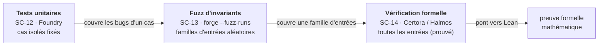

# 03-Foundry-Testing — Tests, Fuzzing et Vérification Formelle

[← 02 — Solidity Avancé](../02-Solidity-Advanced/README.md) | [↑ SmartContracts](../README.md) | [04 — Privacy & Cryptography →](../04-Privacy-Cryptography/README.md)

## Ouverture — ce que cette partie enseigne (Licence)

Cette troisième sous-série introduit le **testing rigoureux** des smart contracts : la suite d'outils Foundry (`forge`, `cast`, `anvil`), le fuzz testing d'invariants, puis la vérification formelle avec Certora Prover et le langage CVL. C'est le passage du « code qui semble marcher » au « code dont on prouve les propriétés » — une **escalade de l'assurance** où chaque étape couvre une classe de bugs plus large que la précédente.

**Signature pédagogique.** Le code Solidity y est présenté comme chaînes de caractères. **SC-13 exécute `forge` pour de vrai** : il lance `forge test --fuzz-runs 512` sur un mini-projet et committe sa sortie (#3921), où la moyenne naïve `(a+b)/2` déborde (`panic: arithmetic underflow or overflow`) alors que la version safe passe. **SC-12 ne lance pas `forge test`** : sa cellule vérifie seulement la présence de `forge`, et ses lignes `[PASS]` sont une sortie d'exemple, honnêtement signalée comme illustration. Une installation locale de Foundry et Certora permet de reproduire les tests pour de vrai.

**À qui elle s'adresse.** Un lecteur ayant terminé [02-Solidity-Advanced](../02-Solidity-Advanced/README.md) et qui veut savoir **comment garantir** les propriétés des contrats qu'il écrit. Les prérequis exacts sont en [Installation](#installation).

Le décompte des carnets de cette sous-série est tenu par le [catalogue des cours](../../../../COURSE_CATALOG.generated.md), régénéré automatiquement.

## Comment lire ce README (Licence)

Un README de série se lit à plusieurs vitesses : le parcours principal par les numéros nus, l'approfondissement par les lettres, la recherche en cours par les sous-séries et la section « Pour aller plus loin ». Le principe est exposé à la racine du dépôt, dans [« Choisir sa vitesse de lecture »](https://github.com/jsboige/CoursIA#choisir-sa-vitesse-de-lecture).

- **Vous sécurisez vos contrats** : suivez la table du parcours principal, de haut en bas — l'escalade est cumulative.
- **Vous creusez un palier** : cette partie n'en porte aucun (voir [Approfondissements](#approfondissements-licence)) ; les compagnons lettrés vivent dans la partie précédente.
- **Vous cherchez la recherche en cours** : SC-14 ouvre le pont vers la preuve formelle — voir [« Pour aller plus loin »](#pour-aller-plus-loin--niveau-recherche).

## Parcours principal (Licence)

| # | Notebook | Ce qu'on y apprend | Public | Pour approfondir |
|---|---|---|---|---|
| 12 | [SC-12-Foundry-Testing-Python](SC-12-Foundry-Testing-Python.ipynb) | Installation Foundry, structure de projet standard, tests en Solidity avec DSTest, **cheatcodes** (`vm.prank`, `vm.warp`, `vm.expectRevert`) pour simuler des scénarios, assertions avec logging | Licence | — |
| 13 | [SC-13-Fuzz-Invariants-Python](SC-13-Fuzz-Invariants-Python.ipynb) | Fuzz testing : paramètres aléatoires, **invariants** (propriétés qui doivent tenir quelles que soient les entrées), filtrage par `vm.assume` — et la découverte réelle d'un contre-exemple d'overflow par le fuzzer | Licence | — |
| 14 | [SC-14-Formal-Verification-Python](SC-14-Formal-Verification-Python.ipynb) | Vérification formelle : **Certora Prover** et le langage de spécification **CVL**, écriture de spécifications et de règles, vérification d'invariants mathématiques — le pont vers la preuve Lean | Recherche | — |

**Ce que vous saurez faire à l'issue de cette partie :**

1. **Écrire** une suite de tests Foundry avec cheatcodes et assertions DSTest ;
2. **Fuzzer** des invariants et lire un contre-exemple produit par le fuzzer ;
3. **Spécifier** des règles CVL et distinguer test, fuzz et preuve — ce que chacun garantit et ne garantit pas.

## Approfondissements (Licence)

Cette partie **ne porte aucun approfondissement lettré** : l'escalade tests → fuzz → preuve est un parcours continu, sans variante qui se détacherait d'un numéro porteur. Rien n'est perdu ici — il n'y a rien à replier.

## Sous-séries (Licence)

Cette partie n'en contient pas. Elle est elle-même une **sous-série** de [SmartContracts](../README.md), dont le README porte la vue d'ensemble de l'arc et l'escalier entre les parties.

## Installation

- **Prérequis d'entrée** : SC-1 à SC-4 (syntaxe Solidity) et SC-6 (erreurs et événements, pour `vm.expectRevert` et `emit`) ; un terminal/bash.
- **Foundry installé** : `curl -L https://foundry.paradigm.xyz | bash && foundryup`. Les notebooks SC-12/13 invoquent `forge test` / `forge build` depuis des cellules Python d'orchestration (Python 3.10+).
- **SC-14** : **Certora Prover** (compte Certora + accès cloud, commercial) ou l'alternative open-source **Halmos** (exécution symbolique) — sans ces outils, les règles CVL ne sont pas toutes vérifiables.
- Aucun faucet, aucun ETH réel : les tests tournent en local via `anvil` ou en simulation.

## Pour aller plus loin — niveau Recherche

**Formalisations Lean.** Cette partie ne consomme pas le lake `erc20_lean` (qui vit en [02-Solidity-Advanced](../02-Solidity-Advanced/README.md)), mais SC-14 ouvre le même paradigme : **spécifier puis prouver**. [SymbolicAI/Lean](../../Lean/README.md) développe ce paradigme dans un cadre mathématique pur — CVL et Lean sont deux instances du même idéal de vérification. L'inventaire des modules de la série vit dans le README parent, il n'est pas recopié ici.

**Le fil de recherche.** Ne plus demander « est-ce que ça marche sur mes exemples ? » mais **« quelles propriétés sont garanties quelles que soient les entrées ? »**. Sur une chaîne où le code est immuable et où une faille coûte des millions, prouver un invariant (qu'il résiste à toute entrée, même aléatoire, même adversariale) est précisément ce qui distingue un protocole déployable d'une démonstration de prototype — et cette exigence d'assurance est le pont vers les protocoles cryptographiques de la partie suivante.

## Ressources

- [SmartContracts — README de la série](../README.md) : le parcours global, les parties suivantes, l'inventaire Lean.
- [02 — Solidity Avancé](../02-Solidity-Advanced/README.md) : ce que cette partie vient sécuriser.
- [04 — Privacy & Cryptography](../04-Privacy-Cryptography/README.md) : la suite, où la rigueur formelle devient centrale.
- [SymbolicAI/Lean](../../Lean/README.md) : le même paradigme de preuve, cadre mathématique pur.
- **Foundry Book** (Foundry contributors) — `forge test`, `forge build`, fuzzing, cheatcodes : book.getfoundry.sh.
- **Certora Documentation** (Certora Inc.) — Prover, langage CVL : docs.certora.com.
- **Halmos** (a16z, 2023) — exécution symbolique open-source pour tests Foundry.
- Wilkinson, M. (2022) — *Foundry: A Blazing Fast, Portable, and Modular Toolkit for Ethereum Application Development*.
- [Choisir sa vitesse de lecture](https://github.com/jsboige/CoursIA#choisir-sa-vitesse-de-lecture) : le principe des parcours à plusieurs vitesses, à la racine du dépôt.
