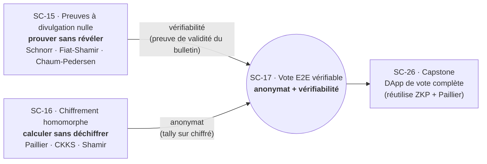

# 04-Privacy-Cryptography — Preuves Zero-Knowledge, Chiffrement Homomorphe et Vote Vérifiable

[← 03 — Foundry Testing](../03-Foundry-Testing/README.md) | [↑ SmartContracts](../README.md) | [05 — Alternative Chains →](../05-Alternative-Chains/README.md)

## Ouverture — ce que cette partie enseigne (Licence)

Cette quatrième sous-série explore la cryptographie avancée au service de la confidentialité sur blockchain : les **preuves à divulgation nulle** (Zero-Knowledge Proofs), le **chiffrement homomorphe** (calcul sur données chiffrées), et le **vote électronique de bout en bout vérifiable** (E2E). Les protocoles cryptographiques sont implémentés **pour de vrai** en Python (`pycryptodome`, `phe`, `tenseal`) : la crypto Paillier et Schnorr est réellement exécutée dans les outputs committés — les paramètres (clés, challenges, réponses) sont authentiques.

SC-17 n'est pas une primitive de plus : il **assemble** les preuves à divulgation nulle (SC-15) et le chiffrement homomorphe (SC-16) pour résoudre le paradoxe du vote électronique — concilier **anonymat** et **vérifiabilité**. Le capstone SC-26 réutilisera les deux.

Le décompte des carnets de cette sous-série est tenu par le [catalogue des cours](../../../../COURSE_CATALOG.generated.md), régénéré automatiquement.

**À qui elle s'adresse.** Un lecteur à l'aise en Python et en arithmétique modulaire de base ; les protocoles sont implémentés from scratch avant d'être utilisés. Les prérequis exacts, y compris les dépendances optionnelles, sont en [Installation](#installation).

## Comment lire ce README (Licence)

Un README de série se lit à plusieurs vitesses : le parcours principal par les numéros nus, l'approfondissement par les lettres, la recherche en cours par les sous-séries et la section « Pour aller plus loin ». Le principe est exposé à la racine du dépôt, dans [« Choisir sa vitesse de lecture »](https://github.com/jsboige/CoursIA#choisir-sa-vitesse-de-lecture).

- **Vous apprenez la crypto de confidentialité** : suivez la table du parcours principal, de haut en bas — SC-17 assemble les deux premiers.
- **Vous creusez un palier** : cette partie n'en porte aucun (voir [Approfondissements](#approfondissements-licence)).
- **Vous cherchez la recherche en cours** : le capstone qui réutilise ces primitives est en [06-Real-World](../06-Real-World/README.md) ; les dépendances SOTA optionnelles (TenSEAL, Concrete, ElectionGuard) sont décrites en [Installation](#installation).

## Parcours principal (Licence)

| # | Notebook | Ce qu'on y apprend | Public | Pour approfondir |
|---|---|---|---|---|
| 15 | [SC-15-Zero-Knowledge-Proofs-Python](SC-15-Zero-Knowledge-Proofs-Python.ipynb) | Prouver la connaissance d'un secret sans le révéler : protocole de **Schnorr** implémenté from scratch (preuve de connaissance d'un logarithme discret), transformation **Fiat-Shamir** (protocole interactif → non-interactif via oracle aléatoire), Sigma protocols avec **Chaum-Pedersen** | Licence | — |
| 16 | [SC-16-Homomorphic-Encryption-Python](SC-16-Homomorphic-Encryption-Python.ipynb) | Calculer sur données chiffrées : variantes PHE/SHE/FHE, schéma de **Paillier** (additivement homomorphe) avec `phe`, schéma **CKKS** pour l'arithmétique approchée, et calcul multipartite sécurisé via le partage de secrets de **Shamir** | Licence | — |
| 17 | [SC-17-E2E-Verifiable-Voting-Python](SC-17-E2E-Verifiable-Voting-Python.ipynb) | Le paradoxe du vote électronique : **anonymat** vs **vérifiabilité**. Système de vote construit à la main combinant Paillier + ZKP, bulletin board publiquement vérifiable, tally corroboré dans les outputs, et découverte d'**ElectionGuard** | Licence | — |

**Ce que vous saurez faire à l'issue de cette partie :**

1. **Implémenter** une preuve de connaissance à divulgation nulle (Schnorr) et la rendre non-interactive (Fiat-Shamir) ;
2. **Calculer** sur des données chiffrées (Paillier additif, CKKS approché) et partager un secret (Shamir) ;
3. **Assembler** ces primitives en un vote vérifiable : bulletin chiffré anonyme, preuve de validité, tally publiquement contrôlable.

## Approfondissements (Licence)

Cette partie **ne porte aucun approfondissement lettré** : ses notebooks forment un arc d'assemblage (SC-17 consomme SC-15 et SC-16), sans variante qui se détacherait d'un numéro porteur. Rien n'est perdu ici — il n'y a rien à replier.

## Sous-séries (Licence)

Cette partie n'en contient pas. Elle est elle-même une **sous-série** de [SmartContracts](../README.md), dont le README porte la vue d'ensemble de l'arc et l'escalier entre les parties.

## Installation

- **Prérequis d'entrée** : arithmétique modulaire de base ; SC-17 suppose SC-15 et SC-16 complétés.
- **Python 3.10+** avec :
  - `pip install pycryptodome` (SC-15 grands nombres premiers, SC-17) ;
  - `pip install phe` (SC-16 Paillier, SC-17) ;
  - `pip install tenseal` (SC-16 CKKS — **optionnel**, dépend d'une toolchain C++ ; sans lui, la section CKKS tourne en repli honnêtement disclose) ;
  - `pip install mpyc` (SC-16 MPC — optionnel) ;
  - `pip install electionguard` (SC-17 — optionnel ; à défaut, la partie ElectionGuard est disclose comme simulation conceptuelle).
- **Concrete (Zama FHE) sur SC-16 — kernel dédié WSL/Linux** : la cellule de compilation FHE utilise le kernel `python3-sc16-concrete-wsl`, car `concrete-python` est Linux/macOS-only. Le wrapper `wsl.exe` pointe sur le venv WSL `/home/jesse/.sc16-fhe-venv` (Python 3.12 + `concrete-python` + `phe` + `pycryptodome`) ; sans ce kernel, la cellule bascule sur le repli disclose. Procédure d'installation : [#7029](https://github.com/jsboige/CoursIA/issues/7029).
- Aucune blockchain, aucun faucet : la crypto tourne en Python pur.

## Pour aller plus loin — niveau Recherche

**Formalisations Lean.** Cette partie ne consomme aucune formalisation Lean — les protocoles y sont implémentés et observés, pas prouvés. Le lake de la série (`erc20_lean`) vit en [02-Solidity-Advanced](../02-Solidity-Advanced/README.md) ; l'inventaire des modules vit dans le README parent, il n'est pas recopié ici.

**Le fil de recherche.** Ne plus opposer **confidentialité** et **vérifiabilité** comme un compromis, mais les **réconcilier par la cryptographie**. Les preuves à divulgation nulle (prouver sans révéler), le chiffrement homomorphe (calculer sans déchiffrer) et le vote E2E (anonymat + vérifiabilité) sont trois variations du même idéal : faire confiance à la **preuve mathématique** plutôt qu'à l'**autorité** — un idéal particulièrement précieux sur une chaîne publique où chaque transaction est, par défaut, transparente. Le capstone [SC-26](../06-Real-World/SC-26-Final-Project-Python.ipynb) réassemble ces primitives dans une DApp de vote complète.

## Ressources

- [SmartContracts — README de la série](../README.md) : le parcours global, les parties suivantes, l'inventaire Lean.
- [05 — Alternative Chains](../05-Alternative-Chains/README.md) : la suite — quitter la EVM.
- [06-Real-World / SC-26](../06-Real-World/SC-26-Final-Project-Python.ipynb) : le capstone qui réutilise ZKP + Paillier.
- **Schnorr, C.-P. (1991)** — *Efficient Signature Generation by Smart Cards*, Journal of Cryptology 4(3).
- **Fiat, A., & Shamir, A. (1987)** — *How To Prove Yourself: Practical Solutions to Identification and Signature Problems*, CRYPTO 1986, LNCS 263.
- **Chaum, D., & Pedersen, T. (1993)** — *Wallet Databases with Observers*, CRYPTO 1992.
- **Paillier, P. (1999)** — *Public-Key Cryptosystems Based on Composite Degree Residuosity Classes*, EUROCRYPT 1999.
- **Shamir, A. (1979)** — *How to Share a Secret*, Communications of the ACM 22(11).
- **ElectionGuard** (Microsoft, 2019) — spécification du vote E2E vérifiable : github.com/microsoft/electionguard.
- [Choisir sa vitesse de lecture](https://github.com/jsboige/CoursIA#choisir-sa-vitesse-de-lecture) : le principe des parcours à plusieurs vitesses, à la racine du dépôt.
