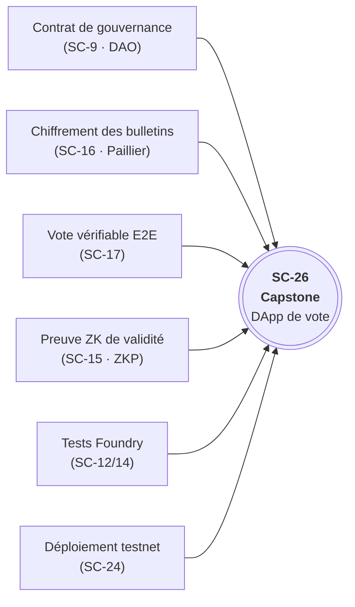

# 06-Real-World — SmartContracts en Production

[← 05 — Alternative Chains](../05-Alternative-Chains/README.md) | [↑ SmartContracts](../README.md)

## Ouverture — ce que cette partie enseigne (Licence)

La dernière sous-série fait le passage de la théorie au déploiement réel. On quitte le bac à sable `anvil` local pour affronter des réseaux publics : testnets Ethereum/XRP, mainnets L2 (Base, Polygon), ponts cross-chain Chainlink CCIP, et un projet capstone qui combine vote, chiffrement homomorphique, preuve ZKP et tests Foundry. L'épilogue SC-27 referme la boucle en **revenant au bac à sable** : la boucle de gouvernance y est déroulée et **mesurée** (gas par étape, quorum, timelock, coût du retour arrière, verrous sans rollback).

Le capstone SC-26 ne présente pas un concept nouveau : il **assemble les briques acquises** dans les parties précédentes en une DApp de vote complète :

**Exécution et secrets.** Ces notebooks supposent que les clés API et private keys sont lues depuis l'environnement (`.env`, `os.getenv`) — ils ne s'exécutent pas end-to-end sans configuration externe (faucet testnet, clé Infura/Alchemy, ETH sur L2). Les outputs committés documentent honnêtement ce qui se passe quand la configuration est absente (messages `DEPLOYER_PRIVATE_KEY non configure`, simulations conceptuelles disclose), et ce qui a réellement tourné quand elle est présente. **Exception : SC-27** s'exécute entièrement sur `anvil` local (comptes pré-financés) — aucune clé, aucun faucet, exécution end-to-end réelle.

**À qui elle s'adresse.** Un lecteur ayant parcouru la série jusqu'ici (le capstone suppose tout ce qui précède). Les prérequis exacts et les variables d'environnement sont en [Installation](#installation).

Le décompte des carnets de cette sous-série est tenu par le [catalogue des cours](../../../../COURSE_CATALOG.generated.md), régénéré automatiquement.

## Comment lire ce README (Licence)

Un README de série se lit à plusieurs vitesses : le parcours principal par les numéros nus, l'approfondissement par les lettres, la recherche en cours par les sous-séries et la section « Pour aller plus loin ». Le principe est exposé à la racine du dépôt, dans [« Choisir sa vitesse de lecture »](https://github.com/jsboige/CoursIA#choisir-sa-vitesse-de-lecture).

- **Vous passez en production** : suivez la table du parcours principal, de haut en bas — testnet systématiquement avant mainnet.
- **Vous creusez un palier** : cette partie n'en porte aucun (voir [Approfondissements](#approfondissements-licence)) ; les paliers lettrés vivent en [02-Solidity-Advanced](../02-Solidity-Advanced/README.md).
- **Vous cherchez la recherche en cours** : l'épilogue mesuré SC-27 (méthodologie de mesure de dette) et le capstone sont décrits dans [« Pour aller plus loin »](#pour-aller-plus-loin--niveau-recherche).

## Parcours principal (Licence)

| # | Notebook | Ce qu'on y apprend | Public | Pour approfondir |
|---|---|---|---|---|
| 23 | [SC-23-Cross-Chain-Python](SC-23-Cross-Chain-Python.ipynb) | Pourquoi déplacer un actif ou un message d'une chaîne à l'autre, comment Chainlink CCIP fait transiter des données on-chain de manière vérifiable, et où se cachent les attaques cross-chain (reentrancy de bridge, message spoofing) — contrats CCIP lus comme texte pédagogique | Licence | — |
| 24 | [SC-24-Testnet-Deploy-Python](SC-24-Testnet-Deploy-Python.ipynb) | Le déploiement public sur Sepolia via Alchemy/Infura (faucet, broadcast, interaction) et les transactions sur le XRP Testnet via `xrpl-py` — le cycle complet : connexion RPC, wallet, gas, vérification | Licence | — |
| 25 | [SC-25-Mainnet-Deploy-Python](SC-25-Mainnet-Deploy-Python.ipynb) | Le choix d'un mainnet L2 (Base/Polygon/Arbitrum), l'estimation de coût, le déploiement réel, la checklist sécurité et la vérification du source sur l'explorateur (Basescan/Polygonscan) | Licence | — |
| 26 | [SC-26-Final-Project-Python](SC-26-Final-Project-Python.ipynb) | Le capstone : DApp de vote complète assemblant gouvernance (SC-9), chiffrement Paillier des bulletins (SC-16/17), preuve ZKP de validité (SC-15), déploiement anvil puis testnet (SC-24) et tests Foundry (SC-12/14) | Licence | — |
| 27 | [SC-27-Dette-Irreversibilite-Python](SC-27-Dette-Irreversibilite-Python.ipynb) | L'épilogue mesuré : boucle de gouvernance déroulée sur `anvil` transaction par transaction (gas mesuré depuis de vrais receipts), coût du retour arrière et liste de l'irréversible, table de dette (paramètre/logique/migration), verrou du brûlage démontré par une proposition unanime refusée | Recherche | — |

**Ce que vous saurez faire à l'issue de cette partie :**

1. **Déployer** sur un réseau public, du testnet gratuit au mainnet L2, avec vérification du source ;
2. **Assembler** une DApp complète (contrat + crypto + preuve + tests) dans le capstone ;
3. **Mesurer** ce que le monde réel rend irréversible : coûts gas réels, retour arrière, formes de dette d'un mécanisme on-chain.

## Approfondissements (Licence)

Cette partie **ne porte aucun approfondissement lettré** : c'est la partie de convergence (déploiement, capstone, épilogue), sans variante qui se détacherait d'un numéro porteur. Rien n'est perdu ici — il n'y a rien à replier.

## Sous-séries (Licence)

Cette partie n'en contient pas. Elle est elle-même une **sous-série** de [SmartContracts](../README.md), dont le README porte la vue d'ensemble de l'arc et l'escalier entre les parties.

## Installation

- **Prérequis d'entrée** : SC-3 à SC-10 (Solidity et account abstraction) pour SC-23 ; SC-24 pour SC-25 ; toute la série pour le capstone SC-26 ; SC-9 (mécanique DAO) pour SC-27.
- **Variables d'environnement** (via `.env`, jamais inline dans le code) :
  - `ALCHEMY_API_KEY` ou `INFURA_API_KEY` — endpoint RPC Sepolia/Base ;
  - `DEPLOYER_PRIVATE_KEY` — wallet de déploiement (testnet ou L2 mainnet) ;
  - XRP Testnet : wallet + seed générés via faucet XRP.
- **Paquets** : `pip install web3 py-solc-x xrpl-py python-dotenv` ; Foundry (`forge`, `anvil`) pour SC-26 ; `pycryptodome` pour le capstone.
- **Coût réel du mainnet** : sur Base/Polygon, un déploiement coûte ~$0.01-0.50, contre des dizaines de dollars sur Ethereum L1 — le motif pédagogique des L2 : même sécurité (settlement L1), coût divisé d'un à trois ordres de grandeur.
- **SC-27 ne demande rien d'externe** : `web3 py-solc-x` + `anvil` local (comptes pré-financés), aucune clé, aucun faucet.
- Sans ces variables, les notebooks tournent en mode dégradé et les outputs committés le documentent (messages `non configure`, `Interaction non disponible`).

**Discipline de sécurité** : jamais de clé privée dans le code — `os.getenv("DEPLOYER_PRIVATE_KEY")` sans valeur par défaut ; testnet systématiquement avant mainnet ; gas = coût réel, la checklist de SC-25 (audit, vérification explorateur, proxy pattern) existe pour ça.

## Pour aller plus loin — niveau Recherche

**Formalisations Lean.** Cette partie ne consomme pas le lake `erc20_lean` (qui vit en [02-Solidity-Advanced](../02-Solidity-Advanced/README.md)), mais le capstone mobilise les mêmes briques que la preuve : le vote vérifiable de SC-26 renvoie aux fondations théoriques de [GameTheory/SocialChoice](../../../GameTheory/SocialChoice/README.md) — le théorème d'Arrow prouvé formellement éclaire les limites de tout système de vote on-chain — et l'idéal de vérification de SC-14 se prolonge en [SymbolicAI/Lean](../../Lean/README.md). L'inventaire des modules vit dans le README parent, il n'est pas recopié ici.

**Le fil de recherche.** Ne plus opposer **théorie** et **pratique** : un protocole n'est vraiment éprouvé qu'**exposé au monde réel** (gas coûteux, adversaires, immutabilité). Le passage testnet → mainnet L2, la discipline du secret et le capstone ne sont pas des exercices accessoires : ils sont la *validation* de tout ce que les parties précédentes ont construit. La leçon transversale : un smart contract n'est jamais « fini » tant qu'il n'a pas survécu au contact d'un réseau public — et l'épilogue SC-27 ajoute le regard du praticien : mesurer la **dette d'irréversibilité** que chaque geste on-chain contracte.

## Ressources

- [SmartContracts — README de la série](../README.md) : le parcours global, l'inventaire Lean, les ressources externes transversales.
- [Chainlink CCIP Docs](https://docs.chain.link/ccip) — cross-chain messaging (SC-23).
- [Sepolia Faucet](https://sepoliafaucet.com/) — testnet ETH gratuit (SC-24).
- [XRP Ledger Testnet](https://xrpl.org/xrp-test-net-faucets.html) — faucet XRP (SC-24).
- [Base / Polygon docs](https://docs.base.org/) — L2 mainnet deployment (SC-25).
- [Basescan](https://basescan.org/) / [Polygonscan](https://polygonscan.com/) — vérification de contrat (SC-25).
- [GameTheory/SocialChoice](../../../GameTheory/SocialChoice/README.md) — fondations théoriques du vote (SC-9, SC-17, capstone).
- [Choisir sa vitesse de lecture](https://github.com/jsboige/CoursIA#choisir-sa-vitesse-de-lecture) : le principe des parcours à plusieurs vitesses, à la racine du dépôt.
