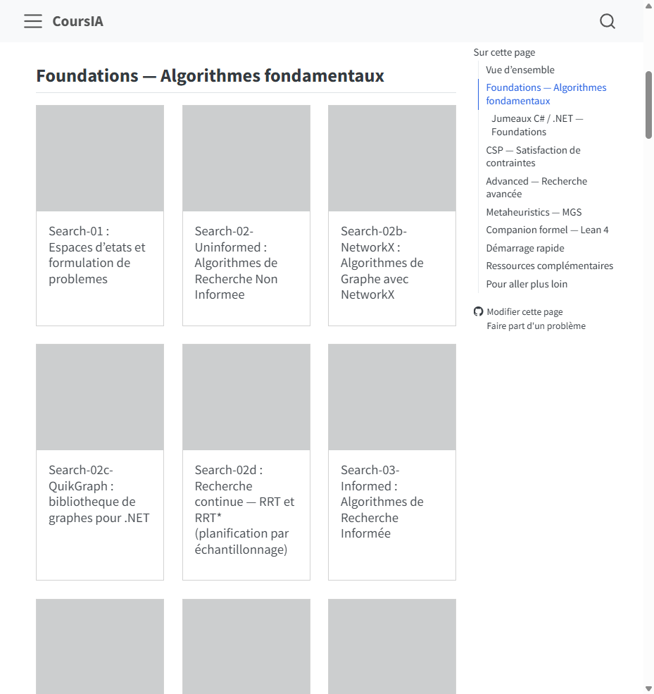
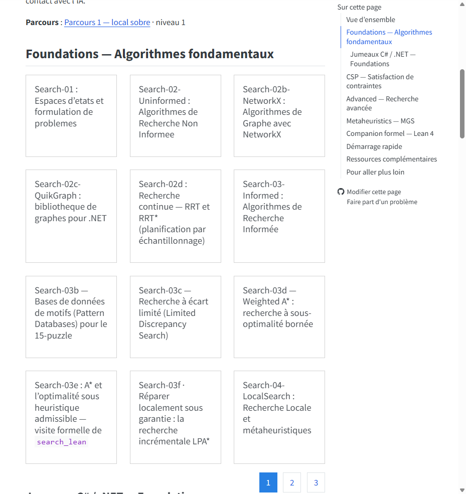

# Captures de rendu — cadre gris des vignettes de listing (#10921, PR #27751)

Preuve **visuelle** de la correction CSS qui retire le cadre vide de 150 px
insere par Quarto pour toute carte de listing sans vignette.

- **Issue** : #10921 · **PR** : #27751 (`styles.css`, une regle)
- **Lane** : `myia-ai-01:CoursIA-2` · **Date** : 21/11/2026
- **Objet** : la page de listing `MyIA.AI.Notebooks/Search/` du site Quarto

## Le defaut

Pour toute carte **sans** vignette, le theme Quarto insere :

```html
<div class="listing-item-img-placeholder card-img-top" style="height: 150px;"></div>
```

(fond `rgba(52,58,64,0.25)`). La carte affiche alors un rectangle gris vide :
c'est un **defaut de rendu**, pas une image manquante. Sur le site deploye
(21/11), la page Search comptait 102 cartes, dont 58 cadres gris vides.

## Methode

Le controle est visuel : il ne se conclut pas sur le texte. Deux copies du
**meme** site rendu de reference (`_site/`, rendu Quarto du worktree
`10921-h1-banner`) sont servies en HTTP, sur deux ports distincts :

- `http://127.0.0.1:8801/` — copie de reference, `styles.css` d'origine ;
- `http://127.0.0.1:8802/` — copie identique, `styles.css` **corrige** (la
  regle `.listing-item-img-placeholder { display: none; }`).

Les deux pages sont ouvertes au meme emplacement de defilement (la carte
`Search-01 : Espaces d'etats et formulation de problemes`), puis capturees au
navigateur (Chromium via Playwright, echelle CSS). Les deux images sont
ci-dessous : la premiere rangee de cartes (`Search-01`, `Search-02-Uninformed`,
`Search-02b-NetworkX`) occupe la meme position dans l'une et dans l'autre --
ce sont les cadres gris qui disparaissent, pas les cartes.

## Avant — `listing-avant.png`



Mesures sur cette copie : 56 placeholders dans le DOM, **56 visibles**, hauteur
150 px ; 56 cartes, titres lisibles.

## Apres — `listing-apres.png`



Mesures sur cette copie : 56 placeholders dans le DOM, **0 visible**, aucune
hauteur ; **56 cartes**, meme ordre, meme titres. La regle retire le
placeholder, pas la carte.

## Ce que les images etablissent

1. le rectangle gris **disparait** sur toutes les cartes sans vignette ;
2. les cartes et leurs titres sont **intacts** (meme ordre, meme texte) ;
3. le rendu des cartes **avec** vignette n'est pas touche : la regle ne cible
   que le placeholder.

## Limites

- Les captures viennent du **rendu local de reference** (`_site/` du worktree
  `10921-h1-banner`), pas du site deploye : le site deploye n'a pas encore la
  regle (elle n'est pas mergee). Les deux copies sont servies depuis le meme
  arbre, ce qui rend la comparaison valide pour l'effet de la regle CSS.
- La mesure porte sur la page `Search` ; le meme selecteur s'applique a toute
  page de listing du site.
- Ces images sont une **preuve de rendu**, pas un compteur rejoue : elles ne
  se substituent pas au calcul de l'organe, elles en sont la contrepartie
  visuelle.
