# Bases de connaissances et Logique

<div class="text-center text-2xl mt-8 mb-4 opacity-70">INTELLIGENCE ARTIFICIELLE — III</div>

<div class="text-xl mt-12 text-center opacity-80 leading-loose">

Logique propositionnelle — Logique du premier ordre<br>
Planification — Representation des connaissances

</div>

---
layout: section
---

# Plan du cours

- I. Introduction
- II. Resolution de problemes
- **III. Bases de connaissances et logique**
- IV. Raisonnement probabiliste
- V. Apprentissage
- VI. Traitement du langage naturel
- VII. TP final projets trimestriels

---
layout: default
---

# Sommaire

- Agents fondes sur la connaissance
- Logique propositionnelle
- Logique du premier ordre
- Planification
- Representation de connaissances
- TP: Mise en oeuvre de l'infrence en logique propositionnelle et en logique du premier ordre
- Apprentissage symbolique : quand la logique apprend (pont vers V)

---
class: nb-map nb-k92
---

# La série SymbolicAI dans CoursIA : la carte

<p class="nb-lead">Ce cours a son pendant exécutable : la série <code>SymbolicAI</code> du dépôt CoursIA. Chaque famille de notebooks reprend un chapitre et le fait tourner sur un vrai solveur, un vrai prouveur ou un vrai planificateur.</p>

<div class="nb-grid nb-cols-4">

<div class="nb-card"><p class="nb-step">Logiques formelles</p><p class="nb-what">Propositionnelle, premier ordre, modale, description, révision de croyances, argumentation de Dung, avec TweetyProject. Dossier : <code>Tweety</code>.</p></div>

<div class="nb-card"><p class="nb-step">SAT et SMT</p><p class="nb-what">Modéliser en contraintes, résoudre avec Z3, expliquer une insatisfiabilité, optimiser. Dossier : <code>SMT</code>.</p></div>

<div class="nb-card"><p class="nb-step">Planification</p><p class="nb-what">PDDL, espace d’états, heuristiques, temporel, hiérarchique, LLM planificateurs. Dossier : <code>Planners</code>.</p></div>

<div class="nb-card"><p class="nb-step">Web sémantique</p><p class="nb-what">RDF, SPARQL, RDFS, OWL, SHACL, graphes de connaissances, raisonneurs. Dossier : <code>SemanticWeb</code>.</p></div>

<div class="nb-card"><p class="nb-step">Analyse argumentative</p><p class="nb-what">Toulmin, Walton, sophismes, dialogues, maintenance de vérité, ontologie AIF. Dossier : <code>ArgumentAnalysis</code>.</p></div>

<div class="nb-card"><p class="nb-step">Apprentissage symbolique</p><p class="nb-what">Espace des versions, explications, ILP, automates, neuro-symbolique. Dossier : <code>SymbolicLearning</code>.</p></div>

<div class="nb-card"><p class="nb-step">Preuve formelle</p><p class="nb-what">Lean 4 : types dépendants, tactiques, Mathlib, preuve assistée par LLM, mathématiques formalisées. Dossier : <code>Lean</code>.</p></div>

<div class="nb-card"><p class="nb-step">Smart contracts</p><p class="nb-what">Solidity, tests et fuzzing, vérification formelle, preuves à divulgation nulle. Dossier : <code>SmartContracts</code>.</p></div>

</div>

<p class="nb-foot"><strong>Mode d’emploi.</strong> Les planches « carte » de chaque chapitre renvoient aux notebooks sur GitHub ; « À observer » donne la question à trancher en les exécutant.</p>

---
layout: section
---

# Agents fondes sur les connaissances
---
layout: compact
class: fig
---


# Agents fondes sur les connaissances

<TeachingStep placement="end" size="md">

## Fonction KB-AGENT

```
fonction KB-AGENT(percept) retourne une action
  persistante: KB, une base de connaissances
               t, un compteur, initialement a 0

  Tell(KB, Creer-Enonce-Percept(percept, t))
  action <- Ask(KB, Creer-Requete-Action(t))
  Tell(KB, Creer-Enonce-Action(action, t))
  t <- t + 1
  retourner action
```

## Composants

- Une base de connaissance (KB), composee d'enonces formules dans un langage formel de representation des connaissances
- Un système d'infrence (raisonnement) qui produit de nouveaux enonces pour prendre des decisions

## Fonctions principales

- Tell (-> KB) : Ajouter des connaissances
- Ask (<- KB) : Interroger la base

<template #visual>
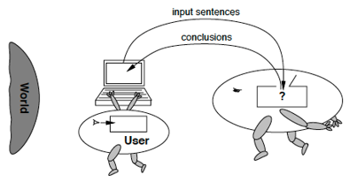
</template>

</TeachingStep>

---
layout: default
---

# Niveaux de l'architecture

- **Connaissances** : formulation naturelle
- **Logique** : formulation en enonces
- **Implementation** : representation physique des enonces

---
layout: default
class: fig
---

# Exemple: le monde du Wumpus

<TeachingStep placement="end" size="lg">

## Jeu de rôle simpliste

### Environnement

- Grille 4x4 de salles a explorer

### But/Performance

- Trouver l'or et sortir sans dommages

### Actions

- Avancer, tourner, saisir, tirer, sortir

### Percepts

- Odeur, brise, lueur, choc, cri
  -> Vecteur

<template #visual>
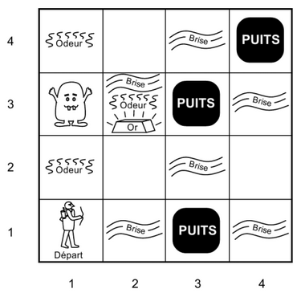
</template>

</TeachingStep>

---
layout: default
class: fig
---

# Monde du Wumpus : symboles

<TeachingStep placement="end" size="lg" class="fig-xl">

- **A** = Agent
- **B** = Brise
- **L** = Lueur / Or
- **OK** = Case sûre
- **P** = Puits
- **O** = Odeur
- **V** = Visité
- **W** = Wumpus

<template #visual>
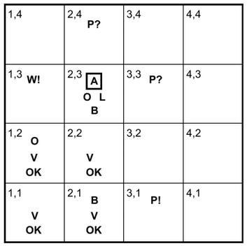
</template>

</TeachingStep>


---
layout: default
class: fig
---


# Representation et logique

<TeachingStep placement="end" size="lg">

## Syntaxe

- Définit les enonces possibles dans le langage

## Sémantique

- Définit le sens des enonces
- Relation entre les enonces et le monde réel

## Proposition logique

- Un enonce qui peut etre vrai ou faux

## Connecteurs logiques

- NON (negation), ET (conjonction), OU (disjonction)
- IMPLIQUE (implication), EQUIVAUT (equivalence)

<template #visual>
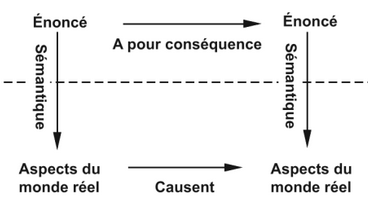
</template>

</TeachingStep>

---
layout: default
---

# Proprietes des systèmes de representation

## Correction

- Preserve la validite sémantique
- Derive des consequences valides

## Coherence / Consistance

- Pas de contradiction dans la base de connaissances

## Completude

- Deriver tout ce qui est valide
- Tout ce qui est vrai peut etre prouve

---
layout: default
---

# Types de logiques

## Ontologie et Epistemologie

- **Ontologie** : étude de ce qui existe dans le monde modelise
- **Epistemologie** : étude de ce qui peut etre connu par l'agent

## Comparaison

| Logique | Variables | Quantifie sur | Decidable ? |
|---------|-----------|---------------|-------------|
| Propositionnelle | Symboles booléens | -- | Oui (NP-complet) |
| Premier ordre (FOL) | Objets du domaine | Variables | Semi-decidable |
| Ordre superieur (HOL) | Relations, fonctions | Relations | Non |
| Modale | + mondes possibles | Necessaire/possible | Selon variante |

*Notebooks : [Tweety-02-Basic-Logics-Python](https://github.com/jsboige/CoursIA/blob/main/MyIA.AI.Notebooks/SymbolicAI/Tweety/Tweety-02-Basic-Logics-Python.ipynb) (propositionnelle et premier ordre) · [Tweety-03-Advanced-Logics-CSharp](https://github.com/jsboige/CoursIA/blob/main/MyIA.AI.Notebooks/SymbolicAI/Tweety/Tweety-03-Advanced-Logics-CSharp.ipynb) (description, modale, QBF, conditionnelle) · [Lean-01-Setup-Lean-Python](https://github.com/jsboige/CoursIA/blob/main/MyIA.AI.Notebooks/SymbolicAI/Lean/Lean-01-Setup-Lean-Python.ipynb) (ordre superieur).*

---
layout: section
---

# Logique Propositionnelle
---
layout: default
---

# Enonces propositionnels

## Proposition

- Un enonce atomique qui peut etre vrai ou faux
- Ex: "Il pleut", "Le Wumpus est en [1,2]"

## Enonces complexes

- Combinaisons de propositions avec des connecteurs logiques
- Ex: "Il pleut ET il fait froid"

## Connecteurs logiques

- P ET Q : vrai si P et Q sont vrais
- P OU Q : vrai si au moins un est vrai
- NON P : vrai si P est faux
- P => Q : vrai si P est faux ou Q est vrai
- P <=> Q : vrai si P et Q ont même valeur de verite

---
layout: default
class: fig
---


# Syntaxe de la logique propositionnelle

<TeachingStep placement="end" size="lg">

## Symboles

- Propositions: P, Q, R, ...
- Connecteurs: ET, OU, NON, =>, <=>
- Parentheses: (, )

## Formules bien formees (FBF)

1. Toute proposition est une FBF
2. Si P est une FBF, NON P est une FBF
3. Si P et Q sont des FBF, (P ET Q), (P OU Q), (P => Q), (P <=> Q) sont des FBF
4. Rien d'autre n'est une FBF

<template #visual>
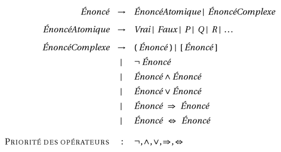
</template>

</TeachingStep>

---
layout: default
class: fig
---

# Sémantique de la logique propositionnelle

<TeachingStep placement="end" size="lg">

## Interpretation

- Attribution d'une valeur de verite (Vrai/Faux) a chaque proposition

## Satisfaction

- Une interpretation satisfait une formule si la formule est vraie sous cette interpretation
- Une formule est **satisfaisable** s'il existe au moins une interpretation qui la satisfait
- Une formule est **valide** (tautologie) si elle est satisfaite par toute interpretation

<template #visual>
<div>

**Tables de verite**

| P | Q | P ET Q | P OU Q | P => Q | P <=> Q |
|:-:|:-:|:-:|:-:|:-:|:-:|
| V | V | V | V | V | V |
| V | F | F | V | F | F |
| F | V | F | V | V | F |
| F | F | F | F | V | V |

</div>
</template>

</TeachingStep>

---
layout: default
---

# Infrence propositionnelle

## Entailment (consequence sémantique)

$$
\alpha \models \beta \iff M(\alpha) \subseteq M(\beta)
$$

- KB |= alpha : "KB entraine alpha"
- Alpha est vrai dans tous les modèles ou KB est vrai

## Theoreme de deduction

- KB |= alpha si et seulement si (KB => alpha) est valide

## Demonstration d'infrence

1. **Méthodes de verification de modèle**
   - Enumerer toutes les interpretations
   - Verifier que alpha est vrai quand KB est vrai

2. **Méthodes de preuve**
   - Deriver alpha a partir de KB en utilisant des règles d'infrence

---
layout: default
class: fig
---


# Règles d'inférence

<TeachingStep placement="end" size="lg">

<div class="dense-list">

## Modus Ponens

- Si P est vrai et P => Q est vrai, alors Q est vrai
- P, P => Q |- Q

## Et-introduction

- Si P est vrai et Q est vrai, alors P ET Q est vrai
- P, Q |- P ET Q

## Et-elimination

- Si P ET Q est vrai, alors P est vrai et Q est vrai
- P ET Q |- P
- P ET Q |- Q

## Ou-introduction

- Si P est vrai, alors P OU Q est vrai
- P |- P OU Q

## Double negation

- NON(NON P) equivaut a P

</div>

<template #visual>
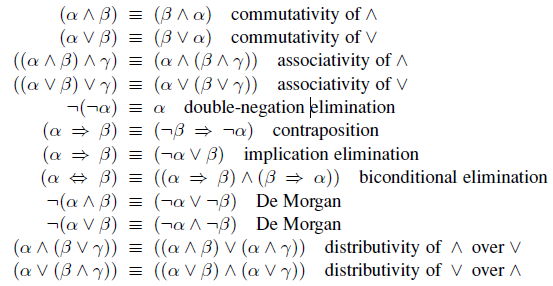
</template>

</TeachingStep>

---
layout: default
---


# Resolution - Clauses

## Clause

- Disjonction de litteraux: P1 OU P2 OU ... OU Pn OU NON Q1 OU ... OU NON Qm

## Clause de Horn

- Au plus un litteral positif: P OU NON Q1 OU ... OU NON Qm
- Equivaut a: (Q1 ET Q2 ET ... ET Qm) => P

## Règle de resolution

- Deux clauses avec des litteraux complementaires peuvent etre combinees
- (P OU Q), (NON P OU R) |- (Q OU R)

## Resolution unitaire

- Si une clause a un seul litteral: P, (NON P OU Q) |- Q

---
layout: default
class: fig
---

# Resolution - Algorithme

<TeachingStep placement="end" size="lg">

## Algorithme de resolution

1. Convertir KB en CNF (forme normale conjonctive)
2. Ajouter NON alpha a l'ensemble de clauses
3. Appliquer la resolution jusqu'a obtenir la clause vide (contradiction) ou ne plus pouvoir progresser

**Résultat** : si la clause vide est derivee, alors KB |= alpha (preuve par refutation).

<template #visual>
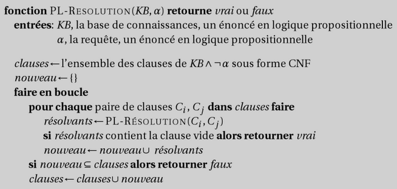
</template>

</TeachingStep>

---
layout: compact
class: fig
---

# Forward et Backward Chaining

<TeachingStep placement="end" size="md">

## Forward Chaining (chaîne avant)

- Partir des faits connus
- Appliquer les règles pour deduire de nouveaux faits
- Continuer jusqu'a ce que le but soit atteint<br>ou plus aucun fait nouveau

## Backward Chaining (chaîne arriere)

- Partir du but
- Chercher les règles dont le but est la conclusion
- Recursivement chercher a prouver les premisses

## Comparaison

- Forward: mieux quand les faits sont peu nombreux et les buts nombreux
- Backward: mieux quand les buts sont peu nombreux et les faits nombreux

<template #visual>
<div class="fig-stack">
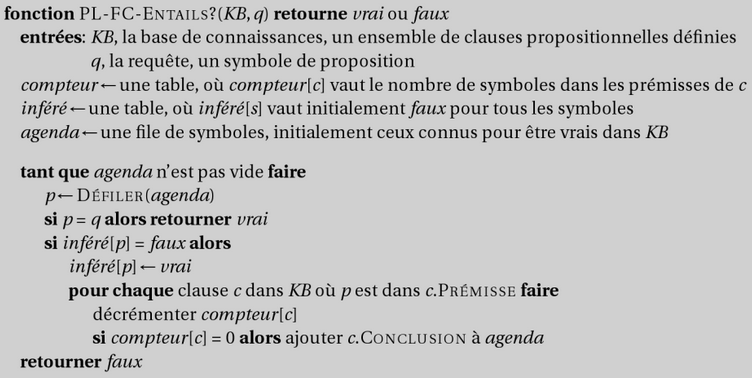
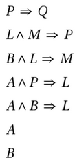
</div>
</template>

</TeachingStep>

---
layout: default
---

# Proprietes des systèmes d'infrence

## Correctitude (Soundness)

- Si KB |- alpha, alors KB |= alpha
- Tout ce qui est prouvable est vrai

## Completude

- Si KB |= alpha, alors KB |- alpha
- Tout ce qui est vrai peut etre prouve

## Decidabilite

- Existe-t-il un algorithme qui peut toujours determiner si KB |= alpha ?

## Complexite

- Logique propositionnelle: NP-complet pour la satisfiabilite
- Mais les clauses de Horn: temps lineaire

---
layout: default
class: fig
---


# Procedure d'inference simple

<TeachingStep placement="end" size="lg">

## Approche par verification de modèle (truth table)

- Enumerer toutes les interpretations possibles
- Verifier que la conclusion est vraie quand les premisses sont vraies

## Proprietes

- Procedure **coherente** et **complete** (par definition)
- Mais **couteuse** : exponentielle en fonction du nombre de symboles

<template #visual>
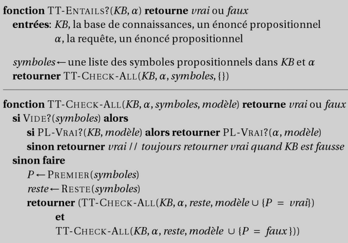
</template>

</TeachingStep>

---
layout: compact
class: fig
---


# Backtracking complet (DPLL)

<TeachingStep placement="end" size="md">

## Algorithmes efficaces pour la satisfiabilite (SAT)

- (P => Q) equivaut a (NON P OU Q)
- Algorithme de Davis-Putnam, Logemann et Loveland (DPLL)

## DPLL

- Enumeration récursive en profondeur d'abord
- **Elagage** : une clause est vraie si un litteral est vrai, un enonce est faux si une clause est fausse
- **Heuristique des symboles purs** : toujours le même signe -> litteral doit etre vrai
- **Heuristique des clauses unitaires** : assignation de ces clauses en premier

<template #visual>
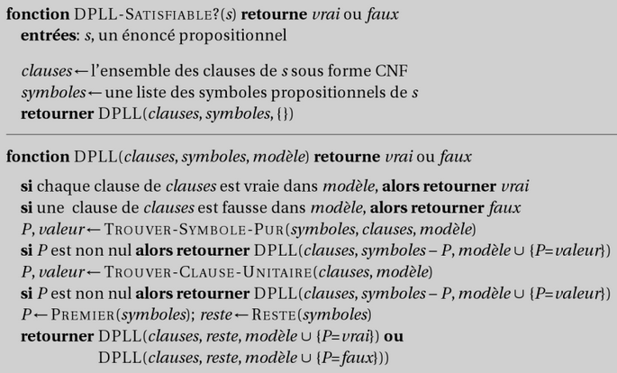
</template>

</TeachingStep>

<p class="nb-ref">Notebooks : <a href="https://github.com/jsboige/CoursIA/blob/main/MyIA.AI.Notebooks/SymbolicAI/SMT/Z3-API/Z3-01-Introduction-Python.ipynb" target="_blank" rel="noopener">Z3-Python-01-Introduction</a> (SAT et SMT par API) · <a href="https://github.com/jsboige/CoursIA/blob/main/MyIA.AI.Notebooks/SymbolicAI/Tweety/Tweety-03-QBF-CSharp.ipynb" target="_blank" rel="noopener">Tweety-03-QBF-CSharp</a> (quantification booleenne).</p>

---
layout: default
---

# Backtracking complet (2/2)

## Astuces (cf. CSP)

- Analyse des composants
- Ordre des variables
- Backtracking intelligent
- Reprises aléatoires
- Indexation intelligente

## Applications modernes

- Verification hardware
- Verification de protocoles
- Model checking

*Notebooks : [App-23-PRESENT-Differential-Cryptanalysis-SAT-Python](https://github.com/jsboige/CoursIA/blob/main/MyIA.AI.Notebooks/Search/Part3-Cas-pratiques/App-23-PRESENT-Differential-Cryptanalysis-SAT-Python.ipynb) (cryptanalyse ramenee a SAT) · [Z3-Python-14-BitVectors-Overflow](https://github.com/jsboige/CoursIA/blob/main/MyIA.AI.Notebooks/SymbolicAI/SMT/Z3-API/Z3-14-BitVectors-Overflow-Python.ipynb) (arithmetique machine, verification de code).*

---
layout: default
class: fig
---


# Exploration locale

<TeachingStep placement="end" size="lg">

## Principe

- Equivaut a Min-Conflits pour les CSPs
- Evaluation = nombre de clauses non satisfaites

## Caractéristiques

- Problemes simples sous-contraints / sur-contraints
- Ratio nb clauses / nb symboles -> seuil de satisfiabilite
- NP-complet souvent au seuil

<template #visual>
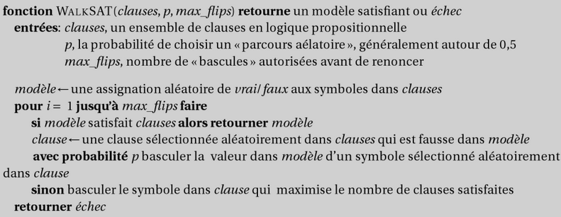
</template>

</TeachingStep>

<p class="nb-ref">Notebooks : <a href="https://github.com/jsboige/CoursIA/blob/main/MyIA.AI.Notebooks/SymbolicAI/SMT/Z3-Linq2Z3/14_Optimize_MaxSAT.ipynb" target="_blank" rel="noopener">14_Optimize_MaxSAT</a> (relachement vers MaxSAT) · <a href="https://github.com/jsboige/CoursIA/blob/main/MyIA.AI.Notebooks/SymbolicAI/Tweety/Tweety-04-Belief-Revision-Python.ipynb" target="_blank" rel="noopener">Tweety-04-Belief-Revision-Python</a> (MaxSAT et incoherence).</p>

---
class: nb-map nb-k96
---

# SAT et SMT avec Z3 : modéliser, résoudre, expliquer

<p class="nb-lead">DPLL et la recherche locale tournent au cœur des solveurs modernes. La série SMT s’en sert à travers Z3 : on écrit le modèle, le solveur cherche — et tout l’art est dans le modèle.</p>

<div class="nb-grid nb-cols-3">

<div class="nb-card"><p class="nb-step">Premiers pas</p><p class="nb-what">Variables, contraintes, <code>check()</code> et <code>model()</code> : satisfaisable ou non, et avec quel témoin.</p><p class="nb-links"><a href="https://github.com/jsboige/CoursIA/blob/main/MyIA.AI.Notebooks/SymbolicAI/SMT/Z3-API/Z3-01-Introduction-Python.ipynb" target="_blank" rel="noopener">Z3-01 Python</a> · <a href="https://github.com/jsboige/CoursIA/blob/main/MyIA.AI.Notebooks/SymbolicAI/SMT/Z3-API/Z3-01-Introduction-CSharp.ipynb" target="_blank" rel="noopener">Z3-01 C#</a></p></div>

<div class="nb-card"><p class="nb-step">Des règles aux contraintes</p><p class="nb-what">Sudoku, énigme d’Einstein : traduire des règles en contraintes et laisser le solveur propager.</p><p class="nb-links"><a href="https://github.com/jsboige/CoursIA/blob/main/MyIA.AI.Notebooks/SymbolicAI/SMT/Z3-API/Z3-02-Sudoku-Python.ipynb" target="_blank" rel="noopener">Z3-02-Sudoku</a> · <a href="https://github.com/jsboige/CoursIA/blob/main/MyIA.AI.Notebooks/SymbolicAI/SMT/Z3-API/Z3-09-Enigme-Einstein-Python.ipynb" target="_blank" rel="noopener">Z3-09-Einstein</a></p></div>

<div class="nb-card"><p class="nb-step">Tactiques et théories</p><p class="nb-what">Bit-vecteurs, tableaux, chaînes : choisir la théorie et la stratégie de résolution.</p><p class="nb-links"><a href="https://github.com/jsboige/CoursIA/blob/main/MyIA.AI.Notebooks/SymbolicAI/SMT/Z3-API/Z3-03-Tactics-Python.ipynb" target="_blank" rel="noopener">Z3-03-Tactics</a> · <a href="https://github.com/jsboige/CoursIA/blob/main/MyIA.AI.Notebooks/SymbolicAI/SMT/Z3-API/Z3-04-Strings-Regex-Python.ipynb" target="_blank" rel="noopener">Z3-04-Strings</a></p></div>

<div class="nb-card"><p class="nb-step">Prouver par réfutation</p><p class="nb-what">Une propriété est valide si sa négation est insatisfaisable : le solveur devient prouveur.</p><p class="nb-links"><a href="https://github.com/jsboige/CoursIA/blob/main/MyIA.AI.Notebooks/SymbolicAI/SMT/Z3-API/Z3-05-Quantifiers-Proofs-Python.ipynb" target="_blank" rel="noopener">Z3-05-Quantifiers-Proofs</a></p></div>

<div class="nb-card"><p class="nb-step">Expliquer l’échec</p><p class="nb-what">Un noyau d’insatisfiabilité désigne les contraintes incompatibles entre elles.</p><p class="nb-links"><a href="https://github.com/jsboige/CoursIA/blob/main/MyIA.AI.Notebooks/SymbolicAI/SMT/Z3-API/Z3-13-UnsatCores-Python.ipynb" target="_blank" rel="noopener">Z3-13-UnsatCores</a></p></div>

<div class="nb-card"><p class="nb-step">Optimiser</p><p class="nb-what">Contraintes molles et MaxSAT : de « existe-t-il ? » à « quelle est la meilleure ? ».</p><p class="nb-links"><a href="https://github.com/jsboige/CoursIA/blob/main/MyIA.AI.Notebooks/SymbolicAI/SMT/Z3-API/Z3-06-Advanced-Optimization-Python.ipynb" target="_blank" rel="noopener">Z3-06-Optimization</a> · <a href="https://github.com/jsboige/CoursIA/blob/main/MyIA.AI.Notebooks/SymbolicAI/SMT/Z3-Linq2Z3/14_Optimize_MaxSAT.ipynb" target="_blank" rel="noopener">14_Optimize_MaxSAT</a></p></div>

</div>

<p class="nb-foot"><strong>À observer.</strong> Le solveur ne connaît aucune règle de Sudoku : d’où vient alors sa rapidité sur une grille difficile ?</p>

---
class: nb-concept nb-center nb-k90
---

# Le Sudoku en contraintes : le modèle fait le travail

<p class="nb-lead">Un humain résout un Sudoku avec des techniques ; Z3 ne reçoit que la description de ce qu’est une grille valide. La modélisation déclarative remplace l’algorithme.</p>

<div class="nb-grid nb-cols-2">

<div class="nb-card"><p class="nb-step">Variables</p><p class="nb-what">Une variable entière par case, de domaine 1 à 9 ; les chiffres donnés fixent certaines cases.</p></div>

<div class="nb-card"><p class="nb-step">Contraintes</p><p class="nb-what"><code>Distinct</code> sur chaque ligne, chaque colonne et chaque bloc : c’est toute la règle du jeu.</p></div>

<div class="nb-card"><p class="nb-step">Résolution</p><p class="nb-what"><code>check()</code> répond <code>sat</code> et le modèle est la grille complétée ; <code>unsat</code> prouve qu’elle n’a pas de solution.</p></div>

<div class="nb-card"><p class="nb-step">Unicité</p><p class="nb-what">Interdire la solution trouvée puis relancer : un second <code>sat</code> révèle une grille à solutions multiples.</p></div>

</div>

<p class="nb-foot"><strong>À observer.</strong> Ajoutez la contrainte anti-diagonale de l’exercice 1 : combien de lignes de modèle faut-il changer, et l’algorithme, lui, change-t-il ?</p>

<p class="notebook-reference">Notebook : <a href="https://github.com/jsboige/CoursIA/blob/main/MyIA.AI.Notebooks/SymbolicAI/SMT/Z3-API/Z3-02-Sudoku-Python.ipynb" target="_blank" rel="noopener">Z3-02-Sudoku-Python.ipynb</a>.</p>

---
layout: default
---

# Agents fondes sur la logique propositionnelle (1/2)

## Etat actuel du monde (cf Wumpus)

- Variables temporelles (fluent) et atemporelles

## Modèle de transition -> axiomes d'effet

- L<sub>0,1</sub> ∧ FacingEast<sub>0</sub> ∧ Forward<sub>0</sub> => (L<sub>1,2,1</sub> ∧ ¬L<sub>1,1,1</sub>)
- Ask(KB, L<sub>1,2,1</sub>) = true

## Persistance

- Pour ce qui demeure inchange -> axiomes de persistance
- Forward<sub>t</sub> => (HaveArrow<sub>t</sub> ⇔ HaveArrow<sub>t+1</sub>)

## Axiomes de l'etat successeur

- HaveArrow<sub>t+1</sub> ⇔ (HaveArrow<sub>t</sub> ∧ ¬Shoot<sub>t</sub>)
- Nombreux cas a couvrir

---
layout: default
class: fig
---


# Agents fondes sur la logique propositionnelle (2/2)

<TeachingStep placement="end" size="lg">

## Agent hybride

- Maintient une KB et un plan courant
- + exploration A* pour la navigation

## Estimation logique des etats

- Problème : inférence de plus en plus longue (t<sub>0</sub>+1+1+...)
- Solution : mise en cache des résultats intermediaires

## MAJ etat de croyance

- = estimation des etats

<template #visual>
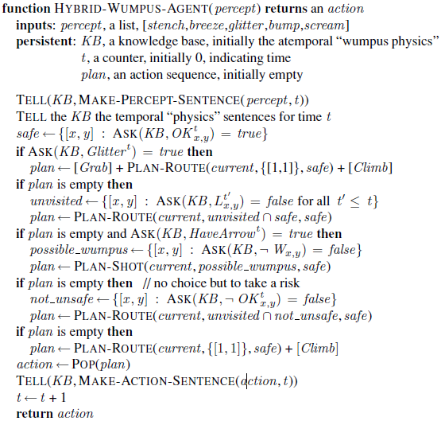
</template>

</TeachingStep>

---
layout: default
---

# Agents fondes sur la logique propositionnelle (3/3)

## Construction du plan par inference

- =/= agent hybride

## Algorithme SAT Plan

- Utilisation de WalkSAT
- **Axiomes de precondition d'actions** (actions legales seulement)
  - Shoot<sub>t</sub> => HaveArrow<sub>t</sub>
- **Axiomes d'exclusion d'action** (non simultaneite)
  - ¬At<sub>i</sub> ∨ At<sub>j</sub>

---
layout: default
---

# Resume logique propositionnelle

## Definition

- Syntaxe : Symboles, connecteurs
- Sémantique : Valeurs de verite

## Inference

- Tables de verite
- Chainage avant, arriere
- Resolution
- Backtracking, DPLL
- Exploration locale, WalkSat

## Agents

- Variables (Fluents / atemporelles)
- Modèle transitionnel, axiomes
- Hybride / SatPlan

---
class: nb-map nb-k96
---

# Logiques formelles avec Tweety : écrire, interroger, certifier

<p class="nb-lead">TweetyProject offre une bibliothèque Java de logiques, appelée ici depuis Python ou C#. Les labos les plus récents font répondre Tweety, puis certifier la réponse par le noyau de Lean.</p>

<div class="nb-grid nb-cols-3">

<div class="nb-card"><p class="nb-step">Installer</p><p class="nb-what">JVM, bibliothèques Tweety et solveurs externes : un environnement réel, vérifié dès la première cellule.</p><p class="nb-links"><a href="https://github.com/jsboige/CoursIA/blob/main/MyIA.AI.Notebooks/SymbolicAI/Tweety/Tweety-01-Setup-Python.ipynb" target="_blank" rel="noopener">Tweety-01-Setup</a></p></div>

<div class="nb-card"><p class="nb-step">Propositionnel et premier ordre</p><p class="nb-what">Écrire des bases de connaissances, interroger un raisonneur, parcourir les mondes possibles.</p><p class="nb-links"><a href="https://github.com/jsboige/CoursIA/blob/main/MyIA.AI.Notebooks/SymbolicAI/Tweety/Tweety-02-Basic-Logics-Python.ipynb" target="_blank" rel="noopener">Tweety-02 Python</a> · <a href="https://github.com/jsboige/CoursIA/blob/main/MyIA.AI.Notebooks/SymbolicAI/Tweety/Tweety-02b-Semantics-CSharp.ipynb" target="_blank" rel="noopener">Tweety-02b C#</a></p></div>

<div class="nb-card"><p class="nb-step">Validité et contre-modèle</p><p class="nb-what">Une formule est prouvée valide, ou un contre-modèle est exhibé : deux réponses, deux certificats.</p><p class="nb-links"><a href="https://github.com/jsboige/CoursIA/blob/main/MyIA.AI.Notebooks/SymbolicAI/Tweety/Tweety-05e-Propositional-Lab-Lean-Python.ipynb" target="_blank" rel="noopener">Tweety-05e-Propositional-Lab</a></p></div>

<div class="nb-card"><p class="nb-step">Calculs de preuve</p><p class="nb-what">Systèmes de Hilbert et calcul des séquents de Gentzen, élimination des coupures.</p><p class="nb-links"><a href="https://github.com/jsboige/CoursIA/blob/main/MyIA.AI.Notebooks/SymbolicAI/Tweety/Tweety-02e-Preuves-Hilbert-Gentzen-Lean-Python.ipynb" target="_blank" rel="noopener">Tweety-02e-Hilbert-Gentzen</a></p></div>

<div class="nb-card"><p class="nb-step">Logiques avancées</p><p class="nb-what">Logiques de description, modale, booléenne quantifiée (QBF), conditionnelle.</p><p class="nb-links"><a href="https://github.com/jsboige/CoursIA/blob/main/MyIA.AI.Notebooks/SymbolicAI/Tweety/Tweety-03-Advanced-Logics-Python.ipynb" target="_blank" rel="noopener">Tweety-03 Python</a> · <a href="https://github.com/jsboige/CoursIA/blob/main/MyIA.AI.Notebooks/SymbolicAI/Tweety/Tweety-03-QBF-CSharp.ipynb" target="_blank" rel="noopener">Tweety-03-QBF C#</a></p></div>

<div class="nb-card"><p class="nb-step">Base incohérente</p><p class="nb-what">Révision de croyances, ensembles minimaux incohérents, mesures d’incohérence.</p><p class="nb-links"><a href="https://github.com/jsboige/CoursIA/blob/main/MyIA.AI.Notebooks/SymbolicAI/Tweety/Tweety-04-Belief-Revision-Python.ipynb" target="_blank" rel="noopener">Tweety-04-Belief-Revision</a></p></div>

</div>

<p class="nb-foot"><strong>À observer.</strong> Quand le raisonneur répond « non valide », qu’est-ce qui le prouve : l’absence de preuve, ou la présence d’un contre-modèle ?</p>

---
layout: section
---

# Logique du Premier Ordre
---
layout: default
---

# Limites de la logique propositionnelle

## Exemple: Monde du Wumpus

- "Il y a une odeur dans toutes les cases adjacentes au Wumpus"
- En logique propositionnelle:
  - O1,1 <=> (W1,1 OU W1,2 OU W2,1)
  - O1,2 <=> (W1,1 OU W1,2 OU W1,3 OU W2,2)
  - ...
- Besoin d'une règle par case!

## Logique du premier ordre

- Permet d'exprimer des generalites
- "Pour tout x, s'il y a du Wumpus en x, alors il y a une odeur dans toutes les cases adjacentes"
- Une seule formule pour toutes les cases

---
layout: default
class: fig
---


# Syntaxe de la logique du premier ordre

<TeachingStep placement="end" size="lg">

## Termes

- Constantes: Jean, Marie, A, B, ...
- Variables: x, y, z, ...
- Fonctions: Pere(Jean), Position(Agent), ...

## Formules atomiques

- Predicats: P(x), Q(x, y), R(Jean, Marie)
- Egalite: x = y

## Formules complexes

- Combinaisons avec connecteurs propositionnels
- Quantificateurs:
  - Quel que soit (pour tout): ∀x P(x)
  - Il existe: ∃x P(x)

<template #visual>
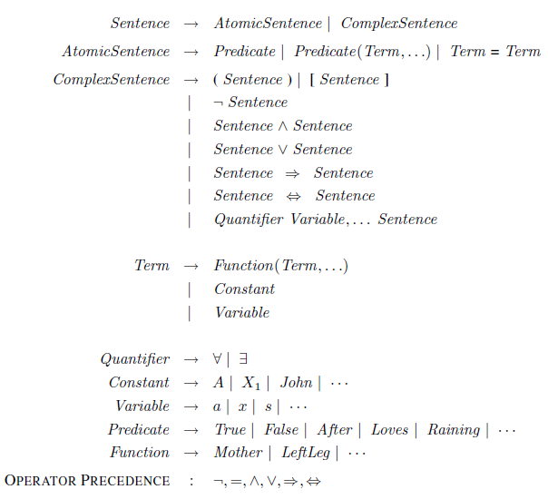
</template>

</TeachingStep>

---
layout: compact
class: fig
---

# Sémantique de la logique du premier ordre

<TeachingStep placement="end" size="lg">

## Interpretation

- Domaine: ensemble non vide d'objets
- Interpretation des constantes: éléments du domaine
- Interpretation des fonctions: applications du domaine vers le domaine
- Interpretation des predicats: relations sur le domaine

## Satisfaction

- Une interpretation satisfait ∀x P(x) si P(x) est vrai pour tout élément du domaine
- Une interpretation satisfait ∃x P(x) si P(x) est vrai pour au moins un élément

## Modèle

- Une interpretation qui satisfait une formule

<template #visual>
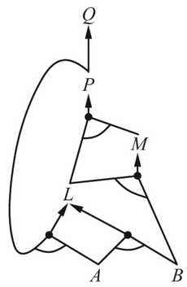
</template>

</TeachingStep>

---
layout: default
---

# Quantificateurs

## Quantificateur universel (∀)

- ∀x P(x) : "Pour tout x, P(x)"
- Ex: ∀x (Humain(x) => Mortel(x))

## Quantificateur existentiel (∃)

- ∃x P(x) : "Il existe un x tel que P(x)"
- Ex: ∃x (Humain(x) ET Philosophe(x))

## Equivalences

- ∀x P(x) equivaut a NON ∃x NON P(x)
- ∃x P(x) equivaut a NON ∀x NON P(x)

## Portee des quantificateurs

- Les variables liees par un quantificateur sont locales a la formule

---
layout: default
---

# Quantificateurs (2/2)

## Formule bien formee (wff)

- Un enonce qui ne contient aucune variable "libre"
- Toutes les variables sont "liees" a des quantificateurs existentiels ou universels

## Règles d'inference quantifiees

- Instanciations universelle et existentielle
  - ∀x P(x) |- P(A)
  - ∃x P(x) |- P(F) (Skolemization : constante de Skolem F)
- Generalisations universelle et existentielle
  - P(A), P(B) ... |- ∀x P(x)
  - P(A) |- ∃x P(x)

---
layout: default
---

# Traductions d'enonces

## Exemples simples

- "On peut tromper quelqu'un tout le temps"
  - ∀x ∃t person(x) ∧ time(t) => can-fool(x,t)
- "On peut tromper tout le monde de temps en temps"
  - ∃x ∀t (person(x) ∧ time(t) => can-fool(x,t))

---
layout: default
---

# Traductions d'enonces (2/2)

## Exemples avances

- "Il y a exactement 2 champignons violets"
  - ∃x ∃y mushroom(x) ∧ purple(x) ∧ mushroom(y) ∧ purple(y) ∧ (x≠y) ∧ ∀z (mushroom(z) ∧ purple(z)) => ((x=z) ∨ (y=z))

## Monty Python (raisonnements fallacieux)

- ∀x witch(x) => burns(x)
- ∀x wood(x) => burns(x)
- Donc ∀x witch(x) => wood(x)
- **Argument fallacieux** : Affirmation du consequent

---
layout: default
---

# Axiomes et ingenierie des données

## Axiomes de base

- Enonces consideres comme vrais sans demonstration
- Fondements de la base de connaissances

## Ingenierie des données

- Processus de formalisation des connaissances
- Identifier les objets, relations et proprietes pertinentes
- Formuler les axiomes corrects

## Exemple: Monde du Wumpus

- "Toutes les cases adjacentes au Wumpus sentent mauvais"
  - ∀x (Wumpus(x) => ∀y (Adjacent(y,x) => Odeur(y)))
- "Il n'y a pas de Wumpus dans la case de depart"
  - NON Wumpus([1,1])

---
layout: default
class: fig
---


# Aparte : Analyse rhetorique

<TeachingStep placement="end" size="lg">

## Introduction a l'argumentation

- Un code de conduite intellectuelle
- Qu'est-ce qu'un argument ?
- Qu'est-ce qu'un bon argument ?
- Qu'est-ce qu'un argument fallacieux ?

## Thèmes

- Taxonomie des arguments fallacieux
- Biais cognitifs
- Qualites argumentatives
- Jeu de cartes

<template #visual>
<div class="fig-row">


</div>
</template>

</TeachingStep>

---
layout: default
---

# Code de conduite intellectuelle (1/2)

## Un standard procedural efficace

- Les règles de base pour une discussion fructueuse

## Un standard ethique important

- Les parties s'engagent a etre honnetes

## Principes de conduite intellectuelle

- **Faillibilite** : accepter de pouvoir se tromper
- **Recherche de la verite** : s'engager a rechercher la position la plus defendable
- **Clarte** : pas de confusion linguistique, separer d'autres problematiques
- **Charge de la preuve** : repose sur celui qui avance une position

---
layout: default
---

# Code de conduite intellectuelle (2/2)

## Principes (suite)

- **Charite** : donner a l'adversaire le benefice du doute
- **Structure, Pertinence, Acceptabilite, Suffisance, Refutation**
- **Suspension du jugement** : si pas de preuve ou des arguments egaux (sauf si necessite consequences)
- **Resolution** : si tout le reste est respecte, accepter la conclusion
- **Accepter un nouvel examen au besoin**

---
layout: default
---

# Qu'est-ce qu'un argument ?

## Definition

- Une proposition supportee par d'autres propositions
  - **Premisses** : les raisons
  - **Conclusion** : supportee par les premisses et le raisonnement

## Argument =/= Opinion

- Une opinion n'est pas supportee

## Forme standard

- Puisque (premise 1), qui est une conclusion supportee par (sous-premise 1.1)
- et (premise 2)
- [et (premise implicite)]
- et (premise de refutation)
- Alors (Conclusion)

---
layout: default
---

# Qu'est-ce qu'un argument ? (2/2)

## Deduction vs Induction

- **Deduction** : necessite logique
- **Induction** : corroboration

## Arguments particuliers

- **Moral** : premise morale (principe)
- **Legal** : premise legale (loi, jurisprudence)
- **Esthetique** : premise esthetique (critere esthetique)

---
layout: default
---

# Qu'est-ce qu'un bon argument ? (1/2)

## 5 critères

1. **Structure bien formee**
   - Pas de contradictions entre premisses et avec la conclusion
   - Pas de verite par principe, ou de deduction invalide
2. **Premisses pertinentes** pour la verite de la conclusion
   - Pas de premisses inutiles, les liens doivent etre explicites
3. **Premisses acceptables** par une personne raisonnable
   - Connaissance commune, ou confirmee par l'expérience
   - Defendue ou defendable par une source accessible
   - Temoignage non controversee par une autorite competente
   - Conclusion d'un autre bon argument
   - Proposition mineure constituant une hypothese raisonnable

---
layout: default
---

# Qu'est-ce qu'un bon argument ? (2/2)

## Critères (suite)

4. **Premisses suffisantes** a demontrer la conclusion
   - Difficile a systematiser
   - Cf. certaines sciences (echantillons statistiques) ou expérience
5. **Refutation effective** des critiques anticipees
   - Le plus difficile, manque le plus souvent
   - Permet de departager de "presque" bons arguments

## Renforcer un argument

- Balayer ces 5 critères et le modifier en consequence

---
layout: default
---

# Qu'est-ce qu'un argument fallacieux ?

## Definition

- La violation de l'un des critères definissant un bon argument
  - Faille structurelle
  - Premisse non pertinente
  - Premisse sous le standard d'acceptabilite
  - Premisses insuffisantes a etablir la conclusion
  - Pas de refutation effective des critiques anticipees

## Nommees ou non

- Cf. Taxonomie
- Le nom pas necessaire, mais utile

---
layout: default
---

# Qu'est-ce qu'un argument fallacieux ? (2/2)

## Denoncer un argument fallacieux

- Autodestruction par reconstruction en forme standard
- Méthode du contre-exemple absurde

## Fair-play

- Pas trop en faire
- Que si necessaire
- Accepter ses propres erreurs
- Eviter si possible de mentionner la notion d'argument fallacieux

---
layout: default
---

# Sémantique de la logique du premier ordre (details)

## Transposition dans le monde

- Interpretation des domaines (Constantes -> objets), connecteurs, quantificateurs
- Predicats, fonctions -> relations entre objets
- Egalite -> mêmes objets

## Interpretation d'enonce

- Modèle d'enonces, enonce satisfiable (vrai selon une interpretation)
- Valide (toutes les interpretations), inconsistant (pas d'interpretation)
- Consequence logique (inclusion des modèles)

## Derivations

- Axiomes : capture des faits importants des domaines
- Demonstration de theoremes
- Definitions par equivalences
- Conditions necessaires, suffisantes (dualite)

---
layout: default
---

# Sémantique de la logique du premier ordre (2/2)

## Sémantique de base de données

- Hypothese des noms uniques
- Les enonces atomiques inconnus sont presumes faux (hypothese de monde clos)
- Fermeture du domaine (pas plus d'éléments que les constantes données)

## Infrence en FOL : Opérations Tell, Ask

- Assertions -> Tell (ex: TELL(KB, King(John)))
- Requêtes / buts -> Ask (ex: ASK(KB, King(John)))
- Substitution / liste de liaison -> AskVars (ex: ASKVARS(KB, Person(x)))
- Reduction a l'inference propositionnelle
  - Règles des quantificateurs + symboles fermes => symboles propositionnels
  - Procedure complete mais semi-decidable (Godel), très lente

---
layout: default
---

# Procedures d'inference en FOL

## Chainages

- **Chainage avant** : bases de données deductives, systèmes de production
- **Chainage arriere** : programmation logique (Prolog) + memoisation

## Exemple : le crime du Colonel West

- "The law says that it is a crime for an American to sell weapons to hostile nations"
- "The country Nono, an enemy of America, has some missiles M1"
- "All of its missiles were sold to it by Colonel West, who is American"
- "Who's a criminal?"

---
layout: compact
class: fig
---

# Procedures d'inference en FOL (2/2)

<TeachingStep placement="end" size="md">

## Resolution

- Système de preuve complet
- Stratégies pour reduire l'espace de resolution<br>(demodulation, paramodulation)
- Demonstrateurs de theoremes sophistiques :<br>OTTER, E-prover

## Notations

- p ∨ (q ∧ r) <-> p + (q * r)
- Prolog: `cat(X) :- furry(X), meows(X), has(X, claws)`
- Lispy: `(forall ?x (implies (and (furry ?x) (meows ?x) (has ?x claws)) (cat ?x)))`

<template #visual>
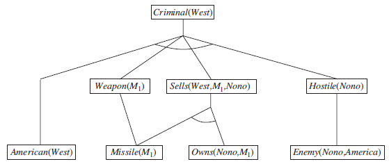
</template>

</TeachingStep>

---
layout: default
---

# Infrence en logique du premier ordre

## Propositionalisation

- Convertir en logique propositionnelle
- Remplacer les variables par toutes les constantes possibles
- Problème: explosion combinatoire

## Unification

- Trouver une substitution qui rend deux termes identiques
- Ex: unifier P(x, Jean) et P(Marie, y) -> &#123;x/Marie, y/Jean&#125;

## Modus Ponens generalise

- Si P et (P => Q) sont vrais, alors Q est vrai
- Avec substitution appropriee

---
layout: default
---


# Unification

<style scoped>
.slidev-layout { font-size: 0.88em; }
h2 { margin-top: 0.3em !important; margin-bottom: 0.1em !important; }
</style>

## Definition

- Substitution: ensemble de paires variable/terme
- Unificateur: substitution qui rend deux atomes identiques
- Unificateur le plus general (MGU): unificateur minimal

## Exemples

- Unifier P(x, Jean) et P(Marie, y)
  - MGU: &#123;x/Marie, y/Jean&#125;
  - Résultat: P(Marie, Jean)

- Unifier P(x, x) et P(Jean, Marie)
  - Echec: impossible d'unifier

## Algorithme d'unification

- Comparer recursivement les termes
- Remplacer les variables par des termes plus spécifiques

*Notebooks : [SL-5-InverseResolution](https://github.com/jsboige/CoursIA/blob/main/MyIA.AI.Notebooks/SymbolicAI/SymbolicLearning/SL-5-InverseResolution.ipynb) (unification remontee a l'envers) · [SL-4-InductiveLogicProgramming](https://github.com/jsboige/CoursIA/blob/main/MyIA.AI.Notebooks/SymbolicAI/SymbolicLearning/SL-4-InductiveLogicProgramming.ipynb) (apprendre des regles).*

---
layout: default
---


# Forward chaining en FOL

## Principe

1. Partir des faits connus
2. Pour chaque règle, trouver les substitutions qui satisfont les premisses
3. Ajouter les conclusions correspondantes
4. Repeter jusqu'a ce que le but soit atteint

## Exemple

- Faits: Humain(Socrate)
- Règle: ∀x (Humain(x) => Mortel(x))
- Substitution: &#123;x/Socrate&#125;
- Nouveau fait: Mortel(Socrate)

---
layout: default
class: fig
---

# Backward chaining en FOL

<TeachingStep placement="end" size="lg">

## Principe

1. Partir du but
2. Chercher les règles dont le but est la conclusion
3. Pour chaque règle, chercher les substitutions et prouver les premisses
4. Recursivement

## Exemple

- But: Mortel(Socrate)
- Règle: ∀x (Humain(x) => Mortel(x))
- Substitution: &#123;x/Socrate&#125;
- Nouveau but: Humain(Socrate)
- Fait connu: Humain(Socrate) -> Succes!

<template #visual>

</template>

</TeachingStep>

---
layout: default
---


# Resolution en FOL

<style scoped>
.slidev-layout { font-size: 0.88em; }
h2 { margin-top: 0.3em !important; margin-bottom: 0.1em !important; }
</style>

## Conversion en forme normale conjonctive (CNF)

1. Eliminer => et <=>
2. Deplacer NON vers l'interieur
3. Standardiser les variables
4. Skolemiser (eliminer ∃)
5. Eliminer ∀
6. Distribuer ET sur OU

## Resolution generalisee

- Unifier des clauses complementaires
- (P(x) OU Q(x)), (NON P(Jean) OU R(y))
- Substitution: &#123;x/Jean&#125;
- Resolvante: (Q(Jean) OU R(y))

*Notebooks : [Tweety-02c-FOL-CSharp](https://github.com/jsboige/CoursIA/blob/main/MyIA.AI.Notebooks/SymbolicAI/Tweety/Tweety-02c-FOL-CSharp.ipynb) (FOL avec EProver) · [Z3-Python-05-Quantifiers-Proofs](https://github.com/jsboige/CoursIA/blob/main/MyIA.AI.Notebooks/SymbolicAI/SMT/Z3-API/Z3-05-Quantifiers-Proofs-Python.ipynb) (quantificateurs et preuves).*

---
layout: default
---

# Logiques d'ordre superieur

<style scoped>
.slidev-layout { font-size: 0.88em; }
h2 { margin-top: 0.3em !important; margin-bottom: 0.1em !important; }
</style>

## FOL vs HOL

- **FOL** quantifie sur des variables representant des **objets**
- **HOL** (Higher-Order Logic) quantifie sur les **relations et fonctions elles-mêmes**

## Exemples

- Extensionnalite : ∀f ∀g (f = g) ↔ (∀x f(x) = g(x))
- Transitivite : ∀r transitive(r) ↔ (∀x∀y∀z r(x,y) ∧ r(y,z) → r(x,z))

## Proprietes

- Plus expressif mais **indecidable** (pas d'algorithme complet garanti de terminer)

## Outils et demonstrateurs

- **Tweety** : framework Java pour logiques argumentatives
- **E-prover** : demonstrateur automatique pour FOL
- **Lean** : assistant de preuve interactif, très actif en mathematiques

*Notebooks : [Tweety-02c-FOL-CSharp](https://github.com/jsboige/CoursIA/blob/main/MyIA.AI.Notebooks/SymbolicAI/Tweety/Tweety-02c-FOL-CSharp.ipynb) (EProver pilote depuis Python) · [Lean-01-Setup-Lean-Python](https://github.com/jsboige/CoursIA/blob/main/MyIA.AI.Notebooks/SymbolicAI/Lean/Lean-01-Setup-Lean-Python.ipynb) (ordre superieur en Lean 4).*

---
layout: default
---

# Logique modale

## Extension avec les modalites

- De la logique propositionnelle
- Ou de la logique du premier ordre

## Modalites

- **Possibilite** (peut etre vrai)
- **Necessite** (doit etre vrai)
- **Contingence** (vrai dans certains cas)

---
layout: default
---

# Logique modale (2/2)

## Syntaxe : opérateurs

- "◊" (diamant = possibilite)
- "□" (carre = necessite)

## Sémantique : mondes possibles

## Applications

- Philosophie (modalites epistemiques)
- Informatique (systèmes multi-agents, verification formelle)
- Mathematiques (théorie des ensembles, des jeux, de la preuve)
- Argumentation (raisonnement modal, mondes possibles)
- Argumentum

*Notebooks : [Tweety-03-ModalLogic-CSharp](https://github.com/jsboige/CoursIA/blob/main/MyIA.AI.Notebooks/SymbolicAI/Tweety/Tweety-03-ModalLogic-CSharp.ipynb) (modale, SPASS-XDB) · [Tweety-03-Conditional-Logics-CSharp](https://github.com/jsboige/CoursIA/blob/main/MyIA.AI.Notebooks/SymbolicAI/Tweety/Tweety-03-Conditional-Logics-CSharp.ipynb) (logiques conditionnelles).*

---
class: nb-concept nb-center nb-k94
---

# Logique modale : Kripke répond, Lean certifie

<p class="nb-lead">Un schéma modal (T, 4, 5) est valide sur une classe de cadres de Kripke. Le labo vérifie cette correspondance de deux façons indépendantes : par calcul sur des cadres finis, puis par preuve dans le noyau de Lean.</p>

<div class="nb-grid nb-cols-2">

<div class="nb-card"><p class="nb-step">La syntaxe</p><p class="nb-what">Tweety manipule les formules et les schémas, mais ne tranche pas leur validité.</p></div>

<div class="nb-card"><p class="nb-step">La sémantique</p><p class="nb-what">Un petit moteur de Kripke évalue chaque formule dans chaque monde d’un cadre fini.</p></div>

<div class="nb-card"><p class="nb-step">Les témoins</p><p class="nb-what">Trois cadres cassent respectivement T, 4 et 5 : réflexivité, transitivité, euclidianité.</p></div>

<div class="nb-card"><p class="nb-step">La certification</p><p class="nb-what">Le même résultat, prouvé dans Lean : « non valide » devient une preuve d’existence d’un contre-modèle.</p></div>

</div>

<p class="nb-foot"><strong>À observer.</strong> Le calcul sur cadres finis et la preuve Lean donnent-ils toujours le même verdict ? Où s’arrête ce que le comptage peut établir ?</p>

<p class="notebook-reference">Notebooks : <a href="https://github.com/jsboige/CoursIA/blob/main/MyIA.AI.Notebooks/SymbolicAI/Tweety/Tweety-03b-Modal-Lab-Lean-Python.ipynb" target="_blank" rel="noopener">Tweety-03b-Modal-Lab-Lean-Python.ipynb</a> · <a href="https://github.com/jsboige/CoursIA/blob/main/MyIA.AI.Notebooks/SymbolicAI/Tweety/Tweety-02f-Modal-Zoo-Lean-Python.ipynb" target="_blank" rel="noopener">Tweety-02f-Modal-Zoo-Lean-Python.ipynb</a>.</p>

---
layout: default
---

# Logiques argumentatives

## Extension des logiques appliquees a l'argumentation

- Analyse de la structure, la validite, la force des arguments

## Logique argumentative abstraite (de Dung)

- Modèle sous forme de graphe
  - Noeuds = arguments
  - Aretes = attaques
- Notion d'ensembles stables / extensions (pas d'attaques internes)
- Exemple : si A attaque B et B attaque C, alors {A, C} est une extension stable

---
layout: default
---

# Logiques argumentatives (2/2)

## Extensions de Dung

- **ASPIC** (SPecification and Interrogation with Constraints)
  - Règles, contraintes, attaques entre arguments
  - Satisfaction des règles, validite des arguments, resolution des conflits
- **ABA** (Assumption-Based Argumentation)
  - Utilisation d'ensembles d'hypotheses
  - Relations de soutien et d'attaques
  - Coherence des ensembles et forces contextuels des arguments
- **Argumentum**

*Notebooks : [Tweety-05-Abstract-Argumentation-Python](https://github.com/jsboige/CoursIA/blob/main/MyIA.AI.Notebooks/SymbolicAI/Tweety/Tweety-05-Abstract-Argumentation-Python.ipynb) (Dung, semantiques, CF2) · [Tweety-06-Structured-Argumentation-Python](https://github.com/jsboige/CoursIA/blob/main/MyIA.AI.Notebooks/SymbolicAI/Tweety/Tweety-06-Structured-Argumentation-Python.ipynb) (ASPIC+, ABA) · [Argument_Analysis_Dung_AF_Semantics](https://github.com/jsboige/CoursIA/blob/main/MyIA.AI.Notebooks/SymbolicAI/ArgumentAnalysis/Argumentation-03-Dung-AF-Semantics-Python.ipynb).*

---
layout: compact
class: fig
---

# Argument mining

<TeachingStep placement="end" size="lg">

## Objectif

- Reconstruire la structure inferentielle depuis le texte et le discours

## Domaine naissant

- Groupes de recherches : CMNA, COMMA, ACL
- Outils : DisLog Language, Topic Based Modelling
- Ontologie : Argument Interchange Format (AIF+ rajoute le dialogue)
- Outils d'annotation : Ova+

## Dimension sociale

- Importance du travail collaboratif
- Debat, jeux de dialogue : "statement, challenge, defense"

<template #visual>
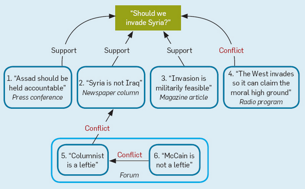
</template>

</TeachingStep>

<p class="nb-ref">Notebooks : <a href="https://github.com/jsboige/CoursIA/blob/main/MyIA.AI.Notebooks/SymbolicAI/ArgumentAnalysis/Argumentation-Onto-01-AIF-OWL2-Python.ipynb" target="_blank" rel="noopener">Argumentation-Onto-01-AIF-OWL2-Python</a> (ontologie AIF+) · <a href="https://github.com/jsboige/CoursIA/blob/main/MyIA.AI.Notebooks/SymbolicAI/ArgumentAnalysis/Argumentation-01-Toulmin-Model-Python.ipynb" target="_blank" rel="noopener">Argument_Analysis_Toulmin_Model</a> · <a href="https://github.com/jsboige/CoursIA/blob/main/MyIA.AI.Notebooks/SymbolicAI/ArgumentAnalysis/Argumentation-02-Fallacies-Detection-Python.ipynb" target="_blank" rel="noopener">Argument_Analysis_Agentic-1-informal</a> (reconstruction depuis le texte).</p>

---
class: nb-map nb-k96
---

# Argumentation : des cadres abstraits à l’analyse de textes

<p class="nb-lead">Deux familles se complètent : <code>Tweety</code> calcule sur des cadres formels, <code>ArgumentAnalysis</code> part du texte argumentatif pour en extraire la structure.</p>

<div class="nb-grid nb-cols-3">

<div class="nb-card"><p class="nb-step">Cadres de Dung</p><p class="nb-what">Arguments, attaques, extensions : qui est accepté, selon quelle sémantique.</p><p class="nb-links"><a href="https://github.com/jsboige/CoursIA/blob/main/MyIA.AI.Notebooks/SymbolicAI/Tweety/Tweety-05-Abstract-Argumentation-Python.ipynb" target="_blank" rel="noopener">Tweety-05</a> · <a href="https://github.com/jsboige/CoursIA/blob/main/MyIA.AI.Notebooks/SymbolicAI/ArgumentAnalysis/Argumentation-03-Dung-AF-Semantics-Python.ipynb" target="_blank" rel="noopener">Argumentation-03-Dung</a></p></div>

<div class="nb-card"><p class="nb-step">Argumentation structurée</p><p class="nb-what">ASPIC+, DeLP, ABA : les arguments sont construits à partir de règles strictes et défaisables.</p><p class="nb-links"><a href="https://github.com/jsboige/CoursIA/blob/main/MyIA.AI.Notebooks/SymbolicAI/Tweety/Tweety-06-Structured-Argumentation-Python.ipynb" target="_blank" rel="noopener">Tweety-06</a> · <a href="https://github.com/jsboige/CoursIA/blob/main/MyIA.AI.Notebooks/SymbolicAI/Tweety/Tweety-04-Aspic-CSharp.ipynb" target="_blank" rel="noopener">Tweety-04-Aspic C#</a></p></div>

<div class="nb-card"><p class="nb-step">Valeurs et classements</p><p class="nb-what">Valeurs (VAF), classement gradué, cadres dialectiques (ADF).</p><p class="nb-links"><a href="https://github.com/jsboige/CoursIA/blob/main/MyIA.AI.Notebooks/SymbolicAI/ArgumentAnalysis/Argumentation-03b-Value-Based-AF-Python.ipynb" target="_blank" rel="noopener">03b-VAF</a> · <a href="https://github.com/jsboige/CoursIA/blob/main/MyIA.AI.Notebooks/SymbolicAI/ArgumentAnalysis/Argumentation-03c-Ranking-Semantics-Python.ipynb" target="_blank" rel="noopener">03c-Ranking</a> · <a href="https://github.com/jsboige/CoursIA/blob/main/MyIA.AI.Notebooks/SymbolicAI/ArgumentAnalysis/Argumentation-03d-ADF-Semantiques-Python.ipynb" target="_blank" rel="noopener">03d-ADF</a></p></div>

<div class="nb-card"><p class="nb-step">Du texte à la structure</p><p class="nb-what">Modèle de Toulmin, schémas de Walton : reconnaître donnée, garantie et conclusion.</p><p class="nb-links"><a href="https://github.com/jsboige/CoursIA/blob/main/MyIA.AI.Notebooks/SymbolicAI/ArgumentAnalysis/Argumentation-01-Toulmin-Model-Python.ipynb" target="_blank" rel="noopener">01-Toulmin</a> · <a href="https://github.com/jsboige/CoursIA/blob/main/MyIA.AI.Notebooks/SymbolicAI/ArgumentAnalysis/Argumentation-01b-Schemes-Walton-Python.ipynb" target="_blank" rel="noopener">01b-Walton</a></p></div>

<div class="nb-card"><p class="nb-step">Sophismes</p><p class="nb-what">Détection par taxonomie, cartes Argumentum, ontologie AIF en OWL 2.</p><p class="nb-links"><a href="https://github.com/jsboige/CoursIA/blob/main/MyIA.AI.Notebooks/SymbolicAI/ArgumentAnalysis/Argumentation-02-Fallacies-Detection-Python.ipynb" target="_blank" rel="noopener">02-Fallacies</a> · <a href="https://github.com/jsboige/CoursIA/blob/main/MyIA.AI.Notebooks/SymbolicAI/ArgumentAnalysis/Argumentation-02b-Argumentum-Cards-Python.ipynb" target="_blank" rel="noopener">02b-Cards</a> · <a href="https://github.com/jsboige/CoursIA/blob/main/MyIA.AI.Notebooks/SymbolicAI/ArgumentAnalysis/Argumentation-Onto-01-AIF-OWL2-Python.ipynb" target="_blank" rel="noopener">Onto-01-AIF</a></p></div>

<div class="nb-card"><p class="nb-step">Dialogues</p><p class="nb-what">Protocoles d’enquête et de persuasion ; dialogues entre agents.</p><p class="nb-links"><a href="https://github.com/jsboige/CoursIA/blob/main/MyIA.AI.Notebooks/SymbolicAI/ArgumentAnalysis/Argumentation-04-Dialogues-Protocolises-Python.ipynb" target="_blank" rel="noopener">04-Dialogues</a> · <a href="https://github.com/jsboige/CoursIA/blob/main/MyIA.AI.Notebooks/SymbolicAI/Tweety/Tweety-08-Agent-Dialogues-Python.ipynb" target="_blank" rel="noopener">Tweety-08</a></p></div>

</div>

<p class="nb-foot"><strong>À observer.</strong> Le même débat, analysé à la main puis par un cadre de Dung : les arguments acceptés sont-ils ceux que vous aviez jugés convaincants ?</p>

---
class: nb-concept nb-center nb-k94
---

# Dung : une attaque, trois verdicts

<p class="nb-lead">Un cadre d’argumentation n’est qu’un graphe d’attaques. Ce qu’on « accepte » dépend de la sémantique choisie, et sur un même cadre les trois sémantiques classiques peuvent diverger.</p>

<div class="nb-grid nb-cols-2">

<div class="nb-card"><p class="nb-step">Admissible</p><p class="nb-what">Un ensemble sans conflit interne qui défend chacun de ses membres contre toute attaque.</p></div>

<div class="nb-card"><p class="nb-step">Grounded</p><p class="nb-what">Le verdict le plus sceptique : unique, il n’accepte que ce qui est défendu sans aucun pari.</p></div>

<div class="nb-card"><p class="nb-step">Preferred</p><p class="nb-what">Les ensembles admissibles maximaux : plusieurs positions crédules peuvent coexister.</p></div>

<div class="nb-card"><p class="nb-step">Stable</p><p class="nb-what">Accepte un ensemble qui attaque tout le reste ; il peut ne pas exister du tout.</p></div>

</div>

<p class="nb-foot"><strong>À observer.</strong> Sur le cas canonique du notebook, grounded, preferred et stable diffèrent : quel argument fait basculer chaque verdict ?</p>

<p class="notebook-reference">Notebook : <a href="https://github.com/jsboige/CoursIA/blob/main/MyIA.AI.Notebooks/SymbolicAI/ArgumentAnalysis/Argumentation-03-Dung-AF-Semantics-Python.ipynb" target="_blank" rel="noopener">Argumentation-03-Dung-AF-Semantics-Python.ipynb</a>.</p>

---
layout: default
---

# Solveurs Modulo Théorie et optimiseurs (1/2)

## Issus de SAT, rajoute

- Des théories arithmetiques
- Les quantificateurs du premier ordre
- Certaines techniques de resolution d'equations ou d'optimisation mathematique

## Très populaires

- Representation + riche que SAT mais **decidables** = sweet spot
- Ex : Verification de circuits electroniques et de code/protocoles critiques
- Automates symboliques (ex: Automata.Net)

---
layout: default
---

# Solveurs Modulo Théorie et optimiseurs (2/2)

## Théories

- Egalite de fonctions, différences
- Arithmetique lineaire entière, rationnelle, réelle
- Tableaux, arithmetique non lineaire, vecteur de bits

## Outils

- **Solveurs** : Z3, Yices, Open SMT, MathSAT
- **Optimiseurs / solveurs** : MSF, OR-Tools
- **Exemple** : Linq To Z3

*Notebooks : [Z3-Python-01-Introduction](https://github.com/jsboige/CoursIA/blob/main/MyIA.AI.Notebooks/SymbolicAI/SMT/Z3-API/Z3-01-Introduction-Python.ipynb) · [Z3-Python-01b-Style-Declaratif-Linq](https://github.com/jsboige/CoursIA/blob/main/MyIA.AI.Notebooks/SymbolicAI/SMT/Z3-API/Z3-01b-Style-Declaratif-Linq.ipynb) (le style declaratif Linq To Z3) · [Z3-Python-06-Advanced-Optimization](https://github.com/jsboige/CoursIA/blob/main/MyIA.AI.Notebooks/SymbolicAI/SMT/Z3-API/Z3-06-Advanced-Optimization-Python.ipynb) (optimiseurs).*

---
layout: default
---

# Expliquer l'incoherence : MUS, MCS et noyaux d'insatisfiabilite

<style scoped>
.slidev-layout { font-size: 0.88em; }
h2 { margin-top: 0.3em !important; margin-bottom: 0.1em !important; }
</style>

## Le probleme du « UNSAT »

- Un solveur SAT/SMT repond **insatisfaisable** — il ne dit pas **quelle partie** de la base est en cause
- Sur une base de connaissances reelle, savoir *que* c'est incoherent ne suffit pas : il faut savoir *pourquoi*

## Deux objets minimaux, duaux l'un de l'autre

- **MUS** (Minimal Unsatisfiable Subset) : sous-ensemble incoherent dont tout retrait rend coherent
- **MCS** (Minimal Correction Subset) : sous-ensemble dont le retrait rend la base coherente
- **Dualite** : les MUS sont les transversaux minimaux des MCS — expliquer et reparer sont deux faces du meme calcul

## Ou cela sert

- Diagnostiquer une base de regles contradictoire (ingenierie des connaissances)
- Debloquer une configuration industrielle : le solveur dit UNSAT, quelle contrainte relacher ?
- Revision des croyances : quelle croyance retirer pour rester coherent (postulats AGM)

*Notebooks : [Z3-13-UnsatCores-Python](https://github.com/jsboige/CoursIA/blob/main/MyIA.AI.Notebooks/SymbolicAI/SMT/Z3-API/Z3-13-UnsatCores-Python.ipynb) (noyaux d'insatisfiabilite) · [Z3-13b-UnsatCores-MUS-Python](https://github.com/jsboige/CoursIA/blob/main/MyIA.AI.Notebooks/SymbolicAI/SMT/Z3-API/Z3-13b-UnsatCores-MUS-Python.ipynb) (MUS par deletion-based) · [17_UnsatCores](https://github.com/jsboige/CoursIA/blob/main/MyIA.AI.Notebooks/SymbolicAI/SMT/Z3-Linq2Z3/17_UnsatCores.ipynb) · [Tweety-04-Belief-Revision-Python](https://github.com/jsboige/CoursIA/blob/main/MyIA.AI.Notebooks/SymbolicAI/Tweety/Tweety-04-Belief-Revision-Python.ipynb) (MUS, MCS, dualite).*

---
layout: default
---

# Agents a base de connaissance (1/2)

## 3 architectures (par ordre de complexite)

### Agents reflex

- Classifications de situations
- Percepts -> observations -> actions
- Ex: s,g,u,c,t Percept([s, Breeze, g, u, c], t) => Breeze(t)
- Mais faits non percepts (position, or) + boucles

---
layout: default
class: fig
---

# Agents a base de connaissance (2/2)

<TeachingStep placement="end" size="lg">

## Fondes sur un modèle

- Modèle interne du monde
- Representation du changement -> calcul situationnel
- Proprietes perpetuelles -> proprietes cachees des lieux
- Règles causales, de diagnostique
- Ex: (l1,l2,s) At(Wumpus,l1,s) ∧ Adjacent(l1,l2) => Smelly(l2)
- Axiomes de persistance, d'effets, problemes de qualifications
- Ingenierie de données -> modeliser le bon niveau

<template #visual>
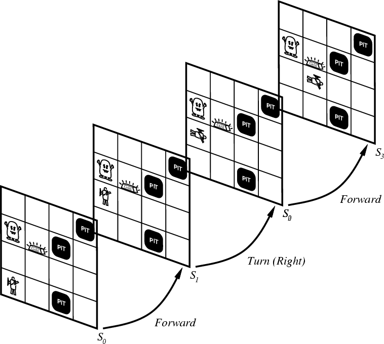
</template>

</TeachingStep>

---
layout: default
---

# Agents a base de connaissance (3/3)

## Fondes sur des buts

- Concoivent des buts a atteindre
- Tri des actions, separation des faits sur les actions et les buts
- Ex: ∀(a,s) Good(a,s) => ¬(∃b) Great(b,s) => Action(a,s)
- Approches : Inference, Exploration, Planification

---
layout: default
---

# Resume logique du premier ordre

## Logique du premier ordre

- Objets, relations, fonctions
- Termes, Quantificateurs
- Modèle, interpretation
- Axiomes, Ingenierie de données

## Inference

- Propositionalisation
- Unification, Modus ponens elargi, chainage avant et arriere
- Resolution, ameliorations

---
layout: default
---

# Resume logique du premier ordre (2/2)

## Applications puissantes

- Solveurs SMTs
- Logiques d'ordre superieur
- Arg Tech (argumentation)

## Agents

- Reflex
- Modèle
- Fondes sur un but

---
layout: default
---

# Applications

<style scoped>
.slidev-layout { font-size: 0.88em; }
h2 { margin-top: 0.3em !important; margin-bottom: 0.1em !important; }
</style>

## Agents fondes sur la connaissance

- Representation explicite des connaissances
- Raisonnement automatique

## Systèmes experts

- Base de connaissances + Moteur d'infrence
- Domaines: medecine, diagnostic, configuration

## Web sémantique

- RDF, OWL: representation des connaissances sur le web
- SPARQL: interrogation des connaissances

## Planification automatique

- Representation des actions et des etats
- Raisonnement sur les plans

*Notebooks : [SW-02-RDFBasics-Python](https://github.com/jsboige/CoursIA/blob/main/MyIA.AI.Notebooks/SymbolicAI/SemanticWeb/SW-02-RDFBasics-Python.ipynb) (RDF, SPARQL) · [Planners-01-Introduction-Python](https://github.com/jsboige/CoursIA/blob/main/MyIA.AI.Notebooks/SymbolicAI/Planners/01-Foundation/Planners-01-Introduction-Python.ipynb) (planification).*

---
layout: section
---

# Planification
---
layout: default
---


# Planification

## Problème de planification

- Trouver une sequence d'actions qui permettent d'atteindre un objectif a partir d'un etat initial
- Donner la liste des instances d'opérations, qui, executees a partir de l'etat initial, vont modifier l'etat du monde a un etat qui satisfait le but

## Planification et resolution de problème

- Souvent mêmes types de problemes
- Planification plus expressive
- Exploration de l'espace de plan en plus de l'espace d'etats
- Sous-objectifs independants reduisent la complexite

*Notebooks : [Planners-01-Introduction-Python](https://github.com/jsboige/CoursIA/blob/main/MyIA.AI.Notebooks/SymbolicAI/Planners/01-Foundation/Planners-01-Introduction-Python.ipynb) · [Planners-03-State-Space-Python](https://github.com/jsboige/CoursIA/blob/main/MyIA.AI.Notebooks/SymbolicAI/Planners/01-Foundation/Planners-03-State-Space-Python.ipynb).*

---
layout: compact
---

# Definition d'un domaine de planification

<div class="cols-2">

## Planning Domain Definition Language (PDDL)

- Similaire a la logique du premier ordre (FOL)
- Etat: At(Truck1, Melbourne) ET At(Truck2, Sydney)
- Chaque etat est appele un fluent
- Sémantique de DB (ce qui n'est pas explicite est presume faux)
- Les enonces sont fermes, sans fonction

## Schema d'action

- Noms: ex: Go
- Liste de variables (here, there)
- Preconditions: At(here), Path(here, there)
- Effets: At(there), NON At(here)

## Application d'une action

- Les preconditions doivent etre satisfaites
- S' = (S - Del(a)) ∪ Add(a)
- Add(a): Litteraux positifs dans les effets
- Del(a): Litteraux negatifs dans les effets

## Domaine de planification

- Schémas d'action + état initial + but
- Ex: transport logistique (diapo suivante) : description PDDL et plan solution

</div>

---
layout: default
class: fig
---


# Exemple PDDL: Transport logistique

<TeachingStep placement="below" size="lg" class="fig-full">

```
Init(At(C1, SFO) ET At(C2, JFK) ET At(P1, SFO) ET At(P2, JFK)
    ET Cargo(C1) ET Cargo(C2) ET Plane(P1) ET Plane(P2)
    ET Airport(JFK) ET Airport(SFO))
Goal(At(C1, JFK) ET At(C2, SFO))

Action(Load(c, p, a))
  PRECOND: At(c, a) ET At(p, a) ET Cargo(c) ET Plane(p) ET Airport(a)
  EFFECT: NON At(c, a) ET In(c, p))

Action(Unload(c, p, a))
  PRECOND: In(c, p) ET At(p, a) ET Cargo(c) ET Plane(p) ET Airport(a)
  EFFECT: At(c, a) ET NON In(c, p))

Action(Fly(p, from, to),
  PRECOND: At(p, from) ET Plane(p) ET Airport(from) ET Airport(to)
  EFFECT: NON At(p, from) ET At(p, to))
```

<template #visual>
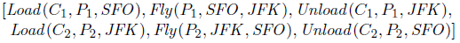
</template>

</TeachingStep>

<p class="nb-ref">Notebooks : <a href="https://github.com/jsboige/CoursIA/blob/main/MyIA.AI.Notebooks/SymbolicAI/Planners/01-Foundation/Planners-02-PDDL-Basics-Python.ipynb" target="_blank" rel="noopener">Planners-02-PDDL-Basics-Python</a> (le domaine logistique) · <a href="https://github.com/jsboige/CoursIA/blob/main/MyIA.AI.Notebooks/SymbolicAI/Planners/02-Classical/Planners-06-Domains-Python.ipynb" target="_blank" rel="noopener">Planners-06-Domains-Python</a>.</p>

---
layout: compact
class: fig
---


# Approches de planification

<TeachingStep placement="end" size="lg">

## Exploration de l'espace des etats et des plans

- STRIPS, chainage avant, etc.

## Planification a ordre partiel

- Construction des sous-plans
- Ordre reconcilie par application de contraintes

## Decomposition hiérarchique

- Distinction des buts a decomposer
- Primitives atomiques pour les atteindre

## Planification par contraintes

- Utilisation des CSP

## Calcul situationnel

- Logique du premier ordre
- Utilisation de theoremes pour prouver les bonnes sequences

<template #visual>
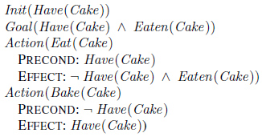
</template>

</TeachingStep>

---
layout: compact
class: fig
---

# Exploration de l'espace des etats

<TeachingStep placement="end" size="lg">

## Complexite de la planification classique

- PlanSAT: Y-a-t-il un plan? -> PSPACE > NP
- PlanSAT "borne": Y-a-t-il un plan de longueur <k? -> PSPACE
- Pour de nombreux domaines (e.g. logistique):
  - PlanSAT borne NP-Complet (optimalite difficile)
  - PlanSAT dans P (suboptimalite plus facile)

## Algorithmes

- Planificateur progressif (avant)
- Planificateur regressif (arriere)
  - Recherche des etats pertinents
- Explorations bidirectionnelles

<template #visual>
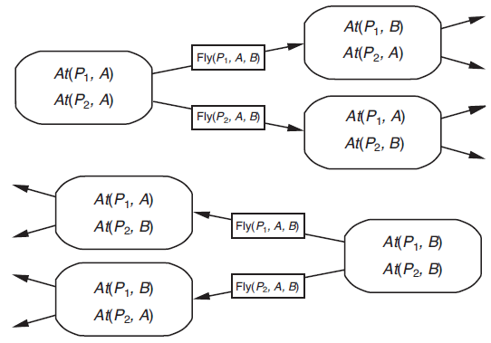
</template>

</TeachingStep>

<p class="nb-ref">Notebooks : <a href="https://github.com/jsboige/CoursIA/blob/main/MyIA.AI.Notebooks/SymbolicAI/Planners/01-Foundation/Planners-03-State-Space-Python.ipynb" target="_blank" rel="noopener">Planners-03-State-Space-Python</a> · <a href="https://github.com/jsboige/CoursIA/blob/main/MyIA.AI.Notebooks/SymbolicAI/Planners/02-Classical/Planners-04-Fast-Downward-Python.ipynb" target="_blank" rel="noopener">Planners-04-Fast-Downward-Python</a> (planificateur progressif et regressif).</p>

---
layout: default
---

# Heuristiques pour la planification

## Problème relache

- Ignorer les preconditions
- Ignorer les delete lists

## Abstraction

- Ignorer les fluents non pertinents

## Decomposition

- Diviser le problème en sous-problemes independants

## Landmarks

- Faits qui doivent etre vrais a un moment donne

*Notebooks : [Planners-05-Heuristics-Python](https://github.com/jsboige/CoursIA/blob/main/MyIA.AI.Notebooks/SymbolicAI/Planners/02-Classical/Planners-05-Heuristics-Python.ipynb) (heuristiques de planification) · [Planners-05b-Lean-Relaxation-Lean](https://github.com/jsboige/CoursIA/blob/main/MyIA.AI.Notebooks/SymbolicAI/Planners/02-Classical/Planners-05b-Lean-Relaxation-Lean.ipynb) (relaxation et landmarks).*

---
layout: compact
class: fig
---

# Graphes de planification

<TeachingStep placement="end" size="lg">

## Structure de données

- Generee a partir d'un problème de planification
- Divisee en niveaux:
  - Niveaux d'etats Si: Les fluents peuvent etre vrais au niveau i
  - Niveaux d'actions Ai: Les actions applicables a l'étape i

## Construction

- Ai = actions avec preconditions satisfaites par Si
- Si = fluents rendus vrais par effets des actions Ai-1
- + NO-OP passe les fluents vrais de Si a Si+1

## Liens

- Fluents -> Preconditions
- Effets -> Fluents
- Mutexes: actions incompatibles, fluents incompatibles

<template #visual>
<div class="fig-stack">
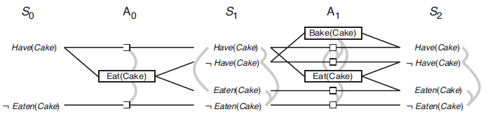
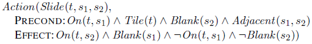
</div>
</template>

</TeachingStep>

---
layout: default
class: code-lg
---

# Algorithme GraphPlan

```
fonction GRAPHPLAN(probleme) retourne solution ou echec
  graph <- INITIAL-PLANNING-GRAPH(probleme)
  goals <- CONJUNCTS(probleme.Goal)
  nogoods <- table de hachage vide
  pour t = 0 a l'infini faire
    si goals tous non-mutex dans St de graph alors
      solution <- EXTRACT-SOLUTION(graph, goals, NUMLEVELS(graph), nogoods)
      si solution != echec alors retourner solution
    si graph et nogoods ont tous les deux level-off alors retourner echec
    graph <- EXPAND-GRAPH(graph, probleme)
```

L'expansion alterne niveaux d'actions et de propositions ; l'extraction remonte du but en évitant les paires mutuellement exclusives, et la table *nogoods* mémorise les échecs pour ne pas les refaire.

---
layout: default
---


# Planification par contraintes

## SatPlan

- La planification comme une satisfiabilite Booleenne
- Propositionalisation des actions, des buts
- Ajout des axiomes d'etats successeurs
- Ajout des axiomes de preconditions
- Utilisation de l'algorithme WalkSat

## Formulation comme CSP

- Plan a "k" actions
- Variables: Action unique pour chaque étape, Fluent
- Contraintes: decrivent les effets + etat initial et but

*Notebooks : [Planners-07-OR-Tools-Python](https://github.com/jsboige/CoursIA/blob/main/MyIA.AI.Notebooks/SymbolicAI/Planners/03-Advanced/Planners-07-OR-Tools-Python.ipynb) (planification par contraintes) · [Z3-Python-08-Ordonnancement](https://github.com/jsboige/CoursIA/blob/main/MyIA.AI.Notebooks/SymbolicAI/SMT/Z3-API/Z3-08-Ordonnancement-Python.ipynb) (planning vers scheduling) · [11_Job_Shop_Scheduling](https://github.com/jsboige/CoursIA/blob/main/MyIA.AI.Notebooks/SymbolicAI/SMT/Z3-Linq2Z3/11_Job_Shop_Scheduling.ipynb).*

---
layout: default
class: fig
---

# Calcul situationnel

<style scoped>
.slidev-layout { font-size: 0.85em; }
h2 { margin-top: 0.3em !important; margin-bottom: 0.1em !important; }
</style>

<TeachingStep placement="end" size="lg">


## Limitations de PDDL

- Pas de quantificateur (deplacer "tout le chargement" etc.)
- Logique propositionnelle: le temps est lie aux fluents

## Alternative: utiliser la FOL avec branches de situations

- Raisonner a propos du changement a travers ces branches
- Utilisation de theoremes pour prouver qu'un plan fonctionne

## Etat initial

- Phrase logique a propos de la situation S0
- At(Home, S0) ET NON Have(Milk, S0)<br>ET NON Have(Bananas, S0) ET NON Have(Drill, S0)

## Etat but

- (∃s) At(Home, s) ET Have(Milk, s)<br>ET Have(Bananas, s) ET Have(Drill, s)

<template #visual>

</template>

</TeachingStep>

---
layout: compact
class: fig
---


# Axiomes du calcul situationnel

<TeachingStep placement="end" size="md">

## Preconditions -> Axiomes de Possibilite

## Opérateurs: descriptions de comment le monde change

- ∀(a,s) Have(Milk, Result(a,s)) <=><br>((a=Buy(Milk) ET At(Grocery,s))<br>OU (Have(Milk, s) ET a≠Drop(Milk)))

## Axiomes d'action unique

## Situations resultant du plan d'actions p

- Result(p, S0)
- (∀s) Result([], s) = s
- (∀a,p,s) Result([a|p], s) = Result(p, Result(a, s))

## Solution

- At(Home, Result'(p, S0)) ET Have(Milk, Result'(p, S0))<br>ET Have(Bananas, Result'(p, S0)) ET Have(Drill, Result'(p, S0))

<template #visual>
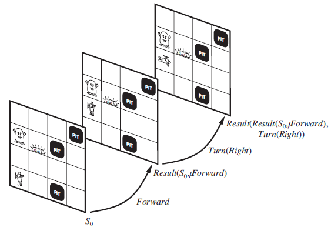
</template>

</TeachingStep>

---
layout: default
class: fig
---

# Planification a ordre partiel

<style scoped>
.slidev-layout { font-size: 0.88em; }
h2 { margin-top: 0.3em !important; margin-bottom: 0.1em !important; }
</style>

<TeachingStep placement="end" size="lg">


## Planificateur non lineaire

- Construit une liste d'étapes avec des contraintes temporelles

## Raffinement du plan partiellement ordonne

- Par ajout d'étapes
- Par ajout de contraintes

## Engagement minimal

- On ne garde que le necessaire
- Pas d'engagement a l'avance

## Plan non lineaire

- Étapes &#123;S1, S2, S3...&#125;
  - Description d'opérateurs + pre et post-conditions
- Liens causaux &#123;... (Si, C, Sj) ...&#125;
- Contraintes d'ordre &#123;... Si &lt; Sj ...&#125;

## Plan complet

- Toutes les étapes sont incluses
- Chaîne de causalite
- Validite temporelle

<template #visual>
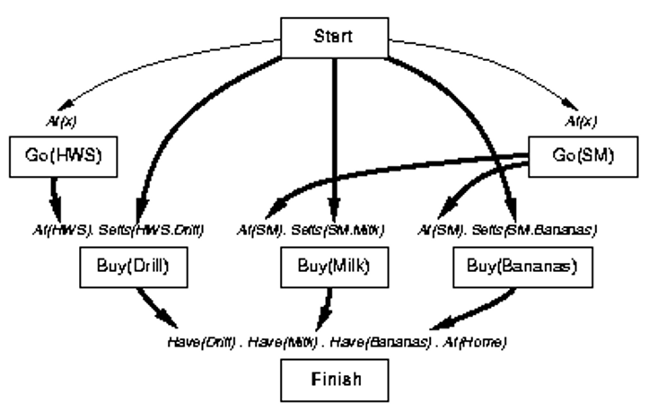
</template>

</TeachingStep>

---
layout: default
class: fig
---

# Decomposition hiérarchique

<style scoped>
.slidev-layout { font-size: 0.88em; }
h2 { margin-top: 0.3em !important; margin-bottom: 0.1em !important; }
/* img_036 est absolute a right:58px width:200px (bord gauche x=722) : l'ancre
   notebook, dernier paragraphe en flux, est bornee a 640px pour ne pas passer
   SOUS l'image (glyphes repeints, cf issue 15351). */
.slidev-layout > p:last-of-type { max-width: 640px; }
</style>

<TeachingStep placement="end" size="lg">


## Conditions réelles plus difficiles

- Gestion des ressources, du temps, des abstractions
- Planning -> scheduling
- Actions conditionnelles, incertaines, dynamiques

## Planifier =/= Programmer un événement

- Allouer des ressources, respecter des contraintes
- Planifier -> raisonnement
- Programmer -> CSPs

## Decomposition hiérarchique

- Opérateurs abstraits -> vers les Buts intermediaires
- Primitives de bas niveau: Executable
- Opérateurs non primitifs: Buts, actions abstraites

<template #visual>
<div class="fig-stack">
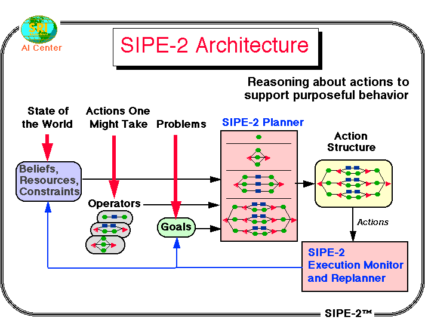
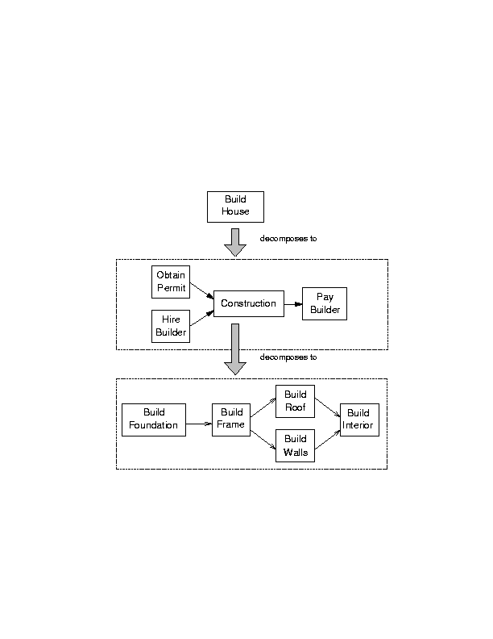
</div>
</template>

</TeachingStep>

<p class="nb-ref">Notebooks : <a href="https://github.com/jsboige/CoursIA/blob/main/MyIA.AI.Notebooks/SymbolicAI/Planners/03-Advanced/Planners-09-HTN-Python.ipynb" target="_blank" rel="noopener">Planners-09-HTN-Python</a> (decomposition hierarchique) · <a href="https://github.com/jsboige/CoursIA/blob/main/MyIA.AI.Notebooks/SymbolicAI/Planners/04-NeuroSymbolic/Planners-10-LLM-Planning-Python.ipynb" target="_blank" rel="noopener">Planners-10-LLM-Planning-Python</a> (LLM et decomposition).</p>

---
layout: compact
class: fig
---

# Resume planification

<TeachingStep placement="end" size="lg">

## Approches

- Recherche dans l'espace d'etats (STRIPS, chainage avant, etc.)
- Dans l'espace des plans (planification partiellement ordonnees, HTN, etc.)
- Base sur les contraintes (GraphPlan, SATPlan etc.)
- Calcul situationnel
- Planification hiérarchique

## Stratégies d'exploration

- Planification progressive
- Regression des buts
- Planification retrograde
- Moindre engagement
- Planification non lineaire

<template #visual>
<div class="fig-stack">
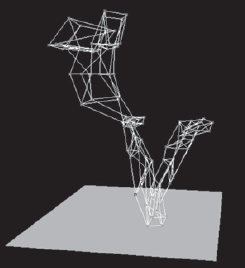
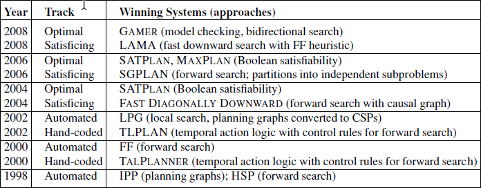
</div>
</template>

</TeachingStep>

---
class: nb-map nb-k96
---

# Planification : du PDDL au planificateur neuro-symbolique

<p class="nb-lead">La série <code>Planners</code> reprend ce chapitre dans l’ordre : écrire un domaine, le résoudre par recherche, guider la recherche, puis élargir au temps, à la hiérarchie et aux LLM.</p>

<div class="nb-grid nb-cols-3">

<div class="nb-card"><p class="nb-step">Fondations</p><p class="nb-what">La planification d’abord écrite à la main, puis le langage PDDL : domaine, problème, plan.</p><p class="nb-links"><a href="https://github.com/jsboige/CoursIA/blob/main/MyIA.AI.Notebooks/SymbolicAI/Planners/01-Foundation/Planners-01-Introduction-Python.ipynb" target="_blank" rel="noopener">Planners-01</a> · <a href="https://github.com/jsboige/CoursIA/blob/main/MyIA.AI.Notebooks/SymbolicAI/Planners/01-Foundation/Planners-02-PDDL-Basics-Python.ipynb" target="_blank" rel="noopener">Planners-02-PDDL</a></p></div>

<div class="nb-card"><p class="nb-step">Espace d’états</p><p class="nb-what">Recherche progressive et régressive, puis un planificateur classique de référence, Fast Downward.</p><p class="nb-links"><a href="https://github.com/jsboige/CoursIA/blob/main/MyIA.AI.Notebooks/SymbolicAI/Planners/01-Foundation/Planners-03-State-Space-Python.ipynb" target="_blank" rel="noopener">Planners-03</a> · <a href="https://github.com/jsboige/CoursIA/blob/main/MyIA.AI.Notebooks/SymbolicAI/Planners/02-Classical/Planners-04-Fast-Downward-Python.ipynb" target="_blank" rel="noopener">Planners-04-Fast-Downward</a></p></div>

<div class="nb-card"><p class="nb-step">Heuristiques</p><p class="nb-what">Relaxation sans suppressions, h<sup>max</sup> et h<sup>add</sup>, admissibilité prouvée en Lean.</p><p class="nb-links"><a href="https://github.com/jsboige/CoursIA/blob/main/MyIA.AI.Notebooks/SymbolicAI/Planners/02-Classical/Planners-05-Heuristics-Python.ipynb" target="_blank" rel="noopener">Planners-05</a> · <a href="https://github.com/jsboige/CoursIA/blob/main/MyIA.AI.Notebooks/SymbolicAI/Planners/02-Classical/Planners-05b-Lean-Relaxation-Lean.ipynb" target="_blank" rel="noopener">Planners-05b-Lean</a></p></div>

<div class="nb-card"><p class="nb-step">Domaines et contraintes</p><p class="nb-what">Domaines classiques (logistique, blocs), puis planification par contraintes avec OR-Tools.</p><p class="nb-links"><a href="https://github.com/jsboige/CoursIA/blob/main/MyIA.AI.Notebooks/SymbolicAI/Planners/02-Classical/Planners-06-Domains-Python.ipynb" target="_blank" rel="noopener">Planners-06-Domains</a> · <a href="https://github.com/jsboige/CoursIA/blob/main/MyIA.AI.Notebooks/SymbolicAI/Planners/03-Advanced/Planners-07-OR-Tools-Python.ipynb" target="_blank" rel="noopener">Planners-07-OR-Tools</a></p></div>

<div class="nb-card"><p class="nb-step">Temps et hiérarchie</p><p class="nb-what">Actions durables et concurrentes ; décomposition hiérarchique de tâches (HTN).</p><p class="nb-links"><a href="https://github.com/jsboige/CoursIA/blob/main/MyIA.AI.Notebooks/SymbolicAI/Planners/03-Advanced/Planners-08-Temporal-Python.ipynb" target="_blank" rel="noopener">Planners-08-Temporal</a> · <a href="https://github.com/jsboige/CoursIA/blob/main/MyIA.AI.Notebooks/SymbolicAI/Planners/03-Advanced/Planners-09-HTN-Python.ipynb" target="_blank" rel="noopener">Planners-09-HTN</a></p></div>

<div class="nb-card"><p class="nb-step">LLM et planification</p><p class="nb-what">Un LLM propose, un planificateur vérifie ; bibliothèque Unified Planning ; apprendre à planifier.</p><p class="nb-links"><a href="https://github.com/jsboige/CoursIA/blob/main/MyIA.AI.Notebooks/SymbolicAI/Planners/04-NeuroSymbolic/Planners-10-LLM-Planning-Python.ipynb" target="_blank" rel="noopener">Planners-10-LLM</a> · <a href="https://github.com/jsboige/CoursIA/blob/main/MyIA.AI.Notebooks/SymbolicAI/Planners/04-NeuroSymbolic/Planners-11-Unified-Planning-Python.ipynb" target="_blank" rel="noopener">Planners-11</a> · <a href="https://github.com/jsboige/CoursIA/blob/main/MyIA.AI.Notebooks/SymbolicAI/Planners/04-NeuroSymbolic/Planners-12-LOOP-Python.ipynb" target="_blank" rel="noopener">Planners-12-LOOP</a></p></div>

</div>

<p class="nb-foot"><strong>À observer.</strong> Sur un même domaine, le plan proposé par un LLM passe-t-il la vérification du planificateur ? Sinon, quelle précondition a-t-il oubliée ?</p>

---
class: nb-concept nb-center nb-k94
---

# Heuristiques : relaxer le problème pour guider la recherche

<p class="nb-lead">Une bonne heuristique estime la distance au but sans résoudre le problème. En planification, on l’obtient en ignorant les effets négatifs des actions : la relaxation sans suppressions.</p>

<div class="nb-grid nb-cols-2">

<div class="nb-card"><p class="nb-step">Relaxation</p><p class="nb-what">Sans suppressions, un fait acquis le reste : le problème relaxé devient facile à résoudre.</p></div>

<div class="nb-card"><p class="nb-step">h<sup>max</sup></p><p class="nb-what">Coût du sous-but le plus cher : admissible, donc sûre pour A*, mais souvent trop optimiste.</p></div>

<div class="nb-card"><p class="nb-step">h<sup>add</sup></p><p class="nb-what">Somme des coûts des sous-buts : plus informative, mais elle peut surestimer.</p></div>

<div class="nb-card"><p class="nb-step">Admissibilité</p><p class="nb-what">Ne jamais surestimer le coût restant : c’est la condition pour qu’A* rende un plan optimal.</p></div>

</div>

<p class="nb-foot"><strong>À observer.</strong> Le notebook exhibe un cas où h<sup>add</sup> surestime : le plan trouvé avec elle est-il encore optimal ?</p>

<p class="notebook-reference">Notebooks : <a href="https://github.com/jsboige/CoursIA/blob/main/MyIA.AI.Notebooks/SymbolicAI/Planners/02-Classical/Planners-05-Heuristics-Python.ipynb" target="_blank" rel="noopener">Planners-05-Heuristics-Python.ipynb</a> · <a href="https://github.com/jsboige/CoursIA/blob/main/MyIA.AI.Notebooks/SymbolicAI/Planners/02-Classical/Planners-05b-Lean-Relaxation-Lean.ipynb" target="_blank" rel="noopener">Planners-05b-Lean-Relaxation-Lean.ipynb</a>.</p>

---
layout: section
---

# Representation de Connaissances
---
layout: compact
class: fig
---

# Ontologies

<style scoped>
.slidev-layout { font-size: 0.88em; }
h2 { margin-top: 0.3em !important; margin-bottom: 0.1em !important; }
</style>

<TeachingStep placement="end" size="md">
<div class="dense-list">


## Objectifs

- Representation des connaissances a grande echelle
- Lier les domaines specialises du savoir
- Couvrir la diversite des connaissances -> tâche difficile

## Besoins de categorisation

- Reification: predicats et constantes
  - BallonDeBasket(b) -> Membre(b, BallonsDeBasket)
- Hiérarchie: taxonomies (sous-classes), heritage
- Partitions: Disjoints + decomposition exhaustive
- Composition: PartieDe(x,y) ; partition -> assortiment (pas ensemble)

## Mesure

- Unites : Diametre(ballonDeBasket12) = Centimetre(24) ; Centimetre(2,54 × d) = Pouces(d)
- Evenements : temps plutot que situations (…, t) ; evenements discrets -> « processus » continus, liquides

## Objets mentaux

- Connaissances sur les croyances -> degres de croyance : Knows(Lois, CanFly(Superman))
- Logique modale: mondes possibles relies par des relations d'accessibilite

</div>

<template #visual>
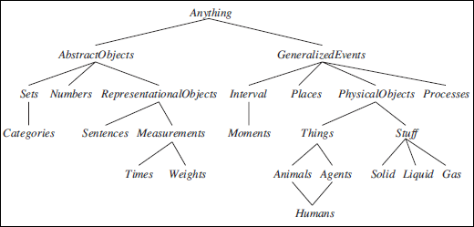
</template>

</TeachingStep>

---
layout: default
class: fig
---

# Web sémantique

<style scoped>
.slidev-layout { font-size: 0.88em; }
h2 { margin-top: 0.3em !important; margin-bottom: 0.1em !important; }
</style>

<TeachingStep placement="end" size="lg" class="fig-xl">


## Resource Description Framework (RDF)

- Communaute KR: AAAI, W3C, Berners-Lee
- RDF: triplets (faits), classes / sous-classes
- Triplet (sujet, predicat, objet)

## RDFS et OWL

- Classes définies
- Contraintes

## SPARQL

- Requêtes sur "Triple Stores"

## Linked Data

- SOA (Service Oriented Architecture)
- Données connectees sur le web

<template #visual>
<div class="fig-grid">
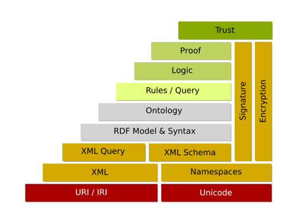
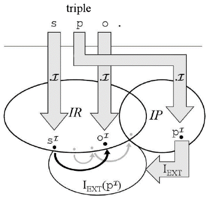
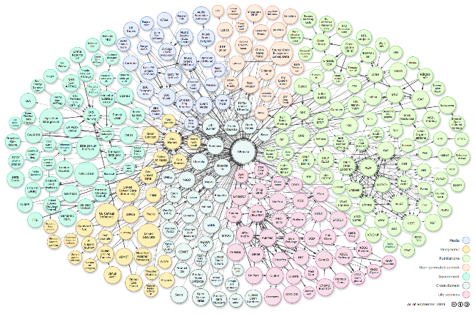


</div>
</template>

</TeachingStep>

<p class="nb-ref">Notebooks : <a href="https://github.com/jsboige/CoursIA/blob/main/MyIA.AI.Notebooks/SymbolicAI/SemanticWeb/SW-02-RDFBasics-Python.ipynb" target="_blank" rel="noopener">SW-02-RDFBasics-Python</a> (triples et SPARQL) · <a href="https://github.com/jsboige/CoursIA/blob/main/MyIA.AI.Notebooks/SymbolicAI/SemanticWeb/SW-11-Python-KnowledgeGraphs.ipynb" target="_blank" rel="noopener">SW-11-Python-KnowledgeGraphs</a> · <a href="https://github.com/jsboige/CoursIA/blob/main/MyIA.AI.Notebooks/SymbolicAI/SemanticWeb/SW-12-GraphRAG-Python.ipynb" target="_blank" rel="noopener">SW-12-GraphRAG-Python</a> (du graphe au RAG).</p>

---
layout: compact
class: fig
---

# Systèmes de raisonnement

<TeachingStep placement="end" size="lg">

## Reseaux sémantiques

- Proche des formalismes UML/Merise
- Infrence par navigation, heritage, reification
- Valeurs par defaut et heritage

## Logiques de descriptions

- Notations elaborees pour FOL
- Subsomption (sous-ensemble), classification, coherence
- And, All, AtLeast, AtMost, Fills, SameAs, OneOf...

## Logiques non monotones

- Monde clos: proposition pas mentionnee fausse par defaut
- Nouveaux faits peuvent invalider etat de croyance
- Circonscription, logique par defaut

<template #visual>
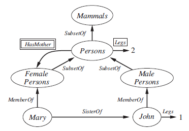
</template>

</TeachingStep>

---
layout: default
---

# Logiques de description et OWL : la logique industrialisee

<style scoped>
.slidev-layout { font-size: 0.88em; }
h2 { margin-top: 0.3em !important; margin-bottom: 0.1em !important; }
</style>

## TBox et ABox

- **TBox** (terminologie) : les concepts et leurs relations — `Main ⊑ Membre`, `Membre ⊑ PartieDuCorps`
- **ABox** (assertions) : les individus — `Main(mainDroite)`
- **Subsomption** : `C ⊑ D` est **calculee** par un raisonneur, pas decidee a la main — c'est la classification automatique d'une ontologie

## Pourquoi DL plutot que la FOL brute

- Fragment **decidable** de la FOL : on echange de l'expressivite contre la garantie que le raisonneur termine
- Profils OWL (EL, QL, RL) : compromis calculables a l'echelle du web
- Correspondance avec la logique modale : les roles sont des relations d'accessibilite entre individus

## Raisonner sur une ontologie

- **HermiT**, **Pellet** : coherence, subsomption, realisation d'individus
- Incoherence = un concept dont aucune instance ne peut exister
- De l'ontologie au graphe de connaissances, puis au RAG : la chaine complete est outillee

*Notebooks : [SW-13-Reasoners-Python](https://github.com/jsboige/CoursIA/blob/main/MyIA.AI.Notebooks/SymbolicAI/SemanticWeb/SW-13-Reasoners-Python.ipynb) (raisonneurs OWL) · [SW-14-Coup-Ontologique-Python](https://github.com/jsboige/CoursIA/blob/main/MyIA.AI.Notebooks/SymbolicAI/SemanticWeb/SW-14-Coup-Ontologique-Python.ipynb) · [Tweety-03-Advanced-Logics-CSharp](https://github.com/jsboige/CoursIA/blob/main/MyIA.AI.Notebooks/SymbolicAI/Tweety/Tweety-03-Advanced-Logics-CSharp.ipynb) (logics.dl, HermiT/Pellet).*

---
class: nb-map nb-k96
---

# Web sémantique : des triplets aux raisonneurs

<p class="nb-lead">La série <code>SemanticWeb</code> existe en Python (rdflib) et en C# (dotNetRDF). Elle suit la pile du web sémantique, du triplet au raisonneur, puis vers les graphes de connaissances.</p>

<div class="nb-grid nb-cols-3">

<div class="nb-card"><p class="nb-step">RDF</p><p class="nb-what">Triplets sujet–prédicat–objet, graphes, sérialisations.</p><p class="nb-links"><a href="https://github.com/jsboige/CoursIA/blob/main/MyIA.AI.Notebooks/SymbolicAI/SemanticWeb/SW-02-RDFBasics-Python.ipynb" target="_blank" rel="noopener">SW-02 Python</a> · <a href="https://github.com/jsboige/CoursIA/blob/main/MyIA.AI.Notebooks/SymbolicAI/SemanticWeb/SW-02-RDFBasics-CSharp.ipynb" target="_blank" rel="noopener">SW-02 C#</a></p></div>

<div class="nb-card"><p class="nb-step">SPARQL et Linked Data</p><p class="nb-what">Interroger un graphe ; suivre les liens vers des sources ouvertes.</p><p class="nb-links"><a href="https://github.com/jsboige/CoursIA/blob/main/MyIA.AI.Notebooks/SymbolicAI/SemanticWeb/SW-04-SPARQL-Python.ipynb" target="_blank" rel="noopener">SW-04-SPARQL</a> · <a href="https://github.com/jsboige/CoursIA/blob/main/MyIA.AI.Notebooks/SymbolicAI/SemanticWeb/SW-05-LinkedData-Python.ipynb" target="_blank" rel="noopener">SW-05-LinkedData</a></p></div>

<div class="nb-card"><p class="nb-step">RDFS et OWL</p><p class="nb-what">Classes, propriétés, restrictions : le vocabulaire devient une ontologie.</p><p class="nb-links"><a href="https://github.com/jsboige/CoursIA/blob/main/MyIA.AI.Notebooks/SymbolicAI/SemanticWeb/SW-06-RDFS-Python.ipynb" target="_blank" rel="noopener">SW-06-RDFS</a> · <a href="https://github.com/jsboige/CoursIA/blob/main/MyIA.AI.Notebooks/SymbolicAI/SemanticWeb/SW-07-OWL-Python.ipynb" target="_blank" rel="noopener">SW-07-OWL</a></p></div>

<div class="nb-card"><p class="nb-step">Valider</p><p class="nb-what">SHACL contrôle la forme des données, là où OWL infère.</p><p class="nb-links"><a href="https://github.com/jsboige/CoursIA/blob/main/MyIA.AI.Notebooks/SymbolicAI/SemanticWeb/SW-08-SHACL-Python.ipynb" target="_blank" rel="noopener">SW-08-SHACL</a></p></div>

<div class="nb-card"><p class="nb-step">Raisonner</p><p class="nb-what">Inférer les faits implicites d’une ontologie avec un raisonneur.</p><p class="nb-links"><a href="https://github.com/jsboige/CoursIA/blob/main/MyIA.AI.Notebooks/SymbolicAI/SemanticWeb/SW-13-Reasoners-Python.ipynb" target="_blank" rel="noopener">SW-13-Reasoners</a></p></div>

<div class="nb-card"><p class="nb-step">Graphes de connaissances</p><p class="nb-what">Construire un graphe de connaissances, puis s’en servir pour ancrer un RAG.</p><p class="nb-links"><a href="https://github.com/jsboige/CoursIA/blob/main/MyIA.AI.Notebooks/SymbolicAI/SemanticWeb/SW-11-Python-KnowledgeGraphs.ipynb" target="_blank" rel="noopener">SW-11-KnowledgeGraphs</a> · <a href="https://github.com/jsboige/CoursIA/blob/main/MyIA.AI.Notebooks/SymbolicAI/SemanticWeb/SW-12-GraphRAG-Python.ipynb" target="_blank" rel="noopener">SW-12-GraphRAG</a></p></div>

</div>

<p class="nb-foot"><strong>À observer.</strong> Après le passage du raisonneur, combien de triplets nouveaux apparaissent, et lesquels n’auriez-vous pas écrits vous-même ?</p>

---
layout: default
---


# Systèmes a maintenance de verite

<style scoped>
.slidev-layout { font-size: 0.88em; }
h2 { margin-top: 0.3em !important; margin-bottom: 0.1em !important; }
</style>

## Revision des croyances

- Statut par defaut -> revision des faits infenes faux
- Tell(KB, not P) -> Retract(KB, P)
- Problème: si P->Q doit-on annuler Q?

## Fondes sur la justification (JTMS)

- Les enonces sont associes a leurs justifications
- Suppression soft: in/out

## Fondes sur les hypotheses (ATMS)

- Envisager simultanement plusieurs hypotheses
- Chaque enonce comporte les hypotheses qui peuvent le rendre vrai

## Générateurs d'explications

- Hypotheses = explications raisonnables
- Explications minimales (Ockham)

*Notebooks : [Argument_Analysis_Agentic-5-jtms](https://github.com/jsboige/CoursIA/blob/main/MyIA.AI.Notebooks/SymbolicAI/ArgumentAnalysis/Argumentation-06-JTMS-Python.ipynb) (JTMS : justification et revision) · [Tweety-04-Belief-Revision-Python](https://github.com/jsboige/CoursIA/blob/main/MyIA.AI.Notebooks/SymbolicAI/Tweety/Tweety-04-Belief-Revision-Python.ipynb) (postulats AGM).*

---
class: nb-concept nb-center nb-k90
---

# Maintenir la vérité : justifier, retirer, propager

<p class="nb-lead">Un système de maintenance de vérité (JTMS) garde, pour chaque croyance, les justifications qui la soutiennent. Retirer une prémisse retire en cascade tout ce qui n’avait qu’elle pour appui.</p>

<div class="nb-grid nb-cols-2">

<div class="nb-card"><p class="nb-step">Étiquetage</p><p class="nb-what">Chaque croyance est IN ou OUT selon ses justifications ; l’étiquetage est un point fixe.</p></div>

<div class="nb-card"><p class="nb-step">Rétractation</p><p class="nb-what">Retirer un fait relance l’étiquetage : la cascade est le cœur du raisonnement non monotone.</p></div>

<div class="nb-card"><p class="nb-step">Circularité</p><p class="nb-what">Une boucle impaire de justifications empêche tout étiquetage cohérent.</p></div>

<div class="nb-card"><p class="nb-step">Hypothèses multiples</p><p class="nb-what">L’ATMS garde tous les environnements à la fois ; la révision AGM choisit quoi abandonner.</p></div>

</div>

<p class="nb-foot"><strong>À observer.</strong> Prédisez la cascade de l’exercice 2 avant de l’exécuter : quelles croyances tombent, lesquelles survivent grâce à un second appui ?</p>

<p class="notebook-reference">Notebooks : <a href="https://github.com/jsboige/CoursIA/blob/main/MyIA.AI.Notebooks/SymbolicAI/ArgumentAnalysis/Argumentation-06-JTMS-Python.ipynb" target="_blank" rel="noopener">Argumentation-06-JTMS-Python.ipynb</a> · <a href="https://github.com/jsboige/CoursIA/blob/main/MyIA.AI.Notebooks/SymbolicAI/ArgumentAnalysis/Argumentation-06b-ATMS-Conflits-Python.ipynb" target="_blank" rel="noopener">Argumentation-06b-ATMS-Conflits-Python.ipynb</a> · <a href="https://github.com/jsboige/CoursIA/blob/main/MyIA.AI.Notebooks/SymbolicAI/ArgumentAnalysis/Argumentation-06c-Revision-Croyances-Python.ipynb" target="_blank" rel="noopener">Argumentation-06c-Revision-Croyances-Python.ipynb</a>.</p>

---
layout: default
class: fig
---

# Smart Contracts

<style scoped>
.slidev-layout { font-size: 0.88em; }
h2 { margin-top: 0.3em !important; margin-bottom: 0.1em !important; }
</style>

<TeachingStep placement="end" size="lg">


## Cryptographie

- Signature, chiffrement (symetrique, asymetrique)

## Blockchain

- POW, POS

## Non divulgation de connaissance

- Preuves interactives (ex: la porte cachee)
- Preuves non interactives
- Chiffrement Homomorphe : C(A+B) = C(A)+C(B)
- Ex: Helios voting

## Contrats a clauses complexes

- Signatures composites (courtier, depots/agents fiduciaires)
- Clauses scriptees (ex: EtherCoin Hack)

<template #visual>

</template>

</TeachingStep>

<p class="nb-ref">Notebooks : <a href="https://github.com/jsboige/CoursIA/blob/main/MyIA.AI.Notebooks/SymbolicAI/SmartContracts/03-Foundry-Testing/SC-14-Formal-Verification-Python.ipynb" target="_blank" rel="noopener">SC-14-Formal-Verification-Python</a> (verification formelle) · <a href="https://github.com/jsboige/CoursIA/blob/main/MyIA.AI.Notebooks/SymbolicAI/SmartContracts/04-Privacy-Cryptography/SC-15-Zero-Knowledge-Proofs-Python.ipynb" target="_blank" rel="noopener">SC-15-Zero-Knowledge-Proofs-Python</a> (preuves non interactives) · <a href="https://github.com/jsboige/CoursIA/blob/main/MyIA.AI.Notebooks/SymbolicAI/SmartContracts/04-Privacy-Cryptography/SC-16-Homomorphic-Encryption-Python.ipynb" target="_blank" rel="noopener">SC-16-Homomorphic-Encryption-Python</a> · <a href="https://github.com/jsboige/CoursIA/blob/main/MyIA.AI.Notebooks/SymbolicAI/SmartContracts/04-Privacy-Cryptography/SC-17-E2E-Verifiable-Voting-Python.ipynb" target="_blank" rel="noopener">SC-17-E2E-Verifiable-Voting-Python</a> (vote verifiable, cf Helios).</p>

---
class: nb-map nb-k96
---

# Smart contracts : du contrat écrit au contrat vérifié

<p class="nb-lead">Un smart contract est un programme qui détient de la valeur : une erreur se paie immédiatement. La série <code>SmartContracts</code> va de Solidity à la vérification formelle et à la cryptographie.</p>

<div class="nb-grid nb-cols-3">

<div class="nb-card"><p class="nb-step">Origines et outils</p><p class="nb-what">L’héritage cypherpunk, puis Foundry et web3.py pour déployer en local.</p><p class="nb-links"><a href="https://github.com/jsboige/CoursIA/blob/main/MyIA.AI.Notebooks/SymbolicAI/SmartContracts/00-Foundations/SC-00-Cypherpunk-Origins-Python.ipynb" target="_blank" rel="noopener">SC-00</a> · <a href="https://github.com/jsboige/CoursIA/blob/main/MyIA.AI.Notebooks/SymbolicAI/SmartContracts/00-Foundations/SC-01-Setup-Foundry-Python.ipynb" target="_blank" rel="noopener">SC-01-Foundry</a></p></div>

<div class="nb-card"><p class="nb-step">Solidity</p><p class="nb-what">Types, fonctions, état, héritage, erreurs et événements.</p><p class="nb-links"><a href="https://github.com/jsboige/CoursIA/blob/main/MyIA.AI.Notebooks/SymbolicAI/SmartContracts/01-Solidity-Foundation/SC-03-Solidity-Basics-Python.ipynb" target="_blank" rel="noopener">SC-03</a> · <a href="https://github.com/jsboige/CoursIA/blob/main/MyIA.AI.Notebooks/SymbolicAI/SmartContracts/01-Solidity-Foundation/SC-04-Functions-State-Python.ipynb" target="_blank" rel="noopener">SC-04</a></p></div>

<div class="nb-card"><p class="nb-step">Tokens et invariants</p><p class="nb-what">Le standard ERC-20 et son invariant « somme des soldes = offre totale », prouvé en Lean.</p><p class="nb-links"><a href="https://github.com/jsboige/CoursIA/blob/main/MyIA.AI.Notebooks/SymbolicAI/SmartContracts/02-Solidity-Advanced/SC-07-Token-Standards-Python.ipynb" target="_blank" rel="noopener">SC-07</a> · <a href="https://github.com/jsboige/CoursIA/blob/main/MyIA.AI.Notebooks/SymbolicAI/SmartContracts/02-Solidity-Advanced/SC-7b-ERC20-Lean-Verification-Companion.ipynb" target="_blank" rel="noopener">SC-7b-Lean</a></p></div>

<div class="nb-card"><p class="nb-step">Tester, puis prouver</p><p class="nb-what">Fuzzing d’invariants, puis vérification formelle (SMTChecker, Certora).</p><p class="nb-links"><a href="https://github.com/jsboige/CoursIA/blob/main/MyIA.AI.Notebooks/SymbolicAI/SmartContracts/03-Foundry-Testing/SC-13-Fuzz-Invariants-Python.ipynb" target="_blank" rel="noopener">SC-13-Fuzz</a> · <a href="https://github.com/jsboige/CoursIA/blob/main/MyIA.AI.Notebooks/SymbolicAI/SmartContracts/03-Foundry-Testing/SC-14-Formal-Verification-Python.ipynb" target="_blank" rel="noopener">SC-14-Formal</a></p></div>

<div class="nb-card"><p class="nb-step">Confidentialité</p><p class="nb-what">Preuves à divulgation nulle, chiffrement homomorphe.</p><p class="nb-links"><a href="https://github.com/jsboige/CoursIA/blob/main/MyIA.AI.Notebooks/SymbolicAI/SmartContracts/04-Privacy-Cryptography/SC-15-Zero-Knowledge-Proofs-Python.ipynb" target="_blank" rel="noopener">SC-15-ZKP</a> · <a href="https://github.com/jsboige/CoursIA/blob/main/MyIA.AI.Notebooks/SymbolicAI/SmartContracts/04-Privacy-Cryptography/SC-16-Homomorphic-Encryption-Python.ipynb" target="_blank" rel="noopener">SC-16-FHE</a></p></div>

<div class="nb-card"><p class="nb-step">Vote vérifiable</p><p class="nb-what">Un vote de bout en bout vérifiable, dans l’esprit d’Helios.</p><p class="nb-links"><a href="https://github.com/jsboige/CoursIA/blob/main/MyIA.AI.Notebooks/SymbolicAI/SmartContracts/04-Privacy-Cryptography/SC-17-E2E-Verifiable-Voting-Python.ipynb" target="_blank" rel="noopener">SC-17-Voting</a></p></div>

</div>

<p class="nb-foot"><strong>À observer.</strong> Le fuzzing n’a trouvé aucun contre-exemple : qu’est-ce que la vérification formelle établit de plus ?</p>

---
layout: default
---

# Resume representation des connaissances

## Ontologies

- Meta-modèles de données

## Web sémantique

- Representation de faits
- Pile sémantique du W3C

## Systèmes de raisonnement

- Maintenance de la verite

## Smart Contracts

- Signatures, chiffrement et Preuves
- Divulgation partielle et contractualisee

---
layout: section
---

# TP — Tweety et Lean

---

# Pourquoi l'IA symbolique en 2026 ?

**Renaissance de l'IA symbolique** : alors que les LLM dominent l'IA generative, l'IA symbolique reste **indispensable** pour :

- **Verification formelle** : preuves de correction (preuves Lean, SAT/SMT)
- **Garantie de comportement** : reseaux de neurones verifies (TorchLean)
- **Raisonnement explicable** : argumentation structuree (ASPIC+, ABA)
- **Theoremes mathematiques** : AlphaProof (DeepMind 2024), APOLLO (2025)
- **Decisions multi-agents** : votes, dialogues argumentatifs

**Convergence neural + symbolic** :
- LeanCopilot, AlphaProof : LLM **+** Lean prover
- LeanDojo (NeurIPS 2023) : RAG sur Mathlib
- APOLLO : 99.5% miniF2F

---
class: nb-map nb-k96
---

# Le TP en un coup d’œil : Tweety calcule, Lean prouve

<p class="nb-lead">Deux familles de la série <code>SymbolicAI</code> portent la partie pratique. Tweety exécute les logiques et l’argumentation du cours ; Lean vérifie des preuves, des algorithmes et des réseaux de neurones.</p>

<div class="nb-grid nb-cols-3">

<div class="nb-card"><p class="nb-step">Tweety · logiques</p><p class="nb-what">Installation, propositionnel et premier ordre, logiques avancées, révision de croyances.</p><p class="nb-links"><a href="https://github.com/jsboige/CoursIA/blob/main/MyIA.AI.Notebooks/SymbolicAI/Tweety/Tweety-01-Setup-Python.ipynb" target="_blank" rel="noopener">01</a> · <a href="https://github.com/jsboige/CoursIA/blob/main/MyIA.AI.Notebooks/SymbolicAI/Tweety/Tweety-02-Basic-Logics-Python.ipynb" target="_blank" rel="noopener">02</a> · <a href="https://github.com/jsboige/CoursIA/blob/main/MyIA.AI.Notebooks/SymbolicAI/Tweety/Tweety-03-Advanced-Logics-Python.ipynb" target="_blank" rel="noopener">03</a> · <a href="https://github.com/jsboige/CoursIA/blob/main/MyIA.AI.Notebooks/SymbolicAI/Tweety/Tweety-04-Belief-Revision-Python.ipynb" target="_blank" rel="noopener">04</a></p></div>

<div class="nb-card"><p class="nb-step">Tweety · argumentation</p><p class="nb-what">Cadres de Dung, argumentation structurée, cadres étendus, classements et probabilités.</p><p class="nb-links"><a href="https://github.com/jsboige/CoursIA/blob/main/MyIA.AI.Notebooks/SymbolicAI/Tweety/Tweety-05-Abstract-Argumentation-Python.ipynb" target="_blank" rel="noopener">05</a> · <a href="https://github.com/jsboige/CoursIA/blob/main/MyIA.AI.Notebooks/SymbolicAI/Tweety/Tweety-06-Structured-Argumentation-Python.ipynb" target="_blank" rel="noopener">06</a> · <a href="https://github.com/jsboige/CoursIA/blob/main/MyIA.AI.Notebooks/SymbolicAI/Tweety/Tweety-07a-Extended-Frameworks-Python.ipynb" target="_blank" rel="noopener">07a</a> · <a href="https://github.com/jsboige/CoursIA/blob/main/MyIA.AI.Notebooks/SymbolicAI/Tweety/Tweety-07b-Ranking-Probabilistic-Python.ipynb" target="_blank" rel="noopener">07b</a></p></div>

<div class="nb-card"><p class="nb-step">Tweety · agents et au-delà</p><p class="nb-what">Dialogues entre agents, préférences et vote, réseaux logiques de Markov, causalité.</p><p class="nb-links"><a href="https://github.com/jsboige/CoursIA/blob/main/MyIA.AI.Notebooks/SymbolicAI/Tweety/Tweety-08-Agent-Dialogues-Python.ipynb" target="_blank" rel="noopener">08</a> · <a href="https://github.com/jsboige/CoursIA/blob/main/MyIA.AI.Notebooks/SymbolicAI/Tweety/Tweety-09-Preferences-Python.ipynb" target="_blank" rel="noopener">09</a> · <a href="https://github.com/jsboige/CoursIA/blob/main/MyIA.AI.Notebooks/SymbolicAI/Tweety/Tweety-10-MLN-Python.ipynb" target="_blank" rel="noopener">10</a> · <a href="https://github.com/jsboige/CoursIA/blob/main/MyIA.AI.Notebooks/SymbolicAI/Tweety/Tweety-11-Causal-Python.ipynb" target="_blank" rel="noopener">11</a></p></div>

<div class="nb-card"><p class="nb-step">Lean · fondations</p><p class="nb-what">Types dépendants, propositions comme types, quantificateurs, tactiques.</p><p class="nb-links"><a href="https://github.com/jsboige/CoursIA/blob/main/MyIA.AI.Notebooks/SymbolicAI/Lean/Lean-01-Setup-Lean-Python.ipynb" target="_blank" rel="noopener">01</a> · <a href="https://github.com/jsboige/CoursIA/blob/main/MyIA.AI.Notebooks/SymbolicAI/Lean/Lean-02-Dependent-Types-Lean.ipynb" target="_blank" rel="noopener">02</a> · <a href="https://github.com/jsboige/CoursIA/blob/main/MyIA.AI.Notebooks/SymbolicAI/Lean/Lean-03-Propositions-Proofs-Lean.ipynb" target="_blank" rel="noopener">03</a> · <a href="https://github.com/jsboige/CoursIA/blob/main/MyIA.AI.Notebooks/SymbolicAI/Lean/Lean-04-Quantifiers-Lean.ipynb" target="_blank" rel="noopener">04</a> · <a href="https://github.com/jsboige/CoursIA/blob/main/MyIA.AI.Notebooks/SymbolicAI/Lean/Lean-05-Tactics-Lean.ipynb" target="_blank" rel="noopener">05</a></p></div>

<div class="nb-card"><p class="nb-step">Lean · Mathlib et IA</p><p class="nb-what">Mathlib, preuve assistée par LLM, preuve agentique, multi-agents, LeanDojo.</p><p class="nb-links"><a href="https://github.com/jsboige/CoursIA/blob/main/MyIA.AI.Notebooks/SymbolicAI/Lean/Lean-06-Mathlib-Essentials-Lean.ipynb" target="_blank" rel="noopener">06</a> · <a href="https://github.com/jsboige/CoursIA/blob/main/MyIA.AI.Notebooks/SymbolicAI/Lean/Lean-07-LLM-Integration-Lean-Python.ipynb" target="_blank" rel="noopener">07</a> · <a href="https://github.com/jsboige/CoursIA/blob/main/MyIA.AI.Notebooks/SymbolicAI/Lean/Lean-08-Agentic-Proving-Python.ipynb" target="_blank" rel="noopener">08</a> · <a href="https://github.com/jsboige/CoursIA/blob/main/MyIA.AI.Notebooks/SymbolicAI/Lean/Lean-09-SK-Multi-Agents-Lean-Python.ipynb" target="_blank" rel="noopener">09</a> · <a href="https://github.com/jsboige/CoursIA/blob/main/MyIA.AI.Notebooks/SymbolicAI/Lean/Lean-10-LeanDojo.ipynb" target="_blank" rel="noopener">10</a></p></div>

<div class="nb-card"><p class="nb-step">Lean · ML vérifié et capstones</p><p class="nb-what">Réseaux de neurones vérifiés, théorème de sensibilité, projets de formalisation.</p><p class="nb-links"><a href="https://github.com/jsboige/CoursIA/blob/main/MyIA.AI.Notebooks/SymbolicAI/Lean/Lean-11-TorchLean.ipynb" target="_blank" rel="noopener">11</a> · <a href="https://github.com/jsboige/CoursIA/blob/main/MyIA.AI.Notebooks/SymbolicAI/Lean/Lean-12-Sensitivity-Theorem.ipynb" target="_blank" rel="noopener">12</a> · <a href="https://github.com/jsboige/CoursIA/blob/main/MyIA.AI.Notebooks/SymbolicAI/Lean/Lean-37-Capstone-Serre100.ipynb" target="_blank" rel="noopener">37</a> · <a href="https://github.com/jsboige/CoursIA/blob/main/MyIA.AI.Notebooks/SymbolicAI/Lean/Lean-39-Capstone-GOL.ipynb" target="_blank" rel="noopener">39</a> · <a href="https://github.com/jsboige/CoursIA/blob/main/MyIA.AI.Notebooks/SymbolicAI/Lean/Lean-41-Capstone-MIMO-Python.ipynb" target="_blank" rel="noopener">41</a></p></div>

</div>

<p class="nb-foot"><strong>Le pont.</strong> Les labos <code>*-Lean-Python</code> de la famille Tweety font certifier par le noyau de Lean ce que Tweety calcule — logique propositionnelle, premier ordre, modale.</p>

---

# Plan de la partie pratique

| Partie | Duree | Contenu |
|--------|-------|---------|
| **I. TweetyProject** | 30 min | Logiques formelles et argumentation, en Python et en C# |
| **II. Lean 4** | 40 min | Vérification formelle et intégration de l’IA |
| **III. Convergence** | 15 min | LLM + provers, ponts inter-series |
| **IV. Pratique** | 15 min | Quick start, parcours suggere, projets integrateurs |

**Approche** : passer de l'abstraction (logiques formelles) au concret (verification de reseaux de neurones, theoremes mathematiques).

---
layout: section
---

# I. TweetyProject (30 min)

---

# Qu'est-ce que TweetyProject ?

**TweetyProject** : bibliotheque Java open-source pour l'IA symbolique.

- **35 modules** couvrant logiques formelles et argumentation computationnelle
- Developpe a l'Universite de Hagen (Matthias Thimm et al.)
- Reference : [tweetyproject.org](https://tweetyproject.org/)

**Integration Python** via **JPype** :

```python
import jpype
jpype.startJVM(classpath=["libs/*"])
PlBeliefSet = jpype.JClass("org.tweetyproject.logics.pl.syntax.PlBeliefSet")
```

JDK 17 + 35 JARs telecharges automatiquement par le notebook de setup. Aucune installation système requise.

---

# Tweety — cartographie des notebooks

| # | Notebook | Thème | Duree |
|---|----------|-------|-------|
| 1 | [Setup](https://github.com/jsboige/CoursIA/blob/main/MyIA.AI.Notebooks/SymbolicAI/Tweety/Tweety-01-Setup-Python.ipynb) | JVM, JARs, outils externes | 20 min |
| 2 | [Basic-Logics](https://github.com/jsboige/CoursIA/blob/main/MyIA.AI.Notebooks/SymbolicAI/Tweety/Tweety-02-Basic-Logics-Python.ipynb) | Propositionnelle, FOL | 45 min |
| 3 | [Advanced-Logics](https://github.com/jsboige/CoursIA/blob/main/MyIA.AI.Notebooks/SymbolicAI/Tweety/Tweety-03-Advanced-Logics-Python.ipynb) | DL, Modale, QBF, Conditionnelle | 40 min |
| 4 | [Belief-Revision](https://github.com/jsboige/CoursIA/blob/main/MyIA.AI.Notebooks/SymbolicAI/Tweety/Tweety-04-Belief-Revision-Python.ipynb) | MUS, MaxSAT, incoherence | 50 min |
| 5 | [Abstract-Argumentation](https://github.com/jsboige/CoursIA/blob/main/MyIA.AI.Notebooks/SymbolicAI/Tweety/Tweety-05-Abstract-Argumentation-Python.ipynb) | Dung AF, sémantiques, CF2 | 55 min |
| 6 | [Structured-Argumentation](https://github.com/jsboige/CoursIA/blob/main/MyIA.AI.Notebooks/SymbolicAI/Tweety/Tweety-06-Structured-Argumentation-Python.ipynb) | ASPIC+, DeLP, ABA, ASP | 60 min |
| 7a | [Extended-Frameworks](https://github.com/jsboige/CoursIA/blob/main/MyIA.AI.Notebooks/SymbolicAI/Tweety/Tweety-07a-Extended-Frameworks-Python.ipynb) | ADF, Bipolar, WAF, SAF | 50 min |
| 7b | [Ranking-Probabilistic](https://github.com/jsboige/CoursIA/blob/main/MyIA.AI.Notebooks/SymbolicAI/Tweety/Tweety-07b-Ranking-Probabilistic-Python.ipynb) | Ranking, probabiliste | 40 min |
| 8 | [Agent-Dialogues](https://github.com/jsboige/CoursIA/blob/main/MyIA.AI.Notebooks/SymbolicAI/Tweety/Tweety-08-Agent-Dialogues-Python.ipynb) | Dialogues, loteries | 35 min |
| 9 | [Preferences](https://github.com/jsboige/CoursIA/blob/main/MyIA.AI.Notebooks/SymbolicAI/Tweety/Tweety-09-Preferences-Python.ipynb) | Vote, agregation | 30 min |

---

# Notebooks 2-3 — Logiques formelles

**Logique Propositionnelle (`logics.pl`)** :

```python
parser = PlParser()
kb = parser.parseBeliefBase("a && b\n!a || c")
reasoner = SatReasoner()
result = reasoner.query(kb, parser.parseFormula("c"))
```

**Logiques avancees** :

| Logique | Module | Solveur |
|---------|--------|---------|
| **DL** (Description) | `logics.dl` | HermiT, Pellet |
| **Modale** (ML) | `logics.ml` | SPASS-XDB |
| **QBF** | `logics.qbf` | DepQBF, CAQE |
| **FOL** | `logics.fol` | EProver |
| **Conditionnelle** | `logics.cl` | ranking-based |

---

# Notebook 4 — Revision AGM et MUS

**Postulats AGM** (Alchourron-Gardenfors-Makinson, 1985) :

| Opération | Notation | Effet |
|-----------|----------|-------|
| Expansion | K + α | Ajoute α sans verification |
| Contraction | K - α | Retire α et ses consequences |
| Revision | K * α | Integre α en maintenant la coherence |

**Diagnostic d'incoherence** :
- **MUS** : Minimal Unsatisfiable Subsets
- **MCS** : Minimal Correction Subsets
- **Dualite** : `MUS = hitting set minimal de MCS`

**Mesures** : `MI`, `eta`, `Contention`, `MUS-count`. Outils : MARCO (Z3), MaxSAT (PySAT).

---

# Notebook 5 — Frameworks de Dung

**Definition** : `AF = (A, R)` graphe oriente arguments + relation d'attaque.

**Sémantiques** :

| Sémantique | Definition |
|------------|------------|
| **Conflict-free** | Aucun argument n'attaque un autre dans le set |
| **Admissible** | Conflict-free + defend ses membres |
| **Complete** | Admissible + contient tous les arguments defendus |
| **Grounded** | Plus petite complete (skeptique) |
| **Preferred** | Maximale parmi les admissibles |
| **Stable** | Conflict-free + attaque tout le reste |
| **Semi-stable** | Preferred maximisant le range |
| **CF2** | Récursif sur SCC |

Reference : Dung, *"On the Acceptability of Arguments"*, AIJ 1995.

---

# Notebook 6 — Argumentation structuree

**ASPIC+** (Modgil & Prakken, 2014) : arguments comme arbres de derivation.

```python
theory = AspicArgumentationTheory(parser)
theory.addAxiom(formula)
theory.addRule(rule_d, premises, conclusion)
af = theory.asDungTheory()
```

**Frameworks complementaires** :
- **DeLP** (Garcia & Simari) : Defeasible Logic Programming
- **ABA** (Bondarenko et al.) : Assumption-Based Argumentation
- **ASP** via **Clingo** : metaprogrammation argumentation

```
% ASP : reachability
reach(X, X) :- node(X).
reach(X, Y) :- reach(X, Z), edge(Z, Y).
```

---

# Notebooks 7a-7b — Frameworks etendus

**Frameworks generalises** :

| Framework | Extension |
|-----------|-----------|
| **ADF** | Acceptance conditions arbitraires |
| **Bipolar** | Attack + Support |
| **Weighted (WAF)** | Poids sur les attaques |
| **SetAF** | Attaques collectives (sets → arg) |
| **Extended** | Attaques recursives |

**Ranking et probabilistic** (7b) :
- Ranking semantics : Categoriser, Burden, Discussion, h-Categorizer
- Probabilistic : constellation approach, epistemic approach

---

# Notebooks 8-9 — Agents et préférences

**Dialogues argumentatifs** (Walton & Krabbe, 1995) :
- **Persuasion** : convaincre
- **Negotiation** : trouver un accord
- **Information-seeking** : obtenir une donnée
- **Inquiry** : decouvrir la verite
- **Deliberation** : decider d'une action

**Théorie sociale du choix** :
- Theoreme d'Arrow (1951) : impossibilite
- Règles : Plurality, Borda, Condorcet, Copeland, STV
- Lien serie GameTheory : port Lean d'Arrow dans `social_choice_lean/`

---
layout: section
---

# II. Lean 4 (40 min)

---

# Qu'est-ce que Lean 4 ?

**Lean 4** : assistant de preuves et langage de programmation fonctionnel base sur la **théorie des types dependants**.

- Successeur de Lean 3, reecriture complete (2021)
- Auteur principal : Leonardo de Moura (Microsoft Research, AWS)
- Compile vers C, performance native
- Ecosysteme : **Mathlib4** (~1M+ lignes de math formelle)

**Pourquoi Lean 4 maintenant ?**
- 2023-2024 : Polynomial Freiman-Ruzsa, Liquid Tensor Experiment
- 2024-2025 : integration LLM (AlphaProof, LeanCopilot, LeanDojo)
- 2025-2026 : agents autonomes (APOLLO, Erdos problems)

Reference : de Moura & Ullrich, *"The Lean 4 Theorem Prover and Programming Language"* (CADE 2021).

---

# Lean — cartographie des notebooks

| # | Notebook | Thème | Duree |
|---|----------|-------|-------|
| 1 | [Setup](https://github.com/jsboige/CoursIA/blob/main/MyIA.AI.Notebooks/SymbolicAI/Lean/Lean-01-Setup-Lean-Python.ipynb) | elan, kernel Jupyter | 15 min |
| 2 | [Dependent-Types](https://github.com/jsboige/CoursIA/blob/main/MyIA.AI.Notebooks/SymbolicAI/Lean/Lean-02-Dependent-Types-Lean.ipynb) | Calcul des Constructions | 35 min |
| 3 | [Propositions-Proofs](https://github.com/jsboige/CoursIA/blob/main/MyIA.AI.Notebooks/SymbolicAI/Lean/Lean-03-Propositions-Proofs-Lean.ipynb) | Prop, Curry-Howard | 45 min |
| 4 | [Quantifiers](https://github.com/jsboige/CoursIA/blob/main/MyIA.AI.Notebooks/SymbolicAI/Lean/Lean-04-Quantifiers-Lean.ipynb) | forall, exists, egalite | 40 min |
| 5 | [Tactics](https://github.com/jsboige/CoursIA/blob/main/MyIA.AI.Notebooks/SymbolicAI/Lean/Lean-05-Tactics-Lean.ipynb) | apply/exact/intro/rw/simp | 50 min |
| 6 | [Mathlib-Essentials](https://github.com/jsboige/CoursIA/blob/main/MyIA.AI.Notebooks/SymbolicAI/Lean/Lean-06-Mathlib-Essentials-Lean.ipynb) | ring/linarith/omega | 45 min |
| 7 | [LLM-Integration](https://github.com/jsboige/CoursIA/blob/main/MyIA.AI.Notebooks/SymbolicAI/Lean/Lean-07-LLM-Integration-Lean-Python.ipynb) | LeanCopilot, AlphaProof | 50 min |
| 7b | [Examples](https://github.com/jsboige/CoursIA/blob/main/MyIA.AI.Notebooks/SymbolicAI/Lean/Lean-07b-Examples-Python.ipynb) | Benchmarks miniF2F, proofnet | 40 min |
| 8 | [Agentic-Proving](https://github.com/jsboige/CoursIA/blob/main/MyIA.AI.Notebooks/SymbolicAI/Lean/Lean-08-Agentic-Proving-Python.ipynb) | APOLLO, Erdos | 55 min |
| 9 | [SK-Multi-Agents](https://github.com/jsboige/CoursIA/blob/main/MyIA.AI.Notebooks/SymbolicAI/Lean/Lean-09-SK-Multi-Agents-Lean-Python.ipynb) | Agent Framework | 45 min |
| 10 | [LeanDojo](https://github.com/jsboige/CoursIA/blob/main/MyIA.AI.Notebooks/SymbolicAI/Lean/Lean-10-LeanDojo.ipynb) | Tracing, Dojo interactif | 45 min |
| 11/11b | [TorchLean](https://github.com/jsboige/CoursIA/blob/main/MyIA.AI.Notebooks/SymbolicAI/Lean/Lean-11-TorchLean.ipynb) | NN verifies, IBP, CROWN | 1h30-2h |
| 12 | [Sensitivity-Theorem](https://github.com/jsboige/CoursIA/blob/main/MyIA.AI.Notebooks/SymbolicAI/Lean/Lean-12-Sensitivity-Theorem.ipynb) | Huang 2019, port Lean | 60 min |

---

# Modes d'exécution suggeres

| Mode | Notebooks | Temps |
|------|-----------|-------|
| **Fondations** | 1-5 | ~3h |
| **Avec Mathlib** | 1-6 | ~3h45 |
| **Integration IA** | 1-7, 7b | ~5h |
| **Complet** | 1-12 | ~11h |

**Architecture pedagogique** :
- Notebooks **1-5** : bases sur PDF de reference (Avigad, *Theorem Proving in Lean 4*)
- Notebooks **6-12** : etat de l'art 2024-2026

---

# Notebooks 1-5 — Fondations

**Curry-Howard** : `Propositions ≅ Types`, `Preuves ≅ Programmes`.

```lean
-- And introduction
theorem and_comm (p q : Prop) : p ∧ q → q ∧ p :=
  fun ⟨hp, hq⟩ => ⟨hq, hp⟩

-- Universal
theorem forall_and (p q : α → Prop) :
    (∀ x, p x ∧ q x) ↔ (∀ x, p x) ∧ (∀ x, q x) :=
  ⟨fun h => ⟨fun x => (h x).1, fun x => (h x).2⟩,
   fun ⟨hp, hq⟩ x => ⟨hp x, hq x⟩⟩

-- Induction tactique
theorem zero_add (n : Nat) : 0 + n = n := by
  induction n with
  | zero => rfl
  | succ k ih => simp [Nat.add_succ, ih]
```

---

# Tactiques essentielles

| Tactique | Usage |
|----------|-------|
| `intro` | Introduit une hypothese |
| `exact` | Fournit un terme exact |
| `apply` | Applique un lemme (back-chaining) |
| `rw` | Reecrit avec une egalite |
| `simp` | Simplifie avec lemmes marques `@[simp]` |
| `omega` | Arithmetique lineaire Nat/Int |
| `linarith` | Ordres lineaires réels |
| `ring` | Anneaux commutatifs |
| `decide` | Decide une proposition decidable |

```lean
example (a b : Nat) (h : a = b) : a + 1 = b + 1 := by
  rw [h]
```

---

# Notebook 6 — Mathlib4

**Mathlib4** : ~1M+ lignes, ~150,000 theoremes.

```lean
import Mathlib

-- ring
example (a b : ℝ) : (a + b)^2 = a^2 + 2*a*b + b^2 := by ring

-- linarith
example (x y : ℝ) (h1 : x ≤ y) (h2 : y ≤ 5) : x ≤ 5 := by linarith

-- omega
example (n : Nat) : n + 0 = n ∧ n * 1 = n := by omega

-- polyrith (SMT-based)
example (a b : ℝ) : a^2 - b^2 = (a-b)*(a+b) := by polyrith
```

**Recherche** : **Loogle** (syntaxique), **Moogle** (sémantique).

---

# Notebooks 7-9 — Integration IA

**LeanCopilot** : LLM in-editor.

```lean
import LeanCopilot

example (a b : Nat) : a + b = b + a := by
  suggest_tactics  -- LLM propose: exact Nat.add_comm a b
```

**AlphaProof** (DeepMind, 2024) : IMO 2024 silver-medal equivalent.

**APOLLO** (Yang et al., 2025) :
- Agent autonome multi-agents : Director / Tactician / Verifier / Critic
- 99.5% sur miniF2F (vs 85% AlphaProof)
- Problemes Erdos en cours de formalisation

**Microsoft Agent Framework** (Notebook 9) : orchestration séquentielle, concurrente, group chat, handoff.

---

# Notebooks 10-12 — ML verifie

**LeanDojo** (Yang et al., NeurIPS 2023) :

```python
from lean_dojo import LeanGitRepo, trace, Dojo

repo = LeanGitRepo("https://github.com/leanprover/mathlib4", "v4.x")
traced = trace(repo)

with Dojo(theorem) as dojo:
    state = dojo.init_state
    new_state, result = dojo.run_tac(state, "intro h")
```

**TorchLean** — verification de NN :

| Méthode | Complexite | Precision |
|---------|------------|-----------|
| **IBP** (Interval Bound Propagation) | O(n) | Faible |
| **CROWN** (Linear Relaxation) | O(n^2) | Moyenne |
| **LiRPA** (per Activation) | O(n^2) | Eleve |
| **MILP** (exact) | NP-hard | Exact |

---

# Notebook 12 — Theoreme de sensibilité

**Huang (2019)** : reponse au problème de sensibilité (ouvert depuis 1988).

> Pour toute fonction booleenne `f : {0,1}^n → {0,1}`, sensibilité `s(f)` et degré `deg(f)` sont polynomialement equivalents : `deg(f) ≤ s(f)^4`.

**Outils** :
- Hypercube `{0,1}^n`
- Signing matrix `A_n` (récursive, eigenvalues ±√n)
- Cauchy interlacing

**Port Lean 4** (en cours) :

```lean
-- sensitivity_lean/Sensitivity.lean
theorem sensitivity_theorem (n : ℕ) (f : (Fin n → Bool) → Bool) :
    deg f ≤ (s f) ^ 4 := by
  sorry  -- port Lean en cours
```

Reference : Huang, *Induced subgraphs of hypercubes and a proof of the Sensitivity Conjecture* (Ann. of Math., 2019).

---
layout: section
---

# III. Convergence neural + symbolic (15 min)

---

# Percees recentes (2024-2026)

| Annee | Système | Accomplissement |
|-------|---------|------------------|
| 2023 | **LeanDojo** | RAG ReProver, NeurIPS 2023 |
| 2024 | **AlphaProof** | IMO 2024 silver-medal |
| 2025 | **APOLLO** | 99.5% miniF2F |
| 2025 | **Erdos problems** | Projet de formalisation collective |
| 2025 | **TweetyProject 1.29** | arg.eaf (Epistemic AF) |
| 2025 | **MetaMath-Lean** | Cross-formalization |
| 2026 | **AlphaProof v2** | Gold-medal predicte |

**Mathematiques formelles 2025** :
- Polynomial Freiman-Ruzsa (Tao, Gowers et al., 2023)
- Liquid Tensor Experiment (Scholze, 2022)
- Sphere Packing 8D (Viazovska, en cours)

---

# Convergence : argumentation + theorem proving

**Tweety** (raisonnement argumentatif Java) :
- Logiques **PL, FOL, DL, Modale, QBF, CL**
- Frameworks **Dung, ASPIC+, ABA, ADF**
- Solveurs **Sat4j, MiniSAT, Lingeling**

**Lean 4** (verification formelle) :
- Tactiques **omega, linarith, ring, polyrith**
- **Mathlib4** (~150k theoremes)
- LLM in-editor : **LeanCopilot, AlphaProof**

**Convergence pratique** :
- Tweety encode des sémantiques de Dung en ASP (Clingo)
- Lean **prouve** la correction des algorithmes argumentatifs
- LLMs (GPT-4o, Claude Opus) generent **+** verifient via les deux

---

# Ponts inter-series

| Serie | Connection avec Tweety + Lean |
|-------|--------------------------------|
| **ArgumentAnalysis** | Tweety = backend Java pour l'analyse de textes argumentatifs |
| **GameTheory** | Notebook 9 Tweety (vote) + `social_choice_lean/` (Arrow, Sen) |
| **SmartContracts** | Verification Solidity (Certora, SMTChecker) — même stack SAT/SMT |
| **ML** | TorchLean (Lean 11/11a) : verification de NN entraines |
| **Search** | CSP : preuves de correction via Lean |
| **Planners** | Dialogues argumentatifs (Tweety 8) ↔ planification PDDL |

**Slides connexes** :
- S1 — Argumentation (Argumentum card game)
- S2 — IA exploratoire symbolique (contexte historique)
- S3 — Acculturation IA

---
layout: section
---

# IV. Pratique (15 min)

---

# Quick start — Tweety

```bash
# 1. Installer les packages Python
pip install jpype1 requests tqdm clingo z3-solver python-sat

# 2. Ouvrir le notebook de setup (auto-telecharge JDK + JARs)
cd MyIA.AI.Notebooks/SymbolicAI/Tweety
jupyter notebook Tweety-01-Setup-Python.ipynb

# 3. Executer toutes les cellules, puis passer a Tweety-2
```

JDK 17 et 35 JARs telecharges automatiquement. Aucune installation système requise.

**Validation rapide** :

```bash
cd scripts
python verify_all_tweety.py --quick
python verify_all_tweety.py --check-env
```

---

# Quick start — Lean 4

```bash
# 1. elan + Lean 4
curl https://raw.githubusercontent.com/leanprover/elan/master/elan-init.sh -sSf | sh
elan default leanprover/lean4:stable

# 2. WSL (Windows) : conda + lean4_jupyter
wsl -d Ubuntu
conda create -n lean4-jupyter python=3.10
conda activate lean4-jupyter
pip install lean4_jupyter

# 3. Lancer le notebook 1
jupyter notebook MyIA.AI.Notebooks/SymbolicAI/Lean/Lean-01-Setup-Lean-Python.ipynb
```

**Pour les notebooks LLM** (7-10) : configurer `.env` avec `OPENAI_API_KEY` ou `ANTHROPIC_API_KEY`.

**WSL obligatoire sous Windows** (cf [.claude/rules/wsl-kernels.md](../../.claude/rules/wsl-kernels.md)).

---

# Parcours suggere

**Decouverte (5h)** :
- Tweety 1 + 2 + 5 (logiques + Dung)
- Lean 1 + 2 + 3 + 5 (types + tactiques)

**Approfondissement (10h)** :
- Tweety 3 + 4 + 6 (logiques avancees + revision + ASPIC+)
- Lean 4 + 6 + 7 (quantificateurs + Mathlib + LLM)

**Specialisation IA (8h)** :
- Lean 8 + 9 + 10 (APOLLO + Multi-Agents + LeanDojo)
- Tweety 7a + 7b + 8 + 9 (extended + ranking + agents)

**Projet integrateur** :
- Choisir un theoreme classique (Cauchy-Schwarz, Borda paradox)
- Modeliser argumentativement (Tweety) **et** prouver formellement (Lean)
- Implementer un agent dialogique qui consulte Lean

---

# Projets de groupe (1/2)

- Moteur de recherche augmenté par le raisonnement et le langage naturel
  - Grammaire et sémantique des contenus et des requêtes. Lucene.Net, OpenNLP, SharpRDF, FOL
- Conception de bots de services sur réseaux sociaux
  - Chat Bots, AIML, Reddit et agents de service, NLP, RDF, APIs
- Conception d'un modèle d'inférence pour l'analyse de sentiment
  - Conception d'un modèle probabiliste, Infer.Net, démarche expérimentale, Reddit
- Création d'une plateforme sémantique LDP à partir d'un index structuré
  - Structuration et ouverture des données = Linked Data. Lucene.Net, SharpRDF
- Résolution de Captchas par apprentissage profond
  - Réseau de neurones convolutif. PyTorch, TensorFlow, transfer learning

---

# Projets de groupe (2/2)

- Entraînement de stratégies de trading algorithmiques sur crypto-monnaies
  - Réseaux de neurones récurrents (LSTM), scikit-learn, données Binance API
- Amélioration par l'apprentissage d'un agent joueur de Go simple
  - Le Go et l'IA, récentes avancées (AlphaGo). PyTorch, reinforcement learning
- Évolution de vaisseaux spatiaux par algorithmes génétiques dans le jeu de la vie
  - Approches évolutionnistes, automates cellulaires. DEAP, Golly, Python
- Pilotage d'un cluster de cache distribué pour le portage d'applications dans le Cloud
  - Caches distribués, scaling, stratégies et clustering. Redis

---

# References academiques

**Tweety** :
- Dung (1995) — *Acceptability of Arguments*, AIJ
- Modgil & Prakken (2014) — ASPIC+
- AGM (1985) — *Logic of Theory Change*
- Brewka, Eiter & Truszczynski (2011) — ASP
- Besnard & Hunter (2008) — *Elements of Argumentation*
- Walton & Krabbe (1995) — typologie dialogues

**Lean** :
- de Moura & Ullrich (2021) — Lean 4 (CADE)
- Avigad (2024) — *Theorem Proving in Lean 4*
- Yang et al. (NeurIPS 2023) — LeanDojo
- First et al. (2024) — AlphaProof
- Song et al. (2025) — TorchLean IBP/CROWN/LiRPA
- Huang (2019) — Sensitivity theorem (Ann. of Math.)

---

# Outils et solveurs

**Tweety** :

| Outil | Usage | Telechargement |
|-------|-------|----------------|
| **Clingo** | ASP | Auto (Win/Linux) |
| **SPASS** | Modale | Auto Linux / inclus Windows |
| **EProver** | FOL | Inclus dans `ext_tools/` |
| **Z3** | SMT | `pip install z3-solver` |
| **PySAT** | SAT/MaxSAT | `pip install python-sat` |

**Lean** :

| Outil | Rôle |
|-------|------|
| **elan** | Gestionnaire de versions |
| **lake** | Build system |
| **mathlib4** | Bibliotheque mathematique |
| **LeanCopilot** | LLM in-editor |
| **LeanDojo** | RAG framework Python |
| **TorchLean** | NN verification |

---

# Ressources en ligne

**Tweety** :
- [tweetyproject.org](https://tweetyproject.org/)
- [API Doc](https://tweetyproject.org/api/)
- [GitHub](https://github.com/TweetyProjectTeam/TweetyProject)
- [JPype](https://jpype.readthedocs.io/)

**Lean** :
- [Theorem Proving in Lean 4](https://leanprover.github.io/theorem_proving_in_lean4/)
- [Mathlib4 Docs](https://leanprover-community.github.io/mathlib4_docs/)
- [Loogle](https://loogle.lean-lang.org/) — recherche syntaxique
- [Moogle](https://www.moogle.ai/) — recherche sémantique
- [Lean Zulip](https://leanprover.zulipchat.com/)
- [Mathematics in Lean](https://leanprover-community.github.io/mathematics_in_lean/)

---
layout: two-cols
---

# Pour aller plus loin : Argumentum

- **~1500 sophismes** classifies en arbre interactif
- **7 familles** : Insuffisance, Influence, Erreur mathematique, Erreur de raisonnement, Abus de langage, Tricherie, Obstruction
- **Sur smartphone** : scanner le QR ->
- **Interactions** :
  - **Tap** sur un noeud -> carte (definition + exemple)
  - **Pinch** pour zoomer / dezoomer
  - Boutons **+ / - / Reset** disponibles
- **Source** : argumentum.games

::right::

<div style="display: flex; flex-direction: column; align-items: center; justify-content: center; height: 100%;">


<p style="font-family: monospace; font-size: 0.75em; margin-top: 0.5em;">argumentum.games/fallacies_fr.html</p>

</div>

---
layout: default
---

# Quand la logique apprend : l'apprentissage symbolique

<style scoped>
.slidev-layout { font-size: 0.88em; }
h2 { margin-top: 0.3em !important; margin-bottom: 0.1em !important; }
</style>

## Le renversement

- La déduction **part** des règles et produit des conséquences ; apprendre, c'est **remonter** ce sens
- **Résolution inverse** : proposer la clause manquante qui, ajoutée à la base, rend la conséquence dérivable — la machine propose l'hypothèse, la logique la **valide**
- Cadre général (apprentissage inductif à base de connaissances, KBIL) :
  **Hypothèses ∧ Descriptions |= Classifications** — le rasoir d'Occam écarte l'énumération

## Trois façons d'exploiter la connaissance

| Famille | Ce qui est appris | Schéma |
|---|---|---|
| **EBL** — par explication | une règle **générale** depuis **un** exemple | Contexte |= Hypothèse |
| **RBL** — par pertinence | une **détermination** | Contexte ∧ Desc. ∧ Classif. |= Hypothèse |
| **ILP** — inductif | un programme logique | Contexte ∧ Hypothèse ∧ Desc. |= Classif. |

*Cette partie se présente ici, à la fin de la logique — ou, comme précédemment, au moment du cours V (Apprentissage) : le cursus AIMA la place dans « Knowledge in Learning » (3ᵉ éd., ch. 19). Les trois familles suivent ce chapitre.*

---
layout: default
---

# Apprentissage par explication (EBL)

<style scoped>
.slidev-layout { font-size: 0.88em; }
h2 { margin-top: 0.3em !important; margin-bottom: 0.1em !important; }
</style>

## Principe

- **Hypothèse ∧ Descriptions |= Classifications** et **Contexte |= Hypothèse** : un seul exemple suffit quand la connaissance de fond explique pourquoi il fonctionne (la langue du pays visité, la densité constante — pas le poids de la brochette)

## Méthode — généraliser la preuve d'un exemple

1. **Dériver l'exemple** depuis la KB existante (backward chaining depuis le but)
2. Construire l'**arbre parallèle généralisé** : même preuve, but **variabilisé**
3. En tirer la **règle causale** ; **supprimer les conditions tautologiques** ou inutiles
4. L'élagage des branches produit des règles plus générales (ex. `InconnueArithmétique` → `Primitive` → `Simplifier`)

## Critère d'opérationnalité

- Une règle extraite doit **rembourser** son coût : l'augmentation du biais est compensée par les gains d'efficacité
- `Primitive(x)` est opérationnel ; `Simplifier(x+z, w)` ne l'est pas — compromis généralité (maths, difficile) ou efficacité (empirique, plus simple)

## Lecture

- EBL améliore l'**efficacité** d'une KB : une **mémoïsation** généralisée, pas de savoir nouveau
- L'hypothèse de stationnarité de la distribution (cadre PAC) fait le lien avec l'apprentissage statistique

---
layout: default
---

# Apprentissage par pertinence (RBL) et déterminations

<style scoped>
.slidev-layout { font-size: 0.88em; }
h2 { margin-top: 0.3em !important; margin-bottom: 0.1em !important; }
</style>

## Principe

- **Contexte ∧ Descriptions ∧ Classifications |= Hypothèse** : la connaissance de fond **déduit** l'hypothèse elle-même — une généralisation déductive, pas une conjecture

## Déterminations

- Une **détermination** énonce qu'un attribut en détermine un autre : la **nationalité détermine la langue** ; la densité est constante pour un matériau — pas le poids d'un objet
- Connue, elle transforme l'induction en **déduction** : plus besoin d'exemples pour généraliser, seulement pour identifier la valeur
- C'est le pont diagnostic : apprendre une détermination, c'est apprendre **quoi observer** — le diagnostic médical procède ainsi (signes déterminants vs bruit)

## Place dans le cursus

- RBL prépare la question du **biais inductif** : ce que la connaissance impose avant tout exemple — on la retrouve au cours V face aux espaces d'hypothèses statistiques

---
layout: default
---

# Programmation logique inductive (ILP)

<style scoped>
.slidev-layout { font-size: 0.88em; }
h2 { margin-top: 0.3em !important; margin-bottom: 0.1em !important; }
</style>

## Principe

- **Contexte ∧ Hypothèse ∧ Descriptions |= Classifications** : combiner l'induction et la **force de la FOL**
- Les relations FOL généralisent là où les attributs échouent : `GrandPère` exige la **réification** de la chaîne `Père/Mère`
- Clauses lisibles, critiquables — ce que les réseaux appris n'offrent pas

## Exemple — apprendre `GrandPère(x, y)`

- `Père(x,y) ⇒ GrandPère(x,y)` : **contre-exemples** (il manque le chaînage)
- `Père(x,z) ∧ Père(z,y) ⇒ GrandPère(x,y)` **fonctionne** ; couverture complète : + `Père(x,z) ∧ Mère(z,y) ⇒ GrandPère(x,y)`
- Choix des nouveaux littéraux : prédicats (une variable commune au moins), égalités/inégalités, comparaisons arithmétiques

## Deux directions

- **Descendante** (générale → spécifique) : **FOIL** (1990), clauses de Horn, spécialisation ≈ induction d'arbres de décision — hypothèse = clauses et non arbre
- **Montante** (exemples → générale) : **résolution inverse**, Progol — remonter la déduction depuis les exemples

## Le coût

- Espace d'hypothèses **très grand** : restrictions de types + **gain informationnel** + heuristique d'Occam (longueur de la clause) bornent la recherche
- L'**induction constructive** (créer de nouveaux prédicats, ex. `Parent`) reste la frontière

---
layout: default
---

# Pourquoi cela compte en 2026

<style scoped>
.slidev-layout { font-size: 0.88em; }
h2 { margin-top: 0.3em !important; margin-bottom: 0.1em !important; }
</style>

## La règle apprise reste un énoncé

- Un LLM propose des règles plausibles mais **non garanties** ; l'ILP en établit la **cohérence avec les exemples** — hypothèses vérifiables, pas seulement plausibles
- La règle apprise vit dans la base : elle se relit, se critique, se **re-vérifie** à chaque inférence
- Espace des versions : la borne S/G (spécifique/générale) encadre l'hypothèse compatible avec les exemples — l'élimination d'hypothèses **est** l'apprentissage

## Pont vers le cours V

- Cette section est autoportante : présentable ici (fin de la logique) ou au moment de l'apprentissage, comme le cursus AIMA le propose
- Les mêmes schémas `|=` se retrouveront en apprentissage statistique : hypothèse, descriptions, classifications — seul le cadre de vérification change (données vs conséquences logiques)

*Notebooks : [SL-5-InverseResolution](https://github.com/jsboige/CoursIA/blob/main/MyIA.AI.Notebooks/SymbolicAI/SymbolicLearning/SL-5-InverseResolution.ipynb) (résolution remontée) · [SL-4-InductiveLogicProgramming](https://github.com/jsboige/CoursIA/blob/main/MyIA.AI.Notebooks/SymbolicAI/SymbolicLearning/SL-4-InductiveLogicProgramming.ipynb) (ILP) · [SL-1-LogicalLearning](https://github.com/jsboige/CoursIA/blob/main/MyIA.AI.Notebooks/SymbolicAI/SymbolicLearning/SL-1-LogicalLearning.ipynb) (espace des versions).*

---
class: nb-map nb-k96
---

# Apprendre des règles : la série SymbolicLearning

<p class="nb-lead">La résolution inverse retourne la déduction pour induire des règles. La série suit ce fil, de l’espace des versions jusqu’aux moteurs ILP modernes et aux hybrides neuro-symboliques.</p>

<div class="nb-grid nb-cols-3">

<div class="nb-card"><p class="nb-step">Espace des versions</p><p class="nb-what">Chercher l’hypothèse cohérente avec les exemples, entre la plus générale et la plus spécifique.</p><p class="nb-links"><a href="https://github.com/jsboige/CoursIA/blob/main/MyIA.AI.Notebooks/SymbolicAI/SymbolicLearning/SL-1-LogicalLearning.ipynb" target="_blank" rel="noopener">SL-1-LogicalLearning</a></p></div>

<div class="nb-card"><p class="nb-step">Apprendre avec des connaissances</p><p class="nb-what">Apprentissage par explications et par pertinence : la théorie du domaine guide la généralisation.</p><p class="nb-links"><a href="https://github.com/jsboige/CoursIA/blob/main/MyIA.AI.Notebooks/SymbolicAI/SymbolicLearning/SL-2-KnowledgeBasedLearning.ipynb" target="_blank" rel="noopener">SL-2</a> · <a href="https://github.com/jsboige/CoursIA/blob/main/MyIA.AI.Notebooks/SymbolicAI/SymbolicLearning/SL-3-RelevanceLearning.ipynb" target="_blank" rel="noopener">SL-3</a></p></div>

<div class="nb-card"><p class="nb-step">Programmation logique inductive</p><p class="nb-what">FOIL descend du général au spécifique ; la résolution inverse et Progol remontent des exemples.</p><p class="nb-links"><a href="https://github.com/jsboige/CoursIA/blob/main/MyIA.AI.Notebooks/SymbolicAI/SymbolicLearning/SL-4-InductiveLogicProgramming.ipynb" target="_blank" rel="noopener">SL-4-ILP</a> · <a href="https://github.com/jsboige/CoursIA/blob/main/MyIA.AI.Notebooks/SymbolicAI/SymbolicLearning/SL-5-InverseResolution.ipynb" target="_blank" rel="noopener">SL-5-InverseResolution</a></p></div>

<div class="nb-card"><p class="nb-step">ILP moderne</p><p class="nb-what">Aleph, Metagol, Popper et dILP : apprendre des programmes récursifs.</p><p class="nb-links"><a href="https://github.com/jsboige/CoursIA/blob/main/MyIA.AI.Notebooks/SymbolicAI/SymbolicLearning/SL-6-ModernILP.ipynb" target="_blank" rel="noopener">SL-6-ModernILP</a> · <a href="https://github.com/jsboige/CoursIA/blob/main/MyIA.AI.Notebooks/SymbolicAI/SymbolicLearning/SL-8-KnowledgeGraphs-ILP.ipynb" target="_blank" rel="noopener">SL-8-KG-ILP</a></p></div>

<div class="nb-card"><p class="nb-step">Automates</p><p class="nb-what">L* d’Angluin : apprendre un automate en posant des questions à un oracle.</p><p class="nb-links"><a href="https://github.com/jsboige/CoursIA/blob/main/MyIA.AI.Notebooks/SymbolicAI/SymbolicLearning/SL-10-ActiveAutomataLearning.ipynb" target="_blank" rel="noopener">SL-10-ActiveAutomataLearning</a></p></div>

<div class="nb-card"><p class="nb-step">Neuro-symbolique</p><p class="nb-what">Réseaux et règles dans un même pipeline, avec un LLM comme générateur d’hypothèses.</p><p class="nb-links"><a href="https://github.com/jsboige/CoursIA/blob/main/MyIA.AI.Notebooks/SymbolicAI/SymbolicLearning/SL-7-NeuroSymbolic.ipynb" target="_blank" rel="noopener">SL-7</a> · <a href="https://github.com/jsboige/CoursIA/blob/main/MyIA.AI.Notebooks/SymbolicAI/SymbolicLearning/SL-9-LLM-SymbolicLearning.ipynb" target="_blank" rel="noopener">SL-9</a> · <a href="https://github.com/jsboige/CoursIA/blob/main/MyIA.AI.Notebooks/SymbolicAI/SymbolicLearning/SL-11-Capstone-NeuroSymbolic.ipynb" target="_blank" rel="noopener">SL-11-Capstone</a></p></div>

</div>

<p class="nb-foot"><strong>À observer.</strong> Une règle apprise par ILP se lit et se vérifie ; un réseau appris, non. Que coûte cette lisibilité en données et en temps de calcul ?</p>


---
layout: center
---

# Questions ?

---
layout: end
---

# Merci

Jean-Sylvain Boige
JSBOIGE@myia.ORG
