# Incertitude et modèles probabilistes

Intelligence Artificielle - IV

**Quantification de l'incertitude, Raisonnement probabiliste, Prise de décision**

- Quantification de l'incertitude
- Raisonnement probabiliste
- Prise de décision

---

# Plan du cours

- Introduction
- Résolution de problèmes
- Bases de connaissances et logique
- **Incertitude et modèles probabilistes** ← *vous êtes ici*
- Théorie des jeux
- Apprentissage
- Traitement du langage naturel
- Présentation projets

---

# Sommaire

- **Quantification de l'incertitude**
  - Incertitude
  - Probabilités
  - Syntaxe et sémantique
  - Inférence
  - Indépendance et règle de Bayes
- **Raisonnement probabiliste**
  - Réseaux Bayésiens
  - Modèles de Markov Cachés (HMM)
  - Raisonnement probabiliste temporel
- **Théorie de la décision**
  - Prise de décision simple
  - Prise de décision complexe (MDP)

---
class: nb-map nb-k92
---

# La série Probas dans CoursIA : la carte

Ce cours a son pendant exécutable : la série <code>Probas</code> du dépôt CoursIA. Chaque famille de notebooks reprend un chapitre et le fait tourner sur un vrai moteur d’inférence — Infer.NET en C#, PyMC en Python.

Infer.NET

Programmation probabiliste en C# : premiers modèles, graphes de facteurs, réseaux bayésiens, HMM, Kalman, puis TrueSkill, LDA, recommandation. Dossier : <code>Infer</code>.

PyMC

Les mêmes modèles en Python, numérotés comme leurs jumeaux Infer.NET : échantillonnage MCMC, diagnostics de convergence. Dossier : <code>PyMC</code>.

Fondations

Théorème central limite et MCMC (Metropolis-Hastings, Gibbs) codés à la main, en Python et en C#. Dossier : <code>Fondations</code>.

Décision

Utilité, argent et risque, multi-attributs, réseaux de décision, valeur de l’information, MDP, bandits ; preuves en Lean. Dossier : <code>DecisionTheory/DecInfer</code>.

Décision en PyMC

Les mêmes chapitres de décision en Python, jusqu’à un capstone actuariel. Dossier : <code>DecisionTheory/DecPyMC</code>.

Actuariat

Prime pure, fréquence-sévérité hiérarchique, crédibilité, ruine de Lundberg, valeur de l’information en souscription. Dossier : <code>DecisionTheory/Actuariat</code>.

Causalité

Échelle de Pearl, calcul do, DoWhy : estimand, contrefactuels, découverte de structure, sensibilité aux confondeurs. Dossier : <code>Causalite</code>.

Applications

Percolation (Python et Lean), marches aléatoires, concentration, pragmatique bayésienne avec Pyro ; capstone percolation. Dossier : <code>Applications</code>.

<strong>Mode d’emploi.</strong> Chaque chapitre du cours se termine par une carte de notebooks ; « À observer » donne la question à trancher en les exécutant.

---

# Incertitude

- **At = partir pour l'aéroport t minutes avant le vol**
  - Est-ce que At me permettra d'avoir mon vol?
- **Problèmes**
  - Observabilité partielle (état de la route, plans des autres etc.)
  - Capteurs bruités (Bison Futé)
  - Incertitude sur les résultats des actions (pneu crevé, etc.)
  - Complexité de la modélisation et la prévision du trafic
- **Une approche purement logique**
  - Risque d'être incorrecte (A25 devrait suffire…)
  - Conduira à des conclusions trop faibles pour la prise de décision
  - A25 suffira s'il n'y a pas d'accident sur le pont et il ne pleut pas et mes pneus ne crèvent pas etc. = problème de la qualification logique
  - A1500 conduira raisonnablement au but, mais il me faudra dormir à l'aéroport

Notebooks : pas de notebook dédié pour la démarche incertitude/probabilités — voir <a href="https://github.com/jsboige/CoursIA/blob/main/MyIA.AI.Notebooks/Probas/Infer/Infer-01b-Premiers-Modeles.ipynb" target="_blank" rel="noopener">Infer-01b-Premiers-Modeles</a> (modélisation probabiliste : croyances, prédictions).

---

# Méthodes face à l'incertitude

- **Logique par défaut ou non monotone**
  - On suppose que ma voiture n'a pas de pneu crevé
  - On suppose que A25 fonctionne à moins d'une indication contradictoire
  - Problèmes:
    - Quelles sont les suppositions raisonnables?
    - Comment gérer la contradiction?
- **Règles avec facteurs vagues**
  - A25 |→0.3 devrait suffire
  - Arroseur |→ 0.99 Herbe Mouillée
  - Herbe Mouillée |→ 0.7 Pluie
  - Problèmes: combinaisons (e.g, l'arroseur cause la pluie?)
- **Probabilités**
  - Représente le degré de croyance de l'agent
  - Etant donné les observations disponibles, A25 devrait me permettre d'avoir mon avion avec la probabilité 0.04

---

# Probabilité

- **Les assertions probabilistes résument les effets de:**
  - La paresse: on n'énumère pas toutes les exceptions, qualifications etc.
  - L'ignorance théorique et pratique: Il nous manque des faits pertinents, les conditions initiales etc.
- **Probabilités subjectives**
  - Elles concernent les propositions de l'état de connaissance de l'agent
  - P(A25 | pas d'incident rapporté) = 0.06
  - Ce ne sont pas des assertions sur le monde
  - Les probabilités des propositions changent avec de nouvelles observations
  - P(A25 | pas d'incident rapporté, 05h00) = 0.15

---

# Prendre des décisions dans l'incertitude

- **Supposons que je crois:**
  - P(A25 j'arrive à temps | …) = 0.04
  - P(A90 j'arrive à temps | …) = 0.70
  - P(A120 j'arrive à temps | …) = 0.95
  - P(A1440 j'arrive à temps | …) = 0.9999
- **Quelles actions choisir?**
  - Dépend des préférences entre rater le vol et attendre
  - La théorie de l'utilité peut représenter et inférer les préférences
  - Théorie de la décision = probabilités + théorie de l'utilité

---

# Syntaxe

- **Elément de base: La variable aléatoire**
  - Des mondes possibles leur donnent des assignations (cf logique propositionnelle)
- **Domaines:**
  - Variables aléatoires Booléennes:
    - E.g. Carie (est-ce que j'ai une carie?)
  - Variables discrètes:
    - E.g. Le Temps est un parmi <ensoleillé, nuageux, pluvieux, neigeux>
    - Valeurs des domaines exhaustives et mutuellement exclusives
- **Propositions:**
  - Proposition élémentaire construites par assignation
    - E.g. Temps = ensoleillé, Carie = faux (¬Carie)
  - Proposition complexe formée par élémentaires + connecteurs logiques
    - E.g. Temps = ensoleillé ∧ Carie = faux
- **Evènement atomique: spécification complète de l'état incertain**
  - Ex pour 2 variables aléatoires: Carie = false ∧ MalDeDent = true
  - Mutuellement exclusifs et exhaustifs

---
layout: default
class: fig
---

# Axiomes des probabilités

<TeachingStep placement="end" size="md">

Pour toutes propositions $A$ et $B$ (axiomes de Kolmogorov) :

- $0 \le P(A) \le 1$
- $P(\text{vrai}) = 1$ et $P(\text{faux}) = 0$
- $P(A \lor B) = P(A) + P(B) - P(A \land B)$

**Lecture du diagramme.** Additionner les aires de $A$ et de $B$ compte deux fois l’intersection $A \land B$ : on la retire une fois.

**Conséquence.** Avec $B = \lnot A$ (intersection vide, union certaine) : $P(\lnot A) = 1 - P(A)$.

<template #visual>
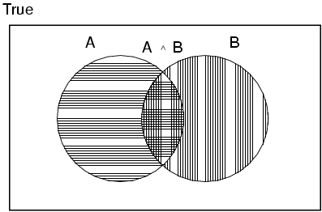
</template>

</TeachingStep>

Notebooks : <a href="https://github.com/jsboige/CoursIA/blob/main/MyIA.AI.Notebooks/Probas/Infer/Infer-01b-Premiers-Modeles.ipynb" target="_blank" rel="noopener">Infer-01b-Premiers-Modeles</a> (variables aléatoires, distributions) · <a href="https://github.com/jsboige/CoursIA/blob/main/MyIA.AI.Notebooks/Probas/Infer/Infer-02-Gaussian-Mixtures.ipynb" target="_blank" rel="noopener">Infer-02-Gaussian-Mixtures</a> (gaussiennes, lois conjuguées).

---

# Probabilités a priori

- **Probabilités inconditionnelles ou a priori de propositions**
  - E.g. P(Carie = vrai) et P(Temps = ensoleillé) = 0.72
  - État de croyance a priori en l'absence d'observation
- **La distribution de probabilité donne les valeurs pour toutes les assignations:**
  - P(Temps) = <0.72, 0.1, 0.08, 0.1> (normalisées, i.e. la somme vaut 1)
- **Distribution de probabilités conjointe**
  - Pour des variables aléatoires, la probabilité de chacun de leurs évènements atomiques
  - P(Temps, Carie) = une matrice 4 x 2

| Temps = | Soleil | Pluie | Nuages | Neige |
|---------|--------|-------|--------|-------|
| Carie = true | 0.144 | 0.02 | 0.016 | 0.02 |
| Carie = false | 0.576 | 0.08 | 0.064 | 0.08 |

- Chaque question sur un domaine peut être répondue par la distribution conjointe

Notebooks : <a href="https://github.com/jsboige/CoursIA/blob/main/MyIA.AI.Notebooks/Probas/Infer/Infer-01b-Premiers-Modeles.ipynb" target="_blank" rel="noopener">Infer-01b-Premiers-Modeles</a> (priors, distributions conjointes) · <a href="https://github.com/jsboige/CoursIA/blob/main/MyIA.AI.Notebooks/Probas/Infer/Infer-02-Gaussian-Mixtures.ipynb" target="_blank" rel="noopener">Infer-02-Gaussian-Mixtures</a> (variables continues, gaussiennes).

---
layout: default
class: fig
---

# Probabilités des variables continues

<TeachingStep placement="below" size="lg" class="fig-full">

- Pour une variable continue, $P(X = x) = 0$ : on raisonne avec une **densité** $p(x)$, et $P(a \le X \le b) = \int_a^b p(x)\,dx$.
- **Uniforme** sur $[18, 26]$ (à gauche) : densité constante $1/8 = 0{,}125$, d’intégrale 1. **Gaussienne** (à droite) : $p(x) = \frac{1}{\sigma\sqrt{2\pi}}\, e^{-(x-\mu)^2/2\sigma^2}$.

<template #visual>

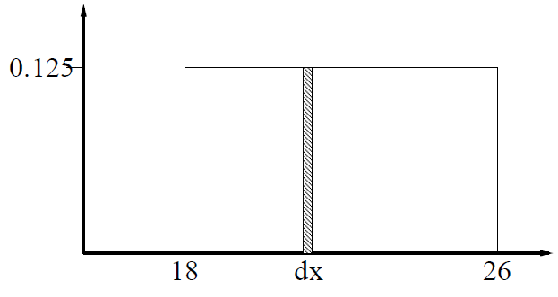
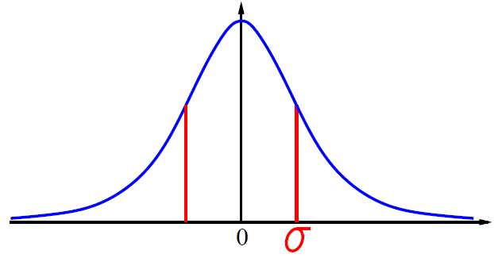

</template>

</TeachingStep>

---
layout: dense
---

# Probabilités conditionnelles

- **Probabilités conditionnelles ou a posteriori**
  - E.g. P(Carie | MalDeDent) = 0.8
  - i.e. "sachant uniquement" Mal De Dent
- **Notation pour distributions conditionnelles:**
  - P(Carie | MalDeDent) = vecteur à 2 elts de vecteurs à 2 elts
- **Si l'on sait plus**
  - P(Carie | MalDeDent, Carie) = 1
- **Des observations peuvent être non pertinentes**
  - Permettent la simplification
  - P(Carie | MalDeDent, ensoleillé) = P(Carie | MalDeDent) = 0.8

Notebooks : <a href="https://github.com/jsboige/CoursIA/blob/main/MyIA.AI.Notebooks/Probas/Infer/Infer-01b-Premiers-Modeles.ipynb" target="_blank" rel="noopener">Infer-01b-Premiers-Modeles</a> (distributions conditionnelles) · <a href="https://github.com/jsboige/CoursIA/blob/main/MyIA.AI.Notebooks/Probas/Infer/Infer-03-Factor-Graphs.ipynb" target="_blank" rel="noopener">Infer-03-Factor-Graphs</a> (produit de facteurs, chaînage).

---

# Règles de calcul probabiliste

- **Règle du produit**
  - P(a ∧ b) = P(a | b) P(b) = P(b | a) P(a)
  - Soit P(a | b) = P(a ∧ b) / P(b) si P(b) > 0
  - P(Temps, Carie) = P(Temps | Carie) P(Carie) produit terme à terme, pas matriciel
- **Règle de chaînage = dérivation successive**
  - P(X₁, …, Xₙ) = P(X₁, …, Xₙ₋₁) P(Xₙ | X₁, …, Xₙ₋₁)
  - = P(X₁) P(X₂ | X₁)… P(Xₙ₋₁ | X₁, …, Xₙ₋₂) P(Xₙ | X₁, …, Xₙ₋₁)
  - = πⁿᵢ₌₁ P(Xᵢ | X₁, …, Xᵢ₋₁)

---
layout: default
class: fig
---

# Inférence par énumération

<TeachingStep placement="end" size="md">

- **Probabilité d’une proposition** $\varphi$ : sommer les événements atomiques où elle est vraie, $P(\varphi) = \sum_{\omega \models \varphi} P(\omega)$.
- $P(\text{MalDeDents}) = 0{,}108 + 0{,}012 + 0{,}016 + 0{,}064 = 0{,}2$ (en haut).
- **Conditionnelle** (en bas) : diviser par la probabilité de l’observation.

$$
P(\lnot\text{Carie} \mid \text{MalDeDents}) = \frac{P(\lnot\text{Carie} \land \text{MalDeDents})}{P(\text{MalDeDents})} = \frac{0{,}016 + 0{,}064}{0{,}2} = 0{,}4
$$

- Et donc $P(\text{Carie} \mid \text{MalDeDents}) = 0{,}6$.

<template #visual>

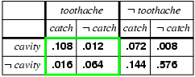
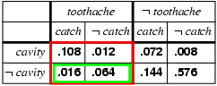

</template>

</TeachingStep>

Notebooks : <a href="https://github.com/jsboige/CoursIA/blob/main/MyIA.AI.Notebooks/Probas/Infer/Infer-03-Factor-Graphs.ipynb" target="_blank" rel="noopener">Infer-03-Factor-Graphs</a> (énumération, élimination de variables) · <a href="https://github.com/jsboige/CoursIA/blob/main/MyIA.AI.Notebooks/Probas/PyMC/PyMC-03-Factor-Graphs.ipynb" target="_blank" rel="noopener">PyMC-03-Factor-Graphs</a> (même approche en PyMC).

---
layout: dense
class: fig
---

# Normalisation

<TeachingStep placement="end" size="sm">

- **Le dénominateur est une constante de normalisation** $\alpha = 1/P(\text{md})$ ($\text{md}$ = MalDeDents) :

$$
\begin{aligned}
\mathbf P(\text{Carie} \mid \text{md}) &= \alpha\,[\mathbf P(\text{Carie}, \text{md}, \text{croche}) + \mathbf P(\text{Carie}, \text{md}, \lnot\text{croche})] \\
&= \alpha\,[\langle 0{,}108 ; 0{,}016\rangle + \langle 0{,}012 ; 0{,}064\rangle] \\
&= \alpha\,\langle 0{,}12 ; 0{,}08\rangle = \langle 0{,}6 ; 0{,}4\rangle
\end{aligned}
$$

- **Idée générale** : variable de requête $Y$, observations $E = e$, variables cachées $H$ sur lesquelles on somme :

$$
\mathbf P(Y \mid E = e) = \alpha\,\mathbf P(Y, E = e) = \alpha \sum_h \mathbf P(Y, E = e, H = h)
$$

- **Problèmes** : temps et espace en $O(d^n)$ pour $n$ variables, où $d$ est le plus grand nombre de valeurs d’une variable ; et comment obtenir les $O(d^n)$ nombres de la table ?

<template #visual>
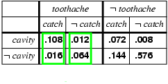
</template>

</TeachingStep>

---
layout: default
class: fig
---

# Indépendance

<TeachingStep placement="below" size="lg" class="fig-xl">

- $A$ et $B$ sont **indépendants** si et seulement si $P(A \mid B) = P(A)$, ou $P(B \mid A) = P(B)$, ou $P(A, B) = P(A)\,P(B)$.
- **Exemple** : $\mathbf P(\text{MalDeDent}, \text{Croche}, \text{Carie}, \text{Temps}) = \mathbf P(\text{MalDeDent}, \text{Croche}, \text{Carie})\,\mathbf P(\text{Temps})$. La table de $2 \times 2 \times 2 \times 4 = 32$ entrées se décompose en $8 + 4$ (figure).
- **Complexité** : $n$ lancers de pièce indépendants, $O(2^n) \to O(n)$. Puissant mais rare : chez le dentiste, des centaines de variables restent dépendantes.

<template #visual>
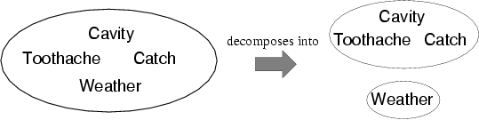
</template>

</TeachingStep>

Notebooks : <a href="https://github.com/jsboige/CoursIA/blob/main/MyIA.AI.Notebooks/Probas/Infer/Infer-04-Bayesian-Networks.ipynb" target="_blank" rel="noopener">Infer-04-Bayesian-Networks</a> (indépendances encodées par la topologie).

---

# Indépendance conditionnelle

- **Croche est conditionnellement indépendant de Mal De Dents:**
  - (1) P(Croche | MalDeDent, Carie) = P(Croche | Carie)
  - (2) P(Croche | MalDeDent, ¬Carie) = P(Croche | ¬Carie)
  - P(Croche | MalDeDent, Carie) = P(Croche | Carie)
  - P(MalDeDent | Croche, Carie) = P(MalDeDent | Carie)
  - P(MalDeDent, Croche | Carie) = P(MalDeDent | Carie) P(Croche | Carie)
- **Utilisation de la règle de chaînage:**
  - P(MalDeDent, Croche, Carie) = P(MalDeDent | Carie) P(Croche | Carie) P(Carie)
- **Réduction de la complexité:**
  - Peut réduire depuis la distribution conjointe de O(2ⁿ) à O(n)
  - Notre connaissance la plus basique et robuste en environnement incertain

---

# Règle de Bayes

- **Règle du produit:**
  - P(a ∧ b) = P(a | b) P(b) = P(b | a) P(a)
  - → Règle de Bayes
  - P(a | b) = P(b | a) P(a) / P(b)
- **Sous forme de distribution:**
  - P(Y | X) = P(X | Y) P(Y) / P(X) = α P(X | Y) P(Y)
- **Utile pour déterminer les probabilités de diagnostic depuis les probabilités causales**
  - P(Cause | Effet) = P(Effet | Cause) P(Cause) / P(Effet)
- **Ex: méningite, nuque douloureuse:**
  - P(m | s) = P(s | m) P(m) / P(s) = 0.8 × 0.0001 / 0.1 = 0.0008
  - La probabilité a posteriori est encore très faible

Notebooks : <a href="https://github.com/jsboige/CoursIA/blob/main/MyIA.AI.Notebooks/Probas/Infer/Infer-04-Bayesian-Networks.ipynb" target="_blank" rel="noopener">Infer-04-Bayesian-Networks</a> (règle de Bayes, modèle naïf) · <a href="https://github.com/jsboige/CoursIA/blob/main/MyIA.AI.Notebooks/Probas/Infer/Infer-09-Classification.ipynb" target="_blank" rel="noopener">Infer-09-Classification</a> (classification bayésienne naïve).

---
layout: default
class: fig
---

# Bayes et indépendance conditionnelle

<TeachingStep placement="below" size="lg" class="fig-xl">

**Exemple** — MalDeDent et Croche sont indépendants sachant Carie :

$$
\mathbf P(\text{Carie} \mid \text{md} \land \text{croche}) = \alpha\,\mathbf P(\text{md} \land \text{croche} \mid \text{Carie})\,\mathbf P(\text{Carie}) = \alpha\,\mathbf P(\text{md} \mid \text{Carie})\,\mathbf P(\text{croche} \mid \text{Carie})\,\mathbf P(\text{Carie})
$$

**Modèle bayésien naïf** (figure) : $\mathbf P(\text{Cause}, \text{Effet}_1, \dots, \text{Effet}_n) = \mathbf P(\text{Cause}) \prod_i \mathbf P(\text{Effet}_i \mid \text{Cause})$ — le nombre de paramètres devient linéaire en $n$.

<template #visual>
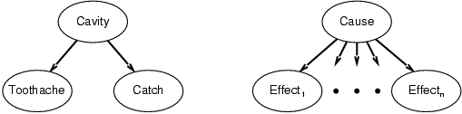
</template>

</TeachingStep>

---

# Résumé

- **Les probabilités sont un formalisme rigoureux pour la connaissance incertaine**
- **La distribution conjointe de probabilité spécifie la probabilité de chaque évènement atomique**
- **Les questions peuvent être répondues en sommant sur les évènements atomiques**
- **Pour des domaines non triviaux, on doit trouver un moyen de réduire la taille conjointe**
  - L'indépendance et l'indépendance conditionnelle fournissent de bons outils

---
layout: section
---

# Questions?

---

# Sommaire

- Quantification de l'incertitude
- **Raisonnement probabiliste**
  - Réseaux Bayésiens
  - Domaines experts simples
- Raisonnement probabiliste temporel
- Prise de décision simple
- Prise de décision complexe

---

# Réseaux Bayésiens

- **Une notation simple, graphique**
  - Pour les assertions d'indépendance conditionnelle
  - Et pour la spécification compacte d'une distribution conjointe complète
- **Syntaxe:**
  - Un ensemble de nœuds, un par variable
  - Un graphe dirigé acyclique (lien ≈ "influences directes")
  - Une distribution conditionnelle pour chaque nœud, étant donné ses parents:
    - P(Xᵢ | Parents(Xᵢ))
- **Dans le cas le plus simple:**
  - Une distribution conditionnelle est représentée par une table de probabilités conditionnelles (CPT)
  - Donnant la distribution en Xᵢ pour chaque combinaison de valeur parente

Notebooks : <a href="https://github.com/jsboige/CoursIA/blob/main/MyIA.AI.Notebooks/Probas/Infer/Infer-04-Bayesian-Networks.ipynb" target="_blank" rel="noopener">Infer-04-Bayesian-Networks</a> (RB classiques : CPT, topologie, compacité) · <a href="https://github.com/jsboige/CoursIA/blob/main/MyIA.AI.Notebooks/Probas/PyMC/PyMC-04-Bayesian-Networks.ipynb" target="_blank" rel="noopener">PyMC-04-Bayesian-Networks</a> (jumeau PyMC).

<!-- Reseau bayesien : DAG + tables de probabilités conditionnelles (CPT) -->

---
layout: default
class: fig
---

# Exemple : la topologie encode les indépendances

<TeachingStep placement="end" size="md">

- **Weather** (le temps) est indépendant des autres variables.
- **Toothache** (mal de dents) et **Catch** (la sonde accroche) sont conditionnellement indépendants sachant **Cavity** (carie) : la carie cause les deux symptômes, qui ne s’influencent pas directement.
- La conjointe se factorise donc selon le graphe :

$$
\mathbf P(W, Ca, T, Cr) = \mathbf P(W)\,\mathbf P(Ca)\,\mathbf P(T \mid Ca)\,\mathbf P(Cr \mid Ca)
$$

<template #visual>
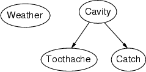
</template>

</TeachingStep>

---
layout: default
---

# Exemple : l’alarme

- **Mise en situation :**
  - « Au travail, mon voisin John m’appelle pour me prévenir que mon alarme sonne, mais ma voisine Marie n’appelle pas. Parfois l’alarme est déclenchée par de petits tremblements de terre. Y a-t-il un cambrioleur ? »
- **Variables :**
  - Burglary (cambriolage), Earthquake (séisme), Alarm, JohnCalls, MaryCalls
- **La topologie du réseau reflète la connaissance « causale » :**
  - Un cambrioleur peut déclencher l’alarme
  - Un séisme peut déclencher l’alarme
  - L’alarme peut pousser Marie à appeler
  - L’alarme peut pousser John à appeler

---
layout: default
class: fig
---

# Le réseau de l’alarme et ses tables

<TeachingStep placement="end" size="lg" class="fig-xl">

Chaque nœud porte sa table de probabilités conditionnelles (CPT) :

- $P(b) = 0{,}001$ et $P(e) = 0{,}002$
- $P(a \mid b, e) = 0{,}95$, $P(a \mid b, \lnot e) = 0{,}94$
- $P(a \mid \lnot b, e) = 0{,}29$, $P(a \mid \lnot b, \lnot e) = 0{,}001$
- $P(j \mid a) = 0{,}90$, $P(j \mid \lnot a) = 0{,}05$
- $P(m \mid a) = 0{,}70$, $P(m \mid \lnot a) = 0{,}01$

Une ligne de CPT ne donne que $P(X = \text{vrai})$ : le complément vaut $1 - p$.

<template #visual>
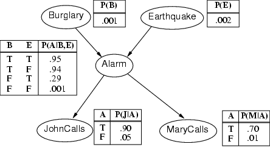
</template>

</TeachingStep>

---
layout: default
class: fig
---

# Compacité

<TeachingStep placement="end" size="sm">

- Une CPT pour une variable booléenne $X_i$ à $k$ parents booléens a $2^k$ lignes, une par combinaison des valeurs des parents.
  - Chaque ligne demande un nombre $p$ pour $X_i = \text{vrai}$ ; celui de $X_i = \text{faux}$ vaut $1 - p$.
- Si chaque variable a au plus $k$ parents, le réseau complet demande $O(n \cdot 2^k)$ nombres : une croissance linéaire en $n$, contre $O(2^n)$ pour la conjointe complète.
- **Réseau de l’alarme** : $1 + 1 + 4 + 2 + 2 = 10$ nombres, contre $2^5 - 1 = 31$.

<template #visual>

</template>

</TeachingStep>

---
layout: default
class: fig
---

# Sémantique

<TeachingStep placement="end" size="sm">

La conjointe complète est le produit des distributions conditionnelles locales :

$$
P(X_1, \dots, X_n) = \prod_{i=1}^{n} P(X_i \mid \text{Parents}(X_i))
$$

**Exemple** — l’alarme sonne et les deux voisins appellent, sans cambriolage ni séisme :

$$
\begin{aligned}
P(j \land m \land a \land \lnot b \land \lnot e) &= P(j \mid a)\,P(m \mid a)\,P(a \mid \lnot b, \lnot e)\,P(\lnot b)\,P(\lnot e) \\
&= 0{,}90 \times 0{,}70 \times 0{,}001 \times 0{,}999 \times 0{,}998 \approx 0{,}000628
\end{aligned}
$$

<template #visual>
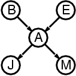
</template>

</TeachingStep>

---

# Construction de réseaux Bayésiens

- **1. On choisit un ordre de variables X₁, …, Xₙ**
- **2. De i = 1 à n**
  - On ajoute Xᵢ au réseau
  - On sélectionne les parents de X₁, …, Xᵢ₋₁ tels que
  - P(Xᵢ | Parents(Xᵢ)) = P(Xᵢ | X₁, ..., Xᵢ₋₁)
- **Ce choix de parents garantit:**
  - P(X₁, …, Xₙ) = πⁿᵢ₌₁ P(Xᵢ | X₁, …, Xᵢ₋₁) (règle de chaîne)
  - = πⁿᵢ₌₁ P(Xᵢ | Parents(Xᵢ)) (par construction)

---
layout: default
class: fig
---

# Construction dans l’ordre M, J, A, B, E

<TeachingStep placement="end" size="md">

**Supposons qu’on choisisse l’ordre M, J, A, B, E**

- $P(J \mid M) = P(J)$ ?

<template #visual>
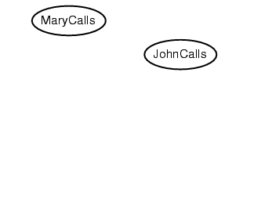
</template>

</TeachingStep>

---
layout: default
class: fig
---

# Construction dans l’ordre M, J, A, B, E

<TeachingStep placement="end" size="md">

**Supposons qu’on choisisse l’ordre M, J, A, B, E**

- $P(J \mid M) = P(J)$ ? **Non**
- $P(A \mid J, M) = P(A \mid J)$ ? $P(A \mid J, M) = P(A)$ ?

<template #visual>
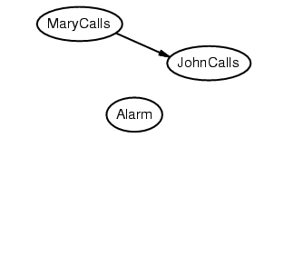
</template>

</TeachingStep>

---
layout: default
class: fig
---

# Construction dans l’ordre M, J, A, B, E

<TeachingStep placement="end" size="md">

**Supposons qu’on choisisse l’ordre M, J, A, B, E**

- $P(J \mid M) = P(J)$ ? **Non**
- $P(A \mid J, M) = P(A \mid J)$ ? $P(A \mid J, M) = P(A)$ ? **Non**
- $P(B \mid A, J, M) = P(B \mid A)$ ?
- $P(B \mid A, J, M) = P(B)$ ?

<template #visual>
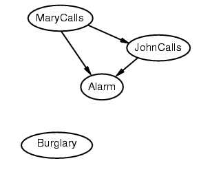
</template>

</TeachingStep>

---
layout: default
class: fig
---

# Construction dans l’ordre M, J, A, B, E

<TeachingStep placement="end" size="md">

**Supposons qu’on choisisse l’ordre M, J, A, B, E**

- $P(J \mid M) = P(J)$ ? **Non**
- $P(A \mid J, M) = P(A \mid J)$ ? $P(A \mid J, M) = P(A)$ ? **Non**
- $P(B \mid A, J, M) = P(B \mid A)$ ? **Oui**
- $P(B \mid A, J, M) = P(B)$ ? **Non**
- $P(E \mid B, A, J, M) = P(E \mid A)$ ?
- $P(E \mid B, A, J, M) = P(E \mid A, B)$ ?

<template #visual>
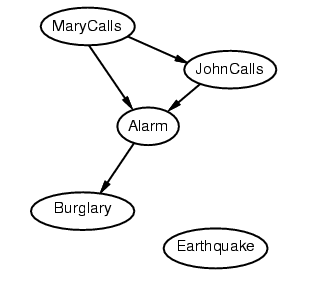
</template>

</TeachingStep>

---
layout: default
class: fig
---

# Construction dans l’ordre M, J, A, B, E

<TeachingStep placement="end" size="md">

**Supposons qu’on choisisse l’ordre M, J, A, B, E**

- $P(J \mid M) = P(J)$ ? **Non**
- $P(A \mid J, M) = P(A \mid J)$ ? $P(A \mid J, M) = P(A)$ ? **Non**
- $P(B \mid A, J, M) = P(B \mid A)$ ? **Oui**
- $P(B \mid A, J, M) = P(B)$ ? **Non**
- $P(E \mid B, A, J, M) = P(E \mid A)$ ? **Non**
- $P(E \mid B, A, J, M) = P(E \mid A, B)$ ? **Oui**

Sachant que l’alarme sonne, apprendre un cambriolage rend le séisme moins probable : Earthquake garde deux parents.

<template #visual>

</template>

</TeachingStep>

---
layout: default
class: fig
---

# Exemple (suite)

<TeachingStep placement="end" size="md">

- **Décider de l’indépendance conditionnelle est difficile dans les directions non causales.**
  - Les modèles causaux semblent « câblés » chez l’humain.
- **Le réseau est moins compact** : $1 + 2 + 4 + 2 + 4 = 13$ nombres, au lieu de 10 dans l’ordre causal.
- Avec l’ordre M, J, E, B, A, c’est pire encore : le réseau devient complet et demande 31 nombres, autant que la conjointe.

<template #visual>
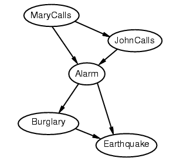
</template>

</TeachingStep>

---
layout: default
class: fig
---

# Représentation efficace

<TeachingStep placement="end" size="lg">

- **Relations d’indépendance conditionnelle**
  - (a) Un nœud est indépendant de ses non-descendants, sachant ses parents.
  - (b) **Couverture de Markov** : un nœud est indépendant du reste du réseau sachant ses parents, ses enfants et les parents de ses enfants.
- **Distributions canoniques**
  - Une CPT complète est fastidieuse : $O(2^k)$ nombres dans le pire cas.
  - On lui préfère des schémas standard, décrits par quelques paramètres.

<template #visual>
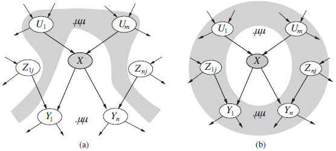
</template>

</TeachingStep>

---
layout: dense
class: fig
---

# Distributions canoniques (exemples)

<TeachingStep placement="end" size="md">

- **Nœuds déterministes** : l’enfant est une fonction de ses parents.
  - Canadien, US, Mexicain → Nord-Américain (disjonction)
  - Concessionnaires → meilleur prix (min) ; débits entrant et sortant → niveau d’un lac (différence)
- **OU bruité** : chaque cause peut être inhibée par un bruit indépendant, de probabilité $q_j$ ; un nœud de fuite couvre les causes oubliées.

$$
P(x_i \mid \text{parents}(X_i)) = 1 - \prod_{\{j \,:\, X_j = \text{vrai}\}} q_j
$$

- **Exemple** (table) : Fever selon Cold, Flu, Malaria, avec $q_{\text{cold}} = 0{,}6$, $q_{\text{flu}} = 0{,}2$, $q_{\text{malaria}} = 0{,}1$. **Trois nombres** suffisent pour les huit lignes, p. ex. $P(\lnot\text{fever} \mid \text{cold}, \text{flu}, \lnot\text{malaria}) = 0{,}6 \times 0{,}2 = 0{,}12$.

<template #visual>
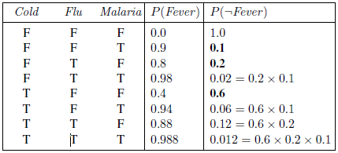
</template>

</TeachingStep>

---
layout: default
class: fig
---

# Variables continues

<TeachingStep placement="below" size="lg" class="fig-full">

- Taille, masse, prix, température… **Discrétiser** en intervalles fixes est simple mais imprécis ; mieux vaut une **densité**, paramétrique (gaussienne : moyenne et variance) ou non paramétrique (définie par les exemples).
- **Gaussienne linéaire** : le coût $c$ d’un produit dépend linéairement de la récolte $h$, avec des paramètres propres à chaque valeur du parent discret *subvention* :

$$
P(c \mid h, \text{subv.}) = \mathcal N(a_t h + b_t,\ \sigma_t^2)(c) \qquad P(c \mid h, \lnot\text{subv.}) = \mathcal N(a_f h + b_f,\ \sigma_f^2)(c)
$$

<template #visual>
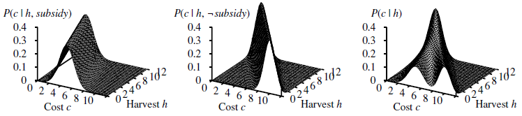
</template>

</TeachingStep>

Notebooks : <a href="https://github.com/jsboige/CoursIA/blob/main/MyIA.AI.Notebooks/Probas/Infer/Infer-02-Gaussian-Mixtures.ipynb" target="_blank" rel="noopener">Infer-02-Gaussian-Mixtures</a> (gaussiennes, lois conjuguées) · <a href="https://github.com/jsboige/CoursIA/blob/main/MyIA.AI.Notebooks/Probas/Infer/Infer-16-Sparse-Gaussian-Process.ipynb" target="_blank" rel="noopener">Infer-16-Sparse-Gaussian-Process</a> (processus gaussiens, classification probit).

---
layout: default
class: fig
---

# Réseau bayésien hybride

<TeachingStep placement="end" size="md">

- **Variables discrètes et continues** dans un même réseau.
- **Enfant continu** : gaussienne linéaire (planche précédente). Si toutes les variables sont gaussiennes linéaires, la conjointe est une gaussienne multivariée, et la loi a posteriori reste gaussienne.
- **Enfant discret, parent continu** : un seuil « doux », p. ex. *acheter* selon le coût $c$ :
  - **probit** : $P(\text{acheter} \mid c) = \Phi\big((-c + \mu)/\sigma\big)$, intégrale de la loi normale ;
  - **logit** : $P(\text{acheter} \mid c) = 1 / \big(1 + e^{-2(-c + \mu)/\sigma}\big)$, une sigmoïde aux queues plus longues.

<template #visual>
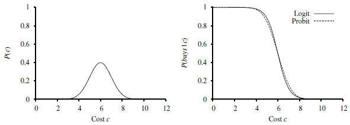
</template>

</TeachingStep>

---
layout: default
class: fig
---

# Distribution a priori conjuguée

<TeachingStep placement="end" size="lg">

- **Quelle loi a priori choisir ?** Une loi **conjuguée** : la loi a posteriori reste dans la même famille, seuls les paramètres changent.
- Règle de Bayes pour un paramètre $\theta$ :

$$
p(\theta \mid x) = \frac{p(x \mid \theta)\,p(\theta)}{p(x)} = \frac{p(x \mid \theta)\,p(\theta)}{\int p(x \mid \theta')\,p(\theta')\,d\theta'}
$$

- Avec une loi conjuguée, l’intégrale du dénominateur a une forme close.
- Référence : [Conjugate prior (Wikipédia)](https://en.wikipedia.org/wiki/Conjugate_prior)

<template #visual>
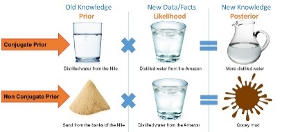
</template>

</TeachingStep>

---
layout: default
---

# Familles conjuguées usuelles

| Vraisemblance (observations) | Loi a priori conjuguée | Paramètre |
|---|---|---|
| Bernoulli, binomiale, géométrique, binomiale négative | Beta | probabilité de succès $p$ |
| Catégorielle, multinomiale | Dirichlet | vecteur de probabilités |
| Poisson, exponentielle | Gamma | taux $\lambda$ |
| Normale, variance connue | Normale | moyenne $\mu$ |
| Normale, moyenne connue | Gamma | précision $\tau = 1/\sigma^2$ |

- **Mise à jour Beta–binomiale** : a priori $\text{Beta}(\alpha, \beta)$, $k$ succès sur $n$ essais, a posteriori $\text{Beta}(\alpha + k,\ \beta + n - k)$. Les paramètres se lisent comme des succès et des échecs « virtuels » observés avant les données.

Notebooks : <a href="https://github.com/jsboige/CoursIA/blob/main/MyIA.AI.Notebooks/Probas/Infer/Infer-02-Gaussian-Mixtures.ipynb" target="_blank" rel="noopener">Infer-02-Gaussian-Mixtures</a> (lois conjuguées, scénario du cycliste) · <a href="https://github.com/jsboige/CoursIA/blob/main/MyIA.AI.Notebooks/Probas/PyMC/PyMC-01-Setup.ipynb" target="_blank" rel="noopener">PyMC-01-Setup</a> (a priori Beta-Bernoulli, biais d’une pièce).

---
layout: default
class: fig
---

# Inférence exacte dans les réseaux bayésiens

<TeachingStep placement="below" size="lg" class="fig-xl">

- **Énumération** : sommer la conjointe factorisée sur les variables cachées. **Élimination de variables** : ranger chaque somme au plus près des facteurs qui en dépendent, et ne calculer chaque facteur qu’une fois.

$$
\mathbf P(B \mid j, m) = \alpha\,\underbrace{\mathbf P(B)}_{f_1(B)} \sum_e \underbrace{P(e)}_{f_2(E)} \sum_a \underbrace{\mathbf P(a \mid B, e)}_{f_3(A,B,E)}\,\underbrace{P(j \mid a)}_{f_4(A)}\,\underbrace{P(m \mid a)}_{f_5(A)}
$$

- **Clustering** (figure) : fusionner des nœuds en méga-nœuds (Sprinkler + Rain) pour obtenir un polyarbre, où l’inférence est linéaire.

<template #visual>
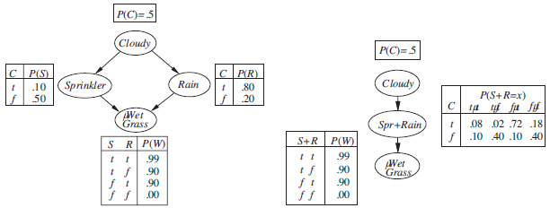
</template>

</TeachingStep>

---
layout: default
---

# Inférence approchée dans les réseaux bayésiens

- **Échantillonnage a priori** : tirer chaque variable dans l’ordre topologique selon sa CPT ; la fréquence d’un événement estime sa probabilité.
- **Échantillonnage par rejet** : jeter les échantillons incompatibles avec l’observation — un gaspillage quand l’observation est rare.
- **Pondération par vraisemblance** : fixer les variables observées et pondérer chaque échantillon par la vraisemblance de l’observation, $w(\mathbf z, \mathbf e) = \prod_{i=1}^{m} P(e_i \mid \text{parents}(E_i))$.
- **MCMC (Gibbs, Metropolis-Hastings)** : une marche aléatoire dans l’espace des états ; Gibbs retire chaque variable non observée sachant sa couverture de Markov. La chaîne converge vers la loi cible $\pi$ grâce à l’**équilibre détaillé** : $\pi(\mathbf x)\,q(\mathbf x \to \mathbf x') = \pi(\mathbf x')\,q(\mathbf x' \to \mathbf x)$.

Notebooks : <a href="https://github.com/jsboige/CoursIA/blob/main/MyIA.AI.Notebooks/Probas/Fondations/Probas-MCMC-Echantillonnage-Metropolis-Python.ipynb" target="_blank" rel="noopener">Probas-MCMC-Echantillonnage-Metropolis-Python</a> (Metropolis-Hastings et Gibbs codés à la main, diagnostics) · <a href="https://github.com/jsboige/CoursIA/blob/main/MyIA.AI.Notebooks/Probas/Fondations/Probas-MCMC-Echantillonnage-Metropolis-CSharp.ipynb" target="_blank" rel="noopener">version C#</a>.

---
layout: default
class: fig
---

# Modèles relationnels du premier ordre

<TeachingStep placement="end" size="md">

- **Les réseaux bayésiens sont propositionnels** ; la logique du premier ordre parle d’**objets et de relations**.
  - Exemple : évaluer des livres malgré la partialité des critiques → prédicats $\text{Impartial}(c)$, $\text{Indulgent}(c)$, $\text{Mérite}(l)$.
- **Mondes possibles** : une assignation des variables = un monde ; la sémantique de base de données (noms uniques, monde clos) borne la taille du problème.
- **Modèles probabilistes relationnels (MPR)** : des variables aléatoires définies par la syntaxe du premier ordre, chacune avec sa distribution conditionnelle ; indépendance contextuelle par branchement, p. ex. *si* $\text{Impartial}(c)$, *si* $\text{Fan}(c, \text{Auteur}(l))$.

<template #visual>
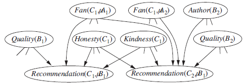
</template>

</TeachingStep>

---
layout: default
---

# MPR : inférence et univers ouverts

- **Inférence par dépliement** : construire le réseau bayésien équivalent (propositionnalisation).
  - Grand réseau, et des variables inconnues (qui est l’auteur ?) donnent des nœuds aux parents très nombreux.
  - Avec une sémantique de base de données : mise en cache, indépendance contextuelle et MCMC efficaces ; comme en logique du premier ordre, le *lifting* évite de tout propositionnaliser.
- **Modèles probabilistes en univers ouvert (MPUO)**
  - On lève la sémantique de base de données : incertitude sur l’**existence** et l’**identité** des objets (p. ex. plusieurs identifiants pour une même personne : attaques Sybil).
  - Exemple : nombre de comptes d’un client — exactement 1 s’il est honnête, sinon tiré d’une loi $\text{LogNormal}[6{,}9 ;\ 2{,}3^2]$.

---

# Résumé réseaux bayésiens

- **Les réseaux Bayésiens fournissent une représentation naturelle pour les indépendance conditionnelles (induites par causalité)**
- **Topologie + CPTs = représentation compacte d'une distribution jointe**
  - Généralement facile à construire pour un expert d'un domaine
- **Représentation efficace/compacte:**
  - Distributions canonique, distributions paramétriques (Gaussiennes etc.)
- **Inférence = calcul de variables de requêtes**
  - Exacte: énumération, élimination, clustering → Efficace dans les polyarbres
  - Approximée: Echantillonnage a priori, par rejet, par vraisemblance, Méthodes de Monte-Carlo (Gibbs)
- **Modèles relationnels**
  - Combinaison avec FOL = Modèles probabilistes relationnels (MPR)
  - + Incertitude d'existence et d'identité = MP en Univers Ouvert

Notebooks : <a href="https://github.com/jsboige/CoursIA/blob/main/MyIA.AI.Notebooks/Probas/Infer/Infer-03-Factor-Graphs.ipynb" target="_blank" rel="noopener">Infer-03-Factor-Graphs</a> (inférence exacte) · <a href="https://github.com/jsboige/CoursIA/blob/main/MyIA.AI.Notebooks/Probas/PyMC/PyMC-03-Factor-Graphs.ipynb" target="_blank" rel="noopener">PyMC-03-Factor-Graphs</a> (inférence approchée) · pas de notebook dédié pour les MPR/univers ouverts.

---
class: nb-map nb-k96
---

# Réseaux bayésiens et inférence : les notebooks

Les réseaux bayésiens se construisent et s’interrogent dans Infer.NET comme dans PyMC : on décrit le modèle, le moteur calcule les lois a posteriori — exactement ou par échantillonnage.

Premiers modèles

Variables aléatoires, a priori, observation, a posteriori : la règle de Bayes exécutée par un moteur d’inférence.

<a href="https://github.com/jsboige/CoursIA/blob/main/MyIA.AI.Notebooks/Probas/Infer/Infer-01b-Premiers-Modeles.ipynb" target="_blank" rel="noopener">Infer-01b</a> · <a href="https://github.com/jsboige/CoursIA/blob/main/MyIA.AI.Notebooks/Probas/PyMC/PyMC-01-Setup.ipynb" target="_blank" rel="noopener">PyMC-01-Setup</a>

Graphes de facteurs

Monty Hall, énigme du meurtre, témoins : la conjointe factorisée et l’inférence exacte.

<a href="https://github.com/jsboige/CoursIA/blob/main/MyIA.AI.Notebooks/Probas/Infer/Infer-03-Factor-Graphs.ipynb" target="_blank" rel="noopener">Infer-03-Factor-Graphs</a> · <a href="https://github.com/jsboige/CoursIA/blob/main/MyIA.AI.Notebooks/Probas/PyMC/PyMC-03-Factor-Graphs.ipynb" target="_blank" rel="noopener">PyMC-03</a>

Réseaux bayésiens

Herbe mouillée, d-séparation, causal contre observationnel, diagnostic médical.

<a href="https://github.com/jsboige/CoursIA/blob/main/MyIA.AI.Notebooks/Probas/Infer/Infer-04-Bayesian-Networks.ipynb" target="_blank" rel="noopener">Infer-04-Bayesian-Networks</a> · <a href="https://github.com/jsboige/CoursIA/blob/main/MyIA.AI.Notebooks/Probas/PyMC/PyMC-04-Bayesian-Networks.ipynb" target="_blank" rel="noopener">PyMC-04</a>

Variables continues

Gaussiennes, lois conjuguées, mélanges : le scénario du cycliste.

<a href="https://github.com/jsboige/CoursIA/blob/main/MyIA.AI.Notebooks/Probas/Infer/Infer-02-Gaussian-Mixtures.ipynb" target="_blank" rel="noopener">Infer-02-Gaussian-Mixtures</a> · <a href="https://github.com/jsboige/CoursIA/blob/main/MyIA.AI.Notebooks/Probas/PyMC/PyMC-02-Gaussian-Mixtures.ipynb" target="_blank" rel="noopener">PyMC-02</a>

MCMC à la main

Metropolis-Hastings et Gibbs codés pas à pas, avec leurs diagnostics de convergence.

<a href="https://github.com/jsboige/CoursIA/blob/main/MyIA.AI.Notebooks/Probas/Fondations/Probas-MCMC-Echantillonnage-Metropolis-Python.ipynb" target="_blank" rel="noopener">MCMC Python</a> · <a href="https://github.com/jsboige/CoursIA/blob/main/MyIA.AI.Notebooks/Probas/Fondations/Probas-MCMC-Echantillonnage-Metropolis-CSharp.ipynb" target="_blank" rel="noopener">MCMC C#</a>

De l’observation à l’intervention

P(Y | X) n’est pas P(Y | do(X)) : l’échelle de Pearl et l’inférence causale.

<a href="https://github.com/jsboige/CoursIA/blob/main/MyIA.AI.Notebooks/Probas/Infer/Infer-05-Causal-Inference.ipynb" target="_blank" rel="noopener">Infer-05-Causal-Inference</a> · <a href="https://github.com/jsboige/CoursIA/blob/main/MyIA.AI.Notebooks/Probas/Causalite/Causalite-00-Echelle-de-Pearl-Intro-Python.ipynb" target="_blank" rel="noopener">Causalite-00</a>

<strong>À observer.</strong> Dans Infer-04, observer la pluie fait baisser la probabilité de l’arroseur : comment une cause peut-elle en « expliquer » une autre ?

---
class: nb-concept nb-center nb-k92
---

# L’effet « explaining away » : une cause en chasse une autre

Dans le réseau de l’herbe mouillée, l’arroseur et la pluie causent tous deux l’herbe mouillée. Indépendantes a priori, ces deux causes deviennent dépendantes dès qu’on observe leur effet commun.

Le modèle

Nuageux → Arroseur, Nuageux → Pluie, puis Arroseur → Herbe mouillée ← Pluie. Chaque nœud porte sa CPT.

Observer l’herbe mouillée

P(Arroseur | herbe mouillée) ≈ 0,40 : l’effet rend sa cause possible plus probable.

Puis observer la pluie

P(Arroseur | herbe mouillée, pluie) ≈ 0,19 : la pluie suffit à expliquer l’herbe, l’arroseur redevient peu probable.

Pourquoi

Herbe mouillée est un nœud en V (collider) : l’observer relie ses deux parents. La cause commune Nuageux ajoute sa propre dépendance.

<strong>À observer.</strong> Retirez l’observation de l’herbe mouillée : la pluie change-t-elle encore la probabilité de l’arroseur ? Vérifiez votre réponse avec la d-séparation du notebook.

Notebook : <a href="https://github.com/jsboige/CoursIA/blob/main/MyIA.AI.Notebooks/Probas/Infer/Infer-04-Bayesian-Networks.ipynb" target="_blank" rel="noopener">Infer-04-Bayesian-Networks.ipynb</a>.

---
layout: section
---

# Questions?

---

# Sommaire

- Quantification de l'incertitude
- Raisonnement probabiliste
- **Raisonnement probabiliste temporel**
  - Chaînes de Markov
  - Modèles de Markov Cachés
  - Réseaux Bayésiens dynamiques
  - Filtrage particulaire
- Prise de décision simple
- Prise de décision complexe

---

# Raisonner dans le temps ou l'espace

- **Souvent, nous souhaitons raisonner à propos d'une séquence d'observations**
  - Reconnaissance de la parole
  - Localisation d'un robot
  - Attention d'un utilisateur
  - Monitoring médical
  - Suivi radar
- **Besoin d'introduire le temps (ou l'espace) dans nos modèles**
- Exemples modernes : vehicules autonomes (fusion capteurs), LLMs contextuels (attention temporelle)

Notebooks : <a href="https://github.com/jsboige/CoursIA/blob/main/MyIA.AI.Notebooks/Probas/Infer/Infer-14-Sequences.ipynb" target="_blank" rel="noopener">Infer-14-Sequences</a> (HMM, séries temporelles) · <a href="https://github.com/jsboige/CoursIA/blob/main/MyIA.AI.Notebooks/Probas/Infer/Infer-17-Kalman-Filter.ipynb" target="_blank" rel="noopener">Infer-17-Kalman-Filter</a> (filtres de Kalman) · <a href="https://github.com/jsboige/CoursIA/blob/main/MyIA.AI.Notebooks/Probas/PyMC/PyMC-14-Sequences.ipynb" target="_blank" rel="noopener">PyMC-14-Sequences</a> (jumeau PyMC).

---
layout: default
class: fig
---

# Modèles de Markov

<TeachingStep placement="below" size="md">

- Un modèle (ou une chaîne) de Markov est un **réseau bayésien en forme de chaîne**.
- Il comprend une variable aléatoire $X_t$ par instant $t$ : l’**état** du système.
- Ses paramètres, les **probabilités de transition** (ou dynamique), disent comment le système évolue : $P(X_t \mid X_{t-1})$, plus les probabilités initiales $P(X_1)$.

<template #visual>

</template>

</TeachingStep>

---
layout: default
class: fig
---

# Distribution de probabilités

<TeachingStep placement="below" size="md">

La conjointe de la chaîne se factorise en transitions successives :

$$
P(X_1, X_2, \dots, X_N) = P(X_1) \prod_{t=2}^{N} P(X_t \mid X_{t-1})
$$

**Problème d’inférence courant** : calculer la marginale $P(X_t)$ pour chaque instant $t$.

<template #visual>
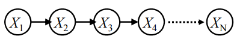
</template>

</TeachingStep>

---
layout: default
class: fig
---

# Indépendance conditionnelle

<TeachingStep placement="below" size="lg" class="fig-xl">

- **Indépendance conditionnelle de base :**
  - Passé et futur sont indépendants sachant le présent.
  - Chaque étape ne dépend que de la précédente : c’est la **propriété de Markov** (du premier ordre).
- **La chaîne n’est qu’un réseau bayésien (extensible) :**
  - Tronquée à une longueur donnée, elle se traite avec les méthodes des réseaux bayésiens classiques.

<template #visual>
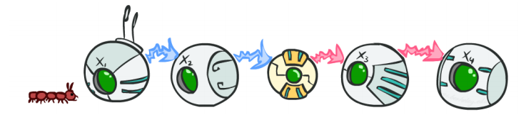
</template>

</TeachingStep>

---
layout: default
class: fig
---

# Exemple : chaîne de Markov

<TeachingStep placement="end" size="md">

- **États** : $X \in \{\text{soleil}, \text{pluie}\}$.
- **Transitions** : $P(\text{soleil} \mid \text{soleil}) = 0{,}9$, $P(\text{pluie} \mid \text{soleil}) = 0{,}1$, $P(\text{soleil} \mid \text{pluie}) = 0{,}3$, $P(\text{pluie} \mid \text{pluie}) = 0{,}7$.
- Chaque flèche porte $P(X_t = x' \mid X_{t-1} = x)$ ; les flèches qui partent d’un état somment à 1.
- **Attention** : ici, les nœuds sont des **valeurs** de la variable, pas des variables comme dans un réseau bayésien.

<template #visual>
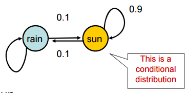
</template>

</TeachingStep>

---
layout: default
class: fig
---

# Inférence sur chaînes de Markov

<TeachingStep placement="below" size="lg" class="fig-full">

- **Question** : quelle est la probabilité d’être dans un état $x$ à l’instant $t$ ?
- **Réponse lente** : énumérer toutes les séquences de longueur $t$ qui finissent en $x$ et sommer leurs probabilités, soit $2^{t-1}$ séquences pour deux états :

$$
P(X_t = \text{soleil}) = \sum_{x_1, \dots, x_{t-1}} P(x_1, \dots, x_{t-1}, \text{soleil})
$$

<template #visual>
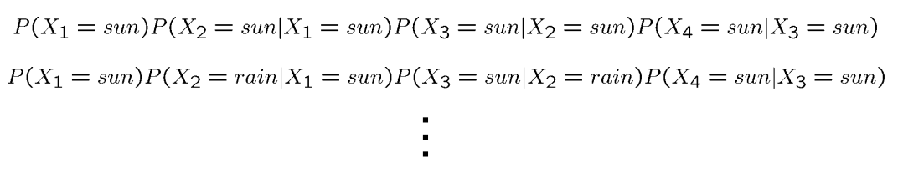
</template>

</TeachingStep>

---
layout: default
class: fig
---

# Distribution conjointe d’un modèle de Markov

<TeachingStep placement="below" size="md">

Sur quatre instants :

$$
P(X_1, X_2, X_3, X_4) = P(X_1)\,P(X_2 \mid X_1)\,P(X_3 \mid X_2)\,P(X_4 \mid X_3)
$$

Plus généralement : $P(X_1, \dots, X_T) = P(X_1) \prod_{t=2}^{T} P(X_t \mid X_{t-1})$.

<template #visual>
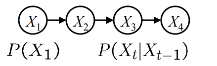
</template>

</TeachingStep>

---
layout: default
class: fig
---

# Récapitulatif : modèles de Markov

<TeachingStep placement="end" size="sm">

- **Distribution conjointe** : $P(X_1, \dots, X_T) = P(X_1) \prod_{t=2}^{T} P(X_t \mid X_{t-1})$.
- **Indépendance conditionnelle supposée** : le futur est indépendant du passé sachant le présent, $X_{t+1} \perp X_{1:t-1} \mid X_t$.
- **Hypothèse supplémentaire, explicite** : $P(X_t \mid X_{t-1})$ est la même pour tout $t$ — la chaîne est **homogène dans le temps** (stationnaire).
- Le nom vient d’Andreï Markov (1856–1922).

<template #visual>
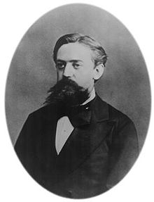
</template>

</TeachingStep>

---
layout: default
class: fig
---

# Algorithme Mini-Forward

<TeachingStep placement="below" size="lg" class="fig-xl">

- **Idée** : propager la distribution d’un instant au suivant, au lieu d’énumérer les séquences.

$$
P(x_t) = \sum_{x_{t-1}} P(x_t \mid x_{t-1})\,P(x_{t-1})
$$

- Chaque pas coûte $O(|X|^2)$ ; le calcul de $P(X_t)$ devient linéaire en $t$.

<template #visual>
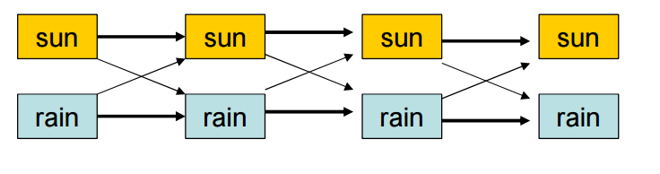
</template>

</TeachingStep>

---
layout: default
---

# Exemple d’exécution Mini-Forward

Transitions de la planche précédente : soleil → soleil 0,9, pluie → soleil 0,3. Chaque cellule donne $\langle P(\text{soleil}) ; P(\text{pluie}) \rangle$.

| Départ | $P(X_1)$ | $P(X_2)$ | $P(X_3)$ | $P(X_4)$ | … | $P(X_\infty)$ |
|---|---|---|---|---|---|---|
| Soleil observé | ⟨1 ; 0⟩ | ⟨0,9 ; 0,1⟩ | ⟨0,84 ; 0,16⟩ | ⟨0,804 ; 0,196⟩ | … | ⟨0,75 ; 0,25⟩ |
| Pluie observée | ⟨0 ; 1⟩ | ⟨0,3 ; 0,7⟩ | ⟨0,48 ; 0,52⟩ | ⟨0,588 ; 0,412⟩ | … | ⟨0,75 ; 0,25⟩ |
| Autre $P(X_1)$ | ⟨p ; 1 − p⟩ | … | … | … | … | ⟨0,75 ; 0,25⟩ |

- Quel que soit le départ, la distribution converge vers la même limite.

---
layout: default
---

# Distributions stationnaires

- Pour la plupart des chaînes, l’influence de la distribution initiale s’amenuise avec le temps : la distribution finale ne dépend plus du point de départ.
- **Distribution stationnaire** $P_\infty$ : celle qu’un pas de plus laisse inchangée,

$$
P_\infty(X) = P_{\infty+1}(X) = \sum_x P(X \mid x)\,P_\infty(x)
$$

- Pour une chaîne finie **irréductible** (tout état est accessible depuis tout autre) et **apériodique**, $P_\infty$ existe, est unique, et la chaîne converge vers elle depuis n’importe quel départ.

---
layout: default
class: fig
---

# Exemple : distribution stationnaire

<TeachingStep placement="end" size="md">

**Question** : que vaut $P(X)$ quand $t \to \infty$ ? On écrit l’invariance pour chaque état :

$$
\begin{aligned}
P_\infty(s) &= 0{,}9\,P_\infty(s) + 0{,}3\,P_\infty(p) \\
P_\infty(p) &= 0{,}1\,P_\infty(s) + 0{,}7\,P_\infty(p)
\end{aligned}
$$

Les deux équations donnent $P_\infty(s) = 3\,P_\infty(p)$ ; avec $P_\infty(s) + P_\infty(p) = 1$ :

$$
P_\infty(s) = 3/4 \qquad P_\infty(p) = 1/4
$$

<template #visual>

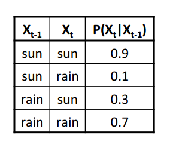

</template>

</TeachingStep>

---
layout: default
class: fig
---

# Application : analyse des liens du web

<TeachingStep placement="end" size="sm">

- **PageRank** : chaque page est un état ; la distribution initiale est uniforme.
- **Transitions** : avec la probabilité $c$, saut vers une page au hasard (pointillés) ; avec $1 - c$, suivre un lien sortant au hasard (traits pleins).
- **Distribution stationnaire** : on passe plus de temps sur les pages très accessibles ; le classement résiste assez bien au spam de liens.
- **Google 1.0** classait les pages contenant les mots-clés par PageRank décroissant. Les moteurs actuels combinent l’analyse de liens avec bien d’autres signaux.

<template #visual>
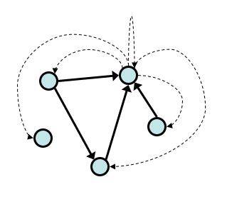
</template>

</TeachingStep>

---
layout: default
class: fig
---

# Modèles de Markov cachés (HMM)

<TeachingStep placement="below" size="lg" class="fig-xl">

- **Une chaîne de Markov seule sert peu à un agent** : sans observation, l’incertitude finit par tout noyer ; il faut des observations pour mettre ses croyances à jour.
- **Modèle de Markov caché** (*Hidden Markov Model*) : une chaîne de Markov sur des états cachés $X_t$, et une observation $E_t$ émise à chaque instant.
- **Vu comme un réseau bayésien** :

<template #visual>

</template>

</TeachingStep>

---
layout: default
class: fig
---

# Exemple : le parapluie

<TeachingStep placement="below" size="lg" class="fig-full">

- Un gardien sans fenêtre voit chaque matin si le directeur arrive avec un parapluie ($U_t$) et en déduit s’il pleut ($R_t$).
- **Transition** : $P(r_t \mid r_{t-1}) = 0{,}7$, $P(r_t \mid \lnot r_{t-1}) = 0{,}3$. **Émission** : $P(u_t \mid r_t) = 0{,}9$, $P(u_t \mid \lnot r_t) = 0{,}2$.

<template #visual>
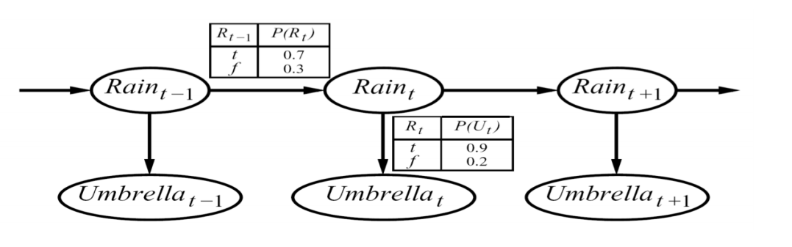
</template>

</TeachingStep>

---
layout: default
class: fig
---

# Distribution conjointe d’un HMM

<TeachingStep placement="below" size="lg" class="fig-xl">

Un HMM est défini par l’état initial $P(X_1)$, les transitions $P(X_t \mid X_{t-1})$ et les émissions $P(E_t \mid X_t)$ :

$$
P(X_{1:T}, E_{1:T}) = P(X_1)\,P(E_1 \mid X_1) \prod_{t=2}^{T} P(X_t \mid X_{t-1})\,P(E_t \mid X_t)
$$

<template #visual>
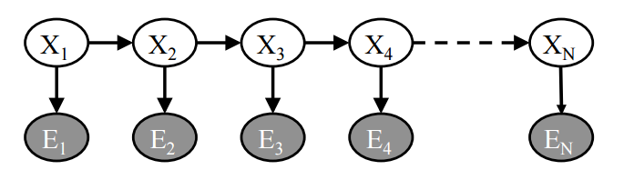
</template>

</TeachingStep>

---
layout: default
---

# Calculs sur un HMM

- **Données** : les paramètres du modèle et les observations $E_{1:T} = e_{1:T}$.
- **Problèmes d’inférence :**
  - **Filtrage** : $P(X_t \mid e_{1:t})$, l’état courant au vu du passé ;
  - **Prédiction** : $P(X_{t+k} \mid e_{1:t})$ pour $k > 0$ ;
  - **Lissage** : $P(X_t \mid e_{1:T})$ pour $t < T$, l’état passé revu à la lumière de toute la séquence ;
  - **Explication la plus probable** : $x^*_{1:T} = \arg\max_{x_{1:T}} P(x_{1:T} \mid e_{1:T})$.

---
layout: default
---

# Exemples réels de HMM

| Application | Observations $E_t$ | États cachés $X_t$ |
|---|---|---|
| Reconnaissance de la parole | signal acoustique (continu) | positions dans des mots (des dizaines de milliers) |
| Traduction automatique | mots (des dizaines de milliers) | options de traduction |
| Suivi d’un robot | mesures de distance (continues) | positions sur une carte (continues) |

- Même structure à chaque fois : une chaîne cachée qu’on ne voit qu’à travers ses émissions bruitées.

---
layout: default
class: fig
---

# Indépendance conditionnelle dans un HMM

<TeachingStep placement="below" size="lg" class="fig-xl">

- **Un HMM a deux propriétés d’indépendance importantes :**
  - le processus caché est markovien : le futur ne dépend du passé qu’à travers le présent.

<template #visual>
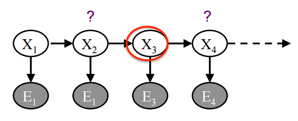
</template>

</TeachingStep>

---
layout: default
class: fig
---

# Indépendance conditionnelle dans un HMM

<TeachingStep placement="below" size="lg" class="fig-xl">

- **Un HMM a deux propriétés d’indépendance importantes :**
  - le processus caché est markovien : le futur ne dépend du passé qu’à travers le présent ;
  - l’observation courante est indépendante de tout le reste sachant l’état courant.

<template #visual>
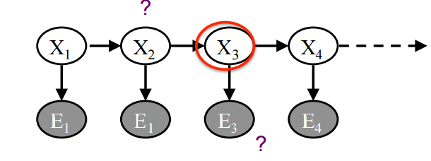
</template>

</TeachingStep>

---
layout: default
class: fig
---

# Indépendance conditionnelle dans un HMM

<TeachingStep placement="below" size="lg" class="fig-xl">

- **Un HMM a deux propriétés d’indépendance importantes :**
  - le processus caché est markovien : le futur ne dépend du passé qu’à travers le présent ;
  - l’observation courante est indépendante de tout le reste sachant l’état courant.
- **Quiz** : les observations sont-elles indépendantes entre elles quand on n’observe rien ?

<v-click>

- **Réponse : non.** Sans évidence, les observations restent corrélées à travers la chaîne cachée : voir $E_1$ renseigne sur $X_1$, donc sur $X_2$, donc sur $E_2$.

</v-click>

<template #visual>
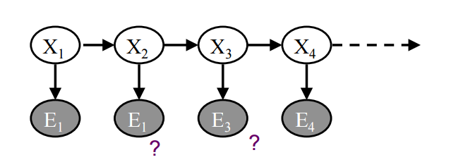
</template>

</TeachingStep>

---
layout: default
---

# Notation des HMM

- Un HMM se note par le triplet $\lambda = (\Pi, A, B)$ :
  - $\Pi = (\pi_i)$, les probabilités initiales : $\pi_i = P(X_1 = i)$ ;
  - $A = (a_{ij})$, la matrice de transition : $a_{ij} = P(X_t = j \mid X_{t-1} = i)$, chaque ligne somme à 1 ;
  - $B = (b_j(k))$, la matrice d’émission (ou de confusion) : $b_j(k) = P(E_t = k \mid X_t = j)$.
- **Trois problèmes classiques**, traités dans les planches suivantes :
  1. **Évaluation** : $P(e_{1:T} \mid \lambda)$ — algorithme *forward* ;
  2. **Décodage** : la séquence d’états la plus probable — algorithme de Viterbi ;
  3. **Apprentissage** : estimer $\lambda$ à partir des observations — algorithme de Baum-Welch.

---
layout: default
---

# Problème 1 : l’évaluation

- **Situation** : plusieurs HMM (plusieurs triplets $(\Pi, A, B)$) décrivent des systèmes différents, et l’on dispose d’une séquence d’observations.
- **Question** : quel HMM a le plus probablement engendré cette séquence ? On compare les vraisemblances $P(e_{1:T} \mid \lambda)$.
- **Exemple** : en reconnaissance de mots isolés, un HMM par mot ; on retient le mot dont le modèle explique le mieux le signal.
- **Solution : l’algorithme *forward***, en $O(N^2 T)$ pour $N$ états et $T$ instants, au lieu d’énumérer les $N^T$ chemins.

---
layout: default
---

# Problème 2 : le décodage

- **Décodage** : trouver la séquence d’états cachés la plus probable étant donné les observations.
  - Les états cachés représentent souvent ce qui nous intéresse vraiment et qu’on n’observe pas directement (le mot prononcé, la position du robot).
- **Solution : l’algorithme de Viterbi** — la même récurrence que *forward*, avec un **max** à la place de la somme, et un pointeur arrière pour reconstruire le meilleur chemin.
- **À ne pas confondre** : le lissage *forward-backward* donne l’état le plus probable **à chaque instant**, pas la meilleure **séquence** ; les deux peuvent différer.

---
layout: default
class: fig
---

# Problème 3 : l’apprentissage

<TeachingStep placement="below" size="lg" class="fig-xxl">

- **Apprentissage** : construire un HMM, c’est-à-dire estimer $\lambda = (\Pi, A, B)$, à partir d’une séquence d’observations.
- **Solution : l’algorithme de Baum-Welch**, un algorithme EM : *forward-backward* calcule les probabilités a posteriori des états, qui réestiment les paramètres ; on itère jusqu’à convergence.

<template #visual>
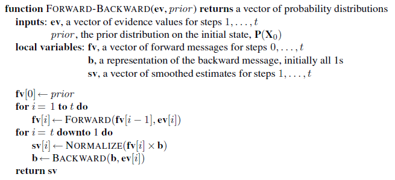
</template>

</TeachingStep>

---
layout: default
class: fig
---

# Recherche exhaustive

<TeachingStep placement="end" size="lg">

- **Exemple de l’algue** : on observe chaque jour l’état d’une algue, **sèche**, **humide** ou **trempée**.
- Le temps qu’il fait est caché : **ensoleillé**, **nuageux** ou **pluvieux**.
- **Séquence observée** : sèche, humide, trempée. Quelle est sa probabilité selon le modèle ?

<template #visual>
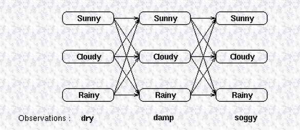
</template>

</TeachingStep>

---
layout: default
class: fig
---

# Recherche exhaustive (suite)

<TeachingStep placement="end" size="md">

- Sommer sur toutes les séquences d’états cachés :

$$
P(e_{1:3}) = \sum_{x_1, x_2, x_3} P(e_{1:3} \mid x_{1:3})\,P(x_{1:3})
$$

- soit $P(\text{sèche}, \text{humide}, \text{trempée} \mid \text{ens.}, \text{ens.}, \text{ens.}) + \dots + P(\ldots \mid \text{pluv.}, \text{pluv.}, \text{pluv.})$, chaque terme pondéré par la probabilité de sa séquence.
- Ici $3^3 = 27$ séquences ; en général $N^T$ : l’énumération explose avec la longueur.

<template #visual>

</template>

</TeachingStep>

---
layout: default
class: fig
---

# Mieux : la programmation dynamique

<TeachingStep placement="end" size="md">

- La probabilité d’atteindre un état intermédiaire du treillis est la **somme sur tous les chemins** qui y mènent.
- Ces sommes partielles se calculent une fois, colonne après colonne, et se réutilisent pour l’instant suivant.

<template #visual>
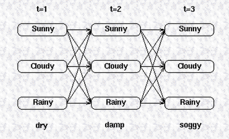
</template>

</TeachingStep>

---
layout: default
class: fig
---

# Mieux : la programmation dynamique (suite)

<TeachingStep placement="end" size="md">

- On définit la **probabilité partielle** :

$$
\alpha_t(j) = P(\text{observation à } t \mid X_t = j) \times P(\text{tous les chemins vers } j \text{ à l’instant } t)
$$

- Autrement dit, $\alpha_t(j) = P(e_{1:t}, X_t = j)$ : la probabilité jointe des observations jusqu’à $t$ et d’être en $j$ à l’instant $t$.

<template #visual>
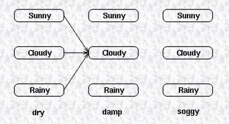
</template>

</TeachingStep>

---
layout: default
class: fig
---

# L’algorithme forward

<TeachingStep placement="below" size="md">

$$
\alpha_1(j) = \pi_j\,b_j(e_1) \qquad \alpha_{t+1}(j) = b_j(e_{t+1}) \sum_i \alpha_t(i)\,a_{ij} \qquad P(e_{1:T} \mid \lambda) = \sum_j \alpha_T(j)
$$

- **Initialisation**, **récurrence** colonne par colonne du treillis, **terminaison**.

<template #visual>
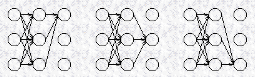
</template>

</TeachingStep>

---
layout: default
class: fig
---

# Forward et Viterbi : le coût

<TeachingStep placement="end" size="md">

- Il y a $3^t$ chemins de longueur $t$ dans le treillis de l’algue, mais *forward* ne fait que $O(N^2 T)$ opérations.
- **Viterbi** : même treillis, avec $\max_i$ à la place de $\sum_i$ ; un pointeur arrière mémorise le meilleur prédécesseur de chaque état, puis on remonte depuis le meilleur état final.

<template #visual>
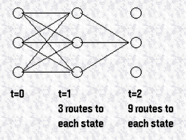
</template>

</TeachingStep>

Notebooks : <a href="https://github.com/jsboige/CoursIA/blob/main/MyIA.AI.Notebooks/Probas/Infer/Infer-14-Sequences.ipynb" target="_blank" rel="noopener">Infer-14-Sequences</a> (HMM, Viterbi contre classification indépendante) · <a href="https://github.com/jsboige/CoursIA/blob/main/MyIA.AI.Notebooks/Probas/PyMC/PyMC-14-Sequences.ipynb" target="_blank" rel="noopener">PyMC-14-Sequences</a> (même modèle en PyMC).

---
layout: default
class: fig
---

# Filtres de Kalman

<TeachingStep placement="end" size="sm">

- Estimation récursive d’un **état continu** (position, vitesse) dans un **modèle linéaire gaussien**, à partir de mesures bruitées.
- **Prédiction** :

$$
\mathbf P(\mathbf X_{t+1} \mid \mathbf e_{1:t}) = \int_{\mathbf x_t} \mathbf P(\mathbf X_{t+1} \mid \mathbf x_t)\,P(\mathbf x_t \mid \mathbf e_{1:t})\,d\mathbf x_t
$$

- **Mise à jour** :

$$
\mathbf P(\mathbf X_{t+1} \mid \mathbf e_{1:t+1}) = \alpha\,\mathbf P(\mathbf e_{t+1} \mid \mathbf X_{t+1})\,\mathbf P(\mathbf X_{t+1} \mid \mathbf e_{1:t})
$$

- Avec des transitions et des capteurs linéaires gaussiens, une gaussienne reste gaussienne : le filtre ne propage qu’une moyenne et une covariance.

<template #visual>
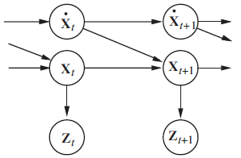
</template>

</TeachingStep>

---
layout: default
---

# Filtres de Kalman (suite)

- **Modèle 1D** : a priori, transition et capteur gaussiens,

$$
P(x_0) = \alpha\,e^{-\frac{1}{2}\frac{(x_0 - \mu_0)^2}{\sigma_0^2}} \qquad P(x_{t+1} \mid x_t) = \alpha\,e^{-\frac{1}{2}\frac{(x_{t+1} - x_t)^2}{\sigma_x^2}} \qquad P(z_t \mid x_t) = \alpha\,e^{-\frac{1}{2}\frac{(z_t - x_t)^2}{\sigma_z^2}}
$$

- **Équations matricielles** (état $\hat x$, covariance $P$, bruits $Q$ et $R$) :

$$
\begin{aligned}
\hat x_k^- &= A\,\hat x_{k-1} + B\,u_k & P_k^- &= A\,P_{k-1}A^\top + Q \\
K_k &= P_k^- H^\top (H P_k^- H^\top + R)^{-1} & & \\
\hat x_k &= \hat x_k^- + K_k\,(z_k - H\,\hat x_k^-) & P_k &= (I - K_k H)\,P_k^-
\end{aligned}
$$

- Le gain $K_k$ arbitre entre la prédiction et la mesure, selon leurs incertitudes respectives.

---
layout: default
class: fig
---

# Filtres de Kalman (suite)

<TeachingStep placement="end" size="sm">

- **Mise à jour 1D** : une moyenne pondérée par les variances,

$$
\mu_{t+1} = \frac{(\sigma_t^2 + \sigma_x^2)\,z_{t+1} + \sigma_z^2\,\mu_t}{\sigma_t^2 + \sigma_x^2 + \sigma_z^2} \qquad \sigma_{t+1}^2 = \frac{(\sigma_t^2 + \sigma_x^2)\,\sigma_z^2}{\sigma_t^2 + \sigma_x^2 + \sigma_z^2}
$$

- En dimension $n$, la même chose avec la gaussienne multivariée $\mathcal N(\boldsymbol\mu, \Sigma)$.
- **Limite** : une seule bosse. L’oiseau qui file vers l’arbre l’évitera par la gauche ou par la droite — une loi bimodale qu’un filtre de Kalman ne représente pas.
- **Applications** : navigation GPS, suivi de véhicules, robotique mobile, traitement du signal.

<template #visual>
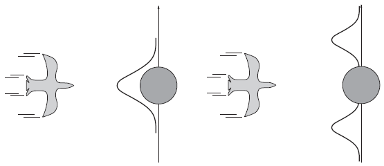
</template>

</TeachingStep>

---
layout: default
class: fig
---

# Réseaux bayésiens dynamiques

<TeachingStep placement="end" size="sm">

- **Généralisation des HMM et des filtres de Kalman** : variables d’état $\mathbf X_t$ et d’observation $\mathbf E_t$, en nombre quelconque dans chaque tranche de temps.
- Tout RBD se regroupe en un HMM (un seul état vectoriel), mais le RBD est **beaucoup plus parcimonieux**.
- **Construction** : loi a priori, modèle de transition, modèle de capteur.
- **Exemple** : la jauge de batterie d’un robot.
  - Défaillance passagère : $P(BMeter_t = 0 \mid Battery_t = 5) = 0{,}03$.
  - Défaillance persistante : une variable $BMBroken_t$ (« jauge cassée »).

<template #visual>
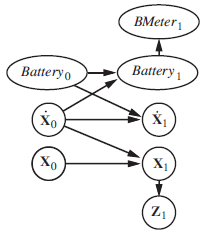
</template>

</TeachingStep>

---
layout: default
class: fig
---

# RBD : inférence

<TeachingStep placement="end" size="md">

- **Exacte** : déplier assez de tranches, puis éliminer ou regrouper. Les sommations partielles se font récursivement, mais l’état de croyance ne se factorise pas : en pratique, on recourt souvent à l’approché.
- **Approchée : filtrage particulaire** (figure) — **propager** $N$ échantillons selon la transition, les **pondérer** par la vraisemblance de l’observation, puis les **rééchantillonner** : les faibles disparaissent, les forts se dupliquent.
- **Suivre plusieurs objets** : l’incertitude d’identité pose un problème d’**association des données** (plus proche voisin, filtrage particulaire, MCMC).

<template #visual>
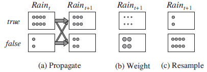
</template>

</TeachingStep>

---

# Résumé raisonnement temporel

- **Variables aléatoires temporelles**
  - Propriété de Markov, stationnarité
  - Modèles de transition, de capteur
- **Inférence**
  - Filtrage (forward), prédiction, lissage (backward), explication vraisemblance
- **Familles de modèles temporels**
  - Modèles de Markov cachés, filtres de Kalman, Réseaux bayésiens dynamiques
  - Inférence exacte souvent difficile mais méthodes approchées efficaces
- **Filtrage particulaire**
  - + Problème de l'association des données

---
class: nb-map nb-k96
---

# Raisonnement temporel : les notebooks

Chaînes, HMM et filtres de Kalman se codent en quelques lignes dans Infer.NET ou PyMC. On y observe ce que les équations promettent : lissage, segmentation, ruptures.

HMM et Viterbi

Séquences d’états cachés : Viterbi contre une classification point par point, coût O(T·K²).

<a href="https://github.com/jsboige/CoursIA/blob/main/MyIA.AI.Notebooks/Probas/Infer/Infer-14-Sequences.ipynb" target="_blank" rel="noopener">Infer-14-Sequences</a> · <a href="https://github.com/jsboige/CoursIA/blob/main/MyIA.AI.Notebooks/Probas/PyMC/PyMC-14-Sequences.ipynb" target="_blank" rel="noopener">PyMC-14</a>

Filtre de Kalman

Prédiction, correction, réglage des bruits Q et R, borne de Riccati, lissage.

<a href="https://github.com/jsboige/CoursIA/blob/main/MyIA.AI.Notebooks/Probas/Infer/Infer-17-Kalman-Filter.ipynb" target="_blank" rel="noopener">Infer-17-Kalman-Filter</a> · <a href="https://github.com/jsboige/CoursIA/blob/main/MyIA.AI.Notebooks/Probas/PyMC/PyMC-17-Kalman-Filter.ipynb" target="_blank" rel="noopener">PyMC-17</a>

Points de rupture

Quand le régime d’une série change-t-il ? Catastrophes minières (Poisson), deux ruptures, changement de variance.

<a href="https://github.com/jsboige/CoursIA/blob/main/MyIA.AI.Notebooks/Probas/Infer/Infer-18-Change-Point.ipynb" target="_blank" rel="noopener">Infer-18-Change-Point</a> · <a href="https://github.com/jsboige/CoursIA/blob/main/MyIA.AI.Notebooks/Probas/PyMC/PyMC-18-Change-Point.ipynb" target="_blank" rel="noopener">PyMC-18</a>

Analyse de survie

Durées jusqu’à l’événement, données censurées, fonctions de risque.

<a href="https://github.com/jsboige/CoursIA/blob/main/MyIA.AI.Notebooks/Probas/Infer/Infer-19-Survival-Analysis.ipynb" target="_blank" rel="noopener">Infer-19-Survival-Analysis</a> · <a href="https://github.com/jsboige/CoursIA/blob/main/MyIA.AI.Notebooks/Probas/PyMC/PyMC-19-Survival-Analysis.ipynb" target="_blank" rel="noopener">PyMC-19</a>

Processus gaussiens

Une loi a priori sur les fonctions ; classification probit, base parcimonieuse.

<a href="https://github.com/jsboige/CoursIA/blob/main/MyIA.AI.Notebooks/Probas/Infer/Infer-16-Sparse-Gaussian-Process.ipynb" target="_blank" rel="noopener">Infer-16-Sparse-Gaussian-Process</a> · <a href="https://github.com/jsboige/CoursIA/blob/main/MyIA.AI.Notebooks/Probas/PyMC/PyMC-16-Sparse-Gaussian-Process.ipynb" target="_blank" rel="noopener">PyMC-16</a>

Marches aléatoires

Théorème de Pólya : la marche revient-elle à l’origine ? Intégrale de Watson, marche anisotrope.

<a href="https://github.com/jsboige/CoursIA/blob/main/MyIA.AI.Notebooks/Probas/Applications/Marches-01-Retour-Polya-Watson-Python.ipynb" target="_blank" rel="noopener">Marches-01</a>

<strong>À observer.</strong> Dans Infer-14, à quels endroits la classification point par point découpe-t-elle trop de segments, et pourquoi Viterbi ne le fait-il pas ?

---
class: nb-concept nb-center nb-k92
---

# Kalman : une moyenne pondérée par la confiance

Le filtre de Kalman ne fait qu’une chose, deux fois par pas : prédire, puis corriger la prédiction par la mesure, chacune pesée par l’inverse de sa variance.

Prédire

L’état avance selon la dynamique ; sa variance augmente du bruit de processus Q.

Corriger

La mesure tire l’estimation vers elle, d’autant plus fort que sa variance R est faible devant celle de la prédiction.

Régler Q et R

Avec R = 4 très grand devant Q = 0,5, le filtre fait peu confiance aux mesures : la trajectoire estimée est fortement lissée.

Stabilité

L’équation de Riccati borne la variance : elle converge vers un régime stable au lieu de croître sans fin.

<strong>À observer.</strong> Dans l’exercice sur la sensibilité à Q, multipliez Q par 10 : l’estimation suit-elle davantage le bruit des mesures ?

Notebook : <a href="https://github.com/jsboige/CoursIA/blob/main/MyIA.AI.Notebooks/Probas/Infer/Infer-17-Kalman-Filter.ipynb" target="_blank" rel="noopener">Infer-17-Kalman-Filter.ipynb</a>.

---
layout: section
---

# Questions?

---

# Programmation probabiliste

- **Principales librairies**
  - Infer.Net (C# / .NET)
  - Pyro (Python / PyTorch)
  - Tensorflow Probability (Python / TensorFlow)
  - PyMC (Python / Aesara, Jax)
  - Stan (C++ / Wrappers)
- **Tutoriels Infer.Net**
  - Prise en main (en français)
  - Tutoriels (en anglais)
  - Guide utilisateur

Notebooks : <a href="https://github.com/jsboige/CoursIA/blob/main/MyIA.AI.Notebooks/Probas/Infer/Infer-01b-Premiers-Modeles.ipynb" target="_blank" rel="noopener">Infer-01b-Premiers-Modeles</a> (Infer.NET prise en main) · <a href="https://github.com/jsboige/CoursIA/blob/main/MyIA.AI.Notebooks/Probas/PyMC/PyMC-01-Setup.ipynb" target="_blank" rel="noopener">PyMC-01-Setup</a> (PyMC) · <a href="https://github.com/jsboige/CoursIA/blob/main/MyIA.AI.Notebooks/Probas/Applications/Pyro_RSA_Hyperbole.ipynb" target="_blank" rel="noopener">Pyro_RSA_Hyperbole</a> (Pyro, bases bayésiennes).

<!-- Voir notebooks Probas/Infer/ pour exemples de code Infer.NET -->

---

# Sommaire

- Quantification de l'incertitude
- Raisonnement probabiliste
- Raisonnement probabiliste temporel
- **Prise de décision simple**
  - Théorie de l'utilité
  - Réseaux de décision
  - Systèmes experts
- Prise de décision complexe
- Théorie des jeux

---
layout: default
class: fig
---

# Agent fondé sur l’utilité

<TeachingStep placement="end" size="lg">

- **Les buts ne suffisent pas** : atteindre un but est binaire, alors que les issues diffèrent par leur **niveau de succès**.
- Une **fonction d’utilité** $U : \text{État} \to \mathbb R$ quantifie la satisfaction associée à chaque état.
- Elle permet des **arbitrages** : entre buts concurrents, ou entre l’importance d’un but (important, urgent…) et ses chances de succès.
- L’agent choisit l’action d’**utilité espérée maximale**.

<template #visual>
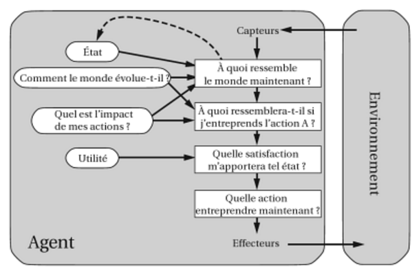
</template>

</TeachingStep>

Notebooks : <a href="https://github.com/jsboige/CoursIA/blob/main/MyIA.AI.Notebooks/Probas/DecisionTheory/DecInfer/DecInfer-01-Utility-Foundations.ipynb" target="_blank" rel="noopener">DecInfer-01-Utility-Foundations</a> (axiomes, fondements) · <a href="https://github.com/jsboige/CoursIA/blob/main/MyIA.AI.Notebooks/Probas/DecisionTheory/DecInfer/DecInfer-02-Utility-Money.ipynb" target="_blank" rel="noopener">DecInfer-02-Utility-Money</a> (utilité monétaire, aversion au risque) · <a href="https://github.com/jsboige/CoursIA/blob/main/MyIA.AI.Notebooks/Probas/DecisionTheory/DecInfer/DecInfer-04-Decision-Networks.ipynb" target="_blank" rel="noopener">DecInfer-04-Decision-Networks</a> (réseaux de décision).

---
layout: default
---

# Prise de décision

- **Théorie des probabilités** : ce que l’agent devrait croire, au vu des observations. **Théorie de l’utilité** : ce que l’agent veut.
- **La théorie de la décision combine les deux** : ce que l’agent devrait faire. L’utilité espérée d’une action $a$ sachant l’évidence $\mathbf e$, puis le choix :

$$
EU(a \mid \mathbf e) = \sum_{s'} P(\text{Result}(a) = s' \mid a, \mathbf e)\,U(s') \qquad\qquad \text{action} = \arg\max_a EU(a \mid \mathbf e)
$$

- **Principe MEU** (*maximum expected utility*) : un agent rationnel maximise l’utilité espérée.
- **Préférences entre loteries** $L = [p_1, S_1 ; p_2, S_2 ; \dots ; p_n, S_n]$ : on note $A \succ B$ (préférence), $A \sim B$ (indifférence).
- **Décision simple** : problèmes épisodiques, une seule décision à prendre.

---
layout: default
---

# Axiomes de l’utilité (von Neumann–Morgenstern)

| Axiome | Énoncé |
|---|---|
| Ordonnabilité | exactement une des relations $A \succ B$, $B \succ A$, $A \sim B$ |
| Transitivité | $(A \succ B) \land (B \succ C) \Rightarrow (A \succ C)$ |
| Continuité | $A \succ B \succ C \Rightarrow \exists p :\ [p, A ; 1-p, C] \sim B$ |
| Substituabilité | $A \sim B \Rightarrow [p, A ; 1-p, C] \sim [p, B ; 1-p, C]$ |
| Monotonie | $A \succ B \Rightarrow \big(p > q \Leftrightarrow [p, A ; 1-p, B] \succ [q, A ; 1-q, B]\big)$ |
| Décomposabilité | $[p, A ; 1-p, [q, B ; 1-q, C]] \sim [p, A ; (1-p)q, B ; (1-p)(1-q), C]$ |

- **Pourquoi ces axiomes ?** Un agent qui préfère $A$ à $B$, $B$ à $C$ et $C$ à $A$ paiera pour chaque échange et tournera en rond : c’est la **pompe à argent**.

---
layout: default
---

# Théorie de l’utilité (suite)

- **Théorème** (von Neumann et Morgenstern, 1944) : si les préférences respectent les axiomes, il existe une fonction $U$ telle que $U(A) > U(B) \Leftrightarrow A \succ B$, $U(A) = U(B) \Leftrightarrow A \sim B$, et

$$
U([p_1, S_1 ; \dots ; p_n, S_n]) = \sum_i p_i\,U(S_i)
$$

- $U$ n’est définie qu’à une transformation affine positive près : $U'(S) = a\,U(S) + b$ avec $a > 0$ décrit le même comportement.
- **Utilité monétaire** : l’utilité de l’argent n’est pas linéaire. L’**équivalent certain** d’une loterie est la somme sûre jugée équivalente ; la **prime de risque** est l’écart entre la valeur monétaire espérée et l’équivalent certain — ce que l’assuré accepte de payer en plus.

---
layout: default
class: fig
---

# Fonctions d’utilité

<TeachingStep placement="end" size="md">

- **Forme de l’utilité de l’argent** : linéaire = neutre au risque, concave = aversion au risque, convexe = goût du risque. Courbe typique (en haut) : concave pour les gains, convexe dans les dettes.
- **Dominance stochastique** (en bas) : $S_1$ domine $S_2$ si sa fonction de répartition est partout sous celle de $S_2$,

$$
\forall t \quad \int_{-\infty}^{t} p_1(x)\,dx \le \int_{-\infty}^{t} p_2(x)\,dx
$$

- Alors $S_1$ est préférée à $S_2$ pour **toute** utilité croissante : on décide sans connaître $U$.

<template #visual>

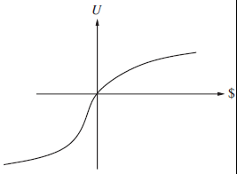
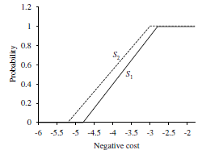

</template>

</TeachingStep>

---
layout: default
---

# Utilité multi-attributs

- **Plusieurs attributs** $X_1, \dots, X_n$ : p. ex., pour un site d’aéroport, les morts, le bruit et le coût.
- **Dominance** stricte ou stochastique : éliminer des options sans connaître $U$.
- **Indépendance préférentielle mutuelle** (cas déterministe) : la fonction de valeur est additive,

$$
V(x_1, \dots, x_n) = \sum_i V_i(x_i)
$$

- **Indépendance d’utilité mutuelle** (cas incertain) : l’utilité est multiplicative ; pour trois attributs,

$$
U = k_1 U_1 + k_2 U_2 + k_3 U_3 + k_1 k_2 U_1 U_2 + k_2 k_3 U_2 U_3 + k_3 k_1 U_3 U_1 + k_1 k_2 k_3 U_1 U_2 U_3
$$

Notebooks : <a href="https://github.com/jsboige/CoursIA/blob/main/MyIA.AI.Notebooks/Probas/DecisionTheory/DecInfer/DecInfer-03-Multi-Attribute.ipynb" target="_blank" rel="noopener">DecInfer-03-Multi-Attribute</a> (fonctions de valeur et d’utilité, indépendance préférentielle) · <a href="https://github.com/jsboige/CoursIA/blob/main/MyIA.AI.Notebooks/Probas/DecisionTheory/DecPyMC/DecPyMC-03-Multi-Attribute.ipynb" target="_blank" rel="noopener">DecPyMC-03-Multi-Attribute</a> (version PyMC).

---
layout: default
class: fig
---

# Réseaux de décision

<TeachingStep placement="end" size="md">

- **Un réseau bayésien, plus deux sortes de nœuds** :
  - nœuds de **chance** (ovales) : variables aléatoires ;
  - nœuds de **décision** (rectangles) : les actions possibles ;
  - nœud d’**utilité** (losange) : fonction de ses parents.
- **Exemple** (figure) : le site d’un aéroport influe sur les morts, le bruit et le coût, eux-mêmes soumis au trafic, aux litiges et à la construction.
- **Évaluation** : fixer l’évidence ; pour chaque valeur de la décision, calculer la loi a posteriori des parents de l’utilité, puis l’utilité espérée ; retenir la meilleure action.

<template #visual>

</template>

</TeachingStep>

Notebooks : <a href="https://github.com/jsboige/CoursIA/blob/main/MyIA.AI.Notebooks/Probas/DecisionTheory/DecInfer/DecInfer-04-Decision-Networks.ipynb" target="_blank" rel="noopener">DecInfer-04-Decision-Networks</a> · <a href="https://github.com/jsboige/CoursIA/blob/main/MyIA.AI.Notebooks/Probas/DecisionTheory/DecPyMC/DecPyMC-04-Decision-Networks.ipynb" target="_blank" rel="noopener">DecPyMC-04-Decision-Networks</a>.

---
layout: default
---

# Valeur de l’information

- **Exemple** : $n$ blocs de forage, un seul contient du pétrole d’une valeur $C$ ; chaque bloc coûte $C/n$. Un sismologue peut dire si le bloc 3 contient du pétrole : combien payer cette information ?
  - Avec la probabilité $1/n$, oui : on achète le bloc 3, gain $C - C/n = (n-1)C/n$.
  - Avec la probabilité $(n-1)/n$, non : on achète un autre bloc, gain espéré $C/(n-1) - C/n = C/(n(n-1))$.

$$
\frac{1}{n} \cdot \frac{(n-1)C}{n} + \frac{n-1}{n} \cdot \frac{C}{n(n-1)} = \frac{C}{n}
$$

- L’information vaut le prix d’un bloc. En général, la **valeur de l’information parfaite** sur $E_j$ :

$$
VPI_{\mathbf e}(E_j) = \Big(\sum_k P(E_j = e_{jk} \mid \mathbf e)\,EU(\alpha_{e_{jk}} \mid \mathbf e, E_j = e_{jk})\Big) - EU(\alpha \mid \mathbf e)
$$

- Toujours $\ge 0$ en espérance ; nulle si l’information ne peut pas changer la décision.

---
layout: default
class: fig
---

# Agent collecteur d’information

<TeachingStep placement="below" size="lg" class="fig-xl">

- Avant d’agir, l’agent demande l’observation $E_j$ qui maximise $VPI(E_j)/\text{Cost}(E_j)$, si sa VPI dépasse son coût ; sinon, il agit.
- **Agent myope** : il évalue chaque observation isolément, comme si c’était la dernière, et peut manquer une combinaison d’observations qui, ensemble, changeraient la décision.

<template #visual>

</template>

</TeachingStep>

Notebooks : <a href="https://github.com/jsboige/CoursIA/blob/main/MyIA.AI.Notebooks/Probas/DecisionTheory/DecInfer/DecInfer-05-Value-Information.ipynb" target="_blank" rel="noopener">DecInfer-05-Value-Information</a> (EVPI, EVSI) · <a href="https://github.com/jsboige/CoursIA/blob/main/MyIA.AI.Notebooks/Probas/DecisionTheory/DecPyMC/DecPyMC-05-Value-Information.ipynb" target="_blank" rel="noopener">DecPyMC-05-Value-Information</a>.

---
layout: dense
---

# Système expert

- **Développés très tôt** (années 1950–1980) : des règles à la logique, puis aux réseaux de décision ; domaines militaire, médical, financier. Le **décideur** (trader) s’appuie sur l’**analyste** (quant), qui traduit le modèle en actions.
- **Conception**
  - Modèle causal : une simplification qualitative du domaine.
  - Probabilités : tirées de bases de données ou d’experts. Utilités : échelle $[0, 1]$, souvent multi-attributs.
  - Vérification et raffinage : comparaison à un étalon métier.
  - **Analyse de sensibilité** : de petites variations des probabilités incertaines changent-elles la décision ? Si non, la décision est robuste ; si oui, décision **minimax** $a^* = \arg\max_a \min_\theta EU(a ; \theta)$, ou hyper-paramétrisation bayésienne de $\theta$ si le minimax est trop conservateur.
- **Préférences inconnues**
  - Incertaines : une fonction d’utilité probabiliste (variable aléatoire dédiée).
  - À affiner : intervention humaine, analogue à la VPI — p. ex. le jeu de l’interrupteur (*off-switch game*) et ses extensions bayésiennes.

Notebooks : <a href="https://github.com/jsboige/CoursIA/blob/main/MyIA.AI.Notebooks/Probas/DecisionTheory/DecInfer/DecInfer-06-Expert-Systems.ipynb" target="_blank" rel="noopener">DecInfer-06-Expert-Systems</a> (minimax, regret de Savage, sensibilité) · <a href="https://github.com/jsboige/CoursIA/blob/main/MyIA.AI.Notebooks/Probas/DecisionTheory/DecPyMC/DecPyMC-06-Expert-Systems.ipynb" target="_blank" rel="noopener">DecPyMC-06-Expert-Systems</a>.

---
class: nb-map nb-k96
---

# Décision : les notebooks

Chaque notion du chapitre a son notebook, en Infer.NET (<code>DecInfer</code>) et en PyMC (<code>DecPyMC</code>), avec des preuves Lean pour les fondements et une série actuarielle pour l’application.

Fondements de l’utilité

Axiomes de von Neumann–Morgenstern, utilité de l’argent, aversion au risque ; utilité espérée prouvée en Lean.

<a href="https://github.com/jsboige/CoursIA/blob/main/MyIA.AI.Notebooks/Probas/DecisionTheory/DecInfer/DecInfer-01-Utility-Foundations.ipynb" target="_blank" rel="noopener">DecInfer-01</a> · <a href="https://github.com/jsboige/CoursIA/blob/main/MyIA.AI.Notebooks/Probas/DecisionTheory/DecInfer/DecInfer-02-Utility-Money.ipynb" target="_blank" rel="noopener">DecInfer-02</a> · <a href="https://github.com/jsboige/CoursIA/blob/main/MyIA.AI.Notebooks/Probas/DecisionTheory/DecInfer/DecInfer-01b-Lean-ExpectedUtility.ipynb" target="_blank" rel="noopener">DecInfer-01b (Lean)</a>

Multi-attributs

Fonctions de valeur et d’utilité, indépendance préférentielle, dominance.

<a href="https://github.com/jsboige/CoursIA/blob/main/MyIA.AI.Notebooks/Probas/DecisionTheory/DecInfer/DecInfer-03-Multi-Attribute.ipynb" target="_blank" rel="noopener">DecInfer-03</a> · <a href="https://github.com/jsboige/CoursIA/blob/main/MyIA.AI.Notebooks/Probas/DecisionTheory/DecPyMC/DecPyMC-03-Multi-Attribute.ipynb" target="_blank" rel="noopener">DecPyMC-03</a>

Réseaux de décision

Nœuds de chance, de décision et d’utilité ; évaluation de la meilleure action.

<a href="https://github.com/jsboige/CoursIA/blob/main/MyIA.AI.Notebooks/Probas/DecisionTheory/DecInfer/DecInfer-04-Decision-Networks.ipynb" target="_blank" rel="noopener">DecInfer-04</a> · <a href="https://github.com/jsboige/CoursIA/blob/main/MyIA.AI.Notebooks/Probas/DecisionTheory/DecPyMC/DecPyMC-04-Decision-Networks.ipynb" target="_blank" rel="noopener">DecPyMC-04</a>

Valeur de l’information

EVPI et EVSI : combien payer une observation avant de décider ?

<a href="https://github.com/jsboige/CoursIA/blob/main/MyIA.AI.Notebooks/Probas/DecisionTheory/DecInfer/DecInfer-05-Value-Information.ipynb" target="_blank" rel="noopener">DecInfer-05</a> · <a href="https://github.com/jsboige/CoursIA/blob/main/MyIA.AI.Notebooks/Probas/DecisionTheory/DecPyMC/DecPyMC-05-Value-Information.ipynb" target="_blank" rel="noopener">DecPyMC-05</a>

Systèmes experts

Décision robuste : minimax, regret de Savage, analyse de sensibilité.

<a href="https://github.com/jsboige/CoursIA/blob/main/MyIA.AI.Notebooks/Probas/DecisionTheory/DecInfer/DecInfer-06-Expert-Systems.ipynb" target="_blank" rel="noopener">DecInfer-06</a> · <a href="https://github.com/jsboige/CoursIA/blob/main/MyIA.AI.Notebooks/Probas/DecisionTheory/DecPyMC/DecPyMC-06-Expert-Systems.ipynb" target="_blank" rel="noopener">DecPyMC-06</a>

Actuariat

Prime pure et chargement, puis valeur de l’information en souscription.

<a href="https://github.com/jsboige/CoursIA/blob/main/MyIA.AI.Notebooks/Probas/DecisionTheory/Actuariat/Actuariat-01-Prime-Pure-Chargement.ipynb" target="_blank" rel="noopener">Actuariat-01</a> · <a href="https://github.com/jsboige/CoursIA/blob/main/MyIA.AI.Notebooks/Probas/DecisionTheory/Actuariat/Actuariat-05-Valeur-Info-Souscription.ipynb" target="_blank" rel="noopener">Actuariat-05</a>

<strong>À observer.</strong> Dans DecInfer-05, l’information parfaite sur la pluie vaut 15 (91 contre 76). Dans quel cas vaudrait-elle zéro ?

---
layout: section
---

# Questions?

---

# Sommaire

- Quantification de l'incertitude
- Raisonnement probabiliste
- Raisonnement probabiliste temporel
- Prise de décision simple
- **Prise de décision complexe**
  - Politiques, Processus de décision de Markov
  - Théorie de jeux
  - Design de mécanismes
  - Jeux différentiels

---
layout: default
class: fig
---

# Prise de décision complexe

<TeachingStep placement="end" size="md">

- **Problèmes de décision séquentiels** : l’utilité dépend d’une séquence de décisions ; la planification en est un cas particulier.
- **Processus de décision markovien (MDP)**, entièrement observable : états $s$, actions $A(s)$, transitions markoviennes $P(s' \mid s, a)$, récompense $R(s)$.
- **Grille 4 × 3** (en haut) : états terminaux $+1$ et $-1$, $R(s) = -0{,}04$ ailleurs ; l’action voulue réussit avec la probabilité $0{,}8$, et dévie à angle droit avec $0{,}1$ de chaque côté.
- **Solution** : une politique $\pi(s)$ ; la politique optimale $\pi^*$ maximise l’utilité espérée. En bas : $\pi^*$ pour $-0{,}4278 < R(s) < -0{,}0850$.

<template #visual>

</template>

</TeachingStep>

---
layout: default
class: fig
---

# Horizons et préférences

<TeachingStep placement="end" size="sm">

- **Horizon fini** : $\pi^*$ est non stationnaire, elle dépend du temps restant. **Horizon infini** : $\pi^*$ est stationnaire.
- **Préférences stationnaires**, deux façons de cumuler les récompenses :
  - **additives** : $U_h([s_0, s_1, \dots]) = R(s_0) + R(s_1) + \dots$, ce qui exige une politique *propre*, garantie d’atteindre un état terminal ;
  - **escomptées**, avec $\gamma \in [0, 1)$ :

$$
U_h([s_0, s_1, \dots]) = \sum_{t=0}^{\infty} \gamma^t R(s_t) \le \frac{R_{\max}}{1 - \gamma}
$$

- Sinon, récompense moyenne. En figure : $\pi^*$ pour $-0{,}0221 < R(s) < 0$, où vivre coûte si peu que l’agent évite le $-1$ quitte à rallonger.

<template #visual>

</template>

</TeachingStep>

---
layout: default
class: fig
---

# Évaluation des politiques

<TeachingStep placement="end" size="md">

- **Utilité d’un état sous la politique** $\pi$, en partant de $S_0 = s$ :

$$
U^\pi(s) = E\Big[\sum_{t=0}^{\infty} \gamma^t R(S_t)\Big]
$$

- **La politique optimale** se lit à partir des utilités $U = U^{\pi^*}$ :

$$
\pi^*(s) = \arg\max_{a \in A(s)} \sum_{s'} P(s' \mid s, a)\,U(s')
$$

- En figure : les utilités de la grille pour $\gamma = 1$ et $R(s) = -0{,}04$ ; elles croissent à l’approche du $+1$.

<template #visual>

</template>

</TeachingStep>

---
layout: default
---

# Équations de Bellman

- **Utilité d’un état** : récompense immédiate, plus l’utilité escomptée du meilleur coup suivant.

$$
U(s) = R(s) + \gamma \max_{a \in A(s)} \sum_{s'} P(s' \mid s, a)\,U(s')
$$

- **Fonction Q** : utilité de faire $a$ dans $s$, puis d’agir au mieux.

$$
\begin{aligned}
Q(s, a) &= R(s) + \gamma \sum_{s'} P(s' \mid s, a) \max_{a'} Q(s', a') \\
U(s) &= \max_a Q(s, a)
\end{aligned}
$$

- **Façonnage de la récompense** : $R'(s, a, s') = R(s, a, s') + \gamma\,\Phi(s') - \Phi(s)$ laisse $\pi^*$ inchangée et peut accélérer l’apprentissage.

---
layout: default
---

# Itération de la valeur

- **Mise à jour de Bellman**, appliquée à tous les états jusqu’à convergence :

$$
U_{i+1}(s) \leftarrow R(s) + \gamma \max_{a \in A(s)} \sum_{s'} P(s' \mid s, a)\,U_i(s')
$$

- La mise à jour est une **contraction** de facteur $\gamma$ (norme max) : point fixe unique, convergence géométrique.
- **Arrêt** : si $\lVert U_{i+1} - U_i \rVert < \epsilon (1 - \gamma)/\gamma$, alors $\lVert U_{i+1} - U \rVert < \epsilon$.
- La politique gloutonne est souvent optimale bien avant que les utilités aient convergé.

---
layout: default
---

# Itération de la politique

Partir d’une politique $\pi_0$ et alterner deux étapes jusqu’à ce que la politique ne change plus.

**Évaluation** : calculer $U_i = U^{\pi_i}$. Sans max, c’est un système linéaire, résolu en $O(n^3)$ pour $n$ états :

$$
U_i(s) = R(s) + \gamma \sum_{s'} P(s' \mid s, \pi_i(s))\,U_i(s')
$$

**Amélioration** : $\pi_{i+1}(s) = \arg\max_a \sum_{s'} P(s' \mid s, a)\,U_i(s')$.

**Itération de la politique modifiée** : remplacer la résolution exacte par $k$ mises à jour simplifiées, $U_{i+1}(s) \leftarrow R(s) + \gamma \sum_{s'} P(s' \mid s, \pi_i(s))\,U_i(s')$.

---
layout: default
---

# Autres méthodes

- **Programmation linéaire** : les équations de Bellman deviennent un problème d’optimisation — polynomial en théorie, souvent impraticable avec beaucoup d’états et d’actions :

$$
\min \sum_s U(s) \quad \text{sous les contraintes} \quad U(s) \ge R(s) + \gamma \sum_{s'} P(s' \mid s, a)\,U(s') \quad \forall s, a
$$

- **Algorithmes en ligne** : quand le calcul hors ligne est impossible (cf. les jeux).
  - **Expectimax** : arbre de décision avec nœuds de chance ; profondeur bornée (grâce à $\gamma$) et branchement borné (par échantillonnage).
  - **Programmation dynamique en temps réel (RTDP)** ; décomposition en sous-problèmes (sous-MDP).

---
layout: default
---

# Méthodes de Monte-Carlo et bandits

- **Grands espaces** : méthodes de Monte-Carlo (p. ex. recherche arborescente Monte-Carlo).
- **Bandits manchots** : $n$ bras aux probabilités de gain inconnues ; dilemme **exploration / exploitation** (p. ex. essais de traitements contre la covid-19).
- **Indice de Gittins** : comparer chaque bras seul à une récompense sûre $\lambda$, avec un temps d’arrêt $T$ :

$$
\lambda = \max_{T > 0} \frac{E\left(\sum_{t=0}^{T-1} \gamma^t R_t\right)}{E\left(\sum_{t=0}^{T-1} \gamma^t\right)}
$$

- Jouer le bras d’indice maximal est optimal. Calcul : MDP à redémarrage (*restart MDP*) dans les cas simples, sinon approximations (MDP tronqué).

Notebooks : <a href="https://github.com/jsboige/CoursIA/blob/main/MyIA.AI.Notebooks/Probas/DecisionTheory/DecInfer/DecInfer-07b-Lean-Gittins.ipynb" target="_blank" rel="noopener">DecInfer-07b-Lean-Gittins</a> (indice de Gittins, preuve Lean) · <a href="https://github.com/jsboige/CoursIA/blob/main/MyIA.AI.Notebooks/Probas/DecisionTheory/DecInfer/DecInfer-08-Thompson-Sampling.ipynb" target="_blank" rel="noopener">DecInfer-08-Thompson-Sampling</a> (bandits bayésiens).

---
layout: default
class: fig
---

# PDMPO / POMDP

<TeachingStep placement="end" size="md">

- **MDP partiellement observable** : l’agent ne connaît pas l’état, seulement des observations via un modèle de capteur $P(e \mid s)$.
- Il maintient un **état de croyance** $b(s)$, une distribution sur les états.
- **Un POMDP est un MDP sur l’espace (continu) des croyances** : la politique optimale est $\pi^*(b)$.
- **Réseau de décision dynamique** (en haut) : transitions, capteur et utilité déroulés dans le temps.
- L’utilité d’un plan conditionnel est linéaire en $b$ ; leur maximum est **linéaire par morceaux et convexe** (en bas).

<template #visual>

</template>

</TeachingStep>

---
layout: default
---

# PDMPO / POMDP (suite)

- **Mise à jour de la croyance** après l’action $a$ et l’observation $e$ — un pas de filtrage :

$$
b'(s') = \alpha\,P(e \mid s') \sum_s P(s' \mid s, a)\,b(s)
$$

- **Résolution**
  - Itération de la valeur sur les plans conditionnels : exacte, mais exponentielle.
  - Méthodes à points de croyance (PBVI) : n’optimiser que sur un échantillon de croyances.
  - Recherche en ligne dans l’arbre des croyances, à partir du réseau de décision dynamique.

Notebooks : <a href="https://github.com/jsboige/CoursIA/blob/main/MyIA.AI.Notebooks/Probas/DecisionTheory/DecInfer/DecInfer-07-Sequential.ipynb" target="_blank" rel="noopener">DecInfer-07-Sequential</a> (MDP, POMDP, itération de la valeur) · <a href="https://github.com/jsboige/CoursIA/blob/main/MyIA.AI.Notebooks/Probas/DecisionTheory/DecPyMC/DecPyMC-07-Sequential.ipynb" target="_blank" rel="noopener">DecPyMC-07-Sequential</a>.

---
class: nb-map nb-k96
---

# Décision séquentielle : les notebooks

MDP, bandits et paradoxes de la décision se calculent et se prouvent : itérations en Infer.NET et PyMC, indice de Gittins en Lean, règles de décision face à un prédicteur.

MDP et POMDP

Itération de la valeur et de la politique sur une grille, puis croyances partielles.

<a href="https://github.com/jsboige/CoursIA/blob/main/MyIA.AI.Notebooks/Probas/DecisionTheory/DecInfer/DecInfer-07-Sequential.ipynb" target="_blank" rel="noopener">DecInfer-07</a> · <a href="https://github.com/jsboige/CoursIA/blob/main/MyIA.AI.Notebooks/Probas/DecisionTheory/DecPyMC/DecPyMC-07-Sequential.ipynb" target="_blank" rel="noopener">DecPyMC-07</a>

Bandits et Gittins

L’indice de Gittins et son optimalité, formalisés en Lean.

<a href="https://github.com/jsboige/CoursIA/blob/main/MyIA.AI.Notebooks/Probas/DecisionTheory/DecInfer/DecInfer-07b-Lean-Gittins.ipynb" target="_blank" rel="noopener">DecInfer-07b (Lean)</a>

Thompson sampling

Explorer en tirant dans la loi a posteriori de chaque bras.

<a href="https://github.com/jsboige/CoursIA/blob/main/MyIA.AI.Notebooks/Probas/DecisionTheory/DecInfer/DecInfer-08-Thompson-Sampling.ipynb" target="_blank" rel="noopener">DecInfer-08</a>

Face à un prédicteur

Le problème de Newcomb : que décider quand un prédicteur anticipe votre choix ?

<a href="https://github.com/jsboige/CoursIA/blob/main/MyIA.AI.Notebooks/Probas/DecisionTheory/DecInfer/DecInfer-09-Theories-Decision-Predicteur-Python.ipynb" target="_blank" rel="noopener">DecInfer-09</a>

Règles de décision

Décision évidentielle, causale et leurs variantes (EDT, CDT, CCDT, UDT) comparées.

<a href="https://github.com/jsboige/CoursIA/blob/main/MyIA.AI.Notebooks/Probas/DecisionTheory/ReglesDeDecision-01-EDT-CDT-CCDT-UDT.ipynb" target="_blank" rel="noopener">ReglesDeDecision-01</a>

Capstone actuariel

Toute la chaîne : modèle bayésien, utilité, décision de souscription.

<a href="https://github.com/jsboige/CoursIA/blob/main/MyIA.AI.Notebooks/Probas/DecisionTheory/DecPyMC/DecPyMC-08-Actuariat-Capstone.ipynb" target="_blank" rel="noopener">DecPyMC-08</a>

<strong>À observer.</strong> Dans DecInfer-07, la case voisine du piège pointe à l’opposé du but : pourquoi ce détour est-il optimal ?

---
class: nb-concept nb-center nb-k92
---

# Itération de la valeur : la récompense se propage

Sur la grille de DecInfer-07, l’itération de la valeur diffuse la récompense du but de proche en proche, une case de plus à chaque balayage, jusqu’au point fixe.

La grille

Un but à +1, un piège à −1 ; chaque action peut dévier sur le côté.

Convergence

Avec γ = 0,9, la variation maximale passe sous 0,001 en 14 itérations.

Lire V*

≈ 0,80 juste à côté du but, ≈ 0,30 dans le coin opposé : la valeur décroît avec la distance au but.

Lire π*

La politique contourne le piège : sous lui, la flèche s’éloigne du but plutôt que de risquer une déviation fatale.

<strong>À observer.</strong> Relancez avec γ = 0,5 : combien d’itérations faut-il, et la politique près du piège change-t-elle ?

Notebook : <a href="https://github.com/jsboige/CoursIA/blob/main/MyIA.AI.Notebooks/Probas/DecisionTheory/DecInfer/DecInfer-07-Sequential.ipynb" target="_blank" rel="noopener">DecInfer-07-Sequential.ipynb</a>.

---
layout: section
---

# Questions?

---

# Plan du cours

- Introduction
- Résolution de problèmes
- Bases de connaissances et logique
- Incertitude et modèles probabilistes
- Théorie des jeux
- Apprentissage
- Traitement du langage naturel
- Présentation projets

---

# Projets de groupe

- **Moteur de recherche augmenté par le raisonnement et le langage naturel**
  - Grammaire et sémantique des contenus et des requêtes. Lucene.Net, OpenNLP, SharpRDF, FOL
- **Conception de bots de services sur réseaux sociaux**
  - Chat Bots, AIML, Reddit et agents de service, NLP, RDF, APIs
- **Conception d'un modèle d'inférence pour l'analyse de sentiment**
  - Conception d'un modèle probabiliste, Infer.Net, démarche expérimentale, Reddit
- **Création d'une plateforme sémantique LDP à partir d'un index structuré**
  - Structuration et ouverture des données = Linked Data. Lucene.Net, SharpRDF
- **Résolution de Captchas par deep learning**
  - Apprentissage via un Adapteur DNN, Réseaux de dernières génération. TensorFlow, CNTK, Encog

---

# Projets de groupe (suite)

- **Entraînement de stratégies de trading algorithmiques sur crypto monnaies**
  - Expérience DNN Bitcoin, Encog et machine learning
- **Amélioration par l'apprentissage d'un agent joueur de Go simple**
  - Le Go et l'IA, Récentes avancées. Go Traxx
- **Évolution de vaisseaux spatiaux par algorithmes génétiques dans le jeu de la vie**
  - Approches évolutionnistes, automates cellulaires, Bac à sable. Golly, Encog
- **Pilotage d'un cluster de cache distribué pour le portage d'applications dans le Cloud**
  - Caches distribués, scaling, stratégies et clustering. Redis

---
class: nb-map nb-k96
---

# Pour aller plus loin : les notebooks

Au-delà des chapitres du cours, la série <code>Probas</code> couvre des modèles et des applications plus avancés.

Infer.NET avancé

Compétences (IRT), TrueSkill, modèles de sujets (LDA), modèles hiérarchiques, recommandation.

<a href="https://github.com/jsboige/CoursIA/blob/main/MyIA.AI.Notebooks/Probas/Infer/Infer-07-Skills-IRT.ipynb" target="_blank" rel="noopener">07</a> · <a href="https://github.com/jsboige/CoursIA/blob/main/MyIA.AI.Notebooks/Probas/Infer/Infer-08-TrueSkill.ipynb" target="_blank" rel="noopener">08</a> · <a href="https://github.com/jsboige/CoursIA/blob/main/MyIA.AI.Notebooks/Probas/Infer/Infer-11-Topic-Models.ipynb" target="_blank" rel="noopener">11</a> · <a href="https://github.com/jsboige/CoursIA/blob/main/MyIA.AI.Notebooks/Probas/Infer/Infer-12-Modeles-Hierarchiques.ipynb" target="_blank" rel="noopener">12</a> · <a href="https://github.com/jsboige/CoursIA/blob/main/MyIA.AI.Notebooks/Probas/Infer/Infer-15-Recommenders.ipynb" target="_blank" rel="noopener">15</a>

Fondations

Le théorème central limite par la simulation.

<a href="https://github.com/jsboige/CoursIA/blob/main/MyIA.AI.Notebooks/Probas/Fondations/Probas-CLT-Theoreme-Central-Limite.ipynb" target="_blank" rel="noopener">CLT Python</a> · <a href="https://github.com/jsboige/CoursIA/blob/main/MyIA.AI.Notebooks/Probas/Fondations/Probas-CLT-Theoreme-Central-Limite-CSharp.ipynb" target="_blank" rel="noopener">CLT C#</a>

Causalité

Calcul do, puis DoWhy : estimand, contrefactuels individuels, découverte de structure.

<a href="https://github.com/jsboige/CoursIA/blob/main/MyIA.AI.Notebooks/Probas/Causalite/Causalite-01-Calcul-Do-Python.ipynb" target="_blank" rel="noopener">01</a> · <a href="https://github.com/jsboige/CoursIA/blob/main/MyIA.AI.Notebooks/Probas/Causalite/Causalite-02-DoWhy-Estimand-Intervention-Python.ipynb" target="_blank" rel="noopener">02</a> · <a href="https://github.com/jsboige/CoursIA/blob/main/MyIA.AI.Notebooks/Probas/Causalite/Causalite-03-DoWhy-Contrefactuel-Individuel-Python.ipynb" target="_blank" rel="noopener">03</a> · <a href="https://github.com/jsboige/CoursIA/blob/main/MyIA.AI.Notebooks/Probas/Causalite/Causalite-04-DoWhy-Decouverte-Structure-Python.ipynb" target="_blank" rel="noopener">04</a>

Actuariat

Prime pure, fréquence-sévérité hiérarchique, crédibilité, ruine de Lundberg.

<a href="https://github.com/jsboige/CoursIA/blob/main/MyIA.AI.Notebooks/Probas/DecisionTheory/Actuariat/Actuariat-01-Prime-Pure-Chargement.ipynb" target="_blank" rel="noopener">01</a> · <a href="https://github.com/jsboige/CoursIA/blob/main/MyIA.AI.Notebooks/Probas/DecisionTheory/Actuariat/Actuariat-02-Freq-Sev-Hierarchique.ipynb" target="_blank" rel="noopener">02</a> · <a href="https://github.com/jsboige/CoursIA/blob/main/MyIA.AI.Notebooks/Probas/DecisionTheory/Actuariat/Actuariat-03-Actuarial-Credibility.ipynb" target="_blank" rel="noopener">03</a> · <a href="https://github.com/jsboige/CoursIA/blob/main/MyIA.AI.Notebooks/Probas/DecisionTheory/Actuariat/Actuariat-04-Ruine-Lundberg.ipynb" target="_blank" rel="noopener">04</a>

Applications

Percolation, concentration de la mesure (KLS), pragmatique bayésienne avec Pyro.

<a href="https://github.com/jsboige/CoursIA/blob/main/MyIA.AI.Notebooks/Probas/Applications/Percolation/Percolation-01-Supercritique-Python.ipynb" target="_blank" rel="noopener">Percolation-01</a> · <a href="https://github.com/jsboige/CoursIA/blob/main/MyIA.AI.Notebooks/Probas/Applications/Probas-KLS-Concentration.ipynb" target="_blank" rel="noopener">KLS</a> · <a href="https://github.com/jsboige/CoursIA/blob/main/MyIA.AI.Notebooks/Probas/Applications/Pyro_RSA_Hyperbole.ipynb" target="_blank" rel="noopener">RSA Pyro</a>

Capstone

Le seuil de percolation comme problème inverse : modèle hiérarchique, puis décision.

<a href="https://github.com/jsboige/CoursIA/blob/main/MyIA.AI.Notebooks/Probas/Probas-Capstone-Percolation-Bayesienne-Python.ipynb" target="_blank" rel="noopener">Capstone percolation bayésienne</a>

<strong>Jumeaux.</strong> Les notebooks Infer.NET et PyMC de même numéro traitent le même modèle : comparez les deux écritures.

---
layout: end
---

# Merci

Jean-Sylvain Boige
jsboige@myia.org
