# Théorie des jeux

INTELLIGENCE ARTIFICIELLE -- V

**Analyse stratégique**

- Jeux Bayesiens
- Théorie des mécanismes
  - Jeux differentiels

---
layout: section
---

# Du cours aux notebooks

---
layout: default
---

# La série GameTheory : quatre façons de changer la question

| Si l’on change… | La question devient… | Porte d’entrée |
| --- | --- | --- |
| **la représentation** | Quelles propriétés survivent à une abstraction ou à la composition de deux jeux ? | [Métajeux · synthèse](https://github.com/jsboige/CoursIA/blob/main/MyIA.AI.Notebooks/GameTheory/GameTheory-18-Capstone-Metajeux-Python.ipynb) |
| **le temps ou les agents** | La coopération tient-elle si l’on rejoue, si l’on voit le code adverse ou si raisonner coûte ? | [Dynamiques · synthèse](https://github.com/jsboige/CoursIA/blob/main/MyIA.AI.Notebooks/GameTheory/GameTheory-19-Capstone-Dynamics-Python.ipynb) |
| **l’unité de décision** | Que peut obtenir un groupe en se formant, et comment répartir le surplus ? | [Coalitions · synthèse](https://github.com/jsboige/CoursIA/blob/main/MyIA.AI.Notebooks/GameTheory/GameTheory-20-Capstone-Coalitions-Python.ipynb) |
| **la règle collective** | Comment voter ou apparier sans effacer les préférences ni créer de mauvaises incitations ? | [Choix social · synthèse](https://github.com/jsboige/CoursIA/blob/main/MyIA.AI.Notebooks/GameTheory/GameTheory-21-Capstone-Choix-Social-Python.ipynb) |

On commence par les décisions individuelles, puis on change une hypothèse à la fois. Les synthèses font le lien avec les expériences et les preuves ; le [guide de la série](https://github.com/jsboige/CoursIA/blob/main/MyIA.AI.Notebooks/GameTheory/README.md) détaille les parcours et leurs prérequis.

---
layout: dense
---

# Quand un problème devient-il stratégique ?

- **Un décideur, plusieurs effecteurs.** Il faut coordonner ou synchroniser leurs actions. La planification peut être centralisée (état commun) ou distribuée.
- **Plusieurs décideurs.** Chacun choisit à partir des informations dont il dispose. Le résultat dépend des choix de tous, que leurs objectifs coïncident ou non.
- **Pour modéliser un tour**, nommer les joueurs, leurs actions et leurs gains. Pour modéliser plusieurs tours, préciser aussi qui observe quoi, et quand.

Deux questions traversent le cours : **comment jouer sous des règles données ?** et **quelles règles adopter pour obtenir un meilleur résultat ?**

---
layout: image-overlay
---

# Morra : que garantit une stratégie ?

Chaque joueur montre un ou deux doigts ; l’un veut un total pair, l’autre un total impair. Si l’adversaire sait à l’avance quel nombre vous allez montrer, il peut choisir le total qui lui convient.

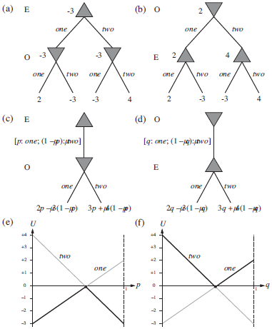

**Le maximin** choisit le mélange qui maximise le gain garanti contre la pire réponse. [Modéliser Morra](https://github.com/jsboige/CoursIA/blob/main/MyIA.AI.Notebooks/GameTheory/GameTheory-01-Setup-Python.ipynb) · [Calculer le minimax](https://github.com/jsboige/CoursIA/blob/main/MyIA.AI.Notebooks/GameTheory/GameTheory-05-ZeroSum-Minimax-Python.ipynb).

---
layout: section
---

# Analyse stratégique

---
layout: default
class: gt-matrix
---

# Dilemme du prisonnier : stable, mais pour qui ?

Les deux prisonniers décident sans connaître le choix de l’autre. Chaque case donne les gains **(ligne, colonne)** ; un nombre plus grand correspond à une peine plus courte.

| Joueur ligne ↓ / Joueur colonne → | Se taire | Avouer |
| --- | ---: | ---: |
| **Se taire** | (−1, −1) | (−12, 0) |
| **Avouer** | (0, −12) | (−8, −8) |

<v-click>

**Avouer domine strictement se taire** : contre le silence, 0 vaut mieux que −1 ; contre un aveu, −8 vaut mieux que −12. Le même calcul vaut pour l’autre joueur.

</v-click>

<v-click>

**Stable ne veut pas dire efficace.** Aucun joueur ne gagne à se taire seul en (−8, −8), mais les deux préfèrent (−1, −1) : l’issue des aveux est Pareto-dominée.

</v-click>

*À refaire : [Matrice, dominance et dilemme](https://github.com/jsboige/CoursIA/blob/main/MyIA.AI.Notebooks/GameTheory/GameTheory-02-NormalForm-Python.ipynb).*

---
layout: default
class: gt-matrix
---

# Éliminer une stratégie change le jeu restant

**IESDS** — élimination itérée des stratégies strictement dominées. Pour le joueur colonne, comparer les **seconds** gains : quelle colonne peut-on rayer d’emblée ?

| Ligne ↓ / Colonne → | Gauche | Centre | Droite |
| --- | ---: | ---: | ---: |
| **Haut** | (13, 3) | (1, 4) | (7, 3) |
| **Milieu** | (4, 1) | (3, 3) | (6, 2) |
| **Bas** | (−1, 9) | (2, 8) | (8, −1) |

<v-click>

1. **Centre** élimine Droite : 4 > 3, 3 > 2, 8 > −1.
2. Sans Droite, **Milieu** élimine Bas pour le joueur ligne : 4 > −1 et 3 > 2.
3. Sans Bas, **Centre** élimine Gauche ; **Milieu** élimine alors Haut. Il reste **(Milieu, Centre)**.

</v-click>

*À explorer : [Rationalisation et IESDS](https://github.com/jsboige/CoursIA/blob/main/MyIA.AI.Notebooks/GameTheory/GameTheory-02e-IESDS-Rationalisation-Python.ipynb) · [Définitions en Lean](https://github.com/jsboige/CoursIA/blob/main/MyIA.AI.Notebooks/GameTheory/GameTheory-02b-Lean-Definitions-Lean.ipynb).*

---
layout: default
---

# Dominance stricte

> **Énoncé.** Une action strictement dominée ne peut recevoir de poids positif à un équilibre de Nash.

## Stratégie de preuve

À stratégie adverse fixée, transférer sa probabilité à la stratégie dominante améliore strictement le gain.

---
layout: default
class: gt-matrix
---

# Chasse au cerf : être prévisible ne suffit pas

Une **meilleure réponse** maximise mon gain *contre un choix adverse donné*. Une stratégie dominante, elle, est meilleure *quel que soit* ce choix.

| Ligne ↓ / Colonne → | Cerf | Lièvre |
| --- | ---: | ---: |
| **Cerf** | (3, 3) | (0, 2) |
| **Lièvre** | (2, 0) | (1, 1) |

<v-click>

Contre Cerf, mieux vaut Cerf ; contre Lièvre, mieux vaut Lièvre. **Aucune action ne domine**. Les deux diagonales sont des équilibres de Nash purs : en chacune, dévier seul ne paie pas.

</v-click>

<v-click>

**Le problème est de se coordonner.** Les deux joueurs préfèrent chasser le cerf ensemble, mais chasser le lièvre rapporte davantage si l’autre ne coopère pas.

</v-click>

*À calculer : [Meilleures réponses et équilibres de Nash](https://github.com/jsboige/CoursIA/blob/main/MyIA.AI.Notebooks/GameTheory/GameTheory-04-NashEquilibrium-Python.ipynb).*

---
layout: image-overlay
---

# Repérer Nash dans une matrice à quatre actions

Dans chaque colonne, marquer tous les maxima du **premier** gain ; dans chaque ligne, tous ceux du **second**. Une case doublement marquée est un Nash pur. Garder les ex æquo.

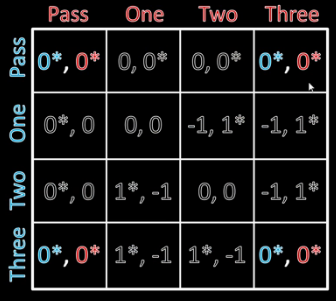

Les quatre combinaisons où chacun choisit **Pass** ou **Three** sont des équilibres purs. L’absence de double marque dans un autre jeu n’exclurait pas un équilibre mixte.

---
layout: dense
---

# Stratégies mixtes

Au penalty, annoncer son côté favori aide le gardien. Comment choisir des probabilités plutôt qu’une direction fixe ?

  
<h2>1 · Mélanger</h2>
Une stratégie mixte est une loi sur les actions pures. À pile ou face, on connaît la loi, pas le résultat du tirage.

Tout jeu fini possède un équilibre de Nash en stratégies mixtes, éventuellement pures.

  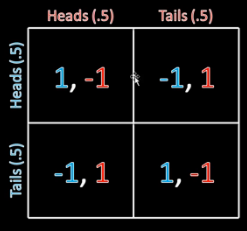

  
<h2>2 · Rendre indifférent</h2>
Si les deux actions sont jouées à l’équilibre, elles doivent rapporter autant. On cherche la probabilité de l’<em>autre</em> joueur qui égalise leurs gains.

Colonne : 1 − 4u = 2u, donc u = 1/6. Ligne : 5ℓ − 2 = −ℓ, donc ℓ = 1/3.

  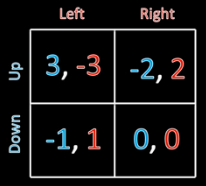

  
<h2>3 · Calculer le gain</h2>
Dans la bataille des sexes, boxe et ballet donnent deux équilibres purs. Au mélange (1/3, 2/3), pondérer chaque case par sa probabilité donne un gain espéré de 2/3 à chacun.

  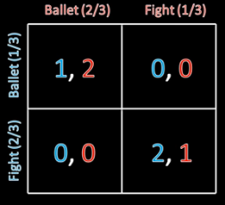

*Notebooks : [GameTheory-05-ZeroSum-Minimax-Python](https://github.com/jsboige/CoursIA/blob/main/MyIA.AI.Notebooks/GameTheory/GameTheory-05-ZeroSum-Minimax-Python.ipynb) (support mixte, somme nulle) · [GameTheory-04c-NashExistence-Python](https://github.com/jsboige/CoursIA/blob/main/MyIA.AI.Notebooks/GameTheory/GameTheory-04c-NashExistence-Python.ipynb) (existence calculee).*

---
layout: dense
---

# Preuves formelles : Nash et minimax en Lean

> **Nash.** Tout jeu fini à ensembles d’actions non vides possède un équilibre en stratégies mixtes.

**Idée de preuve.** Une application continue sur le produit des simplexes corrige les déviations profitables. À un point fixe, aucune ne subsiste.

- [GameTheory-04b-Lean-NashExistence-Lean](https://github.com/jsboige/CoursIA/blob/main/MyIA.AI.Notebooks/GameTheory/GameTheory-04b-Lean-NashExistence-Lean.ipynb)
  - Simplexe standard (compact, convexe) -> point fixe -> equilibre mixte

> **Von Neumann.** Dans un jeu fini à deux joueurs à somme nulle, le maximum du gain garanti égale le minimum que peut imposer l’adversaire.

**Idée de preuve.** Le gain espéré est bilinéaire sur deux simplexes compacts : appliquer le théorème de minimax.

- [GameTheory-05b-Lean-Minimax-Lean](https://github.com/jsboige/CoursIA/blob/main/MyIA.AI.Notebooks/GameTheory/GameTheory-05b-Lean-Minimax-Lean.ipynb)
  - Point de selle via le théorème de Sion.

---
layout: dense
---

# Equilibres de stratégie mixte

## Stratégie mixte dominant strictement une pure

- Ex: trois lignes, milieu dominee, calcul des probas

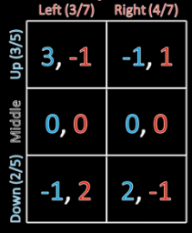

## Dominance faible

- Domine ou indifferente (>=)
- Elimination iterative, mais reste autres equilibres

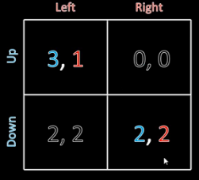

*Notebooks : [GameTheory-03-Topology2x2-Python](https://github.com/jsboige/CoursIA/blob/main/MyIA.AI.Notebooks/GameTheory/GameTheory-03-Topology2x2-Python.ipynb) (dominance faible, regle impaire) · [Metajeux-04-Chemin-Minimal-Robinson-Goforth-Python](https://github.com/jsboige/CoursIA/blob/main/MyIA.AI.Notebooks/GameTheory/Metajeux/Metajeux-04-Chemin-Minimal-Robinson-Goforth-Python.ipynb) · [Metajeux-05-Temoins-Impossibilite-Python](https://github.com/jsboige/CoursIA/blob/main/MyIA.AI.Notebooks/GameTheory/Metajeux/Metajeux-05-Temoins-Impossibilite-Python.ipynb).*

---
layout: dense
---

# Équilibres mixtes — multiplicité et parité

## Equilibres infinis

- Ex: equilibres partiellement mixtes

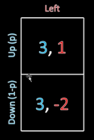

## Règle impaire

- Presque tous les jeux ont un nombre impair d'equilibres
- Nombre infini ou pair généralement lie a la dominance faible
  - Ex nombre pair: l'argent gratuit
  - Sinon verifier si on n'a pas oublie une mixte

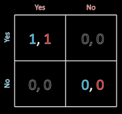

*Notebooks : [GameTheory-03-Topology2x2-Python](https://github.com/jsboige/CoursIA/blob/main/MyIA.AI.Notebooks/GameTheory/GameTheory-03-Topology2x2-Python.ipynb) (dominance faible, regle impaire) · [Metajeux-04-Chemin-Minimal-Robinson-Goforth-Python](https://github.com/jsboige/CoursIA/blob/main/MyIA.AI.Notebooks/GameTheory/Metajeux/Metajeux-04-Chemin-Minimal-Robinson-Goforth-Python.ipynb) · [Metajeux-05-Temoins-Impossibilite-Python](https://github.com/jsboige/CoursIA/blob/main/MyIA.AI.Notebooks/GameTheory/Metajeux/Metajeux-05-Temoins-Impossibilite-Python.ipynb).*

---
layout: dense
---

# Jeux séquentiels

Une menace de guerre des prix suffit-elle à décourager un concurrent d’entrer sur le marché ?

<h2>1 · Suivre les décisions</h2>
L’entrant choisit entre rester dehors et entrer. Ce n’est qu’après une entrée que la firme en place décide d’accepter la concurrence ou de livrer une guerre des prix.

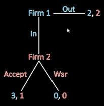

<h2>2 · Remonter depuis les feuilles</h2>
Dans cet arbre d’escalade, partez de la dernière décision. Comparez les gains du joueur qui décide, retenez sa meilleure réponse, puis remontez d’un nœud.

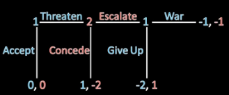

<h2>3 · Pourquoi plusieurs équilibres ?</h2>
Le pointillé relie deux nœuds : le joueur 1 ne sait pas si le joueur 2 a choisi <em>Left</em> ou <em>Right</em>. Il ne peut donc pas adapter son choix à cette action.

Le mélange indiqué rapporte −1/3 au joueur 1 après <em>Go</em>, autant que <em>Stay</em>. À la racine, toute probabilité <em>p</em> est alors optimale.

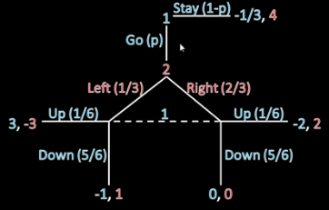

*Notebooks : [GameTheory-07-ExtensiveForm-Python](https://github.com/jsboige/CoursIA/blob/main/MyIA.AI.Notebooks/GameTheory/GameTheory-07-ExtensiveForm-Python.ipynb) (arbres, tours successifs) · [GameTheory-09-BackwardInduction-Python](https://github.com/jsboige/CoursIA/blob/main/MyIA.AI.Notebooks/GameTheory/GameTheory-09-BackwardInduction-Python.ipynb) (mille-pattes) · [GameTheory-10-ForwardInduction-SPE-Python](https://github.com/jsboige/CoursIA/blob/main/MyIA.AI.Notebooks/GameTheory/GameTheory-10-ForwardInduction-SPE-Python.ipynb).*

---
layout: dense
---

# Jeux a étapes

## Plusieurs manches

- Sous-jeux simultanes, Gains independants, connaissance du passe
- Difficile a dessiner (exponentiel)
- Theoremes:
  - Dernière étape -> Equilibre de Nash (passe non modifiable)
  - Autres: jouer equilibres de Nash = 1 equilibre de sous-jeu
  - Mais autres equilibres de sous-jeu possibles (cooperation)

*Notebook : [GameTheory-10-ForwardInduction-SPE-Python](https://github.com/jsboige/CoursIA/blob/main/MyIA.AI.Notebooks/GameTheory/GameTheory-10-ForwardInduction-SPE-Python.ipynb) (equilibres de sous-jeu, induction sur plusieurs manches).*

---
layout: dense
---

# Menaces credibles -- punition et engagement

## Que change la destruction du pont ?

Le pays 1 occupe l’île. Tant que son pont reste intact, il peut se retirer si le pays 2 envahit. Brûler son propre pont ne change pas les préférences du pays 1 : cela retire une action possible.

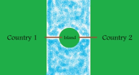

## Se lier les mains

- Ex: bruler le pont derriere soi -> Rend la menace credible

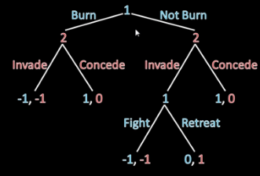

*Notebooks : [GameTheory-09b-Commitment-Stackelberg-Python](https://github.com/jsboige/CoursIA/blob/main/MyIA.AI.Notebooks/GameTheory/GameTheory-09b-Commitment-Stackelberg-Python.ipynb) (se lier les mains, menace credible) · [Dynamics-01-Jeux-Repetes-Folk-Theorem-Python](https://github.com/jsboige/CoursIA/blob/main/MyIA.AI.Notebooks/GameTheory/Dynamics/Dynamics-01-Jeux-Repetes-Folk-Theorem-Python.ipynb) (strategies de punition).*

---
layout: dense
---

# Jeux a étapes -- induction arriere et repetition

## La fouille : anticiper la réponse

Le garde préfère une fouille complète (3 plutôt que 2). En l’anticipant, le premier joueur préfère attendre le chien (2 plutôt que 1). Promettre une fouille rapide ne suffit pas.

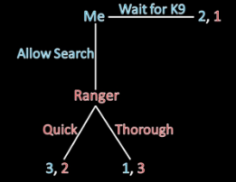

## Récompenser ou punir à la seconde manche

Dans la matrice de droite, récompenser ensemble rapporte (3, 3). Punir ensemble rapporte (0, 0), mais aucun joueur ne gagne à changer seul. Ces deux équilibres permettent de conditionner la seconde manche à la coopération dans la première.

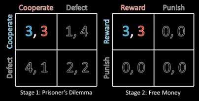

*Notebooks : [Dynamics-01-Jeux-Repetes-Folk-Theorem-Python](https://github.com/jsboige/CoursIA/blob/main/MyIA.AI.Notebooks/GameTheory/Dynamics/Dynamics-01-Jeux-Repetes-Folk-Theorem-Python.ipynb) (folk theorem) · [GameTheory-06-EvolutionTrust-Python](https://github.com/jsboige/CoursIA/blob/main/MyIA.AI.Notebooks/GameTheory/GameTheory-06-EvolutionTrust-Python.ipynb) (evolution de la confiance).*

---
layout: dense
---

# Jeux à étapes — du pub au mille-pattes

## Induction vers l’avant : pourquoi renoncer au pub ?

Le pub garantit 2,5 au premier joueur. Le lapin ne lui rapporte jamais plus de 2. Si le second joueur interprète le refus du pub comme un choix rationnel, il a une raison de miser sur le cerf plutôt que sur le lapin.

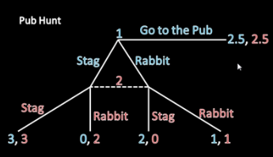

## Le mille-pattes : remonter jusqu’au début

Au dernier nœud, le joueur 2 préfère 101 à 100. Le joueur 1 l’anticipe au nœud précédent et préfère 100 à 99. En remontant ainsi, le modèle prédit un arrêt immédiat, même si continuer profiterait aux deux. Cette prédiction dépend de ce que chacun suppose de la rationalité des autres.

Pour comparer : dans un dilemme répété, une punition perpétuelle ou un « œil pour œil » fait dépendre la réponse du passé.

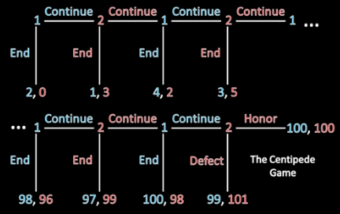

*Notebooks : [Dynamics-01-Jeux-Repetes-Folk-Theorem-Python](https://github.com/jsboige/CoursIA/blob/main/MyIA.AI.Notebooks/GameTheory/Dynamics/Dynamics-01-Jeux-Repetes-Folk-Theorem-Python.ipynb) (folk theorem) · [GameTheory-06-EvolutionTrust-Python](https://github.com/jsboige/CoursIA/blob/main/MyIA.AI.Notebooks/GameTheory/GameTheory-06-EvolutionTrust-Python.ipynb) (evolution de la confiance).*

---
layout: dense
---

# Jeux répétés : du seuil au théorème folk

## Ce que Lean établit pour le dilemme du prisonnier

- [`grim_trigger_sustains_iff`](https://github.com/jsboige/CoursIA/blob/main/MyIA.AI.Notebooks/GameTheory/game_theory_lean/RepeatedGames/GrimTrigger.lean) compare le flux coopératif au flux après défection.
- [`grim_isSPE_iff`](https://github.com/jsboige/CoursIA/blob/main/MyIA.AI.Notebooks/GameTheory/game_theory_lean/RepeatedGames/Perfect.lean) établit l’équivalence entre le même seuil et l’équilibre parfait en sous-jeux du profil grim trigger.

## Au-delà du dilemme : le résultat général

> **Théorème folk (version à surveillance parfaite).** Dans un jeu fini répété, sous l’hypothèse de pleine dimension des gains réalisables, tout gain réalisable strictement au-dessus des niveaux minimax individuels peut être soutenu en équilibre parfait en sous-jeux pour des joueurs suffisamment patients.

**Exemple.** Avec $(T,R,P,S)=(5,3,1,0)$, la moyenne de $(3,3)$ et $(5,0)$ est $(4,\,1{,}5)$ : même la part la plus faible dépasse le minimax de 1.

**Stratégie.** Réaliser le gain sur le chemin d’équilibre, puis rendre les sanctions crédibles pour ceux qui les appliquent.

<!--
La moyenne illustre la faisabilité, pas la preuve qu’une alternance réalise exactement cette cible pour tout facteur d’actualisation. Dans RepeatedGames/Folk.lean, folk_theorem_discounted a encore un sorry pour la réalisation d’une cible par une trajectoire du dilemme à deux joueurs. Ce n’est pas une formalisation du résultat général, qui exige aussi les incitations après tout historique.
-->

---
layout: default
---

# Punition permanente : un équilibre dans chaque sous-jeu

> **Énoncé.** Dans le dilemme du prisonnier infiniment répété ($T>R>P>S$, $0\leq\delta<1$), le profil grim trigger — coopérer tant que personne n’a fait défection, puis faire défection pour toujours — est un équilibre parfait en sous-jeux **si et seulement si** $\delta\geq\frac{T-R}{T-P}$.

## Stratégie de preuve

1. **Avant une défection**, trahir rapporte $T-R$ aujourd’hui, mais coûte $\delta(R-P)/(1-\delta)$ sur les tours futurs.
2. **Après une défection**, la punition est crédible : face à une défection, trahir rapporte $P$ et coopérer seulement $S$.
3. **À tout historique**, le principe de déviation en un coup suffit : avec des gains bornés, le poids de la fin du flux tend vers zéro.

**Au seuil.** Avec $(T,R,P,S)=(5,3,1,0)$ et $\delta=1/2$, le gain immédiat de 2 est exactement compensé par $2(1/2+1/4+\cdots)=2$.

*Notebook : [Dynamics-02 — Jeux répétés en Lean](https://github.com/jsboige/CoursIA/blob/main/MyIA.AI.Notebooks/GameTheory/Dynamics/Dynamics-02-Jeux-Repetes-Lean-Python.ipynb).*

---
layout: dense
---

# Jeux combinatoires -- Grundy et les nimbers

## Sprague-Grundy

- **Jeu impartial fini sans cycle** : mêmes coups pour les deux joueurs ; sans coup disponible, on perd (convention normale).
- **P ou N ?** Une feuille est perdante (P). En remontant, une position est gagnante (N) dès qu’un coup mène à P.
- **Pourquoi un entier ?** Un tas de 1 et un tas de 2 sont tous deux gagnants seuls. En leur ajoutant le même tas de 1, $(1,1)$ perd mais $(2,1)$ gagne. Le verdict P/N ne suffit pas pour composer les jeux.

*Notebooks : [GameTheory-08-CombinatorialGames-Python](https://github.com/jsboige/CoursIA/blob/main/MyIA.AI.Notebooks/GameTheory/GameTheory-08-CombinatorialGames-Python.ipynb) (Nim, Grundy) · [GameTheory-08b-Lean-CombinatorialGames-Lean](https://github.com/jsboige/CoursIA/blob/main/MyIA.AI.Notebooks/GameTheory/GameTheory-08b-Lean-CombinatorialGames-Lean.ipynb) (port Lean from scratch) · [GameTheory-08c-CombinatorialGames-Python](https://github.com/jsboige/CoursIA/blob/main/MyIA.AI.Notebooks/GameTheory/GameTheory-08c-CombinatorialGames-Python.ipynb) · [GameTheory-08d-Lean-CGT-Lean](https://github.com/jsboige/CoursIA/blob/main/MyIA.AI.Notebooks/GameTheory/GameTheory-08d-Lean-CGT-Lean.ipynb) (lake `conway_cgt_lean`).*

---
layout: default
---

# Sprague–Grundy

> **Énoncé.** En convention normale, la valeur d’une somme disjointe de jeux impartiaux finis sans cycle est le XOR de leurs nimbers.

## Stratégie de preuve

**Calcul local.** En retirant 1 ou 2 jetons, les tailles 0 à 4 valent $0,1,2,0,1$. Depuis 4, on atteint les valeurs 2 et 0 : leur plus petit entier absent (*mex*) est 1.

**Somme.** Un coup change un seul nimber : le XOR $X$ ne peut donc pas rester identique. On peut en revanche atteindre tout $k<X$ ; le mex de la somme est donc exactement $X$. Viser $k=0$ donne un coup gagnant si $X\ne 0$.

<!--
Au bit de poids fort qui distingue X et k, X porte un 1 et k un 0. Au moins une composante g porte ce bit. La remplacer par g′ = g XOR X XOR k donne un nimber plus petit, donc accessible par définition du mex. Le XOR de la somme devient k. L’induction s’applique aux sommes accessibles en un coup.
-->

---
layout: dense
---

# Formes stratégiques avancées

## Bataille des sexes : faire varier les gains

Pour $A>B>C$, l’indifférence de la colonne détermine la probabilité de jouer Ballet en ligne : $\sigma_u=(b-c)/(a+b-2c)$. Elle est strictement entre 0 et 1 si $a>b>c$.

<table class="gt-payoff" aria-label="Matrice de la bataille des sexes">
<thead><tr><th scope="col">Ligne / Colonne</th><th scope="col">Ballet</th><th scope="col">Boxe</th></tr></thead>
<tbody><tr><th scope="row">Ballet</th><td>(B, a)</td><td>(C, c)</td></tr><tr><th scope="row">Boxe</th><td>(C, c)</td><td>(A, b)</td></tr></tbody>
</table>

## Équilibre de lame de couteau

Si $X>0$, (Haut, Gauche) est l’unique équilibre ; si $X<0$, c’est (Bas, Droite). À $X=0$, tous les profils sont des équilibres : un écart aussi petit soit-il suffit à changer le résultat.

<table class="gt-payoff" aria-label="Matrice de l’équilibre de lame de couteau">
<thead><tr><th scope="col">Ligne / Colonne</th><th scope="col">Gauche</th><th scope="col">Droite</th></tr></thead>
<tbody><tr><th scope="row">Haut</th><td>(X, X)</td><td>(0, 0)</td></tr><tr><th scope="row">Bas</th><td>(0, 0)</td><td>(−X, −X)</td></tr></tbody>
</table>

*Notebook : [GameTheory-03-Topology2x2-Python](https://github.com/jsboige/CoursIA/blob/main/MyIA.AI.Notebooks/GameTheory/GameTheory-03-Topology2x2-Python.ipynb) — topologie des jeux 2×2.*

---
layout: dense
---

# Formes stratégiques avancées — statique comparée

## Changer une entrée du modèle

On fixe les joueurs, l’information et les actions, puis on fait varier un gain. Le modèle prédit comment les stratégies d’équilibre et les issues changent.

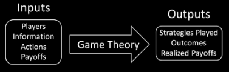

## Au penalty : compenser un côté faible

Pour $X>0$, l’indifférence du gardien donne $\sigma_{KL}(X)=1/(1+X)$ et $\sigma'_{KL}(X)=-1/(1+X)^2$. Quand le tir à gauche devient plus efficace s’il surprend le gardien, le tireur l’utilise moins souvent à l’équilibre.

<table class="gt-payoff" aria-label="Gains du tireur et du gardien au penalty">
<thead><tr><th scope="col">Tir / Plongeon</th><th scope="col">Gauche</th><th scope="col">Droite</th></tr></thead>
<tbody><tr><th scope="row">Gauche</th><td>(0, 0)</td><td>(X, −X)</td></tr><tr><th scope="row">Droite</th><td>(1, −1)</td><td>(0, 0)</td></tr></tbody>
</table>

## Un changement peut être discontinu

Dans le schéma, un coût élevé conduit à la paix, un coût faible à la guerre. Contrairement aux probabilités du penalty pour $X>0$, l’issue représentée bascule plutôt qu’elle ne varie graduellement.

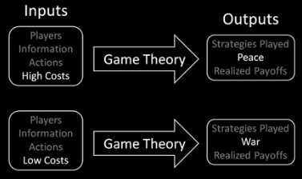

---
layout: dense
---

# Pierre, papier, ciseaux — cycles et mélange

## Le cycle empêche un équilibre pur

Chaque choix a une meilleure réponse adverse. Dans le jeu usuel, le mélange uniforme rend toutes les actions de l’adversaire indifférentes. Le gain d’équilibre est nul : le jeu est symétrique et à somme nulle.

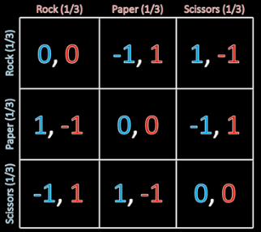

## Doubler l’enjeu d’un duel déforme le mélange

Si papier contre pierre rapporte 2 au lieu de 1, l’indifférence impose des poids de $1/4$ pour pierre et papier et $1/2$ pour ciseaux. La symétrie du jeu entre les joueurs et la somme nulle sont préservées.

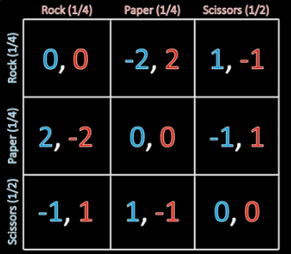

*Notebooks : [Dynamics-09-Biens-Publics-N-Personnes-Python](https://github.com/jsboige/CoursIA/blob/main/MyIA.AI.Notebooks/GameTheory/Dynamics/Dynamics-09-Biens-Publics-N-Personnes-Python.ipynb) (déformation, pierre-papier-ciseaux) · [GameTheory-05-ZeroSum-Minimax-Python](https://github.com/jsboige/CoursIA/blob/main/MyIA.AI.Notebooks/GameTheory/GameTheory-05-ZeroSum-Minimax-Python.ipynb) (somme nulle).*

---
layout: dense
---

# Topologie des jeux 2x2 : l'arc des notebooks

## De la matrice au paysage ordinal

- [GameTheory-03b-Chambres-Murs-Chemins-Lean-Python](https://github.com/jsboige/CoursIA/blob/main/MyIA.AI.Notebooks/GameTheory/GameTheory-03b-Chambres-Murs-Chemins-Lean-Python.ipynb) : partitionner l'espace des jeux 2x2 en chambres et murs, puis mesurer la distance qui separe deux chambres

## Deformations et quotient

- [Dynamics-09-Biens-Publics-N-Personnes-Python](https://github.com/jsboige/CoursIA/blob/main/MyIA.AI.Notebooks/GameTheory/Dynamics/Dynamics-09-Biens-Publics-N-Personnes-Python.ipynb) : chemins continus entre classes
- [GameTheory-03-Topology2x2-Python (§9)](https://github.com/jsboige/CoursIA/blob/main/MyIA.AI.Notebooks/GameTheory/GameTheory-03-Topology2x2-Python.ipynb) : deriver la structure quotient (absorbé depuis l'ex-03g)

## Parcours et extensions

- [GameTheory-03e-Meta-Actions-Tarifees-Python (§4-8)](https://github.com/jsboige/CoursIA/blob/main/MyIA.AI.Notebooks/GameTheory/GameTheory-03e-Meta-Actions-Tarifees-Python.ipynb) : versant d'integration (absorbé depuis l'ex-03f)
  - [GameTheory-03e-Meta-Actions-Tarifees-Python](https://github.com/jsboige/CoursIA/blob/main/MyIA.AI.Notebooks/GameTheory/GameTheory-03e-Meta-Actions-Tarifees-Python.ipynb) · [GameTheory-03d-Deux-Especes-de-Fleches-Python](https://github.com/jsboige/CoursIA/blob/main/MyIA.AI.Notebooks/GameTheory/GameTheory-03d-Deux-Especes-de-Fleches-Python.ipynb) · [Dynamics-10-Joueur-LLM-Python](https://github.com/jsboige/CoursIA/blob/main/MyIA.AI.Notebooks/GameTheory/Dynamics/Dynamics-10-Joueur-LLM-Python.ipynb)

---
layout: default
---

# Invariance dans une chambre

> **Énoncé.** Le long d’un chemin continu de matrices sans égalité de gains pour un joueur, son classement des issues ne change pas.

## Stratégie de preuve

Un point représente une **matrice entière**. Pour chaque joueur et chaque paire d’issues, suivre la différence de gains : changer son signe oblige à passer par zéro, sur un mur. On peut aussi toucher le mur et repartir du même côté.

**Exemple.** Avec une prime $b$ à la coopération mutuelle, $R=3+b$ et $T=5$. De $b=0$ à $b=1$, aucun classement ne change, mais le seuil de grim trigger passe de $1/2$ à $1/4$.

**Compter les chambres.** $576$ jeux étiquetés, $144$ à renommage des actions près, $78$ si l’on peut aussi échanger les joueurs. La distance avant quotient compte les inversions de rang des deux joueurs.

<!--
À b = 2, les deux joueurs ont simultanément R = T ; au-delà, coopérer mutuellement est un équilibre strict. Deux comparaisons de rangs voisins s’inversent : distance 2 entre les chambres de part et d’autre, même si les deux murs sont franchis au même instant. La distance minimale est la somme des nombres d’inversions pour les deux classements.

Pour le quotient : (4!)² = 576 couples de classements stricts étiquetés. Les quatre renommages de lignes et colonnes agissent librement, d’où 144 classes. L’échange des joueurs fixe 12 de ces classes ; les 132 autres s’apparient, d’où 78. Voir la dérivation dans le notebook de topologie, §9.
-->

---
layout: default
---

# Espaces de stratégies infinis

## Jeux sans equilibre

- Nombre fini de stratégies pures -> Matrices + theoremes de Nash
- Certains jeux ont une infinite de stratégies pures
  - Pas de matrice, pas forcement d'equilibre de Nash

## Duels

- 100 m, 2 balles, precisions différentes (0% a 100m, 100% a 0m)
- Equilibre = même distance (preuve par contradiction)
- Ex: date de sortie de produits concurrents

*Notebook : [GameTheory-04c-NashExistence-Python](https://github.com/jsboige/CoursIA/blob/main/MyIA.AI.Notebooks/GameTheory/GameTheory-04c-NashExistence-Python.ipynb) (existence d'un equilibre hors matrice finie).*

---
layout: default
---

# Loi de Hotelling et électeur médian

Deux vendeurs de glaces choisissent où s’installer. À prix égal, chaque client va au plus proche.

<h2>1 · Où passe la frontière ?</h2>
La frontière est à mi-distance des stands. Si le rouge se rapproche du bleu sans le dépasser, la frontière avance vers la droite : le rouge gagne des clients.

<h2>2 · Pourquoi au milieu ?</h2>
Les positions distinctes du schéma ne sont pas stables. Avec des clients uniformément répartis, deux stands au centre servent chacun la moitié de la plage. S’écarter seul laisse plus de la moitié des clients à son rival.

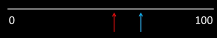

<h2>3 · Du client à l’électeur</h2>
Avec un nombre impair de votants aux préférences strictes à sommet unique, le sommet médian bat toute autre proposition : les votants de son côté, médiane comprise, forment une majorité.

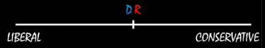

*Notebook : [SocialChoice/ChoixSocial-03-Voting-Methods-Python](https://github.com/jsboige/CoursIA/blob/main/MyIA.AI.Notebooks/GameTheory/SocialChoice/ChoixSocial-03-Voting-Methods-Python.ipynb) (electeur median) ; preuve Lean `median_voter_theorem` dans game_theory_lean/SocialChoice/Voting.lean. Loi de Hotelling : pas de notebook dedie.*

---
layout: default
---

# Électeur médian

> **Énoncé.** Pour un nombre impair de votants aux préférences strictes à sommet unique sur un axe commun, le sommet médian bat toute autre option en duel.

## Stratégie de preuve

Face à une option à gauche du sommet médian, tous les sommets situés à droite, médiane comprise, préfèrent la médiane. Raisonner symétriquement à gauche.

---
layout: section
---

# Jeux Bayesiens

---
layout: dense
---

# Jeux Bayesiens

## Information incomplete

- Sur les autres joueurs (ex: recompenses)
- Representation = Distribution de probabilité sur les types de joueurs
  - Information imparfaite -> Analyse probabiliste

## Formalisation

$G=\langle N,\Omega,(A_i,u_i,T_i,\tau_i,p_i,C_i)_{i\in N}\rangle$

- N joueurs, Omega etats de la nature, A_i actions du joueur i
- T_i type du joueur i, U_i recompense, p_i distribution des types
- Stratégies pures: $S_i=\{s_i:T_i\to A_i\}$

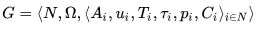

*Notebook : [GameTheory-11-BayesianGames-Python](https://github.com/jsboige/CoursIA/blob/main/MyIA.AI.Notebooks/GameTheory/GameTheory-11-BayesianGames-Python.ipynb) (types, croyances, formalisation).*

---
layout: dense
---

# Jeux Bayesiens -- equilibres et dilemme du Sheriff

## Equilibres de Nash Bayesien

- Objectif = maximisation de la recompense esperee
- De nombreux equilibres sans restrictions supplementaires

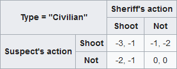

## Ex: Dilemme du Sheriff

- Criminel (p) vs civil (1-p), tirer ou pas
- Stratégies dominantes: tirer pour criminel, pas pour civil
- Pour le Sheriff: $E(\text{tirer})=p-1$, $E(\text{ne pas tirer})=-2p$
  - p>1/3 = tirer

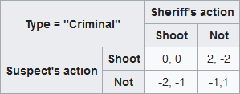

*Notebooks : [GameTheory-11-BayesianGames-Python](https://github.com/jsboige/CoursIA/blob/main/MyIA.AI.Notebooks/GameTheory/GameTheory-11-BayesianGames-Python.ipynb) (types, Nash bayesien) · [GameTheory-11b-Lean-BayesianGamesExt-Lean](https://github.com/jsboige/CoursIA/blob/main/MyIA.AI.Notebooks/GameTheory/GameTheory-11b-Lean-BayesianGamesExt-Lean.ipynb) (extension Lean).*

---
layout: default
---

# Meilleure réponse par type

> **Énoncé.** Dans un jeu bayésien fini, un profil est un équilibre si chaque type de probabilité positive maximise son utilité espérée conditionnelle.

## Stratégie de preuve

Le gain d’une déviation est la moyenne des gains conditionnels, pondérée par la probabilité de chaque type. Sans amélioration locale, cette moyenne ne peut pas être positive.

**Exemple.** Si un type de probabilité $1/5$ peut gagner 3 en changeant seul son action, ne modifier que cette ligne du plan rapporte $3/5$ avant de connaître son type.

---
layout: dense
---

# Equilibres Bayesiens parfaits (PBE)

## Jeux séquentiels

- Rappel SPE -> equilibres non plausibles (menaces non credibles)
- Systèmes de croyance: assignations de probabilités sur les types
  - "Consistant" -> Probabilités par application des stratégies (Bayes)
- Rationalite séquentielle: recompense esperee maximale

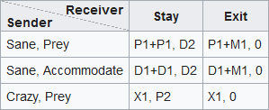

## Definition PBE

- Profile stratégique et système de croyance consistant tels que les stratégies sont sequentiellement rationnelles

*Notebook : [GameTheory-17b-Asymmetric-Information-Python](https://github.com/jsboige/CoursIA/blob/main/MyIA.AI.Notebooks/GameTheory/GameTheory-17-MultiAgent-RL/GameTheory-17b-Asymmetric-Information-Python.ipynb) — croyances consistantes et rationalite sequentielle.*

---
layout: dense
---

# Jeux de signalisation -- pooling, separating, semi-separation

## Trois categories de PBE

- Emetteur S (connait son type) -> message m, Recepteur R -> action a
- 3 catégories de PBE:
  - **Pooling**: emetteurs choisissent le même message (pas de signal)
  - **Separating**: messages toujours différents -> croyance déterministe
  - **Semi-separation** (partial-pooling): mixte

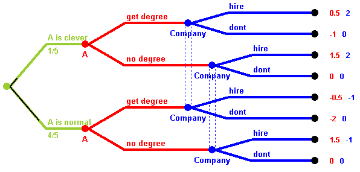

## Exemples

- Jeu de reputation (guerre des prix): pooling ou separating
- Jeu d'education: doue ou pas, diplome ou pas (signal) -> PBE de separation
- Biere-quiche: P=0.9 -> pooling, P=0.2 -> stratégies mixtes

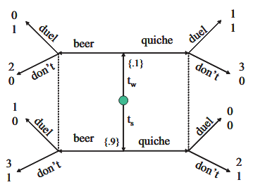

*Notebooks : [GameTheory-12-ReputationGames-Python](https://github.com/jsboige/CoursIA/blob/main/MyIA.AI.Notebooks/GameTheory/GameTheory-12-ReputationGames-Python.ipynb) (pooling/separating) · [GameTheory-17d-Lean-Screening-Signaling-Lean](https://github.com/jsboige/CoursIA/blob/main/MyIA.AI.Notebooks/GameTheory/GameTheory-17-MultiAgent-RL/GameTheory-17d-Lean-Screening-Signaling-Lean.ipynb) (screening formalise).*

---
layout: default
---

# Séparation et incitations

> **Énoncé.** Dans un équilibre séparateur, chaque type préfère son propre signal à celui d’un autre type, compte tenu de la réponse du destinataire.

## Stratégie de preuve

**Exemple.** Le diplôme donne accès à une prime de 4. Son coût vaut 2 pour le premier type et 6 pour le second : le premier gagne $4-2=2$ à se diplômer, le second perdrait $6-4=2$ en l’imitant.

**Vérification.** Ces deux incitations ne suffisent pas : il faut que l’employeur tire les bonnes conclusions du signal et que sa décision soit optimale compte tenu de ses croyances.

<!--
Si les deux types ont une probabilité positive et choisissent chacun un signal différent, Bayes identifie le type après chacun de ces signaux. Le salaire supposé dans le calcul doit alors être justifié par les gains de l’employeur. S’il existe d’autres signaux hors du chemin, il faut aussi préciser les croyances et les réponses correspondantes, puis vérifier les déviations vers ces signaux.
-->

---
layout: dense
---

# Information imparfaite -- le regret contraposé (CFR)

## Poker et apprentissage auto-centré

- Théorème de Kuhn : à rappel parfait, stratégies comportementales = mixtes
  - L'information set porte la croyance qui pilote la meilleure réponse
- CFR (Counterfactual Regret Minimization) : minimiser le regret contraposé
  - Convergence vers l'équilibre de Nash -- la famille qui a révolutionné la résolution du poker
  - Safe subgame solving : recoller une sous-partie sans supposer les croyances (le mauvais recollement produit un témoin adversarial)

*Notebooks : [GameTheory-13-ImperfectInfo-CFR-Python](https://github.com/jsboige/CoursIA/blob/main/MyIA.AI.Notebooks/GameTheory/GameTheory-13-ImperfectInfo-CFR-Python.ipynb) (CFR, Kuhn) · [GameTheory-13b-Safe-Subgame-Solving-Python](https://github.com/jsboige/CoursIA/blob/main/MyIA.AI.Notebooks/GameTheory/GameTheory-13b-Safe-Subgame-Solving-Python.ipynb) · [GameTheory-13b-Safe-Subgame-Solving-CSharp](https://github.com/jsboige/CoursIA/blob/main/MyIA.AI.Notebooks/GameTheory/GameTheory-13b-Safe-Subgame-Solving-CSharp.ipynb) (jumeau C#) · [GameTheory-13d-Optimistic-CFR-Python](https://github.com/jsboige/CoursIA/blob/main/MyIA.AI.Notebooks/GameTheory/GameTheory-13d-Optimistic-CFR-Python.ipynb).*

---
layout: default
---

# Kuhn

> **Énoncé.** Dans un jeu extensif fini à rappel parfait, stratégies mixtes et comportementales sont équivalentes en réalisation, pas nécessairement comme distributions sur les plans.

## Stratégie de preuve

**Du plan aux tirages locaux.** À chaque ensemble d’information, conditionner le plan tiré sur les actions passées du joueur. Le rappel parfait garantit que ce passé est le même partout dans cet ensemble.

**Des tirages locaux au plan.** Tirer à l’avance, indépendamment, une action pour chaque ensemble d’information. Contre toute stratégie adverse, les deux constructions reproduisent les probabilités des issues.

---
layout: section
---

# Questions?

---
layout: section
---

# Jeux cooperatifs

---
layout: dense
---

# Jeux cooperatifs

## Jeux d'assistance

- 2 joueurs, récompense $\theta$ incertaine pour l'assistant
- Ex: Jeu du trombone
  - Nash -> meilleure reponse myope incrementale
- Cas general similaire a un POMDP dont l’état caché inclut $\theta$

## Théorie des jeux cooperatifs

- Utilite transferable de coalition: $G=(N,v)$, $v(C)\geq0$
- Partitions = Structures de Coalitions CS(N)
- **Imputation**: $\sum_i x_i=v(N)$, $x_i\geq v(\{i\})$
- **Noyau**: imputations x telles que $\sum_{i\in C}x_i\geq v(C)$ pour tout C
- **Valeur de Shapley**: contribution marginale moyennee sur toutes les permutations
  - $\phi_i(v)=\frac1{n!}\sum_{\pi}\mathrm{mc}_i(\pi)$
  - Axiomes: Efficace, joueur nul, symetrie, additivite -> unique

## Calculs

- Reseaux de contribution marginale (representation compacte)
  - $\phi_i(R)=\sum_{C\ni i} x_C/\lvert C\rvert$ pour les coalitions contenant i
- Structures de coalition optimales: NP-Hard
  - Bons résultats avec exploration du graphe de structure

*Notebooks : [GameTheory-15-CooperativeGames-Python](https://github.com/jsboige/CoursIA/blob/main/MyIA.AI.Notebooks/GameTheory/GameTheory-15-CooperativeGames-Python.ipynb) (Shapley, noyau) · [GameTheory-15b-Lean-CooperativeGames-Lean](https://github.com/jsboige/CoursIA/blob/main/MyIA.AI.Notebooks/GameTheory/GameTheory-15b-Lean-CooperativeGames-Lean.ipynb) (axiomes de Shapley prouves en Lean) · [SocialChoice/ChoixSocial-06b-Mobius-Coalitions-Lean-Python](https://github.com/jsboige/CoursIA/blob/main/MyIA.AI.Notebooks/GameTheory/SocialChoice/ChoixSocial-06b-Mobius-Coalitions-Lean-Python.ipynb).*

---
layout: default
---

# Caractérisation de Shapley

> **Énoncé.** Sur les jeux finis à utilité transférable normalisés, efficacité, symétrie, joueur nul et additivité caractérisent une unique valeur.

## Stratégie de preuve

**Exemple.** Une coalition gagne 12 si et seulement si elle réunit trois membres indispensables. Les autres sont des joueurs nuls ; la symétrie et l’efficacité donnent $12/3=4$ à chacun des trois.

**Pourquoi cela suffit.** Les jeux d’unanimité forment une base : décomposer le jeu en tels jeux, puis additionner les partages. La moyenne des contributions marginales satisfait les quatre axiomes ; elle donne donc la valeur cherchée.

---
layout: section
---

# Conception de mécanismes

---
layout: dense
---

# Conception de mécanismes

## Théorie des jeux inverse

- Si les agents sont rationnels, quelles sont les bonnes règles?
- Dans le cadre Bayesien d'information imparfaite
  - Le "principal" souhaite inciter a reveler la vraie utilite

## Formalisme

- Le principal choisit la structure de recompense $y$
- Les agents declarent $\hat\theta$ (et peuvent mentir)
- Fonction de choix social $f(\theta)$ a implementer par $y(\hat\theta)$

## Principe de revelation

- Mécanisme incitatif verace (IC): non manipulable, revelateur
  - $\hat\theta(\theta)=\theta$
- S'il existe un mécanisme y implementant f, alors il existe une version IC
- 2 versions:
  - **DSIC**: Implementation en stratégies dominantes
  - **BNIC**: Equilibre de Nash Bayesien (plus faible)

*Notebooks : [GameTheory-16-MechanismDesign-Python](https://github.com/jsboige/CoursIA/blob/main/MyIA.AI.Notebooks/GameTheory/GameTheory-16-MechanismDesign-Python.ipynb) (revelation, DSIC/BNIC) · [GameTheory-16b-Automated-Mechanism-Design-Python](https://github.com/jsboige/CoursIA/blob/main/MyIA.AI.Notebooks/GameTheory/GameTheory-16b-Automated-Mechanism-Design-Python.ipynb) (AMD) ; `amd_star_DSIC/IR` prouves en Lean.*

---
layout: default
---

# Principe de révélation

> **Énoncé.** Si un résultat est implémenté en équilibre, un mécanisme direct peut le reproduire par des déclarations véraces, pour le même concept d’équilibre.

## Stratégie de preuve

**Construction.** Le mécanisme direct exécute, pour chaque type annoncé, la stratégie prévue par l’équilibre initial. Se déclarer de type $t'$ revient à imiter sa stratégie : c’était déjà une déviation possible dans le jeu initial.

**Portée.** Le principe construit un mécanisme à partir d’un équilibre donné. Le certificat Lean du mécanisme AMD démontre les incitations et la participation pour ce mécanisme particulier.

---
layout: dense
---

# Allocation de ressources par les encheres

## Encheres individuelles

- Valeur privee v_i de l'objet par l'individu i
- Enchere anglaise (ascendante): Efficace mais risque de collusion
- Enchere de Vickrey (second prix)
  - Equilibre DSIC = chacun declare la valeur "honnete"
  - Très repandu: eBay, AdWords etc.
- Theoreme d'equivalence de revenue

## Bien commun

- Tragedie des communs (ex: pollution)
  - Stratégie de pollution dominante mais pas optimale (Pareto)
  - Necessite d'expliciter les externalites (ex: taxe carbone)

## Mécanisme de Vickrey-Clarke-Groves (VCG)

- N Encherisseurs declarent utilite de M ressources
- Allocation maximisant la somme des utilites
- Taxe: $T_i=\max_a\sum_{k\ne i}v_k(a)-\sum_{k\ne i}v_k(a^*)$

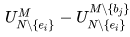

*Notebooks : [GameTheory-16-MechanismDesign-Python](https://github.com/jsboige/CoursIA/blob/main/MyIA.AI.Notebooks/GameTheory/GameTheory-16-MechanismDesign-Python.ipynb) (Vickrey, VCG, equivalence de revenu) · [GameTheory-16c-Extraction-de-Revenu-DSIC-IR-Python](https://github.com/jsboige/CoursIA/blob/main/MyIA.AI.Notebooks/GameTheory/GameTheory-16c-Extraction-de-Revenu-DSIC-IR-Python.ipynb) ; `vickrey_truthful_bidder0/1` (deux enchérisseurs, valeurs naturelles). Bien commun : pas de notebook dedie.*

---
layout: default
---

# Second prix : véracité

> **Énoncé.** Avec valeurs privées et utilité quasi linéaire, enchérir sa valeur est faiblement dominant dans une enchère au second prix.

## Stratégie de preuve

Fixer la meilleure offre adverse : c’est le prix payé si l’on gagne. Enchérir sa valeur fait gagner quand le gain est positif, et perdre quand il serait négatif. À égalité, les deux issues rapportent zéro.

**Exemple.** Pour un objet qui vaut 70 €, gagner à 60 € rapporte 10 €. Face à une offre de 80 €, gagner ferait perdre 10 € : mieux vaut ne pas emporter l’objet.

---
layout: dense
---

# Allocation par les votes

## Théorie du choix social

- Préférences individuelles rationnelles -> Ordre de préférence social
- Proprietes d'une bonne fonction de choix social:
  1. Condition de Pareto / critere d'unanimite
  2. Indépendance des alternatives non pertinentes
  3. Pas de dictature

## Résultats negatifs

- **Paradoxe de Condorcet**: la majorité peut préférer A à B, B à C et C à A
- **Theoreme de Arrow**: Impossible de satisfaire 1, 2 et 3 simultanement (>= 3 options)
- **Theoreme de Gibbard-Satterthwaite**: Toute FCS déterministe avec Pareto et >2 choix est manipulable ou dictatoriale

*Notebooks : [SocialChoice/ChoixSocial-01-Arrow-Impossibility-Theorem-Python](https://github.com/jsboige/CoursIA/blob/main/MyIA.AI.Notebooks/GameTheory/SocialChoice/ChoixSocial-01-Arrow-Impossibility-Theorem-Python.ipynb) (Arrow) · [SocialChoice/ChoixSocial-05-Gibbard-Satterthwaite-Python](https://github.com/jsboige/CoursIA/blob/main/MyIA.AI.Notebooks/GameTheory/SocialChoice/ChoixSocial-05-Gibbard-Satterthwaite-Python.ipynb) · [SocialChoice/ChoixSocial-04-Computational-Aggregation-SAT-Z3-Python](https://github.com/jsboige/CoursIA/blob/main/MyIA.AI.Notebooks/GameTheory/SocialChoice/ChoixSocial-04-Computational-Aggregation-SAT-Z3-Python.ipynb) (verification SAT/Z3) ; `arrow` prouve en Lean (game_theory_lean), Gibbard-Satterthwaite dans social_choice_lean_peters.*

---
layout: default
---

# Arrow : produire un classement

> **Énoncé.** Sur le domaine de tous les classements stricts d’au moins trois options, une règle donnant un classement social strict et transitif, respectant l’unanimité et l’indépendance des options non pertinentes, est dictatoriale.

**Stratégie.** Partir des électeurs tous ensemble, puis chercher une coalition décisive minimale. Une troisième option permet, par transitivité, de transférer le pouvoir de trancher d’une paire à l’autre et de réduire la coalition à un seul électeur.

---
layout: default
---

# Gibbard–Satterthwaite : choisir un vainqueur

> **Énoncé.** Sur le même domaine, une règle déterministe qui choisit un vainqueur et permet à chaque option de gagner est manipulable ou dictatoriale.

**Stratégie.** Si mentir ne paie jamais, remonter un vainqueur dans les bulletins ne peut pas le faire perdre. En modifiant les bulletins un par un, isoler un électeur pivot ; utiliser la liberté des classements et une troisième option pour étendre son pouvoir à tous les choix.

---
layout: dense
---

# Critere de Condorcet

## Condition du vainqueur de Condorcet

- La meilleure aux autres options prises paire a paire
  - Ex: Uninominal a 2 tours: Bayrou vainqueur de Condorcet mais pas au 2e tour
- **Indifference aux petits candidats**: vainqueur stable aux changements
- Paradoxe de Condorcet: pas de garantie d'existence

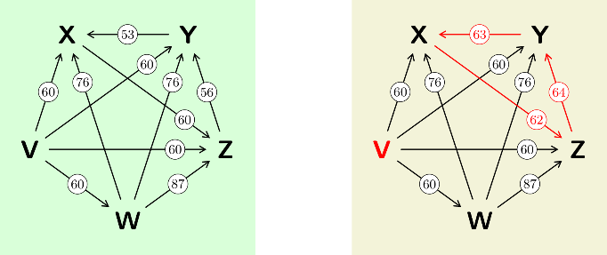

## Theoremes de l'electeur median

- 1er theoreme: Gauche-droite -> existence du vainqueur -> electeur median
- 2e theoreme: Gauche-droite + valeur intrinseque

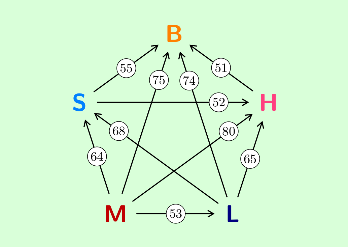

*Notebook : [SocialChoice/ChoixSocial-03-Voting-Methods-Python](https://github.com/jsboige/CoursIA/blob/main/MyIA.AI.Notebooks/GameTheory/SocialChoice/ChoixSocial-03-Voting-Methods-Python.ipynb) (Condorcet, electeur median).*

---
layout: dense
---

# En l’absence de vainqueur de Condorcet

<h2>Un axe peut éviter les cycles</h2>
La figure place les options sur une ligne : c’est le cas structuré du théorème de l’électeur médian. Sans préférences à sommet unique sur un axe commun, la majorité peut préférer A à B, B à C et C à A.

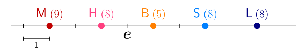

<h2>Minimax : limiter sa pire défaite</h2>
Supposons que A batte B de 3 voix, B batte C de 5 voix et C batte A d’une voix. Les pires défaites de A, B et C ont pour marges 1, 3 et 5. Minimax, dans sa version par marges, choisit A.

<h2>Schulze : comparer les chemins</h2>
La force d’un chemin est celle de son duel le plus faible. En prenant les marges positives, A → B → C a pour force 3, contre 1 pour C → A. Le duel direct ne suffit donc pas à classer C devant A.

*Notebooks : [SocialChoice/ChoixSocial-03-Voting-Methods-Python](https://github.com/jsboige/CoursIA/blob/main/MyIA.AI.Notebooks/GameTheory/SocialChoice/ChoixSocial-03-Voting-Methods-Python.ipynb) (Condorcet, Minimax, Schulze) ; `median_voter_theorem` prouve en Lean (game_theory_lean/SocialChoice/Voting.lean) ; tour Peters : Schulze, Split Cycle, Borda, IRV.*

---
layout: dense
---

# Procédures de vote : que mesure le dépouillement ?

<h2>Une voix ou un classement ?</h2>
Avec deux options, un référendum compare directement les voix. Avec plusieurs candidats, le scrutin uninominal ne compte que les premiers choix : c’est une incitation au vote utile.

Un classement permet soit d’éliminer le dernier et de transférer les voix (vote alternatif), soit d’attribuer des points à chaque rang (Borda). Ni l’un ni l’autre ne garantit le choix du vainqueur de Condorcet.

<h2>Compter les approbations</h2>
Chaque personne peut soutenir plusieurs options. Comptez les traits, pas les rangs : TRUC est en tête avec neuf approbations sur quinze. La règle retient le plus grand total, sans exiger de majorité absolue.

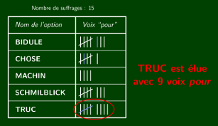

*Notebook : [SocialChoice/ChoixSocial-03-Voting-Methods-Python](https://github.com/jsboige/CoursIA/blob/main/MyIA.AI.Notebooks/GameTheory/SocialChoice/ChoixSocial-03-Voting-Methods-Python.ipynb) (Borda, assentiment, jugement majoritaire).*

---
layout: dense
---

# Procédures de vote — notes et duels

<h2>Prendre la médiane</h2>
Chaque personne évalue chaque option sur la même échelle. Ici, les notes sont rangées : c’est la note du milieu qui compte, pas la moyenne. BIDULE arrive en tête avec une médiane de 11.

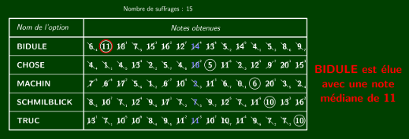

<h2>Comparer deux options à la fois</h2>
Chaque colonne correspond à un adversaire. SCHMILBLICK bat chacun des autres en duel : c’est le vainqueur de Condorcet. En l’absence d’un tel vainqueur, une méthode comme celle de Schulze départage les options.

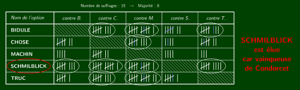

*Notebook : [SocialChoice/ChoixSocial-03-Voting-Methods-Python](https://github.com/jsboige/CoursIA/blob/main/MyIA.AI.Notebooks/GameTheory/SocialChoice/ChoixSocial-03-Voting-Methods-Python.ipynb) (Borda, assentiment, jugement majoritaire).*

---
layout: dense
---

# Du bulletin à la loterie

<h2>Trois bulletins, trois informations</h2>
On peut approuver, noter ou classer. Que devient le résultat si, au lieu de compter les voix, on tire un bulletin au hasard ? Le bulletin ne détermine pas à lui seul la règle de dépouillement.

<h2>Approuver ou noter</h2>
Ce bulletin approuve à la fois BIDULE et CHOSE ; les notes les distinguent, 14 contre 18. Ne pas confondre le nombre d’approbations et la médiane des notes.

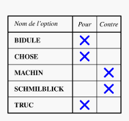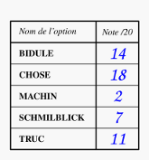

<h2>Tirer un bulletin au hasard</h2>
Si ce bulletin est tiré, son premier choix, CHOSE, gagne. Chaque option a donc pour probabilité de victoire sa part de premières places. Dans cette règle, placer son véritable favori en tête est optimal.

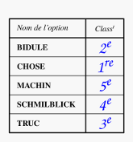

<h2>Randomiser à partir des duels</h2>
Une loterie maximale utilise plutôt les marges de majorité : on cherche une stratégie mixte d’équilibre du jeu à somme nulle entre options. Si un vainqueur strict de Condorcet existe, il reçoit toute la probabilité.

*Notebook : [SocialChoice/ChoixSocial-03-Voting-Methods-Python](https://github.com/jsboige/CoursIA/blob/main/MyIA.AI.Notebooks/GameTheory/SocialChoice/ChoixSocial-03-Voting-Methods-Python.ipynb) (Borda, assentiment, jugement majoritaire). Scrutins stochastiques : pas de notebook dedie.*

---
layout: default
---

# Allocation par la negociation

## Modèle des offres alternees

- Si pas d'accord: Accord de conflit -> fenêtre de negociation
- Nombre de manches:
  - 1 manche: Ultimatum (J1 a tout le pouvoir)
  - 2 manches: J2 a tout le pouvoir
  - N manches: JN a le pouvoir
- Agents impatients: facteurs de discompte $0\leq\gamma_i<1$
  - Offre a l'equilibre: $A_1=\frac{1-\gamma_2}{1-\gamma_1\gamma_2}$

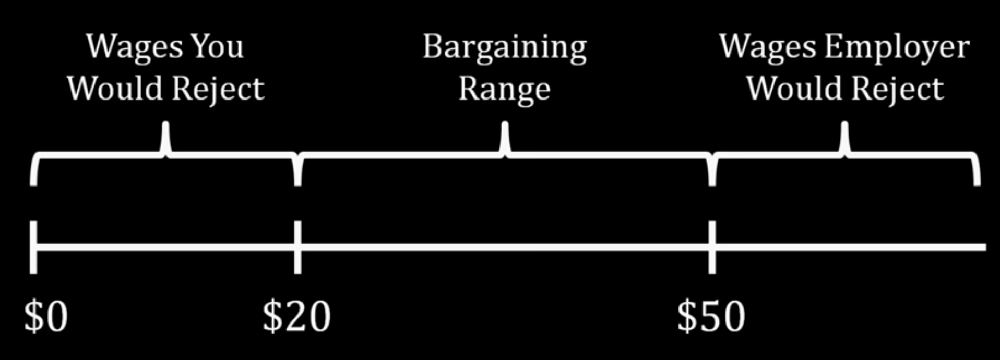

*Notebooks : [GameTheory-04d-Marchandage-Asymetrique-Python](https://github.com/jsboige/CoursIA/blob/main/MyIA.AI.Notebooks/GameTheory/GameTheory-04d-Marchandage-Asymetrique-Python.ipynb) (offres alternees, discompte) · [GameTheory-07-ExtensiveForm-Python](https://github.com/jsboige/CoursIA/blob/main/MyIA.AI.Notebooks/GameTheory/GameTheory-07-ExtensiveForm-Python.ipynb) (ultimatum).*

---
layout: dense
---

# Negociation -- protocoles et concession

## Domaines orientes tâches

- Offres (T1, T2) de repartitions de tâches parmi T
- Protocole de concession monotone

## Stratégie de Zeuthen

- Mesure de l'aversion au risque de conflit
- Le risque plus faible concede, sinon tirage au sort

*Zeuthen et la concession monotone : pas de notebook dedie dans la serie — la mesure d'aversion au risque reste traitee en cours.*

---
layout: default
---

# Théorie de la negociation

## Demarche

- Hypotheses -> Modèles de jeux -> Equilibres et pouvoirs de negociation

## Sources du pouvoir de negociation

- Pouvoir de proposition
- Patience
- Options alternatives
- Connaissance de l'autre utilite
- Monopole
- Reputation
- Engagement credible
- Signalement couteux

---
layout: section
---

# Questions?

---
layout: section
---

# Jeux differentiels

---
layout: dense
---

# Jeux differentiels

## Théorie des jeux + théorie du contrôle

- Interdependance: agents economiques, pollution, marches
- Dynamique: habitudes, technologies, accumulations, traffic
- Comportement stratégique: buts antagonistes, choix

## Definitions

- Joueurs M={1,...,m}, Vecteur de contrôle $u_j(t)$
- Vecteur d'etat $x(t)$, equation d'etat: $\dot x(t)=f(x(t),u(t),t)$
- Fonction de gain: $J_j=S_j(x(T))-\int_0^T g_j\,dt$ -> Minimisation de L

## Structure de l'information

- **Boucle ouverte**: conditions initiales + temps: $u_j(t)=\mu_j(x_0,t)$
- **Markovienne**: $u_j(t)=\sigma_j(t,x(t))$ (lineaire, quadratique, seuil)
- Non Markovienne: utilisation de l'historique
- **Hiérarchique**: le leader annonce sa stratégie

---
layout: dense
---

# Equilibres differentiels

## Equilibres de Nash pour jeux a somme nulle

- $J_1+J_2=0$, equilibres de point de selle
- P1 maximise, P2 minimise -> equilibre ssi point de selle existe

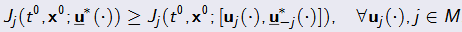

## Equilibres de Stackelberg

- Le "leader" annonce en tenant compte des reponses des autres
- Ex: croissance economique (taxe sur le capital + consommation)

## Jeux cooperatifs/competitifs

- Possibilite de dialogue -> maximisation commune
- Division en partie cooperative et partie competitive (valeur co-co)

*Notebook : [GameTheory-14-DifferentialGames-Python](https://github.com/jsboige/CoursIA/blob/main/MyIA.AI.Notebooks/GameTheory/GameTheory-14-DifferentialGames-Python.ipynb) (point de selle, Stackelberg differentiel).*

---
layout: dense
---

# Equilibres differentiels -- boucle ouverte et Markoviens

## Equilibres en boucle ouverte

- u* est un equilibre de Nash ssi aucun joueur ne peut ameliorer seul
- Resolution: 2 optimisations -> conditions necessaires

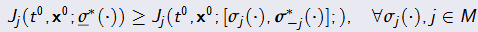

## Equilibres Markoviens

- Resolution d'equations differentielles
- Jeux lineaires quadratiques -> solution analytique

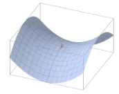

## Equilibres Markoviens

- Resolution d'equations differentielles
- Jeux lineaires quadratiques -> solution analytique

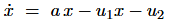

---
layout: default
---

# Méthodes calculatoires

Comment poursuivre une cible qui se déplace ?

<h2>Modéliser les mouvements</h2>
Chaque équation décrit une vitesse : l’indice e désigne le fuyard, p le poursuivant. Chaque joueur agit sur sa trajectoire par sa commande u.

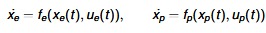

<h2>Calculer une trajectoire ou une politique</h2>
Une méthode directe discrétise et optimise les commandes sous les contraintes du mouvement. La programmation dynamique cherche plutôt la valeur en chaque état, via une équation aux dérivées partielles.

<h2>Explorer par échantillonnage</h2>
Comparez les quatre cartes : les obstacles ne bougent pas, mais l’arbre RRT s’étend au fil des tirages. Les branches sont des mouvements réalisables, pas des particules qui estiment une position cachée.

Davantage d’échantillons enrichit l’exploration ; ces images ne prouvent pas l’optimalité du trajet.

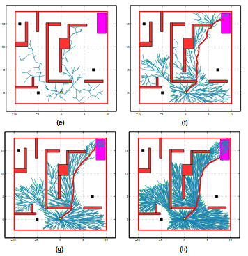

*Notebooks : [GameTheory-14-DifferentialGames-Python](https://github.com/jsboige/CoursIA/blob/main/MyIA.AI.Notebooks/GameTheory/GameTheory-14-DifferentialGames-Python.ipynb) (equilibres, LQ) · [GameTheory-09c-Stackelberg-SecurityGame-Python](https://github.com/jsboige/CoursIA/blob/main/MyIA.AI.Notebooks/GameTheory/GameTheory-09c-Stackelberg-SecurityGame-Python.ipynb) (Stackelberg). Poursuite-evasion par RRT : pas de notebook dedie.*

---
layout: dense
---

# Apprentissage multi-agents -- self-play, NFSP, PSRO

## Quand l'equilibre s'apprend au lieu de se calculer

- Self-play : l'agent devient son propre adversaire -- la population des strategies passees tient lieu d'opposant
  - Fictitious Play : meilleure reponse a la frequence empirique des coups adverses
  - NFSP : un reseau apprend la meilleure reponse, un autre la politique moyenne -- l'equilibre emerge de leur melange
  - PSRO (Policy-Space Response Oracles) : population de meilleures reponses imbriquees, l'echelle ou FP s'essouffle
- La serie se decline en jumeau C# pour les TP .NET

*Notebooks : [GameTheory-17-MultiAgent-RL-Python](https://github.com/jsboige/CoursIA/blob/main/MyIA.AI.Notebooks/GameTheory/GameTheory-17-MultiAgent-RL-Python.ipynb) (self-play, FP, NFSP, PSRO) · [GameTheory-17-MultiAgent-RL-CSharp](https://github.com/jsboige/CoursIA/blob/main/MyIA.AI.Notebooks/GameTheory/GameTheory-17-MultiAgent-RL-CSharp.ipynb) (jumeau C#).*

---
layout: dense
---

# Jeux de programmes : FairBot et DUPOC

## Même dilemme, autre objet de décision

**DUPOC** : faire défection sauf si l’on prouve la coopération adverse. **FairBot** applique cette règle au code de son vis-à-vis. Le choix porte sur un programme, pas sur un chemin entre matrices.

- Agent-programme : code public + budget de raisonnement fini (Barasz et al. 2014, Critch 2016)
  - Interprete total : budget nul = action immediate, budget epuise = arret -- la terminaison est structurelle, pas esperee
  - Simuler l'adversaire coute des steps : chaque borne `MAX_DEPTH` / `STEP_BUDGET` deplace l'equilibre atteignable
- Equilibre de programmes par simulation : deux adversaires au comportement identique sont traites pareil -- l'inspection syntaxique, elle, se trompe
- Compagnon formel : module `ProgramGames.Bounded` du lake `game_theory_lean` -- code public, budget, interprete `act`
- Oracles reflexifs (Fallenstein, Taylor, Christiano 2015) : decider sur sa propre decision sans paradoxe

*Notebooks : [Dynamics-04-Open-Source-Game-Theory-Python](https://github.com/jsboige/CoursIA/blob/main/MyIA.AI.Notebooks/GameTheory/Dynamics/Dynamics-04-Open-Source-Game-Theory-Python.ipynb) · [Dynamics-05-Agents-Bornes-Python](https://github.com/jsboige/CoursIA/blob/main/MyIA.AI.Notebooks/GameTheory/Dynamics/Dynamics-05-Agents-Bornes-Python.ipynb) · [Dynamics-06-Preuves-Bornees-Cout-du-Raisonnement-Python](https://github.com/jsboige/CoursIA/blob/main/MyIA.AI.Notebooks/GameTheory/Dynamics/Dynamics-06-Preuves-Bornees-Cout-du-Raisonnement-Python.ipynb) (preuves bornees) · [Dynamics-05-Agents-Bornes-Lean](https://github.com/jsboige/CoursIA/blob/main/MyIA.AI.Notebooks/GameTheory/Dynamics/Dynamics-05-Agents-Bornes-Lean.ipynb) · [Dynamics-07-Equilibres-par-Simulation-Python](https://github.com/jsboige/CoursIA/blob/main/MyIA.AI.Notebooks/GameTheory/Dynamics/Dynamics-07-Equilibres-par-Simulation-Python.ipynb) · [GameTheory-04e-Reflective-Oracles-Python](https://github.com/jsboige/CoursIA/blob/main/MyIA.AI.Notebooks/GameTheory/GameTheory-04e-Reflective-Oracles-Python.ipynb).*

---
layout: default
---

# Pourquoi deux FairBot peuvent coopérer

> **Énoncé.** Pour la version non bornée dans une théorie de preuve adaptée, FairBot face à sa copie coopère. Ce n’est pas une garantie pour tout budget fini.

## Stratégie de preuve

Notons $C$ la proposition « FairBot coopère face à sa copie » et $\Box C$ « la théorie peut démontrer $C$ ». Par définition du programme idéalisé, la théorie établit $\Box C\Rightarrow C$. Le théorème de Löb permet alors de démontrer $C$.

**Limite.** Trouver la preuve dans un budget donné est une autre question. Deux agents qui s’arrêtent trop tôt peuvent tous deux faire défection.

---
layout: dense
---

# Jeux ouverts et lentilles -- composer les jeux

## La theorie des jeux compositionnelle

- Open game : un jeu a frontieres -- entrees, sorties, couts, strategies locales
  - Lentille (get/set) : le regard qui lit l'etat global et reecrit localement -- composer les jeux, c'est composer les lentilles
  - Propriete de Hedges : la meilleure reponse de la composition est la composition des meilleures reponses -- quand elle tient
- Casser la composition : deux surfaces d'attaque ou la meilleure reponse composee cesse d'etre l'equilibre du jeu compose
- Abstraction a dette mesurable (Kroer & Sandholm) : resoudre le jeu abstrait puis retransporter la strategie -- avec une borne sur ce que le detour coute au pire cas

*Notebooks : [Metajeux-01-Open-Games-Lentilles-Python](https://github.com/jsboige/CoursIA/blob/main/MyIA.AI.Notebooks/GameTheory/Metajeux/Metajeux-01-Open-Games-Lentilles-Python.ipynb) (lentilles, Hedges) · [Metajeux-02-Casser-la-Composition-Python](https://github.com/jsboige/CoursIA/blob/main/MyIA.AI.Notebooks/GameTheory/Metajeux/Metajeux-02-Casser-la-Composition-Python.ipynb) (attaques) · [Metajeux-03-Abstraction-a-Dette-Python](https://github.com/jsboige/CoursIA/blob/main/MyIA.AI.Notebooks/GameTheory/Metajeux/Metajeux-03-Abstraction-a-Dette-Python.ipynb) (bornes d'abstraction).*

---
layout: section
---

# Changer les règles, le jeu ou les agents

---
layout: default
---

# Métajeux : qui peut changer le jeu ?

**Composer.** Deux décisions s’enchaînent : le choix en amont modifie ce que l’agent en aval peut faire. Vérifier les meilleures réponses séparément ne dispense pas de vérifier les interfaces.

**Abstraire.** Résoudre un jeu réduit est utile si l’on peut mesurer ce que perd la stratégie une fois ramenée dans le jeu initial.

**Transformer.** Dans la topologie $2\times2$, un observateur fait varier les gains. Cela devient une **méta-action** si un joueur peut choisir la transformation : préciser son coût et son moment.

[Composer des jeux ouverts](https://github.com/jsboige/CoursIA/blob/main/MyIA.AI.Notebooks/GameTheory/Metajeux/Metajeux-01-Open-Games-Lentilles-Python.ipynb) · [Mesurer la dette d’abstraction](https://github.com/jsboige/CoursIA/blob/main/MyIA.AI.Notebooks/GameTheory/Metajeux/Metajeux-03-Abstraction-a-Dette-Python.ipynb) · [Explorer les chemins entre jeux](https://github.com/jsboige/CoursIA/blob/main/MyIA.AI.Notebooks/GameTheory/Metajeux/Metajeux-04-Chemin-Minimal-Robinson-Goforth-Python.ipynb)

---
layout: default
---

# Trois mécanismes distincts de coopération

| Situation | Ce qui peut soutenir la coopération |
| --- | --- |
| **On se revoit.** | Un gain immédiat peut coûter une relation profitable : comparer les gains actualisés de la coopération et d’une déviation. |
| **On peut lire le programme adverse.** | Un agent peut conditionner son action à ce qu’il arrive à établir sur l’autre. Un budget de preuve ou de simulation limite ce qu’il voit. |
| **On contribue à plusieurs.** | Dans un bien public, on peut bénéficier de l’effort des autres sans contribuer. Observer les contributions individuelles et le résultat collectif. |

[Jeux répétés](https://github.com/jsboige/CoursIA/blob/main/MyIA.AI.Notebooks/GameTheory/Dynamics/Dynamics-01-Jeux-Repetes-Folk-Theorem-Python.ipynb) · [Coût du raisonnement](https://github.com/jsboige/CoursIA/blob/main/MyIA.AI.Notebooks/GameTheory/Dynamics/Dynamics-06-Preuves-Bornees-Cout-du-Raisonnement-Python.ipynb) · [Biens publics](https://github.com/jsboige/CoursIA/blob/main/MyIA.AI.Notebooks/GameTheory/Dynamics/Dynamics-09-Biens-Publics-N-Personnes-Python.ipynb) · [Joueur LLM](https://github.com/jsboige/CoursIA/blob/main/MyIA.AI.Notebooks/GameTheory/Dynamics/Dynamics-10-Joueur-LLM-Python.ipynb)

---
layout: default
---

# Coalitions : former un groupe, puis partager

- **Pouvoir.** Dans un vote pondéré, le poids seul ne suffit pas : un membre compte lorsqu’il fait passer une coalition de perdante à gagnante.
- **Surplus.** La valeur de Shapley répartit la valeur créée en moyennant les contributions marginales sur les ordres d’arrivée. Ce n’est pas un test de stabilité : le cœur demande qu’aucun groupe ne préfère partir.
- **Allocation.** Pour un échange de reins, les compatibilités imposent des échanges réalisables ; une affectation de coût minimal et un échange par cycles ne résolvent pas en général le même problème.

[Calculer le pouvoir avec SMT](https://github.com/jsboige/CoursIA/blob/main/MyIA.AI.Notebooks/GameTheory/Coalitions/Coalitions-01-Pouvoir-Coalitionnel-SMT-Python.ipynb) · [Échange de reins et Lean](https://github.com/jsboige/CoursIA/blob/main/MyIA.AI.Notebooks/GameTheory/Coalitions/Coalitions-03-Echange-de-Reins-Lean-Python.ipynb) · [Certifier une affectation](https://github.com/jsboige/CoursIA/blob/main/MyIA.AI.Notebooks/GameTheory/Coalitions/Coalitions-05-Lean-Affectation-Lean.ipynb)

---
layout: default
---

# Choix social : élire, apparier, composer un comité

| Problème | Ce qu’il faut vérifier |
| --- | --- |
| **Classer des options.** | Les préférences individuelles peuvent être transitives alors que les majorités par paires forment un cycle. Le score et la règle par paires ne répondent pas à la même question. |
| **Apparier des personnes.** | Une paire absente de l’appariement peut-elle l’améliorer pour les deux personnes ? Si oui, l’appariement n’est pas stable. |
| **Élire plusieurs représentants.** | Un comité ne se juge pas seulement par la popularité de ses membres : qui représente-t-il, et peut-on modifier le résultat en votant stratégiquement ? |

[Comparer les scrutins](https://github.com/jsboige/CoursIA/blob/main/MyIA.AI.Notebooks/GameTheory/SocialChoice/ChoixSocial-03-Voting-Methods-Python.ipynb) · [Tester la stabilité](https://github.com/jsboige/CoursIA/blob/main/MyIA.AI.Notebooks/GameTheory/SocialChoice/ChoixSocial-02-Stable-Marriage-Gale-Shapley-Python.ipynb) · [Manipulation en scrutin à plusieurs sièges](https://github.com/jsboige/CoursIA/blob/main/MyIA.AI.Notebooks/GameTheory/SocialChoice/ChoixSocial-10-Manipulation-Strategique-MultiWinner-Python.ipynb)

---
layout: default
---

# Information privée : révéler, filtrer ou informer ?

- **Signaler.** Une personne déjà informée choisit un message ou une action observable. Le destinataire doit en déduire ce que l’émetteur sait.
- **Filtrer.** Le côté non informé conçoit un menu. Les choix des participants révèlent de l’information si les incitations les conduisent à se trier.
- **Persuader.** L’émetteur s’engage à l’avance sur une règle de divulgation. La question n’est plus seulement « que dire ? », mais « quelle expérience rendre publique ? ».

[Marché des citrons](https://github.com/jsboige/CoursIA/blob/main/MyIA.AI.Notebooks/GameTheory/GameTheory-17-MultiAgent-RL/GameTheory-17b-Asymmetric-Information-Python.ipynb) · [Filtrer par un menu de loyers](https://github.com/jsboige/CoursIA/blob/main/MyIA.AI.Notebooks/GameTheory/GameTheory-16j-Screening-Loyer-Information-Python.ipynb) · [Persuasion bayésienne](https://github.com/jsboige/CoursIA/blob/main/MyIA.AI.Notebooks/GameTheory/GameTheory-17-MultiAgent-RL/GameTheory-17e-Bayesian-Persuasion-Python.ipynb)

---
layout: default
---

# Deux prolongements : transitions et règles exécutables

**Jeux stochastiques.** Deux joueurs ne choisissent pas seulement un gain immédiat : leurs actions modifient les probabilités du prochain état. À chaque état, le jeu de Shapley combine récompense du tour et valeur de continuation.

[Calculer la valeur par itération de Shapley](https://github.com/jsboige/CoursIA/blob/main/MyIA.AI.Notebooks/GameTheory/GameTheory-22-Jeux-Stochastiques-Shapley-Python.ipynb)

**Failles légales.** Un ensemble de règles autorise des opérations une à une ; leur enchaînement peut pourtant produire une issue que le mécanisme n’avait pas prévue. Le carnet sépare la recherche d’un chemin admissible de la preuve d’optimalité dans son modèle.

[Chercher le témoin avec Python, le vérifier avec Lean](https://github.com/jsboige/CoursIA/blob/main/MyIA.AI.Notebooks/GameTheory/GameTheory-23-Loopholes-Fiscaux-Python-Lean.ipynb)

---
layout: default
---

# Valeur actualisée

> **Énoncé.** Dans un jeu stochastique fini à deux joueurs à somme nulle, avec facteur d’actualisation strictement inférieur à un, l’opérateur de Shapley admet une unique valeur fixe.

## Stratégie de preuve

**Stratégie.** Si deux vecteurs de continuation diffèrent d’au plus $\varepsilon$ dans chaque état, chaque gain de la matrice change d’au plus $\delta\varepsilon$. Prendre le minimax conserve cette borne. Comme $\delta<1$, l’itération converge vers un unique point fixe.

**Exemple.** Avec $\delta=0{,}9$ et une erreur initiale d’au plus 10, l’erreur après $n$ itérations est au plus $10(0{,}9)^n$.

<!--
La borne vaut pour deux vecteurs arbitraires : une moyenne selon les probabilités de transition ne peut pas amplifier l’écart maximal. Dans le carnet sur les failles légales, le certificat Lean porte au contraire sur les étapes d’un chemin donné ; il ne prouve pas une contraction.
-->

---
layout: section
---

# Questions ?

---
layout: section
---

# Plan du cours

---
layout: default
---

# Sommaire (suite)

- I. Introduction
- II. Resolution de problemes
- III. Bases de connaissances et logique
- IV. Incertitude et modèles probabilistes
- V. Théorie des jeux
- **VI. Apprentissage**
- VII. Traitement du langage naturel
- VIII. Presentation projets

---
layout: dense
---

# Projets de groupe

1. Moteur de recherche augmente par le raisonnement et le langage naturel
2. Conception de bots de services sur reseaux sociaux
3. Conception d'un modèle d'inference pour l'analyse de sentiment
4. Création d'une plateforme sémantique LDP
5. Resolution de Captchas par deep learning
6. Entrainement de stratégies de trading algorithmiques sur crypto monnaies
7. Amelioration par l'apprentissage d'un agent joueur de Go simple
8. Evolution de vaisseaux spatiaux par algorithmes génétiques dans le jeu de la vie
9. Pilotage d'un cluster de cache distribue pour le portage d'applications dans le Cloud

---
layout: end
---

# Merci

**Jean-Sylvain Boige**

jsboige@myia.org
