# Intelligence Artificielle Générative

<p v-click="1">Intelligence Artificielle — VIII</p>

<p v-click="2"><strong>Panorama, concepts et pratiques de l'IA générative</strong></p>

<v-clicks at="3">

- Découvrir les concepts fondamentaux des modèles génératifs
- Comprendre les principales modalités (texte, image, audio, vidéo)
- Identifier les techniques clés (RAG, outils, mémoire, MCP)
- Repérer les limites, risques et enjeux éthiques associés

</v-clicks>

<!-- Référence PPTX : slide 01. -->

---
layout: image-overlay
---

# Plan du cours

<v-clicks at="1">

- I. Introduction
- II. Résolution de problèmes
- III. Bases de connaissances et logique
- IV. Incertitude et modèles probabilistes
- V. Apprentissage
- VI. Traitement du langage naturel
- VII. Élargissements
- **VIII. IA Générative** *(vous êtes ici)*

</v-clicks>

<!-- Référence PPTX : slide 02. -->

---
class: nb-map nb-k92
---

# La série GenAI dans CoursIA : la carte

<p class="nb-lead">Ce diaporama survole toute la série <code>GenAI</code> du dépôt CoursIA. Chaque planche renvoie au notebook où le concept se manipule ; chaque séance se prépare par un exercice de notebook corrigé, soumis par pull request.</p>

<div class="nb-grid nb-cols-3">

<div class="nb-card"><p class="nb-step">Texte et conversation</p><p class="nb-what">Prompts, sorties structurées, outils, raisonnement, production, plateformes conversationnelles. Dossiers : <code>Texte</code>, <code>Plateformes-Conversationnelles</code>.</p></div>

<div class="nb-card"><p class="nb-step">Recherche et mémoire</p><p class="nb-what">Tokens, embeddings, index vectoriels, RAG, citations, mémoire d’agent. Dossiers : <code>RAG-et-Memoire-Semantique</code>.</p></div>

<div class="nb-card"><p class="nb-step">Orchestration et agents</p><p class="nb-what">Semantic Kernel, MCP, agents de code, pile .NET, études de cas. Dossiers : <code>SemanticKernel</code>, <code>Vibe-Coding</code>, <code>Integrations-DotNet</code>, <code>CaseStudies</code>.</p></div>

<div class="nb-card"><p class="nb-step">Image, audio, vidéo, 3D</p><p class="nb-what">Diffusion, édition, voix, musique, vidéo, NeRF et gaussiennes. Dossiers : <code>Image</code>, <code>Audio</code>, <code>Video</code>, <code>3D</code>.</p></div>

<div class="nb-card"><p class="nb-step">Entraînement et adaptation</p><p class="nb-what">LoRA, QLoRA, préférences, récompenses vérifiables, interprétabilité. Dossiers : <code>FineTuning</code>, <code>PostTraining</code>.</p></div>

<div class="nb-card"><p class="nb-step">Données, sécurité, environnement</p><p class="nb-what">Jeux de données, red team et supervision, installation du poste. Dossiers : <code>FallacyDetection</code>, <code>HumorDetection</code>, <code>Security</code>, <code>00-GenAI-Environment</code>.</p></div>

</div>

<p class="nb-foot"><strong>Mode d’emploi.</strong> Les liens en bas de carte ouvrent le notebook sur GitHub ; « À observer » donne la question à trancher en l’exécutant.</p>

---

# Introduction à l'IA Générative

<v-clicks at="1">

- **Définition :** création de contenus (texte, image, audio, vidéo) par des modèles probabilistes conditionnés par une entrée (prompt, image, son, autres modalités).
- **Modalités couvertes :** texte, image, audio, musique, vidéo, code -- les mêmes principes de conditionnement et de génération se réutilisent.
- **Exemples de référence :** ChatGPT / Claude (texte), Stable Diffusion / Flux (image), Whisper (speech-to-text), Hunyuan (vidéo), Audiocraft (musique), Copilot (code).

</v-clicks>

<!-- Référence PPTX : slide 03. -->

---
layout: default
class: pilot-teachingstep
---

# Un système génératif ne se réduit pas au modèle

<!-- Pilote #15048 (groupe + figure) : le paragraphe et sa figure forment UN
     groupe TeachingStep -- la figure apparaît avec son texte (même index de
     clic), sa place est réservée par la grille du composant dès l'état
     initial, et aucune coordonnée ne vit dans ce fichier. -->

<TeachingStep v-click="1" placement="end" size="md">

- **Au-delà du modèle :** entrées, traitement, stockage, sorties et boucle de retour forment une application générative.
- **Entrées et stockage :** consignes, documents et conversation alimentent le contexte. Poids appris et mémoire externe restent distincts.
- **Sortie et retour :** générer, vérifier, corriger. Une conversation ne réentraîne pas les poids ; une réponse plausible ne prouve pas sa fiabilité.

<template #visual>
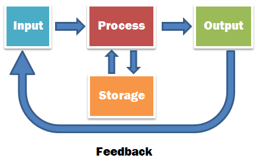
</template>

</TeachingStep>

---

# Les données : qualité et biais

<v-clicks at="1">

- **Qualité et représentativité :** les modèles héritent des corpus d'entraînement -- si les données sont biaisées, les sorties le sont aussi.
- **"Garbage in, garbage out" :** la qualité d'un modèle plafonne par celle de ses données. Le nettoyage et l'audit sont des goulots d'étranglement réels.
- **Biais documentés :** genre, culture, contexte géographique. Les biais conditionnent les *distributions* de sortie ; les *hallucinations* sont un autre phénomène (le modèle complète un contexte sans ancre factuelle).
- **Pipeline classique :** acquisition, nettoyage, préparation, annotation.
- **Données synthétiques :** utiles pour augmenter un corpus ou protéger la confidentialité, mais risquant le *Model Collapse* si elles ré-alimentent l'entraînement en boucle.

</v-clicks>

<!-- Référence PPTX : slide 05. -->

---

# Activité : sources de données

<v-clicks at="1">

- **Domaines et sources :** classe (cours, manuels, exercices), maison (agenda familial, courses, recettes), transport (horaires, plans, trafic), loisirs (critiques, notations, événements locaux).
- **Structure et qualité :** distinguer données structurées (horaires) et non structurées (récits). Chaque source porte un point de vue, une période, une granularité.
- **Droits et biais :** vérifier licences d'usage et représentativité. Restituer un tableau source, date, droits et biais possibles ; comparer deux sources indépendantes.

</v-clicks>

---
class: nb-map nb-k100
---

# Avant le modèle, le jeu de données : sophismes et humour

<p class="nb-lead">Détecter un sophisme ou une blague est une tâche de classification. La difficulté n’est pas le classifieur : c’est de décider quelles étiquettes existent, et quelles données les portent réellement.</p>

<div class="nb-grid nb-cols-3">

<div class="nb-card"><p class="nb-step">Définir les étiquettes</p><p class="nb-what">Sophisme formel ou informel ? La taxonomie du cours face aux taxonomies académiques.</p><p class="nb-links"><a href="https://github.com/jsboige/CoursIA/blob/main/MyIA.AI.Notebooks/GenAI/FallacyDetection/01_taxonomy_intro.ipynb" target="_blank" rel="noopener">01_taxonomy_intro</a></p></div>

<div class="nb-card"><p class="nb-step">Vérifier les données</p><p class="nb-what">Tester l’accès réel à chaque jeu de données candidat au lieu de le citer : succès avec sa taille, ou échec avec sa raison.</p><p class="nb-links"><a href="https://github.com/jsboige/CoursIA/blob/main/MyIA.AI.Notebooks/GenAI/FallacyDetection/02_fallacy_datasets_landscape.ipynb" target="_blank" rel="noopener">02_fallacy_datasets_landscape</a></p></div>

<div class="nb-card"><p class="nb-step">Mesurer l’écart</p><p class="nb-what">Combien d’étiquettes du terrain n’ont aucun exemple public ? L’écart dépasse un ordre de grandeur.</p><p class="nb-links"><a href="https://github.com/jsboige/CoursIA/blob/main/MyIA.AI.Notebooks/GenAI/FallacyDetection/03_taxonomy_coverage_gap.ipynb" target="_blank" rel="noopener">03_taxonomy_coverage_gap</a> · <a href="https://github.com/jsboige/CoursIA/blob/main/MyIA.AI.Notebooks/GenAI/FallacyDetection/04_coverage_matrix.ipynb" target="_blank" rel="noopener">04_coverage_matrix</a></p></div>

<div class="nb-card"><p class="nb-step">Fabriquer le corpus</p><p class="nb-what">Croiser scénarios et taxonomie, puis découper par scénario pour qu’aucun cas de test ne fuie dans l’entraînement.</p><p class="nb-links"><a href="https://github.com/jsboige/CoursIA/blob/main/MyIA.AI.Notebooks/GenAI/FallacyDetection/05_dataset_builder.ipynb" target="_blank" rel="noopener">05_dataset_builder</a></p></div>

<div class="nb-card"><p class="nb-step">Humour : deux questions</p><p class="nb-what">« Est-ce de l’humour ? » et « par quel mécanisme ? » ne demandent ni les mêmes étiquettes ni les mêmes données.</p><p class="nb-links"><a href="https://github.com/jsboige/CoursIA/blob/main/MyIA.AI.Notebooks/GenAI/HumorDetection/01_humor_intro.ipynb" target="_blank" rel="noopener">01_humor_intro</a></p></div>

</div>

<p class="nb-foot"><strong>À observer.</strong> Avec quelles étiquettes annoteriez-vous dix messages d’un forum, avant de regarder un seul modèle ?</p>

---
layout: image-overlay
class: genai-illustrated
---

# Pyramide des méthodes d'adaptation

<TeachingStep placement="end" size="lg">

<v-clicks at="1">

- **Quatre niveaux :** prompt + contexte, RAG, fine-tuning, pré-entraînement de zéro. Le schéma représente un effort croissant, pas une garantie de qualité.
- **Choix selon le besoin :** le contexte et le RAG apportent des connaissances actualisées ; le fine-tuning ajuste les poids pour un comportement ciblé, à évaluer.
- **Pré-entraînement fondationnel :** le plus lourd et le plus ponctuel, réservé aux organisations qui ont les moyens et les données massives.

</v-clicks>

<template #visual>
<div v-click="1" class="genai-figure">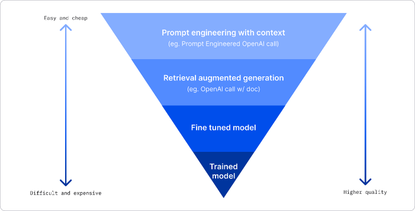</div>
</template>

</TeachingStep>

---
layout: image-overlay
class: genai-illustrated genai-tokens
---

# Des tokens aux embeddings

<v-clicks at="1">

- **Tokens :** le tokenizer découpe le texte en unités associées à des identifiants. Un token peut être un mot ou un fragment.
- **Embeddings :** chaque identifiant reçoit un vecteur appris. Les proximités représentent des régularités, sans garantir une proximité sémantique.
- **Activité Mind-Meld :** par deux, proposer simultanément deux mots, puis un mot à mi-distance. Comparer cette intuition aux analogies vectorielles.

</v-clicks>

<div v-click="1" class="genai-visual visual-1 of-2">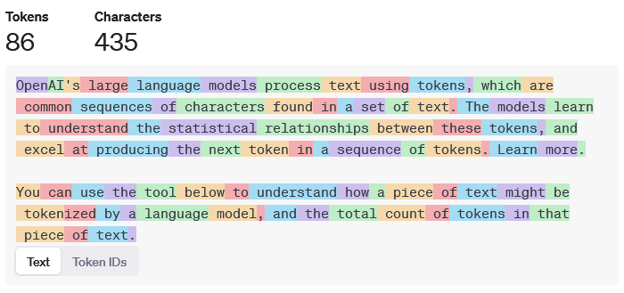</div>

<div v-click="2" class="genai-visual visual-2 of-2">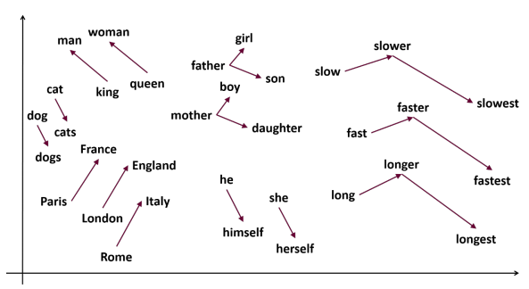</div>

---
class: nb-map nb-k96
---

# Tokens, embeddings, index : les construire à la main

<p class="nb-lead">Avant d’appeler une API d’embeddings, la série RAG reconstruit chaque brique : ce que le modèle compte, ce qu’un vecteur encode, ce qu’un index sacrifie pour aller vite.</p>

<div class="nb-grid nb-cols-3">

<div class="nb-card"><p class="nb-step">Tokenisation BPE</p><p class="nb-what">Construire un Byte-Pair Encoding et le comparer au découpage par mots ou par caractères. Le token est l’unité de compte de tout le cours.</p><p class="nb-links"><a href="https://github.com/jsboige/CoursIA/blob/main/MyIA.AI.Notebooks/GenAI/RAG-et-Memoire-Semantique/04-Tokenisation-From-Scratch.ipynb" target="_blank" rel="noopener">Python</a> · <a href="https://github.com/jsboige/CoursIA/blob/main/MyIA.AI.Notebooks/GenAI/RAG-et-Memoire-Semantique/04-Tokenisation-From-Scratch-CSharp.ipynb" target="_blank" rel="noopener">C#</a></p></div>

<div class="nb-card"><p class="nb-step">WordPiece et Unigram</p><p class="nb-what">Les deux autres familles de sous-mots : même texte, découpages différents.</p><p class="nb-links"><a href="https://github.com/jsboige/CoursIA/blob/main/MyIA.AI.Notebooks/GenAI/RAG-et-Memoire-Semantique/04b-Tokenisateurs-Compares.ipynb" target="_blank" rel="noopener">Python</a> · <a href="https://github.com/jsboige/CoursIA/blob/main/MyIA.AI.Notebooks/GenAI/RAG-et-Memoire-Semantique/04b-Tokenisateurs-Compares-CSharp.ipynb" target="_blank" rel="noopener">C#</a></p></div>

<div class="nb-card"><p class="nb-step">Embeddings word2vec</p><p class="nb-what">Compter les co-occurrences, puis entraîner un skip-gram en NumPy : les mots de contextes proches deviennent voisins.</p><p class="nb-links"><a href="https://github.com/jsboige/CoursIA/blob/main/MyIA.AI.Notebooks/GenAI/RAG-et-Memoire-Semantique/03-Embeddings-From-Scratch.ipynb" target="_blank" rel="noopener">03-Embeddings-From-Scratch</a></p></div>

<div class="nb-card"><p class="nb-step">Voir l’espace</p><p class="nb-what">Réduire la dimension pour regarder la géométrie, puis comparer plusieurs modèles d’embeddings.</p><p class="nb-links"><a href="https://github.com/jsboige/CoursIA/blob/main/MyIA.AI.Notebooks/GenAI/RAG-et-Memoire-Semantique/03b-Espace-Embeddings-Visualisation.ipynb" target="_blank" rel="noopener">03b-Espace-Embeddings-Visualisation</a></p></div>

<div class="nb-card"><p class="nb-step">Index approché (HNSW)</p><p class="nb-what">Persister les vecteurs et mesurer le compromis : répondre plus vite, au risque de manquer un voisin exact.</p><p class="nb-links"><a href="https://github.com/jsboige/CoursIA/blob/main/MyIA.AI.Notebooks/GenAI/RAG-et-Memoire-Semantique/05-Stockage-Vectoriel.ipynb" target="_blank" rel="noopener">Python</a> · <a href="https://github.com/jsboige/CoursIA/blob/main/MyIA.AI.Notebooks/GenAI/RAG-et-Memoire-Semantique/05-Stockage-Vectoriel-CSharp.ipynb" target="_blank" rel="noopener">C#</a></p></div>

<div class="nb-card"><p class="nb-step">Serveur vectoriel</p><p class="nb-what">Provisionner un serveur Qdrant et comparer trois moteurs sur le même corpus : rappel@10 et latence.</p><p class="nb-links"><a href="https://github.com/jsboige/CoursIA/blob/main/MyIA.AI.Notebooks/GenAI/RAG-et-Memoire-Semantique/05b-Stockage-Vectoriel-Serveur.ipynb" target="_blank" rel="noopener">05b-Stockage-Vectoriel-Serveur</a></p></div>

</div>

<p class="nb-foot"><strong>À observer.</strong> Combien de tokens « coûte » un même paragraphe français selon le tokeniseur ? Que devient le rappel quand on accélère l’index ?</p>

---
layout: default
class: pilot-teachingstep
---

# Réseaux de neurones et attention

<!-- Pilote #15048 (plusieurs groupes illustrés) : deux groupes TeachingStep
     empilés via ts-stack, chacun porte SA figure -- plus de figures flottant
     à des hauteurs absolues distinctes (visual-1/visual-2 du style.css). -->

<div class="ts-stack">

<TeachingStep v-click="1" placement="end" size="sm">

- **Réseaux de neurones :** des transformations paramétrées composent plusieurs couches. L’apprentissage ajuste leurs poids.

<template #visual>
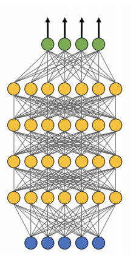
</template>

</TeachingStep>

<TeachingStep v-click="2" placement="start" size="lg">

- **Attention :** chaque position combine les informations du contexte. Les poids d’attention ne constituent pas une explication causale complète.
- **Activité polysémie :** donner deux sens à « avocat », écrire deux phrases, puis dessiner les liens vers les mots qui lèvent l’ambiguïté.

<template #visual>
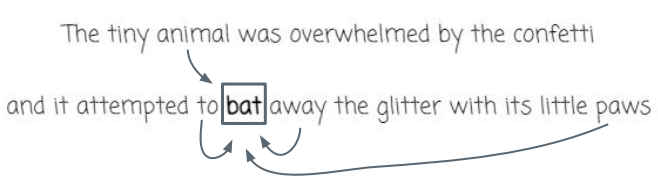
</template>

</TeachingStep>

</div>

---
layout: image-overlay
class: genai-illustrated genai-transformer
---

# Transformer : composer les blocs

<v-clicks at="1">

- **Architecture :** embeddings, positions, attention multi-têtes et couches feed-forward. Le schéma original combine encodeur et décodeur.
- **LLM autoregressif :** de nombreux modèles utilisent seulement des blocs décodeurs avec attention causale sur les positions précédentes.
- **Évolutions :** MoE, attention parcimonieuse et RoPE scaling explorent efficacité et contextes longs. Mamba et Jamba proposent des modèles d’état et hybrides.

</v-clicks>

<div v-click="1" class="genai-visual visual-1 of-1">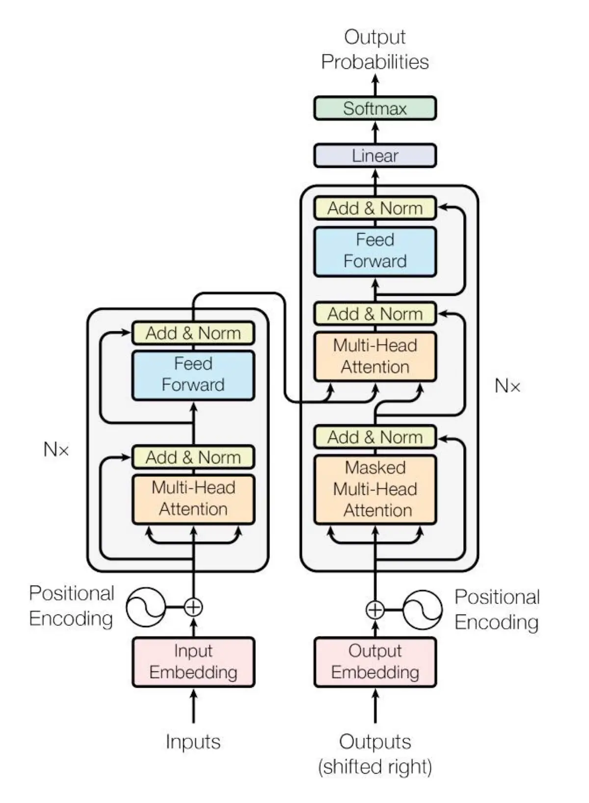</div>

---
class: nb-map nb-k100
---

# Variantes du Transformer : ouvrir la boîte

<p class="nb-lead">Les modèles actuels ne sont plus le Transformer de 2017. La série TransformerVariants reconstruit chaque variante à petite échelle, puis va la lire dans un modèle réel.</p>

<div class="nb-grid nb-cols-3">

<div class="nb-card"><p class="nb-step">Position par rotation</p><p class="nb-what">RoPE : coder la position d’un token par une rotation de son vecteur.</p><p class="nb-links"><a href="https://github.com/jsboige/CoursIA/blob/main/MyIA.AI.Notebooks/GenAI/Texte/TransformerVariants/TV-00a-RoPE-from-scratch.ipynb" target="_blank" rel="noopener">TV-00a-RoPE-from-scratch</a></p></div>

<div class="nb-card"><p class="nb-step">Variantes d’attention</p><p class="nb-what">MHA, MQA, GQA, fenêtre glissante : partager des têtes ou restreindre la fenêtre pour économiser mémoire et calcul.</p><p class="nb-links"><a href="https://github.com/jsboige/CoursIA/blob/main/MyIA.AI.Notebooks/GenAI/Texte/TransformerVariants/TV-00b-Attention-Variants-from-scratch.ipynb" target="_blank" rel="noopener">TV-00b-Attention-Variants-from-scratch</a></p></div>

<div class="nb-card"><p class="nb-step">Les deux autres familles</p><p class="nb-what">Encodeur seul et encodeur-décodeur, à côté du décodeur seul des modèles de chat.</p><p class="nb-links"><a href="https://github.com/jsboige/CoursIA/blob/main/MyIA.AI.Notebooks/GenAI/Texte/TransformerVariants/TV-00d-Encodeurs-from-scratch-Python.ipynb" target="_blank" rel="noopener">TV-00d-Encodeurs-from-scratch-Python</a></p></div>

<div class="nb-card"><p class="nb-step">Dans un modèle réel</p><p class="nb-what">Charger Mistral-7B en 4 bits et y retrouver ces variantes.</p><p class="nb-links"><a href="https://github.com/jsboige/CoursIA/blob/main/MyIA.AI.Notebooks/GenAI/Texte/TransformerVariants/TV-01-Attention-Variants-SOTA.ipynb" target="_blank" rel="noopener">TV-01-Attention-Variants-SOTA</a></p></div>

<div class="nb-card"><p class="nb-step">Mélange d’experts</p><p class="nb-what">MoE : observer le routage réel des tokens vers les experts dans OLMoE-1B-7B.</p><p class="nb-links"><a href="https://github.com/jsboige/CoursIA/blob/main/MyIA.AI.Notebooks/GenAI/Texte/TransformerVariants/TV-02-MoE-SOTA.ipynb" target="_blank" rel="noopener">TV-02-MoE-SOTA</a></p></div>

<div class="nb-card"><p class="nb-step">Raisonner sans l’écrire</p><p class="nb-what">De la chaîne de raisonnement explicite au calcul interne ; DiscoLoop, une récurrence à deux canaux.</p><p class="nb-links"><a href="https://github.com/jsboige/CoursIA/blob/main/MyIA.AI.Notebooks/GenAI/Texte/TransformerVariants/TV-03-Internalisation-CoT-Python.ipynb" target="_blank" rel="noopener">TV-03-Internalisation-CoT-Python</a> · <a href="https://github.com/jsboige/CoursIA/blob/main/MyIA.AI.Notebooks/GenAI/Texte/TransformerVariants/TV-04-DiscoLoop-Python.ipynb" target="_blank" rel="noopener">TV-04-DiscoLoop-Python</a></p></div>

</div>

<p class="nb-foot"><strong>À observer.</strong> Quelle variante change la qualité des réponses, et laquelle ne change que le coût ?</p>

---

# Diffusion textuelle : une autre génération

<v-clicks at="1">

- **Texte discret :** certaines approches de diffusion masquent des tokens, puis apprennent à les retrouver par démasquage itératif. Toutes les variantes ne reposent pas sur le même bruit.
- **Ordre de génération :** plusieurs positions peuvent être complétées à une étape, contrairement au décodage autorégressif gauche à droite. Le nombre d’étapes reste un coût de calcul.
- **Comparaison :** évaluer qualité, latence et contrôlabilité sur les mêmes tâches. Ni le parallélisme ni la diffusion ne garantissent un avantage sur l’autorégressif.
- **Essayez au tableau :** masquez deux mots dans « Le train part de ___ et arrive à ___ ». Comparez un remplissage simultané à deux choix successifs. Quels couples de villes deviennent incohérents ?

</v-clicks>

---
layout: image-overlay
class: genai-illustrated genai-temperature
---

# Génération de texte : distribution et température

<v-clicks at="1">

- **Distribution conditionnelle :** chaque token est tiré d'une distribution calculée sur le contexte précédent. L'ordre compte.
- **Température basse :** concentre la masse sur les tokens les plus probables. Diversité réduite, sans garantie de cohérence ou de vérité.
- **Température haute :** accroît la diversité de sortie. Une valeur trop haute peut produire des textes décousus.

</v-clicks>

<div v-click="1" class="genai-visual visual-1 of-2">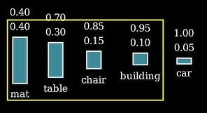</div>

<div v-click="2" class="genai-visual visual-2 of-2">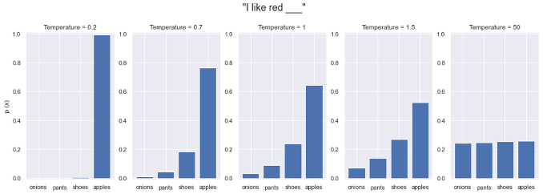</div>

<div v-click="2" class="genai-visual visual-3">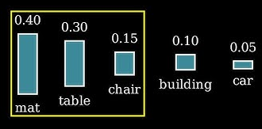</div>

---
layout: default
---

# Génération de texte : échantillonnage et reproductibilité

<v-clicks at="1">

- **Top-p (nucleus) :** trier les tokens par probabilité décroissante, garder le plus petit ensemble atteignant le seuil p, puis renormaliser.
- **Top-k :** ne garde que les k tokens les plus probables. La taille du sous-ensemble est fixe, contrairement à top-p.
- **Reproductibilité :** fixer un seed n'assure pas l'égalité entre matériel, version ou batching. Consigner modèle et paramètres.

</v-clicks>

---
layout: image-overlay
class: genai-illustrated genai-diffusion
---

# Génération d'images : architecture de diffusion

<v-clicks at="1">

- **Principe :** ajouter du bruit (forward) puis apprendre le débruitage inverse (reverse). Certains modèles travaillent en pixels, d’autres dans un espace latent compressé.
- **Compromis du latent :** compression réduit calcul et mémoire, mais la reconstruction perd de l'information. Un détail fin peut s'estomper.
- **Conditionnement :** texte ou image guide le débruitage. Le compromis qualité / fidélité dépend du scheduler et du nombre d'étapes.

</v-clicks>

<div v-click="1" class="genai-visual visual-1 of-1">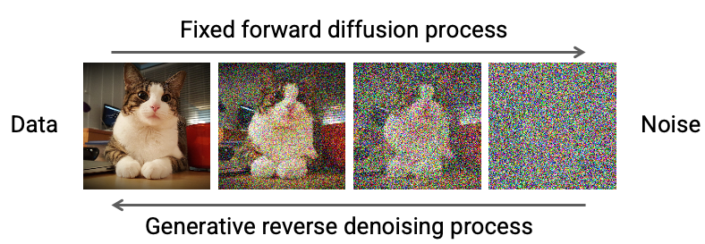</div>

---
layout: image-overlay
class: genai-illustrated genai-large-visual
---

# Diffusion latente : lire l’architecture

<p v-click="1">L’encodeur compresse l’image ; le débruiteur conditionné transforme les latents ; le décodeur reconstruit les pixels.</p>

<div v-click="1" class="genai-visual visual-1 of-1">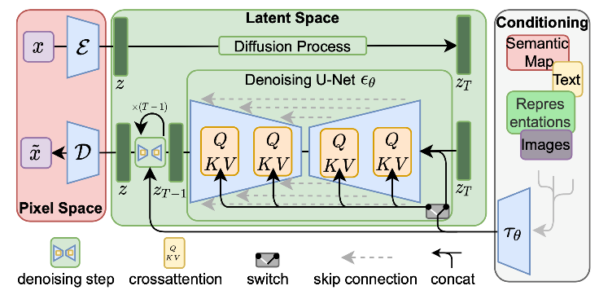</div>

---
layout: default
---

# Génération d'images : CFG et paramètres

<v-clicks at="1">

- **CFG-scale :** intensité du conditionnement. Son effet dépend du modèle, de la variante et de l'implémentation ; les valeurs ne sont pas interchangeables.
- **N-steps :** nombre d'étapes de débruitage. Plus de pas n'améliore pas toujours la qualité ; le scheduler compte autant que le décompte.
- **Denoising strength (img2img) :** fraction de bruit réinjectée. Basse = proche de la source ; haute = réinterprétation libre.
- **Prompt négatif :** préciser les éléments à éviter quand le modèle le permet. Ce guidage ne garantit pas leur absence.

</v-clicks>

---
layout: default
---

# Génération d'images : seed et comparaisons

<v-clicks at="1">

- **Seed :** fixer le seed et conserver l'environnement aide à isoler un paramètre. Le seed seul n'assure pas l'égalité entre runs.
- **Variabilité :** matériel, version du modèle et batching peuvent modifier le résultat, même à seed identique.
- **Bonne pratique :** consigner modèle, version, paramètres et environnement pour qu'une comparaison reste reproductible.

</v-clicks>

---
class: nb-concept nb-center nb-k114
---

# Générer une image en un seul pas ?

<p class="nb-lead">Un échantillonneur de diffusion réduit progressivement le bruit. Enlever des étapes à un modèle existant ne revient pas à apprendre à produire une image en un trajet court.</p>

<div class="nb-grid nb-cols-2">

<div class="nb-card"><p class="nb-step">Première piste</p><p class="nb-what">Même modèle, moins de pas : raccourcir le calcul.</p></div>

<div class="nb-card"><p class="nb-step">À comparer</p><p class="nb-what">Modèle few-step : apprendre un trajet court.</p></div>

</div>

<p class="nb-foot"><strong>À observer.</strong> Dans les comparaisons IMM et TVM du carnet, lire ensemble qualité et coût. Garder matériel, résolution et taille de lot fixes pour comparer les temps. Où apparaît la première perte de détail ?</p>

<p class="notebook-reference">Notebook : <a href="https://github.com/jsboige/CoursIA/blob/main/MyIA.AI.Notebooks/GenAI/Image/02-Advanced/02-6-Few-Step-Generative-Models-IMM-TVM.ipynb" target="_blank" rel="noopener">02-6-Few-Step-Generative-Models-IMM-TVM.ipynb</a>.</p>

---
class: nb-map nb-k96
---

# Image : générer et éditer, par API ou en local

<p class="nb-lead">Le même geste — un texte devient une image — existe en service distant, en interface locale et en graphe de nœuds. Ce qui change : la maîtrise des paramètres, le coût, et ce qui quitte la machine.</p>

<div class="nb-grid nb-cols-3">

<div class="nb-card"><p class="nb-step">Par API</p><p class="nb-what">Envoyer un prompt à un service, recevoir une image ; faire aussi analyser une image par un modèle multimodal.</p><p class="nb-links"><a href="https://github.com/jsboige/CoursIA/blob/main/MyIA.AI.Notebooks/GenAI/Image/01-Foundation/01-1-OpenAI-DALL-E-3.ipynb" target="_blank" rel="noopener">01-1-OpenAI-DALL-E-3</a> · <a href="https://github.com/jsboige/CoursIA/blob/main/MyIA.AI.Notebooks/GenAI/Image/01-Foundation/01-2-Generation-Image-API.ipynb" target="_blank" rel="noopener">01-2-Generation-Image-API</a></p></div>

<div class="nb-card"><p class="nb-step">Manipuler l’image</p><p class="nb-what">Les opérations de base avant et après toute génération.</p><p class="nb-links"><a href="https://github.com/jsboige/CoursIA/blob/main/MyIA.AI.Notebooks/GenAI/Image/01-Foundation/01-3-Basic-Image-Operations.ipynb" target="_blank" rel="noopener">01-3-Basic-Image-Operations</a></p></div>

<div class="nb-card"><p class="nb-step">En local, en quelques pas</p><p class="nb-what">SDXL Turbo dans Stable Diffusion Forge : générer vite sur sa propre machine.</p><p class="nb-links"><a href="https://github.com/jsboige/CoursIA/blob/main/MyIA.AI.Notebooks/GenAI/Image/01-Foundation/01-4-Forge-SD-XL-Turbo.ipynb" target="_blank" rel="noopener">01-4-Forge-SD-XL-Turbo</a></p></div>

<div class="nb-card"><p class="nb-step">Éditer par consigne</p><p class="nb-what">Modifier une image existante par une phrase avec Qwen Image Edit : un appel, des itérations, puis des workflows.</p><p class="nb-links"><a href="https://github.com/jsboige/CoursIA/blob/main/MyIA.AI.Notebooks/GenAI/Image/01-Foundation/01-5-Edition-Image-Prompt.ipynb" target="_blank" rel="noopener">01-5</a> · <a href="https://github.com/jsboige/CoursIA/blob/main/MyIA.AI.Notebooks/GenAI/Image/01-Foundation/01-5b-Edition-Image-Prompt-Iterations.ipynb" target="_blank" rel="noopener">01-5b</a> · <a href="https://github.com/jsboige/CoursIA/blob/main/MyIA.AI.Notebooks/GenAI/Image/01-Foundation/01-5c-Edition-Image-Prompt-Workflows.ipynb" target="_blank" rel="noopener">01-5c</a></p></div>

<div class="nb-card"><p class="nb-step">Modèles de pointe</p><p class="nb-what">FLUX.1 et Stable Diffusion 3.5 : mêmes prompts, architectures et rendus différents.</p><p class="nb-links"><a href="https://github.com/jsboige/CoursIA/blob/main/MyIA.AI.Notebooks/GenAI/Image/02-Advanced/02-2-FLUX-1-Advanced-Generation.ipynb" target="_blank" rel="noopener">02-2-FLUX-1-Advanced-Generation</a> · <a href="https://github.com/jsboige/CoursIA/blob/main/MyIA.AI.Notebooks/GenAI/Image/02-Advanced/02-3-Stable-Diffusion-3-5.ipynb" target="_blank" rel="noopener">02-3-Stable-Diffusion-3-5</a></p></div>

<div class="nb-card"><p class="nb-step">Compresser le modèle</p><p class="nb-what">Bonsai-Image : des poids ternaires (1,58 bit) pour générer avec très peu de mémoire.</p><p class="nb-links"><a href="https://github.com/jsboige/CoursIA/blob/main/MyIA.AI.Notebooks/GenAI/Image/02-Advanced/02-5-Bonsai-Image-Ternary.ipynb" target="_blank" rel="noopener">02-5-Bonsai-Image-Ternary</a></p></div>

</div>

<p class="nb-foot"><strong>À observer.</strong> Pour un même prompt, que pouvez-vous régler en local que l’API ne vous laisse pas toucher ?</p>

---
class: nb-map nb-k98
---

# Image : enchaîner les modèles, livrer une application

<p class="nb-lead">Une image utile sort rarement d’un seul appel. Les carnets d’orchestration comparent, chaînent et mesurent ; les carnets d’application partent d’un besoin.</p>

<div class="nb-grid nb-cols-3">

<div class="nb-card"><p class="nb-step">Comparer</p><p class="nb-what">Mêmes prompts, plusieurs modèles, résultats côte à côte.</p><p class="nb-links"><a href="https://github.com/jsboige/CoursIA/blob/main/MyIA.AI.Notebooks/GenAI/Image/03-Orchestration/03-1-Multi-Model-Comparison.ipynb" target="_blank" rel="noopener">03-1-Multi-Model-Comparison</a></p></div>

<div class="nb-card"><p class="nb-step">Chaîner</p><p class="nb-what">Un workflow où la sortie d’un modèle devient l’entrée du suivant.</p><p class="nb-links"><a href="https://github.com/jsboige/CoursIA/blob/main/MyIA.AI.Notebooks/GenAI/Image/03-Orchestration/03-2-Workflow-Orchestration.ipynb" target="_blank" rel="noopener">03-2-Workflow-Orchestration</a></p></div>

<div class="nb-card"><p class="nb-step">Mesurer et optimiser</p><p class="nb-what">Où part le temps d’une génération, et quels réglages le réduisent ?</p><p class="nb-links"><a href="https://github.com/jsboige/CoursIA/blob/main/MyIA.AI.Notebooks/GenAI/Image/03-Orchestration/03-3-Performance-Optimization.ipynb" target="_blank" rel="noopener">03-3-Performance-Optimization</a></p></div>

<div class="nb-card"><p class="nb-step">Un modèle de vision dans le graphe</p><p class="nb-what">Décrire une image de référence avec un VLM, puis s’en servir pour concevoir un personnage.</p><p class="nb-links"><a href="https://github.com/jsboige/CoursIA/blob/main/MyIA.AI.Notebooks/GenAI/Image/03-Orchestration/03-4-VLM-Character-Design-Workflow.ipynb" target="_blank" rel="noopener">03-4-VLM-Character-Design-Workflow</a></p></div>

<div class="nb-card"><p class="nb-step">Contenus pédagogiques</p><p class="nb-what">Illustrer un cours : histoire-géographie, littérature, schémas scientifiques.</p><p class="nb-links"><a href="https://github.com/jsboige/CoursIA/blob/main/MyIA.AI.Notebooks/GenAI/Image/04-Applications/04-1-Educational-Content-Generation.ipynb" target="_blank" rel="noopener">04-1-Educational-Content-Generation</a> · <a href="https://github.com/jsboige/CoursIA/blob/main/MyIA.AI.Notebooks/GenAI/Image/examples/history-geography.ipynb" target="_blank" rel="noopener">history-geography</a> · <a href="https://github.com/jsboige/CoursIA/blob/main/MyIA.AI.Notebooks/GenAI/Image/examples/literature-visual.ipynb" target="_blank" rel="noopener">literature-visual</a> · <a href="https://github.com/jsboige/CoursIA/blob/main/MyIA.AI.Notebooks/GenAI/Image/examples/science-diagrams.ipynb" target="_blank" rel="noopener">science-diagrams</a></p></div>

<div class="nb-card"><p class="nb-step">Vers la production</p><p class="nb-what">Workflows créatifs, intégration, service distant, documents visuels générés comme du code, patron de point de croix.</p><p class="nb-links"><a href="https://github.com/jsboige/CoursIA/blob/main/MyIA.AI.Notebooks/GenAI/Image/04-Applications/04-2-Creative-Workflows.ipynb" target="_blank" rel="noopener">04-2</a> · <a href="https://github.com/jsboige/CoursIA/blob/main/MyIA.AI.Notebooks/GenAI/Image/04-Applications/04-3-Production-Integration.ipynb" target="_blank" rel="noopener">04-3</a> · <a href="https://github.com/jsboige/CoursIA/blob/main/MyIA.AI.Notebooks/GenAI/Image/04-Applications/04-4-Cross-Stitch-Pattern-Maker-Legacy.ipynb" target="_blank" rel="noopener">04-4</a> · <a href="https://github.com/jsboige/CoursIA/blob/main/MyIA.AI.Notebooks/GenAI/Image/04-Applications/04-5-MiniMax-Cloud-Image.ipynb" target="_blank" rel="noopener">04-5</a> · <a href="https://github.com/jsboige/CoursIA/blob/main/MyIA.AI.Notebooks/GenAI/Image/04-Applications/04-6-AesCode-Visual-Documents.ipynb" target="_blank" rel="noopener">04-6</a></p></div>

</div>

<p class="nb-foot"><strong>Question de projet.</strong> Quel est le besoin, qui valide l’image, et que fait-on quand elle est fausse ?</p>

---
class: nb-map nb-k96
---

# Avant la diffusion : une histoire de l’image générative

<p class="nb-lead">On générait des images bien avant les réseaux de neurones. La série Histoire rejoue chaque étape et pose une question commune : qu’est-ce qu’une description courte d’une image ?</p>

<div class="nb-grid nb-cols-3">

<div class="nb-card"><p class="nb-step">Générateurs symboliques</p><p class="nb-what">L’art algorithmique avant l’apprentissage : des règles écrites à la main produisent des formes.</p><p class="nb-links"><a href="https://github.com/jsboige/CoursIA/blob/main/MyIA.AI.Notebooks/GenAI/Image/05-History/05-0-Generateurs-Symboliques.ipynb" target="_blank" rel="noopener">05-0-Generateurs-Symboliques</a></p></div>

<div class="nb-card"><p class="nb-step">Démoscène</p><p class="nb-what">Un programme minuscule qui produit une animation entière : la génération comme argument de compression.</p><p class="nb-links"><a href="https://github.com/jsboige/CoursIA/blob/main/MyIA.AI.Notebooks/GenAI/Image/05-History/05-0b-Demoscene-Intros-Procedurales-Python.ipynb" target="_blank" rel="noopener">05-0b-Demoscene-Intros-Procedurales-Python</a></p></div>

<div class="nb-card"><p class="nb-step">Beauté et description courte</p><p class="nb-what">Low-complexity art (Schmidhuber, 1997), puis une règle unique pour mesurer la longueur d’une description.</p><p class="nb-links"><a href="https://github.com/jsboige/CoursIA/blob/main/MyIA.AI.Notebooks/GenAI/Image/05-History/05-0c-Low-Complexity-Art-Python.ipynb" target="_blank" rel="noopener">05-0c-Low-Complexity-Art-Python</a> · <a href="https://github.com/jsboige/CoursIA/blob/main/MyIA.AI.Notebooks/GenAI/Image/05-History/05-0e-MDL-Mesure-Unique-Python.ipynb" target="_blank" rel="noopener">05-0e-MDL-Mesure-Unique-Python</a></p></div>

<div class="nb-card"><p class="nb-step">Symétries</p><p class="nb-what">Les sept groupes de frise : l’art génératif de symétrie à une dimension.</p><p class="nb-links"><a href="https://github.com/jsboige/CoursIA/blob/main/MyIA.AI.Notebooks/GenAI/Image/05-History/05-0d-Groupes-De-Frise-Python.ipynb" target="_blank" rel="noopener">05-0d-Groupes-De-Frise-Python</a></p></div>

<div class="nb-card"><p class="nb-step">GANs</p><p class="nb-what">Des portraits adversariaux au moment NFT.</p><p class="nb-links"><a href="https://github.com/jsboige/CoursIA/blob/main/MyIA.AI.Notebooks/GenAI/Image/05-History/05-1-GANs-Portraits-Moment-NFT.ipynb" target="_blank" rel="noopener">05-1-GANs-Portraits-Moment-NFT</a></p></div>

<div class="nb-card"><p class="nb-step">Guidage par CLIP</p><p class="nb-what">DiscoDiffusion et CLIPasso : un modèle texte-image juge et guide le dessin, juste avant Stable Diffusion.</p><p class="nb-links"><a href="https://github.com/jsboige/CoursIA/blob/main/MyIA.AI.Notebooks/GenAI/Image/05-History/05-2-DiscoDiffusion-CLIP-Guided-Diffusion.ipynb" target="_blank" rel="noopener">05-2-DiscoDiffusion-CLIP-Guided-Diffusion</a> · <a href="https://github.com/jsboige/CoursIA/blob/main/MyIA.AI.Notebooks/GenAI/Image/05-History/05-3-CLIPasso-Semantic-Sketching.ipynb" target="_blank" rel="noopener">05-3-CLIPasso-Semantic-Sketching</a></p></div>

</div>

<p class="nb-foot"><strong>À observer.</strong> Dans chaque carnet, où se trouve l'« intelligence » : dans la règle écrite, dans les données, ou dans le critère de jugement ?</p>

---

# Activité : paramètres de diffusion

<v-clicks at="1">

- **Protocole :** garder modèle, version, environnement et seed identiques ; ne faire varier qu'un seul paramètre à la fois pour mesurer durée et qualité.
- **N-steps, CFG, denoising :** comparer successivement N-steps, puis CFG-scale, puis denoising strength ; remettre les autres paramètres à leur valeur initiale et consigner les résultats.
- **img2img et seed :** tester un passage img2img avec denoising strength faible puis élevé. Noter que le seed seul ne garantit pas l'égalité entre moteurs.

</v-clicks>

---
layout: image-overlay
class: genai-illustrated genai-design
---

# Usages individuels : design et rédaction

<v-clicks at="1">

- **Design et graphisme :** prototypes visuels, affiches, illustrations. Outils : Midjourney, Stable Diffusion, Flux, Firefly.
- **Rédaction créative :** scénarios, récits interactifs, co-écriture, poésie. Outils : ChatGPT, Claude, Llama.
- **Entrepreneuriat :** idéation, validation de concepts, prototypage rapide de propositions de valeur avant engagement.

</v-clicks>

<div v-click="1" class="genai-visual visual-1 of-1"></div>

---
layout: image-overlay
class: genai-illustrated genai-companion
---

# Usages individuels : compagnons IA

<v-clicks at="1">

- **Soutien et coaching :** compagnons conversationnels offrant un soutien émotionnel, coaching de vie ou romance interactive.
- **Exemples :** Replika, Character.ai. Les fournisseurs ne résolvent pas toutes les questions éthiques soulevées.
- **Limites :** ces usages appellent une vigilance sur la dépendance affective et la confidentialité des données.

</v-clicks>

<div v-click="1" class="genai-visual visual-1 of-1"></div>

---
layout: image-overlay
class: genai-illustrated genai-workplace
---

# Entreprise : poste de travail et communication

<v-clicks at="1">

- **Poste de travail :** Copilot Microsoft 365, Google Workspace. L'IA s'intègre aux outils métier existants.
- **Intégration :** relier documents et outils métier en respectant les droits d’accès et la confidentialité.
- **Adoption :** la valeur dépend de l'intégration au flux de travail réel, pas seulement de la qualité brute du modèle.

</v-clicks>

<div v-click="1" class="genai-visual visual-1 of-1">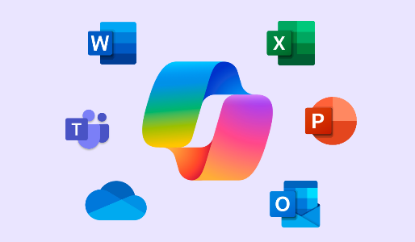</div>

---
layout: image-overlay
class: genai-illustrated genai-email
---

# Entreprise : communication et marketing

<v-clicks at="1">

- **Communication :** synthèse de documents longs, extraction de thèmes majeurs, structuration d'arguments.
- **Marketing :** contenus réseaux sociaux, blogs, slogans, storyboards. FAQ dynamique et chatbots conversationnels.
- **Recrutement et formation :** descriptions de poste, résumé de candidatures, scénarios d'entretien, parcours adaptatifs.

</v-clicks>

<div v-click="1" class="genai-visual visual-1 of-1">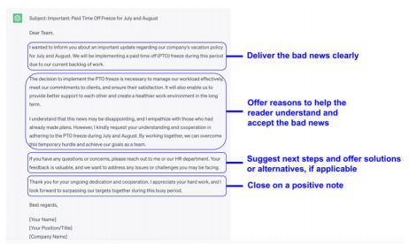</div>

---
layout: image-overlay
class: genai-illustrated genai-analytics
---

# Entreprise : analytics et activité

<v-clicks at="1">

- **Analytics et décision :** automatisation de pipelines de données, modélisation, visualisation rapide, synthèse de tableaux de bord.
- **Activité :** campagne fictive pour un nouveau soda : un slogan, un visuel, trois posts réseaux, un scénario de pub.
- **Limites :** la génération automatique ne remplace pas une stratégie. Une relecture humaine reste nécessaire.

</v-clicks>

<div v-click="1" class="genai-visual visual-1 of-1"></div>

---
layout: image-overlay
class: genai-illustrated genai-sectors
---

# Secteurs : finance et éducation

<v-clicks at="1">

- **Finance :** extraction d'informations de rapports, prévisions, détection d'anomalies. Encadrement réglementaire strict.
- **Éducation :** supports pédagogiques adaptatifs, vulgarisation, quiz dynamiques, tuteurs interactifs personnalisés.
- **Limites communes :** la relecture experte reste indispensable avant toute décision à fort impact.

</v-clicks>

<div v-click="1" class="genai-visual visual-1 of-2"></div>

<div v-click="2" class="genai-visual visual-2 of-2"></div>

---
layout: image-overlay
class: genai-illustrated genai-sectors
---

# Secteurs : recherche et santé

<v-clicks at="1">

- **Recherche :** synthèse d'articles, exploration documentaire, génération d'hypothèses, prototypage rapide de modèles.
- **Santé :** rédaction de comptes-rendus, aide au diagnostic (avec revue médicale obligatoire), chatbots de suivi patient.
- **Vigilance :** dans les deux domaines, la sortie de l'IA reste un brouillon à valider par un expert humain.

</v-clicks>

<div v-click="1" class="genai-visual visual-1 of-2"></div>

<div v-click="2" class="genai-visual visual-2 of-2"></div>

---

# Activité : graphique historique crypto

<v-clicks at="1">

- **Donnée et méthode :** charger un graphique daté BTC, ETH ou autre sur 1-3 ans. Masquer la partie future avant toute sollicitation du modèle.
- **Lecture et scénarios :** repérer 2-3 régimes (tendance, range, choc exogène). Demander des trajectoires alternatives sans prétendre prédire la réalisation réelle.
- **Comparaison :** révéler la suite historique et comparer les scénarios à la baseline « dernier cours inchangé ». Un exemple isolé ne démontre aucune capacité prédictive.
- **Limites explicites :** signaler la possible connaissance préalable de l'historique par le modèle et l'absence de preuve prédictive. Aucune opération réelle.

</v-clicks>

---

# Activité : recommandation voyage

<v-clicks at="1">

- **Entrées :** destination, dates, budget, contraintes (santé, mobilité). Utiliser uniquement des données fictives pour le voyage et les personnes. Aucune réservation automatique.
- **Sorties :** itinéraire, hébergement, activités, transports locaux. Demander des recommandations vérifiables et traçables, pas des promesses.
- **Vérification :** contrôler chaque élément sur sites officiels, avis récents et cartes datées. Signaler explicitement ce qui reste invérifiable ou daté.

</v-clicks>

---

# Techniques : consignes et exemples

<v-clicks at="1">

- **Consigne explicite :** préciser la tâche, le public, les données autorisées, le format attendu et les critères de réussite.
- **Few-shot :** fournir quelques exemples représentatifs d’entrées et de sorties. Ils guident le contexte sans modifier les poids du modèle.
- **Instructions système :** séparer les règles applicatives du contenu fourni par les utilisateurs ou les documents. Le prompt seul n’est pas une barrière de sécurité.
- **Évaluer :** comparer les variantes sur les mêmes cas, y compris les cas limites. Demander des étapes vérifiables plutôt qu’une justification plausible.

</v-clicks>

---
class: nb-concept nb-center nb-k114
---

# Deux prompts, un seul jeu de test

<p class="nb-lead">Une demande doit être classée comme incident ou question. Un exemple dans le prompt change le contexte, pas les poids du modèle.</p>

<div class="nb-grid nb-cols-2">

<div class="nb-card"><p class="nb-step">Première piste</p><p class="nb-what">Sans exemple : donner seulement la règle.</p></div>

<div class="nb-card"><p class="nb-step">À comparer</p><p class="nb-what">Avec exemples : montrer aussi quelques entrées étiquetées.</p></div>

</div>

<p class="nb-foot"><strong>À observer.</strong> Réserver les mêmes demandes inédites aux deux essais. Compter séparément les erreurs de classement et les réponses impossibles à lire. Le gain vient-il du format ou du classement ?</p>

<p class="notebook-reference">Notebook : <a href="https://github.com/jsboige/CoursIA/blob/main/MyIA.AI.Notebooks/GenAI/Texte/02_PromptEngineering.ipynb" target="_blank" rel="noopener">02_PromptEngineering.ipynb</a>.</p>

---

# Techniques : workflows et agents

<v-clicks at="1">

- **Workflow :** le programme fixe l’ordre des étapes, par exemple extraire, vérifier, puis rédiger. Les erreurs et reprises sont explicites.
- **Agent :** le modèle choisit certaines actions dans une boucle d’outils autorisée. L’application conserve permissions, budget et conditions d’arrêt.
- **Orchestration :** LangChain, ou Microsoft Agent Framework -- successeur direct de Semantic Kernel et AutoGen (mêmes équipes, guides de migration officiels) -- pour composer outils, modèles et échanges. Plusieurs agents ajoutent aussi coordination, latence et coûts.
- **Choisir simplement :** commencer par un workflow quand les étapes sont connues. N’ajouter de l’autonomie que si elle apporte un gain mesuré.

</v-clicks>

---
class: nb-map nb-k106
---

# Études de cas : faire dialoguer des agents

<p class="nb-lead">Un système multi-agent tient à trois décisions : qui parle, avec quels outils, et quand on s’arrête. Quatre cas jouables le montrent.</p>

<div class="nb-grid nb-cols-2">

<div class="nb-card"><p class="nb-step">Duel sous contraintes</p><p class="nb-what">Barbie contre l’Âne de Shrek : chaque agent a des contraintes de langue. En exercice : une contrainte que le code peut vérifier, un arbitre dans la boucle.</p><p class="nb-links"><a href="https://github.com/jsboige/CoursIA/blob/main/MyIA.AI.Notebooks/GenAI/CaseStudies/Barbie-Schreck/barbie-schreck.ipynb" target="_blank" rel="noopener">barbie-schreck</a></p></div>

<div class="nb-card"><p class="nb-step">Devinette et règle d’arrêt</p><p class="nb-what">Le Père Fouras et son candidat : la partie se termine sur une stratégie d’arrêt écrite en code, en Python et en C#.</p><p class="nb-links"><a href="https://github.com/jsboige/CoursIA/blob/main/MyIA.AI.Notebooks/GenAI/CaseStudies/Fort-Boyard/fort-boyard-python.ipynb" target="_blank" rel="noopener">fort-boyard-python</a> · <a href="https://github.com/jsboige/CoursIA/blob/main/MyIA.AI.Notebooks/GenAI/SemanticKernel/fort-boyard-csharp.ipynb" target="_blank" rel="noopener">C#</a> · <a href="https://github.com/jsboige/CoursIA/blob/main/MyIA.AI.Notebooks/GenAI/SemanticKernel/fort-boyard-python.ipynb" target="_blank" rel="noopener">variante SK</a></p></div>

<div class="nb-card"><p class="nb-step">Consultation médicale</p><p class="nb-what">Des agents dotés de plugins métier. En exercice : vérifier une ordonnance face au dossier d’allergies.</p><p class="nb-links"><a href="https://github.com/jsboige/CoursIA/blob/main/MyIA.AI.Notebooks/GenAI/CaseStudies/Medical-Chatbot/medical_chatbot.ipynb" target="_blank" rel="noopener">medical_chatbot</a></p></div>

<div class="nb-card"><p class="nb-step">Recette en PDF</p><p class="nb-what">Des agents partagent un état commun et produisent un document. En exercice : valider les contraintes avant de générer.</p><p class="nb-links"><a href="https://github.com/jsboige/CoursIA/blob/main/MyIA.AI.Notebooks/GenAI/CaseStudies/Recipe-Maker/receipe_maker.ipynb" target="_blank" rel="noopener">receipe_maker</a></p></div>

</div>

<p class="nb-foot"><strong>À observer.</strong> Dans chaque cas, quelle règle écrite en code remplace une consigne donnée au modèle ?</p>

---

# Techniques : sorties structurées

<v-clicks at="1">

- **JSON Schema :** le modèle produit une sortie qui respecte un schéma défini -- clés, types, énumérations, champs obligatoires.
- **Décodage contraint :** les implémentations compatibles restreignent les tokens aux formes permises par le schéma. Ce mécanisme ne constitue pas une vérification factuelle.
- **Côté code applicatif :** un `json.loads(arguments)` reste nécessaire pour les appels d'outils et la manipulation post-réponse ; le schéma ne supprime pas le parsing, il borne les formes possibles.
- **Limites :** la conformité structurelle ne signifie pas vérité du contenu ; les refus et troncatures restent à gérer par l'application.

</v-clicks>

<p v-click="5" class="notebook-reference">Référence : <a href="https://github.com/jsboige/CoursIA/blob/main/MyIA.AI.Notebooks/GenAI/Texte/03_Structured_Outputs.ipynb">03_Structured_Outputs.ipynb</a>.</p>

---
class: nb-concept nb-center nb-k114
---

# Que garantit vraiment un schéma ?

<p class="nb-lead">Une notice indique « livraison mardi », sans prix. Un objet JSON peut être parfaitement lisible et pourtant inventer un tarif.</p>

<div class="nb-grid nb-cols-2">

<div class="nb-card"><p class="nb-step">Première piste</p><p class="nb-what">Syntaxe : le parseur accepte la réponse.</p></div>

<div class="nb-card"><p class="nb-step">À comparer</p><p class="nb-what">Schéma : chaque champ a le type attendu.</p></div>

</div>

<p class="nb-foot"><strong>À observer.</strong> Comparer un prix obligatoire à un prix qui autorise null. Zéro affirme que la livraison est gratuite ; null dit que le prix manque. Quel contrôle exige encore de relire la notice ?</p>

<p class="notebook-reference">Notebook : <a href="https://github.com/jsboige/CoursIA/blob/main/MyIA.AI.Notebooks/GenAI/Texte/03_Structured_Outputs.ipynb" target="_blank" rel="noopener">03_Structured_Outputs.ipynb</a>.</p>

---
class: nb-map nb-k106
---

# Contraindre, outiller, faire raisonner

<p class="nb-lead">Un prompt bien écrit ne suffit pas toujours. Trois leviers changent ce que le modèle a le droit de produire, ce qu’il peut consulter, et le temps qu’il prend pour répondre.</p>

<div class="nb-grid nb-cols-3">

<div class="nb-card"><p class="nb-step">Décision typée</p><p class="nb-what">« Système 1 » : obtenir directement une étiquette parmi un ensemble fermé, sans texte à analyser ensuite.</p><p class="nb-links"><a href="https://github.com/jsboige/CoursIA/blob/main/MyIA.AI.Notebooks/GenAI/Texte/03b_Typed_Decisions_System1.ipynb" target="_blank" rel="noopener">03b_Typed_Decisions_System1</a></p></div>

<div class="nb-card"><p class="nb-step">Décodage contraint</p><p class="nb-what">Écarter, au niveau du token, tout ce qui sortirait de la grammaire attendue.</p><p class="nb-links"><a href="https://github.com/jsboige/CoursIA/blob/main/MyIA.AI.Notebooks/GenAI/Texte/03c_Constrained_Decoding_Python.ipynb" target="_blank" rel="noopener">03c_Constrained_Decoding_Python</a></p></div>

<div class="nb-card"><p class="nb-step">Prédiction latente</p><p class="nb-what">Prédire dans l’espace des représentations plutôt que mot à mot (DM-JEPA).</p><p class="nb-links"><a href="https://github.com/jsboige/CoursIA/blob/main/MyIA.AI.Notebooks/GenAI/Texte/03d_JEPA_PredictionLatente_System1.ipynb" target="_blank" rel="noopener">03d_JEPA_PredictionLatente_System1</a></p></div>

<div class="nb-card"><p class="nb-step">Sources documentaires</p><p class="nb-what">Donner un PDF ou une recherche web au modèle comme source.</p><p class="nb-links"><a href="https://github.com/jsboige/CoursIA/blob/main/MyIA.AI.Notebooks/GenAI/Texte/06_PDF_Web_Search.ipynb" target="_blank" rel="noopener">06_PDF_Web_Search</a></p></div>

<div class="nb-card"><p class="nb-step">Exécution de code</p><p class="nb-what">Faire écrire puis exécuter du code par le modèle, pour calculer au lieu de deviner.</p><p class="nb-links"><a href="https://github.com/jsboige/CoursIA/blob/main/MyIA.AI.Notebooks/GenAI/Texte/07_Code_Interpreter.ipynb" target="_blank" rel="noopener">07_Code_Interpreter</a></p></div>

<div class="nb-card"><p class="nb-step">Modèles de raisonnement</p><p class="nb-what">Des modèles qui réfléchissent avant de répondre : quand le surcoût se justifie-t-il ?</p><p class="nb-links"><a href="https://github.com/jsboige/CoursIA/blob/main/MyIA.AI.Notebooks/GenAI/Texte/08_Reasoning_Models.ipynb" target="_blank" rel="noopener">08_Reasoning_Models</a></p></div>

</div>

<p class="nb-foot"><strong>À observer.</strong> Pour chaque levier : qu’est-ce qui devient impossible, et qu’est-ce qui reste à vérifier à la main ?</p>

---

# Techniques : boucle d'outils

<v-clicks at="1">

- **Function Calling :** le modèle *propose* un appel d'outil via `tool_calls`, l'application *autorise et exécute* la fonction, puis ré-injecte le résultat avec le rôle `tool`.
- **Le modèle n'est pas souverain :** c'est l'application qui décide quels appels exécuter, avec quelles limites, et quand arrêter la boucle.
- **Contrôle du choix :** `tool_choice="auto"` laisse le modèle décider, `tool_choice={"type":"function",...}` force un outil précis.
- **Boucles bornées :** limiter le nombre d'itérations et le coût total est une bonne pratique de production -- ne jamais laisser une boucle ouverte sans garde-fou.

</v-clicks>

<p v-click="5" class="notebook-reference">Référence : <a href="https://github.com/jsboige/CoursIA/blob/main/MyIA.AI.Notebooks/GenAI/Texte/04_Function_Calling.ipynb">04_Function_Calling.ipynb</a>.</p>

---
class: nb-concept nb-center nb-k114
---

# Observer un agent entre deux appels

<p class="nb-lead">Un filtre d’invocation entoure une fonction. La réponse finale ne dit pas si un outil a été appelé deux fois ou si un résultat a été réutilisé.</p>

<div class="nb-grid nb-cols-2">

<div class="nb-card"><p class="nb-step">Première piste</p><p class="nb-what">Avant : valider les arguments ou consulter le cache.</p></div>

<div class="nb-card"><p class="nb-step">À comparer</p><p class="nb-what">Après : relever durée et résultat.</p></div>

</div>

<p class="nb-foot"><strong>À observer.</strong> Rejouer la même demande, puis changer un argument. Quel événement dans la trace distingue un cache utile d’un cache qui renvoie le résultat de la mauvaise demande ?</p>

<p class="notebook-reference">Notebook : <a href="https://github.com/jsboige/CoursIA/blob/main/MyIA.AI.Notebooks/GenAI/SemanticKernel/04-SemanticKernel-Filters-Observability.ipynb" target="_blank" rel="noopener">04-SemanticKernel-Filters-Observability.ipynb</a>.</p>

---
class: nb-map nb-k108
---

# Semantic Kernel : du noyau aux agents

<p class="nb-lead">Un orchestrateur relie un modèle à du code. Semantic Kernel le fait en Python et en C# avec quatre briques : fonctions, mémoire, agents, processus.</p>

<div class="nb-grid nb-cols-4">

<div class="nb-card"><p class="nb-step">Noyau et fonctions</p><p class="nb-what">Déclarer un service de modèle, puis des fonctions qu’il peut appeler.</p><p class="nb-links"><a href="https://github.com/jsboige/CoursIA/blob/main/MyIA.AI.Notebooks/GenAI/SemanticKernel/01-SemanticKernel-Intro.ipynb" target="_blank" rel="noopener">01</a> · <a href="https://github.com/jsboige/CoursIA/blob/main/MyIA.AI.Notebooks/GenAI/SemanticKernel/02-SemanticKernel-Advanced.ipynb" target="_blank" rel="noopener">02</a></p></div>

<div class="nb-card"><p class="nb-step">Agents</p><p class="nb-what">Un rôle, des outils et une règle d’arrêt pour des agents qui se répondent.</p><p class="nb-links"><a href="https://github.com/jsboige/CoursIA/blob/main/MyIA.AI.Notebooks/GenAI/SemanticKernel/03-SemanticKernel-Agents.ipynb" target="_blank" rel="noopener">03-SemanticKernel-Agents</a></p></div>

<div class="nb-card"><p class="nb-step">Mémoire vectorielle</p><p class="nb-what">Brancher Qdrant pour faire du RAG depuis le noyau.</p><p class="nb-links"><a href="https://github.com/jsboige/CoursIA/blob/main/MyIA.AI.Notebooks/GenAI/SemanticKernel/05-SemanticKernel-VectorStores.ipynb" target="_blank" rel="noopener">05-SemanticKernel-VectorStores</a></p></div>

<div class="nb-card"><p class="nb-step">Processus</p><p class="nb-what">Décrire un workflow en étapes et événements.</p><p class="nb-links"><a href="https://github.com/jsboige/CoursIA/blob/main/MyIA.AI.Notebooks/GenAI/SemanticKernel/06-SemanticKernel-ProcessFramework.ipynb" target="_blank" rel="noopener">06-SemanticKernel-ProcessFramework</a></p></div>

<div class="nb-card"><p class="nb-step">Multimodal</p><p class="nb-what">Images, audio et vision dans le même noyau.</p><p class="nb-links"><a href="https://github.com/jsboige/CoursIA/blob/main/MyIA.AI.Notebooks/GenAI/SemanticKernel/07-SemanticKernel-MultiModal.ipynb" target="_blank" rel="noopener">07-SemanticKernel-MultiModal</a></p></div>

<div class="nb-card"><p class="nb-step">MCP et A2A</p><p class="nb-what">MCP relie un agent à ses outils ; Agent2Agent relie des agents entre eux.</p><p class="nb-links"><a href="https://github.com/jsboige/CoursIA/blob/main/MyIA.AI.Notebooks/GenAI/SemanticKernel/08-SemanticKernel-MCP-CSharp.ipynb" target="_blank" rel="noopener">MCP en C#</a> · <a href="https://github.com/jsboige/CoursIA/blob/main/MyIA.AI.Notebooks/GenAI/SemanticKernel/11-SemanticKernel-A2A.ipynb" target="_blank" rel="noopener">A2A</a></p></div>

<div class="nb-card"><p class="nb-step">Python et .NET</p><p class="nb-what">Appeler du code .NET depuis Python avec pythonnet.</p><p class="nb-links"><a href="https://github.com/jsboige/CoursIA/blob/main/MyIA.AI.Notebooks/GenAI/SemanticKernel/09-SemanticKernel-Building-CLR.ipynb" target="_blank" rel="noopener">09-SemanticKernel-Building-CLR</a></p></div>

<div class="nb-card"><p class="nb-step">Plugins de raisonnement</p><p class="nb-what">Des plugins pour le test-time scaling.</p><p class="nb-links"><a href="https://github.com/jsboige/CoursIA/blob/main/MyIA.AI.Notebooks/GenAI/Texte/18_Semantic_Kernel_Plugins.ipynb" target="_blank" rel="noopener">18_Semantic_Kernel_Plugins</a></p></div>

</div>

<p class="nb-foot"><strong>À observer.</strong> Quelle part du comportement est écrite dans le code de l’orchestrateur, et quelle part reste dans le prompt ?</p>

---
class: nb-concept nb-center nb-k110
---

# Semantic Kernel en projets : écrire, router, rédiger

<p class="nb-lead">Trois projets complets montrent ce que l’orchestration apporte quand la tâche dépasse un seul appel.</p>

<div class="nb-grid nb-cols-3">

<div class="nb-card"><p class="nb-step">Des agents qui écrivent un notebook</p><p class="nb-what">Un groupe d’agents conçoit, exécute et corrige un notebook, en interactif puis par lots.</p><p class="nb-links"><a href="https://github.com/jsboige/CoursIA/blob/main/MyIA.AI.Notebooks/GenAI/SemanticKernel/10-SemanticKernel-NotebookMaker.ipynb" target="_blank" rel="noopener">10</a> · <a href="https://github.com/jsboige/CoursIA/blob/main/MyIA.AI.Notebooks/GenAI/SemanticKernel/10a-SemanticKernel-NotebookMaker-batch.ipynb" target="_blank" rel="noopener">10a</a> · <a href="https://github.com/jsboige/CoursIA/blob/main/MyIA.AI.Notebooks/GenAI/SemanticKernel/10b-SemanticKernel-NotebookMaker-batch-parameterized.ipynb" target="_blank" rel="noopener">10b</a> · <a href="https://github.com/jsboige/CoursIA/blob/main/MyIA.AI.Notebooks/GenAI/SemanticKernel/Semantic-kernel-AutoInteractive.ipynb" target="_blank" rel="noopener">.NET interactif</a></p></div>

<div class="nb-card"><p class="nb-step">Router entre modèles</p><p class="nb-what">Envoyer chaque prompt au modèle qui convient : par préfixe, entre connecteurs, ou derrière une passerelle unique.</p><p class="nb-links"><a href="https://github.com/jsboige/CoursIA/blob/main/MyIA.AI.Notebooks/GenAI/SemanticKernel/Semantic-fleet-Radix-PromptMatcher.ipynb" target="_blank" rel="noopener">Radix</a> · <a href="https://github.com/jsboige/CoursIA/blob/main/MyIA.AI.Notebooks/GenAI/SemanticKernel/Semantic-fleet-MultiConnector-Routing.ipynb" target="_blank" rel="noopener">MultiConnector</a> · <a href="https://github.com/jsboige/CoursIA/blob/main/MyIA.AI.Notebooks/GenAI/SemanticKernel/Semantic-fleet-Claudish-Routing.ipynb" target="_blank" rel="noopener">Claudish</a></p></div>

<div class="nb-card"><p class="nb-step">Un assistant de rédaction</p><p class="nb-what">Créateur de mail personnalisé : un petit projet mené de bout en bout.</p><p class="nb-links"><a href="https://github.com/jsboige/CoursIA/blob/main/MyIA.AI.Notebooks/GenAI/SemanticKernel/Cr%C3%A9ateur%20de%20mail%20personnalis%C3%A9.ipynb" target="_blank" rel="noopener">Créateur de mail personnalisé</a></p></div>

</div>

<p class="nb-foot"><strong>À savoir.</strong> Les fichiers <code>Notebook-Template</code>, <code>Workbook-Template</code> et <code>Notebook-Generated</code> du dossier sont les gabarits et une sortie de ce générateur, pas des cours.</p>

---
class: nb-map nb-k92
---

# Vibe coding : piloter un agent de code

<p class="nb-lead">Un agent de code lit le dépôt, propose des modifications et lance des commandes. On apprend à le cadrer : quel contexte il reçoit, ce qu’il a le droit de faire, comment on vérifie son travail.</p>

<div class="nb-grid nb-cols-3">

<div class="nb-card"><p class="nb-step">Les bases</p><p class="nb-what">Première commande, réponse JSON validée, coût et latence comparés entre deux modèles.</p><p class="nb-links"><a href="https://github.com/jsboige/CoursIA/blob/main/MyIA.AI.Notebooks/GenAI/Vibe-Coding/Claude-Code/notebooks/01-Claude-CLI-Bases.ipynb" target="_blank" rel="noopener">01-Claude-CLI-Bases</a></p></div>

<div class="nb-card"><p class="nb-step">Sessions et contexte</p><p class="nb-what">Reprendre ou bifurquer une conversation ; désigner un fichier, des lignes ou un dossier comme contexte.</p><p class="nb-links"><a href="https://github.com/jsboige/CoursIA/blob/main/MyIA.AI.Notebooks/GenAI/Vibe-Coding/Claude-Code/notebooks/02-Claude-CLI-Sessions.ipynb" target="_blank" rel="noopener">02-Claude-CLI-Sessions</a> · <a href="https://github.com/jsboige/CoursIA/blob/main/MyIA.AI.Notebooks/GenAI/Vibe-Coding/Claude-Code/notebooks/03-Claude-CLI-References.ipynb" target="_blank" rel="noopener">03-Claude-CLI-References</a></p></div>

<div class="nb-card"><p class="nb-step">Agents et sous-agents</p><p class="nb-what">Déléguer l’exploration et la planification ; réparer un bug avec un agent.</p><p class="nb-links"><a href="https://github.com/jsboige/CoursIA/blob/main/MyIA.AI.Notebooks/GenAI/Vibe-Coding/Claude-Code/notebooks/04-Claude-CLI-Agents.ipynb" target="_blank" rel="noopener">04-Claude-CLI-Agents</a></p></div>

<div class="nb-card"><p class="nb-step">Automatiser</p><p class="nb-what">Pipelines, commandes personnalisées et hooks : l’agent devient une étape d’un script.</p><p class="nb-links"><a href="https://github.com/jsboige/CoursIA/blob/main/MyIA.AI.Notebooks/GenAI/Vibe-Coding/Claude-Code/notebooks/05-Claude-CLI-Automatisation.ipynb" target="_blank" rel="noopener">05-Claude-CLI-Automatisation</a></p></div>

<div class="nb-card"><p class="nb-step">Passer par une passerelle</p><p class="nb-what">Claudish : un protocole, plusieurs modèles par paliers de budget ; distinguer quota dépassé (429) et surcharge (529).</p><p class="nb-links"><a href="https://github.com/jsboige/CoursIA/blob/main/MyIA.AI.Notebooks/GenAI/Vibe-Coding/Claudish/notebooks/01-claude-code-via-claudish.ipynb" target="_blank" rel="noopener">01-claude-code-via-claudish</a></p></div>

<div class="nb-card"><p class="nb-step">Garde-fous du code généré</p><p class="nb-what">Un analyseur Roslyn refuse à la compilation ce qu’un grep naïf laisse passer ; un REPL C# corrige une application à chaud.</p><p class="nb-links"><a href="https://github.com/jsboige/CoursIA/blob/main/MyIA.AI.Notebooks/GenAI/Vibe-Coding/analyzers/Roslyn-Code-Guardrails.ipynb" target="_blank" rel="noopener">Roslyn-Code-Guardrails</a> · <a href="https://github.com/jsboige/CoursIA/blob/main/MyIA.AI.Notebooks/GenAI/Vibe-Coding/docs/CSharpRepl-Live-Patching.ipynb" target="_blank" rel="noopener">CSharpRepl-Live-Patching</a></p></div>

</div>

<p class="nb-foot"><strong>À observer.</strong> Quelle vérification laissez-vous à l’agent, et laquelle gardez-vous dans un outil déterministe ?</p>

---

# Techniques : RAG et sources

<v-clicks at="1">

- **Principe :** découper un corpus en *chunks*, générer un embedding par chunk, retrouver les *k* plus proches voisins d'une question, les injecter dans le contexte.
- **Reranking :** une forte similarité cosinus ne prouve pas la pertinence. Une étape de reranking peut améliorer la pertinence des passages ; vérifier son gain et son coût sur des questions représentatives.
- **Citations :** demander au modèle de citer ses sources produit un contrat de forme, pas un contrat de vérité. Une note [3] peut désigner un passage hors sujet.
- **Limites :** la qualité dépend de l'embedder, du découpage, et du nombre *k* de passages récupérés -- le RAG n'est pas magique, c'est un compromis à régler empiriquement.

</v-clicks>

<p v-click="5" class="notebook-reference">Référence : <a href="https://github.com/jsboige/CoursIA/blob/main/MyIA.AI.Notebooks/GenAI/Texte/05_RAG_Modern.ipynb">05_RAG_Modern.ipynb</a>.</p>

---
layout: image-overlay
class: genai-illustrated genai-hybrideretrieve
---

# Recherche hybride : dense + BM25

<p v-click="1" class="genai-level genai-concept"><strong>Concept</strong> — combiner la similarité vectorielle (dense) et la pertinence lexicale BM25 (Best Matching 25). Deux signaux complémentaires pour ne pas dépendre d'un seul.</p>

<p v-click="2" class="genai-level genai-mechanism"><strong>Mécanisme</strong> — chaque recherche produit un classement. RRF (Reciprocal Rank Fusion) fusionne les rangs, pas les scores bruts. La recherche supplémentaire a néanmoins un coût.</p>

<p v-click="3" class="genai-level genai-limit"><strong>Limite mesurée</strong> — sur le petit corpus du notebook, aucun gain hybride au rappel@5. BM25 exploite le recouvrement lexical après analyse des termes, pas la similarité sémantique.</p>

<div v-click="2" class="genai-visual genai-hybrideretrieve-viz">

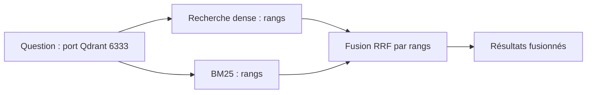

</div>

<p v-click="4" class="notebook-reference">Référence : <a href="https://github.com/jsboige/CoursIA/blob/main/MyIA.AI.Notebooks/GenAI/RAG-et-Memoire-Semantique/08-KernelMemory-Hybrid-Search.ipynb">08-KernelMemory-Hybrid-Search.ipynb</a>.</p>

---
class: nb-concept nb-center nb-k114
---

# Retrouver un passage sans reprendre ses mots

<p class="nb-lead">Dans le petit corpus Qdrant, une question et les passages sont encodés dans le même espace vectoriel. Les voisins les plus proches sont des candidats, pas des preuves.</p>

<div class="nb-grid nb-cols-2">

<div class="nb-card"><p class="nb-step">Première piste</p><p class="nb-what">Recherche lexicale : quels termes sont communs ?</p></div>

<div class="nb-card"><p class="nb-step">À comparer</p><p class="nb-what">Recherche vectorielle : quels passages sont proches ?</p></div>

</div>

<p class="nb-foot"><strong>À observer.</strong> Reformuler la question dans une autre langue, puis exclure une source avec un filtre. Lire les trois premiers passages avant de regarder une réponse générée. À quelle étape la preuve disparaît-elle ?</p>

<p class="notebook-reference">Notebook : <a href="https://github.com/jsboige/CoursIA/blob/main/MyIA.AI.Notebooks/GenAI/RAG-et-Memoire-Semantique/01-Hands-On-Grounding.ipynb" target="_blank" rel="noopener">01-Hands-On-Grounding.ipynb</a>.</p>

---
class: nb-map nb-k96
---

# RAG avancé : mieux chercher, mieux citer, sortir du texte

<p class="nb-lead">Un RAG de base retrouve des passages proches. La suite de la série mesure d’abord, puis ajoute une complexité à la fois.</p>

<div class="nb-grid nb-cols-3">

<div class="nb-card"><p class="nb-step">Mesurer, puis HyDE et reranking</p><p class="nb-what">Calculer Recall@k et nDCG@k à la main, fixer une référence, puis chercher avec une réponse hypothétique et reclasser.</p><p class="nb-links"><a href="https://github.com/jsboige/CoursIA/blob/main/MyIA.AI.Notebooks/GenAI/RAG-et-Memoire-Semantique/02-Retrieval-Avance.ipynb" target="_blank" rel="noopener">02-Retrieval-Avance</a></p></div>

<div class="nb-card"><p class="nb-step">Kernel Memory</p><p class="nb-what">Une couche d’abstraction : ingestion, recherche et citations sans écrire soi-même les appels à la base vectorielle.</p><p class="nb-links"><a href="https://github.com/jsboige/CoursIA/blob/main/MyIA.AI.Notebooks/GenAI/RAG-et-Memoire-Semantique/06-KernelMemory-InProcess.ipynb" target="_blank" rel="noopener">06-KernelMemory-InProcess</a> · <a href="https://github.com/jsboige/CoursIA/blob/main/MyIA.AI.Notebooks/GenAI/RAG-et-Memoire-Semantique/07-KernelMemory-Python-Quickstart.ipynb" target="_blank" rel="noopener">07-KernelMemory-Python-Quickstart</a></p></div>

<div class="nb-card"><p class="nb-step">Au-delà du texte</p><p class="nb-what">Ce que le service ne sait pas indexer, et le pont par un modèle de vision.</p><p class="nb-links"><a href="https://github.com/jsboige/CoursIA/blob/main/MyIA.AI.Notebooks/GenAI/RAG-et-Memoire-Semantique/09-KernelMemory-Multimodal.ipynb" target="_blank" rel="noopener">09-KernelMemory-Multimodal</a></p></div>

<div class="nb-card"><p class="nb-step">Retrouver une page par son image</p><p class="nb-what">Un embedding commun au texte et à l’image : chercher dans des pages sans OCR.</p><p class="nb-links"><a href="https://github.com/jsboige/CoursIA/blob/main/MyIA.AI.Notebooks/GenAI/RAG-et-Memoire-Semantique/10-RAG-Visuel-Embedding-Conjoint.ipynb" target="_blank" rel="noopener">10-RAG-Visuel-Embedding-Conjoint</a></p></div>

<div class="nb-card"><p class="nb-step">Les représentations convergent-elles ?</p><p class="nb-what">Mesurer l’alignement entre modèles de modalités différentes.</p><p class="nb-links"><a href="https://github.com/jsboige/CoursIA/blob/main/MyIA.AI.Notebooks/GenAI/RAG-et-Memoire-Semantique/11-Alignement-Representationnel-Cross-Modal.ipynb" target="_blank" rel="noopener">11-Alignement-Representationnel-Cross-Modal</a></p></div>

<div class="nb-card"><p class="nb-step">Rédiger un rapport cité</p><p class="nb-what">Le pipeline STORM, étape par étape, jusqu’au rapport avec citations.</p><p class="nb-links"><a href="https://github.com/jsboige/CoursIA/blob/main/MyIA.AI.Notebooks/GenAI/RAG-et-Memoire-Semantique/12-Redaction-Rapport-STORM.ipynb" target="_blank" rel="noopener">12-Redaction-Rapport-STORM</a></p></div>

</div>

<p class="nb-foot"><strong>À observer.</strong> Sur le petit corpus du cours, quelle étape améliore réellement le rappel, et laquelle n’ajoute que du coût ?</p>

---
class: nb-concept nb-center nb-k98
---

# Atlas : un cas d’école pour apprendre à vérifier une réponse

<p class="nb-lead"><strong>Atlas est un atelier de prêt de capteurs inventé pour ce cours.</strong> Son règlement tient en trois phrases. Aucun modèle ne l’a lu pendant son entraînement : une réponse juste ne peut venir que du texte qu’on lui fournit.</p>

<div class="nb-grid nb-cols-3">

<div class="nb-card"><p class="nb-step">Pourquoi un cas inventé</p><p class="nb-what">On connaît d’avance la bonne réponse à chaque question. On peut donc dire où le système se trompe : en cherchant, en rédigeant ou en citant.</p></div>

<div class="nb-card"><p class="nb-step">Ce qu’on fait</p><p class="nb-what">Poser trois questions : une dont la réponse est écrite, une dont l’information manque, une fondée sur une prémisse fausse. D’abord sans le règlement, puis avec.</p></div>

<div class="nb-card"><p class="nb-step">Ce qu’on apprend</p><p class="nb-what">Ne plus confondre une réponse plausible, une réponse appuyée sur le texte, une réponse correctement citée et un résultat mesuré.</p></div>

</div>

<p class="nb-foot"><strong>Les sept planches.</strong> 1 le règlement et trois questions · 2 ce que prédit le modèle · 3 chercher puis justifier · 4 une sortie valide mais fausse · 5 activité en binôme, 35 minutes · 6 lire un score · 7 deux versions du règlement.</p>

---
class: atlas-case nb-k120
---

# Atlas 1 · Le règlement et trois questions

Voici **tout** ce que le système a le droit de savoir sur l’atelier :

> L’atelier ouvre les mardis et jeudis de 14 h à 18 h. Le prêt d’un capteur dure sept jours. Une prolongation doit être demandée avant l’échéance.

1. Puis-je venir jeudi à 17 h ?
2. Combien coûte la prolongation ?
3. Puisque l’atelier ouvre le samedi, à quelle heure ferme-t-il ?

**En binôme :** écrivez la réponse attendue *avant* de consulter le modèle.

<!-- Correction : oui avec citation ; tarif non précisé ; rejeter la prémisse du samedi. Variante hors ligne : distribuer les deux réponses précédentes. -->

---
class: atlas-case nb-k120
---

# Atlas 2 · Ce que prédit le modèle

« La prolongation est… » → gratuite ? possible ? soumise à autorisation ?

Le modèle produit une distribution sur les prochains **tokens**, pas un vote sur les faits. Un mot fréquent peut être le mauvais mot pour ce règlement.

**Expérience de pensée :** à température basse, une même erreur devient-elle plus rare, ou seulement plus reproductible ?

<!-- Faire compléter la phrase par trois personnes. Une réponse stable n’est pas une preuve. Relier à la section température du chapitre VIII. -->

---
class: atlas-case nb-k120
---

# Atlas 3 · Du texte récupéré à la réponse justifiée

**Question → recherche → passage → génération → contrôle de citation**

| Observation | Où chercher la panne ? |
|---|---|
| La bonne version ne figure pas parmi les passages | Recherche ou index |
| La bonne version est présente, mais la réponse dit « gratuit » | Génération ou consigne |
| La réponse est juste mais la citation parle des horaires | Vérification de la preuve |

<!-- Enlever le passage pertinent, puis le réintroduire sans changer le prompt. Demander quel échec peut être réparé par un meilleur moteur de recherche. -->

---
class: atlas-case nb-k120
---

# Atlas 4 · Un JSON valide peut mentir

```json
{"reponse":"0 €","citation":"avant l’échéance","statut":"prouvé"}
```

Le JSON est lisible. La citation existe. **Justifie-t-elle le tarif ?**

| Contrôle | Verdict sur cet exemple |
|---|---|
| Syntaxe et présence des champs | Réussite : le programme peut lire la sortie |
| Présence littérale de la citation | Réussite : ces mots figurent dans la notice |
| Preuve du prix | Échec : une échéance ne fixe aucun montant |

Proposez deux tests distincts : un test automatique de structure et un test de fidélité au texte. Que reste-t-il impossible à décider avec une simple recherche de chaîne ?

<!-- Un parseur valide les champs ; une recherche confirme seulement la présence de la citation. Corrigé : statut inconnu, pas de valeur de tarif. Pause avant le travail en binômes. -->

---
class: atlas-case nb-k120
---

# Atlas 5 · Activité : ne changez qu’une variable

1. Fixez quatre questions : fait explicite, information absente, prémisse fausse, paraphrase.
2. Comparez A : question seule ; B : question + règlement ; C : B + citation ou abstention.
3. Gardez le même modèle et les mêmes questions. Consignez **toutes** les sorties, même décevantes.
4. Échangez vos tests avec un autre binôme. Ajoutez son contre-exemple sans retoucher la méthode.

<!-- Prévoir 35 minutes. Sans API : un binôme joue le système, l’autre contrôle les preuves. Ce jeu illustre le protocole, pas la performance d’un modèle. -->

---
class: atlas-case nb-k120
---

# Atlas 6 · Quatre réussites sur cinq : qu’a-t-on mesuré ?

Exemple fictif : trois questions répondables et deux sans réponse. Le système répond juste à deux des trois et s’abstient correctement sur les deux autres.

- Exactitude globale : **4/5**.
- Questions répondables résolues : **2/3**.
- Abstentions justifiées sur questions impossibles : **2/2**.

Un système qui s’abstient toujours obtient **2/5**. Quel score masquerait le coût de ses refus ?

<!-- Faire calculer avant de commenter. Comparer les dénominateurs. Cinq cas illustrent une mesure, ils ne permettent pas de généraliser. -->

---
class: atlas-case nb-k120
---

# Atlas 7 · Quand deux règlements se contredisent

**Version de septembre** : sept jours. **Version de novembre** : dix jours à partir du 1er novembre.

« J’ai emprunté un capteur le 28 octobre. Combien de temps puis-je le garder ? »

Fixez d’abord la règle d’application. Si le texte ne précise pas le régime transitoire, quelle clarification faut-il demander ? Construisez un cas où la version la plus récente seule ne suffit pas.

<!-- Ne pas imposer la date d’emprunt comme règle de droit. Demander un cas non ambigu, puis un cas indécidable ; comparer recherche par pertinence et filtrage par date. -->

---
class: nb-map nb-k104
---

# Atlas : ce qu’on retient, et où le refaire

<p class="nb-lead">Chaque planche isolait une cause d’erreur différente. Les notebooks ci-dessous reproduisent chaque étape sur machine.</p>

<div class="nb-grid nb-cols-3">

<div class="nb-card"><p class="nb-step">Prédire n’est pas savoir</p><p class="nb-what">Une réponse stable à basse température reste une prédiction de tokens.</p><p class="nb-links"><a href="https://github.com/jsboige/CoursIA/blob/main/MyIA.AI.Notebooks/GenAI/Texte/01_OpenAI_Intro.ipynb" target="_blank" rel="noopener">01_OpenAI_Intro</a></p></div>

<div class="nb-card"><p class="nb-step">Chercher peut échouer</p><p class="nb-what">Si le bon passage n’est pas retrouvé, aucun prompt ne le rattrape.</p><p class="nb-links"><a href="https://github.com/jsboige/CoursIA/blob/main/MyIA.AI.Notebooks/GenAI/RAG-et-Memoire-Semantique/01-Hands-On-Grounding.ipynb" target="_blank" rel="noopener">01-Hands-On-Grounding</a> · <a href="https://github.com/jsboige/CoursIA/blob/main/MyIA.AI.Notebooks/GenAI/RAG-et-Memoire-Semantique/02-Retrieval-Avance.ipynb" target="_blank" rel="noopener">02-Retrieval-Avance</a></p></div>

<div class="nb-card"><p class="nb-step">Citer n’est pas prouver</p><p class="nb-what">Une citation présente dans le texte peut ne pas justifier la réponse.</p><p class="nb-links"><a href="https://github.com/jsboige/CoursIA/blob/main/MyIA.AI.Notebooks/GenAI/Texte/05_RAG_Modern.ipynb" target="_blank" rel="noopener">05_RAG_Modern</a> · <a href="https://github.com/jsboige/CoursIA/blob/main/MyIA.AI.Notebooks/GenAI/RAG-et-Memoire-Semantique/12-Redaction-Rapport-STORM.ipynb" target="_blank" rel="noopener">12-Redaction-Rapport-STORM</a></p></div>

<div class="nb-card"><p class="nb-step">Valide n’est pas vrai</p><p class="nb-what">Un schéma garantit la forme d’une sortie, jamais son contenu.</p><p class="nb-links"><a href="https://github.com/jsboige/CoursIA/blob/main/MyIA.AI.Notebooks/GenAI/Texte/03_Structured_Outputs.ipynb" target="_blank" rel="noopener">03_Structured_Outputs</a> · <a href="https://github.com/jsboige/CoursIA/blob/main/MyIA.AI.Notebooks/GenAI/Texte/03c_Constrained_Decoding_Python.ipynb" target="_blank" rel="noopener">03c_Constrained_Decoding_Python</a></p></div>

<div class="nb-card"><p class="nb-step">Un score cache un choix</p><p class="nb-what">Séparer questions répondables et abstentions avant de comparer deux systèmes.</p><p class="nb-links"><a href="https://github.com/jsboige/CoursIA/blob/main/MyIA.AI.Notebooks/GenAI/Texte/22_Evaluating_Generated_Text.ipynb" target="_blank" rel="noopener">22_Evaluating_Generated_Text</a> · <a href="https://github.com/jsboige/CoursIA/blob/main/MyIA.AI.Notebooks/GenAI/Texte/13b_Agent_Evaluation.ipynb" target="_blank" rel="noopener">13b_Agent_Evaluation</a></p></div>

<div class="nb-card"><p class="nb-step">Les sources ont une date</p><p class="nb-what">Deux versions d’un texte : la proximité ne dit pas laquelle s’applique. Il faut des métadonnées.</p><p class="nb-links"><a href="https://github.com/jsboige/CoursIA/blob/main/MyIA.AI.Notebooks/GenAI/Plateformes-Conversationnelles/AI-Engine-WordPress/03-Functional/03-3-RAG-et-Embeddings/ingestion-corpus-long-rag.ipynb" target="_blank" rel="noopener">corpus long et métadonnées</a></p></div>

</div>

<p class="nb-foot"><strong>En une phrase.</strong> Devant une réponse d’assistant, demandez d’abord : d’où vient-elle, et qui l’a vérifiée ?</p>

---

# Techniques : mémoire persistante

<v-clicks at="1">

- **Mémoire externe :** chaque interaction peut être vectorisée et stockée, puis rappelée par similarité au tour suivant.
- **Gouvernance :** plafonner le nombre d'entrées (LRU), purger périodiquement, tracer ce qui est injecté dans le contexte.
- **Sélection et évaluation :** ne rappeler que les souvenirs utiles, datés et autorisés. Comparer avec et sans mémoire sur des questions nécessitant un rappel ; stocker davantage ne garantit pas un gain.

</v-clicks>

<p v-click="4" class="notebook-reference">Référence : <a href="https://github.com/jsboige/CoursIA/blob/main/MyIA.AI.Notebooks/GenAI/Texte/14_Persistent_Memory.ipynb">14_Persistent_Memory.ipynb</a>.</p>

---
class: nb-map nb-k116
---

# Agents et mémoire : tenir sur la durée

<p class="nb-lead">Une conversation longue déborde de la fenêtre de contexte. Il faut décider ce qu’on garde, ce qu’on résume et ce qu’on oublie — puis vérifier que l’agent s’en sert.</p>

<div class="nb-grid nb-cols-2">

<div class="nb-card"><p class="nb-step">Mémoire paginée</p><p class="nb-what">Fenêtre glissante, résumé progressif, éviction : trois politiques pour un contexte borné.</p><p class="nb-links"><a href="https://github.com/jsboige/CoursIA/blob/main/MyIA.AI.Notebooks/GenAI/Texte/14b_Paginated_Memory-Python.ipynb" target="_blank" rel="noopener">Python</a> · <a href="https://github.com/jsboige/CoursIA/blob/main/MyIA.AI.Notebooks/GenAI/Texte/14b_Paginated_Memory-CSharp.ipynb" target="_blank" rel="noopener">C#</a></p></div>

<div class="nb-card"><p class="nb-step">Contextes longs</p><p class="nb-what">Budget de tokens, biais de position, map-reduce, mise en cache du préfixe.</p><p class="nb-links"><a href="https://github.com/jsboige/CoursIA/blob/main/MyIA.AI.Notebooks/GenAI/Texte/10c_Long_Context_Strategies.ipynb" target="_blank" rel="noopener">10c_Long_Context_Strategies</a></p></div>

<div class="nb-card"><p class="nb-step">Orchestration agentique</p><p class="nb-what">Confier à des agents la recherche d’une meilleure réponse au moment de l’inférence.</p><p class="nb-links"><a href="https://github.com/jsboige/CoursIA/blob/main/MyIA.AI.Notebooks/GenAI/Texte/13_Agentic_Orchestration.ipynb" target="_blank" rel="noopener">13_Agentic_Orchestration</a></p></div>

<div class="nb-card"><p class="nb-step">Agents génératifs</p><p class="nb-what">Un mini-monde où chaque agent mémorise, réfléchit et planifie.</p><p class="nb-links"><a href="https://github.com/jsboige/CoursIA/blob/main/MyIA.AI.Notebooks/GenAI/Texte/24_Generative_Agents_MiniMonde.ipynb" target="_blank" rel="noopener">24_Generative_Agents_MiniMonde</a></p></div>

</div>

<p class="nb-foot"><strong>À observer.</strong> Après éviction, quelle information l’agent croit-il encore connaître ?</p>

---

# Techniques : MCP et intégrations

<v-clicks at="1">

- **Model Context Protocol :** standard d'échange entre un client (un agent) et un ou plusieurs serveurs exposant trois primitives -- **Tools** (actions), **Resources** (données adressables), **Prompts** (templates).
- **Intérêt :** rendre les outils portables entre frameworks d'agent -- une fois un serveur MCP écrit, plusieurs clients peuvent le consommer.
- **Architecture :** l'hôte gère les autorisations ; le client découvre les capacités d'un serveur et échange via un transport. MCP standardise les échanges, pas la politique de sécurité.
- **Sécurité :** authentification, permissions minimales, racines de fichiers autorisées et validation des arguments. Le notebook lié propose une illustration conceptuelle, pas une intégration de transport validée.

</v-clicks>

<p v-click="5" class="notebook-reference">Référence : <a href="https://github.com/jsboige/CoursIA/blob/main/MyIA.AI.Notebooks/GenAI/SemanticKernel/08-SemanticKernel-MCP.ipynb">08-SemanticKernel-MCP.ipynb</a>.</p>

---
class: nb-map nb-k110
---

# Intégrations .NET : une pile d’agent en C#

<p class="nb-lead">La même pile GenAI se construit hors de Python. La série suit un agent .NET de bout en bout : déclarer les services, observer, diffuser en flux, tester, garder le code sûr.</p>

<div class="nb-grid nb-cols-4">

<div class="nb-card"><p class="nb-step">Orchestrer (Aspire)</p><p class="nb-what">La pile se déclare, se lance et s’arrête depuis du code C#.</p><p class="nb-links"><a href="https://github.com/jsboige/CoursIA/blob/main/MyIA.AI.Notebooks/GenAI/Integrations-DotNet/Aspire/01-Aspire-Orchestration-GenAi.ipynb" target="_blank" rel="noopener">01</a> · <a href="https://github.com/jsboige/CoursIA/blob/main/MyIA.AI.Notebooks/GenAI/Integrations-DotNet/Aspire/02-Aspire-GenAiStack-Reel.ipynb" target="_blank" rel="noopener">02</a> · <a href="https://github.com/jsboige/CoursIA/blob/main/MyIA.AI.Notebooks/GenAI/Integrations-DotNet/Aspire/10-Aspire-AppHost-Frontend.ipynb" target="_blank" rel="noopener">10</a> · <a href="https://github.com/jsboige/CoursIA/blob/main/MyIA.AI.Notebooks/GenAI/Integrations-DotNet/Aspire/11-Aspire-Copilot-Harness-AppHost.ipynb" target="_blank" rel="noopener">11</a></p></div>

<div class="nb-card"><p class="nb-step">Observer</p><p class="nb-what">Logs structurés et traces : Serilog, OpenTelemetry.</p><p class="nb-links"><a href="https://github.com/jsboige/CoursIA/blob/main/MyIA.AI.Notebooks/GenAI/Integrations-DotNet/Aspire/03-Aspire-Observabilite.ipynb" target="_blank" rel="noopener">03-Aspire-Observabilite</a></p></div>

<div class="nb-card"><p class="nb-step">Diffuser en flux</p><p class="nb-what">Un agent qui publie ses événements au fil de leur production.</p><p class="nb-links"><a href="https://github.com/jsboige/CoursIA/blob/main/MyIA.AI.Notebooks/GenAI/Integrations-DotNet/Aspire/04-Aspire-Streaming-Agent.ipynb" target="_blank" rel="noopener">04-Aspire-Streaming-Agent</a></p></div>

<div class="nb-card"><p class="nb-step">Tester</p><p class="nb-what">Tests d’intégration sur une vraie base, avec retour arrière transactionnel.</p><p class="nb-links"><a href="https://github.com/jsboige/CoursIA/blob/main/MyIA.AI.Notebooks/GenAI/Integrations-DotNet/Aspire/05-Aspire-Tests-Integration.ipynb" target="_blank" rel="noopener">05-Aspire-Tests-Integration</a></p></div>

<div class="nb-card"><p class="nb-step">Garde-fous</p><p class="nb-what">Des analyseurs dans la compilation ; l’asynchrone aux frontières du code natif.</p><p class="nb-links"><a href="https://github.com/jsboige/CoursIA/blob/main/MyIA.AI.Notebooks/GenAI/Integrations-DotNet/Aspire/06-Aspire-GardeFous-Roslyn.ipynb" target="_blank" rel="noopener">06</a> · <a href="https://github.com/jsboige/CoursIA/blob/main/MyIA.AI.Notebooks/GenAI/Integrations-DotNet/Aspire/08-Aspire-AsyncFFI-Dotnet.ipynb" target="_blank" rel="noopener">08</a></p></div>

<div class="nb-card"><p class="nb-step">Router et brancher</p><p class="nb-what">Un routeur multi-connecteurs tracé ; le SDK GitHub Copilot en C#.</p><p class="nb-links"><a href="https://github.com/jsboige/CoursIA/blob/main/MyIA.AI.Notebooks/GenAI/Integrations-DotNet/Aspire/07-Aspire-SemanticFleet-MultiConnector.ipynb" target="_blank" rel="noopener">07</a> · <a href="https://github.com/jsboige/CoursIA/blob/main/MyIA.AI.Notebooks/GenAI/Integrations-DotNet/Aspire/09-Aspire-Harness-CopilotSdk.ipynb" target="_blank" rel="noopener">09</a> · <a href="https://github.com/jsboige/CoursIA/blob/main/MyIA.AI.Notebooks/GenAI/Integrations-DotNet/CopilotSDK/01-GitHub-Copilot-SDK-Binding.ipynb" target="_blank" rel="noopener">SDK</a></p></div>

<div class="nb-card"><p class="nb-step">Acteurs avec état</p><p class="nb-what">Orleans : des grains pour l’état d’un agent, puis un cluster et Redis.</p><p class="nb-links"><a href="https://github.com/jsboige/CoursIA/blob/main/MyIA.AI.Notebooks/GenAI/Integrations-DotNet/Orleans/01-Orleans-Grains-Agents.ipynb" target="_blank" rel="noopener">01</a> · <a href="https://github.com/jsboige/CoursIA/blob/main/MyIA.AI.Notebooks/GenAI/Integrations-DotNet/Orleans/02-Orleans-Aspire-CoHost.ipynb" target="_blank" rel="noopener">02</a> · <a href="https://github.com/jsboige/CoursIA/blob/main/MyIA.AI.Notebooks/GenAI/Integrations-DotNet/Orleans/03-Orleans-Persistance-Redis.ipynb" target="_blank" rel="noopener">03</a> · <a href="https://github.com/jsboige/CoursIA/blob/main/MyIA.AI.Notebooks/GenAI/Integrations-DotNet/Orleans/04-Orleans-Aspire-Cluster-Redis.ipynb" target="_blank" rel="noopener">04</a></p></div>

<div class="nb-card"><p class="nb-step">Données et endpoints</p><p class="nb-what">Requêtes EF Core vérifiées à la compilation ; endpoints par convention.</p><p class="nb-links"><a href="https://github.com/jsboige/CoursIA/blob/main/MyIA.AI.Notebooks/GenAI/Integrations-DotNet/01-EFCore-Requetes-Compilees.ipynb" target="_blank" rel="noopener">EF Core</a> · <a href="https://github.com/jsboige/CoursIA/blob/main/MyIA.AI.Notebooks/GenAI/Integrations-DotNet/Scrutor/01-Scrutor-Endpoints-Par-Convention.ipynb" target="_blank" rel="noopener">Scrutor</a></p></div>

</div>

<p class="nb-foot"><strong>À observer.</strong> Quelles erreurs sont attrapées à la compilation en C#, que Python ne découvre qu’à l’exécution ?</p>

---
layout: image-overlay
class: genai-illustrated genai-ecosystem-models
---

# Écosystème : modèles et APIs

<v-clicks at="1">

- **APIs propriétaires :** OpenAI (ex. GPT-6 Astra, GPT-5.6 Sol -- effort de raisonnement réglable, de none/low à max selon le modèle), Anthropic, Google, Mistral ; OpenRouter pour comparer ou basculer.
- **Modèles locaux :** Llama, Mistral, Phi, Qwen, DeepSeek -- diffusables via Hugging Face ou GitHub, exécutables localement ou sur un cloud de confiance.
- **Benchmarks :** nombreux, mais aucun ne suffit à prédire la qualité sur une tâche métier spécifique -- évaluer sur ses propres cas.

</v-clicks>

<div v-click="1" class="genai-visual openrouter-figure">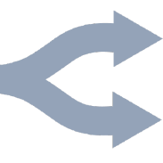</div>

<div v-click="2" class="genai-visual hf-figure"></div>

<p v-click="4" class="notebook-reference">Références : <a href="https://github.com/jsboige/CoursIA/blob/main/MyIA.AI.Notebooks/GenAI/Texte/01_OpenAI_Intro.ipynb">01_OpenAI_Intro.ipynb</a>, <a href="https://github.com/jsboige/CoursIA/blob/main/MyIA.AI.Notebooks/GenAI/Texte/10_LocalLlama.ipynb">10_LocalLlama.ipynb</a> · modèles : <a href="https://platform.openai.com/docs/models">OpenAI Models API Reference</a>.</p>

---
layout: image-overlay
class: genai-illustrated genai-ecosystem-hosting
---

# Écosystème : hébergement

<v-clicks at="1">

- **Cloud géré :** Hugging Face Inference, Groq, RunPod, Vast.ai, AWS / Azure / GCP.
- **Local :** Oobabooga, Ollama, vLLM. Quantification AWQ, GGUF, EXL2/3 pour faire tenir un modèle sur un GPU limité.
- **Containerisation :** Docker et Docker Compose encapsulent les services (modèles, API, monitoring).
- **Hybride :** Tailscale (réseau mesh WireGuard) relie les machines du cluster à un réseau privé unique — GPU de poche + nœuds distants joignables comme s'ils étaient locaux.

</v-clicks>

<div v-click="1" class="genai-visual groq-figure"></div>

<div v-click="1" class="genai-visual vastai-figure"></div>

<div v-click="2" class="genai-visual vllm-figure"></div>

<div v-click="2" class="genai-visual ollama-figure"></div>

<p v-click="3" class="notebook-reference">Référence : <a href="https://github.com/jsboige/CoursIA/blob/main/MyIA.AI.Notebooks/GenAI/00-GenAI-Environment/00-2-Docker-Services-Management.ipynb">00-2-Docker-Services-Management.ipynb</a>.</p>

---
class: nb-map nb-k110
---

# Environnement GenAI : installer, brancher, valider

<p class="nb-lead">Avant le premier TP, six carnets vérifient que votre poste parle aux services du cours. Un environnement non validé se paie en heures perdues plus tard.</p>

<div class="nb-grid nb-cols-3">

<div class="nb-card"><p class="nb-step">Installer</p><p class="nb-what">Préparer l’environnement Python du cours.</p><p class="nb-links"><a href="https://github.com/jsboige/CoursIA/blob/main/MyIA.AI.Notebooks/GenAI/00-GenAI-Environment/00-1-Environment-Setup.ipynb" target="_blank" rel="noopener">00-1-Environment-Setup</a></p></div>

<div class="nb-card"><p class="nb-step">Configurer les accès</p><p class="nb-what">Déclarer les endpoints et les clés dans un fichier local, jamais dans le dépôt.</p><p class="nb-links"><a href="https://github.com/jsboige/CoursIA/blob/main/MyIA.AI.Notebooks/GenAI/00-GenAI-Environment/00-3-API-Endpoints-Configuration.ipynb" target="_blank" rel="noopener">00-3-API-Endpoints-Configuration</a></p></div>

<div class="nb-card"><p class="nb-step">Valider</p><p class="nb-what">Un carnet de contrôle : chaque service répond-il ?</p><p class="nb-links"><a href="https://github.com/jsboige/CoursIA/blob/main/MyIA.AI.Notebooks/GenAI/00-GenAI-Environment/00-4-Environment-Validation.ipynb" target="_blank" rel="noopener">00-4-Environment-Validation</a></p></div>

<div class="nb-card"><p class="nb-step">Tester ComfyUI</p><p class="nb-what">Une première image générée par l’API de ComfyUI.</p><p class="nb-links"><a href="https://github.com/jsboige/CoursIA/blob/main/MyIA.AI.Notebooks/GenAI/00-GenAI-Environment/00-5-ComfyUI-Local-Test.ipynb" target="_blank" rel="noopener">00-5-ComfyUI-Local-Test</a></p></div>

<div class="nb-card"><p class="nb-step">Déployer en local</p><p class="nb-what">Lancer les services dans Docker ; basculer entre mode local et distant.</p><p class="nb-links"><a href="https://github.com/jsboige/CoursIA/blob/main/MyIA.AI.Notebooks/GenAI/00-GenAI-Environment/00-6-Local-Docker-Deployment.ipynb" target="_blank" rel="noopener">00-6-Local-Docker-Deployment</a></p></div>

<div class="nb-card"><p class="nb-step">Calculs longs</p><p class="nb-what">tmux et tunnels SSH : un calcul qui survit à la fermeture du terminal.</p><p class="nb-links"><a href="https://github.com/jsboige/CoursIA/blob/main/MyIA.AI.Notebooks/GenAI/00-GenAI-Environment/00-7-Terminal-Long-Runs.ipynb" target="_blank" rel="noopener">00-7-Terminal-Long-Runs</a></p></div>

</div>

<p class="nb-foot"><strong>Règle du cours.</strong> Une clé d’API ne se colle ni dans un notebook, ni dans une pull request, ni dans une capture d’écran.</p>

---
layout: image-overlay
class: genai-illustrated genai-ecosystem-tools
---

# Écosystème : outils image et conversationnels

<v-clicks at="1">

- **Image :** Stable Diffusion, Flux, Qwen Image Edit ; applications Forge, ComfyUI. Dépôts de modèles : CivitAI, Hugging Face.
- **Conversationnel self-hosted :** Open WebUI, SillyTavern. Workflows métier : Dify, Langflow.

</v-clicks>

<div v-click="1" class="genai-visual comfyui-figure">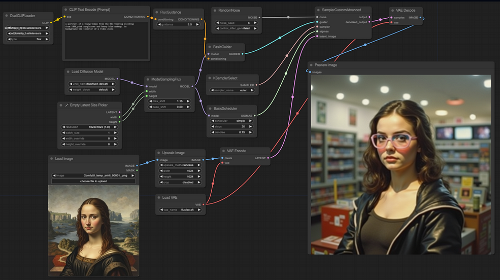</div>

<div v-click="1" class="genai-visual stability-figure">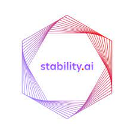</div>

<div v-click="2" class="genai-visual openwebui-figure"></div>

<div v-click="2" class="genai-visual sillytavern-figure"></div>

<div v-click="2" class="genai-visual dify-figure"></div>

<p v-click="3" class="notebook-reference">Référence : <a href="https://github.com/jsboige/CoursIA/blob/main/MyIA.AI.Notebooks/GenAI/Texte/19_OWUI_Orchestration.ipynb">19_OWUI_Orchestration.ipynb</a>.</p>

---
class: nb-map nb-k98
---

# Plateformes conversationnelles : ce qu’elles ajoutent au modèle

<p class="nb-lead">Un modèle répond à un texte. Une plateforme conversationnelle est le produit qu’on déploie autour de lui : c’est elle que vos utilisateurs voient.</p>

<div class="nb-grid nb-cols-3">

<div class="nb-card"><p class="nb-step">Comptes et rôles</p><p class="nb-what">Qui se connecte, qui administre, qui voit quel modèle. Plusieurs organisations peuvent partager un même serveur.</p></div>

<div class="nb-card"><p class="nb-step">Conversations</p><p class="nb-what">Historique, reprise, réponse affichée au fil de sa production (streaming).</p></div>

<div class="nb-card"><p class="nb-step">Bases de connaissances</p><p class="nb-what">Des documents attachés à une conversation : le RAG devient une case à cocher… et un réglage à vérifier.</p></div>

<div class="nb-card"><p class="nb-step">Outils et MCP</p><p class="nb-what">L’assistant appelle des fonctions : recherche web, exécution de code, serveurs MCP.</p></div>

<div class="nb-card"><p class="nb-step">Plusieurs modèles</p><p class="nb-what">Choisir le modèle par assistant, changer de fournisseur, comparer coût et qualité.</p></div>

<div class="nb-card"><p class="nb-step">Assistants déclarés</p><p class="nb-what">Un prompt système, une étiquette, des outils attachés : une spécialisation à tester, pas à croire.</p></div>

</div>

<p class="nb-foot"><strong>Dans le dépôt.</strong> Deux plateformes réelles : <strong>Open WebUI</strong>, serveur auto-hébergé, et <strong>AI Engine</strong>, extension qui ajoute la couche GenAI dans un site WordPress existant.</p>

<p class="notebook-reference">Présentation de la série : <a href="https://github.com/jsboige/CoursIA/blob/main/MyIA.AI.Notebooks/GenAI/Plateformes-Conversationnelles/README.md" target="_blank" rel="noopener">Plateformes-Conversationnelles/README.md</a>.</p>

---
class: nb-concept nb-center nb-k106
---

# Open WebUI ou AI Engine : deux terrains, les mêmes questions

<p class="nb-lead">Les deux plateformes ne se classent pas l’une au-dessus de l’autre : elles répondent à deux situations de départ et cohabitent souvent.</p>

<div class="nb-grid nb-cols-2">

<div class="nb-card"><p class="nb-step">Open WebUI — un serveur à soi</p><p class="nb-what">Interface de chat open source, auto-hébergée, partagée entre plusieurs organisations : authentification et rôles, streaming, RAG, outils et serveurs MCP, image et voix. Dans le dépôt : un tour guidé et une série de tests de bout en bout.</p></div>

<div class="nb-card"><p class="nb-step">AI Engine — dans un site existant</p><p class="nb-what">Extension WordPress : chatbots, assistant dans l’éditeur, formulaires IA, RAG sur le contenu du site, WordPress exposé comme serveur MCP. Dans le dépôt : toute l’extension pilotée par son API.</p></div>

</div>

<p class="nb-foot"><strong>À décider pour un projet.</strong> Vos utilisateurs sont-ils déjà sur un site de contenu, ou faut-il leur ouvrir un espace de travail séparé ?</p>

<p class="notebook-reference">Comparatif détaillé : <a href="https://github.com/jsboige/CoursIA/blob/main/MyIA.AI.Notebooks/GenAI/Plateformes-Conversationnelles/AI-Engine-WordPress/02-Comparatif/comparatif-owui-vs-ai-engine.md" target="_blank" rel="noopener">comparatif-owui-vs-ai-engine.md</a>.</p>

---
class: nb-concept nb-center nb-k106
---

# Six assistants déclarés, combien de comportements ?

<p class="nb-lead">Une plateforme laisse déclarer autant d’assistants qu’on veut. Un prompt est une <strong>intention</strong> ; la spécialisation est une propriété <strong>des réponses</strong>. Elle se mesure, elle ne se lit pas.</p>

<div class="nb-grid nb-cols-2">

<div class="nb-card"><p class="nb-step">Mesure naïve : le vocabulaire commun</p><p class="nb-what">Comparer les mots des réponses (indice de Jaccard). On obtient un classement, mais aucun seuil : 0,26, est-ce beaucoup ?</p></div>

<div class="nb-card"><p class="nb-step">Mesure honnête : retrouver l’auteur</p><p class="nb-what">On cache l’auteur d’une réponse et on tente de le retrouver à partir des autres. Dans le carnet : 0,47 d’exactitude, contre 0,17 au hasard.</p></div>

</div>

<p class="nb-foot"><strong>À observer.</strong> Deux assistants dont les prompts n’ont presque aucun mot commun sont pris systématiquement l’un pour l’autre : deux étiquettes, un seul assistant. On n’audite pas un catalogue en relisant ses prompts, il faut le faire parler.</p>

<p class="notebook-reference">Notebook : <a href="https://github.com/jsboige/CoursIA/blob/main/MyIA.AI.Notebooks/GenAI/Plateformes-Conversationnelles/differencier-les-assistants.ipynb" target="_blank" rel="noopener">differencier-les-assistants</a>.</p>

---
class: nb-concept nb-center nb-k98
---

# Cadrer un assistant : intention, portée, autorité

<p class="nb-lead">Dès le deuxième assistant, une question arrive : comment empêcher l’assistant « atelier d’écriture » de déclencher des opérations de boutique ? Trois couches répondent, à trois endroits du système.</p>

<div class="nb-grid nb-cols-3">

<div class="nb-card"><p class="nb-step">Intention — le prompt système</p><p class="nb-what">À quoi sert cet assistant ? Tient le comportement habituel du modèle. Contrainte molle : elle cède à une formulation insistante ou à une injection.</p></div>

<div class="nb-card"><p class="nb-step">Portée — le catalogue d’outils</p><p class="nb-what">Que peut-il proposer d’appeler ? Un outil absent du catalogue est absent de la requête : il n’y a rien à contourner.</p></div>

<div class="nb-card"><p class="nb-step">Autorité — la vérification à l’appel</p><p class="nb-what">Cet appel a-t-il le droit d’aboutir ? Elle vaut pour tout le monde, y compris hors de l’assistant.</p></div>

</div>

<p class="nb-foot"><strong>Règle.</strong> Ne jamais faire porter à une couche une garantie qui appartient à une couche plus profonde. Plus l’action est irréversible, plus la garantie doit être profonde.</p>

<p class="notebook-reference">Document de conception : <a href="https://github.com/jsboige/CoursIA/blob/main/MyIA.AI.Notebooks/GenAI/Plateformes-Conversationnelles/cadrer-les-agents.md" target="_blank" rel="noopener">cadrer-les-agents.md</a>.</p>

---
class: nb-map nb-k94
---

# Open WebUI : tester une plateforme comme un produit

<p class="nb-lead">Fil rouge de la série : vous êtes responsable qualité d’une flotte GenAI partagée entre plusieurs organisations. Chaque module teste une couche de la plateforme avec un navigateur piloté (Playwright).</p>

<div class="nb-grid nb-cols-3">

<div class="nb-card"><p class="nb-step">Découvrir</p><p class="nb-what">Comment un test « voit » la page : sélecteurs, anatomie d’un test, verdict go / no-go.</p><p class="nb-links"><a href="https://github.com/jsboige/CoursIA/blob/main/MyIA.AI.Notebooks/GenAI/Plateformes-Conversationnelles/Open-WebUI/Playwright-OWUI/00-Parcours-QA-OWUI.ipynb" target="_blank" rel="noopener">00-Parcours-QA-OWUI</a> · <a href="https://github.com/jsboige/CoursIA/blob/main/MyIA.AI.Notebooks/GenAI/Plateformes-Conversationnelles/Open-WebUI/Playwright-OWUI/01-decouverte/01-Decouverte-QA-OWUI.ipynb" target="_blank" rel="noopener">01-Decouverte-QA-OWUI</a></p></div>

<div class="nb-card"><p class="nb-step">Naviguer et s’authentifier</p><p class="nb-what">S’authentifier une seule fois, puis vérifier qui peut aller où.</p><p class="nb-links"><a href="https://github.com/jsboige/CoursIA/blob/main/MyIA.AI.Notebooks/GenAI/Plateformes-Conversationnelles/Open-WebUI/Playwright-OWUI/02-navigation-authentification/02-Navigation-Auth-QA-OWUI.ipynb" target="_blank" rel="noopener">02-Navigation-Auth-QA-OWUI</a></p></div>

<div class="nb-card"><p class="nb-step">Chat et streaming</p><p class="nb-what">Tester une réponse qui change à chaque exécution : assertions souples, contenu qui arrive en continu.</p><p class="nb-links"><a href="https://github.com/jsboige/CoursIA/blob/main/MyIA.AI.Notebooks/GenAI/Plateformes-Conversationnelles/Open-WebUI/Playwright-OWUI/03-chat-streaming/03-Chat-Streaming-QA-OWUI.ipynb" target="_blank" rel="noopener">03-Chat-Streaming-QA-OWUI</a></p></div>

<div class="nb-card"><p class="nb-step">RAG et outils</p><p class="nb-what">Bases de connaissances, outils MCP, canaux : des tests qui s’adaptent à ce que l’instance active.</p><p class="nb-links"><a href="https://github.com/jsboige/CoursIA/blob/main/MyIA.AI.Notebooks/GenAI/Plateformes-Conversationnelles/Open-WebUI/Playwright-OWUI/04-rag-tools-avances/04-RAG-Tools-QA-OWUI.ipynb" target="_blank" rel="noopener">04-RAG-Tools-QA-OWUI</a></p></div>

<div class="nb-card"><p class="nb-step">Multi-tenant et CI</p><p class="nb-what">Quitter le navigateur pour l’API : isolation entre organisations, intégration continue.</p><p class="nb-links"><a href="https://github.com/jsboige/CoursIA/blob/main/MyIA.AI.Notebooks/GenAI/Plateformes-Conversationnelles/Open-WebUI/Playwright-OWUI/05-multi-tenant-ci/05-Multi-Tenant-CI-QA-OWUI.ipynb" target="_blank" rel="noopener">05-Multi-Tenant-CI-QA-OWUI</a></p></div>

<div class="nb-card"><p class="nb-step">Nouveautés agentiques</p><p class="nb-what">Mémoire, raisonnement affiché en continu, compaction du contexte : tester une fonction qui vient d’apparaître.</p><p class="nb-links"><a href="https://github.com/jsboige/CoursIA/blob/main/MyIA.AI.Notebooks/GenAI/Plateformes-Conversationnelles/Open-WebUI/Playwright-OWUI/06-nouveautes-v0.10/06-Nouveautes-v0.10-QA-OWUI.ipynb" target="_blank" rel="noopener">06-Nouveautes-v0.10-QA-OWUI</a></p></div>

</div>

<p class="nb-foot"><strong>Côté API.</strong> Tâches planifiées et orchestration, puis introspection de l’API native d’Open WebUI.</p>

<p class="notebook-reference">Notebooks : <a href="https://github.com/jsboige/CoursIA/blob/main/MyIA.AI.Notebooks/GenAI/Texte/19_OWUI_Orchestration.ipynb" target="_blank" rel="noopener">19_OWUI_Orchestration</a>, <a href="https://github.com/jsboige/CoursIA/blob/main/MyIA.AI.Notebooks/GenAI/Texte/20_OWUI_Native_API.ipynb" target="_blank" rel="noopener">20_OWUI_Native_API</a>.</p>

---
class: nb-map nb-k102
---

# AI Engine par son API : le chatbot est un document JSON

<p class="nb-lead">Dans AI Engine, un chatbot ne se programme pas : il se décrit. La série pilote toute l’extension par son API, sur une instance jetable nommée « Maison Valmont ».</p>

<div class="nb-grid nb-cols-3">

<div class="nb-card"><p class="nb-step">Le socle</p><p class="nb-what">Un point d’entrée REST, des routes par famille : interroger un chatbot, dresser un bilan de santé de l’API.</p><p class="nb-links"><a href="https://github.com/jsboige/CoursIA/blob/main/MyIA.AI.Notebooks/GenAI/Plateformes-Conversationnelles/AI-Engine-WordPress/03-Functional/03-5-Multi-Provider/presenter-ai-engine-par-son-api.ipynb" target="_blank" rel="noopener">présenter par l’API</a></p></div>

<div class="nb-card"><p class="nb-step">Configurer</p><p class="nb-what">Lire puis écrire la configuration : l’écriture remplace toute la liste. La même question posée à deux personas.</p><p class="nb-links"><a href="https://github.com/jsboige/CoursIA/blob/main/MyIA.AI.Notebooks/GenAI/Plateformes-Conversationnelles/AI-Engine-WordPress/03-Functional/03-1-Chatbots/configurer-chatbots-par-l-api.ipynb" target="_blank" rel="noopener">configurer les chatbots</a></p></div>

<div class="nb-card"><p class="nb-step">Trois publics, trois portes</p><p class="nb-what">L’administrateur, le visiteur anonyme et le rédacteur dans l’éditeur ne passent pas par la même porte.</p><p class="nb-links"><a href="https://github.com/jsboige/CoursIA/blob/main/MyIA.AI.Notebooks/GenAI/Plateformes-Conversationnelles/AI-Engine-WordPress/03-Functional/03-1-Chatbots/parler-au-chatbot-en-visiteur-par-l-api.ipynb" target="_blank" rel="noopener">visiteur</a> · <a href="https://github.com/jsboige/CoursIA/blob/main/MyIA.AI.Notebooks/GenAI/Plateformes-Conversationnelles/AI-Engine-WordPress/03-Functional/03-1-Chatbots/interroger-lassistant-de-lediteur-par-l-api.ipynb" target="_blank" rel="noopener">éditeur</a></p></div>

<div class="nb-card"><p class="nb-step">Fichiers joints</p><p class="nb-what">Un fichier déposé vit une heure. Stocker n’est pas lire : le modèle l’a-t-il ignoré, annoté ou vraiment vu ?</p><p class="nb-links"><a href="https://github.com/jsboige/CoursIA/blob/main/MyIA.AI.Notebooks/GenAI/Plateformes-Conversationnelles/AI-Engine-WordPress/03-Functional/03-1-Chatbots/donner-une-memoire-ephemere-au-chatbot-par-l-api.ipynb" target="_blank" rel="noopener">mémoire éphémère</a> · <a href="https://github.com/jsboige/CoursIA/blob/main/MyIA.AI.Notebooks/GenAI/Plateformes-Conversationnelles/AI-Engine-WordPress/03-Functional/03-1-Chatbots/joindre-un-fichier-au-chatbot-par-l-api.ipynb" target="_blank" rel="noopener">fichier joint</a></p></div>

<div class="nb-card"><p class="nb-step">Données structurées</p><p class="nb-what">Demander du JSON à la plateforme : le réglage vide, le repli silencieux, la valeur nulle.</p><p class="nb-links"><a href="https://github.com/jsboige/CoursIA/blob/main/MyIA.AI.Notebooks/GenAI/Plateformes-Conversationnelles/AI-Engine-WordPress/03-Functional/03-1-Chatbots/obtenir-des-donnees-structurees-par-l-api.ipynb" target="_blank" rel="noopener">données structurées</a></p></div>

<div class="nb-card"><p class="nb-step">Dérive d’un copilot</p><p class="nb-what">Des transformations de texte enchaînées : chaque étape passe son contrôle, la chaîne entière perd de l’information.</p><p class="nb-links"><a href="https://github.com/jsboige/CoursIA/blob/main/MyIA.AI.Notebooks/GenAI/Plateformes-Conversationnelles/AI-Engine-WordPress/03-Functional/03-1-Chatbots/mesurer-la-derive-dun-copilot.ipynb" target="_blank" rel="noopener">mesurer la dérive</a></p></div>

</div>

<p class="nb-foot"><strong>À observer.</strong> Qu’est-ce qui est réglé dans la plateforme, et qu’est-ce qui dépend encore du modèle derrière ?</p>

---
class: nb-map nb-k94
---

# AI Engine : formulaires, RAG, MCP et choix du modèle

<p class="nb-lead">Les mêmes notions que dans le reste du cours — RAG, outils, évaluation — vues depuis une plateforme installée, avec ses réglages et ses pièges.</p>

<div class="nb-grid nb-cols-3">

<div class="nb-card"><p class="nb-step">Formulaires IA</p><p class="nb-what">Un formulaire est un contenu du site. Sept champs conditionnels : combien de chemins, lesquels appellent le modèle, quels champs personne ne verra ?</p><p class="nb-links"><a href="https://github.com/jsboige/CoursIA/blob/main/MyIA.AI.Notebooks/GenAI/Plateformes-Conversationnelles/AI-Engine-WordPress/03-Functional/03-2-Forms/administrer-les-formulaires-par-l-api.ipynb" target="_blank" rel="noopener">administrer</a> · <a href="https://github.com/jsboige/CoursIA/blob/main/MyIA.AI.Notebooks/GenAI/Plateformes-Conversationnelles/AI-Engine-WordPress/03-Functional/03-2-Forms/auditer-un-formulaire-conditionnel.ipynb" target="_blank" rel="noopener">auditer</a></p></div>

<div class="nb-card"><p class="nb-step">RAG sur un corpus long</p><p class="nb-what">Découper des ouvrages par chapitres ; séparer les environnements de vecteurs pour éviter fuite et écrasement.</p><p class="nb-links"><a href="https://github.com/jsboige/CoursIA/blob/main/MyIA.AI.Notebooks/GenAI/Plateformes-Conversationnelles/AI-Engine-WordPress/03-Functional/03-3-RAG-et-Embeddings/ingestion-corpus-long-rag.ipynb" target="_blank" rel="noopener">ingestion</a> · <a href="https://github.com/jsboige/CoursIA/blob/main/MyIA.AI.Notebooks/GenAI/Plateformes-Conversationnelles/AI-Engine-WordPress/03-Functional/03-3-RAG-et-Embeddings/separer-les-environnements-de-vecteurs.ipynb" target="_blank" rel="noopener">environnements</a></p></div>

<div class="nb-card"><p class="nb-step">WordPress, serveur MCP</p><p class="nb-what">Un agent pilote le site par des outils ; l’autorisation OAuth ; consommer ou exposer.</p><p class="nb-links"><a href="https://github.com/jsboige/CoursIA/blob/main/MyIA.AI.Notebooks/GenAI/Plateformes-Conversationnelles/AI-Engine-WordPress/03-Functional/03-4-MCP-Server/piloter-wordpress-par-mcp.ipynb" target="_blank" rel="noopener">piloter</a> · <a href="https://github.com/jsboige/CoursIA/blob/main/MyIA.AI.Notebooks/GenAI/Plateformes-Conversationnelles/AI-Engine-WordPress/03-Functional/03-4-MCP-Server/autour-du-consent-oauth-du-serveur-mcp.ipynb" target="_blank" rel="noopener">OAuth</a> · <a href="https://github.com/jsboige/CoursIA/blob/main/MyIA.AI.Notebooks/GenAI/Plateformes-Conversationnelles/AI-Engine-WordPress/03-Functional/03-4-MCP-Server/consommer-vs-exposer-le-mcp.ipynb" target="_blank" rel="noopener">consommer / exposer</a></p></div>

<div class="nb-card"><p class="nb-step">Auditer un catalogue d’outils</p><p class="nb-what">L’outil parle-t-il la base de données ou le métier ? Classer un serveur MCP qu’on n’a pas écrit.</p><p class="nb-links"><a href="https://github.com/jsboige/CoursIA/blob/main/MyIA.AI.Notebooks/GenAI/Plateformes-Conversationnelles/AI-Engine-WordPress/03-Functional/03-4-MCP-Server/auditer-un-serveur-mcp.ipynb" target="_blank" rel="noopener">auditer un serveur MCP</a></p></div>

<div class="nb-card"><p class="nb-step">Choisir le modèle</p><p class="nb-what">Brancher plusieurs fournisseurs, puis décider par une mini-évaluation reproductible plutôt qu’au feeling.</p><p class="nb-links"><a href="https://github.com/jsboige/CoursIA/blob/main/MyIA.AI.Notebooks/GenAI/Plateformes-Conversationnelles/AI-Engine-WordPress/03-Functional/03-5-Multi-Provider/brancher-plusieurs-providers-par-l-api.ipynb" target="_blank" rel="noopener">fournisseurs</a> · <a href="https://github.com/jsboige/CoursIA/blob/main/MyIA.AI.Notebooks/GenAI/Plateformes-Conversationnelles/AI-Engine-WordPress/03-Functional/03-5-Multi-Provider/eval-choisir-son-modele.ipynb" target="_blank" rel="noopener">évaluation</a></p></div>

<div class="nb-card"><p class="nb-step">Ce que l’API ne voit pas</p><p class="nb-what">Tester l’interface réelle dans un navigateur ; contrôler contraste et charte visuelle.</p><p class="nb-links"><a href="https://github.com/jsboige/CoursIA/blob/main/MyIA.AI.Notebooks/GenAI/Plateformes-Conversationnelles/AI-Engine-WordPress/05-Playwright-AI-Engine/00-Parcours-QA-AI-Engine.ipynb" target="_blank" rel="noopener">parcours QA</a> · <a href="https://github.com/jsboige/CoursIA/blob/main/MyIA.AI.Notebooks/GenAI/Plateformes-Conversationnelles/AI-Engine-WordPress/06-Securite-et-Methode/auditer-la-conformite-visuelle.ipynb" target="_blank" rel="noopener">conformité visuelle</a></p></div>

</div>

<p class="nb-foot"><strong>À observer.</strong> Quel réglage de plateforme corrige un défaut que vous auriez d’abord attribué au modèle ?</p>

---

# Auto-hébergement : vLLM et mécanique d'inférence

<v-clicks at="1">

- **vLLM :** moteur d'inférence haute performance -- PagedAttention, continuous batching, speculative decoding. Endpoints OpenAI-compatibles.
- **Mécanique d'inférence :** le *prefill* traite tout le prompt en parallèle, le *decoding* génère un token à la fois.
- **KV-cache :** sans cache, chaque nouveau token recalcule l'attention sur tout l'historique. Le KV-cache *réutilise* les clés/valeurs déjà calculées pour les positions précédentes -- ce qui réduit le coût par token de décodage. L'attention historique n'est pas "supprimée", elle est *ré-utilisée*.
- **Métriques :** le TTFT (*time-to-first-token*) agrège réseau, attente serveur, tokenisation et préfill. L'ITL (*inter-token latency*) mesure l'intervalle entre tokens reçus, influencé par le décodage, le batching et la charge. Comparer à contexte et concurrence contrôlés.

</v-clicks>

<p v-click="5" class="notebook-reference">Référence : <a href="https://github.com/jsboige/CoursIA/blob/main/MyIA.AI.Notebooks/GenAI/Texte/10b_Inference_Mechanics.ipynb">10b_Inference_Mechanics.ipynb</a>.</p>

---
class: nb-map nb-k104
---

# Inférence locale : ce qui limite le débit

<p class="nb-lead">Faire tourner un modèle chez soi revient à arbitrer entre mémoire, vitesse et qualité. Chaque carnet isole un levier et le mesure.</p>

<div class="nb-grid nb-cols-3">

<div class="nb-card"><p class="nb-step">Quantification</p><p class="nb-what">Coder les poids sur moins de bits pour tenir dans la mémoire du GPU : ce qu’on gagne, ce qu’on perd.</p><p class="nb-links"><a href="https://github.com/jsboige/CoursIA/blob/main/MyIA.AI.Notebooks/GenAI/Texte/11_Quantization.ipynb" target="_blank" rel="noopener">11_Quantization</a></p></div>

<div class="nb-card"><p class="nb-step">Matériel et coût</p><p class="nb-what">Ce que paie réellement un token : matériel, débit, coût.</p><p class="nb-links"><a href="https://github.com/jsboige/CoursIA/blob/main/MyIA.AI.Notebooks/GenAI/Texte/11b_Materiel_Debit_Cout.ipynb" target="_blank" rel="noopener">11b_Materiel_Debit_Cout</a></p></div>

<div class="nb-card"><p class="nb-step">Décodage spéculatif</p><p class="nb-what">Un petit modèle propose, le grand vérifie : où est le gain, quand disparaît-il ?</p><p class="nb-links"><a href="https://github.com/jsboige/CoursIA/blob/main/MyIA.AI.Notebooks/GenAI/Texte/10g_Speculative_Decoding.ipynb" target="_blank" rel="noopener">Python</a> · <a href="https://github.com/jsboige/CoursIA/blob/main/MyIA.AI.Notebooks/GenAI/Texte/10g_Speculative_Decoding-CSharp.ipynb" target="_blank" rel="noopener">C#</a></p></div>

<div class="nb-card"><p class="nb-step">Le plafond mémoire</p><p class="nb-what">Pourquoi le décodage est limité par la bande passante mémoire.</p><p class="nb-links"><a href="https://github.com/jsboige/CoursIA/blob/main/MyIA.AI.Notebooks/GenAI/Texte/10h_Roofline_Memory_Bandwidth.ipynb" target="_blank" rel="noopener">Python</a> · <a href="https://github.com/jsboige/CoursIA/blob/main/MyIA.AI.Notebooks/GenAI/Texte/10h_Roofline_Memory_Bandwidth-CSharp.ipynb" target="_blank" rel="noopener">C#</a></p></div>

<div class="nb-card"><p class="nb-step">Hors de Python</p><p class="nb-what">Comparer des bindings .NET pour l’inférence locale : TensorSharp, ONNX Runtime GenAI, LLamaSharp.</p><p class="nb-links"><a href="https://github.com/jsboige/CoursIA/blob/main/MyIA.AI.Notebooks/GenAI/Texte/10d_TensorSharp_DotNet_Inference.ipynb" target="_blank" rel="noopener">10d_TensorSharp_DotNet_Inference</a> · <a href="https://github.com/jsboige/CoursIA/blob/main/MyIA.AI.Notebooks/GenAI/Texte/10e_LLamaSharp_DotNet_BakeOff.ipynb" target="_blank" rel="noopener">10e_LLamaSharp_DotNet_BakeOff</a></p></div>

</div>

<p class="nb-foot"><strong>À observer.</strong> Sur votre machine, quel est le premier facteur limitant : la mémoire, la bande passante ou le calcul ?</p>

---
class: nb-map nb-k114
---

# Mettre en production : router, mettre en cache, exploiter

<p class="nb-lead">Un prototype répond une fois. Un service répond mille fois, à un coût borné, et sait quoi faire quand le modèle ne répond plus.</p>

<div class="nb-grid nb-cols-3">

<div class="nb-card"><p class="nb-step">Patterns de production</p><p class="nb-what">Les schémas de base d’un service construit autour d’un modèle.</p><p class="nb-links"><a href="https://github.com/jsboige/CoursIA/blob/main/MyIA.AI.Notebooks/GenAI/Texte/09_Production_Patterns.ipynb" target="_blank" rel="noopener">09_Production_Patterns</a></p></div>

<div class="nb-card"><p class="nb-step">Routage et repli</p><p class="nb-what">Choisir le bon modèle au bon moment, et prévoir le suivant quand il échoue.</p><p class="nb-links"><a href="https://github.com/jsboige/CoursIA/blob/main/MyIA.AI.Notebooks/GenAI/Texte/09c_Production_Routage_Repli.ipynb" target="_blank" rel="noopener">09c_Production_Routage_Repli</a></p></div>

<div class="nb-card"><p class="nb-step">Caches</p><p class="nb-what">Payer une fois, servir mille fois.</p><p class="nb-links"><a href="https://github.com/jsboige/CoursIA/blob/main/MyIA.AI.Notebooks/GenAI/Texte/09d_Production_Caches.ipynb" target="_blank" rel="noopener">09d_Production_Caches</a></p></div>

<div class="nb-card"><p class="nb-step">Exploitation</p><p class="nb-what">Coût, budget, déploiement, objectifs de niveau de service.</p><p class="nb-links"><a href="https://github.com/jsboige/CoursIA/blob/main/MyIA.AI.Notebooks/GenAI/Texte/09e_Production_Exploitation.ipynb" target="_blank" rel="noopener">09e_Production_Exploitation</a></p></div>

<div class="nb-card"><p class="nb-step">Du notebook à l’application</p><p class="nb-what">Servir le RAG de la série comme une application.</p><p class="nb-links"><a href="https://github.com/jsboige/CoursIA/blob/main/MyIA.AI.Notebooks/GenAI/Texte/23_Du_Notebook_A_L_Application.ipynb" target="_blank" rel="noopener">23_Du_Notebook_A_L_Application</a></p></div>

<div class="nb-card"><p class="nb-step">Prompts compilés</p><p class="nb-what">DSPy : du prompt écrit à la main au prompt compilé.</p><p class="nb-links"><a href="https://github.com/jsboige/CoursIA/blob/main/MyIA.AI.Notebooks/GenAI/Texte/22c_DSPy_Prompt_Compile.ipynb" target="_blank" rel="noopener">22c_DSPy_Prompt_Compile</a></p></div>

</div>

<p class="nb-foot"><strong>Question de projet.</strong> Que fait votre démo si l’API met trente secondes à répondre, ou ne répond pas ?</p>

---

# Post-training : fine-tuning et alignement

<v-clicks at="1">

- **Fine-tuning supervisé (SFT) :** ajuster les poids sur un corpus de paires (instruction, réponse attendue) pour stabiliser un style ou un format.
- **LoRA :** geler les poids de base et apprendre deux matrices de bas rang, A et B, par projection ciblée. Leur produit représente la mise à jour. Le rang règle un compromis de capacité et de coût.
- **QLoRA :** quantifier les poids de base gelés, généralement en 4 bits, tout en entraînant les adaptateurs. **RLHF et DPO** exploitent des préférences ; DPO évite la boucle de renforcement explicite.
- **Quand post-traîner ?** seulement après avoir vérifié qu'un prompt bien écrit et un peu de RAG ne suffisent pas. Sinon, c'est un coût fixe pour un gain marginal -- parfois négatif si le modèle perd en généralité.

</v-clicks>

<p v-click="5" class="notebook-reference">Référence pratique : <a href="https://github.com/jsboige/CoursIA/blob/main/MyIA.AI.Notebooks/GenAI/Texte/21_LoRA_FineTuning.ipynb">21_LoRA_FineTuning.ipynb</a>.</p>

---
class: nb-concept nb-center nb-k114
---

# LoRA : combien de poids faut-il changer ?

<p class="nb-lead">Au lieu de modifier tous les poids d’une couche, LoRA gèle sa matrice et apprend une correction, produit de deux petites matrices. Exemple : couche de 512 entrées et 512 sorties, hors biais.</p>

<div class="nb-grid nb-cols-2">

<div class="nb-card"><p class="nb-step">Première piste</p><p class="nb-what">Correction dense : 512 × 512 = 262 144 coefficients.</p></div>

<div class="nb-card"><p class="nb-step">À comparer</p><p class="nb-what">Rang 4 : 512 × 4 + 4 × 512 = 4 096 coefficients.</p></div>

</div>

<p class="nb-foot"><strong>À observer.</strong> Le carnet adapte un classifieur à des images inversées. Comparer adaptation complète et bas rang sur les mêmes exemples réservés. Diviser le nombre de poids par 64 préserve-t-il la précision ?</p>

<p class="notebook-reference">Notebook : <a href="https://github.com/jsboige/CoursIA/blob/main/MyIA.AI.Notebooks/GenAI/FineTuning/FT-00a-LoRA-from-scratch-Python.ipynb" target="_blank" rel="noopener">FT-00a-LoRA-from-scratch-Python.ipynb</a>.</p>

---
class: nb-map nb-k104
---

# Fine-tuning : la série, du bas rang au vision-langage

<p class="nb-lead">Adapter un modèle sans tout réentraîner : la série part d’une couche démontée à la main et arrive à un modèle vision-langage.</p>

<div class="nb-grid nb-cols-4">

<div class="nb-card"><p class="nb-step">Rang et alpha</p><p class="nb-what">Faire varier le rang et le facteur alpha : une ablation complète.</p><p class="nb-links"><a href="https://github.com/jsboige/CoursIA/blob/main/MyIA.AI.Notebooks/GenAI/FineTuning/FT-00b-LoRA-Hyperparams-from-scratch-Python.ipynb" target="_blank" rel="noopener">FT-00b</a></p></div>

<div class="nb-card"><p class="nb-step">Avec la bibliothèque</p><p class="nb-what">La même adaptation avec peft, puis la quantification 4 bits.</p><p class="nb-links"><a href="https://github.com/jsboige/CoursIA/blob/main/MyIA.AI.Notebooks/GenAI/FineTuning/FT-00c-LoRA-SOTA-Comparison-Python.ipynb" target="_blank" rel="noopener">FT-00c</a> · <a href="https://github.com/jsboige/CoursIA/blob/main/MyIA.AI.Notebooks/GenAI/FineTuning/FT-00d-LoRA-QLoRA-SOTA-Comparison-Python.ipynb" target="_blank" rel="noopener">FT-00d</a></p></div>

<div class="nb-card"><p class="nb-step">Vue d’ensemble</p><p class="nb-what">Le vocabulaire et les étapes d’un fine-tuning.</p><p class="nb-links"><a href="https://github.com/jsboige/CoursIA/blob/main/MyIA.AI.Notebooks/GenAI/FineTuning/FT-01-Introduction-FineTuning-Python.ipynb" target="_blank" rel="noopener">FT-01</a></p></div>

<div class="nb-card"><p class="nb-step">QLoRA</p><p class="nb-what">Affiner un modèle quantifié.</p><p class="nb-links"><a href="https://github.com/jsboige/CoursIA/blob/main/MyIA.AI.Notebooks/GenAI/FineTuning/FT-02-QLoRA-Quantization-Python.ipynb" target="_blank" rel="noopener">FT-02</a></p></div>

<div class="nb-card"><p class="nb-step">SFT</p><p class="nb-what">Enseigner un format de réponse par des exemples supervisés.</p><p class="nb-links"><a href="https://github.com/jsboige/CoursIA/blob/main/MyIA.AI.Notebooks/GenAI/FineTuning/FT-03-Supervised-FineTuning-SFT-Python.ipynb" target="_blank" rel="noopener">FT-03</a></p></div>

<div class="nb-card"><p class="nb-step">Préférences</p><p class="nb-what">RLHF et DPO : apprendre de comparaisons humaines.</p><p class="nb-links"><a href="https://github.com/jsboige/CoursIA/blob/main/MyIA.AI.Notebooks/GenAI/FineTuning/FT-04-RLHF-DPO-Python.ipynb" target="_blank" rel="noopener">FT-04</a></p></div>

<div class="nb-card"><p class="nb-step">Fusion et routage</p><p class="nb-what">Combiner des expertises : fusionner des modèles ou router entre eux.</p><p class="nb-links"><a href="https://github.com/jsboige/CoursIA/blob/main/MyIA.AI.Notebooks/GenAI/FineTuning/FT-05-ModelMerging-Routing-Python.ipynb" target="_blank" rel="noopener">FT-05</a></p></div>

<div class="nb-card"><p class="nb-step">Vision-langage, mémoire</p><p class="nb-what">LoRA sur un modèle vision-langage ; anatomie mémoire d’un pas d’entraînement.</p><p class="nb-links"><a href="https://github.com/jsboige/CoursIA/blob/main/MyIA.AI.Notebooks/GenAI/FineTuning/FT-06-Vision-Language-LoRA-Python.ipynb" target="_blank" rel="noopener">FT-06</a> · <a href="https://github.com/jsboige/CoursIA/blob/main/MyIA.AI.Notebooks/GenAI/FineTuning/FT-07-Anatomie-Memoire-Entrainement-Parallelismes-Python.ipynb" target="_blank" rel="noopener">FT-07</a></p></div>

</div>

<p class="nb-foot"><strong>À observer.</strong> À chaque étape : que gèle-t-on, que modifie-t-on, et sur quels exemples réservés mesure-t-on le gain ?</p>

---
class: nb-concept nb-center nb-k114
---

# DPO : apprendre une préférence, pas une vérité

<p class="nb-lead">Pour une question, on dispose d’une réponse préférée et d’une réponse rejetée. DPO apprend à favoriser la première relativement à un modèle de référence.</p>

<div class="nb-grid nb-cols-2">

<div class="nb-card"><p class="nb-step">Première piste</p><p class="nb-what">Entraînement supervisé : imiter une réponse cible.</p></div>

<div class="nb-card"><p class="nb-step">À comparer</p><p class="nb-what">DPO : apprendre du contraste entre deux réponses.</p></div>

</div>

<p class="nb-foot"><strong>À observer.</strong> Lire une paire chosen/rejected avant de regarder la perte. Si la réponse préférée est toujours plus longue, quel comportement risque-t-on de récompenser ? Proposer une paire qui départage longueur et exactitude.</p>

<p class="notebook-reference">Notebook : <a href="https://github.com/jsboige/CoursIA/blob/main/MyIA.AI.Notebooks/GenAI/PostTraining/PT_03_dpo_direct_preference.ipynb" target="_blank" rel="noopener">PT_03_dpo_direct_preference.ipynb</a>.</p>

---
layout: image-overlay
class: genai-illustrated genai-grpo
---

# GRPO : post-training sans critic

<p v-click="1" class="genai-level genai-concept"><strong>Concept</strong> — GRPO (Group Relative Policy Optimization) supprime le critique appris de la formulation PPO (Proximal Policy Optimization) de référence. L'avantage est estimé relativement aux autres réponses du même prompt.</p>

<p v-click="2" class="genai-level genai-mechanism"><strong>Mécanisme</strong> — pour un prompt, échantillonner G réponses. Normaliser leurs récompenses intra-groupe pour estimer les avantages, puis optimiser un objectif clippé avec régularisation KL.</p>

<p v-click="3" class="genai-level genai-limit"><strong>Limite</strong> — le calcul croît avec G. La mémoire dépend aussi de la longueur des réponses et du traitement par lots. Mesurer le pic mémoire et la qualité avant d'augmenter G.</p>

<div v-click="2" class="genai-visual genai-grpo-viz">

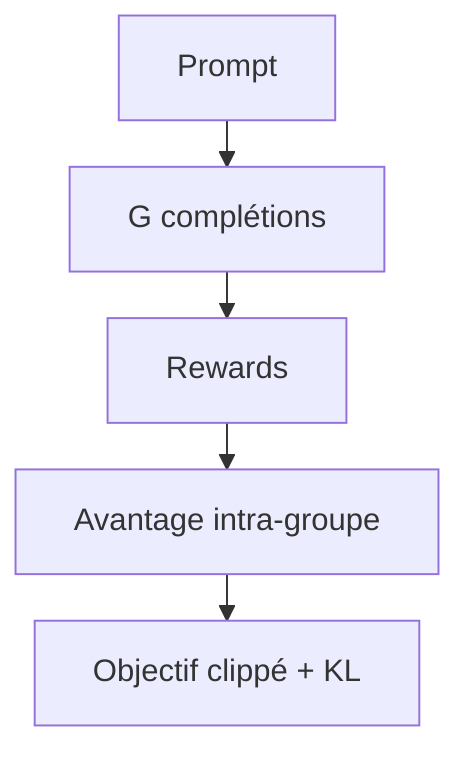

</div>

<p v-click="4" class="notebook-reference">Référence : <a href="https://github.com/jsboige/CoursIA/blob/main/MyIA.AI.Notebooks/GenAI/PostTraining/PT_04_grpo_deepseek_r1.ipynb">PT_04_grpo_deepseek_r1.ipynb</a>.</p>

---
layout: image-overlay
class: genai-illustrated genai-rlvr
---

# RLVR et reward hacking : la récompense, et sa dérive

<p v-click="1" class="genai-level genai-concept"><strong>Concept</strong> — RLVR (Reinforcement Learning with Verifiable Rewards) récompense selon un vérificateur. Ce signal est distinct de l'optimiseur, par exemple GRPO.</p>

<p v-click="2" class="genai-level genai-mechanism"><strong>Mécanisme</strong> — extraire la réponse <em>produite</em>, puis comparer à la <em>référence</em>. Dans PT_05 : 1 si correcte ; 0,5 si extractible mais fausse ; 0 sinon. Le format reçoit donc un crédit distinct de la justesse.</p>

<p v-click="3" class="genai-level genai-limit"><strong>Limite</strong> — des tests incomplets ou une réponse correcte par chance restent récompensés. Une alerte proxy signale une dérive à enquêter, sans prouver à elle seule l'échec.</p>

<div v-click="2" class="genai-visual genai-rlvr-viz">

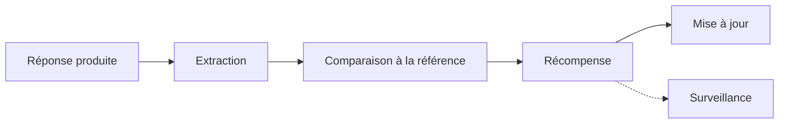

</div>

<p v-click="4" class="notebook-reference">Référence : <a href="https://github.com/jsboige/CoursIA/blob/main/MyIA.AI.Notebooks/GenAI/PostTraining/PT_05_rlvr_verifiable_rewards.ipynb">PT_05_rlvr_verifiable_rewards.ipynb</a> · <a href="https://github.com/jsboige/CoursIA/blob/main/MyIA.AI.Notebooks/GenAI/PostTraining/PT_07_rewardspy_reward_hacking.ipynb">PT_07_rewardspy_reward_hacking.ipynb</a>.</p>

---
class: nb-map nb-k106
---

# Post-training : les estimateurs, construits à la main

<p class="nb-lead">Après le pré-entraînement, on ajuste le comportement du modèle avec un signal : exemples, préférences ou récompense. La série reconstruit chaque estimateur sur un petit environnement vérifié.</p>

<div class="nb-grid nb-cols-3">

<div class="nb-card"><p class="nb-step">Vue d’ensemble et SFT</p><p class="nb-what">La carte des méthodes, puis la référence supervisée à laquelle tout se compare.</p><p class="nb-links"><a href="https://github.com/jsboige/CoursIA/blob/main/MyIA.AI.Notebooks/GenAI/PostTraining/PT_01_intro_post_training.ipynb" target="_blank" rel="noopener">PT-01</a> · <a href="https://github.com/jsboige/CoursIA/blob/main/MyIA.AI.Notebooks/GenAI/PostTraining/PT_02_sft_baseline.ipynb" target="_blank" rel="noopener">PT-02</a></p></div>

<div class="nb-card"><p class="nb-step">GRPO sans critique</p><p class="nb-what">Comparer plusieurs réponses à un même prompt : la moyenne du groupe sert de référence.</p><p class="nb-links"><a href="https://github.com/jsboige/CoursIA/blob/main/MyIA.AI.Notebooks/GenAI/PostTraining/PT_08_grpo_from_scratch_toy_env.ipynb" target="_blank" rel="noopener">PT-08</a> · <a href="https://github.com/jsboige/CoursIA/blob/main/MyIA.AI.Notebooks/GenAI/PostTraining/PT_08_grpo_from_scratch_toy_env-CSharp.ipynb" target="_blank" rel="noopener">PT-08 C#</a></p></div>

<div class="nb-card"><p class="nb-step">RLOO et GAE</p><p class="nb-what">Deux autres références : laisser un échantillon de côté, ou entraîner un petit critique. Quand en faut-il un ?</p><p class="nb-links"><a href="https://github.com/jsboige/CoursIA/blob/main/MyIA.AI.Notebooks/GenAI/PostTraining/PT_09_rloo_from_scratch_toy_env.ipynb" target="_blank" rel="noopener">PT-09</a> · <a href="https://github.com/jsboige/CoursIA/blob/main/MyIA.AI.Notebooks/GenAI/PostTraining/PT_10_gae_from_scratch_toy_env.ipynb" target="_blank" rel="noopener">PT-10</a></p></div>

<div class="nb-card"><p class="nb-step">Crédit différé</p><p class="nb-what">Quand la récompense dépend de toute la séquence, à quelle action l’attribuer ?</p><p class="nb-links"><a href="https://github.com/jsboige/CoursIA/blob/main/MyIA.AI.Notebooks/GenAI/PostTraining/PT_12_multistep_delayed_credit.ipynb" target="_blank" rel="noopener">PT-12</a></p></div>

<div class="nb-card"><p class="nb-step">Corriger GRPO</p><p class="nb-what">Les biais de normalisation de la perte et leurs corrections de 2025 (Dr. GRPO, DAPO).</p><p class="nb-links"><a href="https://github.com/jsboige/CoursIA/blob/main/MyIA.AI.Notebooks/GenAI/PostTraining/PT_13_dapo_drgrpo_corrections.ipynb" target="_blank" rel="noopener">PT-13</a></p></div>

<div class="nb-card"><p class="nb-step">Comparer</p><p class="nb-what">SFT, DPO, GRPO, RLVR : objectifs, données, coûts, limites.</p><p class="nb-links"><a href="https://github.com/jsboige/CoursIA/blob/main/MyIA.AI.Notebooks/GenAI/PostTraining/PT_06_eval_comparative.ipynb" target="_blank" rel="noopener">PT-06</a></p></div>

</div>

<p class="nb-foot"><strong>À observer.</strong> Qu’est-ce qui sert de point de comparaison dans chaque méthode, et que se passe-t-il si on l’enlève ?</p>

---
class: nb-map nb-k96
---

# Post-training sur de vrais modèles, et ce qu’on lit à l’intérieur

<p class="nb-lead">Sortir de l’environnement jouet change tout : une seule graine ne prouve rien, la récompense peut être contournée, et l’on peut regarder ce que l’entraînement a déplacé dans le modèle.</p>

<div class="nb-grid nb-cols-3">

<div class="nb-card"><p class="nb-step">RLVR sur un petit modèle</p><p class="nb-what">GRPO et récompenses vérifiables sur Qwen3.5-0.8B, puis sur le cran au-dessus, avec plusieurs graines.</p><p class="nb-links"><a href="https://github.com/jsboige/CoursIA/blob/main/MyIA.AI.Notebooks/GenAI/PostTraining/PT_11a_grpo_qwen35_rlvr.ipynb" target="_blank" rel="noopener">PT-11a</a> · <a href="https://github.com/jsboige/CoursIA/blob/main/MyIA.AI.Notebooks/GenAI/PostTraining/PT_11b_grpo_qwen_rlvr_on_verifiers.ipynb" target="_blank" rel="noopener">PT-11b</a> · <a href="https://github.com/jsboige/CoursIA/blob/main/MyIA.AI.Notebooks/GenAI/PostTraining/PT_11c_grpo_qwen17_rlvr.ipynb" target="_blank" rel="noopener">PT-11c</a> · <a href="https://github.com/jsboige/CoursIA/blob/main/MyIA.AI.Notebooks/GenAI/PostTraining/PT_11d_multiseed_qwen35_4x100.ipynb" target="_blank" rel="noopener">PT-11d</a></p></div>

<div class="nb-card"><p class="nb-step">La preuve comme récompense</p><p class="nb-what">Vericoding : récompenser un programme parce qu’il est formellement vérifié.</p><p class="nb-links"><a href="https://github.com/jsboige/CoursIA/blob/main/MyIA.AI.Notebooks/GenAI/PostTraining/PT_16_vericoding_formal_verification.ipynb" target="_blank" rel="noopener">PT-16</a></p></div>

<div class="nb-card"><p class="nb-step">Récompenser une probabilité</p><p class="nb-what">Règles de score propres : noter la confiance annoncée, pas seulement la réponse.</p><p class="nb-links"><a href="https://github.com/jsboige/CoursIA/blob/main/MyIA.AI.Notebooks/GenAI/PostTraining/PT_17_laya_proper_rewards_toy.ipynb" target="_blank" rel="noopener">PT-17</a> · <a href="https://github.com/jsboige/CoursIA/blob/main/MyIA.AI.Notebooks/GenAI/PostTraining/PT_18_laya_ablation_distillation.ipynb" target="_blank" rel="noopener">PT-18</a></p></div>

<div class="nb-card"><p class="nb-step">Lire à travers les tailles</p><p class="nb-what">Les mêmes expériences sur cinq tailles de modèle : que reste-t-il du verdict ?</p><p class="nb-links"><a href="https://github.com/jsboige/CoursIA/blob/main/MyIA.AI.Notebooks/GenAI/PostTraining/PT_19_stratification_inter_tailles.ipynb" target="_blank" rel="noopener">PT-19</a></p></div>

<div class="nb-card"><p class="nb-step">Contrôler par l’intérieur</p><p class="nb-what">Direction du refus, pilotage, désapprentissage ; géométrie des features ; deux modèles dans un même dictionnaire.</p><p class="nb-links"><a href="https://github.com/jsboige/CoursIA/blob/main/MyIA.AI.Notebooks/GenAI/PostTraining/PT_15_controle_interpretabilite.ipynb" target="_blank" rel="noopener">PT-15</a> · <a href="https://github.com/jsboige/CoursIA/blob/main/MyIA.AI.Notebooks/GenAI/PostTraining/PT_15b_geometrie_features_sae.ipynb" target="_blank" rel="noopener">PT-15b</a> · <a href="https://github.com/jsboige/CoursIA/blob/main/MyIA.AI.Notebooks/GenAI/PostTraining/PT_15c_crosscoder_distillation.ipynb" target="_blank" rel="noopener">PT-15c</a></p></div>

<div class="nb-card"><p class="nb-step">Mesures de l’entraînement</p><p class="nb-what">L’entraînement lu comme un système thermodynamique ; ce que la précision des poids change à la géométrie.</p><p class="nb-links"><a href="https://github.com/jsboige/CoursIA/blob/main/MyIA.AI.Notebooks/GenAI/PostTraining/PT_14_neural_thermodynamic_laws.ipynb" target="_blank" rel="noopener">PT-14</a> · <a href="https://github.com/jsboige/CoursIA/blob/main/MyIA.AI.Notebooks/GenAI/PostTraining/PT_20_instrument_axe_douleur.ipynb" target="_blank" rel="noopener">PT-20</a> · <a href="https://github.com/jsboige/CoursIA/blob/main/MyIA.AI.Notebooks/GenAI/PostTraining/PT_21_onset_9b_agregat.ipynb" target="_blank" rel="noopener">PT-21</a></p></div>

</div>

<p class="nb-foot"><strong>À observer.</strong> Avec une seule graine, un gain mesuré est-il un résultat ? Le premier essai du carnet PT-11 se conclut par « non concluant ».</p>

---

# Test-time scaling : raisonner à l'inférence

<v-clicks at="1">

- **Scaling laws classiques :** la perte de prédiction tend à diminuer avec le calcul, les données et la capacité, dans des régimes étudiés. Cela ne garantit pas un progrès sur chaque tâche.
- **Test-time scaling :** dépenser du calcul supplémentaire *à l'inférence* -- Tree of Thoughts, self-consistency, reward models intermédiaires.
- **Raisonnement natif :** les modèles à raisonnement intégré (ex. GPT-6 Astra, GPT-5.6 Sol) *consomment eux aussi* du calcul d'inférence -- chaîne de pensée interne, niveau d'effort réglable (jusqu'à max selon le modèle). C'est une forme de test-time scaling *interne*, pas une alternative orthogonale -- les deux se composent.
- **Trade-off :** le test-time scaling coûte du temps et de l'argent par requête. Sur les tâches vérifiables (maths, code), mesurer le gain face au coût total, tokens de raisonnement inclus. Aucune rentabilité universelle n'est garantie.

</v-clicks>

<p v-click="5" class="notebook-reference">Références : <a href="https://github.com/jsboige/CoursIA/blob/main/MyIA.AI.Notebooks/GenAI/Texte/12_Test_Time_Scaling.ipynb">12_Test_Time_Scaling.ipynb</a>, <a href="https://github.com/jsboige/CoursIA/blob/main/MyIA.AI.Notebooks/GenAI/Texte/15_Tree_of_Thoughts_Search.ipynb">15_Tree_of_Thoughts_Search.ipynb</a>, <a href="https://github.com/jsboige/CoursIA/blob/main/MyIA.AI.Notebooks/GenAI/Texte/16_Scaling_Test_Time_Compute.ipynb">16_Scaling_Test_Time_Compute.ipynb</a>, <a href="https://github.com/jsboige/CoursIA/blob/main/MyIA.AI.Notebooks/GenAI/Texte/17_Native_Reasoning_vs_Scaling.ipynb">17_Native_Reasoning_vs_Scaling.ipynb</a>.</p>

---

# Test-time scaling : quatre moteurs

<v-clicks at="1">

- **Best-of-N** — *N* tirages indépendants, on retient celui que le vérificateur valide. Budget : *N* appels **parallèles**. Vise l'erreur **aléatoire** : les tirages fautifs ne se répètent pas identiquement, le vote les annule.
- **Réflexion** — générateur → critique → mémoire : on remontre au modèle *quel* test échoue et *pourquoi*, pour qu'il en corrige la cause. Budget : 2 à 3× les appels. Vise l'erreur **systématique**, qu'un vote ne peut pas corriger.
- **Tree-of-Thoughts** — recherche sur des états partiels, avec évaluation et élagage. Budget variable. Pour les problèmes **combinatoires** où un état intermédiaire peut être noté.
- **Routeur adaptatif** — estime la difficulté, escalade vers le moteur adapté, et sait **s'arrêter**. Pour les cas où la structure d'erreur n'est pas connue à l'avance.

</v-clicks>

<p v-click="5" class="notebook-reference">Référence : <a href="https://github.com/jsboige/CoursIA/blob/main/MyIA.AI.Notebooks/GenAI/Texte/12_Test_Time_Scaling.ipynb">12_Test_Time_Scaling.ipynb</a>.</p>

---

# La structure d'erreur décide du moteur

<v-clicks at="1">

- **Un vote corrige l'aléatoire, pas le systématique.** Si le modèle se trompe *toujours de la même façon*, échantillonner davantage reproduit la même erreur : il n'y a rien à moyenner.
- **Ce que le banc d'essai du notebook montre** — sur ses trois problèmes, le Best-of-N n'améliore **aucun** score : deux sont déjà résolus du premier coup, et sur le troisième l'échec est systématique. Le coût, lui, croît avec *N*.
- **La Réflexion seule ne suffit pas non plus** — même en nommant au modèle le test qui échoue, il peut persister dans la même stratégie. Le gain dépend de la **capacité du modèle à exploiter le signal**, pas du seul calcul dépensé.
- **Conséquence pratique** — la structure d'erreur se **mesure** sur votre tâche et votre modèle avant de choisir un moteur. Le cadre théorique oriente ; il ne dispense pas de la mesure.

</v-clicks>

<p v-click="5" class="notebook-reference">Référence : <a href="https://github.com/jsboige/CoursIA/blob/main/MyIA.AI.Notebooks/GenAI/Texte/12_Test_Time_Scaling.ipynb">12_Test_Time_Scaling.ipynb</a>.</p>

---

# La frontière compute-optimale (Snell 2024)

<v-clicks at="1">

- **L'idée** — le calcul d'inférence se met à l'échelle comme le calcul d'entraînement, mais la stratégie **optimale dépend du régime** : échantillonner large en parallèle sur les problèmes faciles, chercher séquentiellement avec retour du vérificateur sur les difficiles.
- **Ce que le notebook mesure** — une suite graduée à réponse vérifiable, l'estimateur *pass@k* non biaisé par bucket, puis, **à budget égal**, Best-of-N parallèle contre Réflexion séquentielle.
- **Plafond des buckets faciles** — quand *pass@1* est déjà haut, le scaling parallèle n'ajoute presque rien : le signal vit sur le bucket **difficile**.
- **Limites revendiquées (G.2)** — petit *n*, petit *k*, petit modèle, et **échantillonnage non seedé** : les valeurs exactes bougent d'un run à l'autre. Ce qui est démontré et transférable est la **méthodologie**, pas un chiffre.

</v-clicks>

<p v-click="5" class="notebook-reference">Références : <a href="https://github.com/jsboige/CoursIA/blob/main/MyIA.AI.Notebooks/GenAI/Texte/16_Scaling_Test_Time_Compute.ipynb">16_Scaling_Test_Time_Compute.ipynb</a>, <a href="https://github.com/jsboige/CoursIA/blob/main/MyIA.AI.Notebooks/GenAI/Texte/17_Native_Reasoning_vs_Scaling.ipynb">17_Native_Reasoning_vs_Scaling.ipynb</a>.</p>

---

# Sécurité des prompts

<v-clicks at="1">

- **Vecteurs d'attaque :** injection directe ("ignore previous instructions..."), injection indirecte (contenu tiers porteur d'instructions), jailbreak par reformulation, exfiltration de contexte système.
- **Défense en profondeur :** filtres de sortie, sandbox pour les outils sensibles, journalisation, rate limiting, séparation des contextes.
- **Self-hosted vs API :** en self-hosted, vous choisissez le niveau de garde -- c'est une souveraineté, mais aussi une charge de maintenance.
- **Verdict :** aucun filtre n'arrête 100% des attaques. La revue humaine reste indispensable pour les actions à fort impact.

</v-clicks>

<p v-click="5" class="notebook-reference">Référence : <a href="https://github.com/jsboige/CoursIA/blob/main/MyIA.AI.Notebooks/GenAI/Texte/09b_Prompt_Security_RedTeam.ipynb">09b_Prompt_Security_RedTeam.ipynb</a>.</p>

---
class: nb-concept nb-center nb-k110
---

# Trois attaques par la description d’un outil

<p class="nb-lead">Un agent choisit ses outils en lisant leur description. Cette description est un texte fourni par un tiers : elle entre dans le contexte du modèle comme n’importe quelle consigne.</p>

<div class="nb-grid nb-cols-3">

<div class="nb-card"><p class="nb-step">Injection par description</p><p class="nb-what">Une instruction glissée dans la description d’un outil est lue par le modèle avant tout appel.</p></div>

<div class="nb-card"><p class="nb-step">Changement après approbation</p><p class="nb-what">« Rug pull » : la définition de l’outil change une fois qu’on l’a approuvée.</p></div>

<div class="nb-card"><p class="nb-step">Collision de noms</p><p class="nb-what">Deux serveurs exposent un outil du même nom : lequel l’agent appelle-t-il ?</p></div>

</div>

<p class="nb-foot"><strong>Défenses du carnet.</strong> Épingler la définition approuvée, comparer son empreinte, borner ce que l’outil peut faire, séparer les serveurs.</p>

<p class="notebook-reference">Notebook : <a href="https://github.com/jsboige/CoursIA/blob/main/MyIA.AI.Notebooks/GenAI/Security/Tooling/Tooling-MCP-Attack-Surface.ipynb" target="_blank" rel="noopener">Tooling-MCP-Attack-Surface</a>.</p>

---
class: nb-map nb-k96
---

# Sécurité : attaquer, superviser, contrôler

<p class="nb-lead">Au-delà de l’injection de prompt, la série pose trois questions : par où un système entier se laisse-t-il attaquer, un modèle plus faible peut-il en surveiller un plus fort, peut-on agir sur le modèle de l’intérieur ?</p>

<div class="nb-grid nb-cols-3">

<div class="nb-card"><p class="nb-step">Red team élargi</p><p class="nb-what">Jailbreaks sur un modèle local, empoisonnement de corpus, chaîne d’approvisionnement, bac à sable d’un agent outillé.</p><p class="nb-links"><a href="https://github.com/jsboige/CoursIA/blob/main/MyIA.AI.Notebooks/GenAI/Security/RedTeam/RedTeam-Beyond-Injection.ipynb" target="_blank" rel="noopener">RedTeam-Beyond-Injection</a></p></div>

<div class="nb-card"><p class="nb-step">Supervision : lois d’échelle</p><p class="nb-what">Un attaquant et un garde s’affrontent au jeu de Nim : jusqu’à quel écart de niveau la surveillance tient-elle ?</p><p class="nb-links"><a href="https://github.com/jsboige/CoursIA/blob/main/MyIA.AI.Notebooks/GenAI/Security/Oversight/Oversight-Scaling-Laws-Nim.ipynb" target="_blank" rel="noopener">Nim</a> · <a href="https://github.com/jsboige/CoursIA/blob/main/MyIA.AI.Notebooks/GenAI/Security/Oversight/Oversight-Scaling-Laws-Analytics.ipynb" target="_blank" rel="noopener">Analytique</a></p></div>

<div class="nb-card"><p class="nb-step">Scénario et statistiques</p><p class="nb-what">Un scénario à trois rôles, puis la rigueur : intervalles de confiance, faux positifs.</p><p class="nb-links"><a href="https://github.com/jsboige/CoursIA/blob/main/MyIA.AI.Notebooks/GenAI/Security/Oversight/Oversight-Scaling-Laws-Wargames.ipynb" target="_blank" rel="noopener">Wargames</a> · <a href="https://github.com/jsboige/CoursIA/blob/main/MyIA.AI.Notebooks/GenAI/Security/Oversight/Oversight-Scaling-Laws-Statistics.ipynb" target="_blank" rel="noopener">Statistiques</a></p></div>

<div class="nb-card"><p class="nb-step">Porte dérobée dans du code</p><p class="nb-what">Un attaquant insère une porte dérobée ; cinq juges votent à la majorité. Combien de juges faut-il ?</p><p class="nb-links"><a href="https://github.com/jsboige/CoursIA/blob/main/MyIA.AI.Notebooks/GenAI/Security/Oversight/Backdoor-Code-From-Scratch.ipynb" target="_blank" rel="noopener">Backdoor-Code-From-Scratch</a></p></div>

<div class="nb-card"><p class="nb-step">Neurones dormants</p><p class="nb-what">Un neurone inactif reprogrammé pour qu’un déclencheur change le comportement d’un agent — et la table de détection.</p><p class="nb-links"><a href="https://github.com/jsboige/CoursIA/blob/main/MyIA.AI.Notebooks/GenAI/Security/Oversight/Backdoor-Dormant-Neurons.ipynb" target="_blank" rel="noopener">Backdoor-Dormant-Neurons</a></p></div>

<div class="nb-card"><p class="nb-step">Direction du refus</p><p class="nb-what">Trouver dans les activations la direction associée au refus, l’ablater, mesurer le réapprentissage.</p><p class="nb-links"><a href="https://github.com/jsboige/CoursIA/blob/main/MyIA.AI.Notebooks/GenAI/Security/Control/Control-Refusal-Direction.ipynb" target="_blank" rel="noopener">Control-Refusal-Direction</a></p></div>

</div>

<p class="nb-foot"><strong>Cadre.</strong> Ces carnets travaillent sur des modèles jouets ou locaux et des terrains construits : on y apprend à mesurer une défense.</p>

---

# Évaluation : choisir la bonne métrique

<v-clicks at="1">

- **Métriques lexicales :** BLEU et ROUGE comparent les n-grammes avec une référence. Indicatifs pour la paraphrase, mais aveugles à la reformulation valide.
- **Perplexité :** mesure l’incertitude du modèle sur les tokens d’un texte. Plus elle est basse, plus ce texte est prévisible pour ce modèle ; elle ne mesure pas sa vérité.
- **Juge LLM :** pertinent pour comparer deux sorties si le juge est calibré et soumis à un ordre A/B aléatoire. Un ordre inverse qui renverse la note est un *signal* de biais de position, pas une preuve : un renversement isolé peut être stochastique -- répéter les permutations et calibrer le juge avant de conclure.
- **Évaluer le RAG :** distinguer le rappel des documents retrouvés et le rappel des faits couverts dans la réponse. La fidélité mesure si les affirmations sont soutenues par le contexte ; une réponse fidèle peut omettre des faits importants.

</v-clicks>

<p v-click="5" class="notebook-reference">Référence : <a href="https://github.com/jsboige/CoursIA/blob/main/MyIA.AI.Notebooks/GenAI/Texte/22_Evaluating_Generated_Text.ipynb">22_Evaluating_Generated_Text.ipynb</a>.</p>

---
class: nb-map nb-k110
---

# Évaluer au-delà d’un score unique

<p class="nb-lead">Un score global résume trop. Quatre carnets regardent autrement : un profil, un protocole d’écoute, une métrique dont on connaît le zéro, une évaluation taillée pour une décision.</p>

<div class="nb-grid nb-cols-2">

<div class="nb-card"><p class="nb-step">Profil cognitif</p><p class="nb-what">Une batterie de tests inspirée de la psychométrie : le profil d’un LLM est en dents de scie.</p><p class="nb-links"><a href="https://github.com/jsboige/CoursIA/blob/main/MyIA.AI.Notebooks/GenAI/Texte/22b_Profil_Cognitif_CHC.ipynb" target="_blank" rel="noopener">22b_Profil_Cognitif_CHC</a></p></div>

<div class="nb-card"><p class="nb-step">Écoute humaine (MOS)</p><p class="nb-what">Un protocole d’écoute et un agrégateur pour noter des voix de synthèse.</p><p class="nb-links"><a href="https://github.com/jsboige/CoursIA/blob/main/MyIA.AI.Notebooks/GenAI/Audio/04-Applications/04-Voix/04-19-Evaluation-MOS.ipynb" target="_blank" rel="noopener">04-19-Evaluation-MOS</a></p></div>

<div class="nb-card"><p class="nb-step">Connaître le zéro d’une métrique</p><p class="nb-what">SI-SDR : ce que la métrique mesure, et son point zéro.</p><p class="nb-links"><a href="https://github.com/jsboige/CoursIA/blob/main/MyIA.AI.Notebooks/GenAI/Audio/04-Applications/04-Musique/04-21-SI-SDR-Contre-Epreuve.ipynb" target="_blank" rel="noopener">04-21-SI-SDR-Contre-Epreuve</a></p></div>

<div class="nb-card"><p class="nb-step">Évaluer pour décider</p><p class="nb-what">Une mini-évaluation reproductible pour choisir le modèle derrière un chatbot.</p><p class="nb-links"><a href="https://github.com/jsboige/CoursIA/blob/main/MyIA.AI.Notebooks/GenAI/Plateformes-Conversationnelles/AI-Engine-WordPress/03-Functional/03-5-Multi-Provider/eval-choisir-son-modele.ipynb" target="_blank" rel="noopener">eval-choisir-son-modele</a></p></div>

</div>

<p class="nb-foot"><strong>À observer.</strong> Quelle décision votre mesure doit-elle permettre de prendre ?</p>

---
layout: image-overlay
class: genai-illustrated genai-aneval
---

# Évaluer des trajectoires : succès, coût, sûreté

<p v-click="1" class="genai-level genai-concept"><strong>Concept</strong> — faire tourner un agent ne dit pas sa valeur. Quand la tâche le permet, vérifier mécaniquement le succès. Sinon, un juge modèle doit être calibré sur des évaluations de référence.</p>

<p v-click="2" class="genai-level genai-mechanism"><strong>Mécanisme</strong> — comparer succès, coût et sûreté sur les mêmes tâches. Faire une <em>ablation</em> : retirer un outil, puis remesurer. Le notebook compare avec et sans l'outil <code>resoudre_best_of_n</code>.</p>

<p v-click="3" class="genai-level genai-limit"><strong>Limite</strong> — un petit test réussi ne garantit pas la généralisation. Avec un juge modèle, répéter les permutations : un renversement isolé ne prouve pas un biais.</p>

<div v-click="2" class="genai-visual genai-aneval-viz">

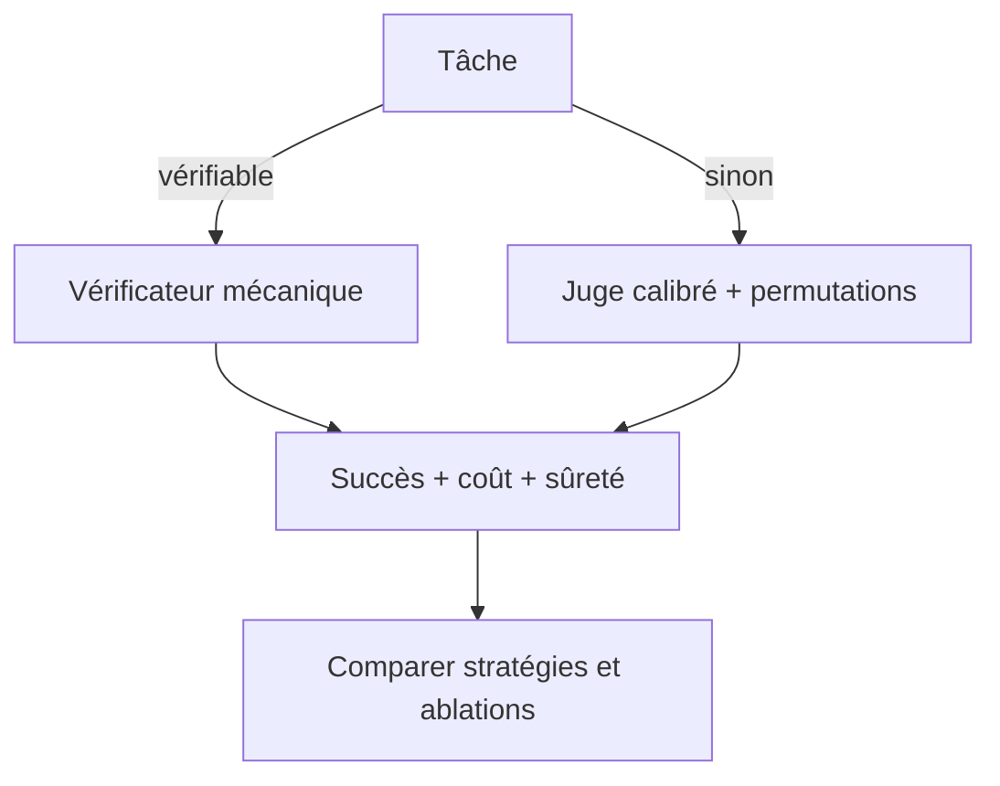

</div>

<p v-click="4" class="notebook-reference">Référence : <a href="https://github.com/jsboige/CoursIA/blob/main/MyIA.AI.Notebooks/GenAI/Texte/13b_Agent_Evaluation.ipynb">13b_Agent_Evaluation.ipynb</a>.</p>

---

# Voix interactive et vidéo générative

<v-clicks at="1">

- **Voix interactive :** les API temps réel permettent une conversation bidirectionnelle avec interruption -- utile pour les assistants oraux.
- **Statut :** l'API Realtime *Beta* a été retirée le 12 mai 2026 ; la version stable (GA) est la cible de migration.
- **Vidéo générative :** LTX-2, Hunyuan, Wan, Veo -- séquence vidéo conditionnée par texte ou image. LTX-2 génère conjointement audio et vidéo. Le notebook montre un workflow ComfyUI quantifié en GGUF Q4.
- **Synchronisation :** modalités conjointes ne signifie pas étape unique : `ti2vid_two_stages`, documenté mais non exécuté ici, utilise deux étapes. Vérifier la synchronisation et évaluer la quantification selon le matériel.

</v-clicks>

<p v-click="5" class="notebook-reference">Références : <a href="https://github.com/jsboige/CoursIA/blob/main/MyIA.AI.Notebooks/GenAI/Audio/03-Orchestration/03-3-Realtime-Voice-API.ipynb">03-3-Realtime-Voice-API.ipynb</a>, <a href="https://github.com/jsboige/CoursIA/blob/main/MyIA.AI.Notebooks/GenAI/Video/02-Advanced/02-5-Video-Audio-Conjoint.ipynb">02-5-Video-Audio-Conjoint.ipynb</a> · dépréciations : <a href="https://platform.openai.com/docs/deprecations">OpenAI Deprecations</a> (retraits du 12 mai 2026).</p>

---
class: nb-concept nb-center nb-k114
---

# Whisper : que perd-on en filtrant ?

<p class="nb-lead">Whisper produit des segments horodatés. Un score aide à repérer les passages douteux ; il ne remplace pas une transcription de référence.</p>

<div class="nb-grid nb-cols-2">

<div class="nb-card"><p class="nb-step">Première piste</p><p class="nb-what">Seuil bas : conserver davantage de segments.</p></div>

<div class="nb-card"><p class="nb-step">À comparer</p><p class="nb-what">Seuil haut : risquer de supprimer une parole faible.</p></div>

</div>

<p class="nb-foot"><strong>À observer.</strong> Écouter un extrait et noter les mots attendus. Après filtrage, combien de mots faux ont disparu ? Combien de mots justes ont aussi été supprimés ?</p>

<p class="notebook-reference">Notebook : <a href="https://github.com/jsboige/CoursIA/blob/main/MyIA.AI.Notebooks/GenAI/Audio/01-Foundation/01-4-Whisper-Local.ipynb" target="_blank" rel="noopener">01-4-Whisper-Local.ipynb</a>.</p>

---
class: nb-map nb-k104
---

# Voix : synthétiser, cloner, diffuser en flux

<p class="nb-lead">La synthèse vocale va de l’appel d’API à la voix clonée à partir d’un court enregistrement. À chaque étape : qualité perçue, latence, et consentement de la personne dont on imite la voix.</p>

<div class="nb-grid nb-cols-3">

<div class="nb-card"><p class="nb-step">Par API</p><p class="nb-what">Du texte à la voix avec un service distant.</p><p class="nb-links"><a href="https://github.com/jsboige/CoursIA/blob/main/MyIA.AI.Notebooks/GenAI/Audio/01-Foundation/01-1-OpenAI-TTS-Intro.ipynb" target="_blank" rel="noopener">01-1-OpenAI-TTS-Intro</a></p></div>

<div class="nb-card"><p class="nb-step">Le signal audio</p><p class="nb-what">Les opérations de base sur un son.</p><p class="nb-links"><a href="https://github.com/jsboige/CoursIA/blob/main/MyIA.AI.Notebooks/GenAI/Audio/01-Foundation/01-3-Basic-Audio-Operations.ipynb" target="_blank" rel="noopener">01-3-Basic-Audio-Operations</a></p></div>

<div class="nb-card"><p class="nb-step">En local, léger</p><p class="nb-what">Kokoro : un petit modèle de synthèse sur sa machine, puis en flux avec pipecat.</p><p class="nb-links"><a href="https://github.com/jsboige/CoursIA/blob/main/MyIA.AI.Notebooks/GenAI/Audio/01-Foundation/01-5-TTS-Local-ONNX.ipynb" target="_blank" rel="noopener">01-5-TTS-Local-ONNX</a> · <a href="https://github.com/jsboige/CoursIA/blob/main/MyIA.AI.Notebooks/GenAI/Audio/03-Orchestration/03-4-TTS-Streaming-Local-Pipecat.ipynb" target="_blank" rel="noopener">03-4-TTS-Streaming-Local-Pipecat</a></p></div>

<div class="nb-card"><p class="nb-step">Cloner une voix</p><p class="nb-what">XTTS v2 : imiter une voix sans réentraînement (zero-shot).</p><p class="nb-links"><a href="https://github.com/jsboige/CoursIA/blob/main/MyIA.AI.Notebooks/GenAI/Audio/02-Advanced/02-2-XTTS-Voice-Cloning.ipynb" target="_blank" rel="noopener">02-2-XTTS-Voice-Cloning</a></p></div>

<div class="nb-card"><p class="nb-step">Voix expressive</p><p class="nb-what">Des modèles expressifs récents ; une passerelle unique devant plusieurs moteurs.</p><p class="nb-links"><a href="https://github.com/jsboige/CoursIA/blob/main/MyIA.AI.Notebooks/GenAI/Audio/02-Advanced/02-8-Expressive-TTS.ipynb" target="_blank" rel="noopener">02-8-Expressive-TTS</a> · <a href="https://github.com/jsboige/CoursIA/blob/main/MyIA.AI.Notebooks/GenAI/Audio/02-Advanced/02-5-Multi-Model-TTS-Gateway.ipynb" target="_blank" rel="noopener">02-5-Multi-Model-TTS-Gateway</a></p></div>

<div class="nb-card"><p class="nb-step">Comparer des voix</p><p class="nb-what">Banc d’essai de modèles vocaux ; attribuer une voix à chaque personnage.</p><p class="nb-links"><a href="https://github.com/jsboige/CoursIA/blob/main/MyIA.AI.Notebooks/GenAI/Audio/04-Applications/04-Voix/04-7-TTS-Voice-Benchmark.ipynb" target="_blank" rel="noopener">04-7-TTS-Voice-Benchmark</a> · <a href="https://github.com/jsboige/CoursIA/blob/main/MyIA.AI.Notebooks/GenAI/Audio/04-Applications/04-Voix/04-9-Voice-Casting.ipynb" target="_blank" rel="noopener">04-9-Voice-Casting</a></p></div>

</div>

<p class="nb-foot"><strong>À observer.</strong> Écoutez sans regarder le nom du modèle : votre classement tient-il ?</p>

---

# Multimodalité : texte, image, vision

<v-clicks at="1">

- **Texte :** ChatGPT, Claude, Gemini, modèles locaux (Llama, Mistral, Qwen).
- **Image :** GPT Image, Stable Diffusion, Flux : génération et édition selon le modèle et le pipeline. ControlNet et LoRA concernent notamment les écosystèmes SD/Flux. Les modèles API DALL-E 2/3 ont été retirés le 12 mai 2026. Le masque GPT Image guide l'édition sans garantir un contour exact.
- **Vision :** GPT-6, Qwen-VL, InternVL -- compréhension d'images et raisonnement visuel. La vision (analyser une image) reste distincte de la génération d'images (GPT Image).

</v-clicks>

<p v-click="4" class="notebook-reference">Références : <a href="https://github.com/jsboige/CoursIA/blob/main/MyIA.AI.Notebooks/GenAI/Image/02-Advanced/02-4-Z-Image-Lumina2.ipynb">02-4-Z-Image-Lumina2.ipynb</a>, <a href="https://github.com/jsboige/CoursIA/blob/main/MyIA.AI.Notebooks/GenAI/Video/01-Foundation/01-3-Comprehension-Video-Locale.ipynb">01-3-Comprehension-Video-Locale.ipynb</a> · <a href="https://developers.openai.com/api/docs/guides/image-generation">Guide GPT Image</a>.</p>

---
class: nb-concept nb-center nb-k114
---

# Animer une image sans perdre le sujet

<p class="nb-lead">Stable Video Diffusion part d’une image. Le paramètre motion_bucket_id influence le mouvement attendu mais ne prescrit pas une trajectoire exacte.</p>

<div class="nb-grid nb-cols-2">

<div class="nb-card"><p class="nb-step">Première piste</p><p class="nb-what">Essai A : demander peu de mouvement.</p></div>

<div class="nb-card"><p class="nb-step">À comparer</p><p class="nb-what">Essai B : même image et même graine, mouvement accru.</p></div>

</div>

<p class="nb-foot"><strong>À observer.</strong> Suivre un point distinctif du sujet au début, au milieu et à la fin. Le déplacement observé est-il un mouvement cohérent ou une déformation du sujet ?</p>

<p class="notebook-reference">Notebook : <a href="https://github.com/jsboige/CoursIA/blob/main/MyIA.AI.Notebooks/GenAI/Video/02-Advanced/02-4-Image-to-Video-Diffusion.ipynb" target="_blank" rel="noopener">02-4-SVD-Image-to-Video.ipynb</a>.</p>

---
class: nb-map nb-k104
---

# Vidéo : comprendre, améliorer, générer

<p class="nb-lead">Une vidéo est une suite d’images qui doivent rester cohérentes entre elles. C’est ce qui rend la génération coûteuse et la compréhension difficile.</p>

<div class="nb-grid nb-cols-3">

<div class="nb-card"><p class="nb-step">Manipuler</p><p class="nb-what">Les opérations de base sur une vidéo ; un diaporama animé en bonus.</p><p class="nb-links"><a href="https://github.com/jsboige/CoursIA/blob/main/MyIA.AI.Notebooks/GenAI/Video/01-Foundation/01-1-Video-Operations-Basics.ipynb" target="_blank" rel="noopener">01-1-Video-Operations-Basics</a> · <a href="https://github.com/jsboige/CoursIA/blob/main/MyIA.AI.Notebooks/GenAI/Video/01-Foundation/01-1b-Video-Slideshow-Bonus.ipynb" target="_blank" rel="noopener">01-1b-Video-Slideshow-Bonus</a></p></div>

<div class="nb-card"><p class="nb-step">Comprendre une vidéo</p><p class="nb-what">Faire décrire et interroger une vidéo par un modèle multimodal.</p><p class="nb-links"><a href="https://github.com/jsboige/CoursIA/blob/main/MyIA.AI.Notebooks/GenAI/Video/01-Foundation/01-2-Comprehension-Video-API.ipynb" target="_blank" rel="noopener">01-2-Comprehension-Video-API</a></p></div>

<div class="nb-card"><p class="nb-step">Améliorer</p><p class="nb-what">Augmenter la résolution (Real-ESRGAN) et interpoler des images.</p><p class="nb-links"><a href="https://github.com/jsboige/CoursIA/blob/main/MyIA.AI.Notebooks/GenAI/Video/01-Foundation/01-4-Video-Enhancement.ipynb" target="_blank" rel="noopener">01-4-Video-Enhancement</a></p></div>

<div class="nb-card"><p class="nb-step">Du texte à la vidéo</p><p class="nb-what">AnimateDiff pour commencer, puis les modèles récents.</p><p class="nb-links"><a href="https://github.com/jsboige/CoursIA/blob/main/MyIA.AI.Notebooks/GenAI/Video/01-Foundation/01-5-Generation-Text-to-Video-Intro.ipynb" target="_blank" rel="noopener">AnimateDiff</a> · <a href="https://github.com/jsboige/CoursIA/blob/main/MyIA.AI.Notebooks/GenAI/Video/02-Advanced/02-1-Generation-Video-Locale.ipynb" target="_blank" rel="noopener">HunyuanVideo</a> · <a href="https://github.com/jsboige/CoursIA/blob/main/MyIA.AI.Notebooks/GenAI/Video/02-Advanced/02-2-Generation-Video-Legere.ipynb" target="_blank" rel="noopener">LTX-Video</a> · <a href="https://github.com/jsboige/CoursIA/blob/main/MyIA.AI.Notebooks/GenAI/Video/02-Advanced/02-3-Wan-Video-Generation.ipynb" target="_blank" rel="noopener">Wan</a> · <a href="https://github.com/jsboige/CoursIA/blob/main/MyIA.AI.Notebooks/GenAI/Video/02-Advanced/02-7-Text-to-Video-Poids-Ouverts.ipynb" target="_blank" rel="noopener">CogVideoX</a></p></div>

<div class="nb-card"><p class="nb-step">Architecture et licence</p><p class="nb-what">MiniMax H3 : ce que le modèle sait faire, et ce que sa licence permet.</p><p class="nb-links"><a href="https://github.com/jsboige/CoursIA/blob/main/MyIA.AI.Notebooks/GenAI/Video/02-Advanced/02-6-Video-Architecture-Licensing.ipynb" target="_blank" rel="noopener">02-6-Video-Architecture-Licensing</a></p></div>

<div class="nb-card"><p class="nb-step">Modèle du monde</p><p class="nb-what">PAN 2 : simuler la suite d’une scène pour raisonner dessus.</p><p class="nb-links"><a href="https://github.com/jsboige/CoursIA/blob/main/MyIA.AI.Notebooks/GenAI/Video/02-Advanced/02-8-PAN2-Modele-du-Monde-GLP.ipynb" target="_blank" rel="noopener">02-8-PAN2-Modele-du-Monde-GLP</a></p></div>

</div>

<p class="nb-foot"><strong>À observer.</strong> Sur dix secondes générées, à quel instant la cohérence du sujet se perd-elle ?</p>

---
class: nb-map nb-k110
---

# Vidéo : orchestrer et produire

<p class="nb-lead">Entre un clip de démonstration et une vidéo livrable, il y a une chaîne : comparer les modèles, enchaîner les étapes, choisir entre local et service distant.</p>

<div class="nb-grid nb-cols-3">

<div class="nb-card"><p class="nb-step">Comparer</p><p class="nb-what">Mêmes consignes, plusieurs modèles de génération.</p><p class="nb-links"><a href="https://github.com/jsboige/CoursIA/blob/main/MyIA.AI.Notebooks/GenAI/Video/03-Orchestration/03-1-Multi-Model-Video-Comparison.ipynb" target="_blank" rel="noopener">03-1-Multi-Model-Video-Comparison</a></p></div>

<div class="nb-card"><p class="nb-step">Orchestrer</p><p class="nb-what">Chaîner les étapes ; piloter des workflows ComfyUI par API.</p><p class="nb-links"><a href="https://github.com/jsboige/CoursIA/blob/main/MyIA.AI.Notebooks/GenAI/Video/03-Orchestration/03-2-Video-Workflow-Orchestration.ipynb" target="_blank" rel="noopener">03-2-Video-Workflow-Orchestration</a> · <a href="https://github.com/jsboige/CoursIA/blob/main/MyIA.AI.Notebooks/GenAI/Video/03-Orchestration/03-3-ComfyUI-Video-Workflows.ipynb" target="_blank" rel="noopener">03-3-ComfyUI-Video-Workflows</a></p></div>

<div class="nb-card"><p class="nb-step">Vidéos pédagogiques</p><p class="nb-what">Produire une vidéo de cours.</p><p class="nb-links"><a href="https://github.com/jsboige/CoursIA/blob/main/MyIA.AI.Notebooks/GenAI/Video/04-Applications/04-1-Educational-Video-Generation.ipynb" target="_blank" rel="noopener">04-1-Educational-Video-Generation</a></p></div>

<div class="nb-card"><p class="nb-step">Workflows créatifs</p><p class="nb-what">Enchaîner génération et montage.</p><p class="nb-links"><a href="https://github.com/jsboige/CoursIA/blob/main/MyIA.AI.Notebooks/GenAI/Video/04-Applications/04-2-Creative-Video-Workflows.ipynb" target="_blank" rel="noopener">04-2-Creative-Video-Workflows</a></p></div>

<div class="nb-card"><p class="nb-step">Services distants</p><p class="nb-what">Générer par un service en ligne : Sora, MiniMax.</p><p class="nb-links"><a href="https://github.com/jsboige/CoursIA/blob/main/MyIA.AI.Notebooks/GenAI/Video/04-Applications/04-3-Sora-API-Cloud-Video.ipynb" target="_blank" rel="noopener">Sora</a> · <a href="https://github.com/jsboige/CoursIA/blob/main/MyIA.AI.Notebooks/GenAI/Video/04-Applications/04-5-Video-Cloud-API.ipynb" target="_blank" rel="noopener">MiniMax H3</a> · <a href="https://github.com/jsboige/CoursIA/blob/main/MyIA.AI.Notebooks/GenAI/Video/04-Applications/04-5b-Video-Cloud-API-v1.ipynb" target="_blank" rel="noopener">MiniMax v1</a></p></div>

<div class="nb-card"><p class="nb-step">Chaîne de production</p><p class="nb-what">Du script à la vidéo finale.</p><p class="nb-links"><a href="https://github.com/jsboige/CoursIA/blob/main/MyIA.AI.Notebooks/GenAI/Video/04-Applications/04-4-Production-Video-Pipeline.ipynb" target="_blank" rel="noopener">04-4-Production-Video-Pipeline</a></p></div>

</div>

<p class="nb-foot"><strong>Question de projet.</strong> Votre démo tient-elle si le service distant est indisponible le jour de la soutenance ?</p>

---

# Multimodalité : audio, musique, code, maths

<v-clicks at="1">

- **Audio :** STT (Whisper, Moonshine), TTS (ElevenLabs, Kokoro, Chatterbox), musique (Audiocraft, AudioLDM, AceStep).
- **Code :** VS Code Copilot, Cline, Continue. Côté CLI : Claude Code, Gemini CLI.
- **Mathématiques :** modèles spécialisés (OpenAI, Google) ou ouverts (DeepSeek-Math). La vérification automatique reste le garde-fou.

</v-clicks>

<p v-click="4" class="notebook-reference">Références : <a href="https://github.com/jsboige/CoursIA/blob/main/MyIA.AI.Notebooks/GenAI/Audio/01-Foundation/01-2-OpenAI-Whisper-STT.ipynb">01-2-OpenAI-Whisper-STT.ipynb</a>, <a href="https://github.com/jsboige/CoursIA/blob/main/MyIA.AI.Notebooks/GenAI/Audio/02-Advanced/02-1-Chatterbox-TTS.ipynb">02-1-Chatterbox-TTS.ipynb</a>, <a href="https://github.com/jsboige/CoursIA/blob/main/MyIA.AI.Notebooks/GenAI/Audio/04-Applications/v4/p5_tts.py">p5_tts.py</a>.</p>

---
class: nb-map nb-k92
---

# Musique et sons : générer

<p class="nb-lead">Générer de l’audio non parlé pose un autre problème que la voix : structure longue, rythme, timbre. Les carnets vont du bruitage à la chanson complète.</p>

<div class="nb-grid nb-cols-3">

<div class="nb-card"><p class="nb-step">Musique depuis un texte</p><p class="nb-what">MusicGen : décrire une ambiance, obtenir de la musique.</p><p class="nb-links"><a href="https://github.com/jsboige/CoursIA/blob/main/MyIA.AI.Notebooks/GenAI/Audio/02-Advanced/02-3-MusicGen-Generation.ipynb" target="_blank" rel="noopener">02-3-MusicGen-Generation</a></p></div>

<div class="nb-card"><p class="nb-step">Chansons avec paroles</p><p class="nb-what">YuE2 et Ace-Step : des chansons complètes.</p><p class="nb-links"><a href="https://github.com/jsboige/CoursIA/blob/main/MyIA.AI.Notebooks/GenAI/Audio/02-Advanced/02-7-YuE2-Song-Generation.ipynb" target="_blank" rel="noopener">02-7-YuE2-Song-Generation</a> · <a href="https://github.com/jsboige/CoursIA/blob/main/MyIA.AI.Notebooks/GenAI/Audio/02-Advanced/02-9-AceStep-Music-Generation.ipynb" target="_blank" rel="noopener">02-9-AceStep-Music-Generation</a></p></div>

<div class="nb-card"><p class="nb-step">Bruitages</p><p class="nb-what">AudioLDM2 et AudioGen : un effet sonore à partir d’une phrase.</p><p class="nb-links"><a href="https://github.com/jsboige/CoursIA/blob/main/MyIA.AI.Notebooks/GenAI/Audio/02-Advanced/02-10-Effets-Sonores-AudioLDM2.ipynb" target="_blank" rel="noopener">02-10-Effets-Sonores-AudioLDM2</a> · <a href="https://github.com/jsboige/CoursIA/blob/main/MyIA.AI.Notebooks/GenAI/Audio/02-Advanced/02-11-Text-to-Audio-Bruitages.ipynb" target="_blank" rel="noopener">02-11-Text-to-Audio-Bruitages</a></p></div>

<div class="nb-card"><p class="nb-step">Des notes plutôt que du son</p><p class="nb-what">Générer du MIDI : une partition éditable au lieu d’un fichier audio.</p><p class="nb-links"><a href="https://github.com/jsboige/CoursIA/blob/main/MyIA.AI.Notebooks/GenAI/Audio/02-Advanced/02-6-MIDI-Generation.ipynb" target="_blank" rel="noopener">02-6-MIDI-Generation</a></p></div>

<div class="nb-card"><p class="nb-step">Voix chantée</p><p class="nb-what">RVC v2 : convertir une voix chantée.</p><p class="nb-links"><a href="https://github.com/jsboige/CoursIA/blob/main/MyIA.AI.Notebooks/GenAI/Audio/02-Advanced/02-12-SVS-Singing-Voice-RVC.ipynb" target="_blank" rel="noopener">02-12-SVS-Singing-Voice-RVC</a></p></div>

<div class="nb-card"><p class="nb-step">Composer avec un LLM</p><p class="nb-what">Workflow de composition, live coding musical piloté par un modèle, rendu d’accords.</p><p class="nb-links"><a href="https://github.com/jsboige/CoursIA/blob/main/MyIA.AI.Notebooks/GenAI/Audio/04-Applications/04-3-Music-Composition-Workflow.ipynb" target="_blank" rel="noopener">04-3-Music-Composition-Workflow</a> · <a href="https://github.com/jsboige/CoursIA/blob/main/MyIA.AI.Notebooks/GenAI/Audio/04-Applications/04-5-LiveCoding-LLM-Music.ipynb" target="_blank" rel="noopener">04-5-LiveCoding-LLM-Music</a> · <a href="https://github.com/jsboige/CoursIA/blob/main/MyIA.AI.Notebooks/GenAI/Audio/04-Applications/04-14-VoiceLeading-Rendu-GenAI.ipynb" target="_blank" rel="noopener">04-14-VoiceLeading-Rendu-GenAI</a></p></div>

</div>

<p class="nb-foot"><strong>À observer.</strong> Un MIDI généré se corrige note par note ; un fichier audio, non. Que choisir pour un projet ?</p>

---
class: nb-map nb-k102
---

# Musique et sons : analyser et séparer

<p class="nb-lead">Avant de générer, savoir écouter par programme : séparer les instruments, retrouver les notes, mesurer une qualité.</p>

<div class="nb-grid nb-cols-2">

<div class="nb-card"><p class="nb-step">Séparer les sources</p><p class="nb-what">Demucs : isoler les pistes d’un morceau, puis mesurer la qualité sur un corpus de référence.</p><p class="nb-links"><a href="https://github.com/jsboige/CoursIA/blob/main/MyIA.AI.Notebooks/GenAI/Audio/02-Advanced/02-4-Demucs-Source-Separation.ipynb" target="_blank" rel="noopener">02-4-Demucs-Source-Separation</a> · <a href="https://github.com/jsboige/CoursIA/blob/main/MyIA.AI.Notebooks/GenAI/Audio/04-Applications/04-Musique/04-20-Separation-Avancee-Qualite.ipynb" target="_blank" rel="noopener">04-20-Separation-Avancee-Qualite</a></p></div>

<div class="nb-card"><p class="nb-step">Analyse classique</p><p class="nb-what">Battue, tempo, tonalité, accords : l’analyse musicale par les méthodes classiques.</p><p class="nb-links"><a href="https://github.com/jsboige/CoursIA/blob/main/MyIA.AI.Notebooks/GenAI/Audio/04-Applications/04-Musique/04-17-MIR-Classique.ipynb" target="_blank" rel="noopener">04-17-MIR-Classique</a></p></div>

<div class="nb-card"><p class="nb-step">Comprendre par embeddings</p><p class="nb-what">MERT2 : des représentations musicales lues par des sondes linéaires.</p><p class="nb-links"><a href="https://github.com/jsboige/CoursIA/blob/main/MyIA.AI.Notebooks/GenAI/Audio/04-Applications/04-Musique/04-15-MERT2-Music-Understanding.ipynb" target="_blank" rel="noopener">04-15-MERT2-Music-Understanding</a></p></div>

<div class="nb-card"><p class="nb-step">De l’audio à la partition</p><p class="nb-what">Transcrire note à note (basic-pitch), ou jusqu’à la partition (SheetSage2).</p><p class="nb-links"><a href="https://github.com/jsboige/CoursIA/blob/main/MyIA.AI.Notebooks/GenAI/Audio/04-Applications/04-Musique/04-18-Basic-Pitch-Transcription.ipynb" target="_blank" rel="noopener">04-18-Basic-Pitch-Transcription</a> · <a href="https://github.com/jsboige/CoursIA/blob/main/MyIA.AI.Notebooks/GenAI/Audio/04-Applications/04-Musique/04-16-SheetSage2-Audio-To-Score.ipynb" target="_blank" rel="noopener">04-16-SheetSage2-Audio-To-Score</a></p></div>

</div>

<p class="nb-foot"><strong>À observer.</strong> Sur un morceau que vous connaissez, quelle erreur fait la transcription : hauteur, durée ou instrument ?</p>

---
class: nb-map nb-k98
---

# Chaînes audio et livre audio agentique

<p class="nb-lead">Une application audio enchaîne plusieurs modèles. Le livre audio agentique sert de projet fil rouge : lire un texte, décider comment le dire, le synthétiser, l’assembler.</p>

<div class="nb-grid nb-cols-3">

<div class="nb-card"><p class="nb-step">Comparer et orchestrer</p><p class="nb-what">Plusieurs modèles sur la même entrée, puis une chaîne complète.</p><p class="nb-links"><a href="https://github.com/jsboige/CoursIA/blob/main/MyIA.AI.Notebooks/GenAI/Audio/03-Orchestration/03-1-Multi-Model-Audio-Comparison.ipynb" target="_blank" rel="noopener">03-1-Multi-Model-Audio-Comparison</a> · <a href="https://github.com/jsboige/CoursIA/blob/main/MyIA.AI.Notebooks/GenAI/Audio/03-Orchestration/03-2-Audio-Pipeline-Orchestration.ipynb" target="_blank" rel="noopener">03-2-Audio-Pipeline-Orchestration</a></p></div>

<div class="nb-card"><p class="nb-step">Transcrire et sous-titrer</p><p class="nb-what">De l’enregistrement aux sous-titres.</p><p class="nb-links"><a href="https://github.com/jsboige/CoursIA/blob/main/MyIA.AI.Notebooks/GenAI/Audio/04-Applications/04-2-Transcription-Pipeline.ipynb" target="_blank" rel="noopener">04-2-Transcription-Pipeline</a></p></div>

<div class="nb-card"><p class="nb-step">Cours audio, synchronisation</p><p class="nb-what">Produire un contenu audio pédagogique ; caler un son sur une vidéo.</p><p class="nb-links"><a href="https://github.com/jsboige/CoursIA/blob/main/MyIA.AI.Notebooks/GenAI/Audio/04-Applications/04-1-Educational-Audio-Content.ipynb" target="_blank" rel="noopener">04-1-Educational-Audio-Content</a> · <a href="https://github.com/jsboige/CoursIA/blob/main/MyIA.AI.Notebooks/GenAI/Audio/04-Applications/04-4-Audio-Video-Sync.ipynb" target="_blank" rel="noopener">04-4-Audio-Video-Sync</a></p></div>

<div class="nb-card"><p class="nb-step">Lire avant de dire</p><p class="nb-what">Lecture analytique du texte, puis annotation de la prosodie pour guider la synthèse.</p><p class="nb-links"><a href="https://github.com/jsboige/CoursIA/blob/main/MyIA.AI.Notebooks/GenAI/Audio/04-Applications/04-Audiobook/04-6-Audiobook-Pipeline.ipynb" target="_blank" rel="noopener">04-6-Audiobook-Pipeline</a> · <a href="https://github.com/jsboige/CoursIA/blob/main/MyIA.AI.Notebooks/GenAI/Audio/04-Applications/04-Audiobook/04-8-Lecture-Analytique.ipynb" target="_blank" rel="noopener">04-8-Lecture-Analytique</a> · <a href="https://github.com/jsboige/CoursIA/blob/main/MyIA.AI.Notebooks/GenAI/Audio/04-Applications/04-Audiobook/04-10-Annotation-Prosodique.ipynb" target="_blank" rel="noopener">04-10-Annotation-Prosodique</a></p></div>

<div class="nb-card"><p class="nb-step">Produire le livre</p><p class="nb-what">Génération des voix, compilation des pistes, variante avec un modèle expressif.</p><p class="nb-links"><a href="https://github.com/jsboige/CoursIA/blob/main/MyIA.AI.Notebooks/GenAI/Audio/04-Applications/04-Audiobook/04-11-Generation-TTS.ipynb" target="_blank" rel="noopener">04-11-Generation-TTS</a> · <a href="https://github.com/jsboige/CoursIA/blob/main/MyIA.AI.Notebooks/GenAI/Audio/04-Applications/04-Audiobook/04-12-Compilation-Audio.ipynb" target="_blank" rel="noopener">04-12-Compilation-Audio</a> · <a href="https://github.com/jsboige/CoursIA/blob/main/MyIA.AI.Notebooks/GenAI/Audio/04-Applications/04-Audiobook/04-13-Audiobook-FishAudio-S2Pro.ipynb" target="_blank" rel="noopener">04-13-Audiobook-FishAudio-S2Pro</a></p></div>

</div>

<p class="nb-foot"><strong>Question de projet.</strong> Quelle étape de la chaîne un humain doit-il encore réécouter ?</p>

---
class: nb-map nb-k110
---

# Diffusion audio : depuis zéro, puis côté industrie

<p class="nb-lead">Même démarche que pour l’image : construire un petit modèle pour comprendre, puis utiliser un modèle pré-entraîné et comparer honnêtement.</p>

<div class="nb-grid nb-cols-2">

<div class="nb-card"><p class="nb-step">Diffusion latente audio</p><p class="nb-what">Débruiter une représentation compressée du son, depuis zéro.</p><p class="nb-links"><a href="https://github.com/jsboige/CoursIA/blob/main/MyIA.AI.Notebooks/GenAI/Audio/05-Diffusion-from-scratch/05-1-AudioDiffusion-Latent-From-Scratch.ipynb" target="_blank" rel="noopener">05-1-AudioDiffusion-Latent-From-Scratch</a></p></div>

<div class="nb-card"><p class="nb-step">Vocodeur</p><p class="nb-what">Un mini HiFi-GAN : revenir de la représentation au signal qu’on entend.</p><p class="nb-links"><a href="https://github.com/jsboige/CoursIA/blob/main/MyIA.AI.Notebooks/GenAI/Audio/05-Diffusion-from-scratch/05-2-Vocoder-From-Scratch.ipynb" target="_blank" rel="noopener">05-2-Vocoder-From-Scratch</a></p></div>

<div class="nb-card"><p class="nb-step">Le geste industriel</p><p class="nb-what">AudioLDM et un vocodeur pré-entraîné, en quelques lignes.</p><p class="nb-links"><a href="https://github.com/jsboige/CoursIA/blob/main/MyIA.AI.Notebooks/GenAI/Audio/06-Diffusion-SOTA/06-1-AudioLDM-SOTA-Comparison.ipynb" target="_blank" rel="noopener">06-1-AudioLDM-SOTA-Comparison</a> · <a href="https://github.com/jsboige/CoursIA/blob/main/MyIA.AI.Notebooks/GenAI/Audio/06-Diffusion-SOTA/06-2-HiFiGAN-SOTA-Comparison.ipynb" target="_blank" rel="noopener">06-2-HiFiGAN-SOTA-Comparison</a></p></div>

<div class="nb-card"><p class="nb-step">Comparer les deux</p><p class="nb-what">Fait main contre état de l’art : ce que l’un apprend, ce que l’autre produit.</p><p class="nb-links"><a href="https://github.com/jsboige/CoursIA/blob/main/MyIA.AI.Notebooks/GenAI/Audio/06-Diffusion-SOTA/06-3-AudioDiffusion-Comparison-A-vs-B.ipynb" target="_blank" rel="noopener">06-3-AudioDiffusion-Comparison-A-vs-B</a></p></div>

</div>

<p class="nb-foot"><strong>À observer.</strong> Qu’avez-vous compris en le construisant que l’appel en trois lignes ne montre pas ?</p>

---

# Multimodalité : 3D et représentations

<v-clicks at="1">

- **Représentations 3D :** meshes, NeRFs, voxels, nuages de points.
- **Génération 3D :** DreamFusion (texte → NeRF), Trellis (image → mesh).
- **Limites :** les géométries générées sont souvent incomplètes, les textures manquent de cohérence au changement de vue -- la recherche avance vite, mais la production reste délicate.

</v-clicks>

---
class: nb-concept nb-center nb-k114
---

# NeRF : comment calculer un seul pixel ?

<p class="nb-lead">Dans la scène jouet « Saturne », la caméra envoie un rayon à travers le pixel. À différentes profondeurs, le champ fournit une densité et une couleur.</p>

<div class="nb-grid nb-cols-2">

<div class="nb-card"><p class="nb-step">Première piste</p><p class="nb-what">Dans le vide : la lumière traverse.</p></div>

<div class="nb-card"><p class="nb-step">À comparer</p><p class="nb-what">Devant une zone opaque : l’arrière-plan contribue peu.</p></div>

</div>

<p class="nb-foot"><strong>À observer.</strong> Prédire la couleur si le rayon rencontre l’anneau avant la planète. Suivre l’accumulation des contributions dans le rendu volumique, puis examiner une vue absente de l’apprentissage.</p>

<p class="notebook-reference">Notebook : <a href="https://github.com/jsboige/CoursIA/blob/main/MyIA.AI.Notebooks/GenAI/3D/3D-01-NeRF-Depuis-Zero-Python.ipynb" target="_blank" rel="noopener">3D-01-NeRF-Depuis-Zero-Python.ipynb</a>.</p>

---
class: nb-concept nb-center nb-k114
---

# Gaussian splatting : inverser le sens du rendu

<p class="nb-lead">La même scène peut être décrite par des gaussiennes orientées, colorées et partiellement opaques. Une gaussienne projetée couvre plusieurs pixels.</p>

<div class="nb-grid nb-cols-2">

<div class="nb-card"><p class="nb-step">Première piste</p><p class="nb-what">NeRF : partir du pixel et interroger la scène.</p></div>

<div class="nb-card"><p class="nb-step">À comparer</p><p class="nb-what">Splats : partir de la scène et projeter sur les pixels.</p></div>

</div>

<p class="nb-foot"><strong>À observer.</strong> Sur Saturne, projeter les ellipses, les trier en profondeur et mélanger leurs couleurs. Que devient la silhouette si on agrandit une gaussienne sans déplacer son centre ?</p>

<p class="notebook-reference">Notebook : <a href="https://github.com/jsboige/CoursIA/blob/main/MyIA.AI.Notebooks/GenAI/3D/3D-03-Gaussian-Splats-Concepts.ipynb" target="_blank" rel="noopener">3D-03-Gaussian-Splats-Concepts.ipynb</a>.</p>

---
class: nb-map nb-k96
---

# 3D : mesurer les limites, brancher le vrai moteur

<p class="nb-lead">Après NeRF et les gaussiennes, la série mesure ce que chaque représentation coûte, puis sort du rendu pour générer des formes.</p>

<div class="nb-grid nb-cols-3">

<div class="nb-card"><p class="nb-step">Cinq limites de NeRF</p><p class="nb-what">Entraînement long, hautes fréquences, dépendance aux poses, échelle unique, rendu coûteux : chacune mesurée.</p><p class="nb-links"><a href="https://github.com/jsboige/CoursIA/blob/main/MyIA.AI.Notebooks/GenAI/3D/3D-02-NeRF-Critique-Python.ipynb" target="_blank" rel="noopener">3D-02-NeRF-Critique-Python</a></p></div>

<div class="nb-card"><p class="nb-step">Le vrai moteur</p><p class="nb-what">Le même nuage de gaussiennes dans gsplat : ce que le moteur achète.</p><p class="nb-links"><a href="https://github.com/jsboige/CoursIA/blob/main/MyIA.AI.Notebooks/GenAI/3D/3D-04-3DGS-From-Scratch-with-gsplat.ipynb" target="_blank" rel="noopener">3D-04-3DGS-From-Scratch-with-gsplat</a></p></div>

<div class="nb-card"><p class="nb-step">Régler l’optimisation</p><p class="nb-what">Densification, remise à zéro de l’opacité, taux d’apprentissage : un levier à la fois.</p><p class="nb-links"><a href="https://github.com/jsboige/CoursIA/blob/main/MyIA.AI.Notebooks/GenAI/3D/3D-05-3DGS-Optimization-Tradeoffs.ipynb" target="_blank" rel="noopener">3D-05-3DGS-Optimization-Tradeoffs</a></p></div>

<div class="nb-card"><p class="nb-step">Générer des formes</p><p class="nb-what">Flow matching discret sur des voxels : générer ensemble les niveaux d’une hiérarchie.</p><p class="nb-links"><a href="https://github.com/jsboige/CoursIA/blob/main/MyIA.AI.Notebooks/GenAI/3D/3D-07-Flow-Matching-Voxel-Joint-Python.ipynb" target="_blank" rel="noopener">3D-07-Flow-Matching-Voxel-Joint-Python</a></p></div>

<div class="nb-card"><p class="nb-step">Écrire ou apprendre la scène</p><p class="nb-what">Rendu analytique exact contre champ de radiance appris : quand la scène se laisse écrire.</p><p class="nb-links"><a href="https://github.com/jsboige/CoursIA/blob/main/MyIA.AI.Notebooks/GenAI/3D/3D-08-Rendu-Analytique-vs-Radiance-Field-Python.ipynb" target="_blank" rel="noopener">3D-08-Rendu-Analytique-vs-Radiance-Field-Python</a></p></div>

</div>

<p class="nb-foot"><strong>À observer.</strong> Pour une même scène, quelle représentation gagne sur quel critère : temps d’entraînement, temps de rendu, qualité ?</p>

---

# Révolution et adoption

<v-clicks at="1">

- **Tournant :** l'article *"Attention is All You Need"* (2017) pose les bases des Transformers. Les modèles fondationnels (GPT, BERT, T5) popularisent ensuite l'apprentissage par pré-entraînement massif.
- **Adoption :** Les interfaces conversationnelles ont élargi l'accès aux modèles génératifs. L'usage s'étend au marketing, à la rédaction, à l'assistance client.
- **Limites concrètes :** coût d'entraînement, biais des modèles, complexité des prompts, intervention humaine indispensable.
- **Multidisciplinarité :** ML + NLP + vision par ordinateur, combinant embeddings et mécanismes d'attention.

</v-clicks>

<!-- Référence PPTX : slide 04 (revolution). -->

---

# Coûts d'entraînement et d'inférence

<v-clicks at="1">

- **Coût d'entraînement :** pré-entraîner un grand modèle nécessite des GPU clusters et plusieurs semaines de calcul. Le coût est concentré et ponctuel.
- **Coût d'inférence :** chaque requête paye le préfill et le décodage. Le coût est diffus, récurrent, et c'est lui qui détermine le modèle économique d'un produit.
- **Optimisations :** quantization (AWQ, GGUF, EXL2/3), distillation, PagedAttention (vLLM), speculative decoding.
- **Datacenters :** impact environnemental lié à la consommation électrique et au refroidissement -- un levier réel d'optimisation.

</v-clicks>

<!-- Référence PPTX : slide 05 (donnees / couts). -->

---
layout: image-overlay
class: genai-illustrated genai-ethics
---

# Enjeux éthiques et sociétaux

<v-clicks at="1">

- **Biais et discrimination :** stéréotypes véhiculés par les données, difficiles à corriger complètement.
- **Hallucinations :** réponses incorrectes mais plausibles. La confiance exagérée des utilisateurs aggrave l'impact.
- **Impact environnemental :** coût énergétique de l'entraînement et de l'inférence -- optimiser les modèles et les data centers est un levier réel.
- **Activité :** concevoir un petit dataset, y introduire un biais connu, mesurer si le modèle le reproduit.

</v-clicks>

<div v-click="1" class="genai-visual ethics-figure">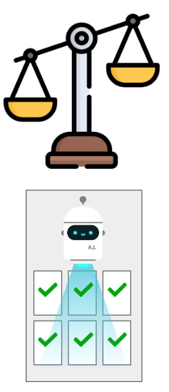</div>

---

# Régulation et droit

<v-clicks at="1">

- **Propriété intellectuelle :** les contenus générés posent des questions de droit d'auteur et de licence -- le statut varie selon les juridictions.
- **Protection des données :** base légale, minimisation, droits des personnes, conservation et transferts. Un hébergement européen ne suffit pas à assurer la conformité au RGPD.
- **AI Act européen :** obligations graduées selon les risques et le rôle de l'organisation. Vérifier le calendrier officiel et les dispositions applicables au système déployé.
- **Décrets nationaux :** États-Unis et autres juridictions adoptent leurs propres cadres (executive orders, décrets).

</v-clicks>

---

# Risques et limites

<v-clicks at="1">

- **Fiabilité :** hallucinations, fabrications, dérapages factuels. Solution : vérification croisée, revue humaine pour les actions à impact.
- **Sécurité :** risques de mauvaise utilisation, perte de contrôle. Les niveaux de sécurité (ASL chez Anthropic) et le Constitutional AI sont des réponses incomplètes.
- **Sociétal :** perte d'emplois, homogénéisation créative, deepfakes. La régulation et l'éducation restent les meilleurs contre-pouvoirs.
- **Activité :** définir une mini-constitution (5 règles) et la tester sur un prompt qui tente de la contourner.

</v-clicks>

---

# Responsabilité sociale

<v-clicks at="1">

- **Rôle des entreprises :** transparence sur les modèles déployés, codes éthiques, audits indépendants.
- **Rôle des utilisateurs :** formation aux limites, esprit critique face aux sorties, signalement des abus.
- **IA pour le bien commun :** écologie (suivi de la déforestation), santé publique, éducation accessible -- usages à fort impact social.
- **Activité :** proposer trois cas d'usage à impact positif dans son domaine, avec et sans accompagnement technique.

</v-clicks>

---

# Défis pratiques de l'adoption

<v-clicks at="1">

- **Compatibilité :** intégration aux CRM, ERP, bases vectorielles existantes -- un projet à part entière.
- **Confidentialité :** maîtrise des flux de données, masquage des PII avant envoi, audit des logs.
- **Coûts :** API au token, GPUs pour le self-hosted. Les modèles distillés et la quantification améliorent le rapport coût / qualité.
- **ROI :** mesurer le temps gagné, la qualité, la correction humaine et les coûts d'intégration sur un cas réel. Comparer à une baseline sans IA ; le retour sur investissement dépend du contexte.
- **Optimisations :** modèles spécialisés plus petits, déploiement local pour la confidentialité, prompts structurés pour réduire les allers-retours.

</v-clicks>

---
layout: section
---

# Questions?

---
layout: cover
---

# Merci

<p v-click="1">Jean-Sylvain Boige</p>

<p v-click="2">jsboige@myia.org</p>

<p v-click="3"><strong>Notebooks associés :</strong> MyIA.AI.Notebooks/GenAI/</p>

<p v-click="4">Tutoriels DALL-E, Stable Diffusion, ComfyUI, Qwen Image Edit, LLMs</p>
